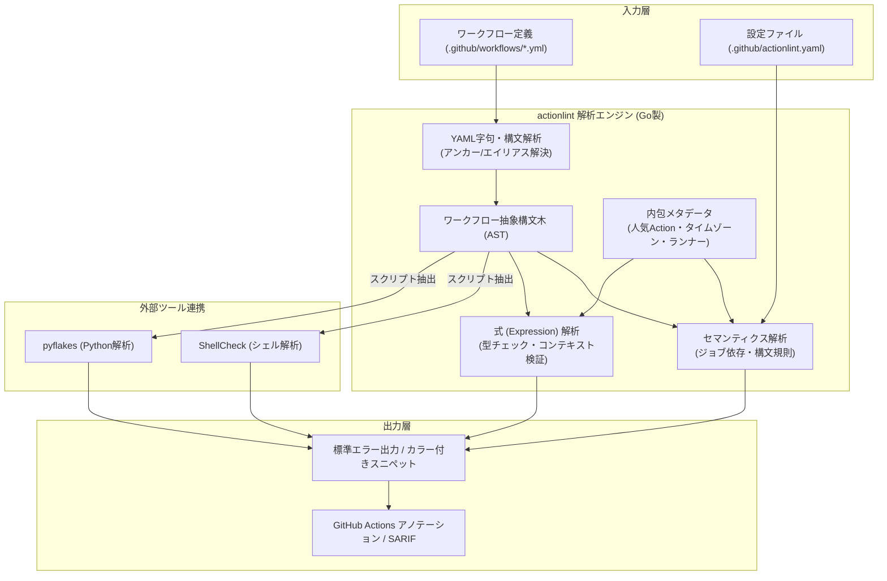

# **actionlint 調査レポート**

## **1. 基本情報**

* **ツール名**: actionlint
* **ツールの読み方**: アクションリント
* **開発元**: rhysd (個人開発OSS)
* **公式サイト**: [https://rhysd.github.io/actionlint/](https://rhysd.github.io/actionlint/)
* **関連リンク**:
  * GitHub: [https://github.com/rhysd/actionlint](https://github.com/rhysd/actionlint)
  * DeepWiki: [https://deepwiki.com/rhysd/actionlint](https://deepwiki.com/rhysd/actionlint)
  * CodeWiki: [https://codewiki.google/github.com/rhysd/actionlint](https://codewiki.google/github.com/rhysd/actionlint)
  * ドキュメント: [https://github.com/rhysd/actionlint/tree/main/docs](https://github.com/rhysd/actionlint/tree/main/docs)
* **カテゴリ**: セキュリティ/静的解析
* **概要**: GitHub Actionsワークフローファイル専用の静的解析（Lint）ツール。Go言語で開発されており、外部ランタイムなしで高速に動作し、YAMLの構文エラーや式の型チェック、セキュリティの懸念を事前に検出する。

## **2. 目的と主な利用シーン**

* **解決する課題**: GitHub Actionsのワークフローにおける、実行してみないと分からないような構文エラー、未定義コンテキストへのアクセス、スクリプトインジェクション等の脆弱性をCIの事前段階で検知し、デバッグ時間や無駄なCIコストを削減する。
* **想定利用者**: GitHub Actionsを利用してCI/CDを構築・保守するすべての開発者やDevSecOpsエンジニア。
* **利用シーン**:
  * ローカルでのワークフロー編集時の構文チェック（エディタ連携）。
  * コミット前の検証（pre-commitフック）。
  * プルリクエスト時の自動レビュー（reviewdogを用いたCIパイプライン上での実行）。
  * WebAssemblyプレイグラウンドによる構文の即時検証。

### **2.1 代表的な利用フロー**

```mermaid
swimlane-beta TB
  subgraph Developer["開発者"]
    A[ワークフローYAMLを編集・コミット]
    E[指摘箇所の修正・再コミット]
  end
  subgraph LocalEnv["ローカル環境 / Gitフック"]
    B[actionlint CLI / pre-commit を起動]
  end
  subgraph LintEngine["actionlint 解析エンジン"]
    C[YAML構文・式型チェック・外部Linter検証]
  end
  subgraph CIEnv["CI/CD環境 (reviewdog)"]
    D[PRアノテーション・結果レポート生成]
  end
  A --> B
  B --> C
  C --> D
  D --> E
```

* **代表的な流れ**: 開発者がワークフローYAMLをローカルまたはpre-commitで編集・保存すると、actionlintが起動してYAML構文、式の型、外部スクリプト（ShellCheck等）を一括検証します。CI環境ではreviewdogなどと連動してPR上にアノテーションを自動付与し、開発者はプッシュ後のCI失敗を待たずに問題を迅速に修正できます。

## **3. 主要機能**

* **構文チェック**: 予期しないキーや必須キーの欠如、空のマッピングをGitHub Actionsの公式構文に従って検証する。
* **式の強力な型チェック**: `${{ }}` 内の式におけるセマンティクスや型チェック。存在しないプロパティの参照や型不一致、`case()` 関数などの構文を検出する。
* **アクション使用状況の検証**: `with:` や `steps.{id}.outputs` などの入力・出力が、対象のActionの仕様（`action.yml`）に沿っているかを検証。特に100以上の人気アクションのデータを内包している。
* **再利用可能ワークフロー（Reusable workflows）のチェック**: 呼び出し側・呼ばれる側の入力/出力/シークレットの型整合性をチェックする。
* **外部Linter統合**: `run:` ブロックに記述されたシェルスクリプトに対しては `shellcheck`、Pythonスクリプトに対しては `pyflakes` と連携して解析する。
* **セキュリティチェック**: 信頼できない入力（例: `${{ github.event.pull_request.title }}` をそのままスクリプト展開する）によるインジェクションの脆弱性を検出する。
* **スケジュール・コンテナ・ランナー検証**: `on.schedule` のIANAタイムゾーン構文チェック、サービスコンテナの `entrypoint` / `command` チェック、`macos-26-intel` 等の最新ホステッドランナーラベル検証。
* **サプライチェーンセキュリティ**: リリースバイナリに対するArtifact Attestations（SLSA provenance）の提供により、`gh attestation verify` による改ざん検証が可能。

## **4. 動作原理・システム構成**

* **アーキテクチャ**: Go言語による完全自己完結型の静的解析パイプライン。外部ネットワークアクセスを必要とせず、ローカルまたはCI環境のCLIとして高速動作する。また、WebAssembly（Wasm）ビルドによりブラウザ上のプレイグラウンドでも同一の解析ロジックが動作する。
* **主要コンポーネントとデータフロー**:
  * **YAML Lexer & Parser**: `.github/workflows/*.yml` を字句解析し、YAMLノードツリー（AST）を構築。YAMLアンカー（`&anchor`）やエイリアス（`*anchor`）の解決・検証も行う。
  * **Workflow Semantics Analyzer**: GitHub Actionsの公式スキーマに基づき、ジョブ依存関係（`needs:`）、マトリックス定義、ステップ構造、権限設定（`permissions:`）などを検証。
  * **Expression Engine**: `${{ ... }}` 内の式構文木をパースし、コンテキスト（`github`、`env`、`steps`、`secrets`等）の型チェックや組み込み関数（`contains()`, `case()` 等）のシグネチャを検証。
  * **Rule Set & Metadata Registry**: 100以上の人気アクション定義、IANAタイムゾーンDB、Webhookイベント種別、GitHubホステッドランナーラベルなどの内包データと照合。
  * **External Linter Bridge**: `run:` ブロック内のスクリプトを抽出し、ローカルの `shellcheck` や `pyflakes` プロセスへSTDIN経由で並行パイプ渡しして結果を統合。



## **5. 開始手順・セットアップ**

* **前提条件**:
  * ローカル環境で実行する場合は、コマンドラインツール（Go, Homebrew, などのパッケージマネージャ）が必要。
  * アカウントやクレカ登録は不要。
* **インストール/導入**:

  ```bash
  # Homebrew (macOS/Linux) の場合
  brew install actionlint

  # Goの場合
  go install github.com/rhysd/actionlint/cmd/actionlint@latest
  ```

* **初期設定**:
  * 設定ファイルは原則不要だが、必要に応じて `.github/actionlint.yaml` でカスタムランナーのラベルや無視するエラーのルールを定義できる。
* **クイックスタート**:
  * リポジトリのルートで以下のコマンドを実行するだけで、配下の `.github/workflows/` ディレクトリのファイルが検証される。

  ```bash
  actionlint
  ```

## **6. 特徴・強み (Pros)**

* **圧倒的な検証範囲と精度**: GitHub Actionsの公式構文に極めて忠実であり、公式ドキュメントにある細かな仕様（コンテキストの利用可能箇所など）を網羅したチェックが行える。
* **高速な動作と依存関係の少なさ**: Goで実装された単一バイナリであり、Node.jsなどの外部ランタイムに依存せず、ミリ秒単位で非常に高速に動作する。
* **ブラウザ上のプレイグラウンド**: ツールをインストールしなくても、WebAssemblyを利用してブラウザ上で即座にLintを試すことができる。
* **豊富なエディタ・ツール連携**: VS Code, Emacs, Vim/Neovim, pre-commit, reviewdog, super-linterなど、多彩なエコシステムとの統合手段が提供されている。

## **7. 弱み・注意点 (Cons)**

* **ポリシーチェックの範囲**: `actionlint` はあくまで「構文が正しいか・実行可能か・既知の致命的なセキュリティリスクがないか」をチェックするツールであり、CIコストの無駄（例えばキャッシュ設定の欠如など）といった組織ポリシーを強制する機能は持たない（この用途には `ci-doctor` や `sherif` との併用が有効）。
* **セキュリティ監査の深さ**: スクリプトインジェクションの基本パターンは検知するが、高度なサプライチェーンリスク監査（過剰なトークン権限や未固定のアクション参照など）は `zizmor` や `pinact` などの特化ツールが必要。
* **日本語対応**: エラーメッセージや公式ドキュメントは英語。ただし技術用語が中心のため理解は容易。

## **8. 料金プラン**

| プラン名 | 料金 | 主な特徴 |
|---------|------|---------|
| **オープンソース (MIT)** | 無料 | すべての機能が利用可能 |

* **課金体系**: 完全無料
* **無料トライアル**: なし

## **9. 導入実績・事例**

* **導入企業**: 無数のオープンソースプロジェクトや企業で採用されている。GitHubの公式ツールである `super-linter` の内部エンジンとしても採用されている。
* **導入事例**: CIパイプラインにおいて `reviewdog` と組み合わせて、PR上で自動的にコメントとしてLintエラーを報告する構成が広く用いられている。
* **対象業界**: ソフトウェア開発を行っているすべての業界。

## **10. サポート体制**

* **ドキュメント**: GitHubリポジトリ内に詳細なドキュメント（[docs](https://github.com/rhysd/actionlint/tree/main/docs)ディレクトリ）が完備されている。各チェックルールについても実例付きで説明されている。
* **コミュニティ**: GitHub DiscussionsやIssuesで活発にやり取りが行われている。
* **公式サポート**: オープンソースであるため公式のSLAを伴うサポートはないが、メンテナによる迅速なIssue対応が実施されている。

## **11. エコシステムと連携**

### **11.1 API・外部サービス連携**

* **API**: Goのライブラリ（API）として組み込むことが可能であり、独自ツールの一部として `actionlint` の解析エンジンを利用できる。
* **外部サービス連携**: reviewdog、GitHub Actions (Problem Matchersによるアノテーション)、super-linter、pre-commit、trunkなど。

### **11.2 技術スタックとの相性**

| 技術スタック | 相性 | メリット・推奨理由 | 懸念点・注意点 |
|:---|:---:|:---|:---|
| **GitHub Actions** | ◎ | GitHub Actions専用に設計されているため、完全な互換性を持つ | 特になし |
| **Go** | ◎ | 開発言語であり、Goのプロジェクトへの組み込みが容易 | 特になし |
| **エディタ拡張 (VS Code, Vim等)** | ◎ | 各種エディタ向けのプラグインが提供されている | 特になし |
| **ShellCheck / pyflakes** | ◎ | ローカルにインストールされていれば自動統合されてスクリプトを解析 | インストールされていない場合はスクリプト内解析がスキップされる |

## **12. セキュリティとコンプライアンス**

* **認証**: ツール自体の利用に認証は不要。
* **データ管理**: ローカル環境、またはCI上で完結して動作する。プレイグラウンド環境（WebAssembly）でもブラウザ外にデータが送信されることはない。
* **サプライチェーン検証**: GitHub Releasesで配布されるバイナリにはArtifact Attestationsが付与されており、`gh attestation verify` でSLSA Provenanceを検証可能。
* **準拠規格**: OSSのため特定のコンプライアンス認証はない。

## **13. 操作性 (UI/UX) と学習コスト**

* **UI/UX**: コマンドラインツールとして標準的で直感的な出力を持ち、エラーメッセージには該当箇所のスニペットと詳細な理由、参考ドキュメントのURLが表示されるため非常に親切。
* **学習コスト**: 導入や実行はコマンドを叩くだけであり、学習コストはほぼゼロ。エラーメッセージに従ってワークフローを修正する過程で、GitHub Actionsの仕様に対する理解が深まる。

## **14. ベストプラクティス**

* **効果的な活用法 (Modern Practices)**:
  * `reviewdog` を活用して、PR上の該当コード行に直接エラーをコメントさせる。
  * `pre-commit` フックに組み込み、開発者が手元でコミットする前にローカルでエラーを防ぐ。
  * `shellcheck`（シェル用）や `pyflakes`（Python用）をインストールしておき、`run:` ブロック内のスクリプトも同時に検証する。
  * セキュリティ監査ツールの `zizmor` やコミットハッシュ固定ツールの `pinact` と併用してGitHub Actionsのサプライチェーンセキュリティを多層防御する。
* **陥りやすい罠 (Antipatterns)**:
  * カスタムのセルフホステッドランナーのラベルを使用している場合、`.github/actionlint.yaml` に定義を追加しないと「不明なラベル」としてエラーになるため、適切な設定ファイルを用意する。

## **15. ユーザーの声（レビュー分析）**

* **調査対象**: GitHub Discussions, X(Twitter), 開発者ブログ
* **総合評価**: 5.0/5.0 (GitHub Discussions等での高い評価)
* **ポジティブな評価**:
  * 「Linterの統合方法として教科書のような模範例。ソフトウェアエンジニアリングの実践として素晴らしい」（GitHub Discussionsより要約）
  * 実行速度が非常に速く、CIパイプラインの時間を一切圧迫しない。
  * 検出エラーが正確で、公式ドキュメントへのリンクが付いているため学習にも役立つ。
* **ネガティブな評価 / 改善要望**:
  * 企業向けのコスト管理やポリシー強制といった機能は持たない（これはツールのスコープ外であるが、他のツールを補完的に用いる必要がある）。
* **特徴的なユースケース**:
  * コマンドラインで利用するだけでなく、WebAssemblyのプレイグラウンド上で検証を行うことで、手軽に新しいワークフローの実験に活用されている。

## **16. 直近半年のアップデート情報**

* **2026-04-19**: サービスコンテナ（service containers）における `entrypoint` および `command` プロパティの構文サポートを追加。Darwin/macOS環境におけるShellCheck連携時のデッドロック不具合を修正。
* **2026-03-30**: `on.schedule` におけるタイムゾーン（`timezone` プロパティ）のIANAタイムゾーン文字列検証をサポート（タイムゾーンDBを静的内蔵）。`jobs.<job_name>.environment.deployment` プロパティ対応、`macos-26-intel` ランナーラベル対応、Webhookアクティビティ種別テーブル更新、Go 1.26対応。（v1.7.12）
* **2026-02-14**: GitHub Actionsに追加された式関数 `case()` の完全サポート。リリースバイナリに対するArtifact Attestations（SLSA provenance）の提供を開始し `gh attestation verify` による真正性検証に対応。`macos-26-large` / `windows-2025-vs2026` ランナーラベル対応、パスフィルター `./` 誤用検知、マトリックス項目比較の修正。（v1.7.11）
* **2025-12-30**: YAMLアンカー（`&anchor`）とエイリアス（`*anchor`）のサポートを追加。未使用・未定義アンカーの静的チェックに対応。（v1.7.10）
* **2025-11-21**: `deprecationMessage` プロパティを持つ非推奨なActionの利用を警告する機能を追加。カスタムイメージ機能（`snapshot`構文など）のサポートを追加。（v1.7.9）
* **2025-10-11**: `permissions` セクションの `models` 権限のサポートを追加。`job.check_run_id` などの新しいプロパティのサポートを追加。（v1.7.8）

(出典: [actionlint Releases](https://github.com/rhysd/actionlint/releases))

## **17. 類似ツールとの比較**

### **17.1 機能比較表 (星取表)**

| 機能カテゴリ | 機能項目 | 本ツール (actionlint) | zizmor | pinact | act |
|:---:|:---|:---:|:---:|:---:|:---:|
| **基本機能** | 構文チェック・YAML解析 | ◎<br><small>最強クラスの型チェック精度</small> | ◯<br><small>対応だが限定的</small> | △<br><small>固定対象構文のみ解析</small> | ◯<br><small>実行時に構文検証</small> |
| **セキュリティ** | 脆弱性・権限設定の監査 | △<br><small>基本インジェクション検知</small> | ◎<br><small>過剰権限や漏洩リスク特化</small> | ◯<br><small>コミットSHA固定で改ざん防止</small> | ×<br><small>非対応</small> |
| **ローカル実行** | ワークフローのローカルシミュレート | ×<br><small>非対応 (静的解析のみ)</small> | ×<br><small>非対応 (静的解析のみ)</small> | ×<br><small>非対応</small> | ◎<br><small>Docker上で実際に実行</small> |
| **運用性** | 自動修正 (Auto-fix) | ×<br><small>非対応</small> | ◯<br><small>一部ルールで自動修正対応</small> | ◎<br><small>SHAの自動ピン留め・更新</small> | ×<br><small>非対応</small> |
| **実行速度** | 解析速度・フットプリント | ◎<br><small>Go単一バイナリで超高速</small> | ◎<br><small>Rust製で極めて高速</small> | ◎<br><small>Go製で高速に動作</small> | △<br><small>Docker起動に伴うオーバーヘッド</small> |

### **17.2 詳細比較**

| ツール名 | 特徴 | 強み | 弱み | 選択肢となるケース |
|---------|------|------|------|------------------|
| **本ツール (actionlint)** | YAML構文・式型チェックのデファクトスタンダード | 型チェックの精度が高く、シェルスクリプトも統合検証可能。実行がミリ秒単位で極めて高速。 | 企業特有のルールやセキュリティポリシーの包括的な監査機能はない。 | GitHub Actionsワークフローの基本的な文法ミスやバグを防ぎたいすべてのプロジェクト（必須ベースライン）。 |
| **zizmor** | GitHub Actions特化のセキュリティ監査ツール | 過剰権限（permissions）、テンプレートインジェクション、既知脆弱性の検出に優れ、自動修正も提供。 | 構文エラーや式の型チェックなどの網羅性はactionlintに劣る。 | ワークフローのサプライチェーンセキュリティや権限リスクを本格的に監査したい場合。 |
| **pinact** | アクションのコミットハッシュ固定CLI | アクションバージョンをコミットSHAに固定・更新し、改ざんやサプライチェーン攻撃を防止。 | 構文チェックや全体的な静的解析は行わない。 | セキュリティ要件としてアクションのSHA固定を徹底・自動化したい場合。 |
| **act** | ワークフローのローカル実行環境 | Dockerを利用してローカル環境でGitHub Actionsを実行し、動作を事前テスト可能。 | Dockerリソースが必要で、GitHubホステッド環境との完全な互換性はない。 | CIにプッシュすることなく、実際のステップ実行やビルド結果を手元で検証したい場合。 |

## **18. 総評**

* **総合的な評価**:
  * `actionlint` は、GitHub Actionsを利用するすべてのプロジェクトに導入を強く推奨できる完成度の高いツールです。構文解析、強力な型チェック、人気Actionのシグネチャによる検証、外部シェルチェッカー（ShellCheck）の統合など、デバッグやCIリトライの無駄な時間を劇的に削減できます。
* **推奨されるチームやプロジェクト**:
  * GitHub ActionsでCI/CDを構築・運用しているあらゆるチームやオープンソースプロジェクト。
* **選択時のポイント**:
  * 基本的な構文や型エラーをなくすベースツールとして `actionlint` を導入し、過剰権限や脆弱性などのセキュリティ監査には `zizmor`、アクションのSHA固定には `pinact`、ローカルでの動作確認には `act` を組み合わせることで、強固で効率的なGitHub Actions運用環境が実現します。
