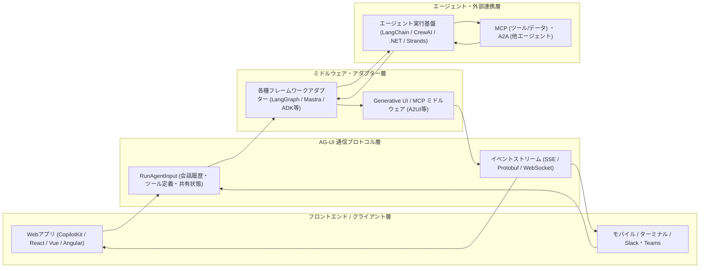

# **AG-UI 調査レポート**

## **1. 基本情報**

* **ツール名**: AG-UI (Agent-User Interaction Protocol)
* **ツールの読み方**: エージーユーアイ
* **開発元**: CopilotKit (Tawkit, Inc.) / AG-UI Community
* **公式サイト**: [https://ag-ui.com](https://ag-ui.com)
* **関連リンク**:
  * GitHub: [https://github.com/ag-ui-protocol/ag-ui](https://github.com/ag-ui-protocol/ag-ui)
  * DeepWiki: [https://deepwiki.com/ag-ui-protocol/ag-ui](https://deepwiki.com/ag-ui-protocol/ag-ui)
  * ドキュメント: [https://docs.ag-ui.com](https://docs.ag-ui.com)
  * デモ (AG-UI Dojo): [https://dojo.ag-ui.com](https://dojo.ag-ui.com)
* **カテゴリ**: エージェントスキル/標準仕様
* **概要**: AG-UI（Agent-User Interaction Protocol）は、バックエンドのAIエージェントとユーザー向けのフロントエンドアプリケーション（Web、モバイル、ターミナル、Slack/Teams等）を接続するための、軽量・オープンソースのイベント駆動型プロトコルである。従来のリクエスト/レスポンスモデルに収まらないトークンストリーミング、ツール呼び出し、双方向の状態同期、Human-in-the-Loop（人間による承認・介入）を単一の型付きイベントストリームとして標準化している。

## **2. 目的と主な利用シーン**

* **解決する課題**:
  * AIエージェントは実行中にテキストの逐次生成、ツール呼び出し、共有状態の更新、承認待ちの一時停止、サブエージェントの起動など非同期かつ多様な振る舞いを行う。
  * 従来はエージェントフレームワーク（LangGraph、CrewAI、Mastra等）とUIフレームワークの組み合わせごとに独自のSSEハンドラやJSONスキーマ、状態同期ロジックを都度実装する（M×N統合の）必要があった。
  * AG-UIは、バックエンドの実装やトランスポートに依存しない共通のイベント仕様を提供することで、エージェントとUI間の接続コスト（Plumbing Tax）を大幅に削減する。
* **想定利用者**: AIエージェント開発者、フロントエンドエンジニア、SaaS/エンタープライズ向けAIプラットフォーム開発チーム
* **利用シーン**:
  * **リアルタイムAIチャット・Copilot組み込み**: 既存のWebアプリや業務システムに、思考過程やツール実行状況をリアルタイム表示するチャットUIを組み込む。
  * **Generative UI（動的UI生成）**: エージェントの実行結果やA2UI/MCP AppsなどのUI仕様ペイロードをフロントエンドへ安全にストリーミングし、動的なコンポーネントを描画する。
  * **Human-in-the-Loop（承認・介入フロー）**: エージェントが重要な外部操作を行う前に実行を中断（`interrupt`）し、UI上でユーザーが内容を確認・修正・承認した後に処理を再開する。
  * **マルチチャネル展開**: 同一のエージェントバックエンドをWebアプリ、モバイルアプリ、ターミナルCLI、Slack/Teamsなどの複数クライアントから共通プロトコルで利用する。

### **2.1 代表的な利用フロー**

```mermaid
swimlane-beta TB
  subgraph User["ユーザー"]
    U1["指示・入力を送信"]
    U2["進捗確認・承認操作"]
  end
  subgraph Frontend["フロントエンド (AG-UIクライアント)"]
    F1["RunAgentInputを構築し送信"]
    F2["イベントを解釈しUI・共有状態を更新"]
    F3["承認結果やクライアントツール結果を返送"]
  end
  subgraph Agent["AG-UIエージェント (バックエンド)"]
    A1["エージェント実行とイベントストリーム生成"]
    A2["承認待ちで中断・再開処理"]
  end
  subgraph External["外部ツール・他エージェント (MCP / A2A)"]
    E1["外部API・データ参照・サブエージェント実行"]
  end
  U1 --> F1
  F1 -->|HTTP + SSE / Protobuf| A1
  A1 -->|MCP / A2A等| E1
  E1 --> A1
  A1 -->|型付きイベントストリーム| F2
  F2 --> U2
  U2 --> F3
  F3 -->|次ターンRunAgentInput| A2
```

* **代表的な流れ**: ユーザーがフロントエンド上で指示を入力すると、AG-UIクライアントがメッセージ・利用可能なフロントエンドツール・共有状態を含む `RunAgentInput` をバックエンドエージェントへ送信する。エージェントは必要に応じてMCPやA2A経由で外部ツール・他エージェントと連携しながら型付きイベントを逐次配信し、フロントエンドがUI描画や状態同期、ユーザーの承認介入（次ターンの入力）をシームレスに仲介する。

## **3. 主要機能**

* **8ファミリー・31種類の標準イベント体系（AG-UI 1.0）**: ライフサイクル（`RUN_STARTED`、`RUN_FINISHED` 等）、テキストメッセージ、ツール呼び出し、状態管理、推論（Reasoning）、アクティビティ進捗、サブエージェント、パススルー（`RAW` / `CUSTOM`）を網羅した型付きイベントを定義。
* **トランスポート非依存設計**: 標準仕様として HTTP + SSE（Server-Sent Events）およびバイナリ形式の HTTP + Protobuf（`@ag-ui/proto`）を定義しており、WebSockets や Webhook 等の任意のリアルタイム通信路にも適用可能。
* **双方向の状態同期（Shared State）**: `STATE_SNAPSHOT` と RFC 6902 準拠の JSON Patch による差分イベント（`STATE_DELTA`）を用い、エージェントとフロントエンド間で型付きの共有状態を効率的に同期。
* **フロントエンドツール呼び出し（Frontend Tool Calling）**: エージェントがバックエンド側だけでなく、フロントエンド側に登録されたUI操作ツールやクライアント側関数を呼び出し、その結果を受け取って推論を継続可能。
* **Human-in-the-Loop（実行中断・再開）**: `RUN_FINISHED` イベントの `outcome` により正常完了・中断（`interrupt`）・キャンセルを明示し、UI側でのユーザー承認や編集を挟んで安全に実行を再開できる。
* **Generative UI との連携**: テキストストリームだけでなく、A2UI、MCP Apps、Open-JSON-UI といった宣言的UI仕様のペイロードを運ぶランタイムプロトコルとして機能し、ミドルウェア（`@ag-ui/a2ui-middleware` 等）を通じて動的UI描画を実現。
* **推論過程・マルチモーダル・サブエージェント対応**: AG-UI 1.0 では暗号化された推論データのラウンドトリップ、ツール結果における画像・音声・動画・ドキュメントのマルチモーダル伝送、ネストされたサブエージェント実行（`SUBAGENT_STARTED` 等）の追跡を標準サポート。
* **JSON Schema ベースの公式SDK自動生成**: `spec/1.0` の凍結された JSON Schema を単一信頼源（Single Source of Truth）とし、TypeScript / Python / .NET の公式SDKが自動生成され、0.x 系との双方向後方互換性も維持。

## **4. 動作原理・システム構成**



* **アーキテクチャ**: オープンなクライアント・サーバー型のイベント駆動アーキテクチャ。フロントエンド（クライアント）とエージェント（サーバー/ランタイム）を疎結合に分離し、単一のHTTPエンドポイント（または双方向ストリーム）上でステートフルな対話ループを構成する。
* **主要コンポーネントとデータフロー**:
  * **入力ペイロード (`RunAgentInput`)**: クライアントは実行開始時に `thread_id`、`run_id`、メッセージ履歴、クライアントが提供するツール一覧、現在の共有状態（`state`）、コンテキスト情報を送信する。
  * **イベントエンコーダ / デコーダ (`EventEncoder` 等)**: バックエンドで発生したフレームワーク固有のイベントをAG-UI標準イベントへ変換し、`Accept` ヘッダー等に応じて SSE（テキストストリーム）または Protobuf（バイナリ）としてエンコード・配信する。
  * **クライアント状態管理 (`HttpAgent` 等)**: 受信したイベントストリームを逐次処理し、メッセージの結合、JSON Patch によるローカル状態の差分適用、ツール呼び出しのディスパッチを行う。
* **特筆すべき要素技術**:
  * **Agentic Protocol Stack における棲み分け**: ツール・データ接続の **MCP**、エージェント間連携の **A2A** と補完関係にあり、AG-UI は「エージェント対ユーザー（UI）」のレイヤーを担当する。
  * **単一JSON Schemaによるコード生成**: TypeScript・Python・.NET間で型の不整合を防ぐため、仕様ディレクトリ（`spec/1.0`）の JSON Schema から各言語のモデル・イベント定義を生成する仕組みを採用。

## **5. 開始手順・セットアップ**

* **前提条件**:
  * TypeScript クライアント/アプリ構築の場合: Node.js 20 以上、npm / pnpm
  * Python エージェントサーバー構築の場合: Python 3.9 以上
  * .NET 環境の場合: .NET SDK
  * アカウント登録・クレジットカード登録は不要（MITライセンスのOSS）。テンプレートアプリでOpenAI等のLLMを呼び出す場合のみ各プロバイダのAPIキーが必要。
* **インストール/導入**:

  ```bash
  # 新規アプリの対話型スキャフォールド（Next.js + CopilotKit 等）
  pnpm dlx create-ag-ui-app@latest
  ```

  ```bash
  # TypeScript クライアントSDKの個別インストール
  pnpm add @ag-ui/client

  # Python サーバー/プロトコルSDKのインストール
  pip install ag-ui-protocol fastapi uvicorn

  # .NET クライアントSDKのインストール
  dotnet add package AGUI.Client
  ```

* **初期設定**:
  * `create-ag-ui-app` で生成したテンプレートでLLMプロバイダを利用する場合は、環境変数にAPIキーを設定する（プロトコル自体の最小テストサーバーではAPIキー不要）。

  ```bash
  export OPENAI_API_KEY="<YOUR_OPENAI_API_KEY>"
  ```

* **クイックスタート**:
  * Python（FastAPI）で `RunAgentInput` を受け取り `EventEncoder` で `RUN_STARTED`、`TEXT_MESSAGE_*`、`RUN_FINISHED` を返す最小サーバー（`uvicorn server:app --port 8000`）を起動し、TypeScript の `HttpAgent`（`http://localhost:8000/`）から `runAgent()` を呼び出すことで、即座にストリーミング応答の動作確認が可能。公式ドキュメントおよび `apps/dojo` に各フレームワーク別の動作サンプルが用意されている。

## **6. 特徴・強み (Pros)**

* **フレームワークロックインの回避**: LangChain/LangGraph、CrewAI、Google ADK、Microsoft Agent Framework、AWS Strands Agents、Mastra、Pydantic AI、LlamaIndex 等20以上の主要フレームワークに対応しており、バックエンドを差し替えてもフロントエンド実装を維持できる。
* **大手クラウド・主要ベンダーの広範な採用**: Google、Microsoft、Amazon（AWS）、Oracle、IBM などが公式統合や対応を発表しており、単なる一企業の独自仕様ではなく業界横断の標準規格として急速に普及している。
* **双方向かつ実戦的な機能セット**: 単純なテキストチャットだけでなく、JSON Patch による状態同期、クライアント側ツール実行、Human-in-the-Loop の中断/再開、サブエージェント追跡など、本番プロダクトに必要な要件を網羅。
* **0.x / 1.0 間の双方向後方互換性**: AG-UI 1.0 クライアントと 0.x エージェント（およびその逆）の双方で互換性シムが機能するため、既存システムの段階的な移行が容易。

## **7. 弱み・注意点 (Cons)**

* **日本語リソースの少なさ**: 公式ドキュメント（`docs.ag-ui.com`）やGitHub、Discordコミュニティは英語が中心であり、日本語の一次情報は限定的（Qiita/Zenn等のコミュニティ記事が中心）。
* **イベント駆動モデルの学習コスト**: 従来の単発REST APIに慣れた開発者にとって、31種のイベントライフサイクルや JSON Patch による状態管理、非同期中断・再開の設計には一定の習得コストがかかる。
* **フロントエンドエコシステムの偏り**: プロトコル自体はUIフレームワーク非依存だが、実践的なUIコンポーネント群は開発元の CopilotKit（React中心、Vue/Angular対応）に依存する側面があり、それ以外の独自UI基盤ではクライアント側のイベントハンドリング実装が必要になる。

## **8. 料金プラン**

| プラン名 | 料金 | 主な特徴 |
|---------|------|---------|
| **オープンソース版 (MIT License)** | 無料 | プロトコル仕様、公式SDK（TS/Python/.NET）、各種アダプター・ミドルウェアを無制限・商用利用可能 |

* **課金体系**: 完全無料のオープンソースソフトウェア（MITライセンス）。プロトコルおよびSDKの利用自体に課金や利用制限は存在しない（連携先のLLM APIやクラウドホスティング費用は別途ユーザー負担）。
* **無料トライアル**: 該当なし（全機能が永続的に無料利用可能）。

## **9. 導入実績・事例**

* **導入企業・採用プラットフォーム**:
  * **Microsoft**: Microsoft Agent Framework（.NET）へ公式パッケージ（`AGUI.Server` / `AGUI.Client`）として組み込み。
  * **Google**: Google ADK（Agent Development Kit）および Google Antigravity 連携、A2UI との併用をサポート。
  * **Amazon (AWS)**: AWS Strands Agents および Amazon Bedrock AgentCore Runtime での AG-UI ランタイム対応を提供。
  * **Oracle / IBM**: Oracle Agent Spec との連携、IBM watsonx Orchestrate インテグレーションを提供。
  * **主要AIフレームワーク**: LangChain（LangGraph）、CrewAI、LlamaIndex、Pydantic AI、Mastra などがパートナーまたはビルトイン統合として採用。
* **導入事例**: 大手クラウドプロバイダやエンタープライズ向けエージェント基盤において、バックエンドの推論エンジンとWeb・チャット（Slack/Teams）・CLI等のマルチチャネルUIを疎結合に繋ぐ標準インターフェースとして活用されている。
* **対象業界**: AI SaaS開発企業、クラウドプラットフォーム、エンタープライズ向け業務自動化・社内Copilot開発チーム

## **10. サポート体制**

* **ドキュメント**: 公式ドキュメント（[https://docs.ag-ui.com](https://docs.ag-ui.com)）に仕様リファレンス（1.0 / Draft）、各言語SDKガイド、アーキテクチャ解説が充実。インタラクティブなデモ環境（[AG-UI Dojo](https://dojo.ag-ui.com)）も公開。
* **コミュニティ**: [Discord](https://discord.gg/Jd3FzfdJa8)、[GitHub Discussions](https://github.com/ag-ui-protocol/ag-ui/discussions)、[GitHub Issues](https://github.com/ag-ui-protocol/ag-ui/issues) にて活発な議論・質問対応が行われている。
* **公式サポート**: OSSとしての無償サポート窓口はないが、開発元である CopilotKit のチームへの本番導入相談窓口（[Talk to the team](https://docs.ag-ui.com/talk-to-us)）や、脆弱性報告窓口（`security@copilotkit.ai`）が用意されている。

## **11. エコシステムと連携**

### **11.1 API・外部サービス連携**

* **API / プロトコル仕様**: HTTP + SSE および HTTP + Protobuf をベースとしたオープンAPI仕様（JSON Schema で定義）。`RunAgentInput` 入力と31種類の型付き出力イベントで構成。
* **外部サービス・フレームワーク連携**:
  * **エージェントフレームワーク**: LangChain / LangGraph, CrewAI, Mastra, Pydantic AI, LlamaIndex, Agno, AG2, Claude Agent SDK, OpenAI Agents, Spring AI, Cloudflare Agents
  * **クラウド・エンタープライズ基盤**: Microsoft Agent Framework, Google ADK, AWS Strands Agents / Amazon Bedrock AgentCore, IBM watsonx Orchestrate, Oracle Agent Spec
  * **補完プロトコル・UI仕様**: MCP (Model Context Protocol), A2A Protocol, A2UI, MCP Apps
  * **クライアントチャネル**: CopilotKit (React, Angular, Vue, React Native), Slack & Microsoft Teams (`channels-sdk`), Terminal CLI

### **11.2 技術スタックとの相性**

| 技術スタック | 相性 | メリット・推奨理由 | 懸念点・注意点 |
|:---|:---:|:---|:---|
| **TypeScript / Next.js (React)** | ◎ | 公式 `@ag-ui/client` / `@ag-ui/core` および CopilotKit によるファーストクラスサポート、スターターCLI完備 | 特になし |
| **Python (FastAPI 等)** | ◎ | 公式 `ag-ui-protocol` SDK、Pydanticモデル、LangGraph/CrewAI/ADK 向けアダプターが充実 | 非同期ストリーミング（`StreamingResponse`）の理解が必要 |
| **.NET (C# / ASP.NET)** | ◎ | スキーマ自動生成による公式 `AGUI.Client` / Microsoft Agent Framework 統合あり | エコシステムのサンプル数はTS/Pythonよりやや少なめ |
| **Go / Rust / Java / Kotlin / Swift** | ◯ | リポジトリ内の `sdks/community/` にコミュニティ製SDK（Genkit Go や Spring AI 連携含む）が存在 | 公式コアSDK（TS/Python/.NET）に比べ仕様追従にタイムラグが生じる場合がある |

## **12. セキュリティとコンプライアンス**

* **認証**: プロトコル仕様自体は認証方式を強制せず、標準の HTTP ヘッダー（Bearer トークン、OAuth2、APIキー等）や既存Webアプリの認証基盤をそのまま透過的に利用できる設計。アダプター側ではクライアントから渡される `forwardedProps` に対する allowlist 制御（例: `@ag-ui/langgraph` でのクライアント制御値の制限）など境界防御の強化が進められている。
* **データ管理**: プロトコルはステートレスな通信仕様であり、開発元がユーザーデータを収集・保存するSaaSではない。データの保存場所や暗号化（TLS等）は導入企業のインフラ環境に完全に委ねられる。なお、LLMの思考過程を安全に往復させるための暗号化推論イベント（`REASONING_ENCRYPTED_VALUE`）も仕様に含まれる。
* **準拠規格**: OSSプロトコル仕様のため、SOC2 や ISO27001 等の組織認証は該当しない。脆弱性開示ポリシー（`SECURITY.md`）を公開しており、報告受領から48時間以内の一次回答・5営業日以内の調査・30日以内の修正を目標としている。

## **13. 操作性 (UI/UX) と学習コスト**

* **UI/UX**: AG-UI自体は通信プロトコルであるため単体のGUIは持たないが、公式のインタラクティブデモ環境「AG-UI Dojo」で各フレームワークの挙動をブラウザ上で即座に体験できる。また、CopilotKit と組み合わせることで洗練されたチャット・Generative UI を短期間で構築可能。
* **学習コスト**: `create-ag-ui-app` や30行程度のサンプルコードにより初期導入は容易。ただし、イベントファミリーの使い分け、JSON Patch による差分状態同期、Human-in-the-Loop の中断再開ロジックを独自に設計する場合は、中程度の学習コストを要する。

## **14. ベストプラクティス**

* **効果的な活用法 (Modern Practices)**:
  * **プロトコルスタックの役割分担を明確にする**: ツール接続は MCP、エージェント間通信は A2A、ユーザー向けUI接続は AG-UI という3層で設計し、UI描画仕様には A2UI や MCP Apps を組み合わせる。
  * **最小イベントから段階的に拡張する**: 最初は `RUN_STARTED`、`TEXT_MESSAGE_*`、`RUN_FINISHED` の必須ライフサイクルのみを実装し、必要に応じて `STATE_DELTA` や `TOOL_CALL_*`、`REASONING_*` を追加する。
  * **1.0 スキーマ準拠の型生成を活用する**: 手書きのJSONパースを避け、`@ag-ui/core` や `ag-ui-protocol` の型定義・エンコーダを利用する。
* **陥りやすい罠 (Antipatterns)**:
  * **クライアント入力の無検証信頼**: `forwardedProps` やクライアント側からの `state` をそのままバックエンドの機密コンテキストやチェックポイントIDに流し込むと権限昇格や意図しない状態改ざんのリスクがあるため、サーバー側で allowlist 検証を行う。
  * **毎回フルスナップショットを送信する**: 大きな共有状態を毎ターン `STATE_SNAPSHOT` で送り直すと帯域と再描画コストが増大するため、差分更新には `STATE_DELTA`（JSON Patch）を使用する。

## **15. ユーザーの声（レビュー分析）**

* **調査対象**: Reddit (`r/AI_Agents`, `r/machinelearningnews`)、GitHub Stars/Discussions、Qiita・Zenn の技術記事
* **総合評価**: G2 / Capterra 等の SaaS 向けレビューサイトには未掲載（オープンソースプロトコルのため）。GitHub 上では公開から約1年半で **21,000以上のスター** を獲得し、開発者コミュニティから極めて高い支持を得ている。
* **ポジティブな評価**:
  * 「フレームワークごとにSSEハンドラや独自JSONを書き直す『配管作業（Plumbing Tax）』から解放された」（Reddit）
  * 「エージェント実行中にフロントエンド側から状態を直接編集し、同じストリーム上でHuman-in-the-Loopの介入ができる点が実用的」（Reddit / 技術ブログ）
  * 「MCP や A2A と競合せず、不足していた『対ユーザーUI』のピースを綺麗に埋めてくれる」（Qiita / Zenn 解説記事）
* **ネガティブな評価 / 改善要望**:
  * 「バックエンドの統合は豊富だが、ブラウザ側のリッチなUI実装は実質的に CopilotKit への依存度が高くなりやすい」（Reddit）
  * 「プロトコルの概念やイベント種別（1.0で31種）が増えたため、ゼロからフルスクラッチでクライアントを書くのはやや重い」（コミュニティフィードバック）
  * 「公式ドキュメントの日本語訳が未整備で、英語資料を読み解く必要がある」（国内エンジニアブログ）
* **特徴的なユースケース**:
  * 既存の業務Webアプリに LangGraph や Microsoft Agent Framework 製エージェントを後付けし、エージェントの判断をUI上の承認モーダルで人間が確認してから処理を実行するエンタープライズ業務フロー。

## **16. 直近半年のアップデート情報**

* **2026-11-21**: `release/2026-11-21` (`@ag-ui/langgraph@0.0.47`) を公開。`durability` オプションを追加し、クライアント由来の `forwardedProps` に対する allowlist 制限（`streamSubgraphs`, `durability` のみ許可）を導入してセキュリティを強化。
* **2026-11-17**: `release/2026-11-17` (`@ag-ui/client@1.0.5`, `@ag-ui/core@1.0.5`, `@ag-ui/encoder@1.0.5`, `@ag-ui/proto@1.0.5`) を公開。`compactEvents` において重複ストリーム間のメッセージ順序とスナップショット境界を保持するよう修正。
* **2026-11-13**: `release/2026-11-13` (`@ag-ui/langgraph@0.0.46`) を公開。LangGraph ネイティブの `Interrupt.response_schema` 読み取りや `ToolMessage` 出力のアンラップ処理を改善。
* **2026-11-12**: `release/2026-11-12` (`@ag-ui/claude-agent-sdk@0.0.9`, `@ag-ui/a2ui-middleware@0.0.16`) を公開。`ClaudeAgentAdapter` の `clone()` 時のスレッド単位状態共有を修正し、A2UI ミドルウェアのコンテキスト保護を強化。
* **2026-09-17**: `release/2026-09-17` にて **AG-UI 1.0** 仕様を凍結（フリーズ）。JSON Schema を単一信頼源とした TypeScript / Python / .NET SDK の自動生成、サブエージェント・マルチモーダルツール結果・トークン使用量追跡・0.x 系との双方向後方互換性を確立。

(出典: [AG-UI GitHub Releases](https://github.com/ag-ui-protocol/ag-ui/releases))

## **17. 類似ツールとの比較**

### **17.1 機能比較表 (星取表)**

| 機能カテゴリ | 機能項目 | AG-UI | A2UI | MCP Apps | A2A Protocol |
|:---:|:---|:---:|:---:|:---:|:---:|
| **役割** | 対象レイヤー | ◎<br><small>エージェント↔UI通信</small> | ◎<br><small>宣言的UIペイロード</small> | ◯<br><small>MCP拡張のUI表示</small> | ◎<br><small>エージェント↔エージェント</small> |
| **通信特性** | 双方向イベントストリーム | ◎<br><small>31イベント・SSE/Protobuf</small> | △<br><small>データ構造定義が主</small> | ◯<br><small>JSON-RPCベース</small> | ◎<br><small>非同期タスク委譲対応</small> |
| **状態・介入** | 共有状態同期 / HITL | ◎<br><small>JSON Patch・interrupt標準化</small> | △<br><small>UI状態モデル中心</small> | △<br><small>ホスト依存</small> | △<br><small>エージェント間状態</small> |
| **UI生成** | 動的UIレンダリング仕様 | ◯<br><small>A2UI等の運搬役</small> | ◎<br><small>ネイティブUI宣言</small> | ◎<br><small>サンドボックスHTML</small> | ×<br><small>UI非対象</small> |
| **エコシステム** | 主要フレームワーク統合 | ◎<br><small>20以上の統合・公式SDK</small> | ◯<br><small>Google中心に拡大</small> | ◯<br><small>MCP対応ホスト</small> | ◎<br><small>Linux Foundation主導</small> |
| **非機能要件** | 日本語ドキュメント | △<br><small>英語中心</small> | △<br><small>英語中心</small> | △<br><small>英語中心</small> | △<br><small>英語中心</small> |

### **17.2 詳細比較**

| ツール名 | 特徴 | 強み | 弱み | 選択肢となるケース |
|---------|------|------|------|------------------|
| **AG-UI** | エージェントとUIを結ぶイベント駆動型ランタイムプロトコル | 双方向状態同期、HITL、20以上のフレームワーク統合、TS/Python/.NET公式SDK | 具体的なUIコンポーネント自体は別ライブラリ（CopilotKitやA2UI等）が必要 | 任意のAIエージェントバックエンドとWeb/モバイル/チャットUIを標準方式で接続したい場合 |
| **A2UI** | Google主導のオープンな宣言型UIプロトコル | 任意コード実行を防ぐ安全なネイティブUI生成 | ランタイム通信・状態同期プロトコルは別途必要（AG-UIと併用が一般的） | エージェントに安全なネイティブUIコンポーネントを動的に生成させたい場合 |
| **MCP Apps** | Model Context Protocol (MCP) のインタラクティブUI拡張 | MCPサーバーからチャットUIへサンドボックス化されたリッチUIを直接提供可能 | MCPエコシステムに閉じた仕様であり汎用アプリ統合には不向き | ClaudeやVS Code等のMCP対応ホスト内でツール専用UIを提供したい場合 |
| **A2A Protocol** | The Linux Foundation主導のエージェント間通信プロトコル | 異なるフレームワークのエージェント同士でタスク委任・連携が可能 | エンドユーザー向けUIのストリーミングや状態同期は対象外 | 複数の専門AIエージェントをバックエンドで協調動作させたい場合 |

## **18. 総評**

* **総合的な評価**:
  * AG-UI は、これまで各フレームワークやアプリごとに個別実装されていた「AIエージェントとユーザーインターフェース間の通信」を標準化する、極めて重要度の高いオープンプロトコルである。2026年9月の1.0仕様確定によりスキーマの安定性と多言語SDKの信頼性が高まり、Google・Microsoft・AWS・Oracle・LangChain・CrewAI といった主要プレイヤーの採用も進んでいる。MCP（対ツール）および A2A（対エージェント）と並ぶ「Agentic Protocol Stack」の3本柱の一角として、事実上の標準（デファクトスタンダード）になりつつある。
* **推奨されるチームやプロジェクト**:
  * LangGraph、CrewAI、Google ADK、Microsoft Agent Framework などの複数または特定のエージェント基盤を用い、自社のWebアプリ（React/Next.js等）や業務システムへリッチなAI体験・Human-in-the-Loop を組み込みたい開発チーム。
  * 将来的にバックエンドのエージェントフレームワークを切り替える可能性があり、フロントエンドとの結合度を下げておきたいプラットフォーム開発チーム。
* **選択時のポイント**:
  * UIの見た目（宣言的UI）を標準化したい場合は A2UI や MCP Apps を選択または併用し、それらを運ぶ「通信路・ライフサイクル・状態同期」の基盤として AG-UI を採用するのが現代的なベストプラクティスとなる。React/Next.js 環境であれば CopilotKit と組み合わせることで最も迅速に導入できる。
