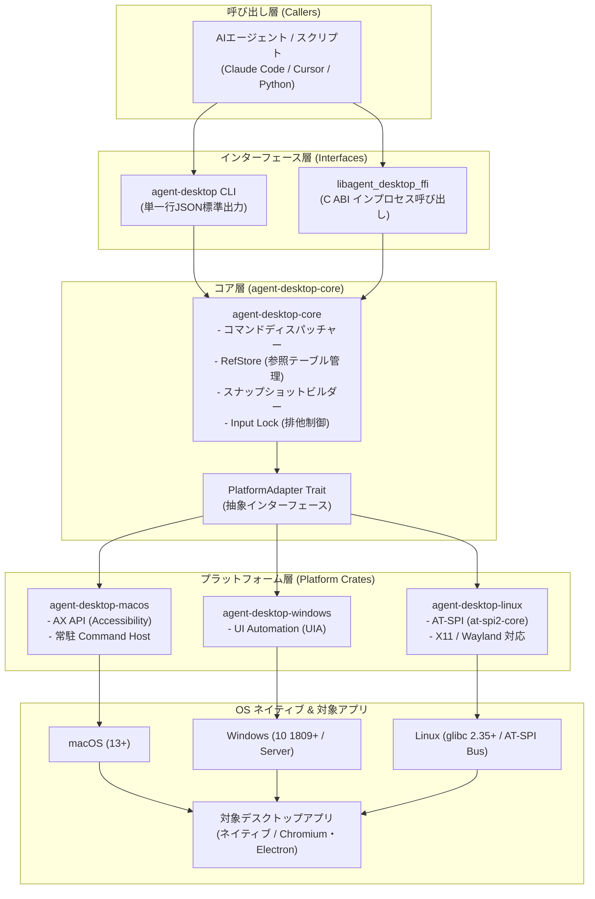

# **agent-desktop 調査レポート**

## **1. 基本情報**

* **ツール名**: agent-desktop
* **ツールの読み方**: エージェント デスクトップ
* **開発元**: Vercel Labs (Vercel Inc.)
* **公式サイト**: [https://agent-browser.dev/desktop](https://agent-browser.dev/desktop)
* **関連リンク**:
  * GitHub: [https://github.com/vercel-labs/agent-desktop](https://github.com/vercel-labs/agent-desktop)
  * ドキュメント: [https://agent-browser.dev/desktop](https://agent-browser.dev/desktop)
* **カテゴリ**: デスクトップ/GUIエージェント
* **概要**: agent-desktop は、Vercel Labs が開発・公開する、AIエージェント向けのオープンソースデスクトップ自動化ツール（CLI および C言語ライブラリ）です。従来の Computer Use エージェントのように画面スクリーンショットのピクセル情報から推測・座標クリックする手法とは異なり、OSネイティブのアクセシビリティツリー（macOS AX API、Windows UI Automation、Linux AT-SPI）からUI構造を構造化JSONとして抽出します。スナップショットごとに発行される確定的な要素参照（Ref）を通じて、ヘッドレスかつ高速にクリックやテキスト入力、状態監視を実行できます。

## **2. 目的と主な利用シーン**

* **解決する課題**:
  * **スクリーンショット推測に伴う脆弱性と高コスト**: 画像認識（Vision LLM）を用いた座標クリックは、画面解像度やスケーリング、微小なUI変化でクリック位置がズレやすく、画像送信に伴うトークン消費量と推論遅延が膨大になる課題
  * **UI操作結果の不透明性**: 操作コマンドを発行しても実際にUIが意図通り反応したか確認が難しく、不要なリトライによる副作用（重複送信・データ破壊）が発生しやすい課題
  * **言語や環境の分断**: デスクトップ操作ツールが特定OS専用であったり、Pythonラッパー経由で起動オーバーヘッドが重く、自律エージェントの推論ループに組み込みにくい課題
* **想定利用者**:
  * 自律型デスクトップ操作エージェント（Computer Use）の開発者
  * Claude Code、Cursor、Codex 等のコーディングエージェントにローカルデスクトップ操作能力を付与したいエンジニア
  * クロスプラットフォームなデスクトップアプリ（Electron、Qt、GTK、Win32/WPF、Cocoa）のE2Eテスト・QA自動化エンジニア
* **利用シーン**:
  * **ネイティブアプリの自律操作ループ**: 電卓、ファイルマネージャー、オフィスソフト等のUI構造を取得し、ボタン操作や値入力を確実に行う
  * **Electron・Chromium製ハイブリッドアプリの統合制御**: ウィンドウ枠やネイティブメニューは agent-desktop で操作し、内部のWeb描画領域は CDP（Chrome DevTools Protocol）経由で姉妹ツール agent-browser と連携して操作
  * **CI/CDパイプラインでのヘッドレスGUIテスト**: 画面フォーカスを奪わずにバックグラウンドでUI要素の状態検証と操作を行い、自動テストを完走させる

### **2.1 代表的な利用フロー**

```mermaid
swimlane-beta TB
  subgraph User["ユーザー / 指示元"]
    A["タスク指示入力 (例: 電卓で計算実行)"]
    G["完了報告・実行結果の受領"]
  end
  subgraph Agent["AIエージェント (推論ループ)"]
    B["snapshot コマンドを発行してUI構造を取得"]
    D["JSONから操作対象の Ref を選定し click / set-value を発行"]
    F["wait または再 snapshot で結果を検証"]
  end
  subgraph AgentDesktop["agent-desktop (CLI / C FFI)"]
    C["OSのアクセシビリティツリーを走査し Ref 付きJSONを出力"]
    E["スナップショット整合性を検証し要素へセマンティック操作を実行"]
  end
  subgraph OSAndApp["OS基盤 & 対象デスクトップアプリ"]
    C1["AX API / UIA / AT-SPI 経由でUIノードを構築"]
    E1["対象コントロールのネイティブアクションを発火しUI状態更新"]
  end
  A --> B
  B --> C
  C --> C1
  C1 --> C
  C --> D
  D --> E
  E --> E1
  E1 --> F
  F --> G
```

* **代表的な流れ**:
  1. ユーザーがタスクをAIエージェントに指示します。
  2. エージェントは `agent-desktop snapshot --app <アプリ名> --skeleton -i --compact` を呼び出します。
  3. `agent-desktop` がOSのアクセシビリティAPIと対話してUI階層を解析し、操作可能要素にスナップショットID付きの参照（例: `@s2txcl95uvubmn:e11`）を割り当てた単一行JSONを出力します。
  4. エージェントはJSONから目的の要素参照（Ref）を特定し、`agent-desktop click <Ref>` などのアクションコマンドを実行します。
  5. `agent-desktop` は参照の有効性を検証した上で、画面を前面に奪わないセマンティックアクション（または `--headed` 時の物理入力）を実行します。
  6. エージェントは `agent-desktop wait` または再スナップショットによって結果の確定を確認し、ユーザーにタスク完了を報告します。

## **3. 主要機能**

* **OSアクセシビリティツリーの構造化スナップショット (snapshot)**:
  対象アプリケーションのウィンドウ構造を探索し、ボタン、テキスト入力欄、ツリーアイテム、コンボボックスなどのUI要素をJSONとして出力。`--compact` による不要フィールドの除外や、`-i`（`--interactive`）による操作可能要素への絞り込みが可能。
* **スケルトン取得とドリルダウン (Skeleton & Drill-down)**:
  ノード数の多い大規模アプリ（IDEやSlack等）において、深さ3までの浅い階層構造を高速に取得（`--skeleton`）。子要素数（`children_count`）を持つ境界ノードに対して `snapshot --root <Ref>` を実行することで、必要な部分木のみをオンデマンドに展開しトークン消費を最小化。
* **確定的な要素参照（Qualified Refs）と無効化検知**:
  すべての要素参照は `@<snapshot_id>:e<N>` の形式でスナップショットIDに厳密にバインド。UIが変化して要素が消滅または位置変更された場合は `STALE_REF` や `AMBIGUOUS_TARGET` を返し、意図しない誤操作を未然に防止。
* **60種類の統合コマンドラインインターフェース**:
  観測系（`snapshot`, `find`, `get`, `is`, `screenshot`, `list-surfaces`）、Ref操作系（`click`, `double-click`, `right-click`, `type`, `set-value`, `clear`, `scroll`, `expand`, `collapse` 等）、ウィンドウ・アプリ管理系（`launch`, `close-app`, `list-apps`, `list-windows`, `minimize`, `maximize`, `open-system-surface`）、通知・クリップボード制御系を同一のコマンド体系で提供。
* **ヘッドレス実行と物理入力モードの切り替え**:
  デフォルトはOSのアクセシビリティアクション（InvokeやSetValue等）を呼び出すヘッドレス実行で、マウスカーソルを動かさず画面フォーカスを奪わない。実入力を再現したい場合は `--headed` フラグにより合成マウス・キーボード入力を実行可能。
* **C言語ABI（libagent_desktop_ffi）によるインプロセス統合**:
  CLIプロセスを起動するオーバーヘッドを削減するため、Rustコアとプラットフォームアダプタを共有した共有ライブラリ（macOS: `.dylib`、Linux: `.so`、Windows: `.dll`）を提供。Python、Node.js、Go、C++などの言語から `ctypes` 等で直接呼び出し可能。
* **マルチサーフェス対応（Surfaces）**:
  メインウィンドウだけでなく、ドロップダウンメニュー、シート（Chromiumモーダル）、アラート、ポップオーバーに加え、タスクバー、システムトレイ、アクションセンター、スタートメニュー（Windows）、Dock、Spotlight（macOS）、GNOME Shellトレイ（Linux）といったOSシェル領域を個別に観測・操作可能。
* **セッション管理とトレース機能**:
  `--session` フラグにより、複数エージェントまたは複数タスク間でスナップショット名前空間を分離。実行したすべての操作と観測履歴をトレースログとして保存・エクスポート可能。

## **4. 動作原理・システム構成**

agent-desktop は、呼び出し元からOSネイティブAPIまでが明確に分離された7層のモジュラー構造を採用しています。共通ロジックを管理する `agent-desktop-core` と、各OSのアクセシビリティAPIに特化したプラットフォームクレート（`agent-desktop-macos`, `agent-desktop-windows`, `agent-desktop-linux`）で構成されます。



### **アーキテクチャの主要コンポーネント**

1. **呼び出し層 (Calling Agent)**:
   LLM推論ループまたは自動化スクリプト。コマンドを実行し、標準出力に返されるJSONエンベロープ（Contract Version 2.5）を1行読み取って判断を行います。
2. **CLI & C FFI層**:
   コマンドライン引数を解析しCoreへ渡すバイナリ、またはインプロセスでCoreを直接叩く共有ライブラリ。各プラットフォーム向けバイナリはコンパイル時に対応するプラットフォームクレートと静的にリンクされます（プラットフォームクレート同士は互いにインポートしません）。
3. **Core層 (`agent-desktop-core`)**:
   OSに依存しない共通ロジックを担当。スナップショットの木構造生成、要素参照テーブル（`RefStore`）、検索処理（`find`）、および複数プロセスからの入力を直列化する `Input Lock` を管理します。
4. **プラットフォームアダプタ層 (`PlatformAdapter`)**:
   Coreが定義する抽象トレイト `PlatformAdapter` を実装：
   * **macOS (`agent-desktop-macos`)**: Apple の Accessibility API（AX API）を使用。CLI実行の高速化とネイティブ要素参照の保持のため、プライベートな Command Host デーモンを自動生成・再利用（15分間アイドルで自動終了）。
   * **Windows (`agent-desktop-windows`)**: Windows UI Automation (UIA) COM インターフェースを使用。
   * **Linux (`agent-desktop-linux`)**: D-Bus 上で稼働する `at-spi2-core`（AT-SPI）と通信。X11 および Wayland（画面キャプチャはポータル経由）をサポート。
5. **JSONエンベロープとエラー契約**:
   すべてのコマンド出力は `{ "version": "2.5", "ok": true/false, "command": "...", "data": {...}, "error": {...} }` の統一形式です。エラー時には16種類の定数エラーコードに加え、再試行の安全性を明示する `disposition.retry`（`safe` または `unsafe`）および復旧戦略 `recovery.strategy` が必ず付与されます。

## **5. 開始手順・セットアップ**

### **5.1 前提条件**
* **Node.js / npm** (npm、pnpm、yarn、bun のいずれか) または **GitHub Releases からの直接バイナリダウンロード**
* **プラットフォーム要件**:
  * **macOS**: macOS 13 (Ventura) 以降 (Intel または Apple Silicon)。ターミナルまたは実行元アプリに対する「アクセシビリティ」権限の付与が必須。
  * **Windows**: Windows 10 1809 以降、または Windows Server 2019 以降 (x64 / ARM64)。対話型デスクトップセッションが必要。
  * **Linux**: Ubuntu 24.04 以降推奨 (glibc 2.35以上、x86_64 / aarch64)。グラフィカルセッションと `at-spi2-core`（AT-SPIバス）の稼働が必須。

### **5.2 インストール**

```bash
# npm によるグローバルインストール
npm install -g agent-desktop

# インストール確認
agent-desktop version
agent-desktop status
```

※ JavaScriptランタイムを介さずに単体バイナリとして実行したい場合は、[GitHub Releases](https://github.com/vercel-labs/agent-desktop/releases) よりターゲットOSのアーカイブ（`agent-desktop-v*-<target>.tar.gz`）を展開してパスを通します。

### **5.3 権限設定**

* **macOS**:
  ```bash
  agent-desktop permissions --guide
  ```
  「システム設定」>「プライバシーとセキュリティ」>「アクセシビリティ」にて、実行するターミナル（Terminal.app、iTerm2、Ghostty等）または親プロセスに権限を付与します。
* **Windows**:
  同一整合性レベル（Integrity Level）のアプリケーションであれば特別な付与は不要です。管理者権限で動くアプリを操作する場合は、ターミナルも管理者として実行します。
* **Linux**:
  GNOME環境等でAT-SPIが有効になっていることを確認します：
  ```bash
  gsettings set org.gnome.desktop.interface toolkit-accessibility true
  ```

### **5.4 クイックスタート実践（電卓の操作例）**

```bash
# 1. アプリケーションの起動
agent-desktop launch gnome-calculator  # macOSの場合は "Calculator"、Windowsは "calc"

# 2. スケルトンスナップショットの取得（対話可能要素に絞り込み、コンパクト形式）
agent-desktop snapshot --app gnome-calculator --skeleton -i --compact

# 3. 特定コンテナ領域のドリルダウン（例: ボタン配列領域）
agent-desktop snapshot --root @s2txcl95uvubmn:e1 -i --compact

# 4. 「7」のボタン（Ref: @s2txcl95uvubmn:e11）をクリック
agent-desktop click @s2txcl95uvubmn:e11

# 5. 表示部の値が「7」になったか待機・検証
agent-desktop wait --element @s2txcl95uvubmn:e6 --predicate value --value 7
```

## **6. 特徴・強み (Pros)**

* **ピクセル推測不要による圧倒的な信頼性とトークン削減**:
  スクリーンショットをLLMに渡して座標を推定する手法に比べ、OSのアクセシビリティツリーをテキストJSONとして取得するため、認識ミスや座標ズレが原理的に発生しません。入力トークン数も画像に比べて1/10〜1/50程度に圧縮されます。
* **ヘッドレス実行によるフォアグラウンド非占有**:
  デフォルトのアクションはOSのアクセシビリティプロバイダー経由でセマンティックに呼び出されるため、マウスカーソルが勝手に動いたり、ユーザーが作業中のフォアグラウンドウィンドウを奪ったりすることがありません。
* **確定的なRef管理とフェイルセーフ**:
  スナップショットIDをプレフィックスに持つ修飾Ref（`@<snapshot_id>:e<N>`）を採用しており、画面更新によってUI要素が移動・消滅した場合でも、別の要素を誤ってクリックする事故を完全に防ぎます（即座に `STALE_REF` を返却）。
* **再試行判断が容易なエラー契約 (Error Disposition)**:
  エラー時に `error.disposition.retry` が `safe` か `unsafe` かを明示し、エージェントが「スナップショットを取り直して再試行すべきか」「直ちに中断すべきか」を確実に自律判断できます。
* **インプロセス統合を可能にする C FFI (C ABI)**:
  CLIのプロセス生成オーバーヘッド（数十〜数百ミリ秒）を嫌う組み込み用途向けに、`libagent_desktop_ffi` を提供しており、PythonやNode.js、Rustエージェントの内部ループで直接マイクロ秒単位の関数呼び出しが可能です。
* **AIエージェント向け Skill 組み込み**:
  バイナリ内に `agent-desktop skills get desktop` や `agent-desktop skills get platform` が内包されており、エージェント起動時にシステムプロンプトへ注入することで、ゼロショットで最適な操作手順とルールを理解させることができます。

## **7. 弱み・注意点 (Cons)**

* **アクセシビリティツリー非公開UIの操作不可**:
  Canvas描画、DirectX/OpenGLを用いたゲーム画面、独自レンダリングを行っていてOSアクセシビリティツリー（AX/UIA/AT-SPI）にノードを公開していない独自UIは認識できません。そうしたUIには従来の画像認識型Computer Useツールが必要です。
* **PowerShellにおける記号展開の制約**:
  WindowsのPowerShellでは `@` がスプラッティング演算子（splatting operator）として解釈されるため、参照IDを渡す際は必ずシングルクォートで囲む必要があります（例: `agent-desktop click '@s8f3k2p9:e1'`）。クォートを忘れると引数が消失し `INVALID_ARGS` となります。
* **Chromium / Electron アプリの初回初期化遅延**:
  ChromiumやElectronアプリは起動直後、アクセシビリティツリーがオンデマンドで生成されるため、初回スナップショット取得時にツリーが不完全であったり、数秒〜十数秒の遅延が発生することがあります（`--timeout-ms` の延長やウォームアップが必要）。
* **キー・マウスの押しっぱなし操作の制限**:
  `key-down`, `key-up`, `mouse-down`, `mouse-up` の4コマンドは、プロセス異常終了時にキーが押されたままフリーズする事故を防ぐため、安全なデーモン解放機構が実装されるまで標準では実行拒絶（fail-closed）に設定されています。
* **プライベート情報の露出配慮**:
  スナップショットやクリップボード取得、スクリーンショットにはユーザーの個人情報や機密データが含まれる可能性があるため、ログ出力や外部LLMへの送信時にはマスキング等の配慮が必要です。

## **8. 料金プラン**

agent-desktop は、オープンソースソフトウェア（Apache License 2.0）として完全に無償で提供されています。

| プラン / エディション | 料金 | 商用利用 | ソースコード | サポート |
|:---|:---:|:---:|:---:|:---|
| **オープンソース (OSS)** | **完全無料** | 可能 (Apache-2.0) | 完全公開 ([GitHub](https://github.com/vercel-labs/agent-desktop)) | コミュニティ (GitHub Issues) |

※ 本ツール自体のライセンス費用は不要ですが、ツールを呼び出すAIエージェント側で利用するLLM（Anthropic Claude、OpenAI GPT、Google Gemini等）のAPI利用料金は別途発生します。ただし、画像トークンを消費しないため、画像ベースのComputer Useツールと比較してLLM API利用コストを大幅に抑制可能です。

## **9. 導入実績・事例**

* **Vercel Labs におけるエージェントインフラ**:
  Next.jsおよびAIエコシステムを牽引するVercel Labsの公式ツールとして開発されており、ブラウザ自動化基盤 `agent-browser` と対をなすデスクトップ自動化標準として社内外のエージェントプロジェクトで利用。
* **AIコーディングエージェントへの統合**:
  Claude Code、Cursor、Codex 等の自律コーディングアシスタントにおいて、ローカルアプリの起動・検証やデスクトップ画面を介した動作確認タスクを実行するカスタムツールとして導入が進んでいます。
* **オープンソースコミュニティ**:
  GitHubにおいて5,300以上のStarを獲得しており、クロスプラットフォームなデスクトップ自動化スクリプトやローカルRPAツールのバックエンドエンジンとして採用が拡大しています。

## **10. サポート体制**

* **公式ドキュメント**: [https://agent-browser.dev/desktop](https://agent-browser.dev/desktop) にて、60種類のコマンドリファレンス、OS別ガイド（macOS、Windows、Linux）、C言語FFIリファレンス、トラブルシューティングを網羅。
* **LLM最適化ドキュメント**: ドキュメント全体がマークダウン形式（`Accept: text/markdown`）および [https://agent-browser.dev/desktop/llms.txt](https://agent-browser.dev/desktop/llms.txt) として提供されており、AIエージェントがドキュメントを直接読み込んで自己解決可能。
* **GitHub Issues**: バグ報告や機能要望は GitHub リポジトリ（[vercel-labs/agent-desktop](https://github.com/vercel-labs/agent-desktop/issues)）で受け付け。
* **セキュリティ窓口**: 脆弱性報告は公開Issueではなく、GitHubのPrivate Vulnerability Reportingを通じて受け付ける体制が整備されています。

## **11. エコシステムと連携**

* **agent-browser とのシームレスな棲み分けと連携**:
  WebブラウザやWebページの操作には `agent-browser` を使用し、デスクトップネイティブアプリには `agent-desktop` を使用します。ElectronやChromiumアプリを `agent-desktop launch --cdp` で起動した場合、DevToolsポートが開かれ、アプリ内部のWebコンテンツは `agent-browser`、外側のネイティブウィンドウやメニューは `agent-desktop` でシームレスに分担操作できます。
* **Agent Skills 標準準拠**:
  `npx skills add https://github.com/vercel-labs/agent-desktop --skill agent-desktop` を通じて、エージェント環境に即座にスキル仕様を追加可能。
* **C言語ABI（FFI）エコシステム**:
  `libagent_desktop_ffi` は純粋な C ABI を提供しているため、Python（`ctypes` / `cffi`）、Node.js（`node-addon-api` / Bun FFI）、Rust、Go（`cgo`）、C#（P/Invoke）からオーバーヘッドなしに呼び出し可能です。
* **OSシェルエコシステム**:
  Windows Action Center、macOS Spotlight / Dock、GNOME Shell 通知トレイなどのOSシェル要素に対応しており、OSレベルのシステム通知の監視やアクション実行が可能です。

## **12. セキュリティとコンプライアンス**

* **最小権限とヘッドレス安全設計**:
  キーボードやマウスの物理イベントをむやみに合成せず、OSのアクセシビリティAPIが提供するセマンティックアクション（パターン呼び出し）を優先するため、誤動作による画面外クリックや意図しないウィンドウへの入力暴走リスクを低減。
* **危険なショートカットの実行制限**:
  Windowsにおける `ctrl+alt+delete` は合成不可に設定されており、`alt+f4`、`win+l`、`win+d`、`ctrl+shift+esc` などのシステム重要キーは `--force` フラグを明示しない限り実行が拒絶されます。
* **整合性レベル（Integrity Level）の尊重**:
  Windowsにおいては、OSのセキュリティ境界（UAC / UIPI）に従い、一般ユーザー権限のプロセスが高特権（管理者権限）プロセスのUIを不正に操作することをOSレベルで防止。
* **クロスプロセス排他ロック (Input Lock)**:
  複数エージェントや複数コマンドが同時に実行された場合、入力操作の競合を防ぐためファイルベースの排他ロックを取得し、操作を安全に直列化します。
* **ローカル完結型アーキテクチャ**:
  クラウドへの画像送信やテレメトリ送信を行わず、すべてのツリー走査・操作がローカルマシン内で完結します。

## **13. 操作性 (UI/UX) と学習コスト**

* **統一されたJSONエンベロープ**:
  全60コマンドが単一行の確定的なJSONを出力するため、`jq` や各プログラミング言語のJSONパーサーで極めてシンプルにパースできます。
* **AIエージェントの自己学習（Skills機構）**:
  エージェント自身が `agent-desktop skills get desktop` を実行することで、自身が守るべき「観測・行動・検証（Observe-Act-Verify）」サイクルやリトライルールを自律的に理解できるため、人間側のプロンプトエンジニアリングコストが大幅に削減されます。
* **学習コスト**:
  CLIコマンドは直感的な英語動詞（`click`, `type`, `snapshot`, `wait` 等）で構成されており、Web自動化（Playwright等）の経験者であれば15分程度で基本操作を習得可能です。

## **14. ベストプラクティス**

* **1. 大規模アプリでは必ずスケルトンとドリルダウンを使う**:
  SlackやVS Code等のノード数が多いアプリに対して最初からフルスナップショットを取得すると、ツリー解析に数秒を要しトークンも浪費します。まず `snapshot --skeleton -i --compact` で大枠を把握し、目的の領域を `snapshot --root <Ref>` でドリルダウン展開するのが鉄則です。
* **2. 確定的なループ（Observe → Act → Verify）の徹底**:
  `click` や `set-value` の実行が成功（`ok: true`）しても、アプリ側の処理完了（画面遷移や値反映）が保証されるわけではありません。必ず `wait --element <Ref> --predicate ...` または再スナップショットによって状態を確認してください。
* **3. `error.disposition.retry` に従った安全なリトライ制御**:
  エラー発生時に盲目的にリトライすると、ボタンの二重押し等の副作用を招きます。`error.disposition.retry == "safe"` の場合のみリトライし、`requires_fresh_snapshot` が指示されている場合は新しいスナップショットを取得して新しいRefを使用してください。
* **4. PowerShell実行時のRefクォート**:
  PowerShellを使用する場合は、`agent-desktop click '@s8f3k2p9:e1'` のように必ずクォートで保護してください。
* **5. バックグラウンド実行時はヘッドレスを維持する**:
  特別な理由がない限り `--headed` を避け、デフォルトのヘッドレスモードで実行することで、ユーザー自身の作業を阻害せずに自動化タスクを進行させることができます。

## **15. ユーザーの声（レビュー分析）**

* **ポジティブな評価**:
  * **「Computer Useの常識を変える速度と安定性」**: 従来のVLMスクリーンショット型エージェントに比べて格段に高速で、ボタンの位置が1ピクセルずれても失敗しないため、実用レベルのエージェントが組める（海外AI開発者コミュニティ）。
  * **「Rust製の軽量さとC ABI提供が素晴らしい」**: Pythonの重い依存関係やNode.jsプロセスの起動オーバーヘッドなしに、共有ライブラリ経由でダイレクトにエージェントループに組み込める点が絶賛されている（GitHubディスカッション）。
  * **「トークンコストの劇的な削減」**: 画面全体を高解像度画像としてAPIに投げる必要がなく、数KBの構造化JSONで済むため、APIコストが激減したとの声が多数。
* **改善要望・ネガティブな評価**:
  * **「独自レンダリングアプリでの限界」**: ゲームエンジン（Unity/Unreal）製ツールや一部のFlutterアプリ、古い社内レガシーシステム等でアクセシビリティツリーが露出していない場合、完全に手も足も出なくなる（画像認識ハイブリッドの要望）。
  * **「Chromium/Electronの初回読み込み時の待機時間」**: Electronアプリの初回起動直後はツリー構築が完了するまでタイムアウトしやすく、適切なウォームアップ戦略が求められる。

## **16. 直近半年のアップデート情報**

agent-desktop は直近半年（2026年5月〜11月）において急速に進化を遂げており、特にクロスプラットフォーム統合とLinux対応、安定性向上が図られています。

* **2026-10-30 (v1.0.2)**: ドキュメントサイト（agent-browser.dev/desktop）の全面公開。AGENTS.md指示書の単一化、npm実行時のNode launcherオーバーヘッド警告機能の追加、アクセシビリティ権限ガイド（permissions）の刷新、vercel-labs組織移管に伴うリポジトリURLの更新。
* **2026-10-27 (v1.0.1)**: スキル定義内のバージョン表記整合性修正。Cargo workspace更新に応じたnpm/GitHubリリースの自動公開パイプライン導入。不要となったカスタムHomebrew tap/Scoop bucketの整理。
* **2026-10-27 (v1.0.0)**: Linux環境（AT-SPI経由、glibc 2.35以上、x86_64/aarch64）の正式サポート追加。macOS・Windows・Linuxの主要3OSを統合したメジャーバージョン1.0.0としてリリース。npmパッケージに各プラットフォームのネイティブバイナリおよびヘルパーを直接同梱。
* **2026-10-18 (v0.10.1)**: Windows環境において `.exe` 拡張子を省略した実行ファイル名での起動（launchコマンド）をサポート。
* **2026-10-18 (v0.10.0)**: C ABIメジャーバージョン5への更新。スナップショット非修飾の裸の参照（`@eN`）を廃止し、スナップショットID付き修飾参照（`@<snapshot_id>:eN`）へ完全移行。プロパティ取得（get）におけるアクセシブル名と値の優先順位仕様改善。存在しない要素に対するエラー応答をTIMEOUTから即時のSTALE_REF / AMBIGUOUS_TARGETへ変更。Windows 10 1809以降およびWindows Server 2019以降の正式サポート。
* **2026-09-23 (v0.9.4)**: Cargo lockの同期およびビルド依存関係の整理。

(出典: [GitHub Releases](https://github.com/vercel-labs/agent-desktop/releases) および [CHANGELOG.md](https://github.com/vercel-labs/agent-desktop/blob/main/CHANGELOG.md))

## **17. 類似ツールとの比較**

### **17.1 機能比較表 (星取表)**

| 機能カテゴリ | 機能項目 | agent-desktop | UI-TARS Desktop | Microsoft Scout | Anthropic Computer Use (API) |
|:---:|:---|:---:|:---:|:---:|:---:|
| **基本機能** | UI認識方式 | ◎<br><small>OSアクセシビリティツリー</small> | ◯<br><small>VLM視覚認識＋ツリー</small> | ◯<br><small>OS統合・Playwright</small> | △<br><small>スクリーンショット画像推論</small> |
| **実行形態** | 軽量性・ランタイム | ◎<br><small>Rust単体バイナリ / C FFI</small> | △<br><small>Python/VLM環境</small> | ◯<br><small>デスクトップアプリ</small> | ◯<br><small>クラウドAPI呼び出し</small> |
| **操作方式** | ヘッドレス実行 | ◎<br><small>OSセマンティック操作標準</small> | ×<br><small>マウスカーソル物理移動</small> | ◯<br><small>バックグラウンド自動化</small> | ×<br><small>座標クリック・フォーカス占有</small> |
| **コスト** | トークン消費効率 | ◎<br><small>テキストJSONのみで最小</small> | △<br><small>画像推論で中〜大</small> | ◯<br><small>Copilotライセンス枠</small> | ×<br><small>高解像度画像で大量消費</small> |
| **対応環境** | クロスプラットフォーム | ◎<br><small>macOS / Windows / Linux</small> | ◯<br><small>Windows / macOS</small> | △<br><small>Windows 11 / macOS</small> | ◯<br><small>コンテナ/Linux/各OS</small> |
| **特殊UI** | ゲーム・Canvas描画UI | ×<br><small>アクセシビリティ必須</small> | ◎<br><small>視覚認識で操作可能</small> | △<br><small>一部Webのみ</small> | ◎<br><small>視覚認識で操作可能</small> |
| **ライセンス** | オープンソース | ◎<br><small>Apache-2.0 (完全無料)</small> | ◎<br><small>Apache-2.0 (完全無料)</small> | ×<br><small>商用プロプライエタリ</small> | ×<br><small>API従量課金</small> |

### **17.2 詳細比較**

| ツール名 | 特徴 | 強み | 弱み | 選択肢となるケース |
|---|---|---|---|---|
| **agent-desktop** | OSアクセシビリティツリー直結のRust製CLI & Cライブラリ | トークン消費極小、ヘッドレス実行可能、Refの決定性と高速性、主要3OS対応 | アクセシビリティツリーを持たない独自レンダリングUIやゲームには非対応 | AIエージェントに高信頼・低コスト・高速なデスクトップ操作能力を組み込みたい場合 |
| **UI-TARS Desktop** | ByteDance発の視覚言語モデル（VLM）搭載型GUIエージェント | 画面の見た目から判断できるため独自描画アプリにも強く、ローカルLLMで完結可能 | 動作が重く、GPU環境が必要。マウスカーソルを占有しヘッドレス実行に不向き | ローカル環境で完全自律のGUI操作エージェントを動かしたい場合 |
| **Microsoft Scout** | Windows/M365と深く統合されたMicrosoft公式のAIアプリケーション | OfficeやTeamsデータ、ファイル、シェルを横断したエンタープライズ業務処理能力 | M365 Copilot等の高額ライセンスやIT管理者の承認が必要で、オープンソース開発には不向き | 企業のM365業務フロー自動化をノーコード・ローコードで実現したい場合 |
| **Anthropic Computer Use** | Claude 3.5/3.7 Sonnet が画面画像を直接見て座標クリックを行うAPI | どのような画面でも人間と同じように見た目だけで直感的に操作可能 | 画像送信によるトークンコストが極めて高く、解像度やレンダリングによる誤クリックが発生しやすい | 既存のWeb/デスクトップ画面を改修せず、見た目重視で手軽にプロトタイプを作りたい場合 |

## **18. 総評**

* **総合的な評価**:
  agent-desktop は、AIエージェントによるデスクトップ自動化（Computer Use）の領域において、「ピクセル推測からセマンティックなツリー構造への回帰」という決定的なパラダイムシフトをもたらす強力なツールです。従来の画像認識型アプローチが抱えていた「高コスト・高遅延・座標ズレによる誤操作」という根本課題を、OSネイティブのアクセシビリティAPIとRust製の堅牢なRef管理機構によって見事に解決しています。単一バイナリやC FFIとして提供されるため、あらゆるAIエージェントの推論ループに容易に組み込める点も極めて高い完成度を誇ります。
* **推奨されるチームやプロジェクト**:
  * Claude Code、Cursor、自作エージェント等を用いて、ローカルアプリの自律操作やテスト自動化を実現したいエンジニア
  * 大規模な画像トークンコストを支払うことなく、高速かつ決定的なデスクトップRPA・テストパイプラインを構築したい開発チーム
  * macOS、Windows、Linuxのマルチプラットフォームで一貫したデスクトップ操作APIを求めている開発者
* **選択時のポイント**:
  操作対象が標準的なデスクトップアプリ（ネイティブUI、Electron、Qt、GTK等）である場合は、迷わず `agent-desktop` を選択すべきです。一方で、アクセシビリティツリーを一切公開していないDirectXゲーム画面やCanvas描画専用ツールを操作する必要がある場合に限っては、UI-TARSやAnthropic Computer Useのような視覚モデル併用型ツールとの併用を検討するのが最適です。
