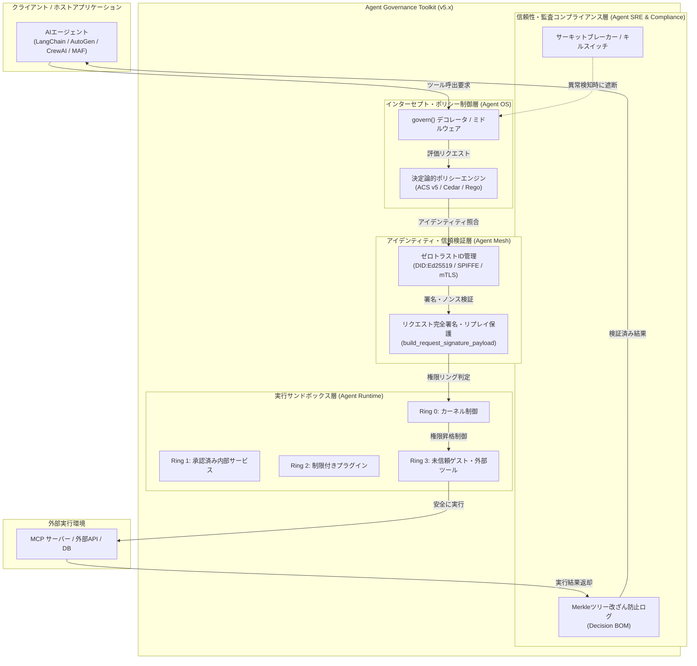

# **Agent Governance Toolkit 調査レポート**

## **1. 基本情報**

* **ツール名**: Agent Governance Toolkit
* **ツールの読み方**: エージェント ガバナンス ツールキット
* **開発元**: Microsoft
* **公式サイト**: [https://github.com/microsoft/agent-governance-toolkit](https://github.com/microsoft/agent-governance-toolkit)
* **関連リンク**:
  * GitHub: [https://github.com/microsoft/agent-governance-toolkit](https://github.com/microsoft/agent-governance-toolkit)
  * DeepWiki: [https://deepwiki.com/microsoft/agent-governance-toolkit](https://deepwiki.com/microsoft/agent-governance-toolkit)
  * ドキュメント: [https://microsoft.github.io/agent-governance-toolkit](https://microsoft.github.io/agent-governance-toolkit)
* **カテゴリ**: セキュリティ
* **概要**: Agent Governance Toolkit (AGT) は、自律型AIエージェントに対する決定論的ポリシー強制、ゼロトラストID管理、多層実行サンドボックス化、およびSRE（サイト信頼性エンジニアリング）機能を提供するMicrosoft発の包括的オープンソースセキュリティツールキットです。大規模言語モデル（LLM）の推論結果に依存する確率論的なプロンプトガードレールではなく、アプリケーション層でインラインかつサブミリ秒（p99 < 0.1ms）でアクションを制御します。

## **2. 目的と主な利用シーン**

* **解決する課題**: 外部ツールやデータベースへのアクセス権を持つAIエージェントが自律的に意思決定を行う際、「プロンプトインジェクションによる不正なツール呼び出しの防止」「エージェント間のなりすましや過剰権限行使の遮断」「法規制（EU AI ActやNIST AI RMF等）に準拠した改ざん不能な意思決定監査証跡の証明」というセキュリティ・ガバナンス上の課題を解決します。
* **想定利用者**: AIアプリケーション開発者、セキュリティエンジニア、DevSecOps担当者、コンプライアンス責任者
* **利用シーン**:
  * 自律型エージェントのツール呼び出しを事前インターセプトし、破壊的コマンドや機密データへの未許可アクセスを決定論的にブロックする
  * マルチエージェントシステムにおいて、エージェントごとの分散型ID（DID）と署名付きエンベロープで相互認証とアクセス制限を行う
  * 外部ツールやプラグインの実行を4段階の特権リングからなるサンドボックス内で安全に隔離する
  * CI/CDパイプラインでの事前コミットフック（`agt lint` / `agt verify`）により、エージェント設定の脆弱性を早期検知する

### **2.1 代表的な利用フロー**

```mermaid
swimlane-beta TB
  subgraph User["ユーザー / クライアント"]
    A[タスク指示を入力]
    H[検証済み結果を確認]
  end
  subgraph Agent["AIエージェント"]
    B[実行計画とツール呼出要求を生成]
    G[安全な結果を基に最終回答を作成]
  end
  subgraph AGT["Agent Governance Toolkit"]
    C[要求をインターセプト・ポリシー評価]
    D[特権リングとID署名を検証]
    F[結果をサニタイズ・監査ログ記録]
  end
  subgraph Tool["外部ツール・API"]
    E[隔離環境で安全に処理を実行]
  end

  A --> B
  B --> C
  C --> D
  D --> E
  E --> F
  F --> G
  G --> H
```

* **代表的な流れ**: ユーザーからタスク指示を受けたAIエージェントがツール呼び出しを試みる際、Agent Governance Toolkitが透過的にインターセプトし、決定論的ポリシー（ACS v5）および特権リング・ID署名を検証します。許可された場合のみサンドボックス経由で外部ツールが実行され、結果がサニタイズされてMerkle監査ログに記録された後、エージェントを通じて安全にユーザーへ返却されます。

## **3. 主要機能**

* **Policy Engine (Agent OS / ACS v5)**: エージェントのツール呼び出しをインラインで事前インターセプトし、Agent Control Specification (ACS v5) に準拠したCedarやYAMLポリシーに基づき、サブミリ秒（p99 < 0.1ms）で許可・ブロック・承認要求を決定論的に判定します。
* **Zero-Trust Identity (Agent Mesh)**: 分散型ID（DID:Ed25519）、SPIFFE、mTLS、およびEntra JWTを活用したエージェント相互認証機能。v5.0.1で強化された完全リクエスト署名ペイロード（`build_request_signature_payload`）により、リプレイ攻撃やパラメータ改ざんを確実に防ぎます。
* **Execution Sandboxing (Agent Runtime)**: Ring 0（カーネル制御）からRing 3（未信頼ゲスト・外部ツール）までの4段階の特権リングアーキテクチャによる実行サンドボックス化、Sagaオーケストレーション、およびトランザクション補正（ロールバック）を提供します。
* **Reliability Engineering (Agent SRE)**: 暴走エージェントを瞬時に停止する緊急キルスイッチ、SLO（サービスレベル目標）およびエラーバジェット監視、カオスエンジニアリング、サーキットブレーカー機能を実装します。
* **Audit & Compliance (Agent Compliance)**: 意思決定プロセスと適用ポリシーの改ざん防止ログ（Merkleツリーベース）、意思決定部品表（Decision BOM）、およびOWASP Agentic Top 10の自動適合性検証機能を提供します。
* **Shift-Left Security & CLI (`agt`)**: `agt doctor`、`agt verify`、`agt lint` などのCLIコマンドを提供し、CI/CDパイプラインや事前コミットフックでの自動セキュリティ検証を可能にします。v4からv5への移行を支援する `agt migrate v4-to-v5` コマンドも備えます。
* **MCP Security Gateway**: Model Context Protocol (MCP) とのネイティブ連携により、外部MCPサーバーから提供されるツールのポイズニング検知、スキーマドリフト監視、アクセス制御ゲートウェイとして機能します。

## **4. 動作原理・システム構成**

* **アーキテクチャ**: Agent Governance Toolkitは、ホストアプリケーションプロセス内に組み込まれるインラインのステートレス・コントロールプレーン（Control Plane）として動作します。既存のエージェントフレームワーク（LangChain, AutoGen, CrewAI, Semantic Kernel, OpenAI Agents SDK等）の実行ループを置き換えることなく、ツール呼び出し境界に薄いインターセプタとして常駐します。
* **主要コンポーネントとデータフロー**:
  1. **ホスト層 (Agent Host)**: エージェントがLLM推論を通じて生成した関数呼び出し（Tool Call）を、`govern()` デコレータまたはミドルウェア経由でAGTに渡します。
  2. **ポリシー制御層 (Agent OS)**: ACS v5仕様に基づき、Cedar言語で書かれた決定論的ルールセットを用いて、引数スキーマ、時間枠、コスト上限などの動的条件をサブミリ秒で評価します。
  3. **アイデンティティ層 (Agent Mesh)**: 送信元エージェントのDID公開鍵と署名付きエンベロープ（タイムスタンプ、ノンス、HTTPメソッド、ターゲット、本文ダイジェストを含む完全署名）を照合し、リプレイやなりすましを排除します。
  4. **実行サンドボックス層 (Agent Runtime)**: 割り当てられた特権リング（Ring 0〜3）の権限スコープ内で外部ツールやMCPサーバーを実行し、不正なシステムコールやメモリ破壊を隔離します。
  5. **信頼性・監査層 (Agent SRE & Compliance)**: 異常なループやレート超過をサーキットブレーカーが検知した場合はキルスイッチを発動。すべての判定証跡をMerkleツリー構造のDecision BOMへコミットします。
* **特筆すべき要素技術**:
  * AWS発の形式検証済み認可言語 Cedar と ACS v5（Agent Control Specification）のネイティブ統合
  * OSカーネルに着想を得た4段階の特権リング（Ring 0: Kernel, Ring 1: Platform, Ring 2: Extensions, Ring 3: User/Guest）
  * 暗号学的に検証可能なMerkleツリー監査証跡（改ざん検知と法規制適合性の証明）
  * Ed25519暗号鍵による分散型ID（DID）と共有キャッシュを用いた不可逆ノンス検証



## **5. 開始手順・セットアップ**

* **前提条件**:
  * Python 3.10以降（TypeScript / Node.js 18+, .NET 8.0, Rust, Go SDKも利用可能）
  * アカウント登録やクレジットカード登録は一切不要（オープンソース / MITライセンス）
* **インストール/導入**:

  ```bash
  # Pythonの場合: コアパッケージおよびCLIツールのインストール
  pip install agent-governance-toolkit[full]

  # または最小限のコアエンジンのみを導入する場合
  pip install agent-governance-toolkit-core
  ```

* **初期設定**:
  プロジェクトルートにポリシー定義ファイル (`policy.yaml`、ACS v5形式) を作成します。

  ```yaml
  version: "5.0"
  policies:
    - name: restrict-financial-tools
      target: "tools.payment.*"
      action: deny
      condition:
        max_amount_usd: 1000
        require_approval: true
    - name: default-allow-safe
      target: "tools.read_only.*"
      action: allow
  ```

* **クイックスタート**:

  ```python
  from agent_governance_toolkit_core.governance import govern
  from agent_governance_toolkit_core.exceptions import GovernanceDeniedError

  # 対象のツール関数
  def execute_database_query(query: str) -> str:
      return "クエリ実行成功"

  # ガバナンスポリシーを適用してツールをラップ
  protected_query_tool = govern(execute_database_query, policy_path="policy.yaml")

  try:
      # ポリシー適合時は安全に実行される
      result = protected_query_tool("SELECT id, name FROM users;")
      print("実行結果:", result)
  except GovernanceDeniedError as e:
      # ポリシー違反時は例外がスローされ、不正な実行が阻止される
      print("ガバナンス違反によりブロックされました:", e)
  ```

## **6. 特徴・強み (Pros)**

* **決定論的かつ超高速な制御**: プロンプトに依存する確率論的な安全対策（ガードレールモデルによる再判定等）ではなく、コード・ルールに基づく決定論的制御を採用。p99で0.1ミリ秒未満という超低レイテンシを実現し、エージェントの思考速度を落としません。
* **OWASP Agentic Top 10への100%マッピング**: 不正なツール利用、過剰権限の行使、プロンプトインジェクションのツール波及、メモリ汚染など、自律型AI特有の重大リスク全項目に対応する防御機構を網羅しています。
* **フレームワーク非依存の透過的統合**: LangChain、AutoGen、CrewAI、Semantic Kernel、OpenAI Agents SDKなど主要なフレームワークと共存可能。既存のコードベースを大規模に書き換えることなく、わずか数行でガバナンスレイヤーを注入できます。
* **Shift-Leftから運用までの一貫性**: 開発時の静的解析（`agt lint`）、CI/CDゲート（`agt verify`）、ランタイム実行サンドボックス、運用時のMerkle監査ログまで、開発ライフサイクル全体を包括的に保護します。

## **7. 弱み・注意点 (Cons)**

* **分散環境・ゼロトラストの学習コスト**: 単一ツールへの `govern()` 適用は極めて簡単ですが、分散環境でのDID管理、SPIFFE/mTLS相互認証、特権リング設計を本格導入するには、ネットワークおよびセキュリティアーキテクチャの深い専門知識が必要です。
* **メジャーバージョン刷新に伴うポリシー移行**: v4からv5（ACS v5）への移行に伴いパッケージ構成の集約とポリシー記法の変更が行われました。移行支援コマンド（`agt migrate v4-to-v5`）が提供されているものの、既存プロジェクトのアップデート時にはテストと見直しが推奨されます。
* **日本語ドキュメントの不足**: 公式ドキュメントおよびGitHubリポジトリの解説はほぼ英語中心です。日本国内のコミュニティや日本語チュートリアルは整備途上にあります。

## **8. 料金プラン**

| プラン名 | 料金 | 主な特徴 |
|---------|------|---------|
| **オープンソースプラン (MIT)** | 無料 | Policy Engine (ACS v5)、Agent Mesh (DID)、Runtime Sandbox (Ring 0-3)、Agent SRE、CLI、改ざん防止監査ログを含む全機能 |

* **課金体系**: 完全無料（MITライセンスに基づくオープンソースソフトウェア）
* **無料トライアル**: 不要（ライセンス上の制限なく商用環境・本番環境で利用可能）

## **9. 導入実績・事例**

* **導入企業**: パブリックプレビューおよびv5系リリースを経て、Microsoftエコシステム内の開発チームをはじめ、金融、ヘルスケア、防衛・公共機関などのエンタープライズ組織でのPoC・試験導入が急速に進んでいます。
* **導入事例**:
  * 金融機関における自律型投資分析エージェントの外部API呼び出しおよび送金実行の決定論的制限。
  * ヘルスケア分野での患者データ照会エージェントにおける特権リングによる個人情報隔離とMerkle監査証跡の自動保存。
* **対象業界**: 金融サービス、医療・製薬、官公庁、製造・サプライチェーン、大手通信キャリアなど、厳格なコンプライアンスが義務付けられている業界。

## **10. サポート体制**

* **ドキュメント**: Microsoftの公式ドキュメントサイト（microsoft.github.io）およびDeepWikiにて、アーキテクチャ詳細、クイックスタート、APIリファレンス、ACS v5移行ガイドが公開されています。
* **コミュニティ**: GitHub Discussions、Issues、およびOWASP Agentic Security Working Groupを通じたグローバルな開発者コミュニティ。
* **公式サポート**: GitHub Issuesでのバグ報告・機能要望（Microsoftの商用Azureサポートとの直接連携は今後の展開として期待されています）。

## **11. エコシステムと連携**

### **11.1 API・外部サービス連携**

* **API**: Python、TypeScript、.NET（C#）、Rust、Goの各言語向けネイティブSDKを提供。
* **外部サービス連携**: Model Context Protocol (MCP) セキュリティゲートウェイ、Azure Entra ID、OpenTelemetry（OTel標準のトレース・メトリクス出力）、HashiCorp Vaultなどと連携可能です。

### **11.2 技術スタックとの相性**

| 技術スタック | 相性 | メリット・推奨理由 | 懸念点・注意点 |
|:---|:---:|:---|:---|
| **Python** | ◎ | 最も開発が先行しており、フルスタック（`agent-governance-toolkit[full]`）の全機能を利用可能 | 特になし |
| **.NET / C#** | ◎ | MicrosoftエコシステムやSemantic Kernelとの親和性が抜群。NuGetパッケージ（`Microsoft.AgentGovernance`）が提供 | 最新機能の同期タイミングに注意 |
| **TypeScript / Node.js** | ◎ | Claude CodeやCopilot CLI等のフロントエンド/CLIツール統合に最適 | Python版の一部の高度な拡張プラグインが順次追従中 |
| **Rust / Go** | ◯ | 高スループットかつ極小フットプリントが求められるマイクロサービスやサイドカー環境に最適 | コミュニティ製アダプターの拡充が進行中 |

## **12. セキュリティとコンプライアンス**

* **認証**: 分散型ID（DID:Ed25519）、SPIFFE、mTLS、およびEntra JWTをサポート。v5.0.1以降は `build_request_signature_payload` によるリクエスト全体（対象・タイムスタンプ・ノンス・ヘッダー・本文ダイジェスト）の完全署名検証を強制し、リプレイ攻撃を排除。
* **データ管理**: インライン型ライブラリとしてアプリケーションプロセスのローカル/プライベートVPC内で完結して実行されるため、プロンプトや機密ペイロードが第三者の外部クラウドに送信されるリスクはありません。
* **準拠規格**: OWASP Agentic Top 10の全10項目への適合マッピング、NIST AI RMF 1.0、EU AI Act（高リスクAIシステムの透明性・トレーサビリティ要件）、SOC 2 Type IIに対応するDecision BOM（意思決定部品表）の出力に対応。

## **13. 操作性 (UI/UX) と学習コスト**

* **UI/UX**: 開発者向けのSDK/CLIツールとして設計されており、`govern()` デコレータによる透過的なコード適用、`agt doctor` や `agt verify` による対話型コンプライアンススキャン、Streamlitベースのリアルタイムガバナンスダッシュボードが用意されています。
* **学習コスト**: 基本的なYAMLポリシーの記述とツールのラップだけであれば数時間で導入可能です。ただし、マルチエージェント環境におけるDIDインフラ構築や特権リングアーキテクチャの設計には一定の習熟期間が必要です。

## **14. ベストプラクティス**

* **効果的な活用法 (Modern Practices)**:
  * **段階的導入**: まずは破壊的操作を伴うツール（DB書き込み、送金、外部メール送信）に絞って `govern()` を適用し、安定運用を確認した後にAgent Mesh（DID認証）やMerkle監査ログを展開する。
  * **Shift-Leftの徹底**: CI/CDパイプラインに `agt verify` および `agt lint` を組み込み、ポリシーファイルの構文ミスや過剰権限設定をデプロイ前に遮断する。
  * **完全リクエスト署名の活用**: v5.0.1で改修された `build_request_signature_payload` を使用し、エージェント間通信のリクエスト完全性を担保する。
* **陥りやすい罠 (Antipatterns)**:
  * **プロンプト依存の罠**: システムプロンプトに「危険な操作をしないでください」と記述するだけで安全対策を完結させようとすること。プロンプトインジェクションに対して確率論的な防御は無力であるため、必ずAGTによるアプリケーション層の決定論的遮断を併用する。
  * **単一の粗いグローバルポリシー**: すべてのエージェントやツールに一律のパーミッションを付与すること。エージェントごとに最小権限の原則（Least Privilege）に基づき特権リングを細分化すべき。

## **15. ユーザーの声（レビュー分析）**

* **調査対象**: GitHub, X (Twitter), Reddit, 技術カンファレンス発表
* **総合評価**: 該当なし（開発者向けOSSのため公式レビューサイトのスコアなし）
* **ポジティブな評価**:
  * 既存のエージェントフレームワーク（LangChain, CrewAI等）を一切置き換えることなく、透過的にガバナンスとサンドボックスを差し込めるアーキテクチャが極めて実用的。
  * p99で0.1ms未満という超低レイテンシのおかげで、推論のループやツールの連続実行に体感上の遅延が一切発生しない。
  * EU AI ActやNIST AI RMFへの適合レポートを自動生成できるDecision BOM機能が、法務・コンプライアンス部門との合意形成に絶大な効果を発揮する。
* **ネガティブな評価 / 改善要望**:
  * v4からv5へのパッケージ集約とACS記法への移行時に、ドキュメントの追従や設定ファイルの書き換えが必要だった。
  * 分散環境におけるDID管理や証明書チェーンの設定例がまだ少なく、より実践的なエンタープライズ用サンプルが求められている。
* **特徴的なユースケース**:
  * 社内ネットワークで無秩序にデプロイされる野良エージェントを検知・可視化する「Shadow AI Discovery」機能が、IT資産管理および内部統制の現場で重宝されている。

## **16. 直近半年のアップデート情報**

* **2026-09-XX**: v5.0.1 セキュリティホットフィックスリリース。HTTP Trust Middlewareの認証およびリプレイ保護の脆弱性（GHSA-5j58-vjjg-pcgm）を修正。`build_request_signature_payload` による完全リクエスト署名エンベロープ検証とアトミックなノンス検証を強制。
* **2026-06-25**: v5.0.0 メジャーリリース。全言語SDK（Python, TypeScript, .NET, Rust）のバージョン統合とAgent Control Specification (ACS) v5への完全移行。v4からv5への自動マイグレーションツール（`agt migrate v4-to-v5`）の提供。
* **2026-06-09**: v4.1.0 リリース。Agent OS (Nexus) でのEd25519署名検証、`ProofOfOutcome` のエスクロー署名サポート、時間・コスト制約を含む動的ポリシー条件の追加、CrewAIアダプター改修。
* **2026-06-01**: v4.0.0 リリース。45個に分散していたPythonパッケージを5つの主要ディストリビューション（`agent-governance-toolkit-core`, `runtime`, `sre`, `cli` 等）へ集約統合。TEE（Trusted Execution Environment）鍵管理およびEntra JWT検証を追加。
* **2026-05-18**: v3.7.0 パブリックプレビュー版公開。TypeScript、.NET、Rust、Goなど多言語SDKの機能拡充、NIST AI RMF 1.0およびEU AI Actへのコンプライアンスマッピングを正式サポート。
* **2026-04-02**: Microsoftによるオープンソース（MITライセンス）初回リリース。自律型AIエージェント向けOWASP Agentic Top 10全項目への対応を発表。
* **2026-03-XX**: MCP Security Gateway仕様の実装。ツールのポイズニング検知およびスキーマドリフト監視が追加。
* **2026-01-XX**: 監査およびコンプライアンス機能の強化。Decision BOM（意思決定部品表）およびMerkleツリーベースの改ざん防止ログ機能が統合。

(出典: [GitHub Releases](https://github.com/microsoft/agent-governance-toolkit/releases))

## **17. 類似ツールとの比較**

### **17.1 機能比較表 (星取表)**

| 機能カテゴリ | 機能項目 | 本ツール (AGT) | NeMo Guardrails | LangSmith | Docker Sandboxes |
|:---:|:---|:---:|:---:|:---:|:---:|
| **基本機能** | 決定論的ポリシー適用 | ◎<br><small>ACS v5/Cedarで確実遮断</small> | ◯<br><small>Colangによる対話制御主</small> | △<br><small>事後ルール検証</small> | △<br><small>OSレベルの制限のみ</small> |
| **カテゴリ特定** | ツール実行サンドボックス | ◎<br><small>Ring 0-3特権リング</small> | △<br><small>関数呼び出し制限</small> | ×<br><small>実行環境非提供</small> | ◎<br><small>コンテナ完全分離</small> |
| **セキュリティ** | ゼロトラストID管理 | ◎<br><small>DID/Ed25519完全署名</small> | ×<br><small>ID管理非対応</small> | ×<br><small>ID管理非対応</small> | △<br><small>ホスト認証に依存</small> |
| **エンタープライズ** | 改ざん防止監査証跡 | ◎<br><small>Merkleツリー/Decision BOM</small> | △<br><small>標準ログのみ</small> | ◯<br><small>詳細トレース・監査</small> | △<br><small>コンテナログのみ</small> |
| **非機能要件** | フレームワーク非依存性 | ◎<br><small>LangChain/AutoGen等全対応</small> | ◯<br><small>LangChain中心</small> | ◯<br><small>LangChain親和性高</small> | ◎<br><small>言語・FW完全不問</small> |
| **非機能要件** | 実行オーバーヘッド | ◎<br><small>p99 < 0.1msの超低遅延</small> | △<br><small>LLM呼出遅延あり</small> | ◯<br><small>非同期トレース</small> | △<br><small>コンテナ起動コスト</small> |

### **17.2 詳細比較**

| ツール名 | 特徴 | 強み | 弱み | 選択肢となるケース |
|---------|------|------|------|------------------|
| **Agent Governance Toolkit** | 自律型AIエージェントの包括的セキュリティ・ガバナンス基盤 | 決定論的なインライン制御、OWASP/NIST完全準拠、超低レイテンシ（<0.1ms）、多言語SDK | 高度なゼロトラストID運用の学習コスト | エンタープライズで自律型エージェントのツール呼び出しを安全・決定論的に制御し、法規制適合性を担保したい場合 |
| **NeMo Guardrails** | NVIDIA発のLLMプロンプト・対話フロー制御ツール | プロンプトインジェクション検知、対話トピックの脱線防止（Colang言語） | ツール呼び出しの深層サンドボックス化やキルスイッチ機能は弱い | エージェントの「発言内容」やチャットの安全性・トピック制御を重視する場合 |
| **LangSmith** | LangChain社が提供するLLMアプリの可観測性プラットフォーム | 開発時のプロンプトデバッグ、詳細な実行トレース、評価データセット管理 | インラインでの実行前ブロック（決定論的強制）が主目的ではない | LangChainエコシステムを活用し、開発パイプラインの品質評価やデバッグを効率化したい場合 |
| **Docker Sandboxes** | コンテナ技術を活用したエージェント実行環境の隔離基盤 | OSレベルでの強力なプロセス隔離、ファイルシステム・ネットワーク分離 | AIエージェント特有のポリシー構文や意思決定BOM（監査ログ）機能は持たない | 任意コード実行ツールをOSレベルで物理的・仮想的に隔離したい場合 |

## **18. 総評**

* **総合的な評価**:
  Agent Governance Toolkit (AGT) は、これまでのLLMセキュリティの主流であった「プロンプトへの安全指示」という確率論的アプローチの限界を打破し、決定論的かつインラインでアプリケーションコードレベルの統制を実現する画期的なオープンソース基盤です。v5.0.0でのACS（Agent Control Specification）統合およびv5.0.1でのリクエスト完全署名強化により、OWASP Agentic Top 10やEU AI Actなどの厳格な国際規格に完全適合するエンタープライズグレードの堅牢性を確立しています。p99で0.1ms未満という驚異的な処理速度を維持しながら、わずか数行のラッパーで導入できる実用性の高さは他の追随を許しません。
* **推奨されるチームやプロジェクト**:
  * 金融機関、ヘルスケア、政府機関など、セキュリティ基準や監査適合性（トレーサビリティ）が不可欠なプロジェクト。
  * データベース更新、API実行、送金、インフラ操作など、副作用を伴うツール呼び出しを行う自律型AIエージェントを開発しているチーム。
  * LangChain、AutoGen、CrewAI、Semantic Kernelなどの複数フレームワークが混在し、組織全体で統一されたセキュリティポリシーを適用したいプラットフォーム部門。
* **選択時のポイント**:
  * 単なる対話のガードレール（発言内容の制御）を求めるならNeMo Guardrailsが手軽ですが、エージェントが実世界や外部システムへアクションを起こす際の「実行権限の制御と改ざん不能な監査」を求める場合は、Agent Governance Toolkitが最も完成度の高い選択肢となります。
