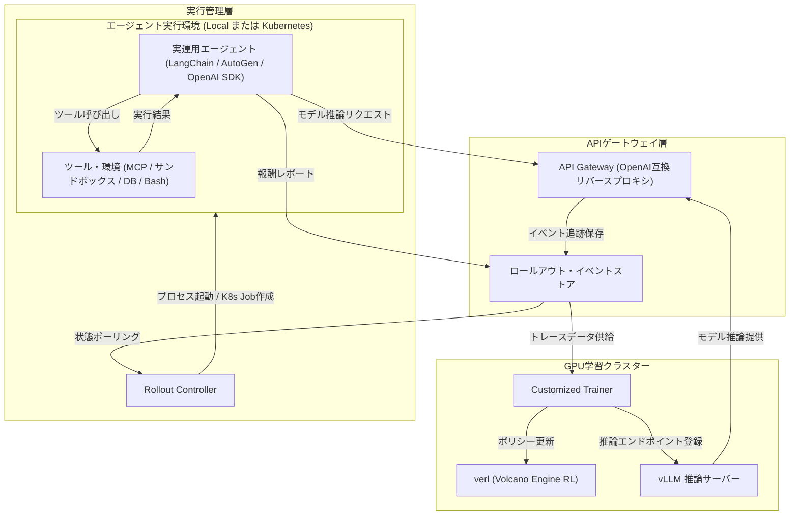

# **Agent Lightning 調査レポート**

## **1. 基本情報**

<!--
【ガイドライン】
- 必須: ツール名、開発元、公式サイト、カテゴリ、概要
- 概要は2-3文で簡潔に記述
-->

* **ツール名**: Agent Lightning
* **ツールの読み方**: エージェント ライトニング
* **開発元**: Microsoft (Research)
* **公式サイト**: [https://microsoft.github.io/agent-lightning/](https://microsoft.github.io/agent-lightning/)
* **関連リンク**:
  * GitHub: [https://github.com/microsoft/agent-lightning](https://github.com/microsoft/agent-lightning)
  * ドキュメント: [https://microsoft.github.io/agent-lightning/stable/](https://microsoft.github.io/agent-lightning/stable/)
  * 論文:
    * v1.0 テクニカルレポート: [Agent Lightning v1.0: Towards Harnessed Agentic RL](https://arxiv.org/abs/2608.17528) (arXiv:2608.17528)
    * 初期論文: [Agent Lightning: Train ANY AI Agents with Reinforcement Learning](https://arxiv.org/abs/2508.03680) (arXiv:2508.03680)
* **カテゴリ**: エージェントプラットフォーム
* **概要**: Agent Lightningは、AIエージェントを本番運用環境（ハーネス）のまま強化学習（RL）で最適化・学習させるためのオープンソースフレームワークです。v1.0で約3,500行の超軽量アーキテクチャへと全面刷新され、OpenAI互換リバースプロキシを活用することで、エージェント側のコード変更を一切行わずに（Zero Code Change）ツール利用や自律的試行錯誤の精度を向上させます。

## **2. 目的と主な利用シーン**

<!--
【ガイドライン】
- 3-5項目を箇条書きで記述
- 想定利用者を具体的に記載
- 末尾に「代表的な利用フロー」をスイムレーンで添付する
-->

* **解決する課題**:
  * **Train-Serve Mismatch（学習と運用の乖離）の解消**: 従来のエージェント強化学習では、専用フレームワーク向けにエージェントコードを書き直す必要があり、本番環境と学習環境で振る舞いが乖離する問題があった。本ツールは本番の実行ハーネスをそのまま学習ループに組み込むことでこれを解決する。
  * **手動プロンプト調整・ヒューリスティクスの限界突破**: 複雑な多段階推論やツール呼び出しを伴う自律型エージェントに対し、数学的・体系的な強化学習アルゴリズム（GRPO/PPOなど）を適用して自律的に性能を引き上げる。
  * **外部サンドボックス依存の脱却と実行コスト削減**: 高価な商用サンドボックスSaaSに頼らず、セルフホストのKubernetesクラスタで安全かつ大規模並列にエージェントを実行・収集する。
* **想定利用者**:
  * AIリサーチャー（エージェント強化学習・推論モデルの最適化研究者）
  * 自律型コーディングエージェントや業務エージェントを開発・運用するAIエンジニア
  * 大規模なモデルチューニング基盤を運用するMLOps/プラットフォームエンジニア
* **利用シーン**:
  * **コーディングエージェントの自律改善**: SWE-benchなどのリポジトリ検証ベンチマークにおいて、リポジトリ探索やテスト実行の成功率を高める強化学習。
  * **多段階推論・科学的タスクの最適化**: 数学計算（Calc-X, GSM8K）や科学シミュレーション（ScienceWorld）でのマルチターン推論とMCPツール活用の習得。
  * **MoEモデルやマルチモーダルエージェントの最適化**: Mixture of Expertsモデルのルーティング制御や、画像入力を伴うQAエージェントの強化学習。
  * **エージェント間メタ最適化（Agent Lightning Skill）**: Claude CodeやGitHub Copilotなどのコーディングエージェントが、他のAIエージェントのプロンプトや設定を自動的に反復改良するワークフローの実現。

### **2.1 代表的な利用フロー**

<!--
【ガイドライン】
- ツールを実際に使う際の代表的な流れを、アクター（ユーザー、AIエージェント、ツール、外部サービス等）ごとのスイムレーンで示す
- Mermaidの swimlane-beta を使用し、向きは TB（上から下）に固定する
- レーン（subgraph）は3〜5個、ステップは4〜8個程度に収め、図内のレーン名・ステップ名は日本語で簡潔に記述する
-->

```mermaid
swimlane-beta TB
  subgraph User["リサーチャー / 開発者"]
    A[タスクデータと報酬関数の定義]
    H[学習済みモデルと指標の確認]
  end
  subgraph Trainer["カスタムトレーナー"]
    B[ロールアウト要求を生成]
    F[ロールアウト完了検知とバッチ変換]
    G[アドバンテージ計算と重み更新]
  end
  subgraph Gateway["APIゲートウェイ"]
    C[待機キューへロールアウト登録]
    E[モデルリクエスト中継とイベント記録]
  end
  subgraph Controller["ロールアウトコントローラー"]
    D[キュー検知とエージェント起動]
  end
  subgraph Harness["エージェント実行環境"]
    I[ツール実行と自律試行錯誤]
    J[タスク終了と報酬レポート]
  end
  A --> B
  B --> C
  C --> D
  D --> I
  I --> E
  E --> I
  I --> J
  J --> C
  C --> F
  F --> G
  G --> H
```

* **代表的な流れ**: リサーチャーが学習データと報酬定義を用意すると、Trainerがロールアウト要求を発行してGatewayに登録します。Controllerが待機中のロールアウトを検知してローカルまたはKubernetes上にエージェントを立ち上げ、エージェントはGateway経由でモデル推論とツール試行を反復します。終了時にレポートされた報酬と対数確率をTrainerが集約し、verlを通じてモデルの重みを更新します。

## **3. 主要機能**

<!--
【ガイドライン】
- 5-10項目の主要機能を箇条書きで記述
- 各機能は1-2文で概要を説明
-->

* **Harnessed Agentic RL（本番ハーネスによる実環境強化学習）**: エージェントを学習専用環境へ移植するのではなく、本番デプロイ時と全く同一のコードベース・ツール・コンテキスト・実行環境（ハーネス）のまま強化学習を実行可能。
* **Zero Code Change（完全無変更の統合）**: エージェント側のソースコードを一切書き換えることなく、OpenAI互換のモデルAPI接続先（Base URL）をAgent LightningのAPI Gatewayに切り替えるだけで学習ループに参加可能。
* **超軽量な約3,500行のアーキテクチャ**: v1.0における全面リファクタリングにより、複雑な中間抽象化レイヤーを排し、約3,500行のPythonコードベースで高い透明性と可読性、拡張性を実現。
* **3大コアコンポーネント協調**: モデル推論と重み更新を担う「Trainer」、モデル呼び出しの中継とトレース収集を行う「API Gateway」、プロセスの調停と実行を司る「Rollout Controller」が疎結合に連携。
* **Kubernetesネイティブサポート**: 外部の有償サンドボックスサービスに依存せず、セルフホストまたはクラウド上のKubernetesクラスタでエージェントをKubernetes Jobとして安全・並列に実行可能。
* **多様な最新強化学習アルゴリズム**: GRPO（Group Relative Policy Optimization）やPPOをベースに、MoE向けのCISPO・R3 expert-routing replay、低精度RL向けのScore Centeringなど最先端の学習手法を標準サポート。
* **MoEおよびマルチモーダル強化学習**: Qwen3.5-35B-A3B等のMixture of Expertsモデルに対するエキスパートルーティングの学習や、画像トレースをVERLバッチへと流し込むマルチモーダル強化学習に対応。
* **低精度推論とメモリ効率化**: INT8重み・アクティベーションによるロールアウト実行、INT4 Attention KVキャッシュ、低メモリMoEルーティングリプレイにより、大規模学習時のホストメモリ消費を大幅低減。
* **Agent Lightning Skill**: Claude Code、GitHub Copilot、Codexなどのコーディングエージェントに組み込み、ベンチマークを基準に他のAIエージェントのプロンプトや推論設定を自動チューニングさせる機能を提供。
* **Retokenization Drift防止と診断**: 推論時のトークンIDと対数確率を確実に保持・比較し、トークナイザの不整合による学習精度の劣化を防ぐプレフィックス不一致診断機能を装備。

## **4. 動作原理・システム構成**

<!--
【ガイドライン】
- ツールの動作原理、システム構成（アーキテクチャ）、データの流れ、通信フローなどを記述
- クライアント・サーバー型、ローカルファースト、クラウド完結など、ツールのアーキテクチャ特性を明記
- 可能であればMermaidによる構成図やフロー図を含めること（Mermaid内のノードや説明テキストは原則日本語表記で作成する）
- 要素技術や内部で使われている仕組みを解説
-->

* **アーキテクチャ**: 分散疎結合型の制御プレーン構成。GPUノード側で動作する「Customized Trainer」、中央でロールアウト状態と通信を管理する「API Gateway」、エージェントの起動とライフサイクルを管理する「Rollout Controller」に分離されており、ローカル単一マシンからマルチノードのKubernetesクラスタまで同一の仕組みでスケールします。
* **主要コンポーネントとデータフロー**:
  * **API Gateway (`agl-server`)**: ロールアウトのメタデータ、状態（`QUEUING`, `RUNNING`, `SUCCEEDED`, `FAILED`）、イベントログを保持する軽量ハブ。OpenAI互換のリバースプロキシとして機能し、エージェントからのモデルリクエストを中継しながら、プロンプトトークンID、生成トークンID、選択されたトークンの対数確率（log probabilities）をロールアウト単位で追跡・記録します。
  * **Rollout Controller (`agl-controller`)**: Gatewayの状態を継続的に監視（Reconciliation Loop）し、待機中ロールアウトをローカルプロセス（`runner_type=local`）またはKubernetes Job（`runner_type=k8s`）として起動します。中断やタイムアウトが発生した場合も一貫性を維持して状態をGatewayに同期します。
  * **Customized Trainer**: 高性能強化学習基盤 `verl` と高速推論基盤 `vLLM` の上位で動作。現在のモデルエンドポイントをGatewayに登録し、ロールアウトを生成してエージェントの終了を待機。収集されたイベント履歴から正確にトークン列を照合し、アドバンテージを計算してポリシーネットワークの重みを更新します。



* **特筆すべき要素技術**:
  * **`verl` (Volcano Engine Reinforcement Learning)**: バイトダンス社開発の次世代LLM強化学習ライブラリであり、Rayと3D並列化（Megatron-LM等）を統合して高スループットなRLトレーニングを実現。
  * **vLLM**: PagedAttentionを採用した高速推論エンジン。Agent Lightningでは推論と学習の重み同期、INT8/INT4によるメモリ効率化を担う。
  * **OpenAI Proxying**: ロールアウトIDを含むパス（`/proxy/rollout/{id}/...`）を用いることで、エージェント側が特別なライブラリを組み込むことなく、単一の環境変数設定のみでコンテキストと対数確率の確実な追跡を可能にしている。

## **5. 開始手順・セットアップ**

<!--
【ガイドライン】
- アカウント作成から「Hello World」的な最初の動作確認までの手順
- 主要なコマンドや設定項目を記載
-->

* **前提条件**:
  * Linux環境（Ubuntu 22.04 LTS以降推奨。WindowsはWSL2環境で動作可能）
  * NVIDIA GPU（NVIDIA CUDA 12.9 または 13.0 対応。ローカル学習には最低1基のA100/H100推奨）
  * Python 3.10以上、パッケージマネージャー `uv`
  * （本番環境）Kubernetesクラスタ（1.26以降）
* **インストール/導入**:

  ```bash
  # リポジトリのクローン
  git clone https://github.com/microsoft/agent-lightning.git
  cd agent-lightning

  # uvによるPython環境の同期
  uv sync

  # GPUスタック（verl, vLLM, FlashAttention）のセットアップ（CUDA 13.0 / verl 0.8.0 の場合）
  source .venv/bin/activate
  bash scripts/setup_verl.sh 0.8.0 cu130
  ```

* **初期設定**:
  * ログ・実験トラッキングのため、Weights & Biasesへのログインを行います。

  ```bash
  uv run wandb login
  ```

* **クイックスタート（単一GPUでのCalc-X学習実行）**:
  * 付属の数学推論サンプル（Calc-X）を用いてローカルで学習ループを起動します。

  ```bash
  # 必要なサンプルの依存関係をインストール
  uv pip install openai httpx sympy "autogen-agentchat" "autogen-ext[openai]" "mcp>=1.11.0,<2" mcp-server-calculator

  # ローカルランナースクリプトの実行（Ray, vLLM, agl-server, agl-controllerを自動起動）
  bash examples/calc_x/run_local.sh
  ```

## **6. 特徴・強み (Pros)**

<!--
【ガイドライン】
- 3-5項目を箇条書きで記述
- 競合との差別化ポイントを明確に
-->

* **「Train-Serve Mismatch」の完全克服**: エージェントを専用のシミュレータコードに移植せず、本番デプロイされるコードそのもの（Harness）を使って強化学習できるため、学習環境と運用環境の乖離による性能低下が発生しない。
* **Zero Code Changeによる既存資産の活用**: LangChain、AutoGen、CrewAI、OpenAI Agents SDK、独自スクリプトなど、OpenAI互換エンドポイントを叩くエージェントであれば、コードを1行も変えずに即座にRLトレーニング対象にできる。
* **超軽量な約3,500行設計と優れた可読性**: 肥大化したフレームワークと異なり、最小限のコアコードベースで構成されているため、アーキテクチャの把握が容易で、研究や企業独自のカスタマイズが極めて行いやすい。
* **Kubernetesネイティブによるインフラコスト最適化**: 有料の外部サンドボックスSaaS契約を必要とせず、社内のKubernetesリソースをそのままエージェント実行環境として利用可能。
* **実証された驚異的な性能改善実績**: SWE-bench Verifiedベンチマークにおいて、わずか6KサンプルでQwen3.5-9Bの正解率を41.8%から56.4%（+14.6ポイント）、MoEモデルQwen3.5-35B-A3Bでは1.8Kサンプルで47.8%から61.6%（+13.8ポイント）へと跳ね上げる圧倒的な学習効率を達成。

## **7. 弱み・注意点 (Cons)**

<!--
【ガイドライン】
- 3-5項目を箇条書きで記述
- 日本語対応の状況は必ず含める
-->

* **高度なインフラリソース（GPU）の要求**: エージェントのロールアウト（推論・試行）と重み更新（`verl`）を高速に回すため、複数基の高性能データセンターGPU（A100やH100）が実質的に推奨され、インフラコストと調達ハードルが高い。
* **専門的なML/RL知識の必要性**: 接続自体はZero Code Changeだが、報酬関数（Reward Function）の設計ミスによる「報酬ハッキング（Reward Hacking）」の防止や、ハイパーパラメータ調整、対数確率の挙動理解など、高度な強化学習の知識が不可欠。
* **Windowsネイティブ環境の非対応**: ローカルランナー（`runner_type=local`）はWindowsネイティブでは動作せず、LinuxまたはWSL2環境での実行が必須。
* **日本語ドキュメントおよび情報の不足**: 公式ドキュメント、リリースノート、論文はすべて英語のみで提供されており、日本語コミュニティや解説記事はまだ限定的。

## **8. 料金プラン**

<!--
【ガイドライン】
- 表形式で整理することを推奨
- 最新の料金情報であることを確認
- 価格は通貨を明記
-->

Agent LightningはMITライセンスのオープンソースソフトウェア（OSS）として提供されており、ソフトウェア自体は完全無料で利用できます。

| プラン名 | 料金 | 主な特徴 |
|---------|------|---------|
| **OSS版 (GitHub)** | 完全無料 | MITライセンス。すべての機能（Trainer, Gateway, Controller, Kubernetes連携, Skill）を制限なく利用可能。 |

* **課金体系**: ソフトウェアライセンス料はなし。学習に必要な計算資源（GPUクラスタ、Kubernetesクラスタ費用）および外部クラウドのインフラ費用のみ利用者の自己負担となります。
* **無料トライアル**: OSSのため該当なし。リポジトリをクローンして即座に全機能を利用開始できます。

## **9. 導入実績・事例**

<!--
【ガイドライン】
- 具体的な企業名を3-5社挙げる
- 導入事例がない場合は「公開事例なし。ただし、〜の分野での利用が報告されている」等
-->

* **導入企業・研究機関**: Microsoft Research, Tencent Cloud (ADP Team), Stanford University (AgentFlow Research Group)
* **導入事例**:
  * **SWE-bench Verified コーディングエージェント学習 (Microsoft Research)**: 本番ハーネスを活用し、Qwen3.5モデルを強化学習のみでチューニング。わずか数千サンプルの訓練でSWE-bench Verifiedの解決率を業界トップ水準（61.6%）まで押し上げた公式事例。
  * **Youtu-Agent (Tencent Cloud)**: Agent Lightningのブランチバージョンを採用し、最大128台のGPUによる大規模分散強化学習基盤を構築。数学推論およびコード生成タスクにおいて安定した収束とスケーラビリティを実証。
  * **DeepWerewolf**: AgentScopeとAgent Lightningを組み合わせ、中国語版「人狼ゲーム」における複雑な騙し合い・推論を行うマルチエージェントを強化学習で訓練したケーススタディ。
  * **AgentFlow (Stanford University)**: プランナー、実行者、検証者、生成者を連携させたモジュール型マルチエージェントシステムにおいて、Flow-GRPOアルゴリズムを実装し、長大なタスクの最適化を達成。
* **対象業界**: 自律型AIエージェント製品開発、大規模言語モデル研究（LLM R&D）、ゲームAI開発、ソフトウェアエンジニアリング自動化。

## **10. サポート体制**

<!--
【ガイドライン】
- ドキュメント、コミュニティ、公式サポートの3項目を必ず含める
- URLがあれば記載
-->

* **ドキュメント**: 公式ドキュメントサイト（[https://microsoft.github.io/agent-lightning/stable/](https://microsoft.github.io/agent-lightning/stable/)）にて、インストールガイド、クイックスタート、基礎概念、Trainer/Gateway/Controller各コンポーネントの設定仕様、Calc-XやCoding Agentなどの実践例が詳細に解説されている。
* **コミュニティ**: GitHub IssuesおよびDiscussionsにて開発者への質問やバグ報告が可能。また公式WeChatグループ（微信群）など活発な研究者コミュニティが存在する。
* **公式サポート**: オープンソースプロジェクトのため商用SLAに基づく個別サポートは提供されていないが、Microsoft Researchのコアチームが継続的にメンテナンスおよび新機能開発を行っている。

## **11. エコシステムと連携**

<!--
【ガイドライン】
- API、外部連携、技術スタックとの相性を包括的に記述
-->

### **11.1 API・外部サービス連携**

<!--
【ガイドライン】
- APIの有無と公開状況を明記
- 主要連携サービスを5-10個リストアップ
-->

* **API**: 
  * **OpenAI互換リバースプロキシAPI**: `/proxy/rollout/{id}/attempt/{attempt}/mode/{mode}/openai/v1/chat/completions` 等のエンドポイントを提供し、標準的なOpenAIクライアントからのリクエストを透過的に中継。
  * **Rollout REST API**: ロールアウトの作成、状態取得、イベント追加を行うRESTful API。
* **主要連携サービス・ライブラリ**:
  * **LLM推論/学習基盤**: `verl` (Volcano Engine RL), vLLM, FlashAttention, Megatron-LM, Hugging Face Transformers
  * **エージェントフレームワーク**: LangChain, Microsoft AutoGen, CrewAI, OpenAI Agents SDK, Microsoft Agent Framework
  * **実験管理・ロギング**: Weights & Biases (W&B)
  * **インフラ・オーケストレーション**: Kubernetes (K8s Jobs API), Docker, Ray
  * **コーディングエージェント連携**: Agent Lightning Skill（Claude Code, GitHub Copilot, Codex対応）

### **11.2 技術スタックとの相性**

<!--
【ガイドライン】
- 主要なフレームワークや言語との相性を表形式で整理
- 相性: ◎ (非常に良い), ◯ (良い), △ (工夫が必要/一部非対応), × (非推奨)
-->

| 技術スタック | 相性 | メリット・推奨理由 | 懸念点・注意点 |
|:---|:---:|:---|:---|
| **Python (3.10+)** | ◎ | ネイティブ開発言語であり、コアライブラリおよび全ユーティリティが完全対応。 | uv環境での依存管理が推奨される。 |
| **Kubernetes** | ◎ | ControllerがK8s Jobを直接生成・監視可能。大規模並列実行に最適。 | クラスタの運用管理知識とクラスタ内ネットワーク設定が必要。 |
| **vLLM / verl** | ◎ | トレーニングバックエンドとして深く統合され、高効率な並列RLを実現。 | CUDAバージョンおよびライブラリバージョン（Pinned Stack）の厳格な一致が必要。 |
| **LangChain / AutoGen** | ◎ | Base URLを切り替えるだけで、ツール呼び出しを含むマルチターン対話を即座に学習可能。 | エージェント終了時の報酬通知処理を適切に設計する必要がある。 |
| **Windows (ネイティブ)** | × | コントローラーのプロセス管理仕様上、ネイティブWindowsはサポート外。 | WSL2（Ubuntu）環境を使用する必要がある。 |

## **12. セキュリティとコンプライアンス**

<!--
【ガイドライン】
- 認証、データ管理、準拠規格の3項目を必ず調査
- 情報が見つからない場合は「公式サイトで公開されていない。問い合わせが必要。」と記載
-->

* **認証**: OSSとしてセルフホスト運用するため、API GatewayやControllerへのアクセス制御は社内ネットワークやKubernetesのNetworkPolicy、リバースプロキシのBasic認証/OAuth等で独自に構成する。
* **データ管理**: エージェントの実行トレース、モデルプロンプト、生成結果などのデータはすべてユーザーが管理するAPI Gatewayおよび内部ストレージにのみ保存され、外部SaaSへ意図せず流出することはない。
* **サンドボックス隔離**: エージェントが任意のシェルコマンドやPythonコードを実行するリスクに対しては、Kubernetes Jobを用いることでクラスタレベルでエージェントを隔離し、ホスト環境を安全に保護する設計が推奨されている。
* **準拠規格**: Microsoft Responsible AI Standardの理念に沿って開発・公開されている。

## **13. 操作性 (UI/UX) と学習コスト**

<!--
【ガイドライン】
- 実際の使用感や、類似ツールとの比較を含める
-->

* **UI/UX**: 実行はシンプルなCLIコマンド（`agl-server`, `agl-controller`）やシェルスクリプトから行い、学習プロセスやロールアウト推移の可視化は業界標準のWeights & Biasesダッシュボードを通じて直感的に把握できる。
* **学習コスト**: 一般的なWebフレームワークやエージェント構築SDKに比べて高い。コード変更自体は不要であるものの、強化学習の数学的背景（PPO/GRPOアルゴリズム、アドバンテージ計算、KLダイバージェンス制御）や、GPU分散学習（Ray, verl）の知見が要求される。

## **14. ベストプラクティス**

<!--
【ガイドライン】
- ツールを効果的に活用するための推奨事項や、避けるべきアンチパターンを記述
- 公式ドキュメントのBest Practicesや、熟練エンジニアの知見を参考にする
-->

* **効果的な活用法 (Modern Practices)**:
  * **単一GPUの小型タスクから着手**: いきなり大規模なコーディングエージェントを回すのではなく、公式のCalc-XやGSM8Kの軽量サンプルを用いて1GPU環境でGatewayとTrainerの通信フローを検証する。
  * **報酬関数（Reward）の厳格な検証**: 単純な文字列一致ではなく、自動テストスイートの実行結果や構文木（AST）解析などを組み合わせ、モデルの報酬ハッキングを防止する。
  * **Kubernetes Jobによるエージェントの完全隔離**: 実環境操作を伴う自律エージェントの学習には、コンテナテンプレートを用いたKubernetesモードを採用し、異常終了やファイル破損がホストに波及しないよう設計する。
  * **低精度推論（INT8/INT4）の活用**: v1.0.3で追加されたScore CenteringやINT4 Attention KVキャッシュを活用し、ロールアウト時のホストメモリ消費と推論レイテンシを最小化する。
* **陥りやすい罠 (Antipatterns)**:
  * **エージェント側のロジック過剰修正**: Agent Lightningの強みは「Zero Code Change」にあるため、エージェント側に余計な学習用ロジックを埋め込まず、プロキシ経由で透過的に動作させる原則を崩さない。
  * **Retokenization Driftの無視**: 推論時と学習時で異なるトークナイザ設定やプロンプトテンプレートを使うと、勾配計算の不整合が発生するため、提供されているドリフト診断ツールで一致を確認する。
  * **Windows環境での直接実行**: ローカルランナーはWindowsネイティブではクラッシュするため、必ずLinuxまたはWSL2上で環境を構築する。

## **15. ユーザーの声（レビュー分析）**

<!--
【ガイドライン】
- 必須調査サイト: G2, Capterra, ITreviewのうち該当するもの
- 追加調査サイト: GitHub Discussions, Reddit, X, arXiv論文等
- 総合評価スコアがあれば必ず記載
- ポジティブ・ネガティブ各3項目以上
-->

* **調査対象**: GitHub Issues / Discussions, Reddit (r/LocalLLaMA), arXiv論文引用, 技術ブログ
* **総合評価**: N/A (研究開発向けOSSのためレビュースコアは未算出だが、エージェントRL分野で極めて高い注目を集めている)
* **ポジティブな評価**:
  * 「エージェントのコードを全く変更せずに、本番のハーネスのまま強化学習に放り込めるのは革命的。」
  * 「v1.0でわずか3,500行にリファクタリングされたことで、コードベースの見通しが抜群に良くなり、研究用途の拡張が劇的に容易になった。」
  * 「SWE-bench Verifiedで41%台から61%超まで伸ばす実証パイプラインが公開されており、コーディングエージェントの学習基盤として極めて信頼できる。」
* **ネガティブな評価 / 改善要望**:
  * 「verl、vLLM、FlashAttentionの依存関係がシビアで、CUDAバージョンの環境構築に手間取ることがある。」
  * 「実際に有用なマルチターン学習を回すには、最低でもA100/H100クラスのGPUクラスタが必要で、個人開発者にはインフラコストの敷居が高い。」
  * 「ドキュメントは整備されてきているが、日本語の解説記事やハンズオン教材がまだほとんど存在しない。」
* **特徴的なユースケース**:
  * リポジトリ自動修正エージェントのPure-RL学習（テスト駆動でのバグ修正能力の飛躍的向上）。
  * 複雑なゲームAI（人狼ゲーム等）におけるブラフや戦略的意思決定の獲得。

## **16. 直近半年のアップデート情報**

<!--
【ガイドライン】
- 日付の降順（新しいものが上）
- 3-10項目をリストアップ
- 各項目に日付と概要を含める
- 情報源のURLを記載（永続リンク）
-->

* **2026-11-03**: **v1.0.3 Release**: 低精度強化学習向け「Score Centering」（Top-K挙動確率キャプチャ）、低メモリMoEルーティングリプレイ（ホストメモリ消費の大幅削減）、INT8重み/アクティベーション推論とINT4 Attention KVキャッシュ、Retokenization Drift（プレフィックス不一致）診断機能の追加。
* **2026-10-15**: **AGL-SKILL テクニカルレポート公開**: コーディングエージェントのハーネスをエージェント最適化器として活用し、他エージェントのプロンプトや設定を反復改良する「AGL-SKILL」に関する論文を発表。
* **2026-09-29**: **v1.0.2 Release**: Qwen3.5-35B-A3B等のMoEモデルによるPure-RL学習のサポート（SWE-bench Verifiedで47.8%から61.6%へ向上）、画像入力をVERLバッチへと流し込むマルチモーダル強化学習（Multimodal QA）のサポート。
* **2026-08-24**: **v1.0.1 Release**: Claude Code、Codex、GitHub Copilot向けに、他AIエージェントの自動最適化を可能にする「Agent Lightning Skill」を初公開。
* **2026-08-19**: **Agent Lightning v1.0 テクニカルレポート公開**: 『Agent Lightning v1.0: Towards Harnessed Agentic RL』(arXiv:2608.17528) を発表。
* **2026-08-17**: **v1.0.0 Release**: アーキテクチャの全面リファクタリング。約3,500行の超軽量設計、本番ハーネスによるZero Code Change強化学習、ネイティブKubernetesサポート、SWE-bench Verifiedで56.4%を達成したエンドツーエンドのコーディングエージェント学習パイプラインを正式リリース。

(出典: [GitHub Releases](https://github.com/microsoft/agent-lightning/releases))

## **17. 類似ツールとの比較**

<!--
【ガイドライン】
- 3-5個の類似ツールと比較
- 機能比較表（星取表）と詳細比較の2つの観点で記述する
-->

### **17.1 機能比較表 (星取表)**

| 機能カテゴリ | 機能項目 | 本ツール (Agent Lightning) | DSPy | LangSmith | TRL (Hugging Face) |
|:---:|:---|:---:|:---:|:---:|:---:|
| **学習・最適化** | ハーネス型エージェントRL | ◎<br><small>本番環境のまま学習</small> | ×<br><small>非対応</small> | ×<br><small>非対応</small> | △<br><small>実装が極めて複雑</small> |
| **学習・最適化** | プロンプト自動最適化 | ◯<br><small>Agent Skill等で支援</small> | ◎<br><small>コンパイル型APO</small> | △<br><small>手動プロンプト試行</small> | ×<br><small>モデル学習のみ</small> |
| **学習・最適化** | MoE / 低精度RL対応 | ◎<br><small>CISPO/INT8/INT4対応</small> | ×<br><small>非対応</small> | ×<br><small>非対応</small> | ◯<br><small>DeepSpeed連携等</small> |
| **統合性** | Zero Code Change統合 | ◎<br><small>Proxy経由で無変更</small> | ×<br><small>DSPy記法必須</small> | ◯<br><small>トレーサー導入</small> | ×<br><small>専用学習ループ必須</small> |
| **インフラ** | Kubernetesネイティブ | ◎<br><small>K8s Job自動管理</small> | ×<br><small>個別実装</small> | △<br><small>SaaS運用</small> | △<br><small>クラスタ環境は手動</small> |
| **運用・監視** | トレース・可観測性 | ◯<br><small>W&B / OTel連携</small> | △<br><small>デバッグ用途限定</small> | ◎<br><small>商用最高水準UI</small> | ×<br><small>なし</small> |

### **17.2 詳細比較**

| ツール名 | 特徴 | 強み | 弱み | 選択肢となるケース |
|---------|------|------|------|------------------|
| **Agent Lightning** | エージェント強化学習特化フレームワーク。 | 本番ハーネスのままコード変更ゼロで強化学習が可能。約3,500行の超軽量設計と実証された高い改善効果。 | GPUインフラコストとRL理論の学習コストが高い。 | 既存のAIエージェントの推論精度や自律タスク解決率を極限まで高めたい場合。 |
| **DSPy** | プログラミングモデルに基づくプロンプト最適化FW。 | プロンプトや推論ステップをアルゴリズム的に自動最適化・コンパイルできる。 | エージェントのモデル重み自体の強化学習やツール環境を巻き込んだRLは対象外。 | モデル重み更新を伴わず、プロンプトの自動最適化を軽量に行いたい場合。 |
| **LangSmith** | LLM・エージェント運用の監視・評価プラットフォーム。 | 直感的なWeb UIによるトレース分析、デバッグ、人手による評価管理が極めて強力。 | モデルの自動強化学習やポリシー更新機能は持たない。 | エージェントの商用運用におけるモニタリング、コスト追跡、品質評価を行いたい場合。 |
| **TRL** | Hugging Faceが提供するRLHF/強化学習ライブラリ。 | SFTからDPO、PPOまでモデル単体の強化学習手法が網羅されている。 | エージェントの多段階ツール呼び出しや環境との対話ループを扱うには独自実装が必要。 | エージェントではなく、ベースとなる基盤モデル単体を強化学習でチューニングしたい場合。 |

## **18. 総評**

<!--
【ガイドライン】
- 総合評価、推奨チーム、選択ポイントの3項目を必ず含める
-->

* **総合的な評価**:
  Agent Lightningは、LLMエージェント開発を「プロンプトによる設計」から「実環境ハーネスによる強化学習育成」へと進化させる先駆的フレームワークです。v1.0の大規模リファクタリングにより約3,500行という驚異的な軽量性を達成し、OpenAI互換プロキシによる「Zero Code Change」統合とKubernetesネイティブの並列実行基盤を確立しました。SWE-bench Verifiedにおいて短期間の学習で劇的な精度向上を証明した実績は、自律型コーディングエージェントや推論エージェント開発において極めて大きな価値を持ちます。
* **推奨されるチームやプロジェクト**:
  * 既存のエージェント（LangChain, AutoGen, 独自実装）をすでに本番運用しており、プロンプトエンジニアリングの限界を超えて自律問題解決能力を向上させたいR&Dチーム。
  * 自律型コーディングエージェントやドメイン特化型エージェントの自社開発に取り組むスタートアップおよびエンタープライズ企業。
  * エージェント強化学習やマルチモーダルRLの先端研究を行う学術・産学連携リサーチチーム。
* **選択時のポイント**:
  * 「まだプロトタイプを作っている段階」や「商用モデルAPIのプロンプト調整で十分な段階」では導入過剰です。
  * 一方で、「本番ハーネスの振る舞いを変えずにモデル性能をチューニングしたい」「高価な商用サンドボックスを使わず、自社クラスタで安全かつスケーラブルにエージェントを自律学習させたい」という明確なニーズがある場合、Agent Lightningは唯一無二の最有力候補となります。
