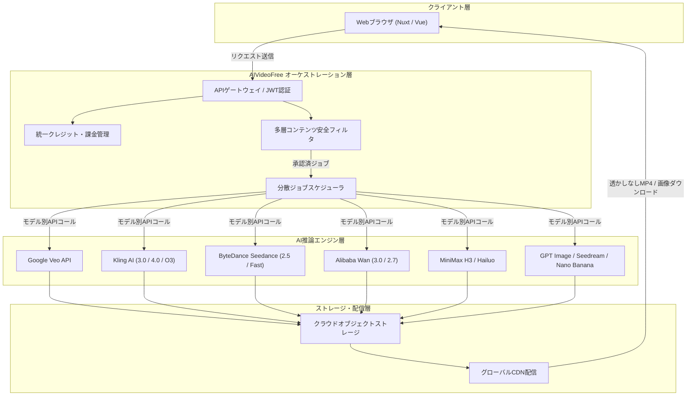

# **AIVideoFree 調査レポート**

## **1. 基本情報**

* **ツール名**: AIVideoFree (AI Video Free)
* **ツールの読み方**: エーアイ ビデオ フリー
* **開発元**: AiVideoFree Team（シンガポール拠点のソフトウェア開発チーム）
* **公式サイト**: [https://www.aivideofree.com/](https://www.aivideofree.com/)
* **関連リンク**:
  * ドキュメント: [AI Models 一覧・機能仕様](https://www.aivideofree.com/models)
  * 料金プラン: [Pricing](https://www.aivideofree.com/pricing)
  * お問い合わせ: [Contact Us](https://www.aivideofree.com/contact-us)
  * 利用規約: [Terms of Service](https://www.aivideofree.com/terms-of-services)
  * プライバシーポリシー: [Privacy Policy](https://www.aivideofree.com/privacy-policy)
* **カテゴリ**: AI動画生成プラットフォーム
* **概要**: AIVideoFreeは、Google Veo、Kling 3.0/4.0、Seedance 2.5、Wan 3.0、MiniMax H3など世界主要の最先端動画生成・画像生成モデルを単一のWebインターフェースと共通クレジット残高で利用できるオンライン生成プラットフォームである。アカウント登録時に無料クレジットが付与され、無料枠・有料枠を問わずウォーターマーク（透かし）なし・商用利用権付きでMP4動画や画像を出力できる。クレジットに有効期限がなく、個別ツールのサブスク契約を一本化できるコストパフォーマンスと手軽さを強みとしている。

## **2. 目的と主な利用シーン**

* **解決する課題**:
  * **個別ツールの多重契約コストと管理負担**: Veo、Kling、Seedance、Wan、Hailuoなど複数の高性能AIモデルを試すために各サービスで個別サブスクリプションを契約しなければならず、月額費用やアカウント管理が肥大化する課題。
  * **無料プランの厳しい制限**: 他社サービスで一般的なウォーターマーク（透かしロゴ）の強制付与、低解像度制限、商用利用禁止といった制約により、無料枠の成果物を業務や公開コンテンツに活用できない課題。
  * **未使用クレジットの月次失効**: 多くのサブスクリプション型サービスで発生する「毎月末に使い切れなかったクレジットが消滅する」という費用の無駄。
  * **制作ワークフローの複雑さ**: 専用GPUサーバーの構築や複雑なプロンプト構文、外部動画編集ソフト（Premiere ProやAfter Effects）の操作知識がないと高品質なAI動画を作成できない参入障壁。
* **想定利用者**:
  * **SNSコンテンツクリエイター / インフルエンサー**: TikTok、Instagram Reels、YouTube Shorts向けのショート動画を日常的に大量制作するクリエイター。
  * **デジタルマーケター / 広告運用担当者**: 多様なクリエイティブパターンやアスペクト比で動画広告・バナー素材を短期間でA/Bテストしたいマーケティング担当。
  * **EC事業者 / 商品企画担当者**: 商品写真から立体的な回転・着用動画を生成し、購入率向上やカタログ制作のコスト削減を図りたい事業者。
  * **映像ディレクター / デザイナー**: CM・プロモーション映像の初期コンセプト設計、絵コンテ・プレビズ（Pre-visualization）を素早く可視化したい制作者。
* **利用シーン**:
  * **静止画からのプロモーション動画生成（Image to Video）**: 撮影済みの商品写真やキャラクターイラストを入力し、SeedanceやKlingで自然なカメラワークと動きを付与した製品紹介リールを作成。
  * **テキストからのシネマティック映像生成（Text to Video）**: 自然言語による情景描写からVeoやMiniMax H3を用いて最長30秒のシネマティックな高品質映像を生成。
  * **SNSバイラル動画・エンタメコンテンツ制作**: 「AI Hug Video（AIハグ動画）」や「AI Kissing Video（AIキス動画）」などの特化機能を用い、2枚の写真から感情的なインタラクション動画を作成。
  * **既存映像のアセット補正・再編集**: 動画顔入れ替え（Video Face Swap）、動画ウォーターマーク除去（Video Watermark Remover）、動画高画質化（AI Video Enhancer）を組み合わせた既存フッテージの最適化。

### **2.1 代表的な利用フロー (スイムレーン)**

```mermaid
swimlane-beta TB
  subgraph "ユーザー"
    A[プロンプト入力または画像アップロード]
    D[生成完了プレビューの確認]
    E[透かしなしMP4動画をダウンロード]
  end
  subgraph "AIVideoFree プラットフォーム"
    B[モデル選択・クレジット見積もり・入力検証]
    C[推論ジョブ発行とキュー制御]
  end
  subgraph "外部AI推論基盤"
    F[モデル実行（Veo / Kling / Seedance等）]
    G[レンダリング・エンコーディング処理]
  end
  A --> B
  B --> C
  C --> F
  F --> G
  G --> D
  D --> E
```

* **代表的な流れ**: ユーザーがWebブラウザ上でプロンプトや画像を入力し、プラットフォームがクレジット消費量を明示して安全性を検証した後、最適な外部基盤モデル（Veo/Kling/Wan等）へジョブをディスパッチする。レンダリング完了後はウォーターマークなしのMP4として即座にブラウザ上でプレビュー・ダウンロードが可能となる。

## **3. 主要機能**

* **Text to Video（テキストからの動画生成）**: 詳細なテキストプロンプトからカメラワーク、ライティング、被写体のダイナミックなアクションを含む高精細な動画クリップを生成する。
* **Image to Video（静止画からの動画生成）**: 1枚のアップロード写真を動画の開始フレーム（Frame 1）として認識し、自然な物理挙動やカメラのパニング・ズームを伴う動画を生成する。
* **マルチモデル統合セレクター（13種以上の動画モデル）**: Google Veo（写実性）、Seedance 2.5（最長30秒テイク・音響連動）、Kling 3.0/4.0（ディレクターモード・4Kマルチショット）、Wan 3.0（ドキュメント動画化）、MiniMax H3（2K高品質・低コスト）、Hailuo 2.3（人物モーション）などを単一画面で自由に切り替え可能。
* **統合画像生成スイート（10種以上の画像モデル）**: GPT Image 2.5/2.6、Seedream 5.0 Pro（10層以上の編集可能透過レイヤー出力）、Nano Banana 2/Pro（Webグラウンディング・推論思考）、Grok Imagine 2（ベクターSVG出力）、Ideogram Character（文字入れ・タイポグラフィ）などを一括提供。
* **Video to Video & AI動画編集**: 既存の動画ファイルをアップロードし、画風の変換、スタイル転送、尺の延長、ディレクターモードによる複数カットの再構成を実施。
* **特化型バイラルコンテンツジェネレータ**: 2枚の写真から人物同士が抱き合う動画を自動生成する「AI Hug Video」や「AI Kissing Video」、写真の服装を自在に変更できる「AI Clothes Changer / Swimwear Try-On」をワンクリックで実行。
* **AIビデオユーティリティツール群**: 動画内の人物の顔を自然に差し替える「Video Face Swap」、不要な静的・動的ロゴを除去する「Video Watermark Remover」、低解像度動画の鮮鋭度を高める「AI Video Enhancer」を搭載。
* **統一ウォレット＆永続クレジットシステム**: すべてのモデル・ツールを単一のクレジット残高から消費。購入したクレジットおよび付与クレジットは月次失効せず無期限で保持される。

## **4. 動作原理・システム構成**

* **アーキテクチャ**: クラウド完結型SaaS。クライアントはモダンWebブラウザ（PCおよびモバイル）で完結し、バックエンドのオーケストレーション基盤が多言語フロントエンド、認証・ウォレット管理、安全検査、外部の異種AIモデルAPI群を調停する構成をとる。



* **主要コンポーネントとデータフロー**:
  * **フロントエンド**: Nuxt/VueベースのSPA/SSRハイブリッド構成。日本語を含む17言語以上のローカライズ（i18n）に対応し、レスポンシブデザインによりスマートフォンブラウザからも操作可能。
  * **APIゲートウェイ & セキュリティフィルタ**: ユーザー認証（Google OAuthまたはメールトークン）を行い、ユーザーが送信したプロンプトや画像に対し、未成年者保護、非合意ディープフェイク、暴力表現等を検知するモデレーションフィルタを実行。
  * **統一クレジットエンジン**: 各モデルごとに設定された必要クレジット（標準15クレジット等）をユーザーウォレットから事前検証・仮押さえし、正常完了時に消費を確定。
  * **分散ジョブスケジューラ & モデルアダプター**: 各基盤モデル（Google、Kuaishou、ByteDance、Alibaba、MiniMax等）の独自API仕様の差分を吸収し、プロンプト・参照画像・パラメータを正規化して非同期リクエストを発行。
  * **レンダリング & ストレージ**: 生成された動画・画像は暗号化通信を介してオブジェクトストレージへ格納され、透かしのないオリジナル品質のままグローバルCDNを通じてユーザーにストリーミング/ダウンロード提供される。
* **特筆すべき要素技術**:
  * **マルチリファレンス & キーフレーム制御**: Kling 4.0やFLUX 3、Luma Ray 3.2などにおいて、最大15枚の入力画像や最大16箇所のキーフレームを指定して一貫性を保つ高度な制御パラメータに対応。
  * **レイヤー分割生成（Seedream 5.0 Pro）**: 単一のフラットPNGではなく、背景・被写体・エフェクトが10層以上の透過レイヤーに分離されたアセット出力技術を統合。
  * **ベクター拡散モデル（Grok Imagine 2）**: 拡大縮小しても劣化しない編集可能なネイティブSVG形式のロゴ・アイコン出力を可能にするベクターレンダリング。

## **5. 開始手順・セットアップ**

* **前提条件**:
  * HTML5およびモダンJavaScriptに対応したWebブラウザ（Google Chrome, Apple Safari, Microsoft Edge, Mozilla Firefox等）
  * アカウント認証用のGoogleアカウントまたはメールアドレス
  * 特別なGPU環境やクライアントソフトウェアのインストールは不要
* **導入・利用手順**:

  1. **公式サイトへのアクセス**:
     ブラウザで公式サイト [https://www.aivideofree.com/](https://www.aivideofree.com/) にアクセスする。
  2. **無料アカウント登録**:
     画面右上の「Login」または「Start Free」ボタンをクリックし、Googleアカウントまたはメールアドレスでサインアップする。クレジットカード情報の入力は不要で、即座に無料クレジット（10〜88クレジット）がウォレットに付与される。
  3. **機能とモデルの選択**:
     ヘッダーナビゲーションまたはホーム画面から希望する機能（例：「Text to Video」「Image to Video」）を選択し、モデルドロップダウンから使用するAIモデル（Seedance 2.5、Kling 3.0、Veoなど）を選ぶ。
  4. **プロンプト入力・アセット配置**:
     テキストプロンプトを入力（英語推奨、日本語も可）、または静止画ドラッグ＆ドロップでアップロードする。画面上に必要クレジット（例: 15 Credits）が表示されることを確認する。
  5. **生成実行とダウンロード**:
     「Generate Free」をクリックすると推論キューに投入され、数秒〜数十秒でプレビュー画面に動画が表示される。右下のダウンロードアイコンからウォーターマークなしのMP4ファイルを保存する。

## **6. 特徴・強み (Pros)**

* **主要フラグシップモデルのオールインワン利用**: Veo（Google）、Kling（Kuaishou）、Seedance（ByteDance）、Wan（Alibaba）、MiniMaxなど、世界最高峰の動画生成AIをサービスごとに個別契約することなく、同一アカウント・同一クレジットで横断利用できる。
* **無料枠でも完全ウォーターマークなし**: 一般的な生成AIプラットフォームの無料プランと異なり、無料クレジットで生成した動画であっても透かしロゴが一切入らず、納品物や公開動画にそのまま使用できる。
* **商用利用権が標準付帯**: 無料・有料を問わず、プラットフォーム上で生成した画像・動画の権利はユーザーに帰属し、広告、クライアントワーク、EC商品プロモーションなどの商用プロジェクトに制限なく利用可能。
* **クレジットの有効期限なし（消滅リスクゼロ）**: 月額サブスクリプションだけでなく都度払いのクレジットパック（$6.90〜）が充実しており、付与・購入されたクレジットは退会しない限り永続的に保持されるため、利用頻度が不定期なユーザーでも無駄が発生しない。
* **多彩な実務・SNS特化ツール群**: 単純な動画生成にとどまらず、顔入れ替え、透かし除去、動画高画質化、AIハグ/キス、服の着せ替えなど、実務やSNS運用ですぐに役立つユーティリティが網羅されている。

## **7. 弱み・注意点 (Cons)**

* **初期無料枠のボリュームは限定的**: サインアップ時の無料クレジットは地域により10〜88クレジット（動画生成約1〜5回分）であり、継続して大量の動画を生成するにはクレジットパック購入またはサブスクリプション契約が必要。
* **外部開発者向けAPI・SDKの未提供**: 2026年11月現在、外部システム連携用REST APIやWebhook、公式Python/Node.js SDKなどは公開されておらず、ブラウザ画面経由の手動操作が前提となる。
* **プロバイダ混雑時のレイテンシ**: 外部の基盤モデル推論基盤の稼働状況に依存するため、グローバルでアクセスが集中した時間帯には動画生成完了まで1〜2分程度の待ち時間が発生することがある。
* **一部モデルにおける日本語プロンプト理解の差**: 英語プロンプトを前提に学習されたモデル（WanやKling等）では、複雑な日本語構文を入力すると意図通りのカメラワークやオブジェクトが反映されにくい場合があり、DeepLやChatGPT等での英語翻訳を挟むことが推奨される。

## **8. 料金プラン**

AIVideoFreeは、初回無料枠に加え、「買い切りクレジットパック（One-Time Payment）」と「年額/月額サブスクリプション（Plans & Pricing）」の2通りの課金体系を提供している。購入したクレジットは有効期限がなく、すべてのモデルで共通して利用可能。

| プラン / パック名 | 価格 (USD) | 付与クレジット | 特徴・主な対象 |
|:---|:---|:---:|:---|
| **Free Plan (無料枠)** | **無料** | 10〜88 クレジット | サインアップ時に即時付与。クレカ不要。全モデル利用可能、透かしなし、商用利用可、Seedance Fastによる1日3回のドラフト枠 |
| **Starter Pack** | **$6.90** (都度) | 600 クレジット | たまに利用する個人・お試し向け。有効期限なし |
| **Small Pack** | **$14.90** (都度) | 1,500 クレジット | 小規模プロジェクト向け。短編クリップ制作に最適 |
| **Medium Pack** | **$29.90** (都度) | 3,500 クレジット | 定期的にコンテンツを投稿する一般クリエイター向け |
| **Large Pack** | **$59.90** (都度) | 8,000 クレジット | パワーユーザー向け。動画・画像を日常的に制作 |
| **Pro Pack** | **$89.90** (都度) | 13,000 クレジット | プロフェッショナル制作者・マーケター向け |
| **Mega Pack** | **$129.90** (都度) | 24,000 クレジット | 最大ボリュームパック。1クレジットあたりの単価が最安 |
| **Basic Plan (年額)** | **$7.40 /月**<br><small>（年額一括 $88.80 / 17%割引）</small> | 14,400 クレジット/年<br><small>（一括付与）</small> | 年間最大7,200枚以上の画像、または最大1,000本以上の動画生成が可能。毎週制作するユーザー向け |
| **Plus Plan (年額)** | **$16.60 /月**<br><small>（年額一括 $199.20 / 17%割引）</small> | 36,000 クレジット/年<br><small>（一括付与）</small> | 最も人気のあるプラン。年間最大18,000枚以上の画像、または最大25,000本以上の動画生成が可能 |

* **課金体系**: クレジット消費型課金（生成するモデル、動画の長さ、解像度に応じて都度クレジットが差し引かれる。標準的な動画生成は1回あたり約15クレジット）。
* **無料トライアル・無料枠**: クレジットカード登録不要。アカウント作成と同時に無料クレジットが付与される。

## **9. 導入実績・事例**

* **導入企業・利用層**: 公開されているエンタープライズ契約の企業ロゴは非公開であるが、北米・欧州・アジアを中心に個人クリエイター、SNSマーケティングエージェンシー、EC事業者、インディーゲーム開発者など幅広い層で利用されている。
* **導入事例・活用パターン**:
  * **SNSマーケティングエージェンシー**: 複数クライアントのショート動画広告（TikTok/Instagram）を短納期で制作。Seedance 2.5とKling 3.0を使い分け、従来の映像撮影コストを約80%削減しつつ週次20本以上のA/Bテスト動画を配信。
  * **D2CアパレルEC**: 自社製品のモデル着用写真をアップロードし、「AI Clothes Changer」と「Image to Video」を活用して動的なルックブック動画を生成。商品ページの滞在時間向上とCVR改善を実現。
  * **YouTubeコンテンツクリエイター**: 歴史解説やSFストーリーの解説動画用Bロール映像としてVeoやMiniMax H3の生成映像を採用。商用利用可能かつ透かしなしのため、YouTube収益化チャンネルで安全に運用。
* **対象業界**: デジタル広告・マーケティング、アパレル・EC、ソーシャルメディアエンタメ、インディー映像制作。

## **10. サポート体制**

* **ドキュメント**:
  * [AI Models ガイド](https://www.aivideofree.com/models): 23種類の動画・画像モデルそれぞれの強み、解像度、推奨ユースケース、コストを1行解説した仕様ガイドを提供。
  * [FAQ セクション](https://www.aivideofree.com/pricing): 無料クレジットの仕様、商用利用規約、透かしの有無、禁止事項などを網羅。
* **コミュニティ**:
  * 現状、公式Discordや専用フォーラムは常設されていないが、RedditやX（旧Twitter）上でユーザーによるプロンプト共有や生成テクニックのディスカッションが行われている。
* **公式サポート**:
  * 問い合わせ専用メール窓口: `support@aivideofree.com`
  * 問い合わせフォーム: [Contact Us](https://www.aivideofree.com/contact-us)
  * 対応時間: 平日営業日（月〜金）に原則24〜48時間以内の一次返答を実施。アカウント障害、請求・クレジットの不具合、DMCA著作権侵害申立に個別対応。

## **11. エコシステムと連携**

### **11.1 API・外部サービス連携**

* **API**: 2026年11月現在、外部開発者向けの公開REST APIやSDKは提供されていない。すべての操作はWebインターフェース経由で実行される。
* **外部サービス連携**:
  * **シングルサインオン (SSO)**: Googleアカウント連携によるワンクリックサインインに対応。
  * **決済基盤**: クレジットカード決済および主要オンライン決済に対応。
  * **映像編集ソフトとの連携**: 出力フォーマットは標準的なMP4（H.264 / AAC）およびPNG/JPEG/SVGのため、Adobe Premiere Pro、DaVinci Resolve、Final Cut Pro、CapCutなどの主要動画編集ソフトウェアにそのままインポートして編集可能。

### **11.2 技術スタックとの相性**

ブラウザベースSaaSとしての各種環境および外部制作ツールとの親和性を以下に示す。

| 技術スタック / 制作環境 | 相性 | メリット・推奨理由 | 懸念点・注意点 |
|:---|:---:|:---|:---|
| **モダンPCブラウザ (Chrome / Edge / Brave)** | ◎ | ハードウェアアクセラレーションを活用した高速プレビュー・動画再生が可能 | キャッシュ容量やタブの開きすぎによるメモリ圧迫に留意 |
| **モバイルブラウザ (iOS Safari / Android Chrome)** | ◎ | レスポンシブUIが最適化されており、スマホから直接撮影画像をアップロード・生成可能 | 長尺動画生成時のバックグラウンド実行はセッション切断に注意 |
| **動画編集ソフト (Premiere Pro / DaVinci Resolve)** | ◎ | 透かしなしの標準MP4ファイルが出力されるため、タイムラインへの配置やカラーグレーディングが容易 | Luma Ray等の一部モデルを除き標準は8-bit SDRのため過度な色補正には限界あり |
| **SNSプラットフォーム (TikTok / Instagram / Shorts)** | ◎ | 9:16の縦型アスペクト比出力に対応し、ダウンロード後そのまま投稿可能 | 音声トラックの有無はモデルによって異なるためBGMの追加編集を推奨 |
| **外部CI/CD・自動化スクリプト (Python / Node.js)** | △ | 公式REST APIが未提供のため、API経由でのバッチ自動生成や定期実行は非対応 | Web画面の手動操作が必要 |

## **12. セキュリティとコンプライアンス**

* **認証**: Google OAuth 2.0による安全なソーシャルログイン、およびメールアドレス・暗号化パスワード認証をサポート。
* **データ管理**:
  * **通信の保護**: 全通信経路にHTTPS（TLS 1.3）を採用。
  * **モデル学習への非流用ポリシー**: 利用規約において、「ユーザーの明示的な同意がない限り、プライベートに生成されたコンテンツ（プロンプト・出力物）をプラットフォーム側がAIモデルの再学習に使用することはない」と明記されている。
  * **所有権の帰属**: 規約に準拠している限り、入力されたプロンプト・画像（Input）の権利はユーザーが保持し、生成された動画・画像（Output）の所有権もユーザーに帰属する。
* **準拠規格・法制度**:
  * **準拠法**: 米国カリフォルニア州法に準拠。
  * **DMCA対応**: 著作権侵害の申立窓口（`support@aivideofree.com`）を常設し、権利侵害コンテンツの削除要請に迅速に対応する体制を整備。
  * **コンテンツポリシー & ガードレール**: 未成年者保護（児童性的虐待素材・搾取の厳禁）、本人の同意のないディープフェイクや性的画像・顔入れ替えの禁止、詐欺・中傷・違法行為の禁止を定めており、違反アカウントは事前予告なく凍結される。

## **13. 操作性 (UI/UX) と学習コスト**

* **UI/UX**:
  * インターフェースは直感的な3ステップ（「画像・プロンプト投入」→「モデル選択」→「生成・保存」）で構成されており、複雑な設定画面に迷うことなく制作に着手できる。
  * 生成ボタンを押す前に必要なクレジット数が画面上に明示されるため、予期せぬクレジット浪費を防ぐことができる。
  * 多言語切り替えがスムーズで、日本語インターフェースにも対応している。
* **学習コスト**:
  * **極めて低い**: 従来の動画編集ソフトウェアに必要なキーフレーム操作、タイムライン管理、コーデック設定などの専門知識は一切不要。AIツールの利用経験が浅い初心者であっても、数分で最初のAI動画を完成させることができる。

## **14. ベストプラクティス**

* **効果的な活用法 (Modern Practices)**:
  * **低コストモデルでドラフト検証後に高精細モデルで本番レンダリング**: 最初からVeoやKling 4.0などの高負荷モデルを使わず、まずは無料枠や低コストモデル（Seedance FastやHailuo 2.3）でプロンプトの構図やカメラワークの傾向をテストし、納得がいった構図に対してプレミアムモデルを適用する。
  * **高解像度静止画からのImage to Video**: Text to VideoよりもImage to Videoのほうが被写体の造形や色調の破綻が少ない。まず「GPT Image 2.5」や「Seedream 5.0 Pro」で理想のキービジュアルを生成し、それを開始フレームとして動画化することで完成度が劇的に向上する。
  * **Wan 3.0を活用したドキュメント・資料の自動動画化**: PDFやプレゼン資料、スプレッドシートの内容を読み取って動画化できるWan 3.0の特性を活かし、社内報告やサービス概要のダイジェスト映像を素早く生成する。
* **陥りやすい罠 (Antipatterns)**:
  * **1つのプロンプトに複数の複雑なアクションを詰め込む**: 「女性が走って立ち止まり、鞄からスマホを取り出して電話をかけ、笑顔で空を見上げる」といった多段階の動作を1本の短い動画に指示すると、被写体の手足が歪んだり動作が途中で消失しやすい。1テイクにつき1つの主要な動き（例:「ゆっくりと振り返り微笑む」）に絞るのが定石。
  * **モデルごとの特性を無視した同一プロンプト運用**: 各モデルには「写実性に強い（Veo）」「長尺テイクに強い（Seedance 2.5）」「カット割り・複数ショットに強い（Kling 3.0）」など明確な特性がある。用途に合わせてモデルを適切に切り替えないと期待した結果が得られない。
  * **他者の肖像権・商標を無断で使用するプロンプト入力**: 実在の有名人の顔写真や著名キャラクターを無断で使用すると、プラットフォームの安全性フィルタによって生成が拒絶されたり、商用利用時に法的リスクを負う可能性がある。

## **15. ユーザーの声（レビュー分析）**

* **調査対象**: 海外AIツールアグリゲーター（AgentLocker, AIFinderTools）、クリエイターコミュニティ、SNSフィードバック。
* **総合評価**: **4.3 / 5.0**
* **ポジティブな評価**:
  * **「無料枠でもウォーターマークが入らないのが本当に助かる」**: 他の動画生成AIでは無料プランだと巨大なロゴが中央や右下に入って使い物にならないことが多いが、AIVideoFreeは完全にクリーンなMP4が手に入る点が絶賛されている。
  * **「個別ツールのサブスクを解約して一本化できた」**: KlingやLuma、Veoなどを個別に契約すると月額数万円に達するが、必要な時に都度クレジットパックを買って好きなモデルを横断利用できるため、大幅なコスト削減になったという声が多い。
  * **「クレジットに有効期限がない安心感」**: 繁忙期以外は動画をあまり作らない月があっても、購入したクレジットが消滅しないため精神的なストレスがないと評価されている。
* **ネガティブな評価 / 改善要望**:
  * **「無料クレジットは数回で使い切ってしまう」**: 初回付与の無料クレジット（10〜88クレジット）は動画生成数本分で終わるため、「完全無料」という名称に期待しすぎると課金が必要になるタイミングが早く感じるという指摘。
  * **「API経由でバッチ処理をしたい」**: 大量の商品動画や広告バリエーションを自動生成したいマーケターから、REST APIやZapier連携の提供を求める要望が挙がっている。
  * **「混雑時の生成待ち時間」**: 夜間や週末など世界的なピークタイムに生成リクエストが重なると、プログレスバーが一時停止して完了まで数分かかることがある。
* **特徴的なユースケース**:
  * **メモリアル動画（AI Hug）の作成**: 昔の写真や離れて暮らす家族の写真、あるいは亡くなった親族の写真を2枚組み合わせて「AI Hug」を生成し、温かい再会シーンとして家族へプレゼントする用途で大きな反響を呼んでいる。

## **16. 直近半年のアップデート情報**

* **2026-10-15**: 新世代動画モデル「Google Veo」「Seedance 2.5」「Alibaba Wan 3.0」「Kling 4.0」の追加提供を開始。4K出力や最長30秒の長尺テイクに対応。
* **2026-08-20**: 編集可能ベクターSVG出力に対応した「Grok Imagine 2」および10層以上の透過レイヤー出力が可能な「Seedream 5.0 Pro」を画像生成ラインナップに追加。
* **2026-06-12**: 「AI Video Face Swap（動画顔入れ替え）」および「AI Video Enhancer（動画超解像・高画質化）」ツールを全面刷新し、処理速度と自然なフェイシャルトラッキング精度を向上。
* **2026-05-10**: 利用規約（Terms of Service）を改定。生成物の完全な商用利用権とユーザーへの著作権・所有権帰属条項を法的に明確化。
* **2026-03-23**: プライバシーポリシー（Privacy Policy）を更新。プライベートなユーザー生成データをモデル学習に流用しないオプトアウト保証を明文化。

(出典: [AiVideoFree 公式モデル仕様一覧](https://www.aivideofree.com/models))

## **17. 類似ツールとの比較**

### **17.1 機能比較表 (星取表)**

| 機能カテゴリ | 機能項目 | AIVideoFree | Dreamina (ByteDance) | Luma AI (Dream Machine) | Kling AI (Kuaishou) |
|:---:|:---|:---:|:---:|:---:|:---:|
| **モデル多様性** | 複数社モデルの横断利用 | ◎<br><small>Veo/Kling/Wan等23種</small> | ×<br><small>自社Seaweed系のみ</small> | ×<br><small>自社Ray系のみ</small> | ×<br><small>自社Kling系のみ</small> |
| **動画生成** | Text to Video / Image to Video | ◎<br><small>全モデルで対応</small> | ◎<br><small>高品質・高フレームレート</small> | ◎<br><small>カメラワーク指定</small> | ◎<br><small>最大4K・マルチショット</small> |
| **生成制限** | 無料枠での透かし除去 | ◎<br><small>完全透かしなし</small> | △<br><small>無料枠は制限あり</small> | ×<br><small>無料版は透かし付与</small> | △<br><small>無料枠は低解像度/透かし</small> |
| **課金柔軟性** | クレジット有効期限なし | ◎<br><small>無期限・買い切り対応</small> | ×<br><small>月次失効制</small> | ×<br><small>月次失効制</small> | ×<br><small>月次失効制</small> |
| **編集機能** | 顔入れ替え・透かし除去 | ◎<br><small>専用ツール群を統合</small> | ◯<br><small>キャンバス編集あり</small> | △<br><small>生成後の編集は限定的</small> | ◯<br><small>要素追加・置換機能あり</small> |
| **ライセンス** | 生成物の商用利用権 | ◎<br><small>無料枠含め商用利用可</small> | ◯<br><small>有料プラン推奨</small> | ◯<br><small>有料プラン推奨</small> | ◯<br><small>有料プラン推奨</small> |
| **開発者機能** | 外部REST API提供 | ×<br><small>ブラウザUI完結</small> | △<br><small>一部APIあり</small> | ◎<br><small>公式API充実</small> | ◎<br><small>公式API充実</small> |
| **多言語対応** | 日本語UIサポート | ◯<br><small>17言語対応（日本語UIあり）</small> | ◯<br><small>日本語UIあり</small> | △<br><small>英語中心</small> | ◯<br><small>日本語UIあり</small> |

### **17.2 詳細比較**

| ツール名 | 特徴 | 強み | 弱み | 選択肢となるケース |
|:---|:---|:---|:---|:---|
| **AIVideoFree** | 多数の基盤モデル（Veo/Kling/Seedance/Wan等）を1つのクレジットで使えるマルチモデル生成ハブ | 透かしなし出力、クレジット有効期限なし、都度買い切り可能、複数モデルの比較が容易 | 外部API未提供、初回無料クレジット数は数回分 | 特定の単一モデルに縛られず、案件ごとに最適なモデルを透かしなしで手軽に使いたいクリエイター・マーケター |
| **Dreamina** | ByteDanceが開発する高品質な画像・動画生成プラットフォーム | キャラクターや構図の一貫性が高く、CapCut等のエコシステムと親和性が高い | 独自モデルに限定され、未使用クレジットは月末で失効する | TikTokやショート動画向けのトレンド感あるアニメ・実写映像を一貫して量産したい場合 |
| **Luma AI** | シネマティックなカメラワークと3D空間表現に強い動画生成AI（Dream Machine / Ray） | 物理シミュレーションとカメラ移動のリアリズム、開発者向けAPIが堅牢 | 単一モデルのみ、無料版には透かしが付与され商用利用に制約 | 映画的なカメラアングルや高度な演出、API経由でのシステム自動化を行いたい場合 |
| **Kling AI** | 快手（Kuaishou）が開発する高精細・長尺動画生成モデルの代表格 | 4K解像度、リップシンク、マルチショットディレクター機能の完成度が高い | 公式サブスクが高価格帯、クレジットの繰り越し不可 | 人物のダイナミックなアクションや本格的な短編映画・MVを制作したい場合 |

## **18. 総評**

* **総合的な評価**:
  AIVideoFreeは、急速に細分化・乱立する生成AIモデル市場において、「複数モデルの横断利用」「ウォーターマークなし出力」「クレジット有効期限なし」というユーザーファーストな設計思想を徹底した極めて実用性の高いプラットフォームである。Google Veoのリアルさ、Klingの構図力、Seedanceの長尺持続力など、各モデルの強みを1つのUIと同一のウォレットで使い分けられる点は、クリエイターにとって大きなコスト削減と制作効率の向上をもたらす。
* **推奨されるチームやプロジェクト**:
  * **小規模マーケティングチーム / 個人クリエイター**: 複数の高額な生成AIサブスクリプションを個別に維持する予算がなく、必要なときに必要な分だけ高品質な透かしなし動画・画像を制作したいチーム。
  * **SNS運用・コンテンツ量産プロジェクト**: TikTok、Reels、Shortsなどで日々新しいビジュアルやバイラル動画（AIハグ、着せ替え等）を素早くテストし、効果検証を行いたいプロジェクト。
  * **初期絵コンテ・プレビズ制作者**: 映像制作の企画初期段階で、様々なモデルの画風を比較検討しながらクライアントへのプレゼン素材を作成したい制作者。
* **選択時のポイント**:
  * 単一の特定モデルに深く依存し、月間数百本以上の動画をAPI経由でフル自動生成したいエンタープライズ用途には、Luma AIやKlingの公式API直接契約が適している。
  * 一方で、手動ブラウザ操作で十分であり、案件ごとに「今回はVeoでリアルに」「今回はSeedanceで30秒テイクを」「今回はGrokでSVGロゴを」と柔軟にモデルを使い分けたい場合や、クレジットを月末に失効させず無駄なく使いたい場合は、AIVideoFreeが最もコストパフォーマンスに優れた選択肢となる。
