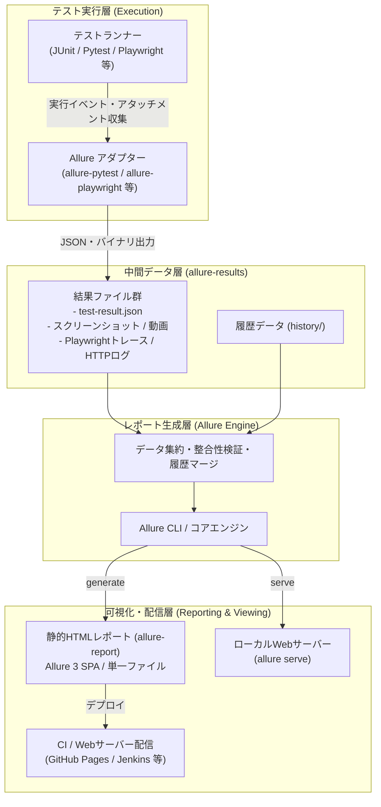

# **Allure Report 調査レポート**

## **1. 基本情報**

* **ツール名**: Allure Report
* **ツールの読み方**: アリュール レポート
* **開発元**: Qameta Software
* **公式サイト**: [https://allurereport.org/](https://allurereport.org/)
* **関連リンク**:
  * GitHub: [https://github.com/allure-framework/allure2](https://github.com/allure-framework/allure2)
  * DeepWiki: [https://deepwiki.com/allure-framework/allure2](https://deepwiki.com/allure-framework/allure2)
  * ドキュメント: [https://allurereport.org/docs/](https://allurereport.org/docs/)
* **カテゴリ**: テスト自動化SaaS
* **概要**: 多くのプログラミング言語やテストフレームワークに対応した、軽量で拡張性の高いオープンソースのテストレポート生成ツール。自動テストの実行結果、ステップごとの詳細ログ、エラー情報、スクリーンショットやトレースファイルを整理し、ステークホルダーが一目で把握できる高品質な対話型HTMLレポートを出力する。

## **2. 目的と主な利用シーン**

* **解決する課題**: 自動テストのコンソールログや単なるXMLレポートだけでは直感的な結果把握が難しく、テスト失敗原因の特定や品質状況の共有に多くの時間がかかるという課題を解決する。
* **想定利用者**: QAエンジニア、テスト自動化エンジニア、ソフトウェア開発者、プロジェクトマネージャー
* **利用シーン**:
  * **日次のCI/CDパイプライン実行**: 夜間やマージリクエストごとに実行されたE2E/結合テストの結果をダッシュボード形式で一括確認する。
  * **迅速なデバッグと原因究明**: テスト失敗時に埋め込まれたスクリーンショット、動画、HTTP通信ログ、Playwrightトレースを直接確認してバグ原因を特定する。
  * **品質傾向・リトライ履歴の分析**: パラメータ化テストの各バリアントの傾向や、不安定なテスト（Flaky test）のリトライ結果を時系列で追跡する。

### **2.1 代表的な利用フロー**

```mermaid
swimlane-beta TB
  subgraph QA["QAエンジニア・開発者"]
    A[テストコード実装・CIプッシュ]
    F[ダッシュボード確認・障害分析]
  end
  subgraph Runner["テストフレームワーク"]
    B[テスト実行・ログや証跡を収集]
  end
  subgraph Adapter["Allure アダプター"]
    C[JSON結果・添付ファイルの出力]
  end
  subgraph Core["Allure Report CLI"]
    D[履歴統合と静的レポート生成]
  end
  subgraph Hosting["CIアーティファクト・Webサーバー"]
    E[レポート公開・ホスティング]
  end
  A --> B
  B --> C
  C --> D
  D --> E
  E --> F
```

* **代表的な流れ**: 開発者やQAがテストを実行すると、各言語用Allureアダプターがテストイベントや添付ファイルをリアルタイムにJSON/バイナリ形式で中間出力する。その後Allure CLIが中間ファイルと過去の履歴を集約して洗練された対話型HTMLレポートを生成し、CI環境やホスティングサーバー経由で関係者が閲覧・分析を行う。

## **3. 主要機能**

* **マルチ言語・フレームワーク対応**: Java (JUnit, TestNG), Python (Pytest), JavaScript/TypeScript (Playwright, Cypress, Jest), C# (.NET), Ruby, Goなど、主要な言語・テストランナー向けのアダプターが完備されている。
* **対話的ダッシュボードとAllure 3新テーマ**: 概要（Overview）、カテゴリ（Categories）、スイート（Suites）、グラフ（Graphs）、タイムライン（Timeline）、振る舞い（Behaviors）、パッケージ（Packages）など多彩な視点で結果を可視化。ダークモードやAllure 3ブランドテーマにも対応。
* **テスト実行単位（Run-level）のエラーおよび添付ファイル対応**: スイートや個別テストケースに収まらないグローバルなセットアップエラーや実行全体のログ・添付ファイルをレポート上で適切に表示（v2.46.0で追加）。
* **パラメータ化テストの個別バリアント識別**: 複数結果ディレクトリにまたがるパラメータ化テストの実行バリアントを混同せず独立して識別・追跡（v2.45.0で追加）。
* **Playwrightトレースの直接プレビュー**: レポート内のあらゆる表示モードからPlaywrightのTraceファイルを直接開いてトレースビューアで検証可能（v2.44.0で強化）。
* **タイムラインでのリトライ・即時テスト可視化**: 再試行（Retries）されたテストや短時間で終了したインスタントテストの実行状況をタイムライン上で明瞭に把握可能（v2.42.1で改善）。
* **リッチなアタッチメント対応**: スクリーンショット、動画、テキストログ、WebP画像、HTTP Exchange通信ログ（リクエスト/レスポンス）などの多彩な証跡をテストステップ単位で添付可能。
* **履歴（History）とトレンド追跡**: 過去のビルド結果を引き継ぎ、成功率の推移や期間ごとの品質改善度をグラフィカルに追跡可能。
* **CI/CD・課題管理ツール連携**: Jenkins, GitHub Actions, GitLab CI, TeamCityなどのCI基盤、およびJira Cloudとのスムーズな連携をサポート。

## **4. 動作原理・システム構成**

Allure Reportは、テスト実行環境からレポート生成・配信までを分離した「2フェーズ・アーキテクチャ」を採用している。



* **アーキテクチャ**: ローカルファーストかつCI/CD組み込み型の静的サイトジェネレーター方式。テスト実行時のオーバーヘッドを最小化するため、ランタイム側ではアダプターが軽量なJSONとバイナリファイルを書き出すのみとし、重い集計やレンダリング処理はCLIツールが一括して静的HTMLとしてビルドする。
* **主要コンポーネントとデータフロー**:
  1. **Allure Adapter**: テストランナーのリスナー/フック機能を利用してテストの開始・終了・ステップ実行・アサーション失敗などのイベントを捉え、`allure-results/` ディレクトリにUUIDベースのJSONファイルと添付ファイルを書き出す。
  2. **allure-results**: テストごとの結果データとメディアファイルが格納される中間ストア。CI環境では前回の `history/` ディレクトリをマージすることで時系列の傾向分析を可能にする。
  3. **Allure Generator (CLI)**: Javaベースのコアエンジンが中間JSONファイルを走査・パースし、カテゴリ分類、エラー種別判定、テスト階層の再構築を行ってSingle Page Application (SPA) 構造の静的Webサイト（`allure-report/`）を生成する。
  4. **Viewer**: 生成されたレポートはブラウザのセキュリティ（CORS）を満たすため組み込みWebサーバー経由（`allure serve`）で開くか、または完全自己完結型の単一HTML（Single-file mode）として出力して配布する。
* **特筆すべき要素技術**:
  * **堅牢なセキュリティ対策**: パストラバーサル防止機構、XSS攻撃防御（レポート名・言語のHTMLエスケープ）、ローカルプレビュー時のサービング保護、およびXCTest plist解析時の外部エンティティ攻撃（XXE）対策を標準装備。
  * **Playwright Trace統合**: Playwrightのバイナリトレースファイルを解釈し、レポートから直接トレースビューアをシームレスに起動可能。

## **5. 開始手順・セットアップ**

* **前提条件**:
  * Java 8以上（レポート生成用CLIツールを実行する場合）
  * 各言語・テストフレームワーク環境（Python, Node.js, Java等）
* **インストール/導入**:

  ```bash
  # macOS (Homebrew)
  brew install allure

  # Windows (Scoop)
  scoop install allure

  # npm (Node.js環境のグローバルCLI)
  npm install -g allure-commandline
  ```

* **初期設定**:
  * 使用するテストフレームワークのアダプターをインストール（例: Python/Pytestの場合）:

    ```bash
    pip install allure-pytest
    ```

* **クイックスタート**:
  1. テストを実行して結果ファイルを出力:

     ```bash
     pytest --alluredir=allure-results
     ```

  2. ローカルサーバーを起動してレポートを即座に確認:

     ```bash
     allure serve allure-results
     ```

  3. 静的HTMLとしてレポートをビルド（CI配布用）:

     ```bash
     allure generate allure-results --clean -o allure-report
     ```

## **6. 特徴・強み (Pros)**

* **圧倒的なUIクオリティ**: オープンソースでありながら商用ツールに匹敵する洗練されたダッシュボードを提供。Allure 3ブランドテーマやダークモード、直感的なグラフにより、開発者だけでなくPMやステークホルダーへの報告資料としてもそのまま活用できる。
* **比類なきフレームワーク対応力**: 言語やテストランナーの枠を超えて一貫したレポーティングフォーマットを提供するため、多言語が混在するマイクロサービス構成でもレポート基盤を一本化できる。
* **高度なデバッグ支援機能**: ステップ別の実行ログ、スクリーンショット、動画、HTTP通信ペイロードに加え、Playwrightトレースの直接閲覧やRun-levelエラー表示など、障害調査を極限まで効率化する機能が満載。
* **完全なデータポータビリティと安全性**: クラウドSaaSにテストデータや内部ログを外部送信することなく、オンプレミスや自社CI/CDパイプライン内で完結して安全に管理・運用可能。

## **7. 弱み・注意点 (Cons)**

* **静的生成ステップが必要**: リアルタイムでテスト進捗をストリーミング表示する仕組みではなく、テスト完了後にレポートをビルドする2段階方式である（リアルタイム管理が必要な場合は商用のAllure TestOpsが推奨される）。
* **ローカル閲覧時のCORS制限**: 生成された `allure-report/index.html` をブラウザで直接ダブルクリックしてファイルプロトコル（`file://`）で開くと、ブラウザのセキュリティ制限によりデータが表示されない場合がある（`allure open` や `allure serve`、または単一ファイル出力オプションの利用が必要）。
* **日本語ドキュメントの不足**: レポートUI自体は多言語対応（日本語UIを含む）が進んでいるものの、公式ドキュメントや最新機能の解説は基本的に英語中心である。

## **8. 料金プラン**

| プラン名 | 料金 | 主な特徴 | 対象ユーザー |
|---------|------|---------|-------------|
| **Allure Report (OSS)** | **完全無料** | Apache 2.0ライセンス。全レポーティング機能、CLI、アダプターを無料利用可能。セルフホスト型。 | 個人開発者、QAチーム、あらゆる規模のエンジニア組織 |
| **Allure TestOps** | **商用ライセンス**<br>(要問い合わせ / クラウドおよびオンプレミス) | リアルタイムテストケース管理、テスト実行オーケストレーション、高度な障害分析、Defect管理、SSO、企業向けサポート。 | 大規模エンタープライズ、統合QAプラットフォームを求める組織 |

* **課金体系**: Allure Reportはオープンソースとして完全無料。Allure TestOpsはユーザー数やインスタンス規模に応じたサブスクリプション課金。
* **無料トライアル**: Allure TestOpsには公式サイトより申請可能な無料トライアルが提供されている。

## **9. 導入実績・事例**

* **導入企業**: 世界中のグローバルテック企業からスタートアップまで、テスト自動化を実施する数万以上の組織で事実上の業界標準として利用されている。
* **導入事例**:
  * **大規模マイクロサービス基盤**: Java, Python, Go, TypeScriptなど異なる言語で書かれた複数サービスのE2E/APIテスト結果をAllure Report形式に統合し、全社的な品質ダッシュボードを構築。
  * **モダンE2Eテストパイプライン**: PlaywrightやCypressと組み合わせ、テスト失敗時のトレースやスクリーンショットをCIのアーティファクトとして自動公開し、障害トリアージ工数を半減。
* **対象業界**: Webサービス、FinTech、EC、エンタープライズSaaS、ゲーム開発など、CI/CDと品質保証を推進するあらゆる業界。

## **10. サポート体制**

* **ドキュメント**: 公式ドキュメント（[https://allurereport.org/docs/](https://allurereport.org/docs/)）にて、言語別のセットアップガイド、アノテーション一覧、CI統合手順が網羅されている。
* **コミュニティ**: GitHub Issues、GitHub Discussions、Stack Overflow、公式Discord/Telegramなどで活発な質疑応答や情報交換が行われている。
* **公式サポート**: オープンソース版はコミュニティ主導のサポートとなるが、開発元Qameta Softwareの商用版「Allure TestOps」を導入することで専任エンジニアによるSLA付きエンタープライズサポートが提供される。

## **11. エコシステムと連携**

### **11.1 API・外部サービス連携**

* **API**: 各種言語向けのアダプターAPI（Pythonのアノテーション/コンテキストマネージャ、Javaのアノテーション等）および、レポート生成をプログラマブルに制御するCLIインターフェースを提供。
* **テストランナー連携**:
  * Java: JUnit 4/5, TestNG, Spock, Cucumber-JVM
  * Python: Pytest, Behave, Robot Framework
  * JavaScript/TypeScript: Playwright, Cypress, Jest, Mocha, WebdriverIO, Jasmine
  * C#: NUnit, xUnit, SpecFlow
* **CI/CDツール連携**: GitHub Actions, Jenkins（公式Allureプラグインあり）, GitLab CI, TeamCity, Bamboo, CircleCI, Azure DevOps。
* **プロジェクト管理連携**: Jira Cloudとの直接連携をサポートし、チケットとテスト結果の双方向リンクを実現。

### **11.2 技術スタックとの相性**

| 技術スタック | 相性 | メリット・推奨理由 | 懸念点・注意点 |
|:---|:---:|:---|:---|
| **Python (Pytest)** | ◎ | `allure-pytest` アダプターが非常に洗練されており、フィクスチャやパラメータの記録が直感的。 | 特になし |
| **JavaScript / TypeScript (Playwright)** | ◎ | Playwrightトレースファイルの直接プレビューやスクリーンショットの連携が極めて強力。 | レポートモード別の設定要件に留意 |
| **Java (JUnit 5 / TestNG)** | ◎ | Allureの原点であり、アノテーション機能やマルチスレッド実行時の安定性が極めて高い。 | Javaランタイムの事前準備が必要 |
| **C# / .NET (NUnit / SpecFlow)** | ◯ | BDDシナリオのステップ可視化やテスト結果出力に適合。 | プラグイン設定に若干の習熟が必要 |
| **Go / Rust 等** | ◯ | コミュニティ製アダプターまたは共通JSON出力ライブラリ経由で統合可能。 | 公式アダプターに比べ一部機能が制限される場合あり |

## **12. セキュリティとコンプライアンス**

* **認証**: OSS版のAllure Report自体にはユーザー認証機能は含まれない。アクセス制御が必要な場合は、CIサーバー（JenkinsやGitHub）の権限設定、あるいはホスティングするWebサーバー（Nginx, Apache）側でSSOやBasic認証を構成する。
* **データ管理**: レポート生成およびデータ保持はすべてユーザーのローカル環境または自社CIサーバー内で完結する。テストログ、個人情報、認証トークンなどの機密データが外部クラウドに送信されるリスクがない。
* **セキュリティ対策と脆弱性対応**:
  * 直近のアップデートにおいて、XCTest plistパース時のXXE（外部実体参照）脆弱性防止、レポート名や言語指定に対するHTMLエスケープ（XSS防止）、ローカルレポートプレビューのパストラバーサル防御などが継続的に実装され、高いセキュリティ基準を維持している。

## **13. 操作性 (UI/UX) と学習コスト**

* **UI/UX**:
  * 画面左側のサイドバーで概要、カテゴリ、スイート、グラフ、タイムラインを素早く切り替え可能。
  * Allure 3ブランドテーマとダークモードが標準搭載され、長時間作業でも目が疲れにくく、アクセシビリティチェック（スモークチェック）もクリアしている。
  * 階層構造のツリービューでテストパッケージやシナリオをドリルダウンでき、失敗したステップやアタッチメントへワンクリックで到達できる。
* **学習コスト**:
  * 非常に低い。基本的な利用であれば各言語のアダプターを導入し、テストコマンドにフラグを追加するだけで自動生成される。より詳細なステップ分割やアタッチメント付与も直感的なデコレータ/アノテーションで記述可能。

## **14. ベストプラクティス**

* **効果的な活用法 (Modern Practices)**:
  * **CIでの履歴マージ（History Trend）**: CIジョブ内で前回のレポート生成結果から `history` フォルダを次回実行時の `allure-results/history` にコピーしてビルドすることで、成功率の推移やリトライ履歴を長期的に可視化する。
  * **失敗時アタッチメントの自動化**: テストフレームワークのフックを利用し、アサーション失敗時のみ自動でスクリーンショットとDOMログ、ネットワークトレースを添付するように設定する。
  * **環境情報の自動埋め込み**: `environment.properties` または `environment.xml` を結果フォルダに配置し、実行OS、ブラウザバージョン、テスト対象サーバーのURLなどをレポートトップに明示する。
  * **テストのカテゴリ分類（categories.json）**: 既知の不具合（Product Defects）と環境起因の失敗（Test Defects）を正規表現で自動仕分けする `categories.json` を定義し、トリアージ工数を削減する。
* **陥りやすい罠 (Antipatterns)**:
  * **中間結果フォルダの未クリア**: 前回の `allure-results` を消さずに別スイートを実行すると新旧のテスト結果が混在するため、実行前にディレクトリをクリアするか `--clean` オプションを指定する。
  * **生成ファイルをGitでバージョン管理**: `allure-results` や `allure-report` をGitリポジトリにコミットしてしまう運用（CIの成果物ストレージやS3/GitHub Pagesに保管し、`.gitignore` に追加すべき）。
  * **巨大アタッチメントの過剰添付**: 大容量の動画や生ログを無制限に添付してレポートサイズが肥大化し、ブラウザの描画が重くなる（必要最小限のクリッピングや圧縮を行う）。

## **15. ユーザーの声（レビュー分析）**

* **調査対象**: GitHub Discussions, G2, Reddit (r/qualityassurance), Qiita, Zenn, Stack Overflow
* **総合評価**: テストレポーティングツールの定番として世界中で圧倒的な支持を獲得（G2スコア等でもオープンソーステスト分野でトップクラスの高評価）。
* **ポジティブな評価**:
  * 「JUnitやPytestの標準テキストログに比べ、どこで失敗したかがグラフィカルに一目でわかり、開発者へのフィードバックが圧倒的に早くなった。」
  * 「Playwrightのトレースがレポートから直接開けるようになり、E2Eテストのデバッグ効率が劇的に向上した。」
  * 「ダークモードやAllure 3テーマが美しく、社内のステークホルダーに見せる品質ダッシュボードとして非常に好評。」
* **ネガティブな評価 / 改善要望**:
  * 「静的HTMLを直接ダブルクリックで開いた際にCORSエラーで真っ白になるため、非エンジニアに共有する際に少し説明が必要。」
  * 「テストケース数が数万件規模になると、レポート生成（`allure generate`）にメモリと処理時間がかかる場合がある。」
* **特徴的なユースケース**:
  * マルチプラットフォーム（Web・モバイル・API）のテスト結果を一括して1つのAllureダッシュボードに統合し、リリース判定会議の単一の真実（Single Source of Truth）として活用する事例が多い。

## **16. 直近半年のアップデート情報**

* **2026-09-03**: **Allure 2.46.1**
  * Allure 2.45.0へのアップグレード後に発生していたテスト履歴（History）の復元不具合を修正。Freemarker (2.3.35) やJsoup (1.23.2) 等の依存ライブラリを更新。
* **2026-08-28**: **Allure 2.46.0**
  * テスト実行単位（Run-level）のエラーおよびアタッチメントのサポートを追加。レポート生成時に不要な一時ファイルを自動無視する機能を追加し、レポートツリー表示における過剰なテスト名切り詰め（トランケーション）を防止。
* **2026-08-06**: **Allure 2.45.0**
  * 複数結果ディレクトリにまたがるパラメータ化テスト（Parameterized Tests）のバリアントを個別に識別・保持する機能を追加。ローカルレポートプレビューのパストラバーサル耐性向上（セキュリティ強化）、実行時間ツールチップ表示を修正。
* **2026-07-28**: **Allure 2.44.1**
  * プレーンテキスト値が誤ってリンクとしてレンダリングされる問題の修正、長いテスト名がパラメータ表示と重なるUI不具合の解消。
* **2026-07-01**: **Allure 2.44.0**
  * ライブHTMLアタッチメントプレビューの自動サイズ調整およびセキュリティ強化、サイズ超過アタッチメントプレビューの制限、あらゆるレポート表示モードからPlaywrightトレースを直接開く機能の追加、アイコン視認性の向上。
* **2026-06-16**: **Allure 2.43.0**
  * レポートジェネレータにおけるBrowserslistターゲットの最適化、XCTest plist解析における外部エンティティ攻撃対策（XXE防御）を強化。
* **2026-06-08**: **Allure 2.42.1**
  * Allure 3テーマのスタイリング問題修正、タイムライン上でのリトライ（再試行）および即時テストの可視化改善、Windows環境における起動スクリプトのクラスパス修正。
* **2026-05-22**: **Allure 2.42.0**
  * Allure 3ブランドテーマ、ダークモード、アクセシビリティスモークチェックの追加。単一ファイルレポート（single-file report）の完全自己完結化、Playwrightトレースアタッチメントの修正。
* **2026-05-11**: **Allure 2.41.0**
  * HTTP Exchangeアタッチメントのサポート追加。レポート名および言語設定におけるXSS脆弱性の修正、ALLURE_NO_ANALYTICS設定の改善。
* **2026-05-06**: **Allure 2.40.0**
  * Webインターフェース機能の刷新、Playwright E2Eテスト基盤の導入、スクリーンショットおよびPlaywrightトレース連携の強化。

(出典: [GitHub Releases](https://github.com/allure-framework/allure2/releases))

## **17. 類似ツールとの比較**

### **17.1 機能比較表 (星取表)**

| 機能カテゴリ | 機能項目 | Allure Report | JUnit Report | ReportPortal | ExtentReports |
|:---:|:---|:---:|:---:|:---:|:---:|
| **基本機能** | 対話型HTMLレポート | ◎<br><small>リッチで美麗なSPA</small> | ◯<br><small>静的で簡素なHTML</small> | ◎<br><small>Webダッシュボード</small> | ◎<br><small>リッチなHTML出力</small> |
| **デバッグ支援** | スクリーンショット/トレース | ◎<br><small>Playwrightトレース直接閲覧</small> | △<br><small>テキストログ中心</small> | ◎<br><small>ログ・画像・AI分析</small> | ◎<br><small>画像・ログ埋め込み</small> |
| **品質分析** | 履歴・トレンド管理 | ◯<br><small>CI連携でHistory保持</small> | ×<br><small>単一実行のみ</small> | ◎<br><small>DB保存で長期傾向分析</small> | △<br><small>要Pro版/自前設定</small> |
| **非機能要件** | 言語・フレームワーク対応 | ◎<br><small>主要言語ほぼ網羅</small> | ◯<br><small>Java中心</small> | ◎<br><small>多数の主要言語に対応</small> | △<br><small>Java / .NET 中心</small> |
| **運用性** | 導入・インフラコスト | ◎<br><small>サーバー不要・完全無料OSS</small> | ◎<br><small>追加インフラ不要</small> | △<br><small>専用DB/サーバー構築必須</small> | ◯<br><small>ライブラリ導入のみ</small> |

### **17.2 詳細比較**

| ツール名 | 特徴 | 強み | 弱み | 選択肢となるケース |
|---------|------|------|------|------------------|
| **Allure Report** | 多言語対応のオープンソース・テストレポートツール | 圧倒的なUIの美しさ、多言語対応、Playwrightトレース連携、サーバー構築不要で無料 | 静的生成のためリアルタイム進捗追跡には別製品が必要 | 軽量かつ高品質なテストレポートを即座にCI/CDに導入したい場合 |
| **ReportPortal** | AI障害分析を備えたサーバー集中型QAダッシュボード | リアルタイム実行監視、AIによるテスト失敗原因の自動分類、長期トレンドDB管理 | PostgreSQLやElasticsearchなどサーバー構築・運用コストが高い | 大規模QA組織でテスト結果を全社的に一元集中管理したい場合 |
| **ExtentReports** | Javaおよび.NET向けのリッチHTMLレポーティングライブラリ | コード内での詳細なログ記録やカスタマイズが容易 | 対応言語が限定的、一部高度な機能は有償版に限定 | Java/.NET環境で詳細なログ出力を重視するテスト設計の場合 |
| **JUnit Report** | JUnit/Maven/Gradle標準のXML・HTMLレポート生成機能 | 追加ツール導入が不要でビルドツール標準で即利用可能 | 見た目が古く簡素で、画像やトレースのデバッグ機能が乏しい | 単体テストの成否を手軽に確認するだけで十分な場合 |

## **18. 総評**

* **総合的な評価**:
  * Allure Reportは、テスト自動化を実施するすべてのエンジニアにとって「デファクトスタンダード」として君臨するレポート生成基盤である。オープンソースでありながら極めて完成度の高いUIを備えており、直近のアップデートでもPlaywrightトレースの直接プレビュー、Run-levelエラー対応、パラメータ化テストの個別識別、ダークモードやセキュリティ強化など、現代のテスト自動化ニーズに即した進化を継続している。
* **推奨されるチームやプロジェクト**:
  * CI/CDパイプライン上でE2Eテストや結合テストを自動実行しているすべての開発・QAチーム。
  * 複数言語（Java, Python, TypeScript等）が混在する環境でテストレポートのフォーマットを標準化したい組織。
  * テスト失敗時の原因究明（スクリーンショット、HTTP通信ログ、トレース確認）をスピードアップしたい現場。
* **選択時のポイント**:
  * インフラ構築の運用負荷をかけずに、無料で最高水準のテストレポートを導入したい場合はAllure Reportが第一候補となる。
  * 一方で、テスト実行中のリアルタイム監視や全社的なテストケース管理（TMS）までを一元化したい場合は、商用版のAllure TestOpsやReportPortalの導入を検討すると良い。
