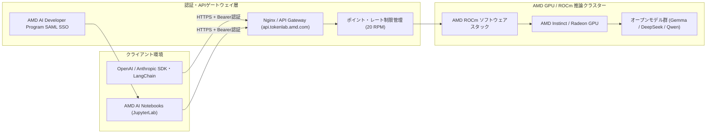

# **AMD TokenLab 調査レポート**

## **1. 基本情報**

* **ツール名**: AMD TokenLab
* **ツールの読み方**: エーエムディー トークンラボ
* **開発元**: AMD (Advanced Micro Devices, Inc.)
* **公式サイト**: [https://notebooks.amd.com/tokenlab](https://notebooks.amd.com/tokenlab)
* **関連リンク**:
  * ドキュメント / プログラムポータル: [https://developer.amd.com](https://developer.amd.com)
  * ROCm ドキュメント: [https://rocm.docs.amd.com/](https://rocm.docs.amd.com/)
* **カテゴリ**: LLMプラットフォーム
* **概要**: AMD TokenLabは、AMDが「AMD AI Developer Program」の会員特典として提供する開発者向けのLLM推論APIおよび検証プラットフォームです。AMD InstinctやRadeon GPU、オープンソースのROCmソフトウェアスタック上でホストされた主要なオープンウェイトモデル（Gemma、DeepSeek、Qwen等）に対し、OpenAI互換のAPIエンドポイント（`https://api.tokenlab.amd.com/v1`）を通じて無料でアクセスできます。また、ポータルであるAMD AI Notebooks（`notebooks.amd.com`）と連携し、オンデマンドのGPUアクセラレーション付きJupyterLab環境と組み合わせてプロトタイピングを行える点が特徴です。

## **2. 目的と主な利用シーン**

* **解決する課題**: ローカル環境に大規模なGPUクラスタを構築したり、クラウドGPUインスタンスを都度契約・設定したりする手間なく、最新のオープンウェイトLLMを即座にAPI経由で試用・評価したいという開発者の課題を解決します。
* **想定利用者**: AIアプリケーション開発者、機械学習エンジニア、LLMエージェントやRAGのプロトタイプを構築する研究者、AMD関連ハッカソン（LabLab.ai等）の参加者。
* **利用シーン**:
  * **AIエージェント・ワークフローのプロトタイピング**: OpenAI SDKやLangChain、ADK（Agent Development Kit）等の既存コードのベースURLを差し替えるだけで、AMD GPU上のオープンモデルを用いたエージェント開発を即座に開始する。
  * **オープンウェイトモデルの性能・応答比較**: Gemma 4、DeepSeek、Qwen、MiniCPMなどの複数モデルを同一エンドポイントから呼び出し、推論品質や応答速度を比較検証する。
  * **ROCm環境でのハンズオン学習**: AMD AI NotebooksのオンデマンドJupyterLab環境と組み合わせ、ROCmベースのAI開発パイプラインやファインチューニング・評価スクリプトをクラウド上で実行する。

### **2.1 代表的な利用フロー**

```mermaid
swimlane-beta TB
  subgraph User["開発者"]
    A[ポータルへSAMLログイン]
    B[APIキー発行・残高確認]
    F[応答結果の検証・開発]
  end
  subgraph Portal["AMD TokenLab ポータル"]
    C[APIキー認証情報・ポイント枠を付与]
  end
  subgraph Client["外部SDK・アプリ (LangChain等)"]
    D[OpenAI互換APIリクエスト送信]
  end
  subgraph Backend["AMD GPU / ROCm 推論基盤"]
    E[オープンモデル推論を実行しJSON返却]
  end
  A --> B
  B --> C
  C --> D
  D --> E
  E --> F
```

* **代表的な流れ**: 開発者はAMD AI Developer Program（Global）のSAML認証でポータル（`notebooks.amd.com/tokenlab`）にログインし、APIキーと初期ポイント枠を取得します。その後、手元のPythonスクリプトやLangChain、JupyterLabから `api.tokenlab.amd.com/v1` へOpenAI互換リクエストを送信すると、AMD Instinct/Radeon GPUおよびROCm上の推論エンジンがオープンモデルを実行し、結果を返却します。

## **3. 主要機能**

* **OpenAI互換APIエンドポイント**: `https://api.tokenlab.amd.com/v1` をベースURLとして提供し、OpenAI公式SDK（Python / Node.js）やAnthropic互換クライアント、curl等から最小限の設定変更で利用できます。
* **マルチモデルカタログ提供**: Gemma（Gemma 4 31B等）、DeepSeek（DeepSeek Flash等）、Qwen、MiniCPMなどの主要なオープンウェイトモデルをホストし、用途に応じたモデルの切り替えが可能です。
* **ポイント制クォータ・使用量ダッシュボード**: アカウントごとに付与されるポイント予算（30日間のアクセス期間など）と残りクォータ、APIキーの発行・管理をWebポータル上で一元管理できます。
* **AMD AI Notebooks（JupyterLab）連携**: `notebooks.amd.com` 上のGPUアクセラレーション付きオンデマンドJupyterLab環境と統合されており、環境構築不要でノートブックから直接APIやROCmワークロードを実行できます。
* **クレジットカード不要の即時アクセス**: AMD AI Developer Programへ登録するだけで、クレジット申請の審査待ちやクレジットカード登録なしに即座にテスト用トークン枠を利用開始できます。
* **レート制限による安定制御**: 開発者間の公平なリソース配分のため、1分あたり20リクエスト（20 RPM）などのレート制限とポイント消費管理が自動適用されます。

## **4. 動作原理・システム構成**



* **アーキテクチャ**: クラウド完結型のマネージドAPIおよびホスト型JupyterLabプラットフォームです。内部の推論オーケストレーションやスケジューリングの詳細は非公開ですが、公開されているフロントエンド（Nginxベースのゲートウェイ）とSAML認証基盤を経由し、AMD GPUクラスター上の推論エンジンへルーティングされる構成となっています。
* **主要コンポーネントとデータフロー**:
  * **Webポータル (`notebooks.amd.com/tokenlab`)**: SAML SSO（`/auth/saml/login`）でユーザーを認証し、JupyterLabインスタンスへのアクセスやTokenLabのAPIキー発行・ポイント確認UIを提供します。
  * **APIゲートウェイ (`api.tokenlab.amd.com/v1`)**: HTTPS経由でOpenAI互換のJSONリクエストを受け付け、Bearerトークン未付与または不正時はHTTP 401（`application/json`、`cache-control: no-store`）を返却します。認証通過後、レート制限およびポイント残高を検証してバックエンドへ転送します。
* **特筆すべき要素技術**:
  * **AMD ROCm**: オープンソースのGPUコンピューティングスタックであるROCmを基盤とし、PyTorchやvLLMなどの推論エンジンをAMD Instinct（MI300X等）およびRadeon GPU上で高速実行しています。
  * **SAML SSO認証**: グローバルなAMD AI Developer Programアカウントとのシングルサインオン連携により、アカウント管理を統一しています。

## **5. 開始手順・セットアップ**

* **前提条件**:
  * AMD AI Developer Program（Global）の無料アカウント登録（クレジットカード不要）。
  * ローカル実行の場合はPython 3.8以上、またはNode.js / `curl` などのHTTPクライアント。
* **インストール/導入**:
  OpenAI互換APIとして利用できるため、専用の独自CLIは不要で標準のOpenAI Python SDKなどをそのまま導入します。

  ```bash
  # OpenAI公式Python SDKのインストール
  pip install openai
  ```

* **初期設定**:
  1. [https://notebooks.amd.com/tokenlab](https://notebooks.amd.com/tokenlab) にアクセスし、「AMD AI Developer Program (Global) Login」からサインインします。
  2. ダッシュボード上でAPIキーを生成し、環境変数として設定します。

  ```bash
  export TOKENLAB_API_KEY="<YOUR_AMD_TOKENLAB_API_KEY>"
  ```

* **クイックスタート**:
  以下はPythonのOpenAI SDKを用いて、ベースURLを `https://api.tokenlab.amd.com/v1` に指定してチャット補完を実行する例です。

  ```python
  import os
  from openai import OpenAI

  client = OpenAI(
      api_key=os.environ["TOKENLAB_API_KEY"],
      base_url="https://api.tokenlab.amd.com/v1",
  )

  response = client.chat.completions.create(
      model="gemma-4-31b",  # ポータル上の利用可能モデルIDを指定
      messages=[
          {"role": "user", "content": "AMD ROCmの概要を3行で教えてください。"}
      ],
  )
  print(response.choices[0].message.content)
  ```

## **6. 特徴・強み (Pros)**

* **完全無料かつクレジットカード不要で開始可能**: 他のクラウドLLM APIプラットフォームの多くが初回クレジット請求やクレジットカード登録を必要とする中、AMD AI Developer Programへの登録のみで即座に無料ポイント枠を取得できます。
* **既存のOpenAI互換ツール資産をそのまま活用**: `base_url` を変更するだけで、OpenAI SDK、LangChain、LlamaIndex、各種ターミナルクライアントやローカルエージェント基盤と即座に連携できます。
* **AMD GPU＋ROCmの最新環境をノーセットアップで体験**: ローカルでのドライバやROCm環境構築を行わずに、AMD Instinct / Radeon GPU上での推論性能やJupyterLab環境（AMD AI Notebooks）をブラウザからすぐ試用できます。
* **多様な最新オープンモデルへのアクセス**: Gemma、DeepSeek、Qwenなどの話題のオープンウェイトモデルが随時ホストされており、単一のAPIキーで比較検証が可能です。

## **7. 弱み・注意点 (Cons)**

* **日本語対応の不足**: ポータルUI、ドキュメント、コミュニティフォーラムともに英語中心であり、日本語での公式サポートや日本語ドキュメントは整備されていません。
* **商用・本番環境での利用制限**: 開発者評価・プロトタイピングを目的とした特典枠（ポイント制、30日間などの有効期間、20リクエスト/分程度のレート制限）であるため、高トラフィックの本番プロダクション環境には適していません。
* **稼働モデル・仕様の流動性**: 無料特典プログラムの一環であるため、提供されるモデルラインナップやポイント消費レート、アクセス期間のルールが予告なく変更される可能性があります。
* **情報公開の限定性**: 専用の独立した価格表やエンタープライズ向けSLA、コンプライアンス認証の個別開示ページはなく、AMD AI Developer Programの利用規約に準拠する形となります。

## **8. 料金プラン**

| プラン名 | 料金 | 主な特徴 |
|---------|------|---------|
| **AMD AI Developer Program 特典枠** | 無料 | プログラム登録で付与。初期ポイント予算（30日アクセス期間など）、OpenAI互換API、AMD AI Notebooksへのアクセスが可能（クレジットカード不要） |
| **有料プラン / 本番向け拡張** | 公式サイトで公開されていない（個別問い合わせ・AMD Instinct Developer Cloud等の別枠利用） | TokenLab自体には独立した有料サブスクリプション表は存在せず、大規模な本番GPU利用にはAMD Instinct Developer Cloud（プログラム特典の$100クラウドクレジット等）や提携クラウドの利用が必要 |

* **課金体系**: 無料ポイント制（モデルごとの相対的なポイント消費量に基づくクォータ管理）。
* **無料トライアル**: アカウント登録後すぐに無料枠が付与されるため、別途トライアル申請は不要です。

## **9. 導入実績・事例**

* **導入企業**: 商用エンタープライズ導入の公開事例は公式サイトでは公開されていない。ただし、AMD公式ハッカソンやAI開発者コミュニティにおける利用実績が多数報告されている。
* **導入事例**:
  * **LabLab.ai AMDハッカソン**: 参加チームがPythonベースのAIエージェント（ADKエージェントやWeb検索連携ツール）の推論バックエンドとしてTokenLab APIを活用し、短期間でプロトタイプを構築した事例が報告されています。
  * **技術ブログ・個人開発者による検証**: DEV CommunityやMediumにて、LangChainやローカルチャットUI、自動化ワークフローのテスト用LLMエンドポイントとして利用するチュートリアル記事が公開されています。
* **対象業界**: ソフトウェア開発、AIスタートアップのプロトタイピング、大学・研究機関、ハッカソン・技術コミュニティ。

## **10. サポート体制**

* **ドキュメント**: AMD Developer Portal（[https://developer.amd.com](https://developer.amd.com)）およびROCm公式ドキュメント（[https://rocm.docs.amd.com/](https://rocm.docs.amd.com/)）にて、AMD AI Developer ProgramやROCm関連の技術資料・AI Playbooksが提供されています。TokenLab単体の詳細な外部公開ドキュメントは限定的で、ログイン後のポータル内ガイドが中心です。
* **コミュニティ**: AMD AI Developer Programのコミュニティチャネル、GitHub上のAMD公式サンプルリポジトリ、LabLab.ai等のハッカソンコミュニティを通じてAMDエンジニアや開発者同士の情報交換が行われています。
* **公式サポート**: TokenLab専用の24時間有償サポート窓口（チャット・電話等）は公式サイトで公開されていない。プログラム全般の問い合わせはAMD Developer Portal経由の英語対応が基本となります。

## **11. エコシステムと連携**

### **11.1 API・外部サービス連携**

* **API**: OpenAI互換REST API（`https://api.tokenlab.amd.com/v1`）を提供。認証はBearerトークン方式。
* **外部サービス連携**: OpenAI API互換仕様を採用しているため、以下を含む幅広いエコシステムと直接連携可能です。
  * **AIフレームワーク**: LangChain、LlamaIndex、Google ADK（Agent Development Kit）、CrewAI
  * **ゲートウェイ・プロキシ**: LiteLLM、Dify（カスタムOpenAI互換モデルプロバイダーとして登録）
  * **開発環境**: AMD AI Notebooks（JupyterLab）、VS Code拡張機能（Continue等のOpenAI互換設定が可能なツール）、curl

### **11.2 技術スタックとの相性**

| 技術スタック | 相性 | メリット・推奨理由 | 懸念点・注意点 |
|:---|:---:|:---|:---|
| **Python (OpenAI SDK / LangChain)** | ◎ | `base_url` を変更するだけで公式SDKやエージェントフレームワークがそのまま動作 | レート制限（20 RPM等）を超える並列実行時のリトライ実装が必要 |
| **Node.js / TypeScript (OpenAI SDK)** | ◎ | Next.jsやNodeバックエンドから標準SDK経由で容易に呼び出し可能 | クライアントサイドへのAPIキー露出防止のためサーバー側での実行が必須 |
| **Dify / LiteLLM** | ◯ | OpenAI互換プロバイダーとしてエンドポイントとAPIキーを登録するだけで連携可能 | ポイント残高や30日有効期限の管理をポータル側で手動確認する必要がある |
| **JupyterLab (AMD AI Notebooks)** | ◎ | 同一ポータル基盤上で統合されており、ROCm環境とAPI検証をシームレスに併用可能 | 長時間の常駐バッチ処理には不向き |

## **12. セキュリティとコンプライアンス**

* **認証**: AMD AI Developer Program（Global）のSAMLシングルサインオン（SSO）によるポータル認証、およびAPI呼び出し時のBearerトークン認証を採用しています。
* **データ管理**: 通信はHTTPS（TLS）で暗号化され、APIレスポンスヘッダには `cache-control: no-store` が設定されています。プライバシーポリシーおよびクッキーポリシーはAMD全社の標準規約（AMD Privacy Notice / Cookie Policy）に準拠しています。推論データの具体的な保存地域やモデル学習への利用有無に関するTokenLab固有の詳細は、公式サイトで公開されていないため個別の確認が必要です。
* **準拠規格**: TokenLab単体としてのISO27001、SOC2、HIPAA等の認証取得状況は公式サイトで公開されていない。機密データや個人情報を含むエンタープライズ本番ワークロードへの利用前には、AMDへの問い合わせまたは利用規約の確認が必要です。

## **13. 操作性 (UI/UX) と学習コスト**

* **UI/UX**: `notebooks.amd.com/tokenlab` はダークテーマをデフォルトとしたシンプルで視認性の高いWeb UIを備えており、SAMLログインからAPIキー発行、ポイント残高確認、JupyterLab起動まで迷わず操作できます。
* **学習コスト**: 既存のOpenAI APIやJupyterLabに触れたことがある開発者であれば、新規の独自仕様を学ぶ必要がなく数分で使い始められるため、学習コストは非常に低いです。

## **14. ベストプラクティス**

* **効果的な活用法 (Modern Practices)**:
  * **環境変数と抽象化レイヤーの活用**: `OPENAI_BASE_URL` と `OPENAI_API_KEY` を環境変数化し、開発・検証フェーズではAMD TokenLabを、本番フェーズではFireworks AIや自社ホスティング（vLLM等）へシームレスに切り替えられる構成にする。
  * **LiteLLM等との組み合わせ**: レート制限（20 RPMなど）に達した場合に備え、LiteLLMなどでフォールバック先プロバイダーを設定しておく。
* **陥りやすい罠 (Antipatterns)**:
  * **本番トラフィックへの直接投入**: 無料のポイント枠・利用期間制限・レート制限があるため、商用サービスのメイン推論基盤として組み込むとクォータ枯渇によるサービス停止を招きます。
  * **APIキーのハードコーディング**: GitHubリポジトリ等にAPIキーを直書きすると悪用されポイント枠を瞬時に消費されるため、必ず環境変数やシークレット管理ツールを使用してください。

## **15. ユーザーの声（レビュー分析）**

* **調査対象**: G2、Capterra、ITreviewにはAMD TokenLab単独のレビュー登録は存在しないため、開発者コミュニティ（DEV Community、Medium、LabLab.aiハッカソンレポート）の投稿・技術記事を調査対象としました。
* **総合評価**: 調査サイト上の数値スコアなし（開発者コミュニティでは無料枠の手軽さに対して概ね好意的な評価）。
* **ポジティブな評価**:
  * 「AMD AI Developer Programにサインインするだけで、クレジットカード登録も承認待ちもなく即座にOpenAI互換APIを使える点が開発体験として非常に優れている」（DEV Community / Medium記事より要約）。
  * 「Gemma 4やDeepSeek、Qwenなどの最新オープンウェイトモデルを1つのエンドポイントで手軽に試せるため、ローカルGPUがない環境でのエージェント開発に重宝している」（ハッカソン参加者・開発者記事より要約）。
  * 「AMD AI Notebooks（JupyterLab）と同じアカウント基盤でシームレスに行き来できるのが便利」（開発者コミュニティより要約）。
* **ネガティブな評価 / 改善要望**:
  * 「1分あたりのリクエスト制限（20 RPM）やポイント有効期間（30日等）があるため、負荷テストや本番運用には別の有料プロバイダーが必要になる」（開発者ブログより要約）。
  * 「ログイン後のポータル外に公開されている詳細なAPIリファレンスやモデル一覧ページが少なく、事前調査がしづらい」（開発者コメントより要約）。
  * 「UIやドキュメントが英語のみで、日本語の解説情報がまだ少ない」。
* **特徴的なユースケース**:
  * PythonベースのADKエージェントやLangChainワークフローにおける、コストゼロの検証用LLMバックエンドとしての活用。

## **16. 直近半年のアップデート情報**

* **2026-10**: AMD AI Developer ProgramおよびROCmエコシステムの拡充に伴い、TokenLab上でGemma 4 31BやDeepSeek・Qwen系の最新オープンウェイトモデルの提供およびAMD AI Notebooksとの統合運用が継続的に強化。
* **2026-08**: AMD ROCmソフトウェアスタックのアップデートおよびAMD Instinct GPU向け最新モデル（Day-0サポートモデル群）の推論最適化に伴い、開発者向けノートブック・API検証環境の互換性が向上。
* **2026-06**: LabLab.ai等のAIハッカソンや開発者コミュニティ向けに、TokenLab APIを用いたエージェント開発・ROCmプロファイリング（`rocprofv3`等）連携の活用事例が多数公開。

(出典: [AMD Developer Portal](https://developer.amd.com) / [AMD ROCm Documentation](https://rocm.docs.amd.com/))

## **17. 類似ツールとの比較**

### **17.1 機能比較表 (星取表)**

| 機能カテゴリ | 機能項目 | AMD TokenLab | Fireworks AI | Hugging Face | LiteLLM |
|:---:|:---|:---:|:---:|:---:|:---:|
| **基本機能** | OpenAI互換API提供 | ◎<br><small>api.tokenlab.amd.com/v1で標準提供</small> | ◎<br><small>高速推論APIを提供</small> | ◯<br><small>Inference Providers経由で対応</small> | ◎<br><small>100以上のLLMを統一API化</small> |
| **コスト・導入** | 無料枠の手軽さ | ◎<br><small>クレカ不要でポイント枠を即時付与</small> | ◯<br><small>初回無料クレジットあり</small> | ◎<br><small>無料枠・OSSモデル公開が充実</small> | ◎<br><small>OSSでセルフホスト無料</small> |
| **環境統合** | クラウドJupyter連携 | ◎<br><small>AMD AI Notebooksと統合</small> | ×<br><small>API・推論特化</small> | ◯<br><small>Spaces等でデモ構築可能</small> | ×<br><small>ゲートウェイ・SDK特化</small> |
| **運用・スケーラビリティ** | 本番向けスケーリング・SLA | △<br><small>開発者評価向け（RPM・期間制限あり）</small> | ◎<br><small>エンタープライズSLA・低遅延対応</small> | ◯<br><small>Dedicated Endpoints等で拡張可能</small> | ◎<br><small>プロキシによる負荷分散・フォールバック</small> |
| **非機能要件** | 日本語対応 | △<br><small>英語中心（日本語情報少）</small> | △<br><small>英語中心</small> | ◯<br><small>コミュニティ記事が豊富</small> | ◯<br><small>英語公式だが国内知見多数</small> |

### **17.2 詳細比較**

| ツール名 | 特徴 | 強み | 弱み | 選択肢となるケース |
|---------|------|------|------|------------------|
| **AMD TokenLab** | AMD AI Developer Program会員向けの無料OpenAI互換LLM APIおよびJupyterLabポータル | クレジットカード不要で最新オープンモデルとROCm GPU環境を即座に試用可能 | ポイント有効期間やレート制限があり、商用本番利用のSLAは非公開 | - |
| **Fireworks AI** | 高スループット・低遅延に特化した商用オープンモデル推論・ファインチューニング基盤 | 本番環境向けの圧倒的な推論速度、ファインチューニング機能、商用SLA | 大規模利用時は従量課金が発生し、無料枠には上限がある | プロトタイピングを終え、低遅延・高スループットの本番推論基盤へ移行する場合 |
| **Hugging Face** | オープンソースAIモデル・データセット・デモアプリ（Spaces）の最大手プラットフォーム | 圧倒的なモデル数、Transformersエコシステム、コミュニティの広さ | 高負荷推論にはDedicated Endpoints等の有料契約が必要 | 多種多様なオープンモデル探索やデータセット管理、Spacesでのデモ公開を行いたい場合 |
| **LiteLLM** | 100以上のLLMプロバイダーをOpenAI互換フォーマットへ統合するOSSゲートウェイ | 複数プロバイダー間のフォールバック、コスト追跡、ルーティングを統一管理可能 | 推論エンジン自体は持たず、別途APIキーや推論バックエンドが必要 | TokenLabを含む複数のLLM APIを統一インタフェースで切り替え・冗長化したい場合 |

## **18. 総評**

* **総合的な評価**:
  * AMD TokenLabは、AMD AI Developer Programへの登録のみでクレジットカード不要・即時利用可能なOpenAI互換APIとROCm搭載JupyterLab環境を提供する、非常に参入障壁の低い開発者向けLLMプラットフォームです。最新のオープンウェイトモデル（Gemma、DeepSeek、Qwen等）をAMDハードウェア上で手軽に検証できる点は高く評価できますが、レート制限やポイント期間制限があるため、あくまで開発・検証・学習フェーズ向けのツールとして位置づけるのが適切です。
* **推奨されるチームやプロジェクト**:
  * 初期コストをかけずにAIエージェントやRAGのプロトタイプを素早く構築したい個人開発者・スタートアップ。
  * AMD Instinct / Radeon GPUおよびROCm環境でのオープンモデル動作や推論パイプラインを評価したいMLエンジニア・研究者。
  * 短期間で成果物を構築する必要があるAIハッカソン参加チーム。
* **選択時のポイント**:
  * 「コストゼロ・クレカ不要ですぐにOpenAI互換APIを試したい」「ROCmベースのノートブック環境も併用したい」という場合はAMD TokenLabが有力な選択肢となります。一方、本番環境での高スループット運用や商用SLAが必要な場合はFireworks AI等の商用推論基盤を、複数プロバイダーの切り替えやフォールバック管理を行いたい場合はLiteLLMを併用・選択することが推奨されます。
