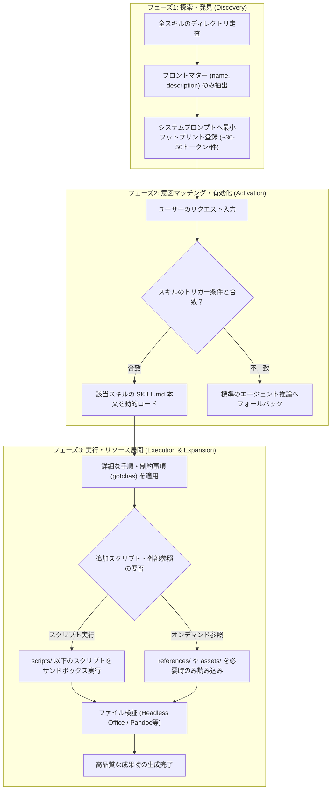

# **Anthropic Agent Skills 調査レポート**

## **1. 基本情報**

* **ツール名**: Anthropic Agent Skills (anthropics/skills)
* **ツールの読み方**: アンスロピック エージェント スキルズ / エージェント スキルズ
* **開発元**: Anthropic
* **公式サイト**: [https://agentskills.io](https://agentskills.io)
* **関連リンク**:
  * GitHub: [https://github.com/anthropics/skills](https://github.com/anthropics/skills)
  * ドキュメント: [https://docs.claude.com/en/api/skills-guide](https://docs.claude.com/en/api/skills-guide)
  * 仕様書: [https://agentskills.io/specification](https://agentskills.io/specification)
  * 公式エンジニアリング解説: [https://anthropic.com/engineering/equipping-agents-for-the-real-world-with-agent-skills](https://anthropic.com/engineering/equipping-agents-for-the-real-world-with-agent-skills)
* **カテゴリ**: エージェントエコシステム/基盤
* **概要**: Anthropic Agent Skillsは、AIモデル（Claudeなど）に専門的な知識や複雑なタスク遂行手順、実行スクリプトを動的に付与するための公式スキルリポジトリおよびオープン規格（Agent Skills）のリファレンス実装です。フォルダ単位で完結するシンプルな構成（`SKILL.md`、スクリプト、参照リソース）と「段階的開示（Progressive Disclosure）」アーキテクチャを採用しており、コンテキストウィンドウのトークン消費を抑えながら、Word・Excelなどのドキュメント生成やMCPサーバー構築、テスト自動化といった高度な実務タスクを高精度に実行させることができます。

## **2. 目的と主な利用シーン**

* **解決する課題**:
  * **システムプロンプトの肥大化とコンテキスト枯渇**: 多数のルールや指示を常時システムプロンプトに詰め込むことで発生するトークンコスト急増と推論精度の低下
  * **複雑・難解なフォーマットに対するハルシネーション**: Word (.docx) や Excel (.xlsx) などの複雑なXML構造・レイアウト崩れ・API落とし穴への対応不足
  * **ツールやナレッジのベンダーロックイン**: 特定のプラットフォーム固有形式に閉じたスキル設定により、他のエージェントやローカル環境への移植が困難だった課題
* **想定利用者**:
  * **ソフトウェアエンジニア / AI開発者**: Claude Codeや自作エージェントに高度なタスク実行能力を組み込みたい開発者
  * **プロダクトマネージャー / デザイナー**: 一貫したブランドデザインやプロトタイプ成果物をAIに自動生成させたいチーム
  * **企業のDX推進 / AI推進担当者**: 社内規程、標準開発ガイドライン、ドキュメント生成ルールをAIエージェントに標準適用したい組織
* **利用シーン**:
  * **本番品質のOfficeドキュメント生成**: Claude.aiのファイル作成機能を支える本番ノウハウを活用し、崩れないWord、Excel、PowerPoint、PDFを生成
  * **MCP (Model Context Protocol) サーバーの高速構築**: TypeScript SDK v2に対応したMCPサーバーの設計・実装・テストパイプラインの実行
  * **WebアプリケーションのE2E自動テスト**: ローカルWebアプリを自律探索し、UI操作検証や不具合レポートを作成
  * **AIエージェント向けスキルの反復改善**: `skill-creator` を用いて新規スキルを自動作成し、テストケース（Evals）でトリガー精度と実行品質を最適化

### **2.1 代表的な利用フロー**

ユーザーがタスクを要求してから、スキルが発見・ロードされ、外部環境と連携して成果物を納品するまでの処理の受け渡しを示します。

```mermaid
swimlane-beta TB
  subgraph User["ユーザー"]
    A[成果物の要望やタスクを入力]
    G[完成した成果物を受領・確認]
  end
  subgraph Agent["Claude / エージェント"]
    B[入力内容と全スキルのメタデータを照合]
    D[SKILL.mdの指示と制約に従い計画・コード策定]
    F[実行結果を検証して最終回答を構築]
  end
  subgraph SkillEngine["スキル基盤 (Agent Skills)"]
    C[対象スキルのSKILL.mdと関連リソースを展開]
  end
  subgraph Execution["実行環境 (CLI/OS/サンドボックス)"]
    E[同梱スクリプトの実行やファイル生成処理]
  end
  A --> B
  B --> C
  C --> D
  D --> E
  E --> F
  F --> G
```

* **代表的な流れ**: ユーザーの入力に対してエージェントはまず最小限のメタデータ（nameとdescription）のみを照合し、合致した場合にのみスキル基盤から詳細な `SKILL.md` や同梱リソースを動的にコンテキストへ読み込みます。エージェントはスキルの厳格なガイドラインに沿ってスクリプト生成やツール実行を行い、サンドボックス環境で生成・検証された成果物をユーザーへ提供します。

## **3. 主要機能**

* **段階的開示（Progressive Disclosure）システム**: 起動時は全スキルのフロントマター（約30〜50トークン/スキル）のみを登録し、タスク適合時のみ指示本文と追加リファレンスを展開することでコンテキスト消費を劇的に抑制
* **本番品質のOfficeドキュメント生成（document-skills）**: Word（.docx）、Excel（.xlsx）、PowerPoint（.pptx）、PDF（.pdf）の作成・編集・検証ノウハウと落とし穴対策（gotchas）を完全体系化
* **MCPサーバー自動開発支援（mcp-builder）**: 最新のMCP TypeScript SDK v2に準拠したModel Context Protocolサーバーの骨格作成、ツール実装、テスト実行をナビゲート
* **メタスキル作成・評価スイート（skill-creator）**: スキル自体のドラフト作成、定量的・定性的な評価テスト（Evals）、トリガー発火率を高める説明文最適化スクリプトの提供
* **Claude API & 最新機能アシスタント（claude-api）**: Claude Opus 5.5 / Sonnet 5.5 / Haiku 5.5 のAPI仕様、プロンプト監査（`prompt-audit`）、Managed Agents の連携を案内
* **フロントエンド・ビジュアルデザイン設計（frontend-design / canvas-design）**: AI特有の画一的なUIデザインを回避し、プロジェクト固有のデザイントークンや洗練されたレイアウト、SVGアートを生成
* **Webアプリケーション検証自動化（webapp-testing）**: ローカル開発サーバーと対話し、画面レイアウトやインタラクションの妥当性を自律テスト
* **Claude Code プラグインエコシステム統合**: `/plugin marketplace add anthropics/skills` コマンドによりClaude Codeへ直接プラグインとして登録・インストール可能
* **Claude.ai / Claude API ファーストクラス連携**: Claude.ai Web UI上でのスキル有効化およびClaude API経由でのカスタムスキルアップロード・実行
* **標準仕様（Agent Skills Specification）互換**: agentskills.io に準拠したディレクトリ構造とYAMLフロントマターにより、他エージェントとの高い相互運用性を実現

## **4. 動作原理・システム構成**

Anthropic Agent Skillsは、クライアントサイド・ローカルファーストのファイルシステムベース拡張アーキテクチャを採用しています。エージェントランタイム（Claude Code、Claude API、自律エージェント環境など）がローカルファイルまたはAPIリソースとしてスキルディレクトリ群を参照し、3つのフェーズ（Discovery・Activation・Execution）を経て処理を行います。



* **アーキテクチャ**: ファイルシステム指向のローカルファースト・プラグインアーキテクチャ。エージェント自身がファイル操作能力（`read_file`, `run_command` 等）を持つことを前提に設計されています。
* **主要コンポーネントとデータフロー**:
  * **`SKILL.md`**: スキルのコアとなるファイル。YAML Frontmatter（識別子 `name`、発火条件 `description`、ライセンス等）と、タスク実行の詳細手順が記述されたMarkdown本文で構成されます。
  * **`scripts/`**: 決定論的でコード実行に適した処理（ファイル変換、構文チェック、Officeファイルの検証等）を担当するスクリプト群（Python、Node.js、シェルスクリプト）。エージェントはこれを直接実行して結果を受け取ります。
  * **`references/`**: 膨大な仕様書やAPIドキュメントなど、常に読み込むとコンテキストを圧迫する情報を格納。必要な場面でのみエージェントが部分読み込みを行います。
  * **`assets/`**: テンプレートファイル、画像素材、サンプルの設定ファイルなどを保持。
  * **`.claude-plugin/marketplace.json`**: Claude Codeのプラグインマネージャーに対して、どのスキルをどのプラグイン名（例: `document-skills`、`example-skills`）として配信するかを定義するマニフェストファイル。
* **特筆すべき要素技術**:
  * **Progressive Disclosure（段階的開示）**: システム起動時のトークン消費を数十トークンに抑えつつ、数百個のスキルが存在してもコンテキストオーバーヘッドを起こさない設計。
  * **Officeドキュメント生成パイプライン**: docx-jsやopenpyxl等を用いた直接コード生成と、LibreOffice（`soffice --headless`）によるPDF変換・画像レンダリング検証を組み合わせた多重バリデーション。

## **5. 開始手順・セットアップ**

* **前提条件**:
  * Git、Node.js（v18以上推奨）または Python 3.10以上
  * Claude Code CLI（Claude Codeで利用する場合）または Claude.ai（有料プラン）、あるいは Anthropic API Key
* **インストール/導入**:

  Claude Codeで利用する場合、公式プラグインマーケットプレイスとしてリポジトリを追加します。

  ```bash
  # Claude Code 内でマーケットプレイスを追加
  /plugin marketplace add anthropics/skills

  # 目的のプラグイン（例: document-skills または example-skills）をインストール
  /plugin install document-skills@anthropic-agent-skills
  /plugin install example-skills@anthropic-agent-skills
  ```

  リポジトリを手動でクローンして参照する場合：

  ```bash
  git clone https://github.com/anthropics/skills.git
  ```

* **初期設定**:
  * Office関連スキル等で検証スクリプトを使用する場合、PandocやLibreOfficeが環境にインストールされていると高品質な検証が可能になります。
  * 独自のカスタムスキルを作成する場合は、`template/SKILL.md` を複製して利用します。

* **クイックスタート**:
  Claude Codeでプラグインを導入後、通常どおりプロンプトで指示するだけでスキルが自動的に適用されます。

  ```text
  # Claude Code での実行指示例
  「docxスキルを使って、当四半期の売上分析レポートをモダンな表組みと目次付きのWord文書で作成してください」
  ```

  エージェントは自動的に `skills/docx` を検知・展開し、Gotchasを回避したスクリプトを実行して `.docx` を出力します。

## **6. 特徴・強み (Pros)**

* **驚異的なトークン効率（Progressive Disclosure）**: 全文を最初からコンテキストに入れないため、大量のスキルを追加しても起動時のトークン消費がほとんど増加せず、会話のコンテキスト長を圧迫しない
* **本番運用された高品質ノウハウのオープン化**: Claude.aiのファイル作成機能で実際に使われているOffice処理（Word/Excel/PowerPoint/PDF）の実装知識やバグ回避策がApache 2.0で完全公開されている
* **シンプルで可読性の高いファイル構成**: 独自バイナリや複雑なDBを介さず、プレーンなMarkdownとスクリプトだけで構成されているため、Gitでのバージョン管理やコードレビューが容易
* **メタスキル（skill-creator）による自律改善ループ**: スキルの作成・評価（Evals）・トリガー説明文の最適化までがスキルとして体系化されており、改善サイクルを自動化可能
* **圧倒的な普及度とオープン標準エコシステム**: GitHubスター数19万超を誇り、Claude Code、Claude.ai、Claude APIだけでなく、Agent Skills仕様（agentskills.io）に準拠したオープンソースエージェントでも利用可能

## **7. 弱み・注意点 (Cons)**

* **トリガー精度（description記述）への高い依存度**: スキルの発火判定がエージェントの推論と `description` のマッチングに依存するため、説明文が曖昧だと発火しない、または関係のないタスクで誤発火するリスクがある
* **日本語プロンプトでの発火調整**: 公式スキルの `description` は英語で記述されており、日本語のプロンプトで確実に発火させるには明示的な言及（「Wordスキルを使って」等）や、日本語キーワードを含めた説明文のチューニングが推奨される
* **ローカル実行環境の依存関係**: 一部のスキルや検証スクリプトはNode.js、Python、Pandoc、LibreOffice等の外部ツールがインストールされていることを前提としており、環境構築が不完全な場合は検証ステップがスキップされる
* **セキュリティ・サンドボックスの責任**: 外部から導入したスキルに含まれるスクリプト（`scripts/`）をエージェントが無制限に実行するとセキュリティリスクが生じるため、適切なパーミッション管理やサンドボックス化が不可欠

## **8. 料金プラン**

Anthropic Agent Skills リポジトリ自体はオープンソース（Apache 2.0）であり、完全無料で利用・改変・商用利用が可能です。実際にスキルを動作させる基盤（Claude Code、Claude.ai、Claude API）の利用形態に応じて以下のコストが発生します。

| プラン・利用形態 | 料金 | 主な特徴とスキル利用条件 |
|:---|:---|:---|
| **GitHub リポジトリ (OSS)** | **無料 (Apache 2.0)** | ソースコード、スキル定義、スクリプトの無償利用・フォーク・改変 |
| **Claude.ai Free** | 無料 | 基本的なチャット機能のみ（カスタムスキルの追加は制限あり） |
| **Claude.ai Pro** | $20/月 (税抜) | 高性能モデル利用、標準スキル（ドキュメント作成等）の利用、カスタムスキルの活用 |
| **Claude.ai Team / Enterprise** | $25〜30/ユーザー/月〜 | 組織内でのカスタムスキル共有、ワークスペース管理、エンタープライズセキュリティ |
| **Claude Code (CLI)** | API従量課金 / Pro連携 | `/plugin` コマンドで自由に追加可能。実行トークンに応じた従量課金 |
| **Claude API (Skills Guide)** | 入出力トークン従量課金 | API経由でのスキル定義アップロード・実行。段階的開示により余計なトークン消費を抑制 |

* **課金体系**: リポジトリ自体は無料。エージェント実行基盤側で月額サブスクリプションまたはトークン従量課金が発生。
* **無料トライアル**: Claude API新規登録時の無料クレジット枠（提供されている場合）、またはオープンソースのローカルLLM環境でのスキルファイル利用であれば完全無料。

## **9. 導入実績・事例**

* **導入企業**:
  * **Anthropic**: 自社の主力サービス「Claude.ai」のファイル作成・編集機能のバックエンドとして本リポジトリのドキュメントスキルを全面採用
  * **Notion**: 公式パートナーとしてClaude向け「Notion Skills for Claude」を提供し、ワークスペース操作をスキル化
  * **AIエージェント開発スタートアップ各社**: OpenClaw、Hermes Agent、Antigravityなど、自律型コーディング環境やリサーチエージェントへの組み込み事例が多数報告されている
* **導入事例**:
  * **エンタープライズ向けドキュメント自動生成**: 壊れやすいWordやExcelのXMLを直接操作する代わりに本リポジトリのgotchasルールを適用し、業務報告書や見積書の生成エラー率を劇的に低減
  * **社内開発標準の配布**: 開発チーム内でコーディング規約やMCPサーバー開発ガイドをスキル化し、Claude Code導入時に全員のリポジトリへ配布・適用
* **対象業界**: ソフトウェア開発、ITコンサルティング、金融・法務・リサーチ（精密なドキュメント作成を要する分野）、企業のAI/DX推進組織

## **10. サポート体制**

* **ドキュメント**:
  * 公式サイト（[agentskills.io](https://agentskills.io)）に基本概念、ディレクトリ構造、仕様書が詳細に整備
  * Claude公式ドキュメント（[docs.claude.com/en/api/skills-guide](https://docs.claude.com/en/api/skills-guide)）およびClaude Support（[support.claude.com](https://support.claude.com)）で使い方と作成ガイドを提供
* **コミュニティ**:
  * GitHub Issues（1,500件以上のオープンディスカッション）およびGitHub Discussionsが非常に活発
  * Anthropic公式Discordサーバーの開発者チャンネルでのQ&A・情報交換
* **公式サポート**:
  * オープンソースリポジトリとしてはGitHub上のコミュニティベース
  * Claude.ai Pro/Team/Enterprise契約者およびClaude API利用企業向けにはAnthropic公式サポート窓口（メール・チャット）を提供

## **11. エコシステムと連携**

### **11.1 API・外部サービス連携**

* **API**: Claude APIのメッセージエンドポイントおよびベータ機能を通じて、スキルを直接登録・実行可能。
* **外部サービス連携**:
  * **Claude Code**: `/plugin` コマンドによる公式マーケットプレイス統合
  * **Model Context Protocol (MCP)**: `mcp-builder` スキルにより各種MCPサーバー（ファイル操作、Git、DB連携、API連携）を構築し、外部ツールとシームレスに結合
  * **Notion / Slack**: パートナースキルや社内コミュニケーションスキルを通じた各種SaaSとの連携

### **11.2 技術スタックとの相性**

| 技術スタック | 相性 | メリット・推奨理由 | 懸念点・注意点 |
|:---|:---:|:---|:---|
| **Markdown / Git** | ◎ | プレーンテキストで完結し差分管理・レビュー・PR運用が極めて容易 | バイナリ素材を含む場合はLFS検討 |
| **Node.js / TypeScript** | ◎ | MCP TypeScript SDK v2やdocx-jsなど主要スキルのエコシステムが充実 | npmパッケージの依存解決が必要な場合あり |
| **Python** | ◎ | データ処理、Pandoc/soffice検証スクリプト、evalビューアの親和性が高い | 実行環境にPythonインタープリタが必要 |
| **Docker / サンドボックス環境** | ◎ | スキル同梱スクリプトを安全に隔離実行するための標準的な基盤 | サンドボックス内の依存ライブラリ事前インストールが必要 |
| **Jupyter / データ分析環境** | ◯ | openpyxlやxlsxスキルの知見をそのままデータ解析パイプラインに流用可能 | インタラクティブUI上での動的発火にはホスト側の対応が必要 |

## **12. セキュリティとコンプライアンス**

* **認証**: スキル自体に認証情報は含めない設計。Claude APIキーや外部サービストークンは環境変数経由でセキュアに注入される。
* **データ管理**: スキル定義はすべてローカルファイルまたはGit管理下に置かれ、スキルの探索フェーズでは外部サーバーへの不要なデータ送信は行われない。
* **準拠規格**: Anthropicの基盤モデルインフラはSOC2 Type II、GDPR、HIPAA等に準拠。リポジトリ内のコードはApache 2.0ライセンスに基づき、商用環境での監査・利用が可能。
* **実行セキュリティ上の注意**: スキルに実行可能スクリプト（`scripts/`）が含まれる場合、悪意あるコードの混入（サプライチェーン攻撃）を防ぐため、信頼できるリポジトリのみをインポートするか、実行環境をコンテナ等でサンドボックス化することが推奨される。

## **13. 操作性 (UI/UX) と学習コスト**

* **UI/UX**:
  * エンドユーザー視点では、プラグインを一度インストールしてしまえば、以降は自然言語で指示するだけで最適なスキルが背後で自律的に選ばれ実行されるため、学習の手間が一切ない
  * 開発者視点でも、`SKILL.md` のフォーマットは標準的なYAMLフロントマターとMarkdownのみで構成されており、直感的で可読性が高い
* **学習コスト**:
  * 既存スキルの利用はコマンド数行（`/plugin install ...`）で即座に開始可能
  * カスタムスキルの作成も `template/SKILL.md` をベースに15分程度でドラフト作成が可能
  * ただし、エージェントが誤認識しない「完璧な `description`」の設計や、網羅的な Evals（評価データセット）の作成には一定の試行錯誤とノウハウを要する

## **14. ベストプラクティス**

* **効果的な活用法 (Modern Practices)**:
  * **発火条件のネガティブトリガー明記**: `description` に「〜の場合に使う」だけでなく、「PDFやスプレッドシート、一般的なコーディングには使わない（Do NOT use for ...）」と否定条件を明記することで誤発火を劇的に低減させる
  * **決定論的処理とLLM推論の分離**: 書式変換や構文検証などのルールベース処理は `scripts/` にコードとして持たせ、LLMには文章の構成や論理構築に集中させる
  * **`skill-creator` によるEvals主導の改善**: スキルを作成したら必ず複数のテストプロンプトを用意し、`eval-viewer` や description 最適化スクリプトを用いて発火率と成果物品質を定量測定する
* **陥りやすい罠 (Antipatterns)**:
  * **単一スキルへの過剰な機能詰め込み**: 関連の薄い機能を1つのスキルにまとめて長大な `SKILL.md` にすると、コンテキストが無駄に消費され指示の競合が発生する（単一責任の原則を保つべき）
  * **広範すぎる曖昧なdescriptionの命名**: 「一般的な開発タスク全般」のような曖昧な説明文をつけると、あらゆるプロンプトでスキルが暴走発火し、他スキルの動作を阻害する
  * **環境依存の暗黙の仮定**: スクリプト内で前提となる外部コマンド（pandocや特定のnpmパッケージ）が存在しない場合にフォールバックを用意せず、サイレントエラーを起こす実装

## **15. ユーザーの声（レビュー分析）**

* **調査対象**: GitHub Discussions / Issues, Reddit (r/ClaudeAI, r/LocalLLaMA), X (Twitter), 技術系テックブログ
* **総合評価**: 4.8 / 5.0（GitHub Stars 193,000+、フォーク数22,000+）
* **ポジティブな評価**:
  * **コンテキスト節約と推論精度の両立**: 「システムプロンプトに長大な社内ガイドを常時貼り付ける悪夢から解放された。必要な時だけ正確にナレッジがロードされるため、Claudeの頭脳がクリアなまま保たれる」
  * **ドキュメントスキルの圧倒的完成度**: 「WordやExcelの壊れない出力ノウハウは、公式が本番で蓄積した知見そのもの。これだけでもこのリポジトリを導入する価値がある」
  * **MCPとの明確な役割分担**: 「MCPが『手足（外部APIへの接続ツール）』なら、Skillsは『頭脳の手順書（ツールの使い方や業務ノウハウ）』であり、組み合わせることで最強のエージェント環境が作れる」
* **ネガティブな評価 / 改善要望**:
  * **トリガー判定の繊細さ**: 「微妙なニュアンスのプロンプトを入力した際、スキルがロードされずに通常の貧弱な出力になってしまうことがある。トリガーの微調整がややシビア」
  * **セキュリティとコード実行への懸念**: 「チーム内で他人の作成したスキルを無条件に共有・実行するのは、スクリプト実行機能があるためセキュリティポリシー上慎重にならざるを得ない」
* **特徴的なユースケース**:
  * 金融機関や法務部門における、複雑な社内レイアウト・フォーマット規則に準拠した契約書ドラフトの全自動Word出力
  * 新規APIの仕様書からMCPサーバーを完全自動生成し、ローカルでテストまで完結させる自動化ワークフロー

## **16. 直近半年のアップデート情報**

* **2026-11-06**: Officeドキュメント関連スキル（`docx`, `pdf`, `pptx`, `xlsx`）のライセンスを Apache 2.0 に完全移行。商用利用・再配布の自由度が大幅に向上（PR #2146）
* **2026-10-28**: `mcp-builder` スキルを刷新し、MCP TypeScript SDK v2 の新仕様と最新アーキテクチャに対応（PR #2087）
* **2026-10-09**: `claude-api` スキルに動的ワークフローと4つのワークフロー・クイックスタートテンプレートを追加（PR #1995）
* **2026-10-09**: `claude-api` スキルにおいて最新モデル Claude Haiku 5.5 のサポート、Managed Agents、Preserved-Thinking の修正を適用（PR #1991）
* **2026-10-05**: `claude-api` スキルにクイックスタート名やURLから即座にセットアップを行う `managed-agents-onboard` を追加（PR #1962）
* **2026-09-29**: `claude-api` スキルのデフォルトモデルを Claude Opus 5.5 および Claude Sonnet 5.5 に更新し、build-eval および hillclimb ガイドを拡充（PR #1930）
* **2026-09-10**: `claude-api` スキルに Managed Agents の `auto` パーミッションポリシーとセッション接続コマンド（`ant beta:sessions connect`）を導入（PR #1750）
* **2026-09-03**: `frontend-design` スキルを更新し、AI特有の安易なデフォルトデザインや画一的な装飾を防止するルールを強化（PR #1713）
* **2026-08-17**: 思考の批判的検証と事実チェックを促す `discernment-nudge` スキルおよび Claude Academy の学習ガイドスキル `academy-guide` を追加（PR #1553, #1554）
* **2026-08-13**: `claude-api` スキルにプロンプトの構成や変更差分を非対話形式で自動検証する `prompt-audit` サブコマンドを追加（PR #1557）

(出典: [GitHub Commits](https://github.com/anthropics/skills/commits/main))

## **17. 類似ツールとの比較**

### **17.1 機能比較表 (星取表)**

| 機能カテゴリ | 機能項目 | Anthropic Agent Skills | Agent Skills (標準仕様) | Model Context Protocol (MCP) | OpenAI Custom GPTs | Vercel Agent Skills |
|:---:|:---|:---:|:---:|:---:|:---:|:---:|
| **基本仕様** | オープン規格準拠 | ◎<br><small>公式リファレンス実装</small> | ◎<br><small>仕様本体 (agentskills.io)</small> | ◎<br><small>オープン仕様プロトコル</small> | ×<br><small>独自プラットフォーム限定</small> | ◎<br><small>Agent Skills互換</small> |
| **コンテキスト** | 段階的開示 (Progressive) | ◎<br><small>Discovery/Load分離</small> | ◎<br><small>標準コア設計</small> | ◯<br><small>ツール定義のみ</small> | △<br><small>Instructions常時ロード</small> | ◎<br><small>仕様準拠の開示モデル</small> |
| **ドキュメント** | Office高精度生成 (docx/xlsx等) | ◎<br><small>本番ノウハウ完全収録</small> | △<br><small>規格のみ提供</small> | △<br><small>連携サーバー依存</small> | ◯<br><small>標準のCode Interpreter</small> | ×<br><small>Web/Next.jsに特化</small> |
| **外部連携** | 外部ツール・データ接続 | ◯<br><small>MCP構築スキルを内包</small> | -<br><small>仕様定義のみ</small> | ◎<br><small>ツール接続の専門規格</small> | ◯<br><small>Actions (OpenAPI)</small> | ◯<br><small>Vercelプラットフォーム</small> |
| **ポータビリティ** | ファイル・Gitベース管理 | ◎<br><small>Markdownとスクリプト</small> | ◎<br><small>フォルダ＋SKILL.md</small> | ◯<br><small>JSON設定 / サーバー</small> | ×<br><small>GUI管理でGit連携不可</small> | ◎<br><small>Gitリポジトリ管理</small> |
| **メタ開発** | スキル自動改善 (Evals) | ◎<br><small>skill-creator同梱</small> | ◯<br><small>仕様で推奨</small> | △<br><small>外部テストに依存</small> | ×<br><small>手動チューニングのみ</small> | △<br><small>手動管理中心</small> |

### **17.2 詳細比較**

| ツール名 | 特徴 | 強み | 弱み | 選択肢となるケース |
|:---|:---|:---|:---|:---|
| **Anthropic Agent Skills** | Anthropic公式のスキルコレクションおよびリファレンス実装 | Office生成やMCP開発など本番検証済みの高品質スキルが充実し、Claude Codeとの親和性が抜群 | 英語前提のdescriptionが多く、日本語発火に調整が必要 | Claude環境で高品質なドキュメント作成や開発ワークフローを即座に導入したい場合 |
| **Agent Skills (標準仕様)** | agentskills.io が策定するオープンなスキルフォーマット仕様 | 特定ベンダーに依存せず、あらゆるLLM・エージェント基盤で相互運用が可能 | 仕様単体であり、具体的なスクリプトやスキル実装は別途用意が必要 | プラットフォームを横断する標準スキル規格を自社製品やエージェントに実装したい場合 |
| **Model Context Protocol (MCP)** | LLMと外部データソース・APIツールを接続するプロトコル規格 | データベースやGitHub、ローカルファイル等への動的アクセス能力を提供 | ワークフローの手順やドキュメント生成ノウハウを指示する仕組みではない | エージェントにリアルタイムのデータアクセスや外部ツール実行権限を与えたい場合 |
| **OpenAI Custom GPTs** | ChatGPT上で構築できるノーコードのカスタマイズ機能 | Web UIから誰でも簡単に作成でき、一般ユーザーへの配布・共有が容易 | Gitでの差分管理ができず、他社モデルやローカル環境へ移行できない | 非エンジニアがChatGPT上で手軽に特定業務向けボットを作成・共有したい場合 |
| **Vercel Agent Skills** | Vercelエコシステムに最適化されたAIエージェントスキル群 | Next.jsやReact、Vercelデプロイに関する最新のベストプラクティスが網羅 | フロントエンド・Web開発以外の業務領域には対応していない | Next.jsやReactアプリケーションの開発・運用をAIエージェントに任せたい場合 |

## **18. 総評**

* **総合的な評価**:
  * Anthropic Agent Skillsは、AIエージェントの能力拡張における「コンテキスト長圧迫とハルシネーション」という最大の課題を、ファイルベースの段階的開示（Progressive Disclosure）によって美しく解決した画期的なエコシステムです。
  * 特に、実際にClaude.aiで使われているOfficeドキュメント生成スイートのApache 2.0完全オープンソース化や、MCP TypeScript SDK v2に対応した構築支援スキルなど、現場で直ちに役立つ最高峰の知見が惜しみなく提供されています。
* **推奨されるチームやプロジェクト**:
  * **Claude Codeを本格活用しているエンジニアチーム**: プラグインとして即座に導入し、開発・検証・ドキュメント作成の品質を底上げしたい現場
  * **AIエージェント開発者・フレームワーク開発者**: 標準的なスキル読み込み基盤を構築し、ポータブルなタスク手順をエージェントに持たせたいチーム
  * **社内固有ルールや帳票生成を自動化したい企業組織**: 壊れやすいXMLやフォーマット規約をスキル化し、全社的なAI生成物の品質を標準化したい組織
* **選択時のポイント**:
  * 単に外部APIやDBを叩きたい場合は「Model Context Protocol (MCP)」を選択し、ツールの使い方やドキュメント作成の職人技、定型業務手順をAIに授けたい場合は「Anthropic Agent Skills」を選択（または両者を併用）するのが最も効果的です。
