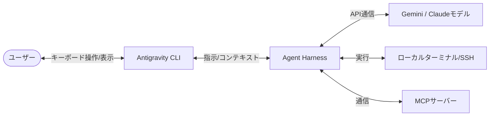

# **Antigravity CLI 調査レポート**

## **1. 基本情報**

* **ツール名**: Antigravity CLI
* **ツールの読み方**: アンチグラビティ シーエルアイ
* **開発元**: Google
* **公式サイト**: [https://antigravity.google/product/antigravity-cli](https://antigravity.google/product/antigravity-cli)
* **関連リンク**:
  * ドキュメント: [https://www.antigravity.google/docs/cli-overview](https://www.antigravity.google/docs/cli-overview)
* **カテゴリ**: ターミナル/シェル
* **概要**: Antigravity CLIは、Googleの次世代AIエージェントプラットフォーム「Antigravity」の軽量なターミナルユーザーインターフェース（TUI）版です。Antigravity 2.0と同じコアエンジンを搭載しながら、高速でリソース消費が少なく、キーボード操作を中心とする開発者に特化しています。

## **2. 目的と主な利用シーン**

* **解決する課題**: リソースを大量に消費するGUIエディタを使わずに、ターミナル上で直接AIエージェントを活用したいというニーズに応え、コンテキストスイッチを防ぐ。
* **想定利用者**: キーボード操作を好む開発者、リモートサーバー(SSH)で作業するインフラエンジニアやバックエンドエンジニア。
* **利用シーン**:
  * リモートSSH環境でのコード編集やインフラ構築・設定の自動化
  * ターミナルから離れずに、複数ステップの推論や複数ファイルの編集をエージェントに依頼する
  * バックグラウンドで長時間のタスクを実行させ、別の作業を並行して行う

## **3. 主要機能**

* **Shared Agent Harness**: Antigravity 2.0と同じコアエージェントエンジンを使用。複数ステップの推論、複数ファイル編集、ツール呼び出しなど、高度なエージェント機能を利用可能。
* **Terminal User Interface (TUI)**: キーボード操作に最適化され、軽量で高速に動作するターミナル専用のUI。
* **Shared Settings**: Antigravity 2.0と設定やパーミッション（権限）が共有される。CLIでの変更が2.0に、2.0での変更がCLIに自動反映される。
* **Conversation Export**: CLIで開始した会話（コンテキスト）をAntigravity 2.0にエクスポートし、GUI上で作業を継続することが可能。
* **Fast-path Approvals & Parallel Tasks**: エージェントにバックグラウンドタスクを委譲したり、承認プロセスを高速化する機能。
* **Remote SSH Support**: リモートサーバー環境でのサイレントキーリングサインインや認証をサポート。

## **4. 動作原理・システム構成**

* **アーキテクチャ**: ローカルファーストのTUI（Terminal User Interface）とクラウドのAIモデルを組み合わせたクライアント・サーバー構成。
* **主要コンポーネントとデータフロー**:
  * **TUIクライアント**: ユーザーのキーボード入力を受け付け、ターミナル上でUIを描画する。
  * **Agent Harness**: Antigravity 2.0と共通のコアエンジン。複数ステップの推論やファイル編集、サブエージェントの管理を行う。
  * **AIモデル**: Google Cloud（Gemini 4 Argon, Gemini 3.8 Flashなど）やClaude 5.5モデルに接続し、推論やコード生成を実行する。
* **特筆すべき要素技術**:
  * **ターミナルサンドボックス**: ターミナル操作の実行前に自動で安全性を検証し、承認プロセスを挟むことでリスクを軽減。
  * **MCP (Model Context Protocol)**: ローカルやリモートのMCPサーバーに接続し、外部ツールやデータソースとの連携を実現する。

## **5. 開始手順・セットアップ**

* **前提条件**:
  * ローカルマシンまたはリモートサーバー環境
  * Googleアカウント
* **インストール/導入**:
  * 公式サイトのダウンロードページからインストールスクリプトを実行。
* **初期設定**:
  * 初回起動時にGoogleアカウントでサインイン（サイレントキーリング対応）。
  * 以前「Gemini CLI」を利用していた場合は、初回セットアップ時に拡張機能(extensions)、スキル、設定をワンタイムで自動インポート（移行）可能。
* **クイックスタート**:
  * ターミナルでコマンドを入力し、TUIを起動してエージェントに対話を始める。

## **6. 特徴・強み (Pros)**

* **軽量かつ高速**: GUIに比べてオーバーヘッドが少なく、リソースが限られた環境でも軽快に動作する。
* **リモート開発との親和性**: SSH経由でのリモートサーバー上でもフル機能を利用できるため、サーバー管理やインフラ構築に最適。
* **Antigravity 2.0とのシームレスな連携**: 異なるUIでありながら、同じ設定基盤とエージェントエンジンを共有し、会話の引き継ぎもできるため、適材適所で使い分けが可能。
* **移行の容易さ**: 既存のGemini CLIユーザー向けに、設定や拡張機能の自動移行パスが用意されている。

## **7. 弱み・注意点 (Cons)**

* **視覚的なレビューに不向き**: Antigravity 2.0の「Artifacts」のような、ブラウザ操作のプレビューやドキュメントのインラインレビューなどの視覚的リッチな機能は提供されない。
* **学習コスト**: スラッシュコマンドやキーバインドなど、TUI特有の操作を覚える必要がある。
* **ターミナル操作リスク**: エージェントにターミナル操作を委譲するため、適切なパーミッション設定（Deny List等）を行わないと予期せぬコマンドが実行されるリスクがある。

## **8. 料金プラン**

| プラン名 | 料金 | 主な特徴 |
|---------|------|---------|
| **For Individuals** | 無料 | Gemini 3.8 Flash等のモデルアクセス。無制限のコマンドリクエストと基本ウィークリー制限。 |
| **Google AI Pro** | (要Google One) | Individualsの機能に加え、より寛大な制限と柔軟なAIクレジットプール。Gemini 4 Argonなどへのアクセス。 |
| **Google AI Ultra** | (要Google One) | 開発者のメインドライバー向け。Proの機能に加えてさらに寛大な制限。 |
| **Organization (Google Cloud)** | $30/月〜または従量課金 | 企業向け。Google Cloudの利用規約に準拠。プロジェクト統合やAPIベースの従量課金。 |

* **課金体系**: 個人向け無料プランのほか、Google Oneベースのプラン、およびGoogle Cloudを通じた企業向けの従量課金モデルが提供されている。
* **無料トライアル**: For Individualsプランは無料で利用可能。

## **9. 導入実績・事例**

* **導入企業**: Googleの次世代プラットフォームとしてリリースされたばかりであり、具体的な企業導入事例はまだ広く公開されていない。
* **導入事例**: Gemini CLIからの移行ユーザーや、ターミナル中心のワークフローを好む開発者に利用されている。
* **対象業界**: ソフトウェア開発全般、インフラ・DevOps領域。

## **10. サポート体制**

* **ドキュメント**: [公式ドキュメント](https://www.antigravity.google/docs/cli-overview)に、設定、キーバインド、リモートSSHのセットアップ方法などが詳細に記載されている。
* **コミュニティ**: Googleの開発者コミュニティが中心。
* **公式サポート**: Google Antigravityの共通サポートチャネルを通じて対応。

## **11. エコシステムと連携**

### **11.1 API・外部サービス連携**

* **API**: MCP (Model Context Protocol) サーバーへの接続など、Antigravity 2.0と同様の機能を持つと考えられる。
* **外部サービス連携**: Google Cloud Project (Organizationプランでの統合)。Gemini CLIからの拡張機能やスキルの引き継ぎ。

### **11.2 技術スタックとの相性**

| 技術スタック | 相性 | メリット・推奨理由 | 懸念点・注意点 |
|:---|:---:|:---|:---|
| **Linux / Bash / Zsh** | ◎ | ターミナルツールであるため、シェルスクリプトやシステム管理コマンドと極めて親和性が高い。 | 特になし |
| **Docker / Kubernetes** | ◎ | インフラ・コンテナ管理において、ターミナル上で直接エージェントに構成ファイル編集やデプロイを依頼できる。 | 特になし |
| **フロントエンド (UI重視)** | △ | ターミナル環境のため、UIプレビューなどを伴う開発にはAntigravity 2.0の方が適している。 | 特になし |

## **12. セキュリティとコンプライアンス**

* **認証**: Googleアカウントによる認証（リモートSSH用のサイレントキーリングにも対応）。
* **データ管理**: Antigravity 2.0と権限や設定を共有。OrganizationプランではGoogle CloudのTerms of Service (ToS)に基づくデータ保護が適用される。
* **準拠規格**: 企業向けプランはGoogle Cloudに準拠。

## **13. 操作性 (UI/UX) と学習コスト**

* **UI/UX**: リソースを消費しない軽量なTUI。キーボード操作で完結するため、VimやEmacs、tmuxなどに慣れた開発者には非常に快適。
* **学習コスト**: スラッシュコマンドやショートカットキーなど、コマンドラインツールの操作に慣れる必要があるが、Gemini CLIからのユーザーであればスムーズに移行できる。

## **14. ベストプラクティス**

* **効果的な活用法 (Modern Practices)**:
  * **UIツールとの使い分け**: インフラ設定やサーバー上での作業はCLIで、コードの視覚的なレビューやフロントエンド開発は会話をエクスポートしてAntigravity 2.0で継続する、というように強みを活かして使い分ける。
  * **リモートSSHでの活用**: ターミナル経由でのみアクセスできるリモートサーバー環境で、エージェントをローカルと同じように呼び出して活用する。
* **陥りやすい罠 (Antipatterns)**:
  * **視覚的タスクの無理な実行**: Webアプリのレイアウト調整など、プレビューが必要な作業をTUIだけで行おうとすること。

## **15. ユーザーの声（レビュー分析）**

* **調査対象**: 公式ドキュメント、リリース情報
* **総合評価**: 評価データ不足
* **ポジティブな評価**:
  * 「ターミナルから離れずにエージェントに並行タスクを依頼できるため、集中力が途切れない」
  * 「SSH経由のリモートサーバーでも使えるのが非常に便利」
* **ネガティブな評価 / 改善要望**:
  * リリースされたばかりのため、具体的な課題の指摘はまだ少ない。
* **特徴的なユースケース**:
  * バックグラウンドでのデプロイスクリプトの作成・実行や、サーバーのログ調査の自動化。

## **16. 直近半年のアップデート情報**

* **2026-10-16 (v1.4.0)**: OSC 7501 terminal status reporting, alt+m message queue toggle, and enhanced agy plugin validate diagnostics.
* **2026-10-15 (v1.3.6)**: Claude 5.5 models via ADC, enhanced Auto mode sandbox reviews, colorized Commit Tree in /diff, and model stall recovery.
* **2026-10-14 (v1.3.5)**: Auto mode for autonomous command approvals, on-demand /compact conversation summarization, and syntax highlighting with folding in /diff.
* **2026-10-13 (v1.3.4)**: JSON output for plugin listing, default thinking level selection, and browser settings synchronization for Remote Control.
* **2026-10-08 (v1.3.2)**: Interactive plugin marketplace manager, authoring capabilities, and /diff Commit Tree navigation.
* **2026-10-07 (v1.3.1)**: Enhanced /diff navigation and position indicators, Windows plugin lifecycle management, and subagent and task status fixes.
* **2026-05**: (リリース情報に基づく) Organizationプラン（Google Cloud統合）の導入、Gemini CLIからの移行機能の提供。
* (Antigravity 2.0とエージェントエンジンを共有するため、エージェント自体のアップデートは2.0に準拠する)

(出典: [Antigravity CLI Pricing](https://antigravity.google/pricing) / [Changelog](https://antigravity.google/docs/changelog))

## **17. 類似ツールとの比較**

### **17.1 機能比較表 (星取表)**

| 機能カテゴリ | 機能項目 | 本ツール | Google Antigravity | Claude Code | Gemini API CLI |
|:---:|:---|:---:|:---:|:---:|:---:|
| **基本機能** | ターミナル環境(TUI) | ◎ <small>特化型</small> | × <small>GUIベース</small> | ◎ <small>TUI対応</small> | ◯ <small>標準的なCLI</small> |
| **カテゴリ特定** | 複数ステップ推論・並行実行 | ◎ <small>Agent Harness共有</small> | ◎ <small>Agent Harness共有</small> | ◎ <small>高度な推論</small> | △ <small>スクリプト用途中心</small> |
| **エンタープライズ** | ブラウザ・視覚的プレビュー | × <small>TUIの制約</small> | ◎ <small>Artifacts対応</small> | × <small>非対応</small> | × <small>非対応</small> |
| **非機能要件** | リソース軽量性 | ◎ <small>低オーバーヘッド</small> | △ <small>VS Codeベースで重め</small> | ◎ <small>軽量</small> | ◎ <small>軽量</small> |

### **17.2 詳細比較**

| ツール名 | 特徴 | 強み | 弱み | 選択肢となるケース |
|---------|------|------|------|------------------|
| **Antigravity CLI** | 次世代AIエージェントのターミナル版。 | 高速、軽量。SSHリモート環境でも使える。Antigravity(GUI)と設定・コンテキストを共有。 | 視覚的なレビューやGUI操作には不向き。 | リモートサーバーでの作業や、キーボード操作で完結させたい場合。 |
| **Google Antigravity** | GUIベースの統合開発環境（VS Codeベース）。 | Artifactsを用いた視覚的なフィードバック、ブラウザ操作の自律実行。 | CLIに比べるとリソース消費が大きく、GUI環境が必要。 | コードの全体的なリファクタリングやフロントエンド開発、視覚的な結果確認が必要な場合。 |
| **Claude Code** | Anthropicが提供するターミナル向けAIツール。 | Claudeモデルによる高度なコーディング支援。 | ターミナル特化であり視覚的なブラウザ検証などは弱い。 | Claudeモデルを好む開発者や、Anthropicのエコシステムを中心に据えたい場合。 |
| **Gemini API CLI** | Gemini APIを直接叩くためのオープンソースCLIツール。 | スクリプトへの組み込みや自動化が容易。 | エージェントとしての自律性やTUIとしてのリッチな操作感には欠ける。 | CI/CDでの自動化やシェルスクリプトでAIを活用したい場合。 |

## **18. 総評**

* **総合的な評価**:
  Antigravity CLIは、Googleの強力なエージェント基盤をターミナルという最も無駄のない環境に持ち込んだ、プロフェッショナル向けのツールです。Antigravity 2.0と相互補完の関係にあり、同じ設定やエンジンを使いながら、GUIが必要な場面とTUIが適した場面で柔軟に使い分けられる点が最大の強みです。
* **推奨されるチームやプロジェクト**:
  インフラエンジニア、バックエンド開発者、あるいはVim/Emacsなどを愛用し、マウス操作を極力減らしたいキーボード中心の開発者に最適です。また、SSHでリモートサーバーに入って作業することが多いチームには欠かせないツールとなるでしょう。
* **選択時のポイント**:
  視覚的な要素（Webプレビューやリッチなドキュメントレビューなど）が必要なタスクにはAntigravity 2.0を、純粋なコード編集、スクリプト作成、システム管理にはAntigravity CLIを、というように、適材適所でツールを選択することが生産性向上の鍵となります。
