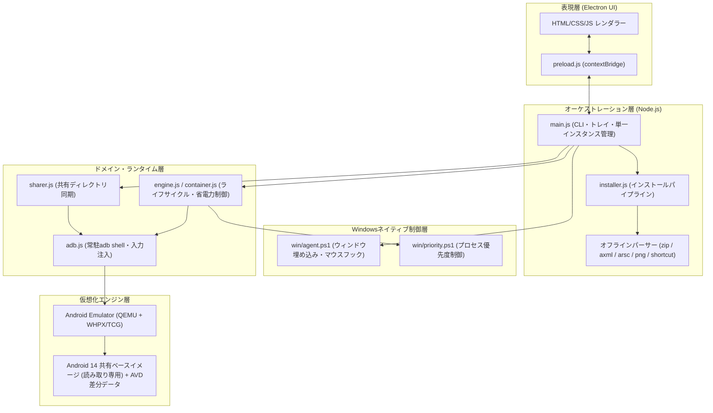

# **ApkStart 調査レポート**

## **1. 基本情報**

* **ツール名**: ApkStart
* **ツールの読み方**: エーピーケースタート / アプケスタート
* **開発元**: RoutineMiku（個人開発者によるオープンソースプロジェクト）
* **公式サイト**: [https://github.com/RoutineMiku/apkstart](https://github.com/RoutineMiku/apkstart)
* **関連リンク**:
  * GitHub: [https://github.com/RoutineMiku/apkstart](https://github.com/RoutineMiku/apkstart)
  * リリース一覧 (GitHub Releases): [https://github.com/RoutineMiku/apkstart/releases](https://github.com/RoutineMiku/apkstart/releases)
  * ミラーリリース (Gitee): [https://gitee.com/daily-miku/apkstart/releases](https://gitee.com/daily-miku/apkstart/releases)
* **カテゴリ**: デスクトップ/環境操作
* **概要**: ApkStartは、Windows 10/11 (x64) 上でAndroidアプリをWindowsネイティブソフトウェアのようにインストール・実行できるオープンソースのAndroidアプリランナーです。`.apk` ファイルをダブルクリックするだけで自動解析・インストール・デスクトップアイコン生成を行い、自己完結型のQEMUベースAndroidランタイム（Android 14 / API 34）を用いて各アプリを独立したWindowsウィンドウとして起動します。

## **2. 目的と主な利用シーン**

* **解決する課題**: 従来のWindows向けAndroidエミュレータ（BlueStacks等）が持つ「巨大なランチャーUIの起動が必要」「広告が多い」「動作が重い」という課題や、MicrosoftによるWSA（Windows Subsystem for Android）のサポート終了に伴う代替手段の不足を解決し、「エミュレータを意識させない（去模拟器化）」シームレスな体験を提供します。
* **想定利用者**: Windows上で日常的に特定のAndroidアプリ（SNS、動画、ツール系アプリ等）を使いたい一般ユーザー・パワーユーザー、およびAPKの動作確認を手早く行いたいAndroidアプリ開発者・QA担当者。
* **利用シーン**:
  * Windowsのエクスプローラーから `.apk` や `.xapk` / `.apks` ファイルをダブルクリックして即座にインストール・起動する
  * よく使うAndroidアプリをデスクトップやスタートメニューのショートカットから直接起動し、独立ウィンドウで並行作業する
  * `%USERPROFILE%\ApkStartShared` フォルダ経由でWindowsとAndroidアプリ間のファイルをシームレスにやり取りする

### **2.1 代表的な利用フロー**

```mermaid
swimlane-beta TB
  subgraph User["ユーザー"]
    A["APKファイルをダブルクリック"]
    F["独立ウィンドウでアプリを操作"]
  end
  subgraph Shell["ApkStart (Electronシェル)"]
    B["APKをオフライン解析 (アイコン・パッケージ名抽出)"]
    D["デスクトップにICO・ショートカット生成"]
    E["エミュレータ画面をアプリウィンドウへ埋め込み"]
  end
  subgraph Runtime["QEMU / Androidランタイム"]
    C["ADB経由でインストール・権限自動付与"]
  end
  A --> B
  B --> C
  C --> D
  D --> E
  E --> F
```

* **代表的な流れ**: ユーザーが `.apk` をダブルクリックすると、ApkStartのシェル層が外部ツールを使わずにAPKのメタデータとアイコンをオフライン抽出し、バックグラウンドのAndroidランタイムへADB経由でインストールします。完了後はショートカットを作成し、ランタイムの描画ウィンドウをタイトル・アイコン付きの独立したアプリウィンドウとしてユーザーに提示します。

## **3. 主要機能**

* **ダブルクリックによる即座のAPKインストール**: HKCUレジストリへの `.apk` ファイル関連付け（管理者権限不要）により、エクスプローラー上でAPKをダブルクリックするだけで解析・インストール・起動までを自動化します。分割APK（`.apks` / `.xapk`）の `install-multiple` にも対応しています。
* **リアルアイコン抽出とショートカット自動生成**: APK内部からアプリアイコンとアプリ名をオフライン抽出し、マルチサイズ `.ico` ファイルを生成します。デスクトップおよびスタートメニュー（`ApkStart` フォルダ）にショートカット（`.lnk`）を作成するため、Windowsの検索機能からもアプリ名で直接起動できます。
* **独立アプリケーションウィンドウ化**: AndroidエミュレータのウィンドウをWindows API（`SetParent` 等）で宿主ウィンドウへ埋め込み、ウィンドウタイトルとアイコンを実アプリのものに差し替えます。縦長画面比率の維持、アプリごとのウィンドウサイズ記憶、`F11` キーでの全画面中央表示、および物理パネルサイズ変更による横画面（タブレットレイアウト）切り替えに対応しています。
* **自己完結型QEMUランタイムと既存環境の再利用**: `adb`、Android Emulator（QEMU）、Android 14（API 34 Google Play x86_64）システムイメージを自身でダウンロード・展開・管理するため、サードパーティ製エミュレータの事前導入が不要です。また、設定で既に起動しているWSAやMuMu等のADBポートを再利用するモードも備えています。
* **ARM互換モード（ARM-onlyアプリ対応）**: Android 14 Google Playイメージに内蔵された `ndk_translation` バイナリ変換層を活用し、x86バイナリを含まない `arm64-v8a` 専用アプリもインストール・実行できます。
* **双方向ファイル共有**: Windowsの `%USERPROFILE%\ApkStartShared` とAndroid側の `/sdcard/ApkStartShared` を増分同期（8秒ポーリング＋主要アクション時トリガー）し、アプリで保存したファイルへPCから直接アクセスできます。
* **実行時権限の自動付与とクラッシュ自動復旧**: `adb install -r -g -t` によるランタイム権限の自動付与に加え、起動後18秒間の生存監視を行い、クラッシュ時は自動リトライや必要に応じたデータリセットを実施します。
* **マウス・ホイール入力の最適化**: 右クリックをAndroidの「戻る（`keyevent 4`）」に割り当てる機能や、マウスホイール回転を60〜90ms単位でマージして滑らかなスワイプ操作（`input swipe`）に変換する機能を提供します。

## **4. 動作原理・システム構成**

* **アーキテクチャ**: **ローカル完結型のElectronシェル＋QEMU仮想化エンジン（アプリケーションレベル・コンテナモデル）**を採用しています。Electron（Node.js）製シェルがUI・ファイル解析・ライフサイクル管理を担い、バックグラウンドでヘッドレスではない窓付きQEMUプロセス（Android Emulator）を制御してWindowsウィンドウに統合します。



* **主要コンポーネントとデータフロー**:
  * **ゼロ依存オフラインAPKパーサー**: `aapt2` や `sharp` などの重い外部バイナリを使わず、`src/core/` 配下に手書きされた `zip.js`、`axml.js`（AndroidバイナリXML解析）、`arsc.js`（`resources.arsc` からのアプリ名・アイコン解決）、`png.js`、`shortcut.js` により数ミリ秒でAPKを解析してマルチサイズICOと `.lnk` を生成します。
  * **コンテナ式の低負荷ライフサイクル管理**: Android OS全体を毎回コールドブートする負荷を避けるため、1つの読み取り専用ベースイメージ（`system-images/`）を全アプリで共有し、差分ユーザーデータとQuickbootスナップショットを使用します。アプリAからアプリBへ切り替える際はOSを再起動せず、他アプリを `am force-stop` して `am start` で即座に切り替えます。全ウィンドウが閉じられると `am kill-all` と `deviceidle force-idle` を実行した上でQEMUプロセス優先度を `Idle` へ落とし、設定時間の経過後に自動シャットダウンします。
* **特筆すべき要素技術**:
  * **カスタムext4 `/data` パーティション生成**: 公式システムイメージの `userdata.img` が1MBのゼロ埋めプレースホルダであるため、初回起動時に `ENCRYPT`（ファイルベース暗号化）および `ext_attr`（SELinuxラベル）付きのext4イメージを自動生成し、`qemu-img` と `resize2fs` で拡張する仕組みを内蔵しています。
  * **コンソールウィンドウの完全抑止と常駐ADBパイプライン**: QEMUや `netsimd` が生成する `conhost.exe` の黒いコマンドプロンプト窓を起動前フックとクラス名監視で抑止します。また、ホイール操作の注入には都度 `adb` プロセスを起動せず、常駐 `adb shell` 上でセンチネル文字列によるバックプレッシャ制御を行っています。
  * **仮想NIC不要のホストNAT通信**: ネットワークはQEMUのユーザーモードNATを使用するため、Windows側に仮想ネットワークアダプタやTAPドライバを追加せずにホストのネットワークをそのまま利用できます。

## **5. 開始手順・セットアップ**

* **前提条件**:
  * OS: Windows 10 または Windows 11（64bit / x64）
  * 仮想化支援: BIOS/UEFIでの仮想化機能有効化およびWindowsの「Windows ハイパーバイザー プラットフォーム（WHPX）」またはAEHDドライバ推奨（未対応環境ではソフトウェアエミュレーションへ自動フォールバック）
  * ソースからビルドする場合のみ: Node.js 20以上
  * アカウント登録・クレジットカード登録: 不要
* **インストール/導入**:
  * **インストーラー版（推奨・オフライン完結）**: [GitHub Releases](https://github.com/RoutineMiku/apkstart/releases) から `ApkStart-v*-Setup.exe`（約800MB〜1.3GB、ランタイム同梱）をダウンロードして実行します。ユーザーディレクトリへインストールされるため管理者権限は不要です。
  * **ポータブル版（軽量）**: `ApkStart-v*-win64-portable.zip`（約95MB）を展開して `ApkStart.exe` を起動します。初回起動時にバックグラウンドでランタイム一式をダウンロードします。
  * **ソースからのビルド**:

  ```powershell
  # リポジトリのクローンと依存関係インストール
  git clone https://github.com/RoutineMiku/apkstart.git
  cd apkstart
  npm install

  # 起動（初回時にランタイムの自動デプロイを実行）
  npm start
  ```

* **初期設定**:
  * 初回起動時に表示される「ランタイム」セットアップ画面で「一括デプロイ（一键部署）」をクリックすると、`adb`・Android Emulator・Android 14システムイメージの展開と初回起動が自動で行われます。
  * 必要に応じて設定画面から `.apk` ファイルの関連付けを有効化します（CLIからも実行可能）。

  ```powershell
  # CLIで .apk ファイルの関連付けを有効化する場合
  npm run assoc:on
  ```

* **クイックスタート**:
  * 任意の `.apk` ファイルをダブルクリックするか、以下のコマンドで直接インストール・起動を実行できます。

  ```powershell
  # APKのインストール
  ApkStart.exe "C:\path\to\app.apk"

  # インストール済みアプリの直接起動（ショートカットから呼ばれるコマンド）
  ApkStart.exe --launch com.example.app
  ```

## **6. 特徴・強み (Pros)**

* **エミュレータを意識させないネイティブ体験**: ランチャー画面を開く手間がなく、Windowsのスタートメニュー検索やデスクトップアイコンから個別のAndroidアプリを直接起動・ウィンドウ操作できます。
* **サードパーティ製ランタイム不要で広告なし**: 商用エミュレータ（BlueStacks等）に見られる広告表示やバンドルソフトがなく、MITライセンスの透明性の高いOSSとして提供されています。
* **非常に軽量なシェルと自動最適化**: シェル層が外部ライブラリに依存しない手書き実装であるため動作が軽く、ハードウェア環境に応じたGPUバックエンド選択やメモリ割り当て、クラッシュ時の自動リトライまで自動で行われます。
* **ホスト環境を汚さないクリーンな設計**: 仮想ネットワークドライバをインストールせず、ファイル関連付けも `HKCU`（現在ユーザー）スコープで行うため、管理者権限不要でアンインストールや残留ファイル整理も容易です。

## **7. 弱み・注意点 (Cons)**

* **日本語対応の状況**: UIテキスト、エラー診断メッセージ、公式ドキュメント（README・アーキテクチャ解説）はすべて中国語（簡体字）で記述されており、現時点では日本語および英語の公式ローカライズは提供されていません。
* **仮想化オーバーヘッドとメモリ消費**: アプリ切り替えは高速なものの、ベースとしてQEMU上でAndroid 14 OSを起動するため、アイドリング時でも約1GB以上のRAMを消費します（低スペックPCでは負荷を感じやすい）。
* **高度なアンチエミュレータ対策・ハードウェア依存アプリへの制限**: 銀行アプリ、高度な3Dゲーム、実機センサーやベースバンド情報を厳格に検証する一部アプリでは起動制限や動作不良が発生する場合があります。
* **Windows x64専用**: macOSやLinux環境はサポートされていません。

## **8. 料金プラン**

| プラン名 | 料金 | 主な特徴 |
|---------|------|---------|
| **オープンソース版 (MITライセンス)** | 無料 | 全機能利用可能。広告なし、アプリ数制限なし、商用・個人利用ともに制限なく利用可能。 |

* **課金体系**: 完全無料（オープンソースソフトウェア、有料プランや課金機能なし）。
* **無料トライアル**: 該当なし（全機能が永続的に無料）。
* **補足**: ダウンロードされるAndroidシステムイメージおよびGoogleコンポーネントはGoogle等の配布元ライセンスに準拠してユーザー端末上でオンデマンド取得されます。

## **9. 導入実績・事例**

* **導入企業**: 公開事例なし（個人ユーザーや開発者コミュニティを中心に急速に普及している新興OSSツール）。
* **活用報告**: 2026年10月末の公開から約2週間でGitHubスター数5,100件・フォーク数420件超を獲得しており、中国語圏および英語圏のWindowsユーザーによる「終了したWSA（Windows Subsystem for Android）の軽量な代替」「ショート動画・電子書籍・業務系AndroidアプリのPC常駐運用」での利用が多数報告されています。公式READMEでも `arm64-v8a` 専用アプリ（紅果無料短劇等）の互換モード動作実績が紹介されています。
* **対象業界**: 個人利用、ソフトウェア開発・テスト、モバイルアプリ検証。

## **10. サポート体制**

* **ドキュメント**: GitHubリポジトリ内の `README.md`、`docs/ARCHITECTURE.md`、`docs/DEV-ENV.md`、`CONTRIBUTING.md` が整備されています（中国語中心）。
* **コミュニティ**: GitHub IssuesおよびPull Requestsを通じてバグ報告・機能要望・コントリビュートを受け付けています。また、作者（RoutineMiku）のWeChat公式アカウントによる情報発信も行われています。
* **公式サポート**: 個人開発のOSSであるため、SLA付きの有償サポートや電話・メール窓口は存在しません。トラブルシューティング用にアプリ内設定から診断レポートをエクスポートする機能が備わっています。

## **11. エコシステムと連携**

### **11.1 API・外部サービス連携**

* **API / CLI**: 外部向けREST APIは提供していませんが、ローカル制御用のCLI引数（`<apkパス>`、`--launch <パッケージ名>`）およびElectron内部のIPCチャネルが定義されています。また、ランタイム診断用のセルフテストスクリプト（`npm run selftest`）を備えています。
* **外部サービス連携**:
  * **Android Debug Bridge (ADB)**: 既存のWSA、MuMu Player、Android Studioエミュレータ等のADBポートに接続して動作するモードをサポート。
  * **GitHub Releases / Gitee Releases**: アプリ内の自動アップデート機構で両ソースのリリースAPIと302フォールバックを自動計測して高速なミラーを選択。
  * **Google公式DLサーバー (`dl.google.com`)**: `platform-tools`、Android Emulator、Android 14システムイメージ、AEHDドライバの取得元として利用。
  * **Windowsエクスプローラー / スタートメニュー**: `.apk` 関連付け、`SHChangeNotify`、`.lnk` ショートカット生成によるOS統合。

### **11.2 技術スタックとの相性**

| 技術スタック / 対象アプリ | 相性 | メリット・推奨理由 | 懸念点・注意点 |
|:---|:---:|:---|:---|
| **x86_64 ネイティブ対応APK** | ◎ | バイナリ変換なしで最高速に動作 | 特になし |
| **ARM専用APK (arm64-v8a)** | ◯ | Android 14イメージの `ndk_translation` により動作可能 | 一部の高度なアンチエミュレータ保護付きアプリは非対応 |
| **分割APK (.apks / .xapk)** | ◎ | `install-multiple` 自動対応により単一APKと同様に導入可能 | 一部独自の暗号化・独自形式バンドルは展開不可の場合あり |
| **既存ADB環境 (WSA / MuMu等)** | ◯ | 既存ランタイムのADBポートを再利用し、重複起動を回避可能 | 外部ランタイム側の仕様変更やウィンドウ仕様に依存 |
| **macOS / Linux環境** | × | Windows 10/11 (x64) 専用設計（PowerShell / Win32 API依存） | 利用不可（LinuxではWaydroid等が代替） |

## **12. セキュリティとコンプライアンス**

* **認証**: デスクトップローカルアプリのため、ツール独自のアカウント認証やSSOは不要です。アップデート取得時のGitee APIレート制限回避用として、設定画面で読み取り専用トークンを任意入力できる仕組みのみを備えています。
* **データ管理**: すべてのAPK解析、AVDデータ（`%APPDATA%\apkstart\avd`）、システムイメージ、および共有ディレクトリ（`%USERPROFILE%\ApkStartShared`）はユーザーのローカルPC上にのみ保存され、外部サーバーへ送信されません。また、Electronの `preload.js` で `contextIsolation` を有効化し、ホワイトリスト化されたIPCチャネルのみを公開しています。
* **準拠規格**: 個人開発のオープンソースソフトウェア（MITライセンス）であり、SOC2やISO27001などの企業向けセキュリティ認証の取得状況は公式サイトで公開されていない。

## **13. 操作性 (UI/UX) と学習コスト**

* **UI/UX**: 初回起動時のランタイム一括デプロイウィザード、起動時のウェルカムカード、設定画面（マウス操作割り当て・軽量コンテナ設定・残存ファイルクリーンアップ・診断レポート出力）など、モダンでクリーンなUIを備えています。ランチャー画面を意識せずデスクトップアイコンから直接起動できるため、日常利用のUXは極めて直感的です。
* **学習コスト**: インストーラー版を利用する場合は「クリックして展開→APKをダブルクリック」だけで完了するため学習コストは非常に低いです。ただし、UI言語が中国語であるため、設定項目の細かなチューニング（互換モード切り替えやマウス右クリック戻る設定など）を行う際は翻訳ツール等の併用が推奨されます。

## **14. ベストプラクティス**

* **効果的な活用法 (Modern Practices)**:
  * オフライン・一括導入を重視する場合はポータブル版ではなくランタイム同梱の `Setup.exe` を使用し、初回起動後にスナップショット（Quickboot）を有効にしてコールドブート時間を短縮する。
  * ARM専用アプリが起動しない・クラッシュする場合は、設定画面から「ARM互換モード（Android 14イメージ）」を有効化する。
  * ホストPCのCPU負荷を抑えたい場合は、デフォルトの「軽量コンテナモード（`liteMode`）」とプロセス優先度自動制御を有効のまま運用する。
* **陥りやすい罠 (Antipatterns)**:
  * **Windows標準の `Compress-Archive` でポータブル版を再圧縮する**: 公式ビルドガイドにある通り、7-Zipや専用スクリプト（`build/zip.js`）以外で圧縮するとファイルサイズが増大し配布制限に引っかかる場合がある。
  * **ゲーム用途でデフォルトの軽量設定のまま使う**: FPSゲームなど低遅延・高フレームレートを求める場合は、設定で「パフォーマンス優先モード（`priorityMode: performance`）」や「ゲーム/低遅延モード」へ切り替える必要がある。
  * **古いバージョンの残留ファイルや壊れたスナップショットを放置する**: 強制終了等で起動しなくなった場合は、アプリ内の「ストレージ整理」「ネットワーク修復」機能を活用して不完全なスナップショットやロックファイルをクリーンアップする。

## **15. ユーザーの声（レビュー分析）**

* **調査対象**: GitHubリポジトリ（Stars / Issues / Releasesフィードバック）、技術メディア・ブログレビュー（CSDN、阿里云開発者コミュニティ、技術系解説記事等）
* **総合評価**: GitHubスター数 5,140以上・フォーク数 429以上（2026年11月時点、公開後約2週間で急成長）。※G2/Capterra/ITreview等のBtoBレビューサイトには未掲載。
* **ポジティブな評価**:
  * 「従来のAndroidエミュレータのように巨大なランチャー画面や広告に悩まされず、Windowsネイティブアプリのように独立ウィンドウとアイコンで使える体験が素晴らしい」（技術レビュー記事より要約）
  * 「WSAの代替として最も完成度が高く、インストーラー1つでQEMUやシステムイメージまで完結し、仮想NICも作らない設計がクリーン」（GitHubコミュニティより要約）
  * 「外部ライブラリに頼らずAPKやAXML・ICO生成まで自前で書かれている点が軽量で、開発者の更新スピードも非常に速い」（技術解説記事より要約）
* **ネガティブな評価 / 改善要望**:
  * 「初期リリース直後は横画面・全画面時の表示崩れや、マウスフックによるシステム全体の引っかかり（フレーム落ち）が報告されていた」（v0.4.3〜v0.5.0で大幅に改善済み）
  * 「UIとエラーメッセージが中国語のみのため、非中国語圏のユーザーには設定項目の理解に少しハードルがある」（コミュニティからのフィードバック要約）
  * 「QEMU全システム仮想化をベースにしているため、ネイティブコンテナ型（WSA等）と比べるとメモリ消費量や初回起動時間は相応にかかる」（技術レビュー記事より要約）
* **特徴的なユースケース**:
  * WSA終了後の代替環境として、PC作業の傍らにSNS・電子書籍・ショートドラマアプリを縦長小窓で常駐させる用途で広く使われている。

## **16. 直近半年のアップデート情報**

* **2026-11-15**: **v0.5.0-fix / v0.4.3** リリース — 横画面・全画面切り替えを従来の論理サイズ変更から「物理LCDパネルサイズ（`hw.lcd.width/height`）の切り替え」へ刷新し、横画面時の正立表示と全画面フィルを実現。マウス低レベルフック（`WH_MOUSE_LL`）を専用メッセージスレッドへ分離し、システム全体の引っかかりを解消。ゲーム/低遅延モードを追加。
* **2026-11-14**: **v0.4.1** リリース — 埋め込み時のElectronウェブレンダリング層（`Chrome_RenderWidgetHostHWND`）とエミュレータ子ウィンドウのZオーダー競合による「クリック不能・黒枠」バグの根本原因を特定し修正。
* **2026-11-14**: **v0.4.0** リリース — アプリ起動パス上での不要なVM再起動を排除して起動安定性を向上。ネットワーク修復機能の改善と、実行時コマンドウィンドウの完全抑止を強化。
* **2026-11-14**: **v0.3.9** リリース — ストレージ回収機能（古いイメージ・スナップショット削除）の追加、およびスマホ（360dp）とタブレット（640dp）レイアウトの適切な切り替えロジックを導入。
* **2026-11-14**: **v0.3.8** リリース — 起動ウェルカムカードの追加、およびGitHub/Gitee APIレート制限時でも動作する302リダイレクトベースのアップデートチェックフォールバックを実装。
* **2026-10-29**: GitHubリポジトリ初回公開。

(出典: [GitHub Releases - RoutineMiku/apkstart](https://github.com/RoutineMiku/apkstart/releases))

## **17. 類似ツールとの比較**

### **17.1 機能比較表 (星取表)**

| 機能カテゴリ | 機能項目 | ApkStart | WSA (参考) | BlueStacks | scrcpy | Android Studio (Emulator) |
|:---:|:---|:---:|:---:|:---:|:---:|:---:|
| **基本機能** | 独立ウィンドウ実行 | ◎<br><small>タイトル・ICO・比率を自動統合</small> | ◎<br><small>Windowsネイティブ統合</small> | △<br><small>ランチャー一体型が基本</small> | ◯<br><small>ミラーリング画面のみ</small> | ×<br><small>エミュレータ枠内で動作</small> |
| **導入性** | ダブルクリックAPK導入 | ◎<br><small>.apk/.xapk関連付け対応</small> | △<br><small>別途ADBやサードパーティ必須</small> | ◯<br><small>関連付け対応</small> | ×<br><small>D&Dインストールのみ</small> | △<br><small>IDE/ADB経由</small> |
| **実行基盤** | 単体完結性 (実機不要) | ◎<br><small>QEMU+Android 14同梱</small> | ◯<br><small>Hyper-Vベース (開発終了)</small> | ◎<br><small>独自VM同梱</small> | ×<br><small>実機または別VMが必須</small> | ◎<br><small>AVD同梱 (要巨大SDK)</small> |
| **軽量性・純粋性** | 広告なし・OSS透明性 | ◎<br><small>MITライセンス完全無料</small> | △<br><small>プロプライエタリ・EOL</small> | ×<br><small>広告・推奨アプリ表示あり</small> | ◎<br><small>Apache 2.0 OSS</small> | ◎<br><small>OSSベース公式ツール</small> |
| **非機能要件** | 日本語対応 | ×<br><small>中国語UIのみ</small> | ◎<br><small>日本語対応</small> | ◎<br><small>日本語対応</small> | ◯<br><small>CLI英語・ドキュメント充実</small> | ◎<br><small>公式日本語プラグイン等あり</small> |

### **17.2 詳細比較**

| ツール名 | 特徴 | 強み | 弱み | 選択肢となるケース |
|---------|------|------|------|------------------|
| **ApkStart** | 「脱エミュレータ」を掲げるWindows用OSS APKランナー | ダブルクリック導入、独立ウィンドウ・アイコン化、広告なし、仮想NIC不要 | 日本語UI非対応、新興プロジェクトで大型3Dゲームは不得手 | Windows上で広告なしの軽量環境で日常系Androidアプリをネイティブソフト感覚で使いたい場合 |
| **WSA** | Microsoft公式のWindows上Androidサブシステム | OSとの深い統合とHyper-Vベースの高速動作 | 2025年3月で公式サポート終了（新規入手・公式更新不可） | 既存の構築済み環境を維持する場合のみ（新規導入には非推奨） |
| **BlueStacks** | 大手商用Androidゲーミングエミュレータ | 高いゲーム互換性、キーマッピング機能、日本語UI完備 | 広告表示が多く、ランチャーUIが重厚でビジネス用途には不向き | 重量級の3Dゲームをキーマッピング機能付きで快適にプレイしたい場合 |
| **scrcpy** | 実機Android端末のPCミラーリング・操作ツール | 超低遅延、極めて軽量、マルチプラットフォーム対応 | 単体ではAndroidを実行できず、別途実機やVMが必要 | 手元にAndroid実機があり、PCの画面とキーボードで低遅延操作したい場合 |
| **Android Studio** | Google公式のAndroidアプリ開発統合開発環境 | 最新のOSバージョン検証、デバッグ・プロファイリング機能が完全 | インストール容量・メモリ消費が非常に大きく、一般アプリ利用には過剰 | 本格的なAndroidアプリ開発・デバッグ・自動テストを行う場合 |

## **18. 総評**

* **総合的な評価**:
  * ApkStartは、「Androidエミュレータの重さや広告を排除し、Windowsソフトウェアと変わらない操作感でAndroidアプリを動かす」という明確なコンセプトを、外部依存ゼロの軽量シェルとGoogle公式Android Emulator（QEMU）の巧みな制御によって実現した非常に完成度の高いOSSプロジェクトです。特に、WSAのサポート終了後に生じた「Windowsで手軽にAPKを単体ウィンドウ起動したい」というニーズを的確に捉えており、短期間での開発スピードとアーキテクチャの洗練度は特筆に値します。
* **推奨されるチームやプロジェクト**:
  * 広告や不要な常駐プロセスを嫌うWindowsパワーユーザー・エンジニア
  * 配布されたAPKや社内検証用APKを手早くデスクトップ上で起動・確認したい開発者・QA担当者
  * サードパーティ製商用エミュレータのポリシー制限やセキュリティ懸念を避けたい個人・小規模チーム
* **選択時のポイント**:
  * 本格的な3Dゲームのプレイが主目的であればBlueStacks等の商用ゲーミングエミュレータが優位であり、手元の実機を操作したい場合はscrcpyが最適です。一方、「Windows PC上で特定のAndroidアプリを独立したウィンドウ・ショートカットとしてクリーンかつ無料で常用したい」という用途においては、日本語UI未対応のハードルを差し引いてもApkStartが極めて有力な選択肢となります。
