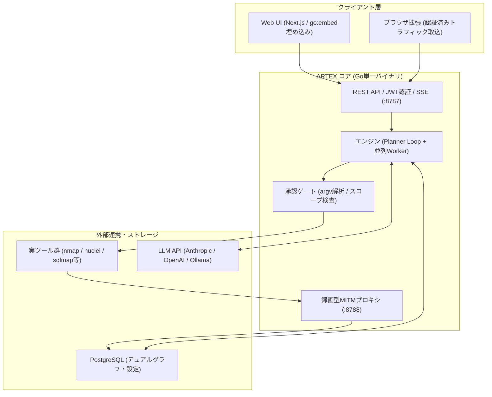

# **ARTEX 調査レポート**

## **1. 基本情報**

* **ツール名**: ARTEX
* **ツールの読み方**: アーテックス
* **開発元**: BaaRai（コミュニティ維持・英訳版メンテナー。原作は Autumn-27）
* **公式サイト**: [https://github.com/BaaRai/ARTEX](https://github.com/BaaRai/ARTEX)
* **関連リンク**:
  * GitHub: [https://github.com/BaaRai/ARTEX](https://github.com/BaaRai/ARTEX)
* **カテゴリ**: AIペネトレーションテスト
* **概要**: ARTEXは、LLM駆動のマルチエージェントが実際のセキュリティツール（nmap、nuclei、sqlmap等）を自律実行し、Webアプリケーションやネットワークの脆弱性を探索・検証するセルフホスト型ペネトレーションテストプラットフォームである。単なるチャットラッパーではなく、目標を分解するプランナーと実作業を行う複数ワーカーが閉ループを形成し、「資産グラフ」と「探索グラフ」の2つのグラフへ結果を蓄積する。さらに録画型MITMプロキシやブラウザ拡張を通じて実際のHTTPリクエスト／レスポンスを証跡として紐づけることで、再現性と監査可能性を確保している。なお、2026年10月に元開発者（Autumn-27）のリポジトリが公開停止となった後、本リポジトリ（`BaaRai/ARTEX`）が英訳および継続的なハードニング・機能開発を担う主要なコミュニティ継承版となっている。

## **2. 目的と主な利用シーン**

* **解決する課題**: 従来の脆弱性スキャナーは既知のシグネチャ検出に偏り多段階の攻撃チェーンの検証が困難であり、一方で初期のLLMベース診断ツールはコマンドの誤実行やハルシネーションによる誤検知（False Positive）、証跡の欠如が課題であった。ARTEXは「探索状態の構造化」「実HTTPトラフィックによる機械検証」「Human-in-the-loopの承認制御」を統合することで、自律的な多段階テストと信頼性の高い証跡管理を両立する。
* **想定利用者**: ペネトレーションテスター、レッドチーム運用者、脆弱性診断エンジニア、認可されたバグバウンティリサーチャー。
* **利用シーン**:
  * **許可されたWebアプリケーション・APIの自律ペネトレーションテスト**: ターゲットURLやドメインに対する偵察から脆弱性検証、再テスト（Retest）までを一貫して実施する。
  * **認証済みセッションを伴う複雑アプリの診断**: ブラウザ拡張機能を用いて人間がCAPTCHAや2FAを通過したセッションのトラフィックを取り込み、そのコンテキストでテストを継続する。
  * **継続的な攻撃面管理とカバレッジ可視化**: 会社・プロジェクト単位で共有される資産グラフとカバレッジ台帳（Coverage Ledger）により、「どのエンドポイントでどのリスククラスを検証済み／未検証か」を把握する。

### **2.1 代表的な利用フロー**

```mermaid
swimlane-beta TB
  subgraph User["ユーザー（オペレーター）"]
    A["ターゲット・スコープと目標を設定"]
    E["危険コマンドの承認・介入判断"]
    H["検証済み発見事項と証跡レポートを確認"]
  end
  subgraph ARTEX["ARTEX エンジン（Planner / Worker）"]
    B["目標を分解しインテントを発行"]
    C["ワーカーがインテントを取得しツール実行"]
    G["デュアルグラフ記録・POE検証を実行"]
  end
  subgraph Proxy["録画型MITMプロキシ・承認ゲート"]
    D["argv・スコープ規則で検査し承認要求"]
    F["実HTTP通信を暗号化保存し証跡化"]
  end
  A --> B
  B --> C
  C --> D
  D --> E
  E --> F
  F --> G
  G --> H
```

* **代表的な流れ**: オペレーターがターゲットとスコープを設定すると、プランナーが目標を具体的なインテントへ分解し、複数ワーカーが実ツールを実行する。すべての実行は承認ゲートと録画型MITMプロキシを経由し、人間の承認を経て記録された実トラフィックがデュアルグラフおよびPOE検証済みレポートとして返却される。

## **3. 主要機能**

* **デュアルグラフアーキテクチャ（探索グラフ＋資産グラフ）**: タスク横断で共有される「資産グラフ（root_domain / subdomain / ip / service / app / endpoint）」と、タスクごとの推論・進捗を表す「探索グラフ（goal / intent / fact / finding / hint）」をアンカー（`exploration_anchors`）で結合し、攻撃経路とテスト網羅率を可視化する。
* **イベント駆動プランナー・ワーカー閉ループ**: グラフの変化をデバウンスしてプランナーが起動し、未探索領域に対してインテント（意図）をフロンティアキューへ投入、複数ワーカーが並列に取得・実行・書き戻しを行う。
* **録画型MITMプロキシ＆ブラウザ拡張**: 専用CAを備えた記録用MITMプロキシ（標準ポート `:8788`）およびChrome/Edge用拡張機能（`extension/`）により、Bashや認証済みブラウザ操作のHTTPリクエスト／レスポンスを捕捉し、トラフィック詳細画面からのリプレイにも対応する。
* **POE（Proof of Exploitation）機械検証と再テストループ**: 発見事項（Finding）に対しPOEレベル（0〜4）と検証ステータスを付与し、紐づけられたレスポンス本文（gzip/deflate展開対応）内に証跡の引用文が文字通り存在するかを機械検証する。専用の `retester` エージェントによる再テスト（`Still reproducible / Fixed / Cannot confirm`）も備える。
* **多層承認ゲート（Interception Gate）**: ツール実行前に文字列・正規表現・`argv` プレフィックス規則（例: `["git","push"]` のようなトークン列一致、パイプやサプシェル等のバイパス抑止を含む）やLLMフォールバック判定で検査し、リスクスコアに応じたバッチ承認または人間による確認を求める。
* **ターゲットノイズガバナー＆Low-and-Slow制御**: `off` / `quiet` / `balanced` / `aggressive` のノイズプロファイルに応じ、ホスト単位のレート制限・ジッター・429/503バックオフ・GET重複排除を行い、プロンプト側にも各種スキャナー（nmap, nuclei, httpx等）のレート制御フラグを指示する。
* **マルチLLMプロバイダーローテーション＆フェイルオーバー**: Anthropic、OpenAI、OpenAI互換ゲートウェイ、Ollamaに対応し、タスク単位で複数プロファイルを連鎖させてフェイルオーバーやワーカー単位のラウンドロビン回転（`llm_rotate`）を実行できる。
* **ScopeSentry連携・MCP・スキル拡張**: ScopeSentryインスタンスからの資産同期、Streamable HTTP/SSEによるリモートMCPサーバー接続、再利用可能なスキル・メモリ・ワークスペースおよびカバレッジ台帳（Coverage Ledger）を提供する。

## **4. 動作原理・システム構成**

* **アーキテクチャ**: Go言語製のモノリシックなバックエンド（`net/http` ベースのREST API、JWT認証、SSE配信）に、Next.jsで静的ビルドされたWeb UIを `go:embed` で埋め込んだ**単一バイナリ＋PostgreSQL構成**の完全セルフホスト型システムである。エージェント基盤には `github.com/Autumn-27/norma` SDKを採用している。
* **主要コンポーネントとデータフロー**:
  * **フロントエンド（Next.js Static Export）**: ダッシュボード、タスク管理、資産カバレッジグラフ（`@antv/g6` / `@xyflow/react` 等）、トラフィックビューア、承認画面、システム設定を提供。
  * **バックエンド／エンジン（Go）**: `Manager` がタスクごとの `engine`（1つの `plannerLoop` ＋ N個の `worker` goroutine）とストアを管理し、PostgreSQL（`pgx/v5`）へ資産グラフ・探索グラフ・LLM利用履歴を永続化する。
  * **補助サブシステム**: `go-mitmproxy` ベースの録画プロキシ（`:8788`）、`mvdan.cc/sh/v3` を用いたBash構文解析による `guard / intercept` ゲート、非同期DNS/HTTPエンリッチメント（`enrich`）、S3互換バックアップ／アーカイブ機能を含む。



* **特筆すべき要素技術**:
  * **プロンプトインジェクション境界（Untrusted-output boundary）**: ターゲット由来のデータやツール出力は、メッセージごとにランダムなノンスを付与したデータエンベロープで囲んでプランナー・ワーカーへ渡され、指示とデータの混同を防ぐ（`ARTEX_UNTRUSTED_BOUNDARY`、デフォルト有効）。
  * **階層型予算管理（Run Budgets）**: タスク全体およびインテント単位でトークン数・ターン数の上限を設定でき、ラップアップ予備枠に達すると強制まとめフェーズへ移行する。
  * **保存時暗号化（Secrets at rest）**: LLM APIキー、タスク認証情報、MCP環境変数、プロキシ書換ルール、証跡スナップショット先頭部分などは `ARTEX_SECRET_KEY`（または `keys/secret.key`）を用いたAES-256-GCMで暗号化してPostgreSQLへ保存される。

## **5. 開始手順・セットアップ**

* **前提条件**:
  * **ランタイム／ミドルウェア**: Docker & Docker Compose（推奨）、またはローカルビルド用に Go 1.26系・Node.js・PostgreSQL。
  * **外部アカウント／API**: クラウドLLMを利用する場合は Anthropic や OpenAI 等のAPIキー（ローカルOllamaをプロファイル設定する場合はAPIキー不要）。アカウント登録は不要。
* **インストール/導入**:
  公式では事前ビルド済みDockerイメージを配布せず、リポジトリからのビルド（またはGitHub Releasesのビルド済みアーカイブ利用）を推奨している。

  ```bash
  git clone https://github.com/BaaRai/ARTEX.git
  cd ARTEX
  cp .env.example .env            # POSTGRES_PASSWORD や LLM APIキーを設定
  docker compose up -d --build    # ローカルビルド＆PostgreSQL起動
  ```

* **初期設定**:
  * 起動時に標準出力へ出力されるワンタイムセットアップトークンを確認する。

  ```bash
  docker compose logs artex | grep "Setup token"
  ```

  * 環境変数で `ANTHROPIC_API_KEY=<YOUR_API_KEY>` や `OPENAI_API_KEY=<YOUR_API_KEY>` を設定するか、Web UIの **System → LLM** から設定する（Ollamaの場合はベースURLを `http://127.0.0.1:11434/v1` に設定）。
  * リモートからアクセスする場合は `.env` で `ARTEX_BIND_ADDR=0.0.0.0` を指定する（デフォルトは `127.0.0.1`）。
* **クイックスタート**:
  * ブラウザで `http://localhost:8787` を開き、`/setup` 画面でワンタイムトークンを入力して初期管理者アカウントを作成する。
  * 認可されたテスト対象（ローカルの検証用Webアプリ等）とスコープを登録して新規タスクを作成し、プランナーとワーカーの探索・トラフィック記録を確認する。

## **6. 特徴・強み (Pros)**

* **証跡に基づく高い検証精度**: 単なるLLMの推測ではなく、MITMプロキシやブラウザ拡張で取得した実HTTPリクエスト／レスポンスと照合し、POEレベルおよび引用文字列の機械検証を通過したものだけを `verified` として扱う設計になっている。
* **持続的なマルチステップ攻撃と記憶共有**: プランナーがウェイクアップを跨いでタスク単位のToDoリストを保持し、ワーカー同士も過去の実行トレース（`search_all_worker_traces`）を検索できるため、単発スキャンでは見抜けない複合攻撃パスを探索できる。
* **安全装置とガバナンスの充実**: コマンドの `argv` プレフィックス単位での拒否・承認、スコープ外資産の挿入ブロック（`EvaluateAssetGate`）、ノイズガバナーによるレート制限、トークン予算上限など、自律エージェントの暴走を防ぐ制御がコードレベルで実装されている。
* **単一バイナリ＋完全セルフホスト**: Goバイナリにフロントエンドが埋め込まれており、外部SaaSへターゲット情報や脆弱性データを送信せずにオンプレミスや閉域ラボで完結できる（ローカルLLM併用時は完全オフライン運用も可能）。
* **サプライチェーン透明性**: リリースアーカイブに `SHA256SUMS`、CycloneDX SBOM、GitHub Build Provenance Attestation が付与されており、サードパーティ製イメージに頼らずソースから検証・ビルドできる。

## **7. 弱み・注意点 (Cons)**

* **日本語対応の状況**: Web UIのロケールファイル（`web/src/i18n/locales/`）は英語翻訳用の辞書のみで構成されており、UI・公式ドキュメントともに日本語には対応していない。
* **デュアルユース性と悪用リスクの懸念**: 高速な自律侵入ツールとしての性質上、2026年10月に元リポジトリが公開停止となり、同年11月にはFBI等の公的機関からも悪用事例に対する注意喚起が出された背景がある。必ず書面で許可された自社環境・バグバウンティ対象に限定し、スコープ管理と利用規律を徹底する必要がある。
* **非公式フォーク・改ざんイメージのリスク**: 元リポジトリの停止後に多数の非公式フォークやDockerイメージが乱立しており、一部にバックドアや認証なしRCEを含む危険な配布物が報告されている。導入時は `BaaRai/ARTEX` 等の信頼できるソースから直接ソースビルドし、来歴検証（Attestation）を確認すべきである。
* **LLMコストと環境構築の手間**: SaaS型ツールと異なり、PostgreSQLやDocker環境の用意、およびプランナー・複数ワーカーが消費するLLMトークン料金（またはGPUサーバー）を自前で負担する必要がある。

## **8. 料金プラン**

| プラン名 | 料金 | 主な特徴 |
|---------|------|---------|
| **オープンソース版 (AGPL-3.0)** | 無料 | 全機能をセルフホストで利用可能。商用の有償エディションやクラウド版は提供されていない。 |

* **課金体系**: ソフトウェア自体のライセンス費用は無料（AGPL-3.0）。ただし、利用する外部LLMプロバイダー（Anthropic、OpenAI等）のAPI利用料およびホスティング用のインフラ費用が別途発生する。なお、AGPL-3.0ライセンスのため、改変してネットワーク経由のオンラインサービスとして第三者に提供する場合は、改変後の完全なソースコードを開示する義務が生じる。
* **無料トライアル**: オープンソースソフトウェアのため期間制限なく無料で利用可能。

## **9. 導入実績・事例**

* **導入企業**: 企業単位の公式な導入事例リストは公開されていない。ただし、元リポジトリ（`Autumn-27/ARTEX`）は2026年7月の公開後、Baiduの「agent+」攻防チャレンジで受賞した実績があり、コミュニティ継承版である `BaaRai/ARTEX` もGitHub上で11,900以上のスターを獲得するなど、セキュリティ研究者やレッドチーム関係者の間で広く検証・利用されている。
* **導入事例**: 公開されている具体的な企業事例はないが、ローカルラボ環境での脆弱性再現検証、認可されたバグバウンティプログラムにおける偵察・PoC検証、Webアプリ／APIの自動ペネトレーションテスト用途での活用が報告されている。一方で、2026年後半には攻撃者による悪用（3時間未満での初期侵入から権限昇格・情報窃取の自動化など）も脅威インテリジェンス各社やFBIから報告されており、防御側・攻撃検証側双方の注目を集めている。
* **対象業界**: サイバーセキュリティ研究、レッドチーム／ペネトレーションテスト専門組織、金融・重要インフラ等の防御検証チーム。

## **10. サポート体制**

* **ドキュメント**: GitHubリポジトリの `README.md`、`CHANGELOG.md`、`SECURITY.md`、および `docs/` 配下にアーキテクチャ解説・トラフィック証跡仕様・設定ガイドが詳細に整備されている（言語は英語）。
* **コミュニティ**: GitHub Issues / Pull Requests を中心に活発な開発・バグ報告が行われており、セキュリティコミュニティ（Reddit `r/netsec`、`r/cybersecurity` 等）でも活発に議論されている。
* **公式サポート**: コミュニティベースのOSSプロジェクトであり、商用のメール・電話・チャットサポートやSLA保証はない。脆弱性報告については GitHub Security Advisories（プライベート報告フォーム）を公式窓口として案内している。

## **11. エコシステムと連携**

### **11.1 API・外部サービス連携**

* **API**: バックエンドが `/api/*` のREST APIおよびSSE（Server-Sent Events）を提供している。タスクの作成・LLM設定変更（`PUT /api/tasks/{id}/llm`）、カバレッジ取得（`GET /api/tasks/{id}/coverage`）、トラフィック取り込み（`POST /api/traffic/ingest`）、発見事項のトラフィック証跡操作（`/api/exploration/findings/{finding_id}/traffic`）などをプログラムから操作可能。
* **外部サービス連携**:
  * **LLMプロバイダー**: Anthropic、OpenAI、OpenAI互換ゲートウェイ、Ollama（ローカルLLM）
  * **資産管理・偵察連携**: ScopeSentry（プロジェクト／タスク単位の資産同期）、bbot（JSONLイベント取り込み）、nmap / nuclei / httpx / ffuf（スキャン結果取り込み）
  * **ツール拡張**: リモートMCPサーバー（Streamable HTTP / Legacy SSE）、Web検索バックエンド（Brave、Tavily、Keenable）
  * **通知・ストレージ**: 通知チャンネル（Feishu等）、S3互換ストレージ（アーカイブ・バックアップ）

### **11.2 技術スタックとの相性**

| 技術スタック | 相性 | メリット・推奨理由 | 懸念点・注意点 |
|:---|:---:|:---|:---|
| **Webアプリケーション / REST API (HTTP/HTTPS)** | ◎ | 録画型MITMプロキシ、ブラウザ拡張、nmap/nuclei/sqlmap等と最も相性が良く、POE証跡検証がフル機能で動作する | 2FAやCAPTCHAがある場合はブラウザ拡張での事前ログインが必要 |
| **Go / PostgreSQL (セルフホスト基盤)** | ◎ | ARTEX自体の実装スタックであり、単一バイナリ＋PostgreSQLのみで軽量かつ堅牢にデプロイ可能 | SQLite等での運用には非対応でPostgreSQLが必須 |
| **Docker / Linux (Kaliツールチェーン)** | ◎ | 公式Dockerfileに各種スキャナー群が同梱され、`install.sh` や `docker compose` で即座に環境構築可能 | ホストOSやWSLから利用する場合はバインドアドレス設定に注意 |
| **ローカルLLM (Ollama)** | ◯ | キーレス設定で閉域環境・完全オフラインでのテストが可能 | プランナーと複数ワーカーの並列推論には高いVRAM容量と推論速度が求められる |
| **非HTTPプロトコル (TCPバイナリ通信等)** | △ | Bash経由でツールを実行し発見事項として記録することは可能 | HTTP証跡の自動バインディングやPOE引用検証の対象外となる |

## **12. セキュリティとコンプライアンス**

* **認証**: 初回セットアップ時に起動ログへ出力されるワンタイムトークン（`/setup`）で管理者登録を保護。Web UIログインはJWT認証を採用し、クライアントIPあたり毎分10回のログイン試行レート制限（リバースプロキシ利用時は `ARTEX_TRUSTED_PROXIES` で実IP判定）を備える。また、Web UIはデフォルトで `127.0.0.1` にのみバインドされる。
* **データ管理**: すべてセルフホスト環境のローカルディスク（`./data`、`./keys`）およびPostgreSQL上に保存され、外部クラウドへ送信されない（利用する外部LLM APIへの送信を除く）。LLMキー、MCP環境変数、タスク認証情報、通知設定、証跡スナップショット先頭データ等はAES-256-GCMで暗号化してDB保存され、ハッシュ検証（SHA-256）によって証跡の改ざんを検知する。ツール出力はランダムノンス付きのデータエンベロープで隔離され、プロンプトインジェクション耐性を高めている。
* **準拠規格**: OSSプロジェクトであるため、ISO27001やSOC2等の商用サービス向け第三者認証は取得していない。ただし、リリースアーカイブにはCycloneDX形式のSBOMとGitHubビルド来歴証明（Provenance Attestation）が付与されており、ソフトウェアサプライチェーンの検証に対応している。脆弱性報告手順は `SECURITY.md` に準拠する。

## **13. 操作性 (UI/UX) と学習コスト**

* **UI/UX**: Next.js＋Tailwind/Radix UIベースのモダンなダーク／ライト対応ダッシュボードを備え、タスク一覧、セッションとツール呼び出しログ、探索グラフ・資産カバレッジグラフのインタラクティブ可視化、トラフィック一覧とリプレイ、Human-in-the-loopチャット、承認待ちキューが整理されている。
* **学習コスト**: 初期導入は `install.sh` や `docker compose` で容易だが、実戦的に使いこなすにはペネトレーションテストの基礎知識（HTTPプロキシ、スコープ設計、脆弱性トリアージ）に加え、ARTEX固有の概念（デュアルグラフ、インテント、POEレベル、argvインターセプト規則、ノイズプロファイル、予算設定）の理解が必要であり、学習コストは中〜高程度である。

## **14. ベストプラクティス**

* **効果的な活用法 (Modern Practices)**:
  * **必ずタスク単位でアローリスト（Allow-list）と予算を設定する**: `ARTEX_TASK_BUDGET_TOKENS`（70,000トークン以上推奨）と `ARTEX_INTENT_BUDGET_TOKENS` を設定し、暴走や予期せぬAPI課金を防ぐ。
  * **ノイズプロファイルを活用する**: 対象サーバーへの負荷やWAF検知を避けるため、システム設定の「Target noise」から `quiet` または `balanced` を選択し、レート制限とバックオフを有効にする。
  * **認証が必要な対象にはブラウザ拡張を併用する**: ログインフローをエージェントに任せきりにするのではなく、人間が拡張機能でセッションをキャプチャしてからテストを開始する。
  * **マルチLLMローテーションで精度とコストを最適化する**: プランナーに推論能力の高いモデル、ワーカーに複数プロバイダーのローテーションを設定してスループットと耐障害性を高める。
* **陥りやすい罠 (Antipatterns)**:
  * **許可なき第三者システムへのスキャン実行**: テスト対象とスコープの書面合意なしに実行すると法的責任を問われるリスクがある。
  * **未検証の非公式Dockerイメージの利用**: `BaaRai/ARTEX` 以外の出所不明なイメージやフォークを使用すると、バックドア等のサプライチェーン攻撃を受ける危険がある。
  * **予算を50,000トークン未満に設定する**: 既定の見積もりコストを下回るためワーカーが1つも起動せず、探索が進まない原因となる。
  * **インターセプト規則を過度に緩める**: 危険な破壊的コマンドまで自動許可すると、検証環境のデータ破損や意図しない外部通信を引き起こす。

## **15. ユーザーの声（レビュー分析）**

* **調査対象**: Reddit（`r/netsec`, `r/cybersecurity`, `r/pentesting`）、Hacker News、およびセキュリティベンダー／公的機関の分析記事（G2・Capterra・ITreviewへの単独製品登録は確認されていない）。
* **総合評価**: 専門レビューサイトの数値スコアは未登録だが、GitHubスター数11,900超（2026年11月時点）と高い注目を集めており、技術的革新性への高評価と悪用リスクへの強い警戒が混在している。
* **ポジティブな評価**:
  * 「単なるチャット型スキャナーではなく、プランナーと複数ワーカーがグラフとMITMプロキシ証跡を共有して動く設計は自律ペンテストの大きな飛躍だ」（技術コミュニティでの評価要約）
  * 「証跡付きでPOEを検証する仕組みや、人間が介入できるインターセプトゲート・argvルールが実務的に優れている」（GitHub・開発者コミュニティでの反応要約）
  * 「元リポジトリの停止後も、英訳やセキュリティハードニング（暗号化、SBOM、ノイズ制御）を透明性高く継続している点は評価できる」（Redditでの議論要約）
* **ネガティブな評価 / 改善要望**:
  * 「熟練度の低い攻撃者でも数時間で侵入から情報窃取までを自動化できてしまうため、防御側にとって脅威になっている」（FBI Flash Advisoryおよびセキュリティ研究者による指摘要約）
  * 「元リポジトリ取り下げ後にバックドア入りの偽Dockerイメージやフォークが出回っており、サプライチェーン面の検証が必須だ」（Redditでの注意喚起要約）
  * 「同様の多段階探索はAPIコストがかさみ、結局は人間のレビューと適切な環境隔離が欠かせない」（Hacker Newsでの議論要約）
* **特徴的なユースケース**:
  * 認可されたレッドチーム演習における、初期偵察から多段階攻撃チェーンの検証・証跡レポート作成までの時間短縮。
  * 防御側チームが攻撃者の自律エージェント（3時間未満での高速侵入手法）の挙動を再現し、検知ルールやレート制限・WAFの有効性を検証するパープルチーム演習。

## **16. 直近半年のアップデート情報**

* **2026-11-19 (`main` / Unreleased)**: Bash実行時のコマンドライン解析を強化し、複合コマンドやラッパー（`env -S`、`xargs -l`、`find -exec`、`parallel`等）を経由した `argv` 拒否・承認ルールのバイパス経路を修正。またワークスペースやスキルのシンボリックリンク制限を強化。
* **2026-11-12 (`v0.6.0`)**: 機械検証による発見事項検証（POEレベル0〜4、gzip/deflate展開対応の引用チェック、`retester` 連携）、承認履歴の決定主体記録（`decided_by`）、通知文字数／件数上限設定、ターゲットノイズガバナーおよびカバレッジ台帳機能の基盤整備、Dockerイメージ内ツールのチェックサム検証を導入。
* **2026-11-05 (`v0.5.1`)**: 緊急バグ修正および安定性向上リリース。
* **2026-11-04 (`v0.5.0`)**: 機能拡張およびフロントエンド・エンジン改善を実施。
* **2026-10-23 (`v0.4.0`)**: リポジトリ履歴のクリーンアップ（個人情報削除）およびコミュニティ継続版としてのリリース基盤整備。

(出典: [ARTEX Releases](https://github.com/BaaRai/ARTEX/releases) / [CHANGELOG.md](https://github.com/BaaRai/ARTEX/blob/main/CHANGELOG.md))

## **17. 類似ツールとの比較**

### **17.1 機能比較表 (星取表)**

| 機能カテゴリ | 機能項目 | ARTEX | Strix | Claude-BugHunter | Burp Suite | ZAP |
|:---:|:---|:---:|:---:|:---:|:---:|:---:|
| **基本機能** | 自律マルチエージェント探索 | ◎<br><small>プランナー＋並列ワーカー＋デュアルグラフ</small> | ◎<br><small>Graph of Agentsで自律検証</small> | ◯<br><small>スキル駆動・一部自律CLI</small> | ◯<br><small>Pro版にAIエージェントBurp AT搭載</small> | △<br><small>MCP連携や自動化スクリプト中心</small> |
| **証跡・検証** | HTTPプロキシ・実証跡バインディング | ◎<br><small>録画MITMプロキシ＋POE機械検証</small> | ◎<br><small>Caido連携＋PoC動的検証</small> | ◯<br><small>Burp MCP連携＋7-Question Gate</small> | ◎<br><small>業界標準のインターセプトプロキシ</small> | ◎<br><small>強力なプロキシ＋パッシブ/アクティブ診断</small> |
| **開発連携** | 修正PR生成・ソースコード解析 | ×<br><small>外部ターゲット動的診断に特化</small> | ◎<br><small>修正パッチ/PRを自動生成</small> | △<br><small>報告書ドラフト生成が中心</small> | ×<br><small>動的テスト（DAST）中心</small> | ×<br><small>動的テスト（DAST）中心</small> |
| **安全制御** | 実行承認・スコープ／ノイズ制御 | ◎<br><small>argv規則・ノイズガバナー・予算上限</small> | ◯<br><small>Dockerサンドボックス隔離</small> | ◯<br><small>スコープ強制・誤検知ガード</small> | ◎<br><small>手動制御と詳細なスキャン設定</small> | ◎<br><small>コンテキスト・アラート制御が成熟</small> |
| **導入・コスト** | セルフホスト・無料利用 | ◎<br><small>完全OSS（AGPL-3.0）＋単一バイナリ</small> | ◯<br><small>OSS版あり（Cloud版は有料）</small> | ◎<br><small>OSSスキルバンドル（AI利用料別）</small> | △<br><small>Community無料、Proは$499/年〜</small> | ◎<br><small>完全無料・OSS（Apache-2.0）</small> |
| **非機能要件** | 日本語対応 | ×<br><small>英語UI・英語ドキュメントのみ</small> | ×<br><small>英語中心</small> | ×<br><small>英語中心</small> | △<br><small>UIは英語（解説記事は日本語豊富）</small> | ◯<br><small>UI・ドキュメントの一部が日本語対応</small> |

### **17.2 詳細比較**

| ツール名 | 特徴 | 強み | 弱み | 選択肢となるケース |
|---------|------|------|------|------------------|
| **ARTEX** | デュアルグラフと録画MITMプロキシを備えたセルフホスト型自律ペンテスト基盤 | 攻撃経路・資産カバレッジの可視化、実HTTP証跡の機械検証、きめ細かい承認・ノイズ制御 | 英語UIのみ、ソースコード修正PR生成機能はない、厳格な運用管理が必要 | - |
| **Strix** | アプリ・API・コードを動的に検証し修正PRまで生成するAIペンテストエージェント | 動作するPoCの自動生成と修正PRの自動作成によるDevSecOps連携 | クラウド版は有料、ブラックボックス診断の証跡可視化・トラフィック管理はARTEXより簡易 | 発見から修正PR作成までCI/CDや開発フローへ直結させたい場合 |
| **Claude-BugHunter** | Claude Code等に83の専門スキルと681の脆弱性パターンを注入するスキルバンドル | 既存のAIコーディングエージェント環境に即導入でき、バグバウンティ向け定型作業に強い | 独立したWebダッシュボードや永続的な資産・探索グラフ基盤は持たない | 既存のClaude CodeやBurp Suiteと組み合わせて対話的にハンティングしたい場合 |
| **Burp Suite** | 世界のペネトレーションテスターが使用するデファクトスタンダードのWeb診断ツール | 圧倒的な安定性、豊富なBApp拡張、手動テストの精密な操作性 | Pro版が有料（$499/年〜）であり、完全自律のマルチエージェント探索基盤ではない | 人間のテスターが主導して精密な手動診断や高度な検証を行いたい場合 |
| **ZAP** | Checkmarx支援の完全無料・オープンソースDASTスキャナー | 完全無料でCI/CD自動化のノウハウが豊富、日本語情報やドキュメントも多い | 複雑な多段階ロジック脆弱性の自律探索能力はLLMエージェント型に劣る | 予算を抑えつつCI/CDで標準的なDAST自動スキャンを回したい場合 |

## **18. 総評**

* **総合的な評価**:
  * ARTEX（`BaaRai/ARTEX`）は、LLM駆動の自律ペネトレーションテストにおける「状態管理の曖昧さ」「誤検知の多さ」「安全性・制御性の欠如」という3つの難題に対し、デュアルグラフ構造・POE機械検証・多層承認ゲート＆ノイズガバナーという極めて技術的に洗練された回答を提示したOSSプラットフォームである。Go製単一バイナリ＋PostgreSQLで完結する堅牢な設計と、v0.6.0以降の活発なハードニングにより、実用性と信頼性が急速に高まっている。
* **推奨されるチームやプロジェクト**:
  * 社内に専門のセキュリティチームやレッドチームを擁し、認可された自社システム・ステージング環境に対して継続的かつ証跡付きの自律ペネトレーションテストを実施したい組織。
  * 外部SaaSへ機密性の高いターゲット情報やトラフィックを預けられず、オンプレミス／ローカルLLM環境で完結する診断基盤を求めるセキュリティエンジニア。
* **選択時のポイント**:
  * 開発者のPR修正まで自動化したい場合は **Strix**、手元のClaude Codeを強化したい場合は **Claude-BugHunter**、人間主導の精密診断には **Burp Suite** や **ZAP** が適している。一方、「自律エージェントによる多段階の探索」と「実際のHTTPトラフィックに基づく厳密な証跡管理・安全制御」をセルフホスト環境で両立したい場合には、**ARTEX** が有力な選択肢となる。ただし導入時は必ず公式リポジトリ（`BaaRai/ARTEX`）から来歴を確認してビルドし、スコープと法令遵守を徹底する必要がある。
