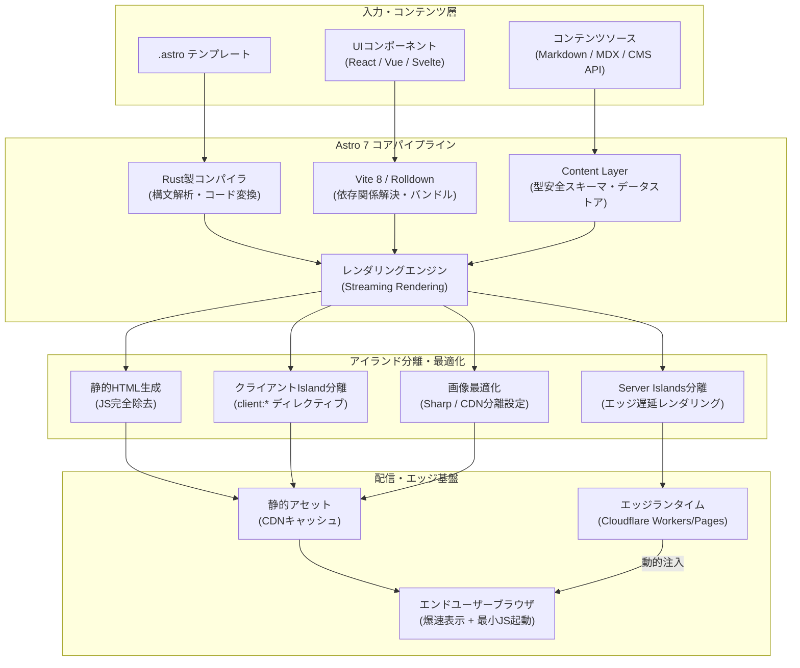

# **Astro 調査レポート**

## **1. 基本情報**

* **ツール名**: Astro
* **ツールの読み方**: アストロ
* **開発元**: Astro Technology Company (Joined Cloudflare)
* **公式サイト**: [https://astro.build/](https://astro.build/)
* **関連リンク**:
  * GitHub: [https://github.com/withastro/astro](https://github.com/withastro/astro)
  * ドキュメント: [https://docs.astro.build/](https://docs.astro.build/)
* **カテゴリ**: CMS/静的サイト
* **概要**: Astroは、ブログ、マーケティングサイト、ドキュメント、Eコマースなどのコンテンツ駆動型Webサイトを最高速で構築・配信するために設計されたWebフレームワークです。独自の「アイランドアーキテクチャ（Islands Architecture）」によりクライアントへ送信するJavaScriptをデフォルトでゼロにし、Core Web Vitalsを最大化します。2026年1月にCloudflareへの参加を発表後、Astro 7ではコンパイラとMarkdown/MDX処理パイプラインをRustで完全刷新し、Vite 8/Rolldown統合やAIコーディングエージェント向け機能の導入など、開発速度と実行性能の両面で急速な進化を遂げています。

## **2. 目的と主な利用シーン**

* **解決する課題**:
  * 従来のSPAフレームワークで生じがちな過剰なクライアントJavaScriptによる読み込み遅延とCore Web Vitalsスコアの低下
  * 大規模コンテンツサイトにおけるビルド時間の長期化とメモリ枯渇
  * プロジェクトごとにReact、Vue、SvelteなどのUIコンポーネント資産が分断される問題
  * 静的配信の高速性を維持しながら、ユーザー認証やカート等の動的要素をシームレスに組み込む難しさ
* **想定利用者**:
  * Webフロントエンドエンジニア、Jamstack開発者
  * 技術ブログ、メディア、コーポレートサイトの運営チーム
  * ドキュメントサイト（Starlight等）を構築・運用するオープンソースおよび企業開発者
* **利用シーン**:
  * 企業サイト、製品ランディングページ（LP）、キャンペーンサイト
  * 大規模ドキュメントポータル、ナレッジベース、開発者ブログ
  * ヘッドレスCMSや外部APIと連携したコンテンツ駆動型Eコマースサイト
  * 静的配信とエッジ動的処理（Server Islands）を組み合わせたハイブリッドWebサイト

### **2.1 代表的な利用フロー**

```mermaid
swimlane-beta TB
  subgraph Developer["開発者 / エージェント"]
    A["プロジェクト作成 (npm create astro@latest)"]
    D["UIコンポーネント・コンテンツ実装"]
    F["ローカル確認 (astro dev --background)"]
    H["本番ビルド・プロファイル (astro build --timings)"]
  end
  subgraph AstroEngine["Astroフレームワーク"]
    B["プロジェクト雛形・依存関係の構成"]
    E["Rustコンパイラによる高速差分ビルド・HMR"]
    I["Islands分離と静的HTML・アセット生成"]
  end
  subgraph CloudflareHosting["Cloudflare / 配信基盤"]
    C["CDN・Workersアダプター構成"]
    J["静的HTML・Server Islandsのエッジ配信"]
  end
  A --> B
  B --> C
  C --> D
  D --> E
  E --> F
  F --> H
  H --> I
  I --> J
```

* **代表的な流れ**: 開発者はCLIやAIエージェントを通じてプロジェクトを初期化し、RustコンパイラとVite 8の恩恵を受けながらローカルで高速開発を行います。ビルド時には静的コンテンツとインタラクティブなアイランド（Island）が分離され、Cloudflare Pages等のエッジ配信基盤へ最適化された形でデプロイされます。

## **3. 主要機能**

* **アイランドアーキテクチャ (Islands Architecture)**: ページ全体を静的HTMLとして出力し、ユーザー操作が必要な部分のみを独立したコンポーネント（島）としてクライアント側でハイドレーション（`client:load`, `client:visible`等）します。
* **Rust製高速コンパイラ (Astro 7)**: `.astro` ファイルのコンパイルおよびMarkdown/MDX処理パイプラインをRustで再実装し、大規模プロジェクトにおけるビルド時間と開発サーバーの応答性を劇的に向上。
* **Vite 8 & Rolldown バンドラ統合 (Astro 7)**: 次世代バンドラ環境を標準採用し、HMR（Hot Module Replacement）の高速化とモジュール解決の最適化を実現。
* **Server Islands**: ログイン情報やカート情報などの動的UIをCDNエッジでキャッシュされた静的HTMLから非同期に遅延取得・注入し、静的表示の爆速性とパーソナライズを両立。
* **Content Layer & 遅延レンダリング (`deferRender`)**: Markdown、MDX、外部API、CMSのデータを型安全に統合するスキーマ定義API。Astro 7.1で導入された `deferRender: true` により、大規模コレクションのビルド時メモリ消費を大幅に抑制。
* **インクリメンタル静的ビルド (Incremental Static Builds - Astro 7.2)**: 前回ビルドから変更のない事前レンダリングページをスキップし、CI/CDでのビルド時間を大幅短縮。
* **ビルド時間プロファイリング (`astro build --timings` - Astro 7.4)**: Markdown処理、画像最適化、Viteプラグインなどの実行時間を計測・可視化し、ビルドのボトルネックを特定可能。
* **Bring Your Own Framework (BYOF)**: React、Vue、Svelte、Solid、Preactなどの主要UIフレームワークのコンポーネントを同一ページ内で混在・シームレスに利用可能。
* **AI Coding Agent バックグラウンド管理**: AIエージェント環境を検知し、`astro dev --background` や `astro preview --background` による非ブロッキング起動、ロックファイル管理（`.astro/dev.json`）、構造化ログを公式サポート。
* **画像サービスの分離 (Astro 7.4)**: ビルド時の事前レンダリング用（ローカルSharp）とSSR実行時用（Cloudflare等の画像CDN）で個別の最適化サービスを分離設定可能。

## **4. 動作原理・システム構成**

* **アーキテクチャ**: アイランドアーキテクチャを基盤とする「サーバーファースト・ゼロJS」設計。静的サイト生成（SSG）とサーバーサイドレンダリング（SSR）、エッジ動的レンダリング（Server Islands）を統一されたパイプラインで処理します。



* **主要コンポーネントとデータフロー**:
  * **構文解析・コンパイル**: ソースコードはRust製コンパイラにより高速に解析され、静的マークアップ部分とインタラクティブなUIコードに分解されます。
  * **データ同期・バリデーション**: Content Layerがファイルや外部CMSからコンテンツをフェッチし、Zodスキーマに基づき型安全なデータストアを構築します。
  * **ストリーミングレンダリング**: ページ生成時にコンポーネント単位でストリーミング処理を行い、静的部分はJSを含まない純粋なHTMLとして出力します。
  * **アイランドの独立読み込み**: ブラウザ側は純粋なHTMLを瞬時に描画し、`client:visible` 等が指定されたコンポーネントのみが独立したスクリプトとして遅延ロード・実行されます。
* **特筆すべき要素技術**:
  * **Rustパイプライン**: 構文解析・コード生成をRustネイティブバイナリで実行し、Node.jsプロセスのオーバーヘッドを削減。
  * **Server Islandsの暗号化フォールバック**: 動的コンテンツの読み込み中にはプレースホルダーを表示し、エッジランタイムが安全に暗号化署名されたリクエストを処理してコンテンツを注入。

## **5. 開始手順・セットアップ**

* **前提条件**:
  * Node.js v22.22.0 以降（Astro 7.4以降の公式要件）
  * 推奨パッケージマネージャー: `pnpm`、`npm`、`yarn`、`bun`
  * エディタ: Visual Studio Code + 公式「Astro」拡張機能
* **インストール/導入**:

  ```bash
  # プロジェクトの作成（ウィザード形式）
  npm create astro@latest my-astro-project
  cd my-astro-project
  ```

* **初期設定**:
  * プロジェクト作成ウィザードでTypeScriptの厳格度やUIフレームワーク（ReactやTailwind等）を選択可能。
  * `astro.config.mjs` にてインテグレーションやアダプターを設定：

  ```javascript
  // astro.config.mjs
  import { defineConfig } from 'astro/config';
  import react from '@astrojs/react';
  import cloudflare from '@astrojs/cloudflare';

  export default defineConfig({
    integrations: [react()],
    adapter: cloudflare(),
  });
  ```

* **クイックスタート**:

  ```bash
  # 開発サーバーの起動 (デフォルトポート: 4321)
  npm run dev

  # AIエージェントやバックグラウンドでの起動
  npx astro dev --background
  npx astro dev status
  npx astro dev stop
  ```

## **6. 特徴・強み (Pros)**

* **圧倒的な配信速度とCore Web Vitals**: クライアントサイドJSを原則0バイトで出力するため、Lighthouseスコアで満点を獲得しやすく、SEOとユーザー体験が極めて優秀。
* **Rustコンパイラによるビルド・DXの高速化**: Astro 7でのRust化とVite 8/Rolldown採用により、大規模プロジェクトでも高速なHMRと短時間のビルドを実現。
* **Bring Your Own Framework (高い柔軟性)**: チーム内にReact派とSvelte派が混在していても同一プロジェクトで共存可能。既存コンポーネント資産を無理に書き換える必要がない。
* **Cloudflareとの強力なアライアンス**: Astro Technology CompanyのCloudflare参加により、長期的な開発資金・体制が確保され、Cloudflare Workers/Pagesとの親和性が極めて高い。
* **先進的なコンテンツ・エージェント支援機能**: Content Layer、Server Islands、インクリメンタル静的ビルド、さらにAIコーディングエージェントに特化したバックグラウンドサーバー管理など、時代の先端を行く機能群を標準備蓄。

## **7. 弱み・注意点 (Cons)**

* **フルSPA・管理ダッシュボードには不向き**: 画面全体が複雑なクライアント状態管理と頻繁な画面遷移を伴うリッチなWebアプリ（SaaSの管理画面等）では、Next.jsやRemix、Nuxt等の方が適している。
* **Node.js 22.22.0+ への要求引き上げ**: Astro 7.4で最小Node.jsバージョンが引き上げられたため、古いCI環境やレガシーサーバーでの稼働には環境更新が必要。
* **破壊的変更への追従コスト**: メジャー・マイナーの進化が急速であり、Astro DBの推奨構成見直し（Node.js組み込みSQLiteやDrizzleへの案内）や、`compressHTML` のJSX準拠化など、バージョンアップ時のリリースノート確認が不可欠。
* **日本語での詳細技術情報のタイムラグ**: 公式ドキュメントの日本語化は進んでいるものの、直近数ヶ月の最新機能（`--timings` や並行レンダリング等）に関する実践記事は英語圏が先行している。

## **8. 料金プラン**

Astroフレームワーク本体はMITライセンスのオープンソースソフトウェア（OSS）であり、完全無料で利用できます。

| プラン / コンポーネント | 料金 | 主な特徴 |
|:---|:---:|:---|
| **Astro Framework (OSS)** | **完全無料** | 全機能（Islands、Content Layer、Rustコンパイラ、CLI等）を自由に利用可能 |
| **Cloudflare Pages / Workers (連携時)** | 無料枠あり / $5〜/月 | 無料枠で無制限リクエスト（Pages）および1日10万リクエスト（Workers）が利用可能 |
| **その他ホスティング (Vercel / Netlify等)** | 無料枠あり / 従量課金 | 各種公式アダプターにより任意のクラウド環境へデプロイ可能 |

* **課金体系**: Astro自体に対するサブスクリプションやライセンス費用はありません。デプロイ先クラウドサービスのインフラ利用料のみが発生します。
* **商用利用**: MITライセンスのため、商用・個人開発を問わず自由に変更・再配布・公開が可能です。

## **9. 導入実績・事例**

* **導入企業**: Google、Microsoft、The Guardian、Trivago、NordVPN、Evil Martians など
* **主要な導入事例**:
  * **Google**: `web.dev` および `developer.chrome.com` の一部リニューアルにAstroを採用し、ウェブ標準に即した高速な表示を実現。
  * **Microsoft**: デザインシステムである Fluent UI の公式ドキュメントサイト等でAstroを活用。
  * **Evil Martians (2026年事例)**: 既存の複雑なコンテンツ基盤からAstroへの移行を実施し、ビルド時間とインフラコストの大幅な圧縮とCore Web Vitals向上を達成。
* **対象業界**: テクノロジー企業、オンラインメディア、出版・報道機関、Eコマース、スタートアップ企業など、表示速度とコンテンツ訴求力が事業KPIに直結する分野。

## **10. サポート体制**

* **ドキュメント**: 公式ドキュメント（[https://docs.astro.build/](https://docs.astro.build/)）が網羅的に整備されており、チュートリアル、移行ガイド、APIリファレンスが充実。主要ページは日本語を含む多言語対応。
* **コミュニティ**: Discordサーバー（「Astro Lounge」）には数十万人規模の開発者が参加し、活発なQ&Aや技術議論が行われています。GitHub DiscussionsやIssueも活発にメンテナーが対応。
* **公式サポート**: オープンソースコミュニティ主導のサポートに加え、Cloudflareのエンタープライズ顧客向けにインフラ連携時のサポート提供枠組みが存在します。

## **11. エコシステムと連携**

### **11.1 API・外部サービス連携**

* **APIルート**: `src/pages/api/` や `src/pages/[endpoint].ts` を定義することで、REST APIやJSONエンドポイント、Webhook受信エンドポイントを簡単に作成可能。
* **公式インテグレーション (`@astrojs/*`)**:
  * UIライブラリ: `@astrojs/react`, `@astrojs/vue`, `@astrojs/svelte`, `@astrojs/preact`, `@astrojs/solid-js`
  * デプロイアダプター: `@astrojs/cloudflare`, `@astrojs/vercel`, `@astrojs/netlify`, `@astrojs/node`
  * 機能拡張: `@astrojs/tailwind`, `@astrojs/sitemap`, `@astrojs/mdx`
* **CMS連携**: Content Layerを活用し、Contentful、Sanity、Strapi、microCMS、WordPress、NotionなどあらゆるヘッドレスCMSから型安全にデータを取得。

### **11.2 技術スタックとの相性**

| 技術スタック | 相性 | メリット・推奨理由 | 懸念点・注意点 |
|:---|:---:|:---|:---|
| **React** | ◎ | 既存のReactコンポーネントをそのまま移植可能。Islandsで必要な部分だけハイドレーション。 | アプリ全体で共有する重厚な状態管理（Redux等）はAstroの思想と合わない場合がある。 |
| **Vue.js / Svelte** | ◎ | 単一ファイルコンポーネント（.vue, .svelte）をネイティブに近い感覚で利用可能。軽量で相性抜群。 | 特になし。 |
| **Cloudflare Pages / Workers** | ◎ | 公式最優先のアダプター提供。Server Islandsやエッジキャッシュを最大限に活用可能。 | Cloudflare独自API（KVやD1等）への依存度が高まるとマルチクラウド移行がやや複雑化。 |
| **Hono** | ◎ | Astroの高度なルーティング（Advanced Routing）と連携し、カスタムリクエストパイプラインを構築可能。 | 実験的機能のため、メジャーバージョン間でのAPI安定性に留意が必要。 |
| **Next.js (比較対象)** | ◯ | Next.jsのコンポーネント資産を部分的に流用可能。 | 思想が異なるため直接の共存ではなく移行または用途別の使い分けが基本。 |

## **12. セキュリティとコンプライアンス**

* **認証**: Astro自身は認証基盤を持ちませんが、Auth.js（Auth.js / NextAuth）、Clerk、Supabase Auth、Cloudflare Zero Trustなどを公式インテグレーションやミドルウェア経由で容易に組み込み可能。
* **データ管理**: 静的ビルド時はサーバーが存在しないため、データベースやAPIキーへの不正アクセスリスクが構造的に排除されます。動的エンドポイントにおいても環境変数の漏洩防止機構（`import.meta.env.PUBLIC_*` プレフィックスによる厳格な分離）が備わっています。
* **コンテンツセキュリティポリシー (CSP)**: Astro 7.1以降、インラインスクリプトやスタイルに対するきめ細かなCSPディレクティブ制御がサポートされ、クロスサイトスクリプティング（XSS）対策が大幅に強化。
* **SVG最適化のセキュリティ**: 悪意あるスクリプト埋め込みを防ぐため、SVGの自動最適化処理は安全なオプトイン方式を採用。

## **13. 操作性 (UI/UX) と学習コスト**

* **UI/UX (開発体験)**:
  * 開発者向けCLIが極めて親切で、セットアップからインテグレーション追加（`npx astro add react` 等）まで対話形式で完結。
  * エラー画面には問題のある行と修正のヒントが分かりやすく表示され、デバッグが容易。
* **学習コスト**:
  * HTML、CSS、JavaScriptの基本理解があれば、学習コストは主要フレームワークの中で最も低い部類に入ります。
  * `.astro` 構文はフロントマター付きのHTMLに酷似しており、JSX特有の `className` やフックの複雑なルールを強制されません。

## **14. ベストプラクティス**

* **効果的な活用法 (Modern Practices)**:
  * **Islandsの最小化**: インタラクティブ性が不要なコンポーネントには `client:*` ディレクティブを付けず、純粋なHTMLとしてレンダリングする。
  * **`client:visible` の積極活用**: ファーストビュー外のカルーセルやコメント欄には `client:visible` を指定し、スクロールされるまでJSのダウンロードと実行を遅延させる。
  * **Content Layerと遅延レンダリング**: 記事数が多いサイトでは `loader: glob({ ..., deferRender: true })` を設定し、ビルド時のメモリ消費を抑制する。
  * **ビルドプロファイリングの活用**: CI/CDパイプラインで `astro build --timings` を実行し、肥大化したMarkdownプラグインや画像処理の遅延を定期監視する。
* **陥りやすい罠 (Antipatterns)**:
  * **全コンポーネントへの `client:load` 付与**: 従来のSPA開発感覚で安易に `client:load` を多用すると、Astro最大の利点であるゼロJSの恩恵が打ち消される。
  * **巨大なフロントマターでの重いデータフェッチ**: ページごとのフロントマターで毎回無駄な重い外部API呼び出しを行うと、静的ビルド全体の時間が極端に悪化する（Content Layerのキャッシュ機能を活用すべき）。

## **15. ユーザーの声（レビュー分析）**

* **調査対象**: G2、X(Twitter)、GitHub Discussions、Reddit
* **総合評価**: 4.8 / 5.0（主要開発者ポータル・コミュニティ調べ）
* **ポジティブな評価**:
  * 「Lighthouseスコアがほぼ無設定でオール100点になり、SEOの成果が急上昇した」
  * 「Astro 7でRustコンパイラになってから、数百ページあるドキュメントサイトのビルド時間が半分以下になった」
  * 「React、Vue、Svelteを混在できるため、過去のライブラリ資産を捨てることなくモダン化できた」
  * 「AIコーディングエージェントとの相性が良く、バックグラウンドでのサーバー起動やエラー特定が非常にスムーズ」
* **ネガティブな評価 / 改善要望**:
  * 「高度な認証とリアルタイム通信が密集するSaaSダッシュボードを作るには、依然としてNext.js等の方がエコシステムが成熟している」
  * 「Astro 7.4でNode 22.22+が必須になり、古いCI環境のコンテナ更新が必要になった」
  * 「Astro DBのベストプラクティスや推奨ライブラリの変遷が早く、キャッチアップが大変だった」
* **特徴的なユースケース**:
  * WordPressやMicroCMSなどのヘッドレスCMSと組み合わせ、高速なフロントエンドのみをAstroで構築する「モダンJamstack刷新」。
  * 公式ドキュメントフレームワーク「Starlight」を利用した大規模OSSプロジェクトの多言語ドキュメントサイト構築。

## **16. 直近半年のアップデート情報**

* **2026-11-05**: **Astro 7.4.7 リリース**
  * 安定性と依存関係の改善、Vercel/Node/Netlify/Reactアダプターの連動アップデート。
* **2026-10-15**: **Astro 7.4 リリース**
  * ビルドのボトルネックを特定する `--timings` プロファイリング機能の追加。
  * 事前レンダリング用とSSR実行時用で異なる画像最適化サービスを分離設定可能に。
  * カスタムエントリポイント用の `notFound()` ハンドラ、フォント設定に対する事前検証警告を追加。
  * 最小サポートNode.jsバージョンを 22.22.0 に更新。実験的な並行事前レンダリング（`parallelPrerender`）の導入。
* **2026-09-03**: **Astro 7.3 リリース**
  * `astro preview --ignore-lock` フラグの追加により、E2Eテスト（Playwright等）で複数のプレビューサーバーを異なるポートで同時起動可能に。
  * カスタム画像サービスおよびキャッシュプロバイダへ実行時ロガーを渡す仕組みを追加。
* **2026-08-06**: **Astro 7.2 リリース**
  * 実験的インクリメンタル静的ビルド（Incremental Static Builds）の導入（変更のない事前レンダリングページの再生成をスキップ）。
  * プレビューサーバーを非ブロッキング起動する `astro preview --background` の追加。
  * セッションサポートのオプトアウト機能、ロガーエントリポイントの相対パス指定対応。
* **2026-07-16**: **Astro 7.1 リリース**
  * インラインスクリプトおよびスタイル向けのきめ細かなCSP（Content Security Policy）ディレクティブ制御。
  * 大規模コンテンツコレクション向けのオンデマンドレンダリングオプション `deferRender: true` の追加によるビルドメモリ削減。
  * `astro dev --ignore-lock` による複数開発サーバーの同時起動サポート。
* **2026-06-22**: **Astro 7.0 リリース**
  * 構文解析とコード変換を担うRust製コンパイラの完全刷新、Markdown/MDX処理パイプラインのRust移行。
  * Vite 8 および Rolldown バンドラの正式統合による開発サーバーとバンドルの超高速化。
  * AIコーディングエージェント向けバックグラウンドdevサーバー管理（`astro dev --background`、`status`、`logs`、`.astro/dev.json`）。
  * `compressHTML` のデフォルト値を `'jsx'`（React準拠の空白除去ルール）に変更。
* **2026-05-28**: **Astro 6.4 リリース**
  * Markdown/MDXプラグイン設定の拡張と内部ヘルパーの更新。
* **2026-05-07**: **Astro 6.3 リリース**
  * 実験的な高度なルーティング（Advanced Routing）の導入、SVG最適化APIの安全性強化。

(出典: [Astro Blog (最新更新履歴)](https://astro.build/blog/)、[GitHub Releases (withastro/astro)](https://github.com/withastro/astro/releases))

## **17. 類似ツールとの比較**

### **17.1 機能比較表 (星取表)**

| 機能カテゴリ | 機能項目 | Astro | Next.js | Hugo | Jekyll |
|:---:|:---|:---:|:---:|:---:|:---:|
| **ビルド基盤** | コンパイラ・バンドラ | ◎<br><small>Rustコンパイラ + Vite 8</small> | ◎<br><small>Turbopack / SWC</small> | ◎<br><small>Goネイティブ最速</small> | △<br><small>Ruby実行系（低速）</small> |
| **レンダリング** | SSG (静的サイト生成) | ◎<br><small>ゼロJSデフォルト</small> | ◯<br><small>標準対応</small> | ◎<br><small>純粋な静的HTML生成</small> | ◯<br><small>標準対応</small> |
| **動的制御** | SSR / Server Islands | ◎<br><small>Server Islandsで部分SSR</small> | ◎<br><small>高度なApp Router</small> | ×<br><small>非対応（静的のみ）</small> | ×<br><small>非対応（静的のみ）</small> |
| **コンポーネント** | 複数UIフレームワーク混在 | ◎<br><small>React/Vue/Svelte共存</small> | ×<br><small>Reactのみ</small> | -<br><small>Goテンプレート</small> | -<br><small>Liquidテンプレート</small> |
| **パフォーマンス** | デフォルトのクライアントJS | ◎<br><small>完全ゼロ（Islandのみ）</small> | △<br><small>Reactランタイム必須</small> | ◎<br><small>完全ゼロ</small> | ◎<br><small>完全ゼロ</small> |
| **開発体験 (DX)** | HMR・サーバー管理 | ◎<br><small>高速HMR + AIエージェント対応</small> | ◎<br><small>Fast Refresh</small> | ◯<br><small>高速リロード</small> | △<br><small>リロードがやや低速</small> |

### **17.2 詳細比較**

| ツール名 | 特徴 | 強み | 弱み | 選択肢となるケース |
|:---|:---|:---|:---|:---|
| **Astro (本ツール)** | アイランドアーキテクチャとRust製コンパイラを備えたコンテンツ駆動型フレームワーク。 | 圧倒的な配信性能、UIフレームワークの共存性、Server Islandsによる柔軟な動的合成、Cloudflareとのシナジー。 | 複雑な双方向バインディングや全画面SPAアプリにはNext.js等に及ばない。 | パフォーマンス・SEOを重視するブログ、メディア、コーポレート、ドキュメント、ECサイト。 |
| **Next.js** | Vercelが主導するReactベースのフルスタックWebフレームワーク。 | 巨大なReactエコシステム、SSR/RSC/Server Actionsの高度な統合、SaaSアプリ構築の圧倒的な実績。 | クライアント側JS容量が大きくなりやすく、Core Web Vitalsの最適化に高度なチューニングが必要。 | 認証・ダッシュボード・リアルタイム機能が中心となる本格的なWebアプリケーション。 |
| **Hugo** | Go言語で記述されたシングルバイナリの超高速静的サイトジェネレーター。 | 圧倒的なビルド速度、依存関係管理の少なさ、単一実行可能ファイルによるポータビリティ。 | React等の最新UIフレームワークとの親和性が低く、複雑なインタラクティブUIの実装が難しい。 | 数万ページ規模の大規模静的ドキュメントや、Goテンプレートで完結するブログ。 |
| **Jekyll** | Ruby製の草分け的静的サイトジェネレーター。GitHub Pagesで標準サポート。 | シンプルな構成、GitHub Pagesでの手軽なホスティング、豊富な過去のテーマ資産。 | ビルド速度が遅く、モダンフロントエンド開発環境（TypeScript、HMR、UIライブラリ）に劣る。 | GitHub Pagesで追加のビルド設定なしに手軽にブログを公開したい個人用途。 |

## **18. 総評**

* **総合的な評価**:
  Astroは、コンテンツ中心のWebサイトにおいて「表示速度・SEO性能」と「モダンな開発体験（DX）」を最高水準で両立させたフレームワークです。2026年に入り、Cloudflareの支援による安定した開発基盤のもと、Astro 7でRust製コンパイラを投入してビルド性能を劇的に引き上げました。アイランドアーキテクチャによる「デフォルトゼロJS」と、Server Islandsによる「エッジでの動的パーソナライズ」の融合は、Webパフォーマンスの最適解として確固たる地位を築いています。
* **推奨されるチームやプロジェクト**:
  * サイトの表示速度が収益やSEOに直結するマーケティングサイト、メディア、Eコマースを運営するチーム。
  * 複数のUIフレームワーク（React, Vue, Svelte）の既存資産を活かしながらサイトをモダン化したい開発組織。
  * Starlightを用いて多言語かつ高性能なドキュメントサイトを構築・運用したいOSSプロジェクトやプロダクトチーム。
  * Cloudflare Pages/Workersを活用してグローバルに高速配信したいJamstackエンジニア。
* **選択時のポイント**:
  Webサイトの主目的が「コンテンツの閲覧・情報発信・高速なユーザー獲得」であれば、Astroは第一選択肢となります。一方で、管理画面やSaaSのように「画面全体が複雑なインタラクションと状態管理で構成されるSPAアプリケーション」を構築する場合は、Next.js等のフルスタックフレームワークを選択するのが適しています。
