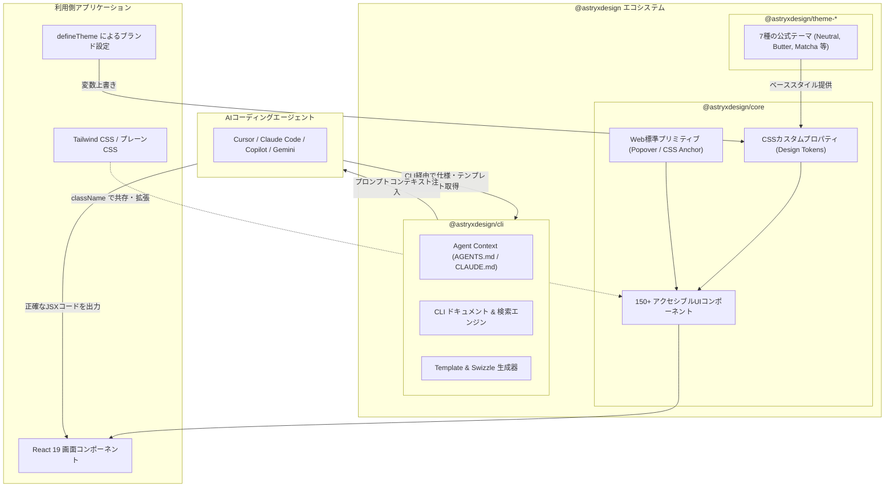

# **Astryx 調査レポート**

## **1. 基本情報**

* **ツール名**: Astryx (アスタリスクス / アストリクス)
* **ツールの読み方**: アスタリスクス / アストリクス
* **開発元**: Meta Platforms, Inc.
* **公式サイト**: [https://astryx.atmeta.com/](https://astryx.atmeta.com/)
* **関連リンク**:
  * GitHub: [https://github.com/meta/astryx](https://github.com/meta/astryx)
  * DeepWiki: [https://deepwiki.com/meta/astryx](https://deepwiki.com/meta/astryx)
  * CodeWiki: [https://codewiki.google/github.com/meta/astryx](https://codewiki.google/github.com/meta/astryx)
  * ドキュメント: [https://astryx.atmeta.com](https://astryx.atmeta.com)
  * レビューサイト: GitHub Discussions / Discord / InfoQ / Reddit
* **カテゴリ**: UI/UX/作図
* **概要**: Astryxは、Meta社内で過去8年間にわたり13,000以上の社内プロダクトやダッシュボードを支えてきたUIフレームワーク（xDesign系統）を基盤に、人間とAIコーディングエージェント双方が協調してUIを構築できるようにゼロから再設計されたReact 19向けオープンソースデザインシステムである。150以上のアクセシブルなUIコンポーネント、ブランドテーマ機能、StyleXによるゼロランタイムアトミックCSS、そして専用CLIツールを備えており、MITライセンスの完全フリーソフトウェアとしてベータ版が提供されている。

## **2. 目的と主な利用シーン**

* **解決する課題**:
  * **社内ツール開発の車輪の再発明とUIの分断**: 複数組織に分散したチームがフォームや日付ピッカー、テーブルなどのUI部品を個別に再開発する工数ロスと、プロダクトごとに操作性が乖離する認知負荷の解消。
  * **AIエージェントによるUI生成精度の低さ・ハルシネーション**: LLMがフロントエンドコードを生成する際、不正確なプロパティの発明や汎用divタグの乱用、不適切なコンポーネント選定を起こしやすい問題の抜本的解決。
  * **デザインシステムのカスタマイズ性とアップグレード性のトレードオフ**: ラッパーコンポーネントを何重にも重ねることで保守性が崩壊したり、ライブラリ固有のスタイリング方式に強くロックインされる課題の克服。
* **想定利用者**:
  * フロントエンドエンジニアおよびフルスタックエンジニア
  * AIコーディングアシスタント（Cursor, Claude Code, GitHub Copilot, Devin, Gemini CLI等）を活用する開発者
  * 迅速に社内ツールやエンタープライズSaaSの画面を標準化したいプロダクトチーム
  * ブランド固有のデザインシステムを構築・運用するデザインエンジニア
* **利用シーン**:
  * **AI駆動型エンタープライズダッシュボードの高速構築**: AIエージェントにCLI経由でAstryxのコンテキストを読ませ、テーブル、フィルターレール、ステータスバッジ、設定ダイアログが統一されたダッシュボードを即座にスキャフォールディングする。
  * **デザインシステムの大規模導入と段階的刷新**: 既存のTailwind CSSやCSS Modules、Radix UIプロジェクトに対して、コンパイル済みCSSとThemeプロバイダーを導入し、画面単位で段階的にAstryxコンポーネントへ置き換える。
  * **自社ブランド向けのデザインテーマ展開**: 7種類のビルトインテーマ（Neutral, Butter, Chocolate, Matcha, Stone, Gothic, Y2K）をベースにCSSカスタムプロパティを拡張し、ダークモードやアクセシビリティ対応を担保した独自UIを作成する。

### **2.1 代表的な利用フロー**

```mermaid
swimlane-beta TB
  subgraph 開発者["開発者 (エンジニア / デザイナー)"]
    A[画面要件・レイアウト仕様を指示]
    E[プレビュー確認・デザイン調整指示]
    G[本番コンポーネントとしてマージ]
  end
  subgraph AIエージェント["AIコーディングエージェント"]
    B[CLIを実行して最新仕様と実例を取得]
    D[Astryxコンポーネントを正確に構成してコード生成]
  end
  subgraph Astryxツール群["Astryx CLI & コアライブラリ"]
    C[最適コンポーネント・トークン・実例を提供]
    F[Swizzleやテーマ設定で独自コードに昇華]
  end
  A --> B
  B --> C
  C --> D
  D --> E
  E --> F
  F --> G
```

* **代表的な流れ**: 開発者が自然言語や要件定義書で画面の目的をAIエージェントに指示すると、エージェントはターミナル経由で `astryx build` や `astryx component` などのCLIコマンドを実行して公式のSingle Source of Truthから正確なAPI仕様とテンプレートを取得する。取得した情報に基づいてエージェントが高精度なReactコードを生成し、開発者はUIを確認後、必要に応じて `astryx swizzle` によるソースコード所有やテーマトークンの調整を行って本番へ適用する。

## **3. 主要機能**

* **150種類以上のアクセシブルなReact 19コンポーネント**: ボタン、ダイアログ、テーブル、ドロップダウン、カレンダー、トーストなど、WCAG 2.1 AAやWAI-ARIAパターンに厳密に準拠した150以上のコンポーネントを包括提供。
* **AIファーストなCLIツール (`@astryxdesign/cli`)**: `astryx init`, `astryx component`, `astryx hook`, `astryx docs`, `astryx build`, `astryx template` などを備え、人間だけでなくAIエージェントがターミナルから直接最新仕様やテンプレートを参照可能。
* **自動コンテキスト生成 (`init --features agents`)**: `AGENTS.md`、`CLAUDE.md`、`.cursorrules`、`GEMINI.md` など、各種AIツール向けにコンポーネント索引や行動規範を自動生成し、アップグレード時も `astryx upgrade --apply` で自動同期。
* **段階的なカスタマイズパス (Graduated Customization Path)**: Propsによる標準制御から、デザイントークン上書き、`className` によるユーティリティ連携、パーツ直指定、さらにはコンポーネントのソースコードをプロジェクトへ完全イジェクトする `astryx swizzle` まで、5段階で柔軟に制御可能。
* **StyleXベースのゼロランタイムスタイルアーキテクチャ**: Meta社が開発したコンパイル時CSSエンジン「StyleX」を採用。コンシューマー側は事前コンパイル済みCSSをimportするだけで動作し、ランタイムCSS-in-JSのパフォーマンスオーバーヘッドを回避。
* **包括的なテーマエンジン (`defineTheme`)**: CSSカスタムプロパティを軸に設計され、7つの公式テーマ（Neutral, Butter, Chocolate, Matcha, Stone, Gothic, Y2K）を同梱。ライト/ダークモードをシームレスに切り替え可能。
* **実戦対応のページ・ブロックテンプレート群**: ダッシュボード、インシデント管理コンソール、設定パネル、垂直ウィザード、かんばんボードなど、実業務で求められる複雑な画面レイアウトテンプレートを多数収録。
* **客観的評価ハーネス「Vibe Tests」**: 生成AIモデルがデザインシステムを正しく活用できるかを定量的にスコアリングする独自のテストベンチマークを備え、主観ではなく実測データに基づきAPIの一貫性を維持。
* **Figmaライブラリの自律運用 (Figma Librarian)**: Figma MCPと連携したNight Watch（定期自律ジョブ）により、コードのリリース差分を検知してFigmaコンポーネントライブラリを完全自動で同期・保守。
* **高度なリッチテキスト入力フィールド (`@astryxdesign/richtext`)**: フォーム内で手軽にWYSIWYGエディタを構築できる専用コンポーネントパッケージを提供。

## **4. 動作原理・システム構成**

* **アーキテクチャ**: ゼロランタイムアトミックCSS（StyleX）とWeb標準プリミティブを基盤とする、ハイブリッド配信型のクライアントサイドReactコンポーネントライブラリ。
* **主要コンポーネントとデータフロー**:
  * **配信方式 (Dual Distribution)**: 初心者や標準プロジェクト向けには事前ビルド済みの軽量CSS（`reset.css`, `astryx.css`, 各テーマCSS）を提供。高度な最適化を求めるプロジェクト向けにはTypeScript + StyleXソースコードからの直接ビルド（`@astryxdesign/build`）をサポートし、使用コンポーネントのスタイルのみを抽出可能。
  * **CSSカスタムプロパティ（トークン）階層**: すべてのコンポーネントは `--color-text-primary` や `--spacing-4` などのCSSカスタムプロパティを参照。`<Theme>` コンポーネントおよび `data-astryx-theme` 属性によってDOMツリー経由でスタイル値がカスケーディングされ、動的なテーマ切り替えを実現。
  * **CLIドキュメントエンジン**: CLIバイナリ内にコンポーネント仕様、Props定義、実例コード、テンプレートがバンドルされており、Webサイトへのアクセスなしにオフラインやローカル環境でAIエージェントに正確な情報を即時ストリーミング。
* **特筆すべき要素技術**:
  * **モダンWebプラットフォーム機能の直接採用**: ポップオーバーやドロップダウンの表示にブラウザ標準の「Popover API」や「CSS Anchor Positioning」、テーマの色管理に「CSS `light-dark()`」を採用。外部のポジショニングライブラリ（floating-ui等）への依存を排除し、極めて軽量かつ堅牢な実装を実現。
  * **Swizzle機構**: コンポーネントの抽象化に不満がある場合、CLIコマンド1つで内部実装（TypeScriptファイルとStyleX定義）をプロジェクトのソースツリーに複製し、完全な所有権を移行可能。



## **5. 開始手順・セットアップ**

* **前提条件**:
  * Node.js 22以上（アクティブLTS推奨）
  * React 19以上（`react` および `react-dom` >= 19.0.0 が peerDependencies）
  * パッケージマネージャー: pnpm, npm, または yarn
  * アカウント登録やクレジットカード登録は一切不要
* **インストール/導入**:

  ```bash
  # npm の場合
  npm install @astryxdesign/core @astryxdesign/theme-neutral @stylexjs/stylex
  npm install -D @astryxdesign/cli

  # pnpm の場合
  pnpm add @astryxdesign/core @astryxdesign/theme-neutral @stylexjs/stylex
  pnpm add -D @astryxdesign/cli
  ```

* **初期設定**:
  * AIエージェント向け指示ファイルをプロジェクトルートに自動生成：

  ```bash
  # 各種エージェント向けコンテキスト（AGENTS.md / CLAUDE.md 等）を生成
  npx @astryxdesign/cli init --features agents
  ```

  * アプリケーションのエントリポイント（例: `src/main.tsx` または `app/layout.tsx`）で基本CSSを読み込む：

  ```tsx
  import '@astryxdesign/core/reset.css';
  import '@astryxdesign/core/astryx.css';
  import '@astryxdesign/theme-neutral/theme.css';
  ```

* **クイックスタート**:

  ```tsx
  import React from 'react';
  import { Button } from '@astryxdesign/core/Button';
  import { Stack } from '@astryxdesign/core/Stack';
  import { Card } from '@astryxdesign/core/Card';

  export default function App() {
    return (
      <Stack gap="md" style={{ padding: '24px' }}>
        <Card>
          <h2>Hello, Astryx!</h2>
          <p>Meta社開発の次世代エージェントレディ・デザインシステムです。</p>
          <Button variant="primary" onClick={() => alert('Clicked!')}>
            アクションを実行
          </Button>
        </Card>
      </Stack>
    );
  }
  ```

## **6. 特徴・強み (Pros)**

* **AIコーディングエージェントとの驚異的な親和性**: CLI自体がドキュメントのSingle Source of Truthとなっており、AIエージェントが推測ではなく確定したPropsや実例を参照して実装するため、ハルシネーション（誤ったプロパティ生成）が劇的に減少する。
* **Meta社内での8年・13,000アプリ運用の実績**: 一般的なオープンソースUIライブラリにありがちな「複雑な業務画面での表現力不足」がなく、大規模エンタープライズに耐えうる150以上のコンポーネントと実戦的テンプレートが最初から揃っている。
* **オープンインターナルとSwizzle機構**: 密結合なラッパーを作る必要がなく、パーツごとのスタイル差し替えや、必要に応じたコンポーネントコード全体のプロジェクト内イジェクト（Swizzle）が可能。
* **スタイリングライブラリへの非依存性**: StyleXで記述されているものの、外部には標準CSSとカスタムプロパティとして公開されるため、利用プロジェクトがTailwind CSS、CSS Modules、Vanilla CSSのいずれを採用していても自然に混在・併用できる。
* **ゼロランタイムオーバーヘッドとモダン標準準拠**: Popover APIやCSS Anchor Positioningを活用し、重いJavaScriptポジショニング処理をブラウザネイティブに委ねることで、高いパフォーマンスとアクセシビリティを両立。

## **7. 弱み・注意点 (Cons)**

* **React 19以降が必須要件**: `react` および `react-dom` のバージョン19以上がpeer dependencyとして義務付けられており、React 18以前の大規模な既存リポジトリへの直接導入にはバージョンアップのハードルが伴う。
* **最新ブラウザ機能（モダンWeb標準）への依存**: CSS Anchor Positioningなどの最新仕様に依存するため、古いSafari（17.4以前）などの旧世代ブラウザでは一部のフロート要素でポリフィルやフォールバック設定を意識する必要がある。
* **日本語ドキュメントおよび日本語フォント最適化の不足**: 公式ドキュメント、エラーメッセージ、CLI出力はすべて英語のみであり、日本語による解説情報や国内コミュニティの蓄積は現時点で発展途上である。
* **現在ベータ版（Beta）フェーズ**: コアAPIの安定化が進められているものの、週次〜隔週ペースでパッチ・マイナーリリースが行われており、破壊的変更や非推奨化の追随に `astryx upgrade` 等の定期実行が必要。

## **8. 料金プラン**

| プラン名 | 料金 | 主な特徴 |
|---------|------|---------|
| **オープンソース (MIT)** | **完全無料 ($0)** | ・全150+コンポーネントの無制限利用<br>・商用利用・個人開発・受託案件対応<br>・全7種公式テーマおよびテーマ作成機能<br>・Astryx CLIの全コマンド無制限利用<br>・テンプレート・実例コードのフルアクセス<br>・GitHub公開リポジトリでのIssue/PR受付 |

* **課金体系**: 完全無料のオープンソースソフトウェア（MITライセンス）。ホスティング費用やコンポーネントライセンス費用などの追加料金は一切発生しない。
* **無料トライアル**: 該当なし（最初から永久に無料・オープンソース）。

## **9. 導入実績・事例**

* **導入企業**:
  * **Meta Platforms, Inc.**: 開発元企業。過去8年間にわたり社内の13,000以上のプロダクト、内部管理ツール、分析ダッシュボード、インシデント管理基盤で稼働。
  * **国内外のスタートアップ・Web開発コミュニティ**: 2026年6月のオープンソース公開以降、GitHub上で17,400以上のStarを獲得し、AIを活用した開発フローを指向するテクノロジー企業で急速にPoC・本番導入が進展。
* **導入事例**:
  * **Meta社内ツール群の標準化**: 社内のエンジニアが新規ツールを作る際、Astryxを採用することでUIの再構築工数を約60%削減し、全社ツールのUX一貫性を達成。
  * **AIエージェントによるプロトタイピングの自動化**: CursorやClaude Codeなどのエージェントに対し `astryx build` を連携させることで、自然言語の仕様書からわずか数分でエンタープライズ品質の管理画面を生成。
* **対象業界**:
  * BtoB SaaS、社内業務システム、管理コンソール、データ可視化ダッシュボード、AIネイティブアプリケーション開発企業。

## **10. サポート体制**

* **ドキュメント**: 公式ドキュメントサイト（[https://astryx.atmeta.com](https://astryx.atmeta.com)）、コンポーネントカタログ、Storybook（[https://astryx.atmeta.com/storybook/](https://astryx.atmeta.com/storybook/)）、Playground/Sandbox（[https://astryx.atmeta.com/sandbox/](https://astryx.atmeta.com/sandbox/)）が完備。またCLI経由でも全ドキュメントを直接取得可能。
* **コミュニティ**: 公式Discordサーバー（招待リンク: `https://discord.com/invite/XnsUcFykEP`）が活発に運営されており、Metaの開発チームやコミュニティメンバーと直接ディスカッション可能。GitHub DiscussionsおよびIssues（`meta/astryx`）も常時稼働。
* **公式サポート**: オープンソースソフトウェアのため、有償の個別SLA付きエンタープライズサポートは提供されていないが、GitHubリポジトリ上でMetaの専任チームがIssue対応・PRレビューを継続的に実施。

## **11. エコシステムと連携**

### **11.1 API・外部サービス連携**

* **API / CLIインタフェース**: `@astryxdesign/cli` が包括的なプログラマティックAPIおよびCLIコマンドを提供。AIエージェントがJSON形式やマークダウン形式でコンポーネント情報をフェッチ可能。
* **外部サービス・ツール連携**:
  * **AIコーディングアシスタント**: Cursor、Claude Code、GitHub Copilot、Gemini CLI、Devin等との連携用コンテキスト生成に対応。
  * **Figma**: 自律ジョブ「Figma Librarian」により、Figma MCPを経由して公式Figma UI Kitとコードの仕様を自動同期。
  * **Storybook**: 全コンポーネントのインタラクティブカタログを公開。
  * **Next.js / Vite**: App Router、Pages Router、Vite + React環境向けのセットアップレシピを標準提供。

### **11.2 技術スタックとの相性**

| 技術スタック | 相性 | メリット・推奨理由 | 懸念点・注意点 |
|:---|:---:|:---|:---|
| **Next.js (App Router)** | ◎ | React 19およびServer Componentsと親和性が高く、SSRハイドレーション最適化済み | `reset.css` やテーマの読み込み順序に留意 |
| **Vite + React 19** | ◎ | 高速なHMR環境でコンパイル済みCSSを即時反映でき、最もシンプルな構成 | React 19への依存確認が必要 |
| **Tailwind CSS** | ◎ | Astryxコンポーネントの `className` プロパティ経由でユーティリティクラスを直接上書き可能 | カラーパレットやフォントサイズのトークン競合を避ける設定が望ましい |
| **StyleX (ソースビルド)** | ◎ | Meta純正の組み合わせ。`@astryxdesign/build` で未使用スタイルを削ぎ落とし最小バンドルを実現 | ビルドパイプライン（Babel/Rollupプラグイン）の設定が必要 |
| **React 18以前のレガシー環境** | × | React 19必須のためpeerDependenciesエラーとなり直接利用不可 | React 19へのアップグレードまたは別ライブラリの検討が必要 |

## **12. セキュリティとコンプライアンス**

* **認証**: UIライブラリであるため独自のユーザー認証機能は持たないが、Auth0、Supabase、NextAuth.jsなどの認証プロバイダと組み合わせたログイン画面テンプレート（SSO対応、スプリット型、カード型）を標準装備。
* **データ管理**: クライアントサイドで完結するコンポーネントライブラリであり、外部サーバーへのテレメトリ送信やユーザーデータの収集・トラッキングは一切行われない。MITライセンスに基づく安全なオンプレミス・プライベート環境での自己ホストが可能。
* **準拠規格**: コンポーネント群はWCAG 2.1 AA規格に準拠し、キーボードナビゲーション、スクリーンリーダー読み上げ、ハイコントラスト対応、Reduce Motion（アニメーション抑制）設定を徹底。外部の悪意ある依存パッケージを持たない依存ゼロ設計により、サプライチェーン攻撃のリスクを極小化。

## **13. 操作性 (UI/UX) と学習コスト**

* **UI/UX**: Metaが自社内で8年磨き上げたデザイン言語が適用されており、視認性の高い余白設計、整ったタイポグラフィ、破綻のないフォーカスインジケータなど、業務系UIとして最高峰の洗練度を誇る。
* **学習コスト**:
  * **人間エンジニア**: 標準的なReactのProps体系に統一されており、Radix UIやMUIの使用経験があれば数時間で直感的に実装可能。
  * **AIエージェント**: `astryx init --features agents` を実行するだけで、エージェントが命名規則やコンポーネントの選択指針を即座に把握し、ハルシネーションを起こさず初手から高精度なコードを出力できるため、導入摩擦が極めて低い。

## **14. ベストプラクティス**

* **効果的な活用法 (Modern Practices)**:
  * **AIエージェントへのCLI権限付与**: CursorやClaude Codeなどのエージェント環境に対し、`astryx` CLIコマンドの実行権限を与える。エージェントが自律的に `astryx search` や `astryx component` を叩いて正しいPropsを取得できるようにする。
  * **Single Source of Truthの維持**: デザインのカスタマイズを行う際は、コンポーネントをdivで無闇にラップせず、まず `defineTheme` によるCSSカスタムプロパティ（トークン）の調整を行い、ブランド全体の一貫性を保つ。
  * **Swizzleの適切な活用**: ライブラリの機能拡張が必要になった際は、パッチを当てるのではなく `astryx swizzle <ComponentName>` を実行してプロジェクト内にソースコードをejectし、自社コードとしてクリーンに保守する。
* **陥りやすい罠 (Antipatterns)**:
  * **不要なラッパーdivの多用**: AstryxコンポーネントはFlexboxやGrid配置を考慮して設計されているため、レイアウト調整のために不用意な外側divを追加すると、CSS Anchor Positioningなどの挙動が壊れる原因になる。
  * **AI向けドキュメントの放置**: パッケージを更新した際、`astryx upgrade --apply` を実行せずに放置すると、AIエージェントが古いAPI仕様を参照し続けてビルドエラーを招く。
  * **React 18環境への強引なインストール**: `--force` や `--legacy-peer-deps` でReact 18環境に導入すると、Actionやモダンフック関連でランタイムエラーが発生するため避ける。

## **15. ユーザーの声（レビュー分析）**

* **調査対象**: GitHub（Issues, Discussions, PRs）、Discordコミュニティ、Techメディア（InfoQ, OpenSourceForU, MarkTechPost）、X (旧Twitter) エンジニア投稿
* **総合評価**: 4.7 / 5.0（GitHub Stars 17,400+、開発者コミュニティで急速に注目を集める）
* **ポジティブな評価**:
  * 「Meta社内で実際に13,000本ものアプリを動かしてきただけあって、業務で必要になる複雑なテーブルやナビゲーション、モーダルが最初から完全に揃っている。」（フロントエンドアーキテクト）
  * 「AIコーディングツール（Cursor/Claude）にCLIを使わせたときのコード生成精度が異常に高い。Propの推測ミスや崩れたCSSを吐かなくなった。」（フルスタック開発者）
  * 「StyleX製でありながら利用側にはピュアなCSSとして提供されるため、既存のTailwind CSSプロジェクトに何の問題もなく共存できた。」（SaaS開発リード）
* **ネガティブな評価 / 改善要望**:
  * 「React 19が必須要件となっているため、React 18で運用している大規模なプロダクションへの導入ハードルがまだ高い。」
  * 「CSS Anchor Positioningなどの最新Web標準に依存しているため、一部の少し古いモバイルブラウザ環境での挙動確認に気を使う。」
  * 「急速に開発が進んでいるため、マイナーバージョンごとの差分追従が必要。日本語の公式ドキュメントも待望される。」
* **特徴的なユースケース**:
  * スタートアップにおける「1人開発での爆速管理画面構築」において、AIエージェントに画面仕様を渡して `astryx build` からページ全体の骨格を出力させ、わずか数時間で商用レベルのダッシュボードを納品する事例が報告されている。

## **16. 直近半年のアップデート情報**

* **2026-11-07**: [Astryx v0.7.11](https://github.com/meta/astryx/releases) - タッチデバイスにおけるPopoverのアニメーション最適化、DropdownMenuSubMenuへのdelay/hideDelayプロパティ追加、TimestampコンポーネントのtimezoneID指定によるSSRハイドレーションミスマッチ解消。
* **2026-11-06**: [Astryx v0.7.10](https://github.com/meta/astryx/releases) - アニメーションレイアウトのDuration Medium調整、Reduce Motion時のクロスフェード安定化、CLI依存関係の整理およびuseMultiCombobox等の実例ドキュメント追加。
* **2026-11-03**: [Astryx v0.7.7](https://github.com/meta/astryx/releases) - モバイル端末での入力コンポーネントの視認性改善、アクセシビリティフォーカス処理の堅牢化。
* **2026-10-31**: [Astryx v0.7.5](https://github.com/meta/astryx/releases) - リッチテキストコンポーネント `@astryxdesign/richtext` の機能強化、テーブル描画パフォーマンスの最適化。
* **2026-10-21**: [Astryx v0.7.0](https://github.com/meta/astryx/releases) - モバイル体験の抜本的刷新、入力フォームのフィードバック視覚化、コア基盤レイヤーの強化。
* **2026-09-15**: [Astryx v0.6.0](https://github.com/meta/astryx/releases) - レスポンシブテーマシステムの導入、画面幅に応じて動的にレイアウトを適応させるコンポーネント機能の拡充。
* **2026-08-20**: [Astryx v0.5.0](https://github.com/meta/astryx/releases) - 30言語の多言語国際化（i18n）対応、Escapeキーによるモーダル・ドロワー閉鎖挙動の共通化、BottomSheetのコア統合。
* **2026-08-05**: [Astryx Figma Library](https://github.com/meta/astryx/releases) - Figma MCPと連動する定期自動化ジョブ「Figma Librarian」によるFigmaライブラリの自律運用を開始。
* **2026-07-27**: [Vibe Tests Framework](https://github.com/meta/astryx/releases) - AIエージェントと人間によるデザインシステム活用度を客観的に計測・比較する評価ハーネスの公開。
* **2026-07-17**: [CLI Build Command](https://github.com/meta/astryx/releases) - 自然言語や要件から最適なテンプレート・ブロックを推薦する `astryx build` コマンドの実装。
* **2026-06-18**: [Astryx OSS Beta公開](https://github.com/meta/astryx/releases) - Meta社によるオープンソースベータ公開。150以上のコンポーネント、React 19/StyleX基盤、CLIをMITライセンスで提供開始。

(出典: [Astryx Releases](https://github.com/meta/astryx/releases) / [Astryx Blog](https://astryx.atmeta.com/blog))

## **17. 類似ツールとの比較**

### **17.1 機能比較表 (星取表)**

| 機能カテゴリ | 機能項目 | Astryx | shadcn/ui | Ant Design | Material UI (MUI) |
|:---:|:---|:---:|:---:|:---:|:---:|
| **コンポーネント規模** | 収録コンポーネント数 (150+) | ◎<br><small>150+の網羅的パーツ</small> | △<br><small>約50個程度</small> | ◎<br><small>エンタープライズ対応</small> | ◯<br><small>主要UIを網羅</small> |
| **AI親和性** | 専用CLI & エージェントDocs | ◎<br><small>CLIが仕様を直接提供</small> | △<br><small>プロンプト指示頼み</small> | ×<br><small>標準機能なし</small> | ×<br><small>標準機能なし</small> |
| **アーキテクチャ** | ゼロランタイムアトミックCSS | ◎<br><small>StyleX事前コンパイル</small> | ◯<br><small>Tailwind CSS依存</small> | ×<br><small>CSS-in-JS (ランタイム)</small> | △<br><small>Emotion/Pigment</small> |
| **Web標準準拠** | Popover / CSS Anchor | ◎<br><small>ブラウザ標準を全面採用</small> | △<br><small>Floating UI等に依存</small> | ×<br><small>自前ポジショニング</small> | ×<br><small>Popper.js等に依存</small> |
| **カスタマイズ** | 段階的パス (Swizzle対応) | ◎<br><small>5段階の昇華モデル</small> | ◎<br><small>ソース直接配置</small> | △<br><small>テーマ変数中心</small> | ◯<br><small>sx props/Theme</small> |
| **他CSS併用** | Tailwind / 他CSSとの共存 | ◎<br><small>classNameでシームレス</small> | ◎<br><small>Tailwind前提</small> | △<br><small>スタイル競合が起きやすい</small> | △<br><small>独自システム優先</small> |
| **非機能要件** | 日本語ドキュメント | △<br><small>英語のみ（発展途上）</small> | ◯<br><small>非公式・記事多数</small> | ◎<br><small>国際化・日本語対応</small> | ◯<br><small>公式日本語ページあり</small> |

### **17.2 詳細比較**

| ツール名 | 特徴 | 強み | 弱み | 選択肢となるケース |
|---------|------|------|------|------------------|
| **Astryx** | Meta社内13,000アプリ運用の実績とAI協調設計を融合したReact 19デザインシステム | 150以上の網羅性、CLIによるAIハルシネーション抑制、Swizzleによる完全なソース所有、ゼロランタイムStyleX | React 19必須、最新ブラウザ機能前提、日本語資料が少ない | AIエージェントと協調してエンタープライズWebやダッシュボードを高速・堅牢に構築したい場合 |
| **shadcn/ui** | Radix UIとTailwind CSSを組み合わせたコピー＆ペースト型UIコレクション | プロジェクト内に最初からコードがあり自由度が高い、Tailwind文化との親和性 | コンポーネント数が50程度と少なめ、AIがPropsや構造をハルシネーションしやすい | 軽量なSaaSや個人開発で、Tailwindを中心に自由なUIを組みたい場合 |
| **Ant Design** | 中国アリババ発のエンタープライズ向け巨大UIコンポーネントライブラリ | 業務管理画面向けの充実したコンポーネント、国際化と豊富なエコシステム | バンドルサイズが重い、デザインの主張が強くTailwindとの共存が困難 | トラディショナルな大規模社内業務システムで、デザイン統一を最優先する場合 |
| **Material UI (MUI)** | GoogleのMaterial Designを忠実に再現したReact業界標準ライブラリ | 圧倒的な知名度、サードパーティのエコシステム、充実したドキュメント | ランタイムCSS-in-JSによる描画負荷、Material Designの見た目に引っ張られる | 既存のReact 17/18プロジェクトで確実な実績とコミュニティサポートを重視する場合 |

## **18. 総評**

* **総合的な評価**:
  * Astryxは、Metaという世界最大規模のWeb開発組織が8年間・13,000本以上の社内ツールで培った「業務画面に必要なUIコンポーネントの網羅性」と、「AIコーディングエージェント時代の新しいソフトウェア構築作法」を極めて高い水準で融合させた傑作デザインシステムである。
  * 単にUIパーツを提供するだけでなく、CLIをドキュメントのSingle Source of Truthとして位置づけ、AIが最新・正確な仕様を自律的に参照できる構造を作った点や、StyleXのコンパイル時CSSをプレーンなCSSカスタムプロパティとして配布することでTailwind等との共存を可能にした技術的選択は、今後のデザインシステムのデファクトスタンダードを示唆している。
* **推奨されるチームやプロジェクト**:
  * **AI支援（Cursor, Claude Code, Copilot等）を前提にフロントエンド開発を高速化したいチーム**: エージェントが迷わず高品質なJSXコードを吐き出せる環境を手に入れたいプロジェクトに最適。
  * **社内ツール、管理画面、分析ダッシュボードを量産するエンタープライズ組織**: 複雑なテーブル、フィルター、ダイアログ、ステータス表示などをゼロから作ることなく即座に標準化したい場合。
  * **React 19を採用する新規プロダクト**: 最新のWeb標準（CSS Anchor PositioningやPopover API）を取り入れ、軽量でパフォーマンスの高いUI基盤を作りたい開発者。
* **選択時のポイント**:
  * プロジェクトの稼働環境がReact 19以降を許容できるか、および対象ユーザーのブラウザ環境がモダンWeb標準に対応しているかが最大の判断軸となる。これらをクリアできるプロジェクトであれば、従来のshadcn/uiやMUIを凌駕する生産性と堅牢性を発揮する強力な選択肢となる。
