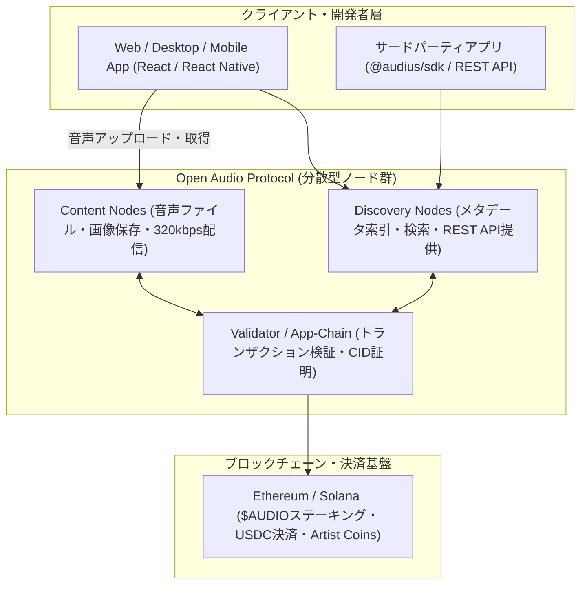

# **Audius 調査レポート**

## **1. 基本情報**

* **ツール名**: Audius
* **ツールの読み方**: オーディウス / アウディウス
* **開発元**: Audius, Inc.（米国サンフランシスコ本社）/ Open Audio Foundation
* **公式サイト**: [https://audius.co/](https://audius.co/)
* **関連リンク**:
  * GitHub: [https://github.com/AudiusProject/apps](https://github.com/AudiusProject/apps)
  * ドキュメント: [https://docs.audius.co/](https://docs.audius.co/)
  * プロトコル仕様ドキュメント: [https://docs.openaudio.org/](https://docs.openaudio.org/)
  * 公式ブログ: [https://blog.audius.co/](https://blog.audius.co/)
* **カテゴリ**: メディアクライアント
* **概要**: Audiusは、Roneil Rumburg氏とForrest Browning氏によって2018年に設立された、ブロックチェーンと分散型ストレージを基盤とするオープンソースの音楽ストリーミングプラットフォームである。従来のレコード会社や中央集権的な配信プラットフォームを介さず、アーティストが楽曲の権利と収益化（USDC直接販売やArtist Coins等）を直接コントロールし、リスナーへ320kbpsの高音質で広告なしのストリーミングを提供することを目的としている。基盤技術である「Open Audio Protocol」を通じて、外部開発者向けのREST APIおよびTypeScript SDKも無償で公開されている。

## **2. 目的と主な利用シーン**

* **解決する課題**: 従来の音楽ストリーミングサービスにおける仲介手数料の高さ、不透明なロイヤリティ分配、再生回数に応じた極小の単価、ならびにプラットフォーム側の規約変更やアルゴリズム依存によってインディペンデントアーティストが収益化・ファン獲得しづらい課題を解決する。
* **想定利用者**: インディペンデントのミュージシャン・DJ・プロデューサー、インディーズレーベル、アンダーグラウンドやエレクトロニック系などの音楽を探すリスナー、音楽カタログを活用したアプリを構築したい開発者。
* **利用シーン**:
  * **インディペンデント楽曲の無料・無制限配信**: 配信代行業者（ディストリビューター）や月額料金なしで、新曲やDJミックス、リミックス用ステム（Stems）を即座に公開する。
  * **ファンへの直接販売・限定公開（Gated Content）**: USDC決済による楽曲・アルバム・ビートの直接販売や、Artist Coins / `$AUDIO` トークン保有者限定のファン向けリリースを行う。
  * **オープンAPIを活用した音楽アプリ開発**: `@audius/sdk` やREST APIを使い、サードパーティの音楽プレイヤー、ゲーム内BGM連携、AIエージェント向け音楽取得ツールを構築する。

### **2.1 代表的な利用フロー**

```mermaid
swimlane-beta TB
  subgraph Artist["アーティスト"]
    A1["楽曲アップロード・価格や公開条件を設定"]
  end
  subgraph Client["Audiusクライアント"]
    B1["メタデータ署名・配信リクエスト送信"]
    B2["再生UI表示・トークンまたは決済状態を確認"]
  end
  subgraph Protocol["Open Audio Protocol (ノード群)"]
    C1["Content Nodeへ音声保存・Discovery Nodeで索引化"]
    C2["オンチェーンで権利・決済を検証し320kbps配信"]
  end
  subgraph Listener["リスナー・ファン"]
    D1["楽曲を検索・再生またはUSDCで購入"]
    D2["高音質ストリーミング視聴・Artist Coin特典利用"]
  end
  A1 --> B1
  B1 --> C1
  D1 --> B2
  B2 --> C2
  C1 -->|"公開カタログ反映"| B2
  C2 --> D2
```

* **代表的な流れ**: アーティストがAudiusクライアントから楽曲をアップロードすると、分散型のContent Nodeに音声ファイルが保存され、Discovery Nodeによって検索可能な状態へ索引化される。リスナーがクライアント上で楽曲を再生またはUSDC購入を行うと、オンチェーンの権利・決済検証を経て320kbpsの音声ストリームが直接配信される。

## **3. 主要機能**

* **広告なし・320kbps高音質ストリーミング**: リスナーはアカウント登録の有無を問わず、最大320kbpsの高音質オーディオを広告なしで無制限にストリーミング再生できる。
* **無料・無制限の楽曲アップロードとコラボ管理**: アーティストはファイル数や再生時間の上限なく無料で楽曲をアップロードでき、複数アーティスト間のコラボレーション登録やリリース後のメタデータ編集にも対応している。
* **USDC直接販売・Pay-Gated Content**: 楽曲、アルバム、ステムファイルに任意の価格を設定し、クレジットカード・デビットカードまたは暗号資産（USDC）でファンに直接販売できる（収益の90%がアーティストへ即時還元される）。
* **Artist Coins & トークンゲート機能**: 認証済みアーティストが独自のファンコミュニティ用トークン（Artist Coins）を発行でき、コイン保有者や特定条件を満たしたファン限定の楽曲公開、メッセージ一斉送信、ファンクラブ特典を提供できる。
* **リミックスコンテスト・ステム共有機能**: アーティストが楽曲のステムデータを公開し、他のクリエイターがリミックスを紐づけて投稿できる仕組みを標準搭載しており、公式のリミックスコンテストが頻繁に開催されている。
* **ダイレクトメッセージ・ファンエンゲージメント**: アーティストとファン、またはクリエイター同士がアプリ内で直接やり取りできるチャット機能を備える。
* **Open Audio Protocolによる開発者向けAPI/SDK**: 認証不要またはAPIキーのみでアクセス可能なREST APIと公式TypeScript SDK（`@audius/sdk`）を提供し、サードパーティアプリケーションからの楽曲検索・再生・投稿連携を可能にしている。

## **4. 動作原理・システム構成**



* **アーキテクチャ**: クライアントアプリ（Web/モバイル）と、コミュニティが運営する分散型ノード群（Open Audio Protocol）、およびブロックチェーン（Ethereum / Solana / アプリチェーン）を組み合わせた分散型クライアント・サーバー構成である。Webアプリ、モバイルアプリ、APIサーバー（Go製）、SDKの主要コードベースはGitHub上でApache-2.0ライセンスのオープンソースとして公開されている。
* **主要コンポーネントとデータフロー**:
  * **Content Nodes（ストレージ・配信層）**: コミュニティノード運営者がホスティングするストレージノード。アーティストがアップロードした音声ファイル、アートワーク、ユーザーメタデータを保持し、HLS/HTTP経由でリスナーへ直接ストリーミング配信する。
  * **Discovery Nodes（インデックス・API層）**: ブロックチェーンおよびContent Ledgerからメタデータを収集・索引化し、トレンド集計、全文検索、ユーザーフィードなどの高速なREST APIエンドポイントをクライアントへ提供する。
  * **Content Ledger / Validator（台帳・検証層）**: 楽曲の所有権、再生・購入履歴、ノードのCID（Content Identifier）証明を検証・記録する台帳層。
* **特筆すべき要素技術**:
  * **Ethereum / Solana マルチチェーン活用**: ネットワークセキュリティとガバナンスを担う `$AUDIO` トークンのステーキングにはEthereumを、高速・低手数料の決済（USDC）やArtist Coins・SPLトークン処理にはSolanaを活用している。
  * **OAuth 2.0 / ウォレット署名認証**: 一般ユーザー向けのメール・パスワード認証（暗号化キー管理）に加え、Phantom等のSolanaウォレット署名や「Log In with Audius」OAuthフローに対応している。

## **5. 開始手順・セットアップ**

* **前提条件**:
  * **一般リスナー**: アカウント登録・クレジットカード登録ともに不要で、ブラウザまたはモバイルアプリから即座に視聴可能（プレイリスト作成・いいね・購入には無料アカウントが必要）。
  * **開発者**: Node.js（LTS推奨）、npm / pnpm、および [audius.co](https://audius.co/) の開発者設定画面から取得するAPI Key（書き込み操作を行う場合はAPI Secret / Bearer Tokenも必要）。
* **インストール/導入**:

  新規プロジェクトをテンプレートから作成する場合：

  ```bash
  pnpm dlx create-audius-app my-app
  cd my-app
  pnpm install
  pnpm dev
  ```

  既存プロジェクトへ公式SDKを追加する場合：

  ```bash
  pnpm add @audius/sdk
  ```

* **初期設定**:
  * 環境変数（例：`AUDIUS_API_KEY`、`AUDIUS_API_SECRET`）にAPI認証情報を設定する。フロントエンド（ブラウザ）側ではAPI Keyのみを使用し、API Secret（Bearer Token）はバックエンド側でのみ参照する。
* **クイックスタート**:

  ```javascript
  import { audiusSdk } from '@audius/sdk'

  const sdk = audiusSdk({
    appName: 'MyAudiusApp',
    apiKey: process.env.AUDIUS_API_KEY,
  })

  async function main() {
    const { data: tracks } = await sdk.tracks.getTrendingTracks()
    console.log(tracks)
  }

  main()
  ```

## **6. 特徴・強み (Pros)**

* **完全無料かつ広告なしの視聴・配信体験**: リスナーは課金や広告なしで320kbpsの高音質楽曲を聴き放題であり、アーティストも初期費用や配信維持費なしで無制限に楽曲をアップロードできる。
* **アーティストへの高い収益還元率（90%）**: USDCによる楽曲・アルバム・ステムの直接販売では、ネットワーク手数料10%（コミュニティトレジャリーへ還元）を除く90%が即座にアーティストのウォレットへ支払われる。
* **透明性の高いオープンソース基盤と許可不要のAPI**: クライアントからAPIバックエンドまで主要コードがApache-2.0で公開されており、開発者はゲートキーパーの審査なしに音楽カタログを活用したアプリやAIツールを構築できる。
* **Web3を意識させないオンボーディング**: 裏側ではSolanaや分散型ノードが稼働しているが、リスナーは通常の音楽アプリと同様にメールアドレスやクレジットカードのみで登録・購入・視聴を行える。
* **リミックス文化とファンコミュニティ機能**: ステムファイルの公開、公式リミックスコンテスト、Artist Coinsによるファンクラブ機能など、クリエイター同士の共創と熱心なファンとの直接的な関係構築に特化した機能が充実している。

## **7. 弱み・注意点 (Cons)**

* **日本語UIおよび日本語サポートへの非対応**: Webサイト、iOS/Androidアプリ、開発者ドキュメント、カスタマーサポートはいずれも英語のみでの提供となっており、日本語のUI切り替え設定は存在しない（楽曲タイトルやプロフィールへの日本語入力・表示は可能）。
* **モバイルアプリの動作不安定さ**: App StoreやGoogle Playのレビューにおいて、再生が途中で止まる、アプリを閉じた後もバックグラウンド再生が止まらない、動作が重いといったバグの報告が散見される。
* **スパムボットによる通知ノイズ**: 無料アカウント作成が容易であるため、新規アップロード直後にボットアカウントから大量の自動リポスト・いいね通知が届き、純粋なファンの反応が埋もれやすいという課題がアーティストから指摘されている。
* **メジャーレーベルの商業楽曲カタログの少なさ**: インディペンデントアーティスト主体のため、主要レコード会社所属のヒットチャート楽曲を網羅的に聴きたい一般リスナーのニーズには応えにくい。
* **暗号資産・トークン周りの複雑さ**: `$AUDIO` トークンやArtist Coinsを活用した高度な機能・報酬の換金にはWeb3ウォレット（Phantom等）の知識が必要となり、暗号資産の価格変動リスクも伴う。

## **8. 料金プラン**

| プラン名 | 料金 | 主な特徴 |
|---------|------|---------|
| **リスナー（無料）** | 無料 | 広告なし・320kbpsストリーミング、プレイリスト作成、フォロー、ダイレクトメッセージ |
| **アーティスト（無料）** | 無料 | 無制限の楽曲・アルバムアップロード、ステム公開、リミックスコンテスト参加 |
| **有料コンテンツ販売（USDC）** | 販売額の10%手数料 | アーティストが任意価格を設定し直接販売。90%がアーティスト還元、10%がプロトコル手数料 |
| **開発者API（Free Tier）** | 無料 | APIキー取得によりREST APIおよび`@audius/sdk`でカタログ検索・ストリーミング取得が可能 |

* **課金体系**: 基本利用（視聴・アップロード・API利用）は完全無料。収益化機能（Pay-Gated Content）で売上が発生した場合のみ、取引額の10%がネットワーク手数料として差し引かれる。Artist Coinsの取引にも少額（例：1%）の取引手数料が設定され、アーティストとトレジャリーに分配される。
* **無料トライアル**: 基本サービス自体が無料であるため、トライアルの概念はない。

## **9. 導入実績・事例**

* **参加アーティスト・レーベル**: deadmau5、Skrillex、Diplo、Disclosure（レーベル「Friends & Family」）、Weezer、Nas、Ookay、Jason Derulo などの著名アーティストやエレクトロニック系レーベルがアカウント開設や楽曲配信・コンテストを実施している。
* **プラットフォーム・エコシステム連携実績**:
  * **TikTok**: 音楽ストリーミングサービスとして初期にTikTok Sound Kitと統合し、Audius上の楽曲をワンクリックでTikTokのサウンドライブラリへエクスポートできる機能を実現した。
  * **Phantom**: Solanaエコシステムにおける主要ウォレットであるPhantomとの連携により、シームレスな `$AUDIO` 管理とArtist Coins取引を実現している。
* **対象業界**: インディペンデント音楽業界、エレクトロニック/DJ/ヒップホップ/Lo-Fiシーン、Web3クリエイターエコノミー、音楽系アプリケーション開発。

## **10. サポート体制**

* **ドキュメント**: 開発者向けポータル（[https://docs.audius.co/](https://docs.audius.co/)）、プロトコル・ノード運営者向けドキュメント（[https://docs.openaudio.org/](https://docs.openaudio.org/)）、および一般ユーザー向けヘルプセンター（[https://help.audius.co/](https://help.audius.co/)）が整備されている。いずれも英語表記。
* **コミュニティ**: 公式Discordサーバー、GitHub Discussions / Issues、X（旧Twitter）、Reddit（r/audius）を中心に活発なコミュニティが形成されている。
* **公式サポート**: ヘルプセンター経由のチケット・メールサポートを提供している。対応言語は英語のみであり、ユーザーレビューでは問い合わせから返信までに時間がかかるケースがある点が指摘されている。

## **11. エコシステムと連携**

### **11.1 API・外部サービス連携**

* **API**: OpenAPI（Swagger）仕様に準拠したREST API（`https://api.audius.co/v1`）および公式TypeScript/JavaScript SDK（`@audius/sdk`）を公開。一部のプロトコル機能ではgRPC（`grpc.audius.co:443`）も利用可能。
* **外部サービス連携**:
  * **TikTok**: 楽曲のTikTokサウンドライブラリへの直接エクスポート（Sound Kit連携）
  * **Solana / Ethereum ウォレット**: Phantom、MetaMask 等との接続・署名認証
  * **Stripe / クレジットカード決済基盤**: USDC購入時の法定通貨オンランプ決済
  * **DDEX**: 音楽業界標準のメタデータ交換規格（`ddex-processor`）によるレーベルカタログ取り込み
  * **MusicAPI 等のアグリゲーター**: 外部音楽データ統合APIからのAudiusカタログ参照

### **11.2 技術スタックとの相性**

| 技術スタック | 相性 | メリット・推奨理由 | 懸念点・注意点 |
|:---|:---:|:---|:---|
| **TypeScript / React / Next.js** | ◎ | 公式SDK（`@audius/sdk`）およびCLI（`create-audius-app`）が最適化されており、フロントエンド・バックエンド双方で型安全に利用可能 | クライアント側へAPI Secretを露出させない構成管理が必要 |
| **React Native (モバイル)** | ◎ | Audius自身のモバイルアプリがReact Nativeで構築されており、SDK・認証フローの親和性が非常に高い | ネイティブ音声再生モジュールとの組み合わせ設計が必要 |
| **Go (バックエンド)** | ◯ | AudiusのAPIサーバーやプロトコルノード（`audiusd`）自体がGoで開発されており、REST APIやgRPCでの連携が容易 | 専用の高レベルGo SDKではなく、REST/gRPCクライアントの実装が必要 |
| **Python (FastAPI / AI連携)** | ◯ | 公式のPython専用SDKは未提供だが、標準的なREST API（`https://api.audius.co/v1`）を`httpx`や`requests`で容易に呼び出せる | SDKの型補完がないためOpenAPI仕様を参照して実装する必要がある |

## **12. セキュリティとコンプライアンス**

* **認証**: 一般ユーザー向けにはメールベースの暗号化キー管理、開発者・外部アプリ連携にはAPIキー（Bearer Token）および「Log In with Audius」（OAuth 2.0）を採用。Web3ユーザー向けにはEthereum / Solanaウォレットの秘密鍵署名による認証をサポートしている。
* **データ管理**: 音声ファイルやアートワークは分散型のContent Nodesに保存される。プライバシーポリシーにおいて、ブロックチェーン（Solana、Ethereum、アプリチェーン）上に記録されたトランザクションやオンチェーンの行動履歴は不変（Immutable）であり、後から改変・削除できない旨が明記されている。
* **準拠規格・著作権保護**: 公式サイト上でSOC2やISO27001の取得状況は公開されていない。著作権保護に関しては、アップロード時の自動コンテンツ識別スキャンおよびDMCA（デジタルミレニアム著作権法）に基づく削除要請プロセスを導入している。

## **13. 操作性 (UI/UX) と学習コスト**

* **UI/UX**: ダークモードを基調としたモダンで洗練されたUIを採用しており、SoundCloudやSpotifyに慣れたユーザーであれば直感的に再生・検索・プレイリスト作成が可能である。暗号資産のウォレット接続なしでも基本機能が使える設計になっている。
* **学習コスト**: リスナーとしての利用や単純な楽曲アップロードの学習コストは極めて低い。一方で、`$AUDIO` のステーキング、Artist Coinsの運用、USDC収益のオンチェーン出金などを活用する場合はWeb3特有の基礎知識が必要となる。開発者にとっては、TypeScript SDKと豊富なサンプルが用意されているため導入は比較的容易である。

## **14. ベストプラクティス**

* **効果的な活用法 (Modern Practices)**:
  * **API認証の適切な分離**: Webアプリ開発時は、クライアント（ブラウザ）側で公開用の `apiKey` のみを使用し、書き込みや認証を伴う `apiSecret`（Bearer Token）は必ずバックエンドサーバーで保持する。
  * **高レベルSDKメソッドの利用**: `@audius/sdk` v17以降では、楽曲アップロードやプレビュー生成時に明示的な `userId` 指定（オンチェーンCID証明のため）が推奨・必須化されているため、`createTrack` や `publishTrack` などの高レベルAPIを利用して整合性を保つ。
  * **多段階マネタイズの設計**: 無料の通常トラックでリスナー母数を増やしつつ、リミックス用ステムや限定音源をUSDC購入・Artist Coins保有者限定（Gated Content）に設定する。
* **陥りやすい罠 (Antipatterns)**:
  * **非公式・古いSDKバージョンの利用**: プロトコル仕様（特にバリデータノードやCID証明）の更新が速いため、`@audius/sdk` のメジャーアップデート追従を怠るとアップロードや通知取得APIで互換性エラーが発生する。
  * **ブロックチェーン上のデータ削除前提の設計**: オンチェーンに書き込まれたメタデータやトランザクションは削除不可であるため、個人情報や秘匿すべきデータをオンチェーン属性に含めない。

## **15. ユーザーの声（レビュー分析）**

* **調査対象**: Apple App Store、Google Play ストア、Trustpilot、Reddit（r/audius 等） ※BtoB SaaS向けのG2およびCapterraには登録なし。
* **総合評価**: 4.8/5.0（Apple App Store）、約4.6/5.0（Google Play ストア・9,700件以上のレビュー）
* **ポジティブな評価**:
  * 「広告なしで完全無料、しかも320kbpsの高音質で聴ける点が他の無料音楽アプリより圧倒的に優れている」（Google Play レビュー要約）
  * 「大手プラットフォームのアルゴリズムに埋もれがちなアンダーグラウンドの電子音楽やLo-Fi、インディーズ楽曲の発掘に最適」（Reddit / App Store レビュー要約）
  * 「アーティストが楽曲の権利を100%保持したまま無制限にアップロードでき、リミックスコンテストで他のクリエイターとつながれる」（App Store レビュー要約）
* **ネガティブな評価 / 改善要望**:
  * 「モバイルアプリが時折重くなり、曲の再生に失敗したり、アプリを閉じてもバックグラウンド再生が止まらないバグがある」（Google Play / App Store レビュー要約）
  * 「楽曲をアップロードするとすぐにボットアカウントから大量のリポスト通知が届くなど、スパム対策が弱い」（Reddit ユーザー投稿要約）
  * 「カスタマーサポートへの問い合わせに対する返信が非常に遅い、または返ってこないことがある」（Reddit ユーザー投稿要約）
* **特徴的なユースケース**: メジャーレーベルの商業配信前のテストリリース、DJやプロデューサー同士によるステムファイル共有とリミックスコンテストの開催、Web3コミュニティ向けの限定音源配布。

## **16. 直近半年のアップデート情報**

* **2026-11-13**: `AudiusProject/apps` において、モバイルUIのスクロール時コントロール固定表示や、未返信チャットのデフォルト振り分け改善、共同制作者招待の保持修正などを継続的にリリース。
* **2026-09-24**: 公式SDK `@audius/sdk@17.0.0` および `@audius/spl@2.2.0` をリリース。音声アップロードおよびプレビュー生成時に対象の `userId` を紐づけ、バリデータノードが結果のCIDをオンチェーンで証明（Attestation）する仕組みを導入。
* **2026-08-03**: `@audius/sdk@16.0.0` をリリース。`getNotifications` および `getPlaylistUpdates` のパスパラメータを他エンドポイントと統一（`userId` から `id` へ変更）し、パーソナライズ用のリクエスト者ID指定に対応。
* **2026-05-21**: 「Audius x Symmetry Festival x Magnetic Magazine 2026 DJ Competition」を発表し、DJ・プロデューサー向けのコミュニティ主導イベントおよびプロモーション支援を展開（応募期間：2026年7月1日まで）。

(出典: [AudiusProject/apps Releases](https://github.com/AudiusProject/apps/releases) / [Audius 公式ブログ](https://blog.audius.co/))

## **17. 類似ツールとの比較**

### **17.1 機能比較表 (星取表)**

| 機能カテゴリ | 機能項目 | Audius | Spotify | SoundCloud | Bandcamp |
|:---:|:---|:---:|:---:|:---:|:---:|
| **基本機能** | 無料聴き放題（広告なし） | ◎<br><small>完全無料・広告なし・320kbps</small> | △<br><small>無料プランは広告・シャッフル制限あり</small> | ◯<br><small>無料プランあり（広告あり）</small> | ◯<br><small>試聴可能（購入前回数制限あり）</small> |
| **配信機能** | アーティスト無料アップロード | ◎<br><small>容量・曲数無制限で無料</small> | ×<br><small>配信代行（ディストリビューター）必須</small> | △<br><small>無料枠は時間制限（3時間）あり</small> | ◎<br><small>無料で無制限アップロード可</small> |
| **収益化** | ファンからの直接収益還元 | ◎<br><small>USDC販売90%還元・Artist Coins</small> | △<br><small>再生単価分配（仲介経由）</small> | ◯<br><small>Fan-powered royalties等</small> | ◎<br><small>デジタル売上85%前後を直接還元</small> |
| **カタログ** | メジャー商業楽曲の網羅性 | △<br><small>インディーズ中心</small> | ◎<br><small>主要レーベルをほぼ網羅</small> | ◯<br><small>インディーズから一部メジャーまで</small> | ◯<br><small>インディーズ・レーベル中心</small> |
| **開発者向け** | オープンソース・公開API | ◎<br><small>Apache-2.0公開・認証不要APIあり</small> | △<br><small>クローズド・API利用制限あり</small> | △<br><small>クローズド・新規API申請制限</small> | ×<br><small>一般向け公開APIなし</small> |
| **非機能要件** | 日本語UI対応 | ×<br><small>英語UIのみ</small> | ◎<br><small>完全日本語対応</small> | ◯<br><small>一部日本語対応</small> | ◯<br><small>一部日本語対応</small> |

### **17.2 詳細比較**

| ツール名 | 特徴 | 強み | 弱み | 選択肢となるケース |
|---------|------|------|------|------------------|
| **Audius** | 分散型プロトコル（Open Audio Protocol）上の音楽プラットフォーム | 完全無料・広告なし・320kbps、90%直接還元、OSS・公開API | 日本語UI非対応、モバイルアプリのバグ報告、メジャー楽曲が少ない | Web3連携やUSDC直接販売を行いたいクリエイター、公開APIで音楽アプリを作りたい開発者 |
| **Spotify** | 世界最大級のサブスクリプション型音楽ストリーミング | メジャー楽曲の圧倒的カタログ、高精度レコメンド、日本語完全対応 | アーティストの直接アップロード不可、無料プランの広告・機能制限 | メジャー・邦楽を含めあらゆる楽曲を快適に聴きたい一般リスナー |
| **SoundCloud** | インディーズ・DJ・ポッドキャストに強い音声共有プラットフォーム | 大規模なインディーズコミュニティ、DJミックスや非公式リミックスの豊富さ | 無料アップロード枠に時間制限あり、高音質・無制限には有料プラン必須 | 既存の大規模インディーズリスナー層へリーチしたいクリエイター |
| **Bandcamp** | インディーズアーティストの音源・グッズ直販プラットフォーム | ロスレス（FLAC等）ダウンロード販売、フィジカル・グッズ連携、高い還元率 | ストリーミング専用アプリとしての機能性や公開APIが弱い | Web3を使わずに高音質ダウンロード販売や物販でファンから直接収益を得たい場合 |

## **18. 総評**

* **総合的な評価**:
  * Audiusは、ブロックチェーンと分散型ストレージを実用的な音楽ストリーミング体験へと落とし込んだ先進的なプラットフォームである。リスナーに対して「完全無料・広告なし・320kbps高音質」を提供しつつ、アーティストに対しては「無制限アップロード・90%のUSDC直接還元・Artist Coins」という強力な経済圏を提供している点は高く評価できる。また、2026年後半もSDKやプロトコルの更新が活発に続いており、開発基盤としての信頼性も高い。一方で、日本語UIの未対応、モバイルアプリの安定性、スパムボット対策の甘さは実用上の明確な課題となっている。
* **推奨されるチームやプロジェクト**:
  * グローバル（特に英語圏）のリスナーをターゲットとするインディペンデントのDJ・トラックメイカー・エレクトロニック系アーティスト。
  * Web3（Solana/USDC）を活用したファンコミュニティやトークンゲート施策を試したいクリエイター・レーベル。
  * 著作権クリアなインディーズ音楽カタログやトレンドデータを、ライセンス審査なしでアプリやAIエージェントに組み込みたい開発チーム。
* **選択時のポイント**:
  * **Spotify**や**Apple Music**の代替としてメジャー楽曲を網羅的に聴く用途には向かないため、あくまで「インディーズ音楽の発掘・配信」や「ファンへの直接販売・Web3連携」を主目的とする場合に選択すべきである。また、日本語環境が必須のユーザーや、暗号資産決済に抵抗があるファン層には**Bandcamp**や**SoundCloud**の方が導入しやすい。
