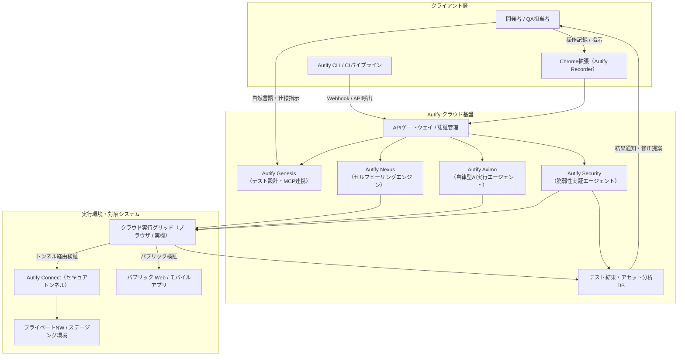

# **Autify 調査レポート**

## **1. 基本情報**

<!--
【ガイドライン】
- 必須: ツール名、開発元、公式サイト、カテゴリ、概要
- 概要は2-3文で簡潔に記述
-->

* **ツール名**: Autify
* **ツールの読み方**: オーティファイ
* **開発元**: オーティファイ株式会社 (Autify, Inc.)
* **公式サイト**: [https://autify.jp/](https://autify.jp/)
* **関連リンク**:
  * ドキュメント: [https://help.autify.com/](https://help.autify.com/)
  * レビューサイト: [G2](https://www.g2.com/products/autify/reviews) | [ITreview](https://www.itreview.jp/products/autify)
* **カテゴリ**: テスト自動化SaaS
* **概要**: Autifyは、AIエージェントとノーコード技術を中核に据えた次世代品質保証（QA）プラットフォームです。要件定義書からのテスト設計・標準化（Autify Genesis）、チャットや直感操作による自動化（Autify Nexus）、セレクタ保守を不要化する自律型実行（Autify Aximo）、脆弱性を実際に確かめて直すセキュリティ検証（Autify Security）、専門家伴走型のマネージドサービス（Autify AI Coworker）を包括的に提供し、ソフトウェア開発ライフサイクル全体の品質とスピードを向上させます。

## **2. 目的と主な利用シーン**

<!--
【ガイドライン】
- 3-5項目を箇条書きで記述
- 想定利用者を具体的に記載
- 末尾に「代表的な利用フロー」をスイムレーンで添付する
-->

* **解決する課題**: ソフトウェア開発におけるテスト工程の工数増大、テスト設計・計画フェーズの属人化、UI変更やセレクタ変更に伴うテストスクリプトの頻繁なメンテナンス負荷、セキュリティ脆弱性のトリアージ・再現確認工数の肥大化。
* **想定利用者**: QAエンジニア、ソフトウェア開発者、プロダクトマネージャー (PdM)、セキュリティ担当者、エンタープライズの品質保証部門。
* **利用シーン**:
  * 仕様書や要件定義書からの、AIを活用した網羅的なテストケースやワークフローの自動生成・標準化（Autify Genesis）
  * Web/モバイルアプリケーションのE2Eテストや回帰テストのノーコード/チャット指示による自動化とAI自動修復（Autify Nexus）
  * セレクタ保守に工数を割かずに、画面の視覚的変化を理解させて自律的に進める回帰テスト運用（Autify Aximo）
  * ソースコードや依存パッケージの脆弱性を隔離環境で再現し、修正提案から再検証まで自動化（Autify Security）
  * QA人材が不足する組織での、テスト設計から実行、リリース判定までの包括的なアウトソース（Autify AI Coworker）

### **2.1 代表的な利用フロー**

<!--
【ガイドライン】
- ツールを実際に使う際の代表的な流れを、アクター（ユーザー、AIエージェント、ツール、外部サービス等）ごとのスイムレーンで示す
- Mermaidの `swimlane-beta` を使用し、向きは `TB`（上から下）に固定する
- レーン（subgraph）は3〜5個、ステップは4〜8個程度に収め、図内のレーン名・ステップ名は日本語で簡潔に記述する
-->

```mermaid
swimlane-beta TB
  subgraph User["QA担当者・開発者"]
    A[仕様書・テスト要件の入力]
    F[テスト結果・修正提案の確認]
  end
  subgraph Platform["Autifyプラットフォーム"]
    B[Genesis: 設計・シナリオ生成]
    C[Nexus・Aximo: 自律テスト実行]
    E[Security: 脆弱性検証・修正提案]
  end
  subgraph Target["対象システム・CI/CD"]
    D[対象アプリの操作・検証]
  end
  A --> B
  B --> C
  C --> D
  D --> E
  E --> F
```

* **代表的な流れ**: QA担当者が仕様書やテスト要件をインプットすると、Autifyプラットフォーム内の「Autify Genesis」がテスト設計とシナリオを自動生成します。続いて「Autify Nexus」や「Autify Aximo」が対象システムに対して自律的にテストを実行し、UI変更にはAIが自動適応します。さらに「Autify Security」によって脆弱性の実証と修正提案が行われ、QA担当者はダッシュボード上で包括的な品質判定結果を確認できます。

## **3. 主要機能**

<!--
【ガイドライン】
- 5-10項目の主要機能を箇条書きで記述
- 各機能は1-2文で概要を説明
-->

* **自律型AIテストエージェント（Autify Aximo）**: 自然言語指示と視覚認識（コンピュータビジョン）を融合し、UI変更を自律的に理解してテストを実行。セレクタ変更によるスクリプト保守の負担を最小化します。
* **AIによるテスト自動設計・標準化（Autify Genesis）**: 仕様書やPRD（要件定義書）を読み込み、網羅的なテストケースやワークフローを自動生成します。MCP (Model Context Protocol) に対応し、社内ドキュメント管理ツールとのシームレスな連携も可能です。
* **ノーコード＆チャットテスト作成（Autify Nexus）**: 自然言語によるチャット指示や、Chrome拡張レコーダーによる直感的な画面操作でプログラミング不要のテストシナリオ作成が可能です。
* **AIセルフヒーリング（自動修復）**: アプリケーションのUIやDOM構造の変化をAIが検知し、テストシナリオの対象要素を自動で修復・追従して不要なテスト失敗を防ぎます。
* **AI駆動型セキュリティ検証（Autify Security）**: 複数の役割別AIエージェントがコードや依存パッケージの脆弱性を分析し、隔離環境で実際の悪用可能性を実証した上で具体的な修正案を提示・再テストします。
* **マネージドQAサービス（Autify AI Coworker）**: テスト設計から実行、リリース判定までのQA業務を一気通貫でAutifyの専門家チームとAIエージェントに委託でき、テスト実行時間を最大86%短縮します。
* **統合運用（Autifyプラットフォーム）**: 個別に提供されていたGenesis、Nexus、Aximoなどを1つの契約と共通インターフェースで統合管理できるエンタープライズ基盤です。
* **ビジュアルリグレッションテスト**: 画面の見た目の変化をピクセル単位で検出し、意図しないレイアウト崩れやフォント崩れを防止します。
* **Eメールテスト**: シナリオ実行中に送信されるメールの内容（認証コードやリンク先URLなど）を自動取得して検証します。
* **Autify Connect**: ローカル開発環境や社内プライベートネットワーク内のアプリケーションに対して、公開不要でセキュアにテストを実行できます。

## **4. 動作原理・システム構成**

<!--
【ガイドライン】
- ツールの動作原理、システム構成（アーキテクチャ）、データの流れ、通信フローなどを記述
- クライアント・サーバー型、ローカルファースト、クラウド完結など、ツールのアーキテクチャ特性を明記
-->

* **アーキテクチャ**: クラウド完結型のSaaSアーキテクチャをベースとしつつ、大規模エンタープライズ向けにBYOK（Bring Your Own Key）やセルフホスト（Self-hosted）展開モデルに対応しています。テスト設計、自律実行、セキュリティ実証をそれぞれ専門のAIエージェントが分担するマルチエージェント構造を採用しています。
* **主要コンポーネントとデータフロー**:
  * **クライアント層**: Chrome拡張機能（Autify Recorder）、Autify CLI、Web管理画面を通じてユーザーからの指示やテスト録画データを受け付けます。
  * **Autify クラウド基盤**: APIゲートウェイ経由でリクエストを受け取り、Genesis（設計生成）、Nexus（シナリオ実行・修復）、Aximo（自律エージェント）、Security（脆弱性実証）などの各エンジンへ処理を振り分けます。
  * **実行グリッド**: クラウド上の安全なコンテナ環境でヘッドレスブラウザやモバイル実機を並列起動し、Autify Connect（セキュアトンネル）を経由して社内NW内の対象システムにも安全にアクセスします。
  * **分析・レポートDB**: 実行ログ、スクリーンショット、脆弱性実証結果を蓄積し、修復提案やレポートを生成します。



* **特筆すべき要素技術**:
  * **マルチモーダルAIと視覚認識**: DOM構造だけでなく画面レンダリング結果（スクリーンショット）を視覚的に解析し、人間のように画面を認識して自律操作を行うエージェント技術。
  * **Model Context Protocol (MCP)**: Autify Genesisにおいて社内ツールや仕様リポジトリから動的にコンテキストを取得するためのオープン規格連携。
  * **隔離サンドボックス環境**: Autify Securityにおいて、安全に脆弱性の悪用可能性（Exploitability）をシミュレーションするための隔離コンテナ基盤。
  * **暗号化セキュアトンネリング**: Autify Connectによる社内プライベート環境へのTLS暗号化リバースプロキシ技術。

## **5. 開始手順・セットアップ**

<!--
【ガイドライン】
- アカウント作成から「Hello World」的な最初の動作確認までの手順
- 主要なコマンドや設定項目を記載
-->

* **前提条件**:
  * Google Chromeブラウザ（テスト作成・レコーディング用）
  * Autifyアカウント（公式サイトより問い合わせ・申し込み）
* **インストール/導入**:
  * Chromeウェブストアから「Autify Recorder」拡張機能をインストールします。
  * CI/CD連携を行う場合は、Autify CLIを導入します。

  ```bash
  # Autify CLIのインストール例（公式インストーラー経由）
  curl -sL https://autify-cli-assets.autify.com/autify-cli/channels/stable/install-cicd.sh | bash
  ```

* **初期設定**:
  * ワークスペースの作成と、テスト対象アプリケーションの開始URL設定を行います。
  * プライベート環境のテストを行う場合は、Autify Connectクライアントを起動してアクセストークンを設定します。
* **クイックスタート**:
  1. Webコンソールで「新規シナリオ」を作成し、テスト対象のURLを入力。
  2. 「レコーディング開始」を押して、ブラウザ上でテストしたいユーザー操作を実行。
  3. テストステップが正しく記録されたことを確認して「保存」。
  4. 「今すぐ実行」をクリックし、クラウド環境でテストが並列実行・合格することを確認。

## **6. 特徴・強み (Pros)**

<!--
【ガイドライン】
- 3-5項目を箇条書きで記述
- 競合との差別化ポイントを明確に
-->

* **テスト設計から自律実行・セキュリティ検証までの包括性**: 単なるノーコードテスト実行にとどまらず、仕様書からの設計（Genesis）、セレクタ保守不要の自律実行（Aximo）、脆弱性の実証と修正（Security）まで、QA・開発プロセスを全方位でカバーします。
* **メンテナンス負荷を劇的に削減するAI技術**: Aximoによる自律操作とNexusのセルフヒーリング機能により、UIデザインやDOM構造の変更によるテストの誤検知・頻繁な改修作業を大幅に削減できます。
* **脆弱性を「確かめて直す」実証型セキュリティ**: Autify Securityにより、従来のアラート過多な静的スキャンとは異なり、隔離環境で実際に再現・実証し、修正コードの提案と再テストまで自動化します。
* **「AI×専門家」のハイブリッドマネージド体制**: Autify AI Coworkerを活用することで、QA人材不足に悩む企業でも高品質なQA体制を短期間で立ち上げ・スケール可能です。
* **国産ツールならではの手厚いサポートとガバナンス**: 日本語ネイティブのカスタマーサクセス、充実したドキュメント、ISMS/SOC 2 Type 2準拠、BYOKやセルフホスト対応など、国内エンタープライズの厳格な要件に適合します。

## **7. 弱み・注意点 (Cons)**

<!--
【ガイドライン】
- 3-5項目を箇条書きで記述
- 日本語対応の状況は必ず含める
-->

* **料金が非公開（個別見積もり）**: Webサイト上に定額プランの価格が明示されておらず、プロダクト構成（Nexus / Genesis / Aximo / Security / Coworker）に応じた個別見積もりのため、初期の予算算出に問い合わせが必要です。
* **プロダクト構成の理解が必要**: 急速な機能拡張とプラットフォーム統合に伴い、自社の課題（設計改善、実行自動化、自律実行、セキュリティ、代行）にどの製品を組み合わせるべきかの事前整理が重要になります。
* **複雑なバックエンドロジック検証の制約**: UIレイヤー中心のテストプラットフォームであるため、複雑な内部DB状態検証や単体APIの極限ケース検証には、カスタムスクリプトや外部ツールとの組み合わせが必要になる場合があります。
* **日本語対応**: UI、ヘルプドキュメント、公式サポート（メール・チャット）、導入コンサルティングのすべてが完全日本語対応しています。

## **8. 料金プラン**

<!--
【ガイドライン】
- 表形式で整理することを推奨
- 最新の料金情報であることを確認
-->

料金は公式サイトで公開されておらず、導入する製品構成（Autifyプラットフォーム / Nexus / Genesis / Aximo / Security / AI Coworker）や共有シナリオ数、並列実行数に応じた年間サブスクリプション（個別見積もり）となっています。テストの実行回数やユーザーアカウント数による従量課金はありません。

| プラン / プロダクト名 | 料金 | 主な特徴・対象 |
|:---|:---:|:---|
| **Autifyプラットフォーム統合契約** | 個別見積もり | Genesis、Nexus、Aximoなどを1つの契約で包括的に利用できる統合プラン。 |
| **Autify Nexus (Lite / Business / Enterprise)** | 個別見積もり | 保存する「共有シナリオ数」と並列実行数に基づく課金。実行回数は無制限。 |
| **Autify Genesis (Cloud / Self-hosted)** | 個別見積もり | 仕様書からのテスト設計・ワークフロー自動生成。BYOKや自社環境ホストに対応。 |
| **Autify Aximo** | 個別見積もり | 自然言語と視覚認識による自律型AIテスト実行。スクリプト保守の不要化を支援。 |
| **Autify Security** | 個別見積もり (EA) | マルチAIエージェントによる脆弱性分析・隔離実証・修正提案。早期アクセス受付中。 |
| **Autify AI Coworker** | 個別見積もり | テスト設計から実行、リリース判定までをAIと専門家チームが代行するQAマネージドサービス。 |

* **課金体系**: 共有シナリオ数、並列実行数（1〜3並列以上）、契約製品構成に応じた定額サブスクリプション。
* **無料トライアル**: 提供の有無や期間については、公式サイトからのデモ申し込みや導入相談を通じて個別に提供されます。

## **9. 導入実績・事例**

<!--
【ガイドライン】
- 具体的な企業名を3-5社挙げる
-->

* **導入企業**: freee、ディー・エヌ・エー (DeNA)、ユーザベース、エムスリー、損害保険ジャパン、コーセー、三菱UFJ eスマート証券、Classi、ミラティブなど。
* **導入事例**:
  * **損害保険ジャパン / コーセー**: 大規模基幹・Webサービスにおけるテスト自動化推進と回帰テスト工数の大幅削減。
  * **金融機関30社以上**: 高度なセキュリティ要件が求められる金融・証券アプリケーションの稼働試験自動化に採用。
  * **SaaS・Web系企業**: 「リグレッションテスト工数を最大90%削減」「テスト実行時間を最大86%短縮」「開発者が本来の機能開発に集中できる環境を実現」などの成果を公表。
* **対象業界**: 金融・保険、SaaS、EC・小売、製造、メディア・ゲームなど幅広いエンタープライズおよび急成長企業。

## **10. サポート体制**

<!--
【ガイドライン】
- ドキュメント、コミュニティ、公式サポートの3項目を必ず含める
-->

* **ドキュメント**: 日本語の[ヘルプセンター](https://help.autify.com/)、スタートガイド、機能別チュートリアル、詳細なリリースノートが提供されています。
* **コミュニティ**: ユーザーコミュニティ「Autifier Community」が運営されており、他社のQA担当者との知見共有やベストプラクティス交換が行われています。
* **公式サポート**: 日本人スタッフによるチャットおよびメールでの迅速なサポートが提供されます。専任のカスタマーサクセス担当者による導入支援や定例ミーティングもプランに応じて提供されます。

## **11. エコシステムと連携**

<!--
【ガイドライン】
- API、外部連携、技術スタックとの相性を包括的に記述
-->

### **11.1 API・外部サービス連携**

<!--
【ガイドライン】
- APIの有無と公開状況を明記
- 主要連携サービスを5-10個リストアップ
-->

* **API**: テストの実行トリガーや結果取得を行うREST APIおよびAutify CLIが提供されており、CI/CDパイプラインとのシームレスな統合が可能です。
* **外部サービス連携**:
  * **CI/CDツール**: GitHub Actions, GitLab CI/CD, CircleCI, Jenkins, AWS CodePipeline
  * **コミュニケーション・通知**: Slack, Microsoft Teams, Webhook
  * **テスト・課題管理**: TestRail, Jira
  * **クラウドマーケットプレイス**: AWS Marketplace（Autify Nexusの調達に対応）
  * **プロトコル連携**: MCP (Model Context Protocol) 経由での社内ナレッジ・仕様書ツールのコンテキスト取得

### **11.2 技術スタックとの相性**

<!--
【ガイドライン】
- 主要なフレームワークや言語との相性を表形式で整理
-->

| 技術スタック | 相性 | メリット・推奨理由 | 懸念点・注意点 |
|:---|:---:|:---|:---|
| **React / Vue / Angular** | ◎ | 動的なDOM変更に対してAIセルフヒーリングやAximoの視覚認識が有効に機能 | Shadow DOMや複雑なカスタムWeb Componentsでは設定確認が推奨 |
| **Next.js / Nuxt** | ◎ | SSR/SSG/SPAを問わずWeb E2Eテストを高速かつ安定して自動化可能 | 動的に生成されるクラス名に対しても視覚・属性複合解析で追従 |
| **Flutter / React Native** | ◯ | モバイル版AutifyによりiOS/Androidの実機・エミュレータ検証が可能 | 一部のOSネイティブ独自ダイアログや特殊ジェスチャーには個別対応が必要 |
| **Microservices / REST API** | △ | Web UI経由のシナリオテストとして一連の疎通確認が可能 | バックエンド単体APIの網羅的パラメータ検証は専用ツールとの併用を推奨 |

## **12. セキュリティとコンプライアンス**

<!--
【ガイドライン】
- 認証、データ管理、準拠規格の3項目を必ず調査
-->

* **認証**: シングルサインオン (SSO / SAML)、多要素認証 (MFA / 2FA) に標準対応。
* **データ管理**:
  * 保存時および通信時の強力な暗号化（TLS/AES）。
  * Autify GenesisではBYOK (Bring Your Own Key) やセルフホスト（Self-hosted）展開モデルに対応し、機密データを自社管理下で処理可能。
  * テスト対象環境へのセキュアトンネル接続（Autify Connect）を提供。
* **準拠規格**: ISO 27001 (ISMS認証)、SOC 2 Type 2 認証を取得・推進。

## **13. 操作性 (UI/UX) と学習コスト**

<!--
【ガイドライン】
- 実際の使用感や、類似ツールとの比較を含める
-->

* **UI/UX**: モダンで直感的なWebコンソールを提供。Chrome拡張のRecorderによる画面操作の自動記録に加え、チャット形式でのテスト作成・編集、Aximoによる自律実行など、非エンジニア（PdMやビジネスサイド）でも扱いやすいUI設計となっています。
* **学習コスト**: 極めて低く、基本的なシナリオ作成は数時間のオンボーディングで習得可能。テスト設計の標準化やAutify Genesisのプロンプト活用、CI/CD組み込みには一定のベストプラクティス習得が推奨されます。

## **14. ベストプラクティス**

<!--
【ガイドライン】
- ツールを効果的に活用するための推奨事項や、避けるべきアンチパターンを記述
-->

* **効果的な活用法 (Modern Practices)**:
  * **ステップグループによる部品化**: ログイン画面や共通ヘッダー・ナビゲーションなど、複数シナリオで共通する処理を「ステップグループ」として共通化し、変更時の修正箇所を最小化する。
  * **データ駆動テスト (DDT) の併用**: CSVアップロードを活用し、同一シナリオに対して多様な入力パラメータを流し込むことでカバレッジを効率的に拡張する。
  * **Genesis × MCPでの設計標準化**: 仕様書作成段階からAutify Genesisを活用し、テストケースの網羅性を仕様レビュー時点で確保する。
  * **Aximoを活用した自律回帰テスト**: 頻繁にUIが変わる開発途中の機能に対してAximoを適用し、テストスクリプトの修正工数を削減する。
* **陥りやすい罠 (Antipatterns)**:
  * **巨大なモノリシックシナリオ**: 1つのシナリオに全工程を詰め込むと、エラー発生時の原因特定や再実行のコストが増大するため、機能単位に分割すべき。
  * **固定ウェイト (Sleep) の多用**: ネットワーク状況による不安定さを招くため、Autify標準のスマートウェイティング（要素出現待ち）を活用する。
  * **脆弱性アラートの放置**: Autify Security等の検証結果を開発パイプラインにフィードバックせず放置すると、修正コストが後工程で跳ね上がる。

## **15. ユーザーの声（レビュー分析）**

<!--
【ガイドライン】
- 必須調査サイト: G2, ITreview
- 総合評価スコアがあれば必ず記載
-->

* **調査対象**: G2, ITreview
* **総合評価**: 4.5 / 5.0 (G2)
* **ポジティブな評価**:
  * 「AIセルフヒーリング機能により、スプリントごとのUI変更に伴うテスト修正作業が激減した」
  * 「エンジニア以外のQA担当者やPdMでも手軽にテストを作成・保守でき、チーム全体の品質意識が向上した」
  * 「日本語サポートのレスポンスが非常に速く、QA戦略の相談にも親身に乗ってくれる」
* **ネガティブな評価 / 改善要望**:
  * 「料金プランがWebで公開されておらず、スモールスタートしたいスタートアップには初期ハードルがある」
  * 「複雑なiframeや特殊なキャンバス描画要素で認識のチューニングが必要になることがある」
  * 「プロダクトの種類（Nexus、Genesis、Aximoなど）が増えており、どれをどう組み合わせるべきか初期の整理が必要」
* **特徴的なユースケース**:
  * PdMやCS部門がリリース前の受け入れテストシナリオをノーコードで作成し、エンジニアはCI/CD連携とAximo自律実行による定常回帰テストを回すという役割分担モデル。

## **16. 直近半年のアップデート情報**

<!--
【ガイドライン】
- 日付の降順（新しいものが上）
- 3-10項目をリストアップ
- 情報源の永続URLを記載
-->

* **2026-11-04**: **「Autify Security」アーリーアクセスプログラム開始**: 脆弱性対策を「見つける」から「確かめて直す」へとシフトさせる新製品を発表。複数AIエージェントがコードや依存関係を分析し、隔離環境で再現実証した上で修正案提示と再テストを実行。
* **2026-10-09**: **金融国際情報技術展「FIT2026」出展および「Engineering Leaders Day 2026」共催発表**: 金融・エンタープライズ領域におけるAI品質保証プラットフォームの導入支援を強化。
* **2026-07-22**: **「Autifyプラットフォーム」提供開始および「Autify Aximo」国内一般提供開始**: 複数プロダクトを1契約で利用できる統合プラットフォームをローンチ。AIが操作を自律理解してスクリプト保守を不要にする自律型AIテストエージェント「Autify Aximo」を国内で本格提供。
* **2026-05-15**: **「AI Engineering Summit Tokyo 2026」へDiamondスポンサーとして協賛**: AI駆動開発時代におけるテスト・品質保証の最新アーキテクチャを発信。
* **2026-04-16**: **「Autify Genesis」大幅刷新**: 自然言語によるワークフロー自動生成、エンタープライズ向けトレーサビリティ強化、BYOK/セルフホスト対応などの新バージョンをリリース。
* **2026-03-17**: **次世代QAマネージドサービス「Autify AI Coworker」提供開始**: AIエージェントの実行力と専門家の指揮を融合し、テスト実行時間を最大86%短縮する新サービスを提供開始。

(出典: [Autify お知らせ一覧](https://autify.jp/news), [Autify Release Notes](https://help.autify.com/docs/release-notes))

## **17. 類似ツールとの比較**

<!--
【ガイドライン】
- 3-5個の類似ツールと比較
- 機能比較表（星取表）と詳細比較の2つの観点で記述する
-->

### **17.1 機能比較表 (星取表)**

| 機能カテゴリ | 機能項目 | Autify | mabl | MagicPod | Selenium |
|:---:|:---|:---:|:---:|:---:|:---:|
| **作成方式** | ノーコード / 自然言語指示 | ◎<br><small>Nexus / Aximo</small> | ◯<br><small>ローコード中心</small> | ◎<br><small>直感的ノーコード</small> | ×<br><small>コード記述必須</small> |
| **テスト設計** | 仕様書からのAI自動設計 | ◎<br><small>Genesis (MCP対応)</small> | △<br><small>プロンプト支援のみ</small> | △<br><small>ケース生成機能あり</small> | ×<br><small>非提供</small> |
| **メンテナンス** | AIセルフヒーリング | ◎<br><small>高精度自動追従</small> | ◎<br><small>高精度自動追従</small> | ◎<br><small>高精度自動追従</small> | ×<br><small>手動修正必須</small> |
| **自律エージェント** | 自律型テスト実行 | ◎<br><small>Aximo搭載</small> | △<br><small>限定的支援</small> | △<br><small>部分自動化</small> | ×<br><small>非提供</small> |
| **セキュリティ** | 脆弱性の実証・修正検証 | ◎<br><small>Autify Security</small> | ×<br><small>非提供</small> | ×<br><small>非提供</small> | ×<br><small>非提供</small> |
| **実行環境** | モバイル実機対応 | ◯<br><small>Web / モバイル対応</small> | ◯<br><small>Web / モバイル対応</small> | ◎<br><small>モバイルに非常に強み</small> | △<br><small>Appium連携必須</small> |
| **アウトソース** | QAマネージドサービス | ◎<br><small>AI Coworker提供</small> | ×<br><small>パートナー依存</small> | ×<br><small>パートナー依存</small> | ×<br><small>非提供</small> |
| **非機能要件** | 日本語サポート・体制 | ◎<br><small>完全ネイティブ対応</small> | ◎<br><small>日本法人あり</small> | ◎<br><small>完全ネイティブ対応</small> | △<br><small>コミュニティ情報のみ</small> |

### **17.2 詳細比較**

| ツール名 | 特徴 | 強み | 弱み | 選択肢となるケース |
|:---|:---|:---|:---|:---|
| **Autify** | 設計・自律実行・セキュリティ・代行まで一気通貫でカバーする次世代QAプラットフォーム。 | ・仕様書からの自動設計(Genesis)<br>・自律型テスト実行(Aximo)<br>・脆弱性の実証と修正(Security)<br>・AI×プロのQA代行(AI Coworker) | ・料金が個別見積もり<br>・製品ラインナップの把握が必要 | テスト実行のみならず、テスト設計や脆弱性検証、QA組織のスケーリングまで総合的に解決したい場合。 |
| **mabl** | Web、モバイル、API、パフォーマンステストを単一環境で統合管理するSaaS。 | ・Web/API/負荷の統合管理<br>・エンタープライズ監査機能<br>・洗練されたレポーティング | ・比較的高価格帯<br>・自律実行やセキュリティ実証は未提供 | Web UIだけでなくAPIやパフォーマンステストまでを同一プラットフォームで統合運用したい場合。 |
| **MagicPod** | モバイルアプリおよびWebのテスト自動化に強みを持つ国産クラウドサービス。 | ・モバイルアプリテストの操作性<br>・明確な料金体系<br>・手軽なスモールスタート | ・テスト設計や自律エージェント機能は限定的<br>・QA代行サービスなし | モバイルアプリのテスト自動化を最優先とし、明確な月額料金で素早く導入・内製化を進めたい場合。 |
| **Selenium** | オープンソースのWebブラウザ自動化標準フレームワーク。 | ・ライセンス費用完全無料<br>・言語や環境の圧倒的な自由度<br>・巨大なエコシステムと情報量 | ・スクリプト保守工数が膨大<br>・AI修復や自動設計機能なし<br>・環境構築と保守の技術力必須 | 高度な自動化エンジニアが組織内に揃っており、インフラコストのみで完全カスタマイズしたい場合。 |

## **18. 総評**

<!--
【ガイドライン】
- 総合評価、推奨チーム、選択ポイントの3項目を必ず含める
-->

* **総合的な評価**:
  * Autifyは、従来の「ノーコードによるE2Eテスト自動化ツール」から、「AIエージェントと専門家が融合した次世代QAプラットフォーム」へと完全な進化を遂げました。仕様書からのテスト設計・標準化（Genesis）、スクリプト保守を不要にする自律型テスト実行（Aximo）、脆弱性を実際に確かめて直すセキュリティ検証（Security）、そして「AIの実行×プロの指揮」を提供するQAマネージドサービス（AI Coworker）までを取り揃え、ソフトウェア開発における品質保証のボトルネックを全方位から解消します。
* **推奨されるチームやプロジェクト**:
  * **QAリソース不足に直面している組織**: テスト担当者やQAエンジニアが足りず、自動化ツールの導入だけでなく運用の自律化やアウトソースを求めている企業。
  * **テスト設計・計画の属人化に悩むチーム**: 仕様変更のたびにテストケースの抜け漏れが発生し、上流工程から品質を標準化したいプロジェクト。
  * **変化の激しいアジャイル開発現場**: 頻繁なUI変更によって従来の自動テストスクリプトが壊れ、保守に追われている開発チーム。
  * **厳格なガバナンスとセキュリティを求めるエンタープライズ**: 金融・保険など、BYOKやセルフホスト、ISMS/SOC 2準拠を前提としてAI駆動QAを導入したい企業。
* **選択時のポイント**:
  * 料金体系が個別見積もりとなるため、事前に課題領域（設計、実行、セキュリティ、運用代行）を明確にし、デモを通じて費用対効果を試算することが重要です。単なるUIテストの自動実行にとどまらず、QAライフサイクル全体をAIエージェントで刷新したい現場において、最も高い投資対効果（ROI）を発揮します。
