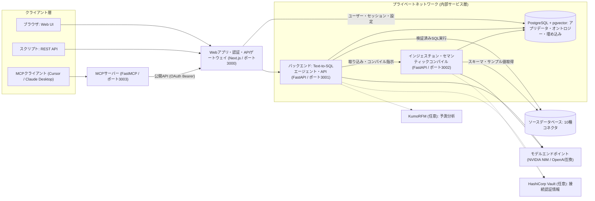

# **Auto Ontology 調査レポート**

## **1. 基本情報**

* **ツール名**: Auto Ontology（オート・オントロジー）
* **ツールの読み方**: オート・オントロジー
* **開発元**: NVIDIA
* **公式サイト**: [https://github.com/NVIDIA/auto-ontology](https://github.com/NVIDIA/auto-ontology)
* **関連リンク**:
  * GitHub: [https://github.com/NVIDIA/auto-ontology](https://github.com/NVIDIA/auto-ontology)
  * 関連評価ツール（GitHub）: [https://github.com/NVIDIA/auto-ontology-eval](https://github.com/NVIDIA/auto-ontology-eval)
  * レビューサイト: G2、Capterra、ITreviewに単独製品としてのレビュー登録なし（GitHub・Reddit・Hacker News等で技術的評価が活発）
* **カテゴリ**: データ分析
* **概要**: NVIDIAが開発した、エンタープライズデータ上にグラフベースの意味層（セマンティック・リーズニング層）を自動構築するPythonベースのオープンソースフレームワーク。データベースのスキーマやクエリ履歴からビジネス用語・SQL属性・テーブル結合関係を抽出してオントロジーを生成し、人間のレビュー・認証を経て、MCP（Model Context Protocol）やREST API、Web UIを通じてLLMやAIエージェントに高精度で説明可能なText-to-SQL基盤を提供する。

## **2. 目的と主な利用シーン**

* **解決する課題**: 企業内のデータベースは複数のシステムに分散しており、略語や暗号的なカラム名、部門ごとに異なるビジネス指標の定義（例：「アクティブ顧客」や「売上」の計算方法の食い違い）、ドキュメント化されていないテーブル結合関係が多く存在する。従来のLLMやText-to-SQLエージェントは構文上正しいSQLを書けても、こうした構造的・業務的コンテキストを欠くため、誤ったカラム参照や結合によるハルシネーション（誤答）を起こす課題があった。Auto Ontologyはメタデータから一貫した意味層を構築・認証することで、この「エージェントの文脈不足」を解消する。
* **想定利用者**: データエンジニア、AIエージェント開発者、データアナリスト、BI/データ基盤運用チーム。
* **利用シーン**:
  * **AIエージェント向けText-to-SQL基盤の構築**: Cursor、Claude Desktop、社内AIエージェントにMCPサーバー経由で企業データベースの正確なクエリ能力を付与する。
  * **エンタープライズ用語集（ビジネスグロッサリー）の自動生成と統合**: 既存DWH（Snowflake、Databricks、PostgreSQL等）のメタデータとクエリ履歴から、統一されたビジネス用語と計算式（SQL属性）を自動抽出し、データスチュワードが認証管理する。
  * **回答可能性チェック（ガードレール）による誤答防止**: データベースに存在しない指標（例：広告費データがない環境でのROAS質問）を尋ねられた際、事前チェックでカバレッジ不足を検知し、推測で数値を捏造せずユーザーに確認・拒否を返す。

### **2.1 代表的な利用フロー**

```mermaid
swimlane-beta TB
  subgraph User["ユーザー / ドメイン専門家"]
    A["DB接続登録・セマンティックコンパイル開始"]
    D["生成された用語・結合・SQL属性をレビュー・認証"]
    E["自然言語で質問を入力 (UI / MCPクライアント)"]
    H["回答・SQL・根拠トレースを確認"]
  end
  subgraph AutoOntology["Auto Ontology (Backend / Ingestion)"]
    B["メタデータ抽出・プロファイリング・埋め込み"]
    C["LLMによる用語・セマンティックFK・SQL属性生成"]
    F["回答可能性チェック・オントロジー検索・SQL生成"]
  end
  subgraph SourceDB["対象データベース / 外部モデル"]
    G["検証済みSQLの実行・結果返却"]
  end
  A --> B
  B --> C
  C --> D
  D --> E
  E --> F
  F --> G
  G --> H
```

* **代表的な流れ**: まずユーザー（データ管理者）が接続先データベースを登録してセマンティックコンパイルを実行すると、Ingestionサービスがメタデータやサンプル値を抽出し、LLMと組み合わせて用語・結合関係・SQL属性のドラフトを生成する。ドメイン専門家がWeb UIやAPIで定義を認証した後、エンドユーザーやMCPクライアントからの自然言語の質問に対して、Auto Ontologyがオントロジーに基づく結合パスと検証済みSQLを生成・実行し、結果と根拠を返却する。

## **3. 主要機能**

* **自動メタデータ取り込みとセマンティックコンパイル**: 10種類のデータベースコネクタからテーブル・カラム・主キー/外部キー・ビュー・クエリ履歴を自動抽出し、SQLによる値プロファイリングとLLM推論を組み合わせて、ビジネス用語（Terms）、SQL属性（SQL Attributes）、セマンティック外部キー（Relationships）を自動生成する。
* **Human-in-the-Loop（人間による認証と編集）**: 自動生成されたオントロジーのドラフトをWeb UIやREST API上で確認・編集し、「認証済み（Certified）」マークを付与できる。編集内容は即座にpgvectorへ再埋め込みされ、次回以降のコンパイルでも保護・維持される。
* **回答可能性チェックとハルシネーション抑止**: MCPツールの `check_answerable` 等を通じ、質問に必要なビジネス用語やカラムがオントロジー内に存在するかを事前評価（カバレッジ判定）する。データが存在しない質問に対しては、誤ったSQLを生成せず明確に回答不可や追加情報の要求を返す。
* **決定論的結合パス探索とSQL自動修復**: 質問からのエンティティ抽出と埋め込み検索の後、オントロジーのセマンティック外部キー上の最短経路を用いて結合パスを決定論的に算出する。生成されたSQLはジャッジステップで検証され、エラーや空結果（フィルタ値のわずかな表記揺れ等）を検知すると最大7回まで自動修復を試みる。
* **Model Context Protocol (MCP) サーバー**: FastMCPベースの読み取り専用MCPサーバー（`auto-ontology-mcp`）を提供し、CursorやClaude DesktopなどのMCPクライアントから自然言語クエリ（`ask_question`）、回答可能性確認（`check_answerable`）、用語検索（`search_terms`）を安全に呼び出せる。
* **PII（個人識別情報）検出とタグ付けルール**: カタログ取り込み時にルールベースおよび推論LLMを用いてPIIカラムを自動検出・タグ付けでき、カスタムのタグ付けルールも設定可能。
* **Ossie YAML形式でのインポート・エクスポート**: 生成・認証したセマンティックモデルを `apache-ossie-nvidia-auto-ontology` コンバータを介してOssie YAML形式で入出力でき、既存のセマンティックモデルとの相互運用性を確保する。
* **KumoRFM連携による予測分析（オプション）**: `KUMO_RFM_API_URL` を設定することで、予測・スコアリングに関する質問をKumoRFMへルーティングし、PQLクエリによる予測結果を返すことができる。
* **Web UI（チャット・分析・データカタログ・オントロジーグラフ）**: Next.js製のWeb UIを備え、自然言語チャット（SQL・実行ステップ・チャート表示付き）、セマンティックグラフの可視化探索、接続管理、SSO・APIトークン管理を一元的に行える。

## **4. 動作原理・システム構成**

* **アーキテクチャ**: フロントエンド（Next.js 16 + Better Auth + Prisma）、バックエンドAPI・Text-to-SQLエージェント（FastAPI + LangGraph）、インジェスチョン・セマンティックコンパイルワーカー（FastAPI）、およびデータストア（PostgreSQL + pgvector）から構成されるマルチサービス・コンテナ型アーキテクチャを採用している。さらに、外部エージェント連携用のMCPサーバー（FastMCP）が公開APIのHTTPクライアントとして動作する。



* **主要コンポーネントとデータフロー**:
  * **Webアプリ / APIゲートウェイ（ポート3000）**: Next.js 16（React 19, TypeScript, Tailwind CSS 4）で構築され、Better Authによるセッション・OAuth・APIトークン認証を一元処理した上で、バックエンド（ポート3001）へユーザーIDを転送する。
  * **バックエンド（ポート3001）**: Python 3.12+ / FastAPI製。LangGraphで構築された固定パイプラインのText-to-SQLエージェントを実行する（質問の意図分類 → エンティティ抽出 → pgvector埋め込み検索とLLMフィルタ → セマンティックFKによる結合パス計算 → 推論モデルによるSQL生成 → SQL検証・自動修復 → 実行と空結果プローブ）。
  * **インジェスチョン・セマンティックコンパイルサービス（ポート3002）**: テーブル単位のパス（1,000行サンプリング、一意性判定、日付フォーマット推論、LLMによるカラム説明・用語抽出）とテーブル横断パス（Term Familyグループ化、実データ照合によるセマンティックFK確定、クエリ履歴やブリッジテーブルからのSQL属性生成）を実行する。
  * **PostgreSQL + pgvector（ポート5432）**: ユーザー・セッション情報（`frontend` スキーマ）、カタログ・オントロジー定義・ベクトル埋め込み（`public` スキーマ）を同一基盤で管理する。
* **特筆すべき要素技術**:
  * **4ロールのモデル構成（Model Triplets）**: `REASONING`（メインのText-to-SQL・コンパイル用推論モデル）、`NON_REASONING`（意図分類・エンティティ抽出・SQL検証用軽量モデル）、`EMBED`（pgvector用埋め込みモデル）、`RERANK`（ブリッジテーブルSQL属性選定用リランカー）の4役割を環境変数で個別に割り当て可能。デフォルトはNVIDIA NIM（`nvidia/nemotron-3.5-lightning-30b-a3b` 等）だが、任意のOpenAI互換エンドポイントを利用できる。
  * **読み取り専用・認証委譲型MCP**: MCPサーバー自体はDB認証情報やモデル設定を持たず、Next.jsのOAuth認可サーバー機能を介してログインしたユーザー本人の権限（RBAC）で公開APIを呼び出す。

## **5. 開始手順・セットアップ**

* **前提条件**:
  * Docker および Docker Compose v2
  * Pythonパッケージマネージャー `uv`（サンプルDB投入やMCPクライアント実行時に使用）
  * NVIDIA APIキー（[NVIDIA API Catalog](https://build.nvidia.com) から取得）またはセルフホストNIM / OpenAI互換エンドポイント
  * GitHubアカウント不要（オープンソースリポジトリをクローンしてローカルまたはKubernetes上に構築）
* **インストール/導入（Docker Composeによるローカル構築）**:

  ```bash
  git clone https://github.com/NVIDIA/auto-ontology.git
  cd auto-ontology
  cp .env.example .env
  ```

* **初期設定（`.env` の必須項目設定）**:
  * `.env` ファイルを開き、APIキーや管理者パスワード、接続先データベースを設定する（機密情報はプレースホルダーを自身の値に置換する）。

  ```dotenv
  DEFAULT_MODELS_API_KEY=<YOUR_NVIDIA_API_KEY>
  AUTH_SECRET=<RANDOM_BASE64_STRING>
  APP_URL=http://localhost:3000
  POSTGRES_PASSWORD=<YOUR_POSTGRES_PASSWORD>
  CONNECTION_STRINGS=postgresql://postgres:<YOUR_POSTGRES_PASSWORD>@postgres:5432/wideworldimporters
  AUTO_ONTOLOGY_ADMIN_PASSWORD=<YOUR_ADMIN_PASSWORD>
  PGADMIN_PASSWORD=<YOUR_PGADMIN_PASSWORD>
  ```

* **クイックスタート**:
  1. PostgreSQLを起動し、`NVIDIA/auto-ontology-eval` のシードスクリプト等でサンプルデータベース（Wide World Importers等）を投入する。
  2. 全スタックをビルド・起動する。

     ```bash
     docker compose up -d --build
     ```

  3. ブラウザで `http://localhost:3000` にアクセスし、`AUTO_ONTOLOGY_ADMIN_EMAIL` と設定したパスワードでサインインする。
  4. **Settings → Semantic Compilation** を有効化すると、インジェスチョンとオントロジー生成が開始される。完了後、**Chat** 画面から自然言語でデータに質問できる。
  5. MCPサーバーをローカルで起動してCursor等と連携する場合は以下を実行する。

     ```bash
     AUTO_ONTOLOGY_API_URL=http://localhost:3000 \
       uvx --from "git+https://github.com/NVIDIA/auto-ontology.git#subdirectory=mcp" auto-ontology-mcp
     ```

## **6. 特徴・強み (Pros)**

* **グラフ構造のセマンティック層による高いText-to-SQL精度と説明可能性**: 単なるテーブルスキーマのダンプをプロンプトに渡す方式と異なり、人間が認証可能な「ビジネス用語」「SQL属性」「実データで検証済みの結合関係」をグラフとして保持するため、結合ミスや指標定義のブレを防ぎ、生成SQLと推論ステップを常に提示できる。
* **MCPネイティブ対応と安全な権限継承**: MCPサーバーがNext.jsのOAuth認可基盤と統合されており、各エージェントのセッションはサインインしたユーザー自身のRBAC権限の範囲内でのみ動作する。生テーブルのブラウズを制限し意味層経由のアクセスに限定する設計により、ガバナンスを保ちやすい。
* **10種類の主要データソースへの広範な接続性**: PostgreSQL、MySQL、Snowflake、Databricks、ClickHouse、Trino、Apache Kyuubi、HeavyDB、DuckDB、SQLiteの10コネクタを標準サポートしており、既存のDWHやデータレイクハウスをそのまま接続できる。
* **評価用ツールキット（`auto-ontology-eval`）による定量的検証**: 姉妹リポジトリとしてBIRD、BEAVER、FDABench-Lite等のベンチマーク上で「スキーマのみ（Control）」と「Auto Ontology利用（Treatment）」を比較できる決定論的評価ハーネスが公開されており、導入効果を自社環境で客観的に測定できる。

## **7. 弱み・注意点 (Cons)**

* **マルチコンテナ構成による導入・運用負荷**: Webフロントエンド、バックエンド、インジェスチョンワーカー、PostgreSQL + pgvector（さらに任意でHashiCorp VaultやMCPサーバー）が連携する構成のため、軽量な単一Pythonライブラリに比べるとメモリ消費や初期構築・ネットワーク分離の運用コストが高い。
* **モデル要件への依存性**: オントロジー生成とSQL生成の品質は、Structured Output（構造化出力）を安定して返せるLLMに大きく依存する。小規模なローカルモデルを使用する場合、外部キー推論やSQL修復の精度が低下する可能性がある。
* **外部コントリビューションの制限**: Apache 2.0のオープンソースとして公開されているものの、公式READMEにて「現在は外部からのプルリクエストを受け付けていない（issueでのバグ報告や連携リクエストのみ受付）」と明記されているため、独自の機能拡張はフォーク管理が必要になる。
* **日本語対応の状況**: Web UIおよび公式ドキュメントはすべて英語で提供されており、日本語ローカライズや日本語の公式サポート窓口はない。ただし、直近のアップデートによりデータベース内の非ASCII（日本語等）テーブル名やラベルの保持、UTF-8 CSV出力には対応している。

## **8. 料金プラン**

Auto Ontology自体はApache 2.0ライセンスの完全オープンソースソフトウェアであり、ソフトウェアライセンス費用は無料である。ただし、推論に使用するLLM・埋め込みモデル（NVIDIA NIM等）や実行インフラのコストが別途発生する。

| プラン / 利用形態 | 料金 | 主な特徴 |
|---------|------|---------|
| **OSSセルフホスト（ローカル / 自社K8s）** | 無料（ソフトウェア利用料） | GitHubからソースまたはNGCコンテナイメージを取得して無償利用可能。全機能（Web UI、MCP、10種コネクタ、SSO）が利用可能 |
| **モデル推論（NVIDIA API Catalog利用時）** | 従量課金（無料枠あり） | `build.nvidia.com` のAPIを利用する場合、NVIDIAのクレジット・従量課金体系に従う（テスト用の無料クレジット枠が提供される場合がある） |
| **モデル推論（セルフホストNIM / OSS LLM利用時）** | インフラ費用のみ | 自社GPUサーバー上のNIMやvLLM等のOpenAI互換エンドポイントを指定すれば、外部API課金なしで利用可能 |

* **課金体系**: ソフトウェア自体は無料（OSS）。実運用コストは、ホスティング用のサーバーリソース（CPU/メモリ、GPUを使用する場合は推論用GPU）および外部LLM APIのトークン消費量に依存する。
* **無料トライアル**: オープンソースのため期間制限なく無償で評価可能。

## **9. 導入実績・事例**

* **導入企業**: 2026年4月にリポジトリが公開（Initial release）された比較的新しいフレームワークであるため、商用製品のような個別企業の導入事例リストは公式サイト上で公開されていない。ただし、公開後約半年でGitHubスター数13,000以上、フォーク数1,000以上を獲得しており、データエンジニアリングおよびAIエージェント開発コミュニティで広く検証・活用されている。
* **導入事例・検証ケース**:
  * **MicrosoftサンプルDB（Wide World Importers）での検証**: 公式クイックスタートにおいて、売上・在庫・顧客などの複数テーブルを横断する自然言語クエリに対し、オントロジー経由で正確なJOINパスを生成し回答するリファレンス実装が提供されている。
  * **学術・業界ベンチマーク（BIRD / BEAVER / FDABench-Lite）での評価**: 関連リポジトリ `NVIDIA/auto-ontology-eval` を用い、生スキーマのみを与えるベースラインと比較してText-to-SQLの実行精度（Execution Accuracy）を定量評価する仕組みがエンタープライズPoCで活用されている。
* **対象業界**: 複雑なRDB・DWHを保有し、社内データアナリストやAIエージェントによるデータ利活用の信頼性向上を目指す金融、小売・EC、SaaS、製造業などのエンタープライズ領域。

## **10. サポート体制**

* **ドキュメント**: GitHubリポジトリ内の `README.md` および `docs/` ディレクトリ（`architecture.md`、`connections.md`、`authentication.md`、`conversation-api.md`、`mcp.md`、`openapi/auto-ontology-api.json`）にアーキテクチャ、API仕様、Kubernetesデプロイ手順（`DEPLOYMENT.md`）が詳細かつ体系的に整備されている（英語のみ）。
* **コミュニティ**: [GitHub Issues](https://github.com/NVIDIA/auto-ontology/issues) を通じてバグ報告およびインテグレーションリクエストを受け付けている。また、Reddit（`r/dataengineering`、`r/LocalLLM`）やHacker Newsでも活発に議論されている。
* **公式サポート**: 無償のOSSプロジェクトであるため、専任の有償サポート窓口（電話・メールSLA等）はリポジトリ上では提供されていない。セキュリティ脆弱性の報告のみ、NVIDIA PSIRTの専用フォームおよびメール（`psirt@nvidia.com`）で受け付けている。

## **11. エコシステムと連携**

### **11.1 API・外部サービス連携**

* **API**: Next.jsゲートウェイ経由でOpenAPI仕様（`docs/openapi/auto-ontology-api.json`）に基づく包括的なREST APIを公開している。質問応答用の `POST /api/chat/completions` はServer-Sent Events（SSE）ストリーミングに対応し、思考ステップ（`step`）、検証済みSQL（`sql`）、最終結果（`result`）、チャート情報（`charts`）を逐次返却する。
* **外部サービス・データソース連携**:
  * **データソース（10種）**: PostgreSQL、MySQL、Snowflake、Databricks、ClickHouse、Trino、Apache Kyuubi、HeavyDB、DuckDB、SQLite
  * **AIモデル基盤**: NVIDIA NIM（NVIDIA API Catalog / セルフホストNIM）、OpenAI APIおよび各種OpenAI互換エンドポイント（vLLM等）
  * **MCPクライアント**: Cursor、Claude Desktop、その他Model Context Protocol対応エージェントハーネス
  * **シークレット管理・予測分析**: HashiCorp Vault（接続認証情報の暗号化保存）、KumoRFM（予測クエリ処理）
  * **認証・SSO**: Better Authを介したOIDC/OAuthベースのSSOプロバイダ

### **11.2 技術スタックとの相性**

| 技術スタック | 相性 | メリット・推奨理由 | 懸念点・注意点 |
|:---|:---:|:---|:---|
| **Python (FastAPI / LangGraph)** | ◎ | バックエンド・インジェスチョンの中核技術であり、コネクタやエージェントパイプラインの理解・拡張が容易 | 外部PRが受け付けられていないため、改変はフォーク管理が必要 |
| **PostgreSQL / pgvector** | ◎ | システム自体のメタデータ・ベクトルストアとして採用されており、ソースDBとしてもフルサポート | ベクトル検索負荷に応じたリソースサイジングが必要 |
| **Snowflake / Databricks** | ◎ | 専用コネクタに加え、Snowflakeの `QUERY_HISTORY` 等からSQL属性を自動抽出する機能に対応 | クラウドDWHへの読み取り権限とネットワーク接続設計が必要 |
| **MCP対応エージェント (Cursor等)** | ◎ | FastMCPサーバーとOAuth認証が標準整備されており、URL設定のみで安全に連携可能 | 本番環境ではOAuthエンドポイント公開とHTTPS設定が必須 |
| **Kubernetes / Docker Compose** | ◎ | 公式の `docker-compose.yml`、Helm Chart、NGC公開コンテナイメージが提供されている | 内部ポート（3001, 3002）をプライベートネットワークに隔離する設定が必要 |

## **12. セキュリティとコンプライアンス**

* **認証**: Better Authを採用し、セルフサービスサインアップは無効化されている（ブートストラップ管理者からのアカウント管理）。WebセッションCookie、SHA-256ハッシュで保護されたAPIトークン（`x-api-key` または `Authorization: Bearer`）、MCPクライアント向けOAuth Bearerトークン、SSO（`Settings → Single Sign-On`）およびRBAC（ロールベースアクセス制御）に対応する。
* **データ管理**:
  * **ネットワーク分離**: ポート3001（バックエンド）および3002（インジェスチョン）は認証を持たない内部サービス設計のため、プライベートネットワーク内に隔離し、ポート3000（Next.jsゲートウェイ）のみを公開する構成が推奨されている。
  * **接続認証情報の保護**: デフォルトでは接続文字列・パスワードがPostgreSQLのカタログ行に平文JSONで保存されるが、HashiCorp Vault（`VAULT_ADDR` 等の4環境変数）を設定することでVault側へ安全に隔離保存できる。
  * **外部データ送信の注意**: 予測分析機能（KumoRFM）を有効化した場合のみ、接続先テーブルデータが外部サービスへ送信されるため、組織のデータレビューが推奨されている。
* **準拠規格**: OSSフレームワークとしてセルフホスト運用されるため、ISO27001やSOC2等の認証は導入組織側のインフラ管理に依存する。脆弱性報告プロセスはNVIDIA PSIRT（Product Security Incident Response Team）のポリシーに準拠している。

## **13. 操作性 (UI/UX) と学習コスト**

* **UI/UX**: Next.js 16とTailwind CSS 4で構築されたモダンなWeb UIを備える。自然言語チャット画面では回答とともに生成されたSQL・実行ステップ（Thoughts）・自動生成チャートが確認でき、オントロジー画面ではビジネス用語・関連テーブル・SQL属性の関係をインタラクティブなグラフで視覚的に探索・認証できる。
* **学習コスト**: Docker Composeを用いたローカル検証の開始までは容易だが、本番運用や高い精度を引き出すには「セマンティック層の設計概念（Terms / SQL Attributes / Semantic FKs）」「4種類のモデル役割（Model Triplets）のチューニング」「VaultやSSO、プライベートネットワーク分離を含むKubernetes運用」の理解が必要となり、学習コストは中〜高程度である。

## **14. ベストプラクティス**

* **効果的な活用法 (Modern Practices)**:
  * **Human-in-the-Loopでの段階的認証**: セマンティックコンパイルが生成したドラフトをそのまま本番投入せず、まず `check_answerable` やChatで主要業務質問をテストし、重要なビジネス指標（売上、解約率等）のSQL属性をドメイン専門家が修正・認証してから全社公開する。
  * **ロール別モデルの最適化（Model Triplets）**: 高精度な推論が必要な `REASONING` には大型の推論モデルを割り当てつつ、エンティティ抽出や構文チェック等の `NON_REASONING` には高速・軽量なモデルを設定することで、回答レイテンシとコストを大幅に削減できる。
  * **本番環境でのHashiCorp Vault有効化**: UIから登録したデータベース接続のパスワードがPostgreSQL内に平文保存されるのを防ぐため、本番デプロイ時は必ずVault連携の4環境変数をすべて設定する。
* **陥りやすい罠 (Antipatterns)**:
  * **インジェスチョン時とクエリ時の埋め込みモデル不一致**: `EMBED_MODEL` を変更したにもかかわらず既存のpgvectorインデックスを再構築（再取り込み）しないと、検索精度が著しく低下する。
  * **内部ポートの外部公開**: FastAPIバックエンド（3001）やインジェスチョンサービス（3002）はNext.jsゲートウェイ（3000）からの認証済み転送を信頼する設計のため、これらを直接インターネットや外部ネットワークに公開すると重大なセキュリティリスクとなる。
  * **`CONNECTION_STRINGS` とUI登録の混在**: 環境変数とUI接続の優先順位が「質問応答」と「インジェスチョン」で異なるため、1つのデプロイメントではどちらか一方の接続管理方式に統一することが推奨されている。

## **15. ユーザーの声（レビュー分析）**

* **調査対象**: Hacker News、Reddit（`r/dataengineering`、`r/LocalLLM`、`r/OpenSourceAI`）、GitHubコミュニティ（G2・Capterra・ITreviewには単独製品の登録なし）
* **総合評価**: 定量スコアの集計サイト登録はないが、GitHub上でのスター数13,000超と活発なコミュニティ議論により、エージェント時代のデータ基盤ツールとして高い注目を集めている。
* **ポジティブな評価**:
  * **ホワイトボックス型のアプローチ**: 「不透明なプロンプトエンジニアリングと異なり、オントロジーによって依存関係が明示されるため、エージェントが失敗した際にどの用語定義や結合パスが原因かを特定しやすい」（Hacker News / Redditより要約）
  * **回答可能性チェックによるガードレール**: 「データに存在しない指標を尋ねられた際、ハルシネーションで数値を捏造せず、カバレッジ不足を検知して明確に確認・拒否できる仕組みがエンタープライズ利用において非常に実用的」（Redditより要約）
  * **組織的なデータガバナンスの促進**: 「部門ごとに曖昧だったビジネス指標を、AI活用を契機に定義・認証するワークフローが組み込まれている点が良い」（Reddit `r/dataengineering` より要約）
* **ネガティブな評価 / 改善要望**:
  * **既存セマンティック層ツールとの重複感**: 「OpenMetadataやdbt Semantic Layer、Cubeといった既存のメタデータ管理・セマンティック層ツールと概念が重複しており、すでに整備されたデータチームには過剰設計に感じられる場合がある」（Reddit `r/dataengineering` より要約）
  * **初期セットアップとローカルLLMのハードル**: 「デフォルトがNVIDIAホストのNIM前提になっており、ローカルLLMで動かす場合は構造化出力（Structured Output）を安定して返せるモデル選定や環境変数の調整に手間がかかる」（Redditより要約）
  * **運用インフラの重さ**: 「単体の軽量ツールではなくWebアプリ・複数のFastAPIサービス・Postgres/pgvectorを動かす必要があるため、小規模な検証には構成が大きい」（開発者レビューより要約）
* **特徴的なユースケース**:
  * **MCP経由での開発・分析ワークフロー統合**: CursorやClaude DesktopなどのIDE/デスクトップエージェントから直接社内DBのビジネス定義を確認しながら、安全に集計クエリを実行する用途での利用が報告されている。

## **16. 直近半年のアップデート情報**

NVIDIA Auto Ontologyは2026年4月末の公開以降、極めて高い頻度でアップデートが行われている（直近6ヶ月の主要な変更履歴を降順に記載）。

* **2026-11-15**: 自己参照型（Self-referencing）のセマンティック外部キーに対応し、同一テーブル内の階層構造等の結合精度を向上。
* **2026-11-14**: アーキテクチャ図を保守性の高いMermaidパイプライン図へ刷新。また、SQLiteの生成カラム・大文字小文字不一致の外部キー解決改善、非ASCIIテーブル名・ラベルのセマンティック用語名保持、非ASCIIチャートタイトルのUTF-8 CSVダウンロード対応を実施。
* **2026-11-13**: PostgreSQLの `pg_constraint` を用いたクロススキーマ外部キーの解決に対応。同日、セマンティック層の機能強化（Semantic layer enhancements）をマージ。
* **2026-11-09**: コミュニティ運営方針として `CODE_OF_CONDUCT.md` を追加。
* **2026-11-06**: バックエンドおよびMCPコンテナイメージのPythonバージョンを `3.12.16` に固定し、ビルドの安定性を向上。

(出典: [GitHub コミット履歴](https://github.com/NVIDIA/auto-ontology/commits/main))

## **17. 類似ツールとの比較**

### **17.1 機能比較表 (星取表)**

| 機能カテゴリ | 機能項目 | Auto Ontology | Wren AI | Vanna.AI | dbt Semantic Layer | Cube |
|:---:|:---|:---:|:---:|:---:|:---:|:---:|
| **基本機能** | Text-to-SQL / 自然言語分析 | ◎<br><small>グラフ意味層+自動修復</small> | ◎<br><small>MDL基盤で高精度</small> | ◎<br><small>RAGベースSQL生成</small> | △<br><small>主に外部BI/AI連携</small> | △<br><small>AI API/MCP連携中心</small> |
| **オントロジー** | メタデータからの自動生成 | ◎<br><small>LLM+値プロファイルで自動構築</small> | ◯<br><small>AIモデリング支援あり</small> | △<br><small>DDL/クエリ学習型</small> | ×<br><small>YAML手動定義が基本</small> | ×<br><small>コードベース手動定義</small> |
| **ガバナンス** | 人間による認証・編集UI | ◎<br><small>Web UI上で編集・認証</small> | ◎<br><small>モデリングUI完備</small> | △<br><small>コード/簡易UI中心</small> | ◯<br><small>Git/dbt Cloud管理</small> | ◯<br><small>Cube Cloud/コード管理</small> |
| **エージェント連携** | MCPサーバー標準対応 | ◎<br><small>OAuth連携FastMCP内蔵</small> | ◯<br><small>MCP対応</small> | △<br><small>カスタム実装が必要</small> | ◯<br><small>MCP連携提供</small> | ◯<br><small>MCP/AI API提供</small> |
| **安全性** | 回答可能性チェック・拒否機構 | ◎<br><small>カバレッジ判定で誤答防止</small> | ◯<br><small>構造化検証あり</small> | △<br><small>モデル依存</small> | ◯<br><small>定義外指標はエラー</small> | ◯<br><small>定義外指標は実行不可</small> |
| **非機能要件** | 日本語UI・ドキュメント | △<br><small>英語のみ(非ASCII DB名対応)</small> | △<br><small>英語中心</small> | △<br><small>英語中心</small> | △<br><small>英語中心(コミュニティ記事多)</small> | △<br><small>英語中心</small> |

### **17.2 詳細比較**

| ツール名 | 特徴 | 強み | 弱み | 選択肢となるケース |
|---------|------|------|------|------------------|
| **Auto Ontology** | メタデータからグラフ意味層を自動生成し、MCPやUIで提供するNVIDIA製OSS | セマンティックFKの自動推論・実データ検証、回答可能性チェック、OAuth連携MCPサーバー | マルチコンテナ構成で運用がやや重い、外部PR非受付 | 複雑なDBを持つ組織で、ハルシネーションを抑えたAIエージェント向けText-to-SQL基盤を内製・セルフホストしたい場合 |
| **Wren AI** | MDL（Modeling Definition Language）を用いたOSSのGenBIプラットフォーム | UI/UXが洗練されており、スプレッドシートやチャート生成、多様なLLM接続が容易 | エンタープライズ向けの厳密なOAuth/Vault連携や自動オントロジー認証フローは限定的 | BIツール代替として、非エンジニアでも使える直感的な自然言語データ分析環境を素早く立ち上げたい場合 |
| **Vanna.AI** | RAG（ベクトルDB）を用いてDDLや過去SQLを学習しSQLを生成するPythonライブラリ | Pythonライブラリとして極めて軽量で、既存アプリへ数行で組み込みやすい | テーブル結合やビジネス用語の意味構造（オントロジー）を体系的に管理・認証する機能が弱い | 既存Pythonアプリに軽量なText-to-SQL機能を素早く組み込みたい場合 |
| **dbt Semantic Layer** | MetricFlowを基盤とし、dbtプロジェクト上で指標を一元定義するセマンティック層 | dbtの変換パイプラインと完全に統合され、バージョン管理・CI/CDとの親和性が極めて高い | オントロジーの自動生成機能はなく、YAMLでの手動モデリングが前提 | すでにdbtでデータ変換基盤を構築済みで、BIやAIへ一貫した指標定義を提供したい場合 |
| **Cube** | ヘッドレスBIとして機能するユニバーサルセマンティック層プラットフォーム | キャッシュ・事前集計による高速なクエリ性能と、GraphQL/REST/SQL/MCPの豊富なAPI | 初期のスキーマ・データモデル定義を手動でコード記述する必要がある | 大規模トラフィックに耐える高速なキャッシュ付きセマンティックAPI基盤を構築したい場合 |

## **18. 総評**

* **総合的な評価**:
  * Auto Ontologyは、単なる「LLMにスキーマを渡してSQLを書かせる」アプローチの限界を正面から解決する、極めて完成度の高いエンタープライズ向けオープンソースフレームワークである。メタデータとクエリ履歴からの自動オントロジー構築、実データに基づく結合関係の確認、人間による認証（Human-in-the-Loop）、そしてOAuth認可と連動したMCPサーバーの提供までが一貫して設計されている。マルチサービス構成の導入負荷や英語中心のUIといったハードルはあるものの、AIエージェントのデータ活用における「正確性・説明可能性・ガバナンス」を重視する現場において非常に高い価値を提供する。
* **推奨されるチームやプロジェクト**:
  * CursorやClaude Desktop、自社開発のAIエージェントに、社内DWH（Snowflake、Databricks、PostgreSQL等）の正確なクエリ能力を安全に付与したいAI/データ基盤チーム。
  * 部門間で指標定義が分散しており、メタデータからの自動ドラフト生成を起点にビジネスグロッサリーとセマンティック層を整備したいエンタープライズ組織。
* **選択時のポイント**:
  * すでにdbtで変換・指標定義が完結している場合は **dbt Semantic Layer**、軽量なPython組み込みを優先する場合は **Vanna.AI**、BI代替の使いやすさを重視する場合は **Wren AI** が適している。一方で、**「未整理の企業DBから意味層を自動構築し、回答可能性ガードレールとOAuth付きMCPで安全にエージェントへ開放したい」** という要件であれば、Auto Ontologyが最有力な選択肢となる。
