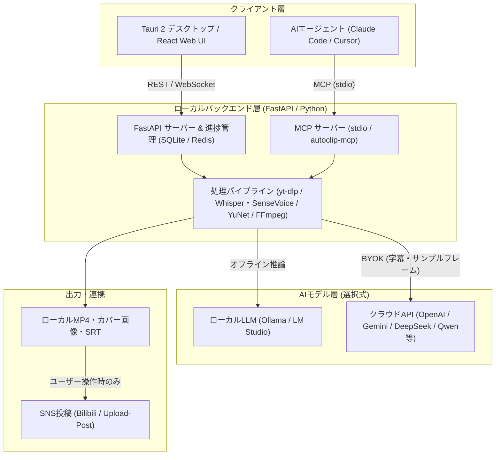

# **AutoClip 調査レポート**

## **1. 基本情報**

* **ツール名**: AutoClip
* **ツールの読み方**: オートクリップ
* **開発元**: zhouxiaoka（個人開発者・OSSメンテナー）
* **公式サイト**: [https://zhouxiaoka.github.io/autoclip_intro/](https://zhouxiaoka.github.io/autoclip_intro/)
* **関連リンク**:
  * GitHub: [https://github.com/zhouxiaoka/autoclip](https://github.com/zhouxiaoka/autoclip)
  * ドキュメント（MCP日本語ガイド）: [https://github.com/zhouxiaoka/autoclip/blob/main/docs/MCP.ja.md](https://github.com/zhouxiaoka/autoclip/blob/main/docs/MCP.ja.md)
* **カテゴリ**: 動画編集
* **概要**: AutoClipは、ポッドキャスト・インタビュー・講義・ゲーム配信などの長尺動画やURL、ライブ配信リプレイからAIが自動でハイライトを抽出し、ショート動画（TikTok、YouTube Shorts、Instagram Reels、抖音、小紅書、Bilibili等向け）へ変換するオープンソースのローカルファースト動画クリッピングツールである。「オープンソースのOpusClip代替」を掲げており、動画の切り抜き・話者トラッキング・字幕焼き込み・表紙（カバー）生成・投稿文作成までをサブスクリプション不要でローカルマシン上で実行できるほか、MCP（Model Context Protocol）サーバーやCLIを標準搭載している。

## **2. 目的と主な利用シーン**

* **解決する課題**: 商用クラウド型クリッピングサービス（OpusClipなど）に伴う月額サブスクリプション費用やクレジット消費の制約、大容量の生動画ファイルを外部クラウドへアップロードする際のプライバシー・待機時間リスク、さらに長尺配信やポッドキャストから手作業でショート動画を切り出す膨大な編集工数を解消する。
* **想定利用者**:
  * ポッドキャスト、インタビュー番組、オンライン講座を複数SNS向けにマルチ展開したい動画クリエイター・マーケティング担当者
  * OBS Studio、Twitch、YouTube、Kickなどでゲーム配信や雑談配信を行い、配信直後にハイライトを切り抜きたいストリーマー
  * Claude Code、Cursor、WindsurfなどのAIコーディングエージェントから動画切り抜きパイプラインを自動呼び出ししたい開発者
* **利用シーン**:
  * **長尺インタビュー・ポッドキャストのショート化**: YouTubeやBilibiliのURL、またはローカルの録画ファイルとSRT字幕を入力し、9:16縦型レイアウト・話者自動追従（リフレーミング）・焼き込み字幕付きのクリップを複数本一括生成する。
  * **ライブ配信終了直後の自動ハイライト生成**: OBS StudioのWebSocket（ポート4455）と連携し、配信停止と同時に無劣化トリム（`-c copy`）およびクリップ生成キューを自動起動してSNS投稿準備を完了させる。
  * **AIエージェント経由のバッチ動画処理**: `uvx autoclip-mcp` でMCPサーバーを起動し、エージェントからの指示で長尺動画の解析・プラットフォーム別レンダリング・投稿キットのエクスポートを非同期実行する。

### **2.1 代表的な利用フロー**

```mermaid
swimlane-beta TB
  subgraph User["ユーザー"]
    A["動画ファイル・URL・配信リプレイを指定"]
    E["生成されたクリップ・字幕・表紙を確認し公開"]
  end
  subgraph AutoClip["AutoClip (ローカル環境)"]
    B["音声文字起こし (Whisper/SenseVoice) とタイムライン解析"]
    D["FFmpegによる9:16リフレーミング・字幕焼き込み・書き出し"]
  end
  subgraph External["AIモデル / 外部サービス"]
    C["LLMによるハイライト抽出・スコアリング・投稿文生成"]
  end
  A --> B
  B -->|"字幕・テキスト送信 (ローカルLLM時は外部送信なし)"| C
  C -->|"抽出区間・タイトル・キャプション返却"| D
  D --> E
```

* **代表的な流れ**: ユーザーがローカル動画・URL・OBS/Twitch等の配信ソースをAutoClipに渡すと、ローカル環境で文字起こし（または既存字幕の読み込み）と必要に応じたフレーム抽出が行われる。抽出されたテキスト（および視覚解析有効時のサンプルフレーム）がLLM（クラウドAPIまたはOllama/LM Studio）で評価されてハイライト区間と投稿メタデータが決定され、最後にローカルのFFmpegが話者追従クロップや字幕焼き込みを行って完成クリップを出力する。

## **3. 主要機能**

* **AIハイライト抽出・スコアリング**: LLMを用いて文字起こしテキストや視覚情報から見どころ（トピックのまとまりや盛り上がり）を自動検出し、スコア付けして複数のショートクリップ候補を提案する。
* **スマートリフレーミング・話者トラッキング**: 16:9等の横長動画をTikTok/Reels/Shorts向けの9:16縦型へ自動変換し、OpenCVのYuNet顔検出等を用いて話者の顔を自動追従する（ポッドキャスト、インタビュー、ニュース、シネマ、ゲーム分屏などのテンプレートに対応）。
* **音声文字起こし（ローカル / クラウド両対応）**: 既存の`.srt`字幕のインポートに加え、ローカル環境でのWhisper / SenseVoice（FunASR）によるオフライン文字起こし、およびAlibaba Cloud Bailian（`qwen-audio-3.1-asr-flash`等）を用いたクラウド文字起こしに対応している。
* **ライブ配信リプレイ連携（v1.6）**: OBS Studio（WebSocket自動キャプチャ）、Twitch、YouTube、Kick、Discord、ローカル録画の6ソースに対応する専用「Live Replay」タブを備え、Twitch/YouTubeの過去配信の直接インポートや、8秒以上の短尺ゲームハイライト検出に対応する。
* **字幕焼き込み・ラウドネス正規化**: 多言語（日本語仮名の全角幅計算やアラビア語RTLを含む）に対応した読みやすい改行位置での字幕焼き込みと、`-14 LUFS`基準の2パスラウドネス正規化による音声出力を提供する。
* **表紙（カバー）生成・投稿文作成・ワンクリック書き出し**: AI画像生成モデル連携またはローカルフレーム合成による表紙生成、各SNS向けの投稿タイトル・キャプション自動生成、およびBilibili / Upload-Post連携による投稿機能を備える。
* **パッケージテンプレートとレンダリング再開（v1.6.2）**: 組み込みテンプレートおよび`.zip`形式のカスタムコミュニティテンプレート（ゲーム用PiP等）のインポート・ホバープレビューに対応し、処理中断時も完了済みクリップを保持したまま未完了分のみを再開できる。
* **Built-in CLI & MCPサーバー**: Pythonパッケージ`autoclip-mcp`としてCLI（`autoclip`）およびMCPサーバー（`autoclip-mcp`）を提供し、Claude CodeやCursor等のAIエージェントから非同期ジョブの開始・進捗取得・キャンセルが可能。

## **4. 動作原理・システム構成**

* **アーキテクチャ**: ローカルファーストのクライアント・サーバー構成（デスクトップ版はTauri 2製のネイティブシェルがPython/FastAPIバックエンドをサイドカーとして管理し、Web/セルフホスト版はDocker Compose上でFrontend + FastAPI + Celery Worker + Redisを構成する）。
* **主要コンポーネントとデータフロー**:
  * **フロントエンド（React 18 + TypeScript + Ant Design + Tailwind CSS）**: Viteでビルドされ、Tauri WebViewまたはブラウザ（ポート3000）上で動作し、WebSocket/REST経由でバックエンドと通信する。
  * **バックエンドAPI & タスク実行（FastAPI + SQLAlchemy / SQLite + Celery）**: プロジェクト・ジョブ状態をSQLite（`autoclip.db`）で管理し、動画ダウンロード（`yt-dlp`）、文字起こし、LLM解析、FFmpegレンダリングのパイプラインを実行する。
  * **デスクトップランチャー（Rust / Tauri 2）**: システムトレイ常駐、単一インスタンス制御、OSスリープ抑止（`power.rs`）、シャットダウン保護、自動アップデータを担い、ポータブルPythonとFFmpegを同梱して起動する。
  * **MCPサーバー（`backend/mcp_server.py`）**: `stdio`トランスポートで動作する公式MCPサーバー（`io.github.zhouxiaoka/autoclip-mcp`）として、デスクトップ設定や環境変数`AUTOCLIP_API_KEY`を参照しながら同一のローカルパイプラインを実行する。
* **特筆すべき要素技術**:
  * **ローカルメディア処理基盤**: `yt-dlp`（動画取得）、`FFmpeg`（無劣化カット・クロップ・字幕合成・音声正規化）、`webrtcvad`（音声区間検出）、`YuNet` ONNXモデル（軽量な顔・話者位置検出）。
  * **ローカルAI推論連携**: Ollama（デフォルト`http://localhost:11434/v1`）やLM Studio（`http://localhost:1234/v1`）とOpenAI互換APIで接続でき、ローカルWhisper / SenseVoiceと組み合わせることで完全オフラインで完結する。



## **5. 開始手順・セットアップ**

* **前提条件**:
  * **デスクトップ版（推奨・最も簡単）**: Apple Silicon搭載macOS（Mシリーズ）またはWindows 10/11 x64（ポータブルPythonおよびFFmpegがインストーラーに同梱済み）。アカウント登録やクレジットカード登録は不要。
  * **CLI / MCP / Docker版**: Python 3.10+（3.11推奨）、`uv`、`FFmpeg`（Docker利用時はDocker & Compose v2）。Intel MacやLinux環境ではDockerまたはCLI/MCPを使用する。
* **インストール/導入**:
  * デスクトップ版は [GitHub Releases](https://github.com/zhouxiaoka/autoclip/releases/latest) から `aarch64.dmg`（macOS）または `x64-setup.exe`（Windows）をダウンロードしてインストールする。
  * CLI / MCP版は以下のコマンドで導入できる。

  ```bash
  # AIエージェント向けMCPサーバー（uvxで即時起動）
  uvx autoclip-mcp

  # Claude Codeへの登録例
  claude mcp add autoclip -- uvx autoclip-mcp

  # Agent Skillの導入
  npx skills add zhouxiaoka/autoclip
  ```

  * Docker（Web版セルフホスト）の起動例:

  ```bash
  git clone https://github.com/zhouxiaoka/autoclip.git
  cd autoclip
  cp env.example .env
  mkdir -p data logs uploads
  docker compose up -d --build
  ```

* **初期設定**:
  * 初回起動後、「Settings」から使用するAIプロバイダー（OpenAI、Gemini、DeepSeek、Qwen/Bailian、Kimi、GLM、Grok、OpenRouter等のクラウドAPIキー、またはローカルのOllama / LM Studio）を設定し、接続テストを行って保存する。
  * APIキーなしで動作確認したい場合は、ホーム画面の組み込みサンプルプロジェクト機能（`source.mp4` と `source.srt` を同梱）を利用できる。
* **クイックスタート**:
  * デスクトップUIでは動画リンクの貼り付け、ローカルファイルのドロップ、または「Live Replay」タブからソースを選びプラットフォームを選択して「Generate」をクリックする。
  * CLIでの動作確認コマンド例:

  ```bash
  autoclip --version
  autoclip doctor --provider ollama
  autoclip produce talk.mp4 --srt talk.srt --platform tiktok --portrait-style podcast --json
  ```

## **6. 特徴・強み (Pros)**

* **完全無料・OSS（MITライセンス）でサブスク不要**: OpusClip等の商用SaaSと異なり、月額課金や分数クレジットの制限がなく、手元のマシン性能を活かして無制限に切り抜き・レンダリングを実行できる。
* **プライバシー重視のローカルファースト設計**: 動画のカットやFFmpegレンダリングはすべてローカルで実行され、クラウドモデル利用時も字幕テキストやサンプリングフレームのみが直接プロバイダーへ送信される。Ollama / LM StudioとWhisper / SenseVoiceを併用すれば完全オフライン動作も可能。
* **多機能なAIエージェント統合（MCP & Agent Skill）**: 単なるGUIアプリにとどまらず、PyPIパッケージ`autoclip-mcp`およびMCP Registry対応のサーバーを標準提供しており、Claude CodeやCursorなどから動画編集パイプラインをプログラマブルに自動化できる。
* **ライブ配信者・グローバルクリエイター向けの充実した対応**: v1.6系でOBS WebSocket自動キャプチャやTwitch/YouTube/Kick等の6ソース連携を実現し、さらにUI・ドキュメントともに13言語（日本語含む）に対応している。

## **7. 弱み・注意点 (Cons)**

* **デスクトップインストーラーのコード署名・公証が未対応**: Windows版・macOS版ともにコード署名証明書およびApple公証（Notarization）が未取得であるため、初回起動時にWindows SmartScreenやmacOS Gatekeeperの警告が表示される（回避手順や`build-provenance.json`のSHA-256検証手順が公式案内されている）。
* **デスクトップ版の対応OSが限定されている**: ネイティブインストーラーはApple Silicon macOSとWindows x64のみ提供されており、Intel MacおよびLinuxデスクトップではDockerまたはCLI/MCP経由での利用が必要となる。
* **日本語対応とサポート体制**: UIとMCPガイド等は日本語化されているものの、一部の詳細ドキュメント（インストールガイドやFAQ詳細など）は英語・中国語中心である。また、個人開発者によるメンテナンスのため、リアルタイムサポートや1対1の導入支援は提供されない。
* **クラウドAPI利用時の従量課金とローカル処理のハードウェア負荷**: クラウドLLMやクラウド音声認識を利用する場合はユーザー自身のAPI利用料が発生する。逆に完全ローカルでWhisperやOllamaを動かす場合は、相応のメモリ・GPU/CPUリソースと処理時間が必要になる。

## **8. 料金プラン**

| プラン名 | 料金 | 主な特徴 |
|---------|------|---------|
| **AutoClip 本体 (MIT License)** | 無料 | デスクトップ版・CLI・MCP・Dockerすべての機能が利用可能、透かし（ウォーターマーク）なし、クリップ数無制限 |
| **クラウドLLM / ASR利用時（任意）** | 従量課金（各APIプロバイダーの料金） | OpenAI、Gemini、DeepSeek、Alibaba Cloud Bailian等のAPIキーを設定した場合のみ、各社へ直接支払いが発生（例: 公式ベンチマークでは1時間43分の動画でLLMコスト約0.09元程度） |
| **ローカルAI構成（任意）** | 無料 | Ollama / LM Studio + ローカルWhisper / SenseVoiceを使用する場合、API課金なしで完全無料実行が可能 |

* **課金体系**: ソフトウェア自体は完全無料（OSS）。外部クラウドAPI（LLM・画像生成・クラウドASR・Upload-Post等）を接続した場合のみ、ユーザー契約の外部サービス側で従量課金または各サービスのプラン制限が適用される。
* **無料トライアル**: ソフト自体が無料であり、APIキー設定前でもアプリ同梱のサンプル動画を用いて試用できる。

## **9. 導入実績・事例**

* **導入企業**: 公式リポジトリ上での具体的な法人導入企業の公表は確認されていない（個人クリエイター、ポッドキャスター、配信者、AI開発者を中心に利用が広がっている）。
* **導入事例**: 公式ShowcaseおよびREADMEにて、Bill Gates、Sam Altman、Jensen Huang、Andrej Karpathy、MrBeastらの長尺インタビューやポッドキャストを素材とした1分前後のショート動画生成例（Douyin、YouTube Shorts、TikTok、Xiaohongshu、Bilibili向け）が16本以上公開されている。また、公式ベンチマークとしてApple Silicon Mac環境で1時間43分の英語インタビュー（既存字幕あり）から10本のクリップを7.5分で生成した実績が報告されている。
* **対象業界**: メディア・コンテンツ制作、ポッドキャスト配信、オンライン教育・講義アーカイブ、eスポーツ・ゲームストリーミング、個人クリエイターエコノミー。

## **10. サポート体制**

* **ドキュメント**: 公式GitHubリポジトリ内の `docs/` 配下に、インストールガイド、Dockerガイド、FAQ、プライバシーポリシー、および13言語対応のREADMEとMCPガイド（[日本語MCPガイド](https://github.com/zhouxiaoka/autoclip/blob/main/docs/MCP.ja.md)含む）が整備されている。
* **コミュニティ**: [GitHub Discussions](https://github.com/zhouxiaoka/autoclip/discussions)（初回クリップQ&A `#128`、機能アイデア `#129`、ショーケース等）および [GitHub Issues](https://github.com/zhouxiaoka/autoclip/issues) が活発に運用されている。
* **公式サポート**: 個人開発者による非同期サポート（GitHub Issues / Discussions、および連絡用メール `christine_zhouye@163.com`）。ライブサポートや個別環境構築支援は行われていない。

## **11. エコシステムと連携**

### **11.1 API・外部サービス連携**

* **API / MCP**: Docker/Web版またはローカルバックエンド起動時にFastAPIによるREST API（`http://localhost:8000/docs` でOpenAPI仕様を参照可能）およびWebSocket進捗通知を提供するほか、標準MCPサーバー（`autoclip-mcp`）とCLI（`autoclip`）を備える。
* **外部サービス連携**:
  * **LLMプロバイダー**: OpenAI、Google Gemini、DeepSeek、Alibaba Cloud Bailian（Qwen）、Doubao Seed、Kimi、GLM、Grok、OpenRouter、SiliconFlow、APIMart、その他OpenAI互換カスタムエンドポイント、Ollama、LM Studio
  * **動画入力ソース**: YouTube、Bilibili、Twitch、Kick、Discord、OBS Studio（WebSocket 4455）、ローカル動画ファイル（`yt-dlp`対応サイト全般）
  * **音声認識**: Whisper（ローカル / `faster-whisper` / `mlx-whisper`）、SenseVoice（FunASR）、Alibaba Cloud Bailian ASR
  * **投稿・配信先**: Bilibili直接投稿、Upload-Post（TikTok、YouTube Shorts、Instagram等へのマルチ投稿連携）
  * **AIエージェント**: Claude Code、Cursor、Windsurf、Codex、OpenCode（`npx skills add zhouxiaoka/autoclip`対応）

### **11.2 技術スタックとの相性**

| 技術スタック | 相性 | メリット・推奨理由 | 懸念点・注意点 |
|:---|:---:|:---|:---|
| **Python 3.10 / 3.11 + uv** | ◎ | コアCLI・MCPサーバー（`autoclip-mcp`）がPyPIで提供され、`uvx`で即座に実行可能 | システムにFFmpegの事前インストールが必要 |
| **MCP対応AIエージェント (Claude Code / Cursor)** | ◎ | 公式MCPサーバーとAgent Skill（`SKILL.md`）を標準提供し、非同期ジョブ制御が可能 | 長時間動画の文字起こし時はタイムアウト・完了ポーリング設計に留意 |
| **Docker / Linuxサーバー** | ◯ | `docker-compose.yml` が用意され、FastAPI + Celery + Redis構成を容易にセルフホスト可能 | ホスト側のOllama等へ接続する場合はネットワーク設定（`host.docker.internal`等）が必要 |
| **Apple Silicon macOS / Windows x64** | ◯ | ポータブルPythonとFFmpegを同梱したTauri 2デスクトップインストーラーを利用可能 | コード署名未対応のため初回起動時にOSセキュリティ警告の手動許可が必要 |
| **Intel Mac / ブラウザ単体環境** | △ | デスクトップインストーラーが提供されていないため、DockerまたはCLI構成が必要 | ブラウザ単体（SaaS）としては提供されておらずローカル実行環境が必須 |

## **12. セキュリティとコンプライアンス**

* **認証**: デスクトップアプリおよびデフォルトのDocker構成はローカルマシンまたは信頼されたネットワークでの利用を想定しており、アプリ独自のログイン認証機能は搭載していない（パブリック公開時はリバースプロキシでの認証・TLS設定が公式推奨されている）。サードパーティのAPIキー（`AUTOCLIP_API_KEY`等）はローカルデバイス内にのみ保存され、開発者サーバーへは送信されない。
* **データ管理**: 動画のカット・レンダリング・プロジェクトファイルはすべてローカル端末に保存される。クラウドLLM利用時は字幕テキスト（および視覚解析有効時のサンプルフレーム）のみがユーザーが選択したプロバイダーへ直接送信される。なお、製品改善のための匿名利用統計（PostHog）およびクラッシュレポート（Sentry、`send_default_pii`は無効）がデフォルトで有効になっているが、設定画面（Settings → App）からいつでもオプトアウトできる（映像・字幕・APIキーは送信対象外）。
* **準拠規格**: SOC 2やISO 27001等の第三者セキュリティ認証の取得は公開されていない（MITライセンスのOSSであり、`SECURITY.md`および`PRIVACY.en.md`にてPIPL等を参考にしたデータ取り扱い方針が公開されている）。

## **13. 操作性 (UI/UX) と学習コスト**

* **UI/UX**: Ant Designベースのクリーンな3タブ構成（「Link」「File」「Live Replay」）を採用し、URL貼り付けやファイルドロップからプラットフォーム選択・生成まで直感的に操作できる。処理中は段階別の進捗バーと推定残り時間が表示され、生成後は統一されたカードUIでプレビュー再生・字幕/タイトル編集・プラットフォーム切り替え再生成・ダウンロードを行える。
* **学習コスト**: デスクトップアプリは環境構築不要（Python/FFmpeg同梱）でサンプルプロジェクトも内蔵しているため、初期導入のハードルは低い。ただし、高品質なクリップを得るためのLLMプロバイダー選定・APIキー取得、あるいは完全オフライン構成（Ollama/LM Studioのコンテキスト長16384以上への設定、Whisperモデルダウンロード）を行う際には一定の技術的知識が求められる。

## **14. ベストプラクティス**

* **効果的な活用法 (Modern Practices)**:
  * **既存SRT字幕の活用による高速化**: YouTube等から正確な字幕が取得できる場合や手元に`.srt`ファイルがある場合はそれを優先利用することで、ローカル文字起こしの時間を大幅に短縮できる。
  * **長尺ローカル動画の時間制限・プリセット活用**: 30分以上の長尺動画でローカル文字起こしを行う場合は、v1.6.2で追加された「最初の30分のみ処理」オプションやクラウドASR（Bailian等）を適宜使い分けることでタイムアウトを回避できる。
  * **Ollama / LM Studio利用時のコンテキスト長設定**: ローカルLLMで長尺動画の字幕を解析する場合は、`OLLAMA_CONTEXT_LENGTH`（`num_ctx`）またはLM StudioのContext Lengthを`16384`以上に設定することが公式推奨されている。
* **陥りやすい罠 (Antipatterns)**:
  * **視覚解析の無自覚な有効化によるAPIコスト増**: ゲーム配信等の画面主体コンテンツ向けにマルチモーダルモデル（視覚解析）を有効にするとサンプルフレームが送信されトークン消費が増えるため、トーク主体動画ではデフォルトの字幕解析ルートを維持するのが望ましい。
  * **Docker公開時の無防備なポート露出**: `docker-compose.yml`をそのままインターネット公開環境にデプロイすると、認証なしでRedisやバックエンドAPIが露出するリスクがあるため、必ずTLSとアクセス制御を前段に配置する。

## **15. ユーザーの声（レビュー分析）**

* **調査対象**: GitHub（Stars / Discussions / Issues）、Reddit（`r/editing`, `r/podcasting`, `r/opusclip`等の関連コミュニティ議論）、テックブログ・紹介記事
* **総合評価**: GitHub Stars 16,900超（2026年11月時点、G2/Capterra等のBtoB SaaSレビューサイトにはOSSデスクトップツールのため未掲載）
* **ポジティブな評価**:
  * 「OpusClipなどの月額サブスク（月29ドル等）を払い続ける必要がなくなり、自分のAPIキーやローカルモデルで1本あたり数円レベル（または無料）で切り抜きを作れる点が画期的」
  * 「大容量の生動画をクラウドにアップロードする待ち時間やプライバシーの懸念がなく、ローカルマシンで完結して動作する」
  * 「MCPサーバーとしてClaude CodeやCursorから直接動画クリッピングを呼び出せるため、制作ワークフローの自動化に非常に便利」
* **ネガティブな評価 / 改善要望**:
  * 「OpusClipのようなブラウザ完結・ゼロ設定の手軽さと比べると、APIキーの準備やローカルモデル設定・OSの未署名アプリ警告への対処など、初回セットアップにやや技術的な手間がかかる」
  * 「長尺動画のローカルWhisper文字起こしはハードウェア性能によって時間がかかり、処理中のメモリ・ディスク消費が大きい」
  * 「デスクトップインストーラーにWindowsコード署名やApple公証がないため、企業端末などでは警告が障壁になりやすい（Issue #119で対応追跡中）」
* **特徴的なユースケース**:
  * ポッドキャストや技術カンファレンス講演のアーカイブから、AIコーディングエージェント（MCP連携）経由で自動的にSNS投稿用ショート動画と投稿文一式を一括生成するパイプライン構築。

## **16. 直近半年のアップデート情報**

* **2026-11-26 (v1.6.2)**: 新たに3種類のショート動画包装テンプレート（`highlight_note`、`meme_setup`、`clean_pill`）とホバー動的プレビューを追加。処理中断・一部失敗時に完了済みクリップを保持して残りだけを再開できるレジューム機能、30分超動画のローカル文字起こしタイムアウト防止オプション、およびGemini/DeepSeek/Bailian/Ollamaの解析安定性向上を実装。
* **2026-11-25 (v1.6.1)**: 署名付き`v2`クラウド動的プロバイダー設定に対応し、クライアント再リリースなしでOpenAI互換プロバイダーの追加・更新が可能に。また、`.zip`形式のカスタムテンプレートパック（13言語対応）インポートやゲーム分屏/PiPテンプレート、YuNetによる配信者カメラROI自動検出、日本語仮名の全角字幕幅計算修正を追加。
* **2026-11-23 (v1.6.0)**: 「Live Replay」タブを新設し、OBS Studio（WebSocket自動キャプチャ）・Twitch・YouTube・Kick・Discord・ローカル録画の6ソースに対応。8秒以上の独立したゲームハイライト検出パイプラインを強化し、UIおよびドキュメントを従来の8言語から13言語（繁体字中国語、ドイツ語、インドネシア語、トルコ語、ベトナム語を追加）へ拡張。
* **2026-11-18 (v1.5.9)**: 組み込みサンプルプロジェクトによるAPIキー不要の即時試用体験を強化。設定・生成・再編集のUX改善、失敗時の段階別診断表示、およびクラッシュ/診断データ送信時のプライバシー保護（リンクインポート時は動画本体を送らずサニタイズ済みURLとログのみ送信）を整備。
* **2026-11-02 (v1.5.8)**: クリップボードからのAPIキー自動認識とNew API互換リンク（`autoclip://`）のワンクリック設定を追加。生成処理全体の20分タイムアウト制御とストリーミング読み取り対応、および`-14 LUFS`による2パス音声ラウドネス正規化を導入。

(出典: [GitHub Releases](https://github.com/zhouxiaoka/autoclip/releases) / [CHANGELOG.md](https://github.com/zhouxiaoka/autoclip/blob/main/CHANGELOG.md))

## **17. 類似ツールとの比較**

### **17.1 機能比較表 (星取表)**

| 機能カテゴリ | 機能項目 | AutoClip | OpusClip | video-use | OpenCut | DaVinci Resolve |
|:---:|:---|:---:|:---:|:---:|:---:|:---:|
| **基本機能** | AI自動ハイライト抽出 | ◎<br><small>字幕・視覚の両ルート対応</small> | ◎<br><small>高度なバイラルスコア算出</small> | ◯<br><small>AI自動編集・切り抜き</small> | △<br><small>手動タイムライン編集中心</small> | ◯<br><small>文字起こしベース編集対応</small> |
| **基本機能** | 縦型リフレーミング・字幕 | ◎<br><small>YuNet話者追従・13言語対応</small> | ◎<br><small>AI B-Roll・ダイナミック字幕</small> | ◯<br><small>動画構成の自動編集</small> | ◯<br><small>手動でのリサイズ・字幕配置</small> | ◎<br><small>プロ仕様のスマートリフレーム</small> |
| **自動化・連携** | MCP / AIエージェント連携 | ◎<br><small>公式MCPサーバー・Skill搭載</small> | ×<br><small>Web UI / 一部法人API</small> | ◎<br><small>AIエージェント指向</small> | ×<br><small>GUI編集ツール</small> | △<br><small>Python/Luaスクリプト対応</small> |
| **実行環境・価格** | ローカル完結・サブスク不要 | ◎<br><small>MIT OSS・ローカル実行可</small> | ×<br><small>クラウドSaaS (月額$15〜)</small> | ◯<br><small>OSS (APIキーは必要)</small> | ◎<br><small>OSS・無料Web/ローカル</small> | ◎<br><small>買い切り・高機能無料版あり</small> |
| **非機能要件** | 初期導入の手軽さ | ◯<br><small>インストーラー有(要モデル設定)</small> | ◎<br><small>ブラウザのみで即利用可能</small> | △<br><small>開発者向けCLI/環境構築</small> | ◎<br><small>ブラウザで即起動可能</small> | ◯<br><small>インストーラー有(学習コスト高)</small> |

### **17.2 詳細比較**

| ツール名 | 特徴 | 強み | 弱み | 選択肢となるケース |
|---------|------|------|------|------------------|
| **AutoClip** | ローカルファーストのOSS AIクリッピングツール（デスクトップ/CLI/MCP） | サブスク不要、BYOK・完全オフライン対応、OBS/Twitch配信連携、MCP対応 | コード署名未対応、高度な手動タイムライン編集は不可 | ランニングコストを抑えたいクリエイター、配信者、MCPで自動化したい開発者 |
| **OpusClip** | クラウド完結型の商用AIショート動画生成SaaS | ゼロ設定でブラウザから即利用可能、AI B-Rollやチーム機能が充実 | 月額課金（Starter $15/月、Pro $29/月〜）とクレジット上限、大容量アップロードが必要 | 技術設定なしで手軽に高品質なショート動画を量産したいマーケティングチーム |
| **video-use** | AIエージェント向けの動画編集・再利用OSSツール | エージェントワークフローとの親和性が高く、プログラマブルな処理が可能 | 配信リプレイ連携や一般ユーザー向けデスクトップGUIの完成度ではAutoClipに譲る | 独自のAIエージェント基盤に動画処理を組み込みたい開発者 |
| **OpenCut** | オープンソースの無料Webベース動画編集ツール | ブラウザ上で直感的にタイムライン編集ができ、商用編集ソフトの代替となる | AIによる長尺からの自動ハイライト抽出や配信リプレイ連携は主目的ではない | 切り抜き後の細かな手動カットやエフェクト調整を行いたい場合 |
| **DaVinci Resolve** | プロフェッショナル向けの統合ノンリニア動画編集ソフト | カラーグレーディング・音声・VFXまで業界最高水準の編集機能（無料版も強力） | 長尺からSNS用クリップと投稿文をワンクリック量産する用途には過剰・高学習コスト | 精密な手動編集や高品質な映像制作を重視する場合 |

## **18. 総評**

* **総合的な評価**:
  * AutoClipは、商用SaaS（OpusClip等）の「月額課金」「クレジット制限」「クラウドへの動画アップロード」という課題を正面から解決する、極めて完成度の高いオープンソース・ローカルファーストの動画クリッピングツールである。FastAPI + FFmpeg + YuNet + Tauri 2という堅実な技術基盤に加え、v1.6系でのOBS/Twitch/YouTube配信リプレイ対応やBuilt-in MCPサーバーの搭載により、単なる「安価な代替品」を超えた独自のポジションを確立している。一方で、デスクトップ版のコード署名未対応や初期のモデル設定といった技術的ハードルは残るため、対象ユーザー層との相性を踏まえて導入を検討するのが望ましい。
* **推奨されるチームやプロジェクト**:
  * ポッドキャスト、インタビュー、オンライン講座などの長尺コンテンツを継続的にSNSショート動画へ展開しており、月額固定費を削減したい個人クリエイター・制作チーム。
  * ライブ配信終了後に素早くハイライトを切り抜きたいゲームストリーマー。
  * Claude CodeやCursorなどのAIエージェントワークフローに動画クリッピングを統合したいエンジニア・開発チーム。
* **選択時のポイント**:
  * 「ブラウザで即座に使いたい・企業端末で未署名アプリの警告を避けたい」場合はOpusClip等の商用SaaSが優位となる一方、「手元のPCリソースと低廉なAPIキー（またはローカルLLM）で無制限に処理したい・プライバシーを保ちたい・MCPで自動化したい」という要件においてはAutoClipが最有力候補となる。
