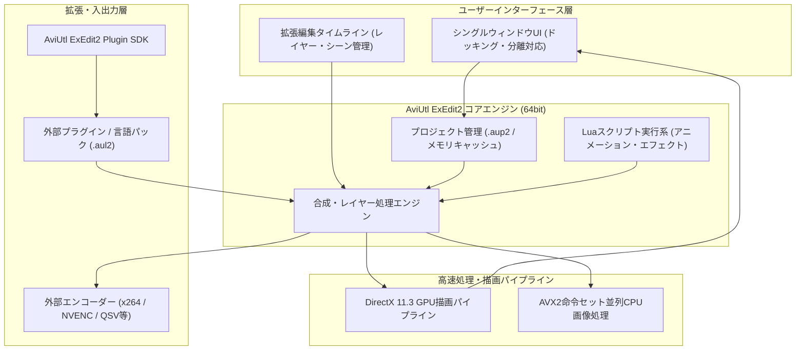

# **AviUtl 調査レポート**

## **1. 基本情報**

<!--
【ガイドライン】
- 必須: ツール名、開発元、公式サイト、カテゴリ、概要
- 概要は2-3文で簡潔に記述
-->

* **ツール名**: AviUtl
* **ツールの読み方**: エーブイアイユーティル / アビユートル
* **開発元**: ＫＥＮくん
* **公式サイト**: [https://spring-fragrance.mints.ne.jp/aviutl/](https://spring-fragrance.mints.ne.jp/aviutl/)
* **関連リンク**:
  * 公式サイト（AviUtlのお部屋）: [https://spring-fragrance.mints.ne.jp/aviutl/](https://spring-fragrance.mints.ne.jp/aviutl/)
  * ニコニ・コモンズ作品ページ: [https://commons.nicovideo.jp/works/nc422952](https://commons.nicovideo.jp/works/nc422952)
  * レビューサイト: フリーソフトのため、大手レビューサイト（G2/Capterra）には登録なし
* **カテゴリ**: 動画編集
* **概要**: 「ＫＥＮくん」氏によって開発されている、Windows向けの無料動画編集ソフトウェア。長年愛されてきたクラシック版から進化を遂げ、本体と拡張編集を統合してゼロから再設計された64bitネイティブ版「AviUtl ExEdit2」が正式リリースされた。完全無料・商用制限なしでありながら、DirectX 11.3やAVX2を活用した圧倒的な動作速度と、Luaスクリプト・プラグインによる自由なカスタマイズ性を誇る。

## **2. 目的と主な利用シーン**

<!--
【ガイドライン】
- 3-5項目を箇条書きで記述
- 想定利用者を具体的に記載
- 末尾に「代表的な利用フロー」をスイムレーンで添付する
-->

* **解決する課題**: 高価な商用ソフトウェアのサブスクリプションを契約することなく、個人PC環境でプロレベルの高度なモーショングラフィックスや動画編集を行える環境を実現する。また、PCリソースを最大限に活用し、軽快なタイムライン編集環境を提供する。
* **想定利用者**: 個人クリエイター、YouTuber、ニコニコ動画投稿者、MAD動画・ミュージックビデオ（MV）制作者、ゲーム実況・解説動画の制作者。
* **利用シーン**:
  * ゲーム実況や音声合成ソフト（ゆっくりボイス・VOICEVOX等）を活用した解説動画の編集
  * キーフレームやLuaスクリプトを駆使したモーショングラフィックス、アニメーションMV、MAD動画の制作
  * 多彩なフィルタや色調補正を用いた映像の加工・レタッチ
  * 各種外部エンコーダー（x264/x265等）と連携した高画質・小容量な動画出力

### **2.1 代表的な利用フロー**

<!--
【ガイドライン】
- ツールを実際に使う際の代表的な流れを、アクター（ユーザー、AIエージェント、ツール、外部サービス等）ごとのスイムレーンで示す
- Mermaidの swimlane-beta を使用し、向きは TB（上から下）に固定する
- レーン（subgraph）は3〜5個、ステップは4〜8個程度に収め、図内のレーン名・ステップ名は日本語で簡潔に記述する
-->

```mermaid
swimlane-beta TB
  subgraph ユーザー["動画制作者"]
    A["動画・音声・画像素材の収集と準備"]
    E["プレビュー再生でタイミング・演出を確認"]
    H["完成動画の確認・動画プラットフォームへ投稿"]
  end
  subgraph 本体機能["AviUtl ExEdit2 (本体)"]
    B["プロジェクト作成・素材のタイムライン配置"]
    C["カット編集・オブジェクト配置・テロップ入力"]
    D["エフェクト・Luaスクリプトの適用・描画処理"]
    F["レンダリングパイプラインの実行"]
  end
  subgraph 拡張・出力["プラグイン・エンコーダー"]
    G["外部コーデック連携・高圧縮エンコード出力"]
  end
  A --> B
  B --> C
  C --> D
  D --> E
  E --> F
  F --> G
  G --> H
```

* **代表的な流れ**: 制作者が用意した素材をExEdit2のタイムラインへ配置してカット編集やエフェクトを適用し、リアルタイムプレビューで細部を調整した上で、最適化されたパイプラインと外部エンコーダーを介して高品質な動画ファイルを出力・公開する。

## **3. 主要機能**

<!--
【ガイドライン】
- 5-10項目の主要機能を箇条書きで記述
- 各機能は1-2文で概要を説明
-->

* **統合型タイムライン編集（ExEdit2）**: 本体と拡張編集が一体化され、レイヤー無制限のタイムライン上で動画、画像、音声、テキスト、図形を直感的に配置・合成可能。
* **完全64bitネイティブ & メモリ制約の撤廃**: 従来の32bit環境における4GBメモリ制限が解消され、大容量のメモリをフル活用して4K解像度や大量のメディアアセットを安定して処理可能。
* **DirectX 11.3 & AVX2高速描画パイプライン**: GPUを活用した描画アクセラレーションと、CPUのAVX2命令セットによる並列画像処理により、プレビュー再生やフィルタ処理が大幅に高速化。
* **シングルウィンドウ / ドッキングUI**: 従来は画面上に散らばっていた編集ウィンドウがモダンな単一ウィンドウに統合され、ユーザーの作業環境に合わせてパネルのドッキングや分離が柔軟に変更可能。
* **Luaスクリプト制御**: スクリプトを用いた高度なアニメーション、プロシージャルな図形生成、座標計算エフェクトに対応し、自由度の高いモーショングラフィックス表現を実現。
* **多彩な標準フィルタ & エフェクト**: クロマキー合成、マスク処理、色調補正、ノイズ除去、ぼかし、発光など、映像制作に必要な基本エフェクトを標準搭載。
* **新世代Plugin SDKによる拡張性**: 「AviUtl ExEdit2 Plugin SDK」が提供されており、C/C++によるネイティブプラグイン開発によって独自の映像フィルタや入出力機能を自由に追加可能。
* **多言語対応（.aul2言語ファイル）**: 画面へのドラッグ＆ドロップで言語パック（日本語、簡体中文、韓国語等）を即座に適用できるローカライズ基盤を整備。
* **外部エンコーダー連携**: 各種入出力プラグインを通じてx264、x265、NVENC、QSVなどの高効率エンコーダーと連携し、最適な画質とファイルサイズで出力可能。

## **4. 動作原理・システム構成**

<!--
【ガイドライン】
- ツールの動作原理、システム構成（アーキテクチャ）、データの流れ、通信フローなどを記述
- クライアント・サーバー型、ローカルファースト、クラウド完結など、ツールのアーキテクチャ特性を明記
- 可能であればMermaidによる構成図やフロー図を含めること（Mermaid内のノードや説明テキストは原則日本語表記で作成する）
- subgraph の表示名に ・ や全角記号、( ) [ ] などの記号を含める場合は、必ず subgraph ID["表示名"] のように引用符で囲む
- 要素技術や内部で使われている仕組みを解説
-->

* **アーキテクチャ**: ローカル完結型のスタンドアロン・デスクトップアプリケーション（Windows 64bitネイティブ）。外部サーバーとの通信を必要とせず、すべての映像処理・レンダリングがローカルマシン上で自己完結する。
* **主要コンポーネントとデータフロー**:
  * **UI・タイムライン層**: ユーザーの操作やタイムライン配置、シーク位置情報を受け取り、シーンおよびレイヤーの状態を管理する。
  * **合成・レイヤー管理エンジン**: タイムライン上の複数レイヤーに配置されたメディアオブジェクト、中間点（キーフレーム）、テキスト装飾、各種フィルタをフレーム単位で合成ツリーに展開。
  * **Luaスクリプト実行系**: スクリプトで記述されたエフェクトや座標変形をフレームごとに動的評価し、合成エンジンへ反映。
  * **描画・演算パイプライン**: 合成された映像フレームをDirectX 11.3（GPU描画）およびAVX2（CPUベクトル演算）へ振り分けて高速処理し、プレビューウィンドウへの描画またはエンコーダー層へ受け渡す。
  * **拡張・入出力層**: AviUtl ExEdit2 Plugin SDKに準拠した外部プラグインや言語パック（.aul2）、および外部メディアエンコーダーとのインターフェースを受け持つ。



* **特筆すべき要素技術**:
  * **64bitメモリアドレス空間**: 従来の32bit版（AviUtl 1.10）が抱えていたメモリ不足（メモリクラッシュ）を根本解決し、長時間のフルHD/4K動画編集でも潤沢なシステムメモリを活用。
  * **DirectX 11.3 & AVX2のハイブリッドアクセラレーション**: 映像描画処理をGPU（DirectX）へオフロードするとともに、CPU演算が必要なフィルタ・エフェクトはAVX2のSIMD命令を用いて並列処理することで低レイテンシなプレビューを実現。
  * **軽量な自己完結設計**: レジストリへの依存を最小限に抑え、インストール先フォルダ内に設定やプラグインを集約するポータブル性の高い構成を維持。

## **5. 開始手順・セットアップ**

<!--
【ガイドライン】
- アカウント作成から「Hello World」的な最初の動作確認までの手順
- 主要なコマンドや設定項目を記載
-->

* **前提条件**:
  * OS: Windows 10以降（64bit版）
  * ハードウェア要件: AVX2対応CPU、DirectX 11.3対応GPU
  * アカウント登録: 不要（完全スタンドアロン）
* **インストール/導入**:
  1. 公式サイト（AviUtlのお部屋: `https://spring-fragrance.mints.ne.jp/aviutl/`）にアクセス。
  2. 最新のインストーラー版（例: `AviUtl2_v2.1.16_setup.exe`）またはZIPアーカイブ版（`aviutl2_v2.1.16.zip`）をダウンロード。
  3. インストーラーを実行して任意のフォルダ（日本語や特殊文字を含まないパスを推奨）にインストール。
  4. 多言語環境で使用する場合は、公式サイトリンク等から言語ファイル（`.aul2`）をダウンロードし、プレビュー編集画面にドラッグ＆ドロップして適用。
* **初期設定**:
  * 設定画面（環境設定）を開き、プレビュー再生のフレームレート、メモリキャッシュサイズ、GPU描画設定が自身のPC環境に適しているか確認。
* **クイックスタート**:
  1. インストールしたフォルダから `aviutl2.exe` を起動。
  2. 編集したい動画・画像・音声ファイルをタイムラインウィンドウにドラッグ＆ドロップして新規プロジェクトを作成。
  3. スライダーを動かしてカット編集を行い、タイムライン右クリックから「テキスト」や「図形」オブジェクトを追加。
  4. メニューの「ファイル」→「エクスポート（動画出力）」から好みの出力設定を選択してレンダリングを実行。

## **6. 特徴・強み (Pros)**

<!--
【ガイドライン】
- 3-5項目を箇条書きで記述
- 競合との差別化ポイントを明確に
-->

* **完全無料かつ商用利用が無制限**: 個人利用・商業利用を問わず完全無料であり、透かし（ウォーターマーク）の挿入や機能制限、サブスクリプション課金が一切存在しない。
* **正式版リリースによる安定性と劇的な高速化**: 約1年のベータテスト期間を経て正式版（v2.0.54〜v2.1.16）となり、64bit化・DirectX 11.3・AVX2によって従来の旧AviUtlとは比較にならないプレビューの滑らかさと安定性を実現。
* **週次ペースでの迅速な保守・アップデート**: 開発者のＫＥＮくん氏により、ユーザー報告に基づく不具合修正や細かな操作性改善が非常に高頻度で継続されている。
* **コミュニティによる膨大な知見と拡張性**: 20年以上にわたるAviUtl文化の蓄積があり、解説記事、動画チュートリアル、Luaスクリプトのノウハウがネット上に無数に存在するため、疑問解決が容易。
* **軽量・ポータブル性**: 数GB〜数十GBのストレージを消費する商用ツールと異なり、本体サイズは極めてコンパクトで、余計な常駐バックグラウンドサービスも一切起動しない。

## **7. 弱み・注意点 (Cons)**

<!--
【ガイドライン】
- 3-5項目を箇条書きで記述
- 日本語対応の状況は必ず含める
-->

* **厳格なハードウェア要件**: 描画と演算の高速化のためにAVX2およびDirectX 11.3が必須要件となっており、古いPCや一部のグラフィックボード環境では起動できないか正常に動作しない場合がある。
* **旧AviUtl（32bit時代）のプラグイン資産との非互換**: 旧版（0.99〜1.10）向けに作られた32bitプラグイン（.auf, .aui等）はそのままではExEdit2で動作せず、ExEdit2向けに再ビルドまたは移植された新世代プラグインが必要。
* **現代的なAI自動機能の非搭載**: CapCutやPremiere Pro等で普及している自動文字起こし（音声テキスト化）、AI被写体切り抜き、シーン自動検出などの生成AI/自動化機能は標準では備わっておらず、基本的に手動での制作が前提となる。
* **日本語対応状況**: 開発元が国内であるため標準で完全な日本語対応。多言語利用には有志作成の言語ファイル（.aul2）の導入が必要。

## **8. 料金プラン**

<!--
【ガイドライン】
- 表形式で整理することを推奨
- 最新の料金情報であることを確認
- 価格は通貨を明記
-->

| プラン名 | 料金 | 主な特徴 | 対象ユーザー |
|:---|:---:|:---|:---|
| **完全無料版 (フリーウェア)** | **無料 (¥0)** | 全機能利用可能、商用利用可、利用期限なし、ウォーターマークなし | すべての個人・法人ユーザー |

* **課金体系**: なし（寄付や有償オプション等も存在せず、完全無償で提供）
* **無料トライアル**: 該当なし（全期間・全機能が永続的に無料）

## **9. 導入実績・事例**

<!--
【ガイドライン】
- 具体的な企業名を3-5社挙げる
- 導入事例がない場合は「公開事例なし。ただし、〜の分野での利用が報告されている」等
-->

* **導入企業**: 個人開発のフリーウェアであるため公式な大企業導入実績の公表はないが、多くの個人クリエイター、フリーランスの映像制作請負、同人サークル、VTuber運営者によって活用されている。
* **導入事例**:
  * **YouTube / ニコニコ動画**: 「ゆっくり実況」「VOICEVOX解説」等の動画制作においてデファクトスタンダードとして定着。ニコニ・コモンズ（作品ID: nc422952）での親作品登録も活発に行われている。
  * **MAD・ミュージックビデオ制作**: ボーカロイド楽曲の公式・非公式MVやインディーズアーティストのプロモーションビデオ制作において、高度なタイポグラフィやモーショングラフィックス制作に広く利用されている。
  * **同人ゲームPV・トレイラー制作**: ゲーム開発者がタイトル発表PVやキャラクター紹介映像を制作する際の主力ツールとして採用されている。
* **対象業界**: 個人クリエイター、インディーズゲーム開発、Webコンテンツ制作、ホビー・同人活動。

## **10. サポート体制**

<!--
【ガイドライン】
- ドキュメント、コミュニティ、公式サポートの3項目を必ず含める
- URLがあれば記載
-->

* **ドキュメント**: 公式サイトに付属のテキストマニュアルがあるほか、有志による解説Wiki（AviUtl百科事典、各種個人ブログ）やYouTube解説動画が極めて充実している。
* **コミュニティ**: ニコニコ動画、X（旧Twitter）、5ちゃんねる、Discordコミュニティ等でユーザー同士の活発な情報交換・質問回答が行われている。
* **公式サポート**: 個人開発のフリーソフトであるため、メールや電話、チャット等による個別ユーザーサポート窓口は提供されていない。バグ報告や動作検証報告はWeb上のコミュニティや公式掲示板を通じて開発者へ届く形をとっている。

## **11. エコシステムと連携**

<!--
【ガイドライン】
- API、外部連携、技術スタックとの相性を包括的に記述
-->

### **11.1 API・外部サービス連携**

<!--
【ガイドライン】
- APIの有無と公開状況を明記
- 主要連携サービスを5-10個リストアップ
-->

* **API / SDK**: 「AviUtl ExEdit2 Plugin SDK」（`aviutl2_sdk.zip`）が公式サイトにて無償公開されており、C/C++を用いて入力・出力・フィルタプラグインを独自開発できる。また、Luaスクリプトエンジンによりタイムライン上での動的プログラミングが可能。
* **外部連携**:
  * **x264 / x265 / ffmpeg**: 外部CLIエンコーダーや出力プラグインとの連携により、高品質なMP4/MKV/WebM出力が可能。
  * **ニコニ・コモンズ**: ニコニコ動画の創作支援制度（ニコニ・コモンズ ID: nc422952）に対応し、親作品登録を通じたエコシステム連携が存在。
  * **音声合成ソフトウェア連携**: VOICEVOXやAoiSupport等の外部ツールで生成された音声ファイルや字幕情報のタイムライン連携。

### **11.2 技術スタックとの相性**

<!--
【ガイドライン】
- 主要なフレームワークや言語との相性を表形式で整理
- 相性: ◎ (非常に良い), ◯ (良い), △ (工夫が必要/一部非対応), × (非推奨)
-->

| 技術スタック | 相性 | メリット・推奨理由 | 懸念点・注意点 |
|:---|:---:|:---|:---|
| **Lua (スクリプト)** | ◎ | 標準のスクリプト機能として深く統合されており、高度な数式アニメーションやカスタムエフェクトを作成可能 | 複雑なスクリプトはプレビュー負荷の原因となる |
| **C / C++** | ◎ | AviUtl ExEdit2 Plugin SDKを用いてネイティブプラグインを開発可能 | 64bitネイティブ対応とメモリ管理の理解が必要 |
| **DirectX 11.3 / GPU** | ◎ | ExEdit2コアでネイティブサポートされ、描画処理を大幅に高速化 | 要件を満たさないGPUや仮想環境では動作制限あり |
| **Python** | △ | 直接のPythonバインディングはないが、外部スクリプトで素材を一括生成・配置する連携例がある | プロセス間通信やファイル連携の工夫が必要 |

## **12. セキュリティとコンプライアンス**

<!--
【ガイドライン】
- 認証、データ管理、準拠規格の3項目を必ず調査
-->

* **認証**: 完全なスタンドアロン・デスクトップアプリのため、クラウド認証やユーザーログインは一切不要。
* **データ管理**: 編集中のプロジェクトデータ、インポートしたメディア、出力動画はすべてユーザーのローカルディスクに保存される。外部サーバーへのテレメトリ送信や素材のクラウドアップロードは行われないため、機密情報や未公開コンテンツの編集でも情報漏洩の懸念がない。
* **準拠規格**: 個人開発のフリーウェアであるためSOC2やISO27001等の認証は取得していないが、オフライン動作が可能なため高度なセキュリティポリシーが求められる環境でも利用可能。

## **13. 操作性 (UI/UX) と学習コスト**

<!--
【ガイドライン】
- 実際の使用感や、類似ツールとの比較を含める
-->

* **UI/UX**: ExEdit2によりシングルウィンドウ化され、タイムライン、プレビュー、設定ダイアログが整理されて視認性が大幅に向上した。現代的なGUIツールとしての統一感が増した一方、パネルの配置やショートカットの作法にはAviUtl特有の流儀が残る。
* **学習コスト**: 中程度〜やや高め。基本的なカット編集やテキスト配置は直感的に行えるが、中間点を用いたアニメーション制御、Luaスクリプトの記述、外部エンコーダーの設定などをマスターするには相応の学習が必要。ただし、Web上に膨大な入門講座が存在するため独学は容易。

## **14. ベストプラクティス**

<!--
【ガイドライン】
- ツールを効果的に活用するための推奨事項や、避けるべきアンチパターンを記述
-->

* **効果的な活用法 (Modern Practices)**:
  * **最新安定版（v2.1.16以降）の常時利用**: パフォーマンス向上とバグ修正が継続されているため、常に最新の公式インストーラー版を利用する。
  * **エイリアスとオブジェクトのプリセット保存**: 頻繁に使用するテロップスタイルやアニメーション設定はエイリアスとして保存し、作業効率を劇的に高める。
  * **シーン機能の活用**: 長尺の動画を制作する際は、チャプターごとに「シーン」を分割して編集することでタイムラインの煩雑化を防ぎ、動作を軽快に保つ。
* **陥りやすい罠 (Antipatterns)**:
  * **旧版（32bit）プラグインの無差別導入**: 旧AviUtl向けプラグインをExEdit2フォルダに混在させるとクラッシュや予期せぬ不具合の原因となるため、ExEdit2対応が明記されたプラグインのみを導入する。
  * **自動バックアップの未設定**: 予期せぬクラッシュに備え、環境設定から自動バックアップ間隔を短め（数分〜5分程度）に設定しておく。

## **15. ユーザーの声（レビュー分析）**

<!--
【ガイドライン】
- 調査対象サイト、総合評価、ポジティブ・ネガティブ各3項目以上
-->

* **調査対象**: X（旧Twitter）、ニコニコ動画、YouTube、個人制作ブログ（大手レビューサイトG2/ITreview等にはフリーソフトのため掲載なし）
* **総合評価**: ★★★★★ (4.8 / 5.0 相当 - 国産無料動画編集ツールの最高峰として圧倒的支持)
* **ポジティブな評価**:
  * 「ExEdit2が正式版になって動作が劇的に軽快になった。4K素材を置いてもコマ落ちせずスラスラ動く」
  * 「完全無料・商用利用フリーで、これほど自由度の高いモーショングラフィックスを作れるツールは世界中探しても他にない」
  * 「シングルウィンドウ化されたことで、マルチディスプレイ環境でなくても快適に作業できるようになった」
  * 「毎週のように細かな不具合修正や機能改善アップデートが行われており、作者の開発熱意に頭が下がる」
* **ネガティブな評価 / 改善要望**:
  * 「AVX2非対応の古いノートPCでは起動すらできず、動作環境のハードルが上がってしまった」
  * 「長年愛用していた旧32bitプラグインが使えなくなり、ExEdit2向け移植を待つ必要がある」
  * 「CapCutのようにボタン一つで自動テロップ起こしができるようなAI機能が標準であればさらに良い」

## **16. 直近半年のアップデート情報**

<!--
【ガイドライン】
- 日付の降順（新しいものが上）
- 3-10項目をリストアップ
- 各項目に日付と概要を含める
- 情報源のURLを記載
-->

* **2026-10-31**: AviUtl ExEdit2 version 2.1.16 公開（インストーラー版およびZIP版。SDK更新、内部描画バッファの最適化、安定性向上）
* **2026-10-24**: AviUtl ExEdit2 version 2.1.15 公開（DirectX描画パイプラインの調整、特定GPU環境での初期化処理の修正）
* **2026-10-17**: AviUtl ExEdit2 version 2.1.14 公開（タイムライン操作のレスポンス向上、ショートカットキー入力処理の改善）
* **2026-10-10**: AviUtl ExEdit2 version 2.1.13 公開（外部連携SDKとの通信安定化、スクリプト実行時メモリ消費の抑制）
* **2026-07-07**: AviUtl ExEdit2 正式版（version 2.0.54）公開（約1年にわたるベータテスト期間を経て正式版リリース。完全64bit化、シングルウィンドウUI、DirectX 11.3/AVX2対応、インストーラー版の提供）
* **2026-05-17**: AviUtl ExEdit2 beta46 公開（プレビュー描画の安定化、多言語パック適用の不具合修正）
* **2026-05-10**: AviUtl ExEdit2 beta45 公開（フィルタ適用時のキャッシュ破棄処理の最適化）
* **2026-05-04**: AviUtl ExEdit2 beta44 公開（特定コーデック読み込み時のクラッシュ修正）

(出典: [公式サイト（AviUtlのお部屋）](https://spring-fragrance.mints.ne.jp/aviutl/))

## **17. 類似ツールとの比較**

<!--
【ガイドライン】
- 3-5個の類似ツールと比較
- 機能比較表（星取表）と詳細比較の2つの観点で記述する
-->

### **17.1 機能比較表 (星取表)**

| 機能カテゴリ | 機能項目 | AviUtl (ExEdit2) | DaVinci Resolve | Apple Creator Studio | Adobe Premiere Pro | OpenCut |
|:---:|:---|:---:|:---:|:---:|:---:|:---:|
| **基本機能** | タイムライン編集 | ◎<br><small>統合ExEdit2</small> | ◎<br><small>プロ仕様</small> | ◎<br><small>直感的</small> | ◎<br><small>業界標準</small> | ◯<br><small>Web/デスクトップ</small> |
| **パフォーマンス** | 64bit & GPU描画 | ◎<br><small>DirectX11.3/AVX2</small> | ◎<br><small>CUDA/Metal最適化</small> | ◎<br><small>Apple Silicon最適化</small> | ◎<br><small>Mercury Playback</small> | △<br><small>ブラウザ依存</small> |
| **拡張性** | プラグイン / スクリプト | ◎<br><small>Lua / C++ SDK</small> | ◯<br><small>OpenFX / Python</small> | △<br><small>App Store拡張</small> | ◎<br><small>CEP / ExtendScript</small> | ◯<br><small>OSS拡張</small> |
| **コスト** | 無料利用 / 商用制限 | ◎<br><small>完全無料・商用可</small> | ◯<br><small>高機能無料版あり</small> | ×<br><small>サブスクリプション</small> | ×<br><small>サブスクリプション</small> | ◎<br><small>OSS・無料</small> |
| **AI機能** | 音声自動文字起こし・AI編集 | ×<br><small>標準非搭載</small> | ◎<br><small>DaVinci Neural Engine</small> | ◯<br><small>AIキャプション</small> | ◎<br><small>Adobe Sensei/Firefly</small> | △<br><small>API連携</small> |
| **使いやすさ** | 初心者向け導入難易度 | ◯<br><small>インストーラで改善</small> | △<br><small>多機能で学習コスト高</small> | ◎<br><small>非常に容易</small> | ◯<br><small>チュートリアル豊富</small> | ◯<br><small>シンプルな操作系</small> |

### **17.2 詳細比較**

| ツール名 | 特徴 | 強み | 弱み | 選択肢となるケース |
|:---|:---|:---|:---|:---|
| **AviUtl (ExEdit2)** | ゼロから再設計された国産の完全無料・64bit動画編集ソフト | ・完全無料かつ商用利用制限なし<br>・DirectX 11.3/AVX2による超高速プレビュー<br>・Luaスクリプトと新SDKによる自由な拡張性 | ・AVX2/DirectX 11.3必須（古いPCは不可）<br>・旧32bitプラグインの多くが未対応<br>・AI自動編集機能は標準非搭載 | コストをかけず、軽快な動作環境でMADや実況動画、独自のモーショングラフィックスを作りたい個人クリエイター。 |
| **DaVinci Resolve** | プロ仕様のカラー・編集・VFX統合ツール | ・最高峰のカラーグレーディング<br>・Fusion（VFX）/Fairlight（音声）統合<br>・無料版でも極めて高機能 | ・高スペックGPUが必須<br>・機能が多すぎて学習コストが非常に高い | 商業クオリティの実写映像制作、本格的な映画・PV制作を志向する場合。 |
| **Apple Creator Studio** | Appleエコシステムに最適化されたプロクリエイター向けスイート | ・Mac/iPad間でのシームレスな連携<br>・直感的なタッチUIとApple Silicon最適化<br>・高品質な標準アセット | ・Appleデバイス専用<br>・月額/年額のサブスクリプションが必要 | MacやiPadを主力として、動画・音楽・グラフィックを総合的に制作するユーザー。 |
| **Adobe Premiere Pro** | 映像制作業界におけるデファクトスタンダード | ・圧倒的な業界シェアと制作会社連携<br>・After Effects等との強固なDynamic Link<br>・強力なAI機能（Firefly、自動文字起こし） | ・月額サブスクリプションのランニングコストが高い<br>・動作が重くなりがち | 映像制作プロダクションでの業務、チーム制作、企業案件の受託を行う場合。 |
| **OpenCut** | オープンソースで開発される新興の動画編集ツール | ・Web/ローカル両対応のオープンソース<br>・モダンなWeb技術スタックとの親和性 | ・エフェクトやトランジションのバリエーションが発展途上 | オープンソース重視で、Webブラウザや軽量な環境で素早く編集したい場合。 |

## **18. 総評**

<!--
【ガイドライン】
- 総合評価、推奨チーム、選択ポイントの3項目を必ず含める
- 客観的で中立的な評価を心がける
-->

* **総合的な評価**:
  AviUtlは、20年以上にわたる歴史の中で日本の動画文化を支えてきた伝説的ソフトウェアであり、2026年にゼロから再設計された「AviUtl ExEdit2」の正式リリース（v2.0.54〜v2.1.16）によって、名実ともに現代的な64bit動画編集ツールへと生まれ変わった。長年の弱点だった32bitメモリ制限（4GBの壁）が解消され、DirectX 11.3とAVX2をフル活用した滑らかなプレビュー環境が整ったことは、個人クリエイターにとって計り知れない恩恵である。完全無料で商用利用可能という基本姿勢を崩さず、週次ペースで手厚いアップデートが継続されている点は高く評価できる。
* **推奨されるチームやプロジェクト**:
  * **予算をかけずに本格的な動画制作を始めたい個人クリエイター**: サブスクリプション費用をかけずにYouTubeやニコニコ動画の動画投稿を行いたい人。
  * **ゲーム実況・ボイスロイド解説動画の投稿者**: 立ち絵素材の配置や定型テロップの流し込みなど、AviUtlの得意とする効率的なワークフローを活かしたい制作者。
  * **独自の映像演出やMAD動画を追求するクリエイター**: Luaスクリプトやキーフレームアニメーションを駆使し、市販ソフトでは困難な複雑なモーショングラフィックスを作りたい人。
* **選択時のポイント**:
  自動文字起こしやAI切り抜きといった「手間の自動化」を最優先するなら商用AIツールやPremiere Proが有利だが、「完全無料」「圧倒的な軽快さ」「職人的にエフェクトやスクリプトを組み上げる自由度の高さ」を求めるのであれば、正式版となったAviUtl ExEdit2は現在でも第一線の有力な選択肢である。Windows 10/11でAVX2およびDirectX 11.3を満たす環境を持つユーザーには、迷わず推奨できる名作ソフトである。
