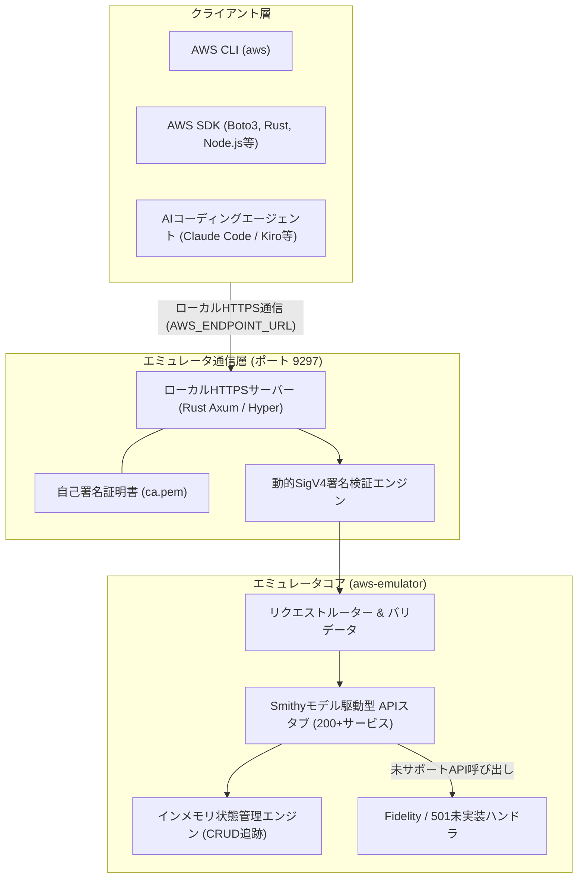

# **AWS Emulator 調査レポート**

## **1. 基本情報**

* **ツール名**: AWS Emulator
* **ツールの読み方**: エーダブリューエス エミュレーター
* **開発元**: Amazon Web Services
* **公式サイト**: [https://docs.aws.amazon.com/ja_jp/emulator/](https://docs.aws.amazon.com/ja_jp/emulator/)
* **関連リンク**:
  * GitHub: [https://github.com/aws/aws-emulator](https://github.com/aws/aws-emulator)
  * ドキュメント: [https://docs.aws.amazon.com/ja_jp/emulator/](https://docs.aws.amazon.com/ja_jp/emulator/)
* **カテゴリ**: テスト用インフラ
* **概要**: AWS Emulatorは、Amazon Web Servicesが提供する公式のローカルAWS APIエミュレーションツールである。実際のAWSアカウントやクラウドリソースへのデプロイを必要とせず、ローカルマシンやCI/CDパイプライン上でAWS APIと対話するテストを実行できる。公式のSmithyモデルから自動生成されるモデル駆動型アーキテクチャを採用し、Rustによる超軽量な実行環境とAIコーディングエージェント向けのサンドボックス検証機能を提供する。

## **2. 目的と主な利用シーン**

* **解決する課題**:
  * ローカル開発やCI/CD環境における実AWS環境のプロビジョニング待ち時間とクラウド利用コストの増大
  * AIコーディングエージェント（Claude Code、Kiro、Cursor等）に実クラウドアカウントを触らせる際のセキュリティリスク・誤削除・予期せぬ課金リスク
  * チーム開発や並列テスト実行時における、リソース名衝突やステート競合によるテストフレーキー（Flaky tests）
  * オフライン環境や閉域網におけるAWS依存アプリケーションの開発・テスト不能問題
* **想定利用者**: クラウドエンジニア、バックエンド開発者、DevOpsエンジニア、AIエージェント活用開発者
* **利用シーン**:
  * **AIエージェントの安全な試行錯誤**: AIエージェントにローカルサンドボックス環境を提供し、インフラ構築コードやSDK呼び出しの自動検証を実行させる
  * **CI/CDパイプラインでの高速統合テスト**: プルリクエストごとのテストにおいて、AWSアカウント不要かつ数秒でクリーンな状態からAPIテストを並列実行する
  * **ローカルでのプロトタイピング**: インターネット接続やIAM権限の事前取得なしに、新規サービスのCRUDロジックを即座にローカル検証する

### **2.1 代表的な利用フロー**

```mermaid
swimlane-beta TB
  subgraph User["開発者 / AIエージェント"]
    A[テストコード実行またはIaC検証指示]
    F[テスト結果・APIログの確認]
  end
  subgraph Agent["AWS Agent Toolkit"]
    B[aws-emulatorスキル経由でインスタンス起動]
    C[環境変数と一時SigV4認証情報を設定]
  end
  subgraph Emulator["AWS Emulator"]
    D[HTTPSエンドポイント待機とモデル駆動API処理]
    E[インメモリ状態の更新とレスポンス返却]
  end
  A --> B
  B --> C
  C --> D
  D --> E
  E --> F
```

* **代表的な流れ**: 開発者やAIエージェントがテスト実行を指示すると、Agent ToolkitがローカルでAWS Emulatorの独立インスタンスを起動し、専用のポート・一時認証情報・CA証明書を環境変数に割り当てます。エミュレーターは実AWSと同様のHTTPSリクエストを受信してインメモリ状態を更新し、高忠実度なレスポンスを返却して安全なテストサイクルを完結させます。

## **3. 主要機能**

* **200以上のAWSサービスをカバーするコントロールプレーンエミュレーション**: S3、DynamoDB、SQS、SNS、KMS、Secrets Manager、Lambda、IAM等の主要リソース作成・取得・更新・削除（CRUD）操作を網羅的にローカル再現
* **公式Smithyモデル駆動による高忠実度（High Fidelity）API再現**: 公式SDKと同じAPI定義から自動生成されたコードベースにより、リクエスト構造・パラメータバリデーション・エラー形式を実環境と同等に再現
* **Agent Toolkit for AWSとのネイティブ統合**: AWS CLIのスキルエコシステムと連携し、AIエージェント（Claude Code、Kiro、Cursor、Cline等）が自律的にエミュレーターを起動・テスト・破棄可能
* **ポート単位の完全インスタンス分離**: テストプロセスやCIジョブごとに異なるポート番号で独立インスタンスを同時起動可能で、状態の衝突が発生しない完全並列テストを実現
* **Rust Embedded Mode（インプロセス実行）**: `aws-emulator-embedded` クレートを利用することで、別プロセスやDockerを立ち上げることなくRustテストプロセス内で直接エミュレーターを起動可能
* **自動TLS証明書・SigV4認証生成**: 起動時に動的な自己署名CA証明書（`ca.pem`）と一時的な認証情報ファイルを生成し、標準AWS SDK/CLIの署名付き通信に完全対応
* **透明性の高いフィデリティレポートと501ハンドリング**: 未実装のAPIやデータプレーン機能は明示的に `501 Not Implemented` を返し、動作保証状況が公開リポジトリ上で可視化されている

## **4. 動作原理・システム構成**



* **アーキテクチャ**: ローカルファーストの軽量スタンドアロン型サーバー構成、またはテストプロセス直接組み込みのインプロセス構成を採用している。
* **主要コンポーネントとデータフロー**:
  * **クライアント・ルーティング**: クライアント（AWS SDKやAWS CLI）は環境変数 `AWS_ENDPOINT_URL`（デフォルト `https://127.0.0.1:9297`）を参照してリクエストを送信する。
  * **TLSと認証検証**: エミュレーターは起動時に一時CA証明書を発行し、受信したリクエストのSigV4署名を動的に検証する（`--auth off` で無効化も可能）。
  * **モデル駆動ハンドラー**: AWS公式のSmithyモデルから機械生成されたハンドラーがパラメータの型やバリデーションを厳密にチェックする。
  * **状態永続化**: すべてのリソース状態はメモリ上で管理され、プロセス終了とともに完全クリーンアップされる。ファイルシステムや外部DBへの書き込みを行わないため極めて高速に動作する。
* **特筆すべき要素技術**:
  * **Rust言語**: メモリ安全性とネイティブコードによる圧倒的な低フットプリント・高速起動（数ミリ秒）を実現。
  * **自律型AIエージェントによる自動生成コードベース**: AWS APIの膨大な差分追従とテストコード作成がAIエージェントによって半自動・自律的に生成・維持されている。

## **5. 開始手順・セットアップ**

* **前提条件**:
  * Linux（x86_64 / aarch64）、またはDocker環境（macOS / Windows / Linux）
  * AWS CLI v2.35.0以降（AIエージェント連携時）
  * AWSアカウント作成やクラウドアカウントへのサインインは一切不要

* **インストール/導入**:

  **方法1: AIコーディングエージェント連携（AWS Agent Toolkit経由）**
  ```bash
  aws agent-toolkit add-skill --skill-name aws-emulator --region us-east-1
  ```

  **方法2: Linuxパッケージ（DEB / RPM）**
  ```bash
  # Debian / Ubuntu系の場合
  sudo dpkg -i aws-emulator_amd64.deb
  
  # または直接バイナリを実行
  aws-emulator
  ```

  **方法3: Dockerコンテナ**
  ```bash
  docker run -d -p 9297:9297 public.ecr.aws/aws-cli/aws-emulator:latest
  ```

* **初期設定（環境変数の設定）**:
  起動後、ローカルCLIやSDKの向け先をエミュレーターに設定する。実アカウントの誤操作を防ぐため、実クレデンシャルをアンセットすることが推奨される。

  ```bash
  # エンドポイントと生成されたクレデンシャルパスの指定
  export AWS_ENDPOINT_URL=https://127.0.0.1:9297
  export AWS_SHARED_CREDENTIALS_FILE=~/.aws/emulator/9297/emulator_credentials
  export AWS_CONFIG_FILE=~/.aws/emulator/9297/config
  export AWS_CA_BUNDLE=~/.aws/emulator/9297/ca.pem
  export AWS_EC2_METADATA_DISABLED=true
  export AWS_REGION=us-east-1

  # 実AWSのキー情報が残っている場合はアンセット
  unset AWS_ACCESS_KEY_ID AWS_SECRET_ACCESS_KEY AWS_SESSION_TOKEN AWS_PROFILE
  ```

* **クイックスタート**:
  設定完了後、通常のAWS CLIコマンドをそのまま実行してリソースを作成・確認できる。

  ```bash
  # S3バケットの作成と一覧表示
  aws s3 mb s3://my-local-test-bucket
  aws s3 ls

  # DynamoDBテーブルの作成
  aws dynamodb create-table \
      --table-name Users \
      --attribute-definitions AttributeName=UserId,AttributeType=S \
      --key-schema AttributeName=UserId,KeyType=HASH \
      --billing-mode PAY_PER_REQUEST
  ```

## **6. 特徴・強み (Pros)**

* **AWS公式提供かつパブリックドメイン（CC0）**: ライセンス費用やプラン制限（無料版の機能制限など）がなく、商用利用を含めて完全に無料で利用可能
* **モデル駆動による高いAPI忠実度**: AWS公式のSmithyモデル定義から自動生成されているため、レスポンス形式やエラーコードの差異による「ローカルでは動いたが本番で落ちる」リスクを最小化
* **Rust製による超高速・低リソース消費**: Dockerレスで動作可能なネイティブバイナリであり、起動は瞬時、メモリフットプリントも数メガバイト〜十数メガバイト程度と極小
* **AIエージェントファースト設計**: Agent Toolkit for AWSと連携し、AIエージェントがセキュアな隔離環境内で自律的にコード生成・テスト・リトライを繰り返す開発サイクルに最適化
* **テストの並列性と独立性**: ポート単位で独立したインメモリ状態を持つため、マルチスレッドテストやCI並列ジョブ間でステート競合が起きない

## **7. 弱み・注意点 (Cons)**

* **データプレーンの機能が限定的**: S3の高度なデータストリーミングやLambdaの実際のコンテナ実行、RDSの実データベースエンジンなど、深層のデータプレーン実行機能はサポート外またはモックレベル
* **未実装APIに対する501レスポンス**: 200以上のサービスモデルを保持しているものの、コントロールプレーンの一部の複雑な操作は `501 Not Implemented` を返す
* **ネットワーク障害やレイテンシの非シミュレート**: 実クラウドで発生するネットワーク遅延、スロットリング（429 Too Many Requests）、リージョン間レイテンシなどの複雑な障害シミュレーション機能は現時点で未提供
* **本番IAM権限の代替にはならない**: 認証形式（SigV4）は模倣するが、本番環境の複雑なSCP（サービスコントロールポリシー）やクロスアカウント権限の厳密な評価は行えない
* **日本語ドキュメントの整備途上**: 基本ドキュメントは日本語版ポータルが存在するものの、最新の更新情報やコミュニティIssueは英語が中心

## **8. 料金プラン**

| プラン名 | 料金 | 主な特徴 |
|:---|:---:|:---|
| **オープンソース (CC0)** | **無料 ($0)** | 全機能利用可能、商用利用可、アカウント登録不要、利用上限なし |

* **課金体系**: 完全無料（クラウドリソース課金・ライセンス費用ともにゼロ）
* **無料トライアル**: 該当なし（常時完全無料）

## **9. 導入実績・事例**

* **導入企業**: 2026年11月に一般公開されたばかりの公式ツールであるため、商用本番導入の個別企業事例は随時公開中である。AWS内部での開発・CI検証およびAgent Toolkitユーザーコミュニティを中心に急速に採用が広がっている。
* **導入事例**:
  * **AIエージェントによる自律テスト環境**: Claude CodeやKiroを用いたコード自動生成・修正ループにおいて、ローカルでAWSリソースを作成・テストするサンドボックスとして活用
  * **CI/CDパイプラインのコスト削減**: GitHub Actions等のCIランナー上でAWS認証情報を発行せずにユニット/インテグレーションテストを実行
* **対象業界**: クラウドネイティブなWebアプリケーション開発企業、SaaS事業者、AIエージェント活用先端企業

## **10. サポート体制**

* **ドキュメント**: [AWS公式ドキュメントポータル](https://docs.aws.amazon.com/ja_jp/emulator/) にてセットアップ、SDK設定、コマンドリファレンスが整備されている。
* **コミュニティ**: GitHub上の [aws/aws-emulator リポジトリ](https://github.com/aws/aws-emulator) にてIssue報告、ディスカッション、未対応機能（`things-that-do-not-work`）の管理が行われている。
* **公式サポート**: オープンソースソフトウェア（CC0）としての提供のため、AWSサポート契約に基づくプレミアムサポートの対象外。バグ報告や改善要望はGitHub Issueを通じて受け付けられる。

## **11. エコシステムと連携**

### **11.1 API・外部サービス連携**

* **API**: AWS公式REST / Query / JSON API（Smithyモデル準拠）
* **外部サービス連携**:
  * **AWS CLI**: 環境変数設定により標準CLIコマンドをそのままエミュレーターへルーティング
  * **AWS SDK**: Boto3 (Python)、AWS SDK for JavaScript / TypeScript、AWS SDK for Rust、AWS SDK for Go、AWS SDK for Java等に対応
  * **Agent Toolkit for AWS**: AIエージェント向けスキルとして登録し、Kiro、Claude Code、Cursor、Cline等から自律制御可能
  * **CI/CDツール**: GitHub Actions、GitLab CI、CircleCI、AWS CodeBuild等のコンテナ/VMランナー上で軽量動作
  * **コンテナ基盤**: Docker、Podman、Amazon ECSローカル検証環境

### **11.2 技術スタックとの相性**

| 技術スタック | 相性 | メリット・推奨理由 | 懸念点・注意点 |
|:---|:---:|:---|:---|
| **Rust** | ◎ | `aws-emulator-embedded` によりインプロセスで直接実行可能、最速のテスト速度 | 組み込みモードはコミットハッシュ固定での利用を推奨 |
| **Python (Boto3)** | ◎ | `AWS_ENDPOINT_URL` の環境変数設定のみで透過的に動作 | 一部データプレーンの高度な操作はモック化が必要 |
| **Node.js / TypeScript** | ◎ | AWS SDK v3の標準設定で完全動作、軽量CIに最適 | 特になし |
| **Go (AWS SDK for Go)** | ◎ | エンドポイントカスタム設定によりスムーズに疎通可能 | 特になし |
| **Docker / コンテナ環境** | ◯ | 公式DockerイメージによりmacOSやWindowsでも即時動作 | コンテナ経由の場合、ポートフォワーディング設定が必要 |

## **12. セキュリティとコンプライアンス**

* **認証**: 一時SigV4クレデンシャルを各セッションごとに自動発行。不要な場合は `--auth off` で認証なしモードに切り替え可能。
* **データ管理**: 完全インメモリで動作し、ホストストレージに顧客データやクラウド認証情報を残さない。プロセス終了時に全データが消去される。
* **安全対策**: 実クラウドへの誤送信を防ぐため、実クレデンシャル（`AWS_ACCESS_KEY_ID` 等）のアンセットが推奨されている。また、外部への不要な通信を行わないローカルループバック（`127.0.0.1`）でのバインドがデフォルトとなっている。

## **13. 操作性 (UI/UX) と学習コスト**

* **UI/UX**: Web UI（ダッシュボード）は提供されず、純粋なCLIツールおよびAPIサーバーとして機能する。使い慣れたAWS CLIやSDKをそのまま利用できるため、余計なツール固有のUIを覚える必要がない。
* **学習コスト**: 極めて低い。環境変数を設定するだけで既存のテストスクリプトやSDKコードを一切書き換えることなくローカル実行できるため、AWS経験者であれば数分で導入可能。

## **14. ベストプラクティス**

* **効果的な活用法 (Modern Practices)**:
  * **AIエージェントの安全テストサンドボックス**: AIコーディングエージェントにコード作成やリファクタリングを行わせる際、`aws agent-toolkit add-skill --skill-name aws-emulator` を通じてエミュレーター上で自動テストを実行させ、確実に動作するコードのみをマージする。
  * **動的ポート（`-p 0`）による並列テスト**: テストフレームワーク（pytest-xdistやCargo test）で並行テストを実行する際、ポート番号に `0` を指定してOSに空きポートを動的割り当てさせ、テストごとの完全な状態分離を担保する。
  * **実クラウド認証情報の完全遮断**: CIスクリプトやローカルターミナル内で `unset AWS_ACCESS_KEY_ID AWS_SECRET_ACCESS_KEY` を明示的に実行し、誤って実アカウントにリクエストが流出する事故を防ぐ。
* **陥りやすい罠 (Antipatterns)**:
  * **Docker内実行時のバインドアドレス誤り**: Dockerコンテナ内で起動する際、デフォルトの `127.0.0.1` のままだとホスト側からアクセスできないため、コンテナ環境では必ず `--bind 0.0.0.0` を指定する必要がある。
  * **IAMポリシー評価の過信**: エミュレーターは認証フォーマット（SigV4）は検証するが、複雑なIAMポリシーのアクセス拒否/許可ロジックを完全再現するわけではないため、IAM権限テストは実環境または専用ステージングで行う必要がある。
  * **永続データの前提**: インメモリ動作のため、プロセスを再起動するとすべてのリソース（S3バケットやDynamoDBデータ）が消失する。テストフィクスチャで毎回必要なリソースを再構築する設計にすること。

## **15. ユーザーの声（レビュー分析）**

* **調査対象**: AWS News Blog、GitHub Discussions、Reddit（r/aws）、Hacker News
* **総合評価**: 2026年11月のリリース直後から「AWS公式による待望のローカルエミュレーター」「LocalStackの有償化に対する強力な無料オープンソースの対抗馬」として極めて高い注目を集めている。
* **ポジティブな評価**:
  * **公式の安心感と完全無料**: AWS公式がCC0ライセンスで無償提供しており、有償ライセンスやプラン制限を気にせずCIやチーム全体に展開できる点への絶賛
  * **Rust製の圧倒的な軽さと速度**: コンテナを立ち上げなくてもミリ秒単位で起動し、メモリをほとんど消費しないため、ローカル開発環境の動作が劇的に軽快になったという声
  * **AIエージェントとの連携のスムーズさ**: Agent Toolkitとの統合により、Claude CodeやCursor等のコーディングエージェントが自律的にインフラ検証を行える環境が即座に整う点
* **ネガティブな評価 / 改善要望**:
  * **データプレーンの未対応領域**: S3の高度なオブジェクト操作やLambdaのローカル実行など、LocalStackが長年培ってきた深いデータプレーン機能と比較すると、まだコントロールプレーン中心である点への改善要望
  * **501未実装エラーのハンドリング**: 一部のサービスで未実装APIに直面した際、テストが中断されるため、モック応答のカスタマイズ機能が欲しいという意見
* **特徴的なユースケース**:
  * クラウド利用枠が厳しく制限されている教育現場やハッカソン、あるいはAIエージェントによるフルオート自律開発環境のローカルバックエンドとしての活用

## **16. 直近半年のアップデート情報**

* **2026-11-12**: 初期バグ修正、ドキュメント改善、コミュニティIssue（`things-that-do-not-work`）の更新（v1.0.322）
* **2026-11-11**: AWS公式より「AWS Emulator」が一般公開（General Availability）としてオープンソース（CC0）リリース。200以上のサービスモデル対応、Agent Toolkit統合、Rust組み込みモード提供
* **2026-11-11**: AWS CLI v2.35.0以降において `aws agent-toolkit add-skill --skill-name aws-emulator` サポートが開始

(出典: [AWS Emulator Releases (GitHub)](https://github.com/aws/aws-emulator/releases))

## **17. 類似ツールとの比較**

### **17.1 機能比較表 (星取表)**

| 機能カテゴリ | 機能項目 | AWS Emulator | LocalStack | Moto | fakecloud |
|:---:|:---|:---:|:---:|:---:|:---:|
| **基本仕様** | 開発元 / 主体 | ◎<br><small>AWS公式 (Smithy生成)</small> | ◯<br><small>LocalStack GmbH</small> | ◯<br><small>コミュニティOSS</small> | ◯<br><small>コミュニティOSS</small> |
| **ライセンス・料金** | コスト | ◎<br><small>完全無料 (CC0)</small> | △<br><small>無料版あり (高度機能は有料)</small> | ◎<br><small>完全無料 (Apache-2.0)</small> | ◎<br><small>完全無料 (MIT)</small> |
| **パフォーマンス** | 起動速度 / メモリ | ◎<br><small>Rust製 (ミリ秒起動・極小)</small> | △<br><small>Python/Docker (重厚)</small> | ◯<br><small>Python製 (軽量)</small> | ◎<br><small>Rust製 (軽量)</small> |
| **APIカバレッジ** | コントロールプレーン | ◎<br><small>200+サービス網羅</small> | ◎<br><small>主要サービス網羅</small> | ◯<br><small>主要サービス中心</small> | △<br><small>限定的</small> |
| **データプレーン** | 詳細機能の実行 | △<br><small>基本モック中心 (501あり)</small> | ◎<br><small>極めて高機能 (Lambda実行等)</small> | ◯<br><small>Pythonモックで忠実再現</small> | △<br><small>限定的</small> |
| **AI親和性** | エージェント連携 | ◎<br><small>Agent Toolkit標準連携</small> | ◯<br><small>コンテナ経由で連携可</small> | △<br><small>スクリプト組み込み中心</small> | △<br><small>特化機能なし</small> |

### **17.2 詳細比較**

| ツール名 | 特徴 | 強み | 弱み | 選択肢となるケース |
|:---|:---|:---|:---|:---|
| **AWS Emulator** | AWS公式のSmithyモデル駆動型Rustエミュレーター | 完全無料、Rust製の超軽量・超高速起動、AIエージェント（Agent Toolkit）連携 | データプレーンの詳細挙動が一部未実装（501エラー） | コストをかけずに軽量CIを構築したい場合や、AIエージェントの安全なテスト環境を用意したい場合 |
| **LocalStack** | 最も広く利用されている包括的AWSローカルエミュレーター | S3やLambdaの実行などデータプレーンの再現性が極めて高い | 高度なサービスや新機能は有償Pro/Enterpriseプランが必要、Docker必須で重量級 | 本番に近いLambda実行や複雑なサーバーレスアプリの統合テストを行いたい場合 |
| **Moto** | PythonのBoto3エコシステムに特化したモックライブラリ | Pythonテストスイートへの組み込みが容易でPython開発者に親しみやすい | Python以外の言語での独立サーバー利用はセットアップがやや煩雑 | Pythonプロジェクトの単体テストでBoto3呼び出しをインプロセスモックしたい場合 |
| **fakecloud** | Rustで記述された軽量なオープンソースAWSモックサーバー | Rust製で軽量かつ高速 | サポートするサービス数が少なく、コミュニティ規模が限定的 | 特定のサポート済みサービスのみを対象とした超軽量テストを行いたい場合 |

## **18. 総評**

* **総合的な評価**:
  * AWS Emulatorは、これまでサードパーティ製品に依存していたAWSローカルエミュレーション環境に、AWS公式がオープンソース（CC0）として投入した画期的なツールである。公式のSmithyモデルから自動生成されるアーキテクチャにより、膨大なAWSサービスのコントロールプレーンAPIを極めて高い忠実度で提供する。Rust製ならではの圧倒的な起動速度と低リソース消費、そしてAgent Toolkit for AWSを通じたAIコーディングエージェントとのネイティブ連携は、次世代の開発・テスト体験を大きく加速させる。
* **推奨されるチームやプロジェクト**:
  * **AIエージェント導入チーム**: Claude CodeやKiro等にローカルでの安全な試行錯誤をさせ、API呼び出しエラーの自動修復を行わせたい開発チーム
  * **CI/CDの高速化・コスト削減を目指す組織**: 実AWSアカウントのプロビジョニングコストや認証情報管理を排除し、並列テストを軽量に回したいDevOpsエンジニア
  * **マイクロサービス・サーバーレスのバックエンド開発**: コントロールプレーンのCRUDロジックをオフラインまたはローカルで迅速に検証したいプロジェクト
* **選択時のポイント**:
  * Lambdaのコンテナ実行や複雑なデータプレーン処理を徹底的にローカル再現したい場合はLocalStackが依然として優位な場面があるが、「追加ライセンス費用ゼロ」「超高速な起動と低メモリ消費」「AIエージェントのサンドボックス検証」「公式モデル準拠の高忠実度なAPI検証」を重視する場合は、AWS Emulatorが最有力なファーストチョイスとなる。
