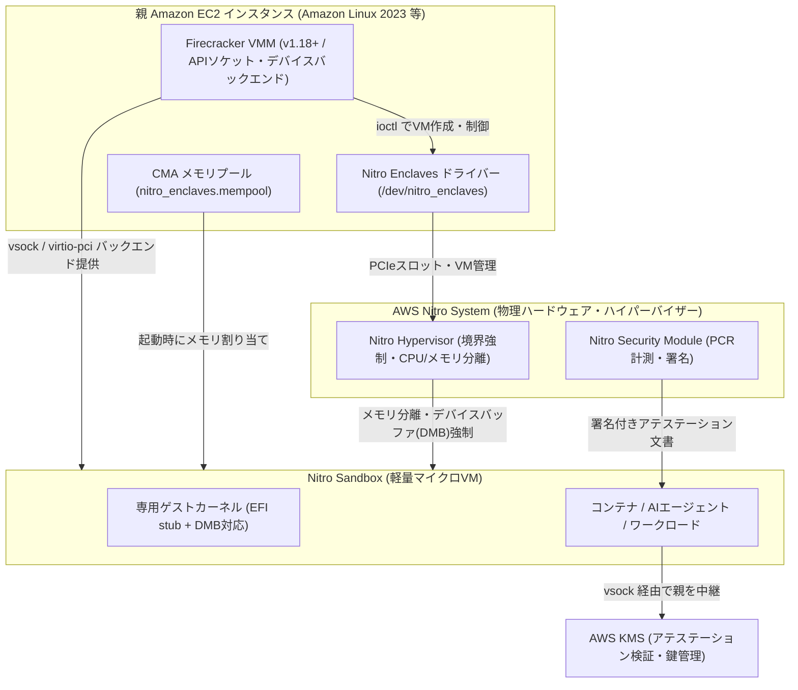

# **AWS Nitro Sandboxes 調査レポート**

## **1. 基本情報**

* **ツール名**: AWS Nitro Sandboxes（Amazon EC2 ユーザーガイド上では「Amazon EC2 Nitro Sandboxes」とも表記）
* **ツールの読み方**: エーダブリューエス ニトロ サンドボックス
* **開発元**: Amazon Web Services (AWS)
* **公式サイト**: [https://docs.aws.amazon.com/AWSEC2/latest/UserGuide/amazon-ec2-nitro-sandboxes.html](https://docs.aws.amazon.com/AWSEC2/latest/UserGuide/amazon-ec2-nitro-sandboxes.html)
* **関連リンク**:
  * ドキュメント（英語）: [https://docs.aws.amazon.com/AWSEC2/latest/UserGuide/amazon-ec2-nitro-sandboxes.html](https://docs.aws.amazon.com/AWSEC2/latest/UserGuide/amazon-ec2-nitro-sandboxes.html)
  * ドキュメント（日本語）: [https://docs.aws.amazon.com/ja_jp/AWSEC2/latest/UserGuide/amazon-ec2-nitro-sandboxes.html](https://docs.aws.amazon.com/ja_jp/AWSEC2/latest/UserGuide/amazon-ec2-nitro-sandboxes.html)
  * AWS What's New: [Introducing AWS Nitro Sandboxes on Amazon EKS, ECS and EC2](https://aws.amazon.com/about-aws/whats-new/2026/11/nitro-sandboxes-eks-ecs-ec2/)
* **カテゴリ**: コンテナ/仮想化
* **概要**: AWS Nitro Sandboxes は、AWS Nitro System のハードウェア境界と軽量仮想マシン（マイクロVM）を用いて、単一の Amazon EC2 インスタンス上で複数のワークロードを完全に隔離して実行する機能である。Amazon EKS の Pod、Amazon ECS のタスク、または EC2 上の独自オーケストレーター（Firecracker 連携）から利用でき、各ワークロードに独立したゲスト OS カーネルとメモリ空間を提供する。

## **2. 目的と主な利用シーン**

* **解決する課題**: 従来の Linux コンテナはホスト OS のカーネルを共有するため、コンテナエスケープやカーネル脆弱性を突かれると同一ホスト上の他ワークロードやホスト自体が侵害されるリスクがあった。一方でワークロードごとに個別の EC2 インスタンスを割り当てるとコストや起動オーバーヘッドが増大する。AWS Nitro Sandboxes は、単一 EC2 インスタンスの柔軟性と集約効率を維持したまま、VM レベルのハードウェア隔離を提供することでこの課題を解決する。
* **想定利用者**: マルチテナント SaaS を運用するプラットフォームエンジニア、AI エージェントの動的コード実行基盤を構築する AI エンジニア、厳格な規制要件（金融・医療等）を満たす必要があるセキュリティエンジニア。
* **利用シーン**:
  * **AI エージェント・LLM 生成コードの安全実行**: ユーザーが入力したコードや LLM が動的に生成した信頼できないコードを、ホストや他セッションから隔離されたマイクロ VM 内で実行する。
  * **マルチテナント SaaS 基盤**: 複数顧客のワークロードを同一の EC2 インスタンスに集約しつつ、テナント間のデータ漏洩やノイジーネイバー問題を防止する。
  * **機密性の高い規制ワークロード**: Confidential モードと暗号学的アテステーションを組み合わせ、親インスタンスの管理者（クラスター管理者を含む）からもメモリ内容を秘匿してシークレットを安全に扱う。

### **2.1 代表的な利用フロー**

```mermaid
swimlane-beta TB
  subgraph User["利用者・開発者"]
    A["EKS Pod定義またはFirecracker設定を作成"]
    F["隔離された環境での実行結果を確認"]
  end
  subgraph Parent["親EC2インスタンス / VMM"]
    B["メモリプールからリソースを確保"]
    C["Nitro Enclavesドライバー経由でVM作成"]
    E["vsock経由でAWS KMSへの検証通信を中継"]
  end
  subgraph Nitro["AWS Nitro System / Sandbox"]
    D["専用ゲストカーネルでワークロードを起動"]
    G["NSMがPCR値を含むアテステーション文書を生成"]
  end
  subgraph KMS["AWS KMS"]
    H["PCR値を検証し条件一致時のみシークレットを復号"]
  end
  A --> B
  B --> C
  C --> D
  D --> G
  G --> E
  E --> H
  H --> F
```

* **代表的な流れ**: 利用者が EKS の `runtimeClassName` 指定や Firecracker 設定でサンドボックス実行を指示すると、親 EC2 インスタンス上の VMM が予約済みメモリプールからリソースを割り当てて Nitro Sandbox を起動する。Confidential モードでは、Nitro Security Module（NSM）が生成したアテステーション文書を親インスタンスが `vsock` 経由で AWS KMS へ中継し、イメージの完全性が検証された場合のみシークレットがサンドボックス内部へ復号・供給される。

## **3. 主要機能**

* **ハードウェア強制のワークロード隔離**: AWS Nitro Hypervisor 上で親 EC2 インスタンスと並列に軽量 VM を実行し、専用のゲスト OS カーネルと隔離されたメモリ空間を各ワークロードに割り当てる。
* **2つの信頼モデル（Confidential / Direct モード）**:
  * **Confidential モード（デフォルト）**: 親インスタンスのメモリマップからサンドボックスのメモリを完全に除外し、親インスタンスの管理者であってもメモリを閲覧・改ざんできない。仮想デバイスは専用のデバイス記憶バッファ（DMB）を介して通信する。
  * **Direct モード**: 親インスタンスとサンドボックス間でメモリを共有し、単一の信頼主体が両方を運用するユースケース向けに軽量な通信を行う。
* **暗号学的アテステーション（NSM & AWS KMS 連携）**: Confidential モードでは Nitro Security Module（NSM）がブートイメージ、起動設定、PCI デバイス構成、親インスタンス ID などを SHA-384 の PCR（PCR0〜PCR6）として計測・署名し、AWS KMS のキーポリシーで検証した上でシークレットを解放する。
* **Amazon EKS / Amazon ECS とのワンライン統合**: EKS では Pod 仕様の `runtimeClassName` に `isolated-sandbox` または `confidential-sandbox` を指定するだけ、ECS でもタスク定義の設定変更のみで各 Pod・タスクを Nitro Sandbox 内で実行できる。
* **Firecracker によるカスタムオーケストレーション**: Firecracker v1.18 以降が Nitro Sandboxes の VMM としてネイティブ対応しており、EC2 上で独自のオーケストレーターと組み合わせて起動・ストレージ接続・ネットワーク制御を自在にカスタマイズできる。
* **AWS ネイティブ機能との互換性**: マイクロ VM 内で動作しながらも、VPC CNI、IAM Roles for Service Accounts / Pod Identity、Amazon EBS / EFS / S3、Amazon CloudWatch などの標準的な AWS 機能やツールがそのまま利用可能である。

## **4. 動作原理・システム構成**



* **アーキテクチャ**: クラウドネイティブなハイパーバイザー支援型マイクロ VM 構成。親となる Amazon EC2 インスタンスの vCPU と予約済みメモリプール（CMA: Contiguous Memory Allocator）をリソース源としながら、実行境界そのものはホスト OS（親インスタンス）ではなく物理層に近い **AWS Nitro Hypervisor** が強制する。
* **主要コンポーネントとデータフロー**:
  * **親インスタンスと Firecracker VMM**: 親インスタンス上の `/dev/nitro_enclaves` ドライバーを通じて、現在唯一対応する VMM である Firecracker（v1.18 以降）がサンドボックスのライフサイクル（作成、vCPU/メモリ割り当て、デバイス接続、起動、停止）を管理する。
  * **通信経路とデバイス**: サンドボックス内のゲスト OS からは標準的な `virtio-pci` デバイス（ブロック、ネットワーク、vsock）として見える。ローカル通信には `vsock` が使用される。Confidential モードでは各仮想デバイスが専用の Device Memory Buffer（DMB）経由でデータをやり取りするため、親インスタンス側がゲストのメインメモリに直接触れることはできない。
  * **アテステーションと計測（PCR）**: Nitro System は起動前に PCR0（イメージ＋機能フラグ）、PCR1/PCR2（カーネルと initrd）、PCR3（親インスタンスの IAM ロール ARN）、PCR4（親インスタンス ID）、PCR5（起動時 PCI デバイス構成）、PCR6（イメージファイル全体）を計測してロックする。なおデバッグモードでは PCR0/1/2/5/6 がゼロになるため、KMS ポリシーでは必ず PCR0 等のイメージ計測値を検証する必要がある。
* **特筆すべき要素技術**:
  * **AWS Nitro Enclaves 基盤の拡張**: 従来の Nitro Enclaves と同じ `/dev/nitro_enclaves` ドライバーおよび NSM 機構を基盤としつつ、汎用的なネットワーク・ストレージデバイス接続や複数サンドボックスの動的スロット管理（初期 4 スロットから 8 スロット単位で拡張可能）に対応している。

## **5. 開始手順・セットアップ**

Amazon EKS や Amazon ECS を使う場合は各マネージドサービスのランタイムクラス設定のみで開始できる。ここでは EC2 インスタンス上で Firecracker を用いて直接 Nitro Sandbox を構築・起動する手順を示す。

* **前提条件**:
  * 対応する Nitro ベース EC2 インスタンスタイプ（`m7i.4xlarge` 等。Flex 系インスタンスや一部最小サイズ・metal サイズは非対応）。
  * 親インスタンス OS: Amazon Linux 2023（`kernel6.18` パッケージ `6.18.51-120.162.amzn2023` 以降）または PPA 経由の Ubuntu。
  * ゲストカーネル: EFI stub 対応（Confidential モードでは加えて DMB 対応が必須。AL2023 の kernel6.18 は両方に対応）。
  * AWS アカウントおよび EC2/IAM/KMS を操作する権限（親インスタンス起動時に `--enclave-options Enabled=true` の指定が必要）。
* **インストール/導入**:
  親 EC2 インスタンスを起動し、SSH 接続後にカーネルのメモリプール設定と Firecracker v1.18 以降のインストールを行う。

  ```bash
  # 1. Nitro Enclaves 有効化オプション付きで親インスタンスを起動（AWS CLI）
  aws ec2 run-instances \
    --image-id resolve:ssm:/aws/service/ami-amazon-linux-latest/al2023-ami-kernel-6.18-x86_64 \
    --instance-type m7i.4xlarge \
    --key-name my-key-pair \
    --iam-instance-profile Name=my-instance-profile \
    --enclave-options Enabled=true

  # 2. 親インスタンス内で CMA メモリプール（例: 8GB）をカーネル引数に追加して再起動
  sudo grubby --update-kernel=ALL --args="nitro_enclaves.mempool=8G@0"
  sudo reboot

  # 3. 再起動後、メモリプール確保を確認
  sudo dmesg | grep "nitro_enclaves: CMA pool"

  # 4. Firecracker (v1.18.0 以降) をインストール
  VERSION="1.18.0"
  ARCH=$(uname -m)
  curl -sSfL -o firecracker.tgz \
    "https://github.com/firecracker-microvm/firecracker/releases/download/v${VERSION}/firecracker-v${VERSION}-${ARCH}.tgz"
  tar -xzf firecracker.tgz
  sudo install -m 755 "release-v${VERSION}-${ARCH}/firecracker-v${VERSION}-${ARCH}" /usr/local/bin/firecracker
  firecracker --version
  ```

* **初期設定**:
  * 5 つ以上の Nitro Sandbox を同時起動する場合は、`/sys/class/misc/nitro_enclaves/pcie_slots` の値を引き上げる（4 から 8 ステップ単位で増加し、8 スロットごとに 128 MiB のプールを消費する）。
  * Confidential モードで AWS KMS と連携する場合は、KMS キーポリシーに `kms:RecipientAttestation:PCR0` 等の条件を設定し、検証済みイメージのみ復号できるよう構成する。
* **クイックスタート**:
  * Firecracker の設定 JSON で `enclave` キー（モードやメモリサイズ等）を指定し、API ソケット経由でゲストイメージ（カーネル＋initrd）を起動する。EKS を利用する場合は、Pod マニフェストに `runtimeClassName: isolated-sandbox`（または `confidential-sandbox`）を 1 行追加してデプロイするだけで動作確認できる。

## **6. 特徴・強み (Pros)**

* **カーネル分離と高集約率の両立**: 1 台の EC2 インスタンス上で複数ワークロードを高密度に実行しながら、各ワークロードに独立したゲストカーネルと Nitro Hypervisor による物理に近い隔離境界を提供できる。
* **追加コストなしで利用可能**: AWS Nitro Sandboxes 自体の機能利用料は無料であり、既存の EC2 インスタンス料金の枠内でセキュリティレベルを大幅に引き上げられる。
* **親ホスト管理者からも保護する Confidential モード**: 単なるサンドボックスにとどまらず、親インスタンスのメモリ空間から切り離し NSM アテステーションを行うことで、運用者やホスト侵害時のメモリダンプ攻撃からも機密データを守れる。
* **既存 AWS エコシステムとの完全な互換性**: 特殊な専用 API への書き換えを強制せず、EKS/ECS の標準ワークフローや VPC CNI、IAM Pod Identity、CloudWatch、EBS/EFS/S3 をそのまま利用可能。

## **7. 弱み・注意点 (Cons)**

* **ライフサイクル・運用機能の一部制約**: スナップショットとリストア、一時停止/再開（Pause/Resume）、ライブマイグレーション、および親インスタンスのハイバネーション（休止状態）は非対応である。親インスタンスを停止・再起動するとサンドボックスも終了する。
* **GPU パススルー非対応**: 現時点では Nitro Sandbox 内への GPU パススルーはサポートされていないため、GPU を直接必要とする推論・学習ワークロードをサンドボックス内で動かすことはできない。
* **ネットワーク・IMDS まわりの自己責任設定（EC2 直接利用時）**: Nitro Sandbox 自体は IMDS（インスタンスメタデータサービス）を持たないが、親インスタンスが NAT 等でトラフィックを転送すると `169.254.169.254` 経由で親の IAM 認証情報に到達できてしまう（IMDSv2 のホップ制限 2 でも防げない）。親インスタンス側でファイアウォールによる明示的な遮断と、conntrack テーブル等の共有ネットワークリソース上限設定が必須となる。
* **ストレージ暗号化に関する注意点**: 親インスタンスはサンドボックスへ提示するブロックデバイスを読み取れるため、EBS 暗号化や SSE-KMS だけでは親インスタンスからデータを秘匿できない。Confidential モードでストレージを保護する場合は、サンドボックス内部で KMS アテステーション鍵を用いて暗号化する必要がある。
* **日本語対応状況**: AWS 公式ドキュメント（EC2 ユーザーガイド）は日本語版（`ja_jp`）が提供されており、AWS サポートも日本語で問い合わせ可能。ただし、Firecracker まわりの最新設定例や一部の技術詳細は英語ドキュメントが先行して更新される場合がある。

## **8. 料金プラン**

| プラン名 | 料金 | 主な特徴 |
|---------|------|---------|
| **AWS Nitro Sandboxes 機能** | 無料（追加料金なし） | 全商用 AWS リージョンの対応 Nitro ベース EC2 インスタンスで利用可能 |
| **親 Amazon EC2 インスタンス** | 従量課金 / Savings Plans / リザーブド | 例: `m7i.4xlarge` 等の標準 EC2 時間課金（サンドボックスは親の vCPU・メモリを使用） |
| **関連 AWS サービス** | 各サービスの標準料金 | Amazon EKS / ECS コントロールプレーン・データ転送・Amazon EBS・AWS KMS API リクエスト等 |

* **課金体系**: AWS Nitro Sandboxes 自体の機能に対する追加課金はない。サンドボックスが消費する vCPU とメモリは親となる EC2 インスタンスのリソースから切り出されるため、親 EC2 インスタンスの標準料金および併用するストレージ（EBS/EFS/S3）や KMS 等の料金のみが発生する。
* **無料トライアル**: Nitro Sandboxes 専用の設定に費用はかからないが、対応する EC2 インスタンスタイプ（`m5.xlarge` 以上や `m7i.xlarge` 以上など、一部の最小サイズを除く Nitro インスタンス）は AWS 無料利用枠の定番（`t2.micro` / `t3.micro` 等）対象外となるケースが多いため、検証時は通常の EC2 料金が発生する。

## **9. 導入実績・事例**

* **導入企業**: 2026年11月9日に正式リリースされたばかりの最新機能であるため、サードパーティ企業による公開導入事例はまだ限定的である（AWS 公式発表では AI エージェント基盤やマルチテナント SaaS、規制業界向けワークロードが想定事例として紹介されている）。
* **導入事例**: 公開事例なし。ただし、基盤技術である AWS Nitro System および Firecracker は AWS Lambda や AWS Fargate で数百万規模のマイクロ VM 隔離に長年実戦投入されており、その実績を EC2/EKS/ECS ユーザーに直接開放した形となる。
* **対象業界**: AI エージェント開発プラットフォーム、マルチテナント SaaS ベンダー、金融・医療・公共機関など高度なデータ隔離とコンプライアンスが求められる業界。

## **10. サポート体制**

* **ドキュメント**: AWS 公式ドキュメント（[Amazon EC2 User Guide](https://docs.aws.amazon.com/AWSEC2/latest/UserGuide/amazon-ec2-nitro-sandboxes.html)、[Amazon EKS User Guide](https://docs.aws.amazon.com/eks/latest/userguide/sandboxing.html)、[Amazon ECS Developer Guide](https://docs.aws.amazon.com/AmazonECS/latest/developerguide/isolated-confidential-tasks.html)）が充実しており、日本語翻訳も提供されている。
* **コミュニティ**: AWS re:Post や GitHub（[firecracker-microvm/firecracker](https://github.com/firecracker-microvm/firecracker)）を通じて技術議論や Issue 報告が可能。
* **公式サポート**: AWS サポートプラン（Developer / Business / Enterprise 等）に準拠。日本語・英語でのテクニカルサポート（Web ケース、チャット、電話）を利用できる。

## **11. エコシステムと連携**

### **11.1 API・外部サービス連携**

* **API**: 親 EC2 インスタンスの起動・設定は標準の Amazon EC2 API / AWS CLI（`--enclave-options Enabled=true`）で制御し、サンドボックス個別の起動・デバイス制御は Firecracker の REST API（Unix ドメインソケット経由）または Kubernetes Pod API / ECS Task API を通じて行う。
* **外部サービス連携**:
  * **Amazon EKS / Amazon ECS**: ランタイムクラスやタスク設定によるネイティブ統合。
  * **AWS KMS**: 暗号学的アテステーション（PCR 条件検証）によるシークレット復号連携。
  * **Amazon VPC / VPC CNI**: サンドボックスごとのネットワークスタックと VPC ネットワーク接続。
  * **Amazon EBS / EFS / S3**: 仮想ブロックデバイスまたはゲスト内クライアント経由でのストレージ利用。
  * **Amazon CloudWatch / IAM Pod Identity**: 標準の監視ログ収集およびワークロード向け権限付与。

### **11.2 技術スタックとの相性**

| 技術スタック | 相性 | メリット・推奨理由 | 懸念点・注意点 |
|:---|:---:|:---|:---|
| **Amazon EKS (Kubernetes)** | ◎ | `runtimeClassName` の 1 行追加で Pod 単位の隔離が可能、Pod Identity や VPC CNI とシームレス | 最新の対応 EKS/AMI バージョンへの追従が必要 |
| **Amazon ECS** | ◎ | タスク単位で隔離・機密タスクとして設定でき、コンテナ運用の手間が少ない | 対応するキャパシティプロバイダー要件の確認が必要 |
| **Firecracker + Amazon Linux 2023** | ◎ | 公式がネイティブサポート（kernel 6.18 以降・Firecracker v1.18+）し、柔軟なカスタマイズが可能 | メモリプール管理・IMDS 遮断・デバイスバックエンドの運用設計が必要 |
| **Ubuntu (カスタム構築)** | ◯ | PPA 経由でドライバー・カーネルサポートが提供されている | AL2023 と比較すると公式手順の参照例が少ない |
| **Windows / GPU ワークロード** | × | Windows 上の Credential Guard と競合し、GPU パススルーは現在非対応 | Linux ベースの CPU ワークロード向けとして割り切る必要がある |

## **12. セキュリティとコンプライアンス**

* **認証**: 親 EC2 インスタンスの起動・操作は AWS IAM により制御される。サンドボックス内部へのシークレット配布には、AWS KMS のキーポリシーと NSM による暗号学的アテステーション（SHA-384 PCR 検証）を組み合わせてハードウェアベースの認証・認可を実現する。
* **データ管理**: Confidential モードでは、AWS Nitro System がサンドボックスのメモリを親インスタンスから完全に切り離し、各仮想デバイスは専用のデバイス記憶バッファ（DMB）でデータ交換を行う。外部通信はサンドボックス内部で暗号化することが推奨される。
* **準拠規格**: AWS Nitro System および Amazon EC2 基盤として、SOC 1/2/3、ISO 27001、PCI DSS、HIPAA、FedRAMP などの主要な国際規格・規制要件に対応した環境上で動作する（詳細は AWS Artifact およびコンプライアンスプログラムで確認可能）。

## **13. 操作性 (UI/UX) と学習コスト**

* **UI/UX**: EKS/ECS 経由で利用する場合は、既存のマニフェストやタスク定義に 1 行のランタイム設定を加えるだけで済むため非常に直感的である。一方、EC2 上で Firecracker を直接扱う場合は CLI・カーネルパラメータ・JSON 設定ファイル中心の操作となり、低レイヤーなインフラ知識が求められる。
* **学習コスト**: EKS/ECS ユーザーにとっては学習コストが低い（数時間〜数日で検証可能）。EC2 で独自オーケストレーターを構築する場合は、Nitro Enclaves ドライバーの CMA メモリプール設計、NUMA ノード配置、PCR0 を用いた KMS ポリシー設計、IMDS 遮断などの知識が必要となり中〜高程度の学習コストがかかる。

## **14. ベストプラクティス**

* **効果的な活用法 (Modern Practices)**:
  * **コンテナワークロードは EKS / ECS 統合を優先する**: 特別なカスタマイズが不要な限り、メモリプール管理やネットワーク隔離を自動処理してくれる EKS（`isolated-sandbox` / `confidential-sandbox`）や ECS のネイティブ統合を利用する。
  * **KMS ポリシーでは必ず `PCR0` 等を検証する**: 親インスタンス情報（`PCR3`/`PCR4`）はデバッグモードでも値が維持されるため、シークレット保護には必ずブートイメージと機能フラグを計測する `PCR0`（または `PCR1`/`PCR2`）を条件に含める。
  * **マルチ NUMA インスタンスではノード単位でプールを分割する**: 大規模インスタンスで複数 NUMA ノードがある場合は、CPU とメモリを同じ NUMA ノードに揃えて起動し性能劣化を防ぐ。
* **陥りやすい罠 (Antipatterns)**:
  * **親インスタンスから IMDS (`169.254.169.254`) を遮断し忘れる**: 親インスタンスで NAT ルーティングを行うと、サンドボックスから親の IAM ロール認証情報を取得できてしまうため、iptables 等で必ずアクセスを拒否する。
  * **`PCR6` を KMS キーポリシーの条件に固定する**: `PCR6` はビルド時刻やメモリサイズ・vCPU 数の変更で値が変化するため、運用上の更新で復号に失敗しやすい。
  * **親インスタンスの停止・再起動を無考慮に行う**: 親 EC2 を停止・再起動すると実行中のすべての Nitro Sandbox が強制終了するため、グレースフルシャットダウン手順をオーケストレーターに組み込む。

## **15. ユーザーの声（レビュー分析）**

* **調査対象**: G2（Amazon EC2 製品ページ）、および公開直後の技術メディア・コミュニティ（InfoQ、AWS News コミュニティ）
* **総合評価**: 4.6 / 5.0（[G2 - Amazon EC2](https://www.g2.com/products/amazon-ec2/reviews) ※基盤サービスとしての評価。Nitro Sandboxes 単体のレビューサイトスコアはリリース直後のため未集計）
* **ポジティブな評価**:
  * 「EKS Pod や ECS タスクに `runtimeClassName` を指定するだけでハードウェアレベルのマイクロ VM 隔離が追加料金なしで使える点は画期的」（InfoQ 等の技術解説・コミュニティ反応より要約）
  * 「LLM が生成した信頼できないコードを、別 EC2 インスタンスを立ち上げずに単一ホスト上で安全・高密度に実行できるため、AI エージェント基盤のコスト削減に直結する」（技術ブログ・コミュニティ反応より要約）
  * 「AWS の既存のセキュリティ・信頼性・スケーラビリティはエンタープライズ要件を満たす上で非常に強力」（G2 Amazon EC2 レビューより要約）
* **ネガティブな評価 / 改善要望**:
  * 「EC2 で Firecracker を使って直接構築する場合、CMA メモリプールの事前予約や IMDS 遮断、スロット数の拡張など低レイヤーの考慮事項が多い」（AWS 公式ドキュメント・技術解説より分析）
  * 「GPU パススルーやライブマイグレーション・スナップショットがまだ使えないため、汎用 VM やローカル学習環境を完全に置き換えることはできない」（技術解説・制限事項より分析）
  * 「AWS サービスの料金体系や各種オプションの組み合わせが複雑になりやすい」（G2 Amazon EC2 レビューより要約）
* **特徴的なユースケース**:
  * 自律型コーディングエージェントや AI ワークフローが動的に生成したスクリプト・ツール群を、リクエストごとに使い捨ての安全な Nitro Sandbox 内で実行する用途が最も注目されている。

## **16. 直近半年のアップデート情報**

* **2026-11-09**: **AWS Nitro Sandboxes 正式リリース（GA）**: Amazon EKS、Amazon ECS、Amazon EC2 向けに全商用 AWS リージョンで追加料金なしにて提供開始。Confidential / Direct の 2 モードおよび AWS KMS アテステーション連携、Firecracker v1.18 ネイティブサポートを同時公開。

(出典: [What's New with AWS](https://aws.amazon.com/about-aws/whats-new/) / [Amazon EC2 ユーザーガイド](https://docs.aws.amazon.com/AWSEC2/latest/UserGuide/amazon-ec2-nitro-sandboxes.html))

## **17. 類似ツールとの比較**

### **17.1 機能比較表 (星取表)**

| 機能カテゴリ | 機能項目 | AWS Nitro Sandboxes | Docker Sandboxes | Apple Container | LiteBox | Amazon Bedrock AgentCore Runtime |
|:---:|:---|:---:|:---:|:---:|:---:|:---:|
| **隔離技術** | ハードウェア VM 隔離 | ◎<br><small>Nitro Hypervisor + Firecracker</small> | ◎<br><small>ローカル MicroVM</small> | ◎<br><small>Apple Virtualization FW</small> | △<br><small>ライブラリOS / LVBS等連携</small> | ◎<br><small>サーバーレス MicroVM</small> |
| **機密計算** | 暗号学的アテステーション | ◎<br><small>NSM + AWS KMS 連携</small> | ×<br><small>非対応</small> | ×<br><small>非対応</small> | ◯<br><small>SEV-SNP 等に対応設計</small> | ×<br><small>ユーザー向け PCR 検証なし</small> |
| **運用形態** | インフラ管理の不要度 | △<br><small>親 EC2 / EKS ノード管理が必要</small> | ◯<br><small>ローカル PC 上で完結</small> | ◯<br><small>Mac ローカルで完結</small> | △<br><small>組み込み向けライブラリOS</small> | ◎<br><small>完全サーバーレス</small> |
| **コンテナ連携** | OCI / Kubernetes 統合 | ◎<br><small>EKS / ECS ネイティブ統合</small> | ◯<br><small>Docker エコシステム統合</small> | ◎<br><small>OCI 互換イメージ対応</small> | ×<br><small>プロセス・バイナリ単位</small> | ◯<br><small>専用エージェントランタイム</small> |
| **コスト** | 機能追加料金の安さ | ◎<br><small>機能自体は無料 (EC2 料金のみ)</small> | ◎<br><small>無料</small> | ◎<br><small>無料 (OSS)</small> | ◎<br><small>無料 (OSS)</small> | ◯<br><small>CPU/メモリ秒単位課金</small> |

### **17.2 詳細比較**

| ツール名 | 特徴 | 強み | 弱み | 選択肢となるケース |
|---------|------|------|------|------------------|
| **AWS Nitro Sandboxes** | AWS Nitro System 上で単一 EC2 内にハードウェア隔離された軽量 VM を実行 | Confidential モード＋KMS 検証、EKS/ECS 統合、追加料金なし | AWS 環境依存、GPU パススルーやスナップショット非対応 | - |
| **Docker Sandboxes** | ローカルマシン上で AI コーディングエージェントを MicroVM 隔離するツール | ローカル開発で即座に利用可能、主要 AI エージェントに標準対応 | クラウド本番のマルチテナント基盤や機密アテステーション用途には不向き | 開発者の手元 PC で Claude Code 等を安全に動かしたい場合 |
| **Apple Container** | Apple シリコン Mac 向けに最適化された Swift 製コンテナ VM ツール | macOS ネイティブで軽量高速、OCI イメージがそのまま動く | macOS 26 以降専用であり、Linux サーバーやクラウド本番では使えない | Mac ローカル環境での開発・テスト用途 |
| **LiteBox** | Microsoft 製の Rust 製セキュリティ特化ライブラリ OS | ホストへのインターフェースを極小化しアタックサーフェスを削減 | 開発中であり本番向けのマネージドオーケストレーション統合はない | OS 研究や特定プラットフォーム向けの低レイヤー組み込み用途 |
| **Amazon Bedrock AgentCore Runtime** | AWS の AI エージェント専用サーバーレス MicroVM 実行基盤 | インフラ管理不要、I/O 待ち時間無料の課金モデルで大規模スケール | AWS 基盤への高い依存、自由なカーネル/独自基盤カスタマイズは不可 | EKS/EC2 のノード管理を一切せずに AI エージェントをホストしたい場合 |

## **18. 総評**

* **総合的な評価**:
  * AWS Nitro Sandboxes は、長らくコンテナ運用における課題であった「共有カーネルによるセキュリティリスク」と「VM 分離によるコスト・オーバーヘッド増大」のジレンマを、AWS Nitro System というハードウェア基盤によって解消した非常に完成度の高い機能である。特に Confidential モードと AWS KMS アテステーションの組み合わせは、ホスト管理者すら信頼しないゼロトラスト要件や AI エージェントによる任意コード実行において決定的な強みを持つ。
* **推奨されるチームやプロジェクト**:
  * Amazon EKS や Amazon ECS 上でマルチテナント SaaS やユーザーコード実行基盤を運用しているチーム。
  * LLM が生成したコードを本番クラウド環境で高密度かつ安全に実行したい AI エージェント開発チーム。
  * 金融・医療など、厳格なワークロード隔離とハードウェア検証が求められるエンタープライズプロジェクト。
* **選択時のポイント**:
  * インフラや Kubernetes クラスターを自社で管理・最適化したい場合は **AWS Nitro Sandboxes**、インフラ管理を完全に手放して AI エージェントの実行だけを行いたい場合は **Amazon Bedrock AgentCore Runtime**、開発者のローカル PC 上でエージェントを隔離したい場合は **Docker Sandboxes** を選択するとよい。
