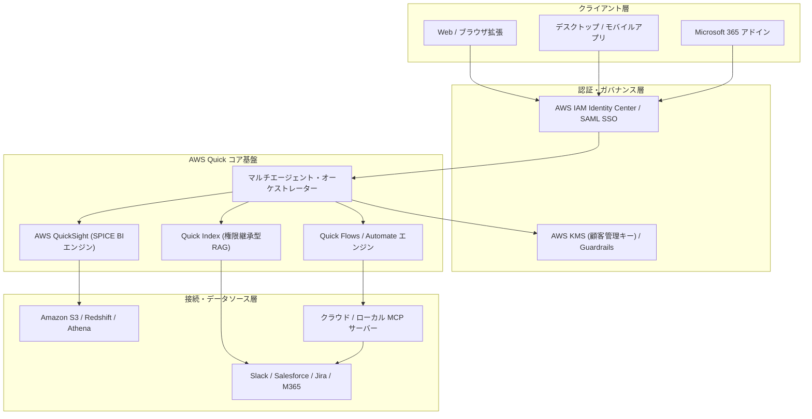

# **AWS Quick 調査レポート**

## **1. 基本情報**

* **ツール名**: AWS Quick（旧称: Amazon Quick / Amazon Quick Suite）
* **ツールの読み方**: エーダブリューエス クイック
* **開発元**: Amazon Web Services (AWS)
* **公式サイト**: [https://aws.amazon.com/jp/quick/](https://aws.amazon.com/jp/quick/)
* **関連リンク**:
  * ドキュメント: [https://docs.aws.amazon.com/quicksuite/](https://docs.aws.amazon.com/quicksuite/)
  * レビューサイト: [G2 (Amazon QuickSight)](https://www.g2.com/products/amazon-quicksight/reviews) | [Capterra (Amazon QuickSight)](https://www.capterra.com/p/153988/Amazon-QuickSight/)
* **カテゴリ**: 自律型AIエージェント
* **概要**: AWS Quickは、ビジネスインテリジェンス（BI）、企業横断型のAIリサーチ、ノーコードのワークフロー自動化、アプリ生成を統合したAWSのエンタープライズ向けAIワークスペースです。2026年11月に「Amazon Quick」から現在の名称へリブランディングされ（BI機能も「AWS QuickSight」へ改称）、デスクトップ・ブラウザ・モバイル・Officeアドインのあらゆる環境から、自然言語で社内データ分析やマルチエージェントによる業務自動化を実行できます。

## **2. 目的と主な利用シーン**

* **解決する課題**: 社内のドキュメント、SaaSツール、BIダッシュボード、Web情報などがサイロ化し、情報収集から分析・意思決定・実務アクションまでの業務プロセスが分断されている課題、および生成AI導入におけるシャドーITやデータ漏洩リスク。
* **想定利用者**: ビジネスアナリスト、営業・マーケティング担当者、経営層、オペレーションマネージャー、IT管理者・開発者。
* **利用シーン**:
  * 営業担当者が商談前にCRM（Salesforce等）、社内Slack、メール、Web上の最新ニュースを横断リサーチし、引用付きの顧客アカウントプランを数分で自動生成する。
  * データアナリストや現場担当者が自然言語で売上データを照会し、AWS QuickSightによるダッシュボード生成と要因分析、さらにチームへの定期レポート配信フローをチャットだけで構築する。
  * 部門の業務フロー（Jiraチケットの要約・分類、定例会議の準備、財務差異分析など）をプラグインやマルチエージェントワークフローとして自動化する。

### **2.1 代表的な利用フロー**

```mermaid
swimlane-beta TB
  subgraph User["ユーザー"]
    A["自然言語で調査・自動化を指示"]
    F["引用付きレポート・実行結果を確認"]
  end
  subgraph Quick["AWS Quick（AIワークスペース）"]
    B["意図を解析しエージェント計画を立案"]
    D["分析・ダッシュボード・成果物を生成"]
  end
  subgraph Connectors["MCP・外部コネクタ"]
    C["社内SaaS・DB・Webへクエリ実行"]
  end
  subgraph Governance["AWSガバナンス層"]
    E["IAM権限・承認ゲート（HITL）を検証"]
  end
  A --> B
  B --> C
  C --> D
  D --> E
  E --> F
```

* **代表的な流れ**: ユーザーがチャット等で業務指示を出すと、AWS Quickのオーケストレーターがタスクを分解し、MCPコネクタやデータソース経由で社内SaaS・DB（S3/Redshift等）から情報を収集します。生成されたレポートや外部アクションはIAM権限とHuman-in-the-loop（Smart Approvals）による承認検証を経てユーザーへ返却・実行されます。

## **3. 主要機能**

* **AWS QuickSight（統合BI・データ可視化）**: インメモリエンジン「SPICE」と生成AIを融合したBI機能。自然言語プロンプトからのダッシュボード自動構築、エグゼクティブサマリー生成、閲覧者（Reader）自身によるピボットテーブルの柔軟なカスタマイズが可能です。
* **AWS Quick Research（深層リサーチ）**: 社内のナレッジベース（Quick Index）、業務アプリ、および信頼性の高いパブリックWeb情報を横断検索し、明確な出典・引用リンク付きの包括的な調査レポートを数分で作成します。
* **AWS Quick Flows（チャット駆動型ワークフロー自動化）**: 非エンジニアでも自然言語の対話だけで複数ステップの業務自動化フローを作成・テスト・実行できる機能。決定論的（Deterministic）なステップとAIエージェントの協調処理をシームレスに組み合わせます。
* **AWS Quick Automate & Custom Apps（エンタープライズ自動化・アプリ生成）**: 大規模な業務プロセスや高負荷なデータループをオーケストレーションする高度な自動化機能。自然言語の指示から、ライブデータと行・列レベルセキュリティに連動した業務Webアプリを即座に生成できます。
* **Quick Index & Spaces（統合ナレッジ・共同作業空間）**: プロジェクトや部署ごとにドキュメント、データソース、チャット履歴を集約するセキュアな共同作業スペース（Spaces）と、権限継承型RAGを実現するベクトルインデックス（Quick Index）。
* **Plugins（プラグインバンドル）**: 2026年11月に追加された機能で、特定の役割や業務（営業開発支援、カレンダー・会議アシスタント等）に必要なコネクタ、スキル、エージェント、フローを1つのパッケージとしてワンステップで導入・共有できます。
* **マルチプラットフォーム＆Office統合**: Webアプリに加え、macOS / Windows向けデスクトップアプリ、iOS / Androidモバイルアプリ、ブラウザ拡張機能（Chrome / Edge / Firefox）、Microsoft 365アドイン（Word / Excel / PowerPoint / Outlook）を提供し、コンテキストを同期します。

## **4. 動作原理・システム構成**

* **アーキテクチャ**: AWSネイティブのクラウド完結型マネージドSaaSアーキテクチャ。AWSリージョン（東京リージョン `ap-northeast-1` やシンガポールリージョン等を含む）内でデータ主権を保ちながら推論・ストレージ処理を実行します。
* **主要コンポーネントとデータフロー**:
  * クライアント層（Web / デスクトップ / モバイル / Officeアドイン）からのリクエストは、AWSの認証・認可基盤（IAM Identity Center等）を通じてAWS Quickのオーケストレーション層へ送信されます。
  * オーケストレーション層では、Amazon Bedrock等の基盤モデルを活用したマルチエージェントが並列・協調動作し、必要に応じて「Quick Index（RAG用ベクトルDB）」「QuickSight（SPICEインメモリBIエンジン）」「Flows/Automateエンジン」へ処理を振り分けます。
  * 外部サービスや社内システムとの接続には **Model Context Protocol (MCP)** 準拠のクラウド／ローカルコネクタおよびVPCプライベート接続が用いられ、ユーザーの権限範囲（ACL）を厳密に尊重してデータ取得・アクション実行を行います。
* **特筆すべき要素技術**:
  * **MCP (Model Context Protocol) 統合とMCP Sync**: 外部MCPサーバーのスキーマ変更を自動同期する「MCP Sync」や、プライベートVPC内のリソースへ安全に接続する `VpcConnectionArn` 構成をサポート。
  * **マルチエージェントオーケストレーション**: 複雑な単一プロンプトに対し、複数の特化型エージェントが同時並行で調査・計算・検証を行う仕組み。
  * **Smart Approvals & ガードレール**: 破壊的操作や外部送信を伴うツール実行前に人間の承認を求めるHuman-in-the-loop（HITL）およびDeny-by-defaultの権限制御。



## **5. 開始手順・セットアップ**

* **前提条件**:
  * **個人・小規模チーム利用**: メールアドレスまたはSNS連携アカウントのみでWebサインアップ可能（AWSアカウント不要・クレジットカード不要のFreeプランあり）。
  * **組織・エンタープライズ利用**: AWSアカウント、および推奨として **AWS IAM Identity Center**（またはOkta / Microsoft Entra ID等のIdP）の設定が必要。
* **インストール/導入**:
  * Web版は公式サイト（`aws.amazon.com/jp/quick/`）からサインインして即時利用可能。
  * デスクトップアプリ（macOS / Windows）、モバイルアプリ（iOS / Android）、およびブラウザ拡張機能は公式ダウンロードページや各ストアから導入します。
  * 組織アカウントとしてAWS CLI等で管理する場合はAWSアカウント環境を準備します。

  ```bash
  # 例: AWS CLIでQuickSight/Quick関連のアカウント状態を確認する場合
  aws sts get-caller-identity
  ```

* **初期設定**:
  * 組織導入時はAWSマネジメントコンソールからAWS Quickを有効化し、利用リージョン（例: 東京リージョン `ap-northeast-1`）を選択してIAM Identity Centerと紐付けます。
  * データソース（S3、Redshift、Slack、Microsoft 365、Jira、カスタムMCPサーバー等）のコネクタを接続し、Quick Indexの同期およびアクセス権限プロファイルを設定します。
* **クイックスタート**:
  * Workspaceのチャット画面を開き、「先月の地域別売上サマリーを作成し、前月比の変動要因を調査して」等と日本語で入力することで、データ検索・グラフ生成・要約レポート作成を即座に体験できます。

## **6. 特徴・強み (Pros)**

* **BIから自律型アクションまでの一気通貫性**: データの可視化（QuickSight）にとどまらず、背景調査（Research）、業務アプリ生成（Apps）、業務自動化（Flows/Automate）が単一UIでシームレスに完結します。
* **エンタープライズ級のセキュリティとデータ主権**: 顧客データは基盤モデルの学習に一切使用されず、AWS KMSによる暗号化やIAM権限継承、東京リージョンでのデータ完結（APPI対応）など、日本の大企業・金融・公共機関でも採用しやすい堅牢なガバナンスを備えています。
* **MCP標準対応による高い拡張性**: Model Context Protocol (MCP) のクラウド／ローカルコネクタおよびVPC接続に対応しており、既存SaaSだけでなく社内独自APIやオンプレミスシステムとも安全に連携できます。
* **導入ハードルの低さと段階的スケーリング**: 個人向けの無料プラン（Free）から試用でき、組織展開時も既存のQuickSight Readerユーザーが追加費用なしでAI機能を使える「Essentials」プランが用意されています。

## **7. 弱み・注意点 (Cons)**

* **組織向けプランの固定基本料金**: 組織向けのProfessionalプランを利用する場合、ユーザー単価（$20/月）とは別に**AWSアカウントあたり月額$250のインフラストラクチャ基本料金**が発生するため、極小規模な組織導入では割高になる場合があります。
* **グラフ表現の高度なカスタマイズ性**: 統合されているQuickSightはサーバーレスで高速な反面、極めて緻密なデザイン調整や特殊なカスタムチャート表現においてはTableauなどの専門BIツールに一歩譲る面があります。
* **初期ガバナンス設計の学習コスト**: 個人利用は直感的ですが、組織全体でMCPサーバー連携、VPC接続、行・列レベルセキュリティ、権限プロファイルを最適設計するにはAWSのIAMやネットワーク知識が求められます。
* **日本語対応の状況**: 2026年11月のアップデートにより、チャット、リサーチレポート、アプリ生成における**日本語ネイティブ対応**および**東京リージョン対応**が正式に強化されました。ただし、最新の実験的機能や一部ドキュメントは英語での先行提供となる場合があります。

## **8. 料金プラン**

AWS Quickは「個人・チーム向け（Web直接サインアップ）」と「組織向け（AWSマネジメントコンソール管理）」の2軸で料金体系が提供されています。

| プラン名 | 区分 | 料金 | 主な特徴 |
|---|---|---|---|
| **Free** | 個人向け | 無料 ($0/月) | デスクトップ/WebでのAIチャット、基本ファイル要約、日常タスク支援 |
| **Plus** | 個人・チーム | $20/ユーザー・月 (年払い)<br>$25/ユーザー・月 (月払い) | 最大300名まで。共有Spaces、M365連携、ユーザー管理、10GB/人ストレージ |
| **Max** | ヘビーユーザー | $100/ユーザー・月 (年払い)<br>$125/ユーザー・月 (月払い) | Plusの全機能に加え、使用クォータおよびインデックスストレージが5倍 |
| **Essentials** | 組織向け | $3/ユーザー・月 | QuickSight Reader相当のBI閲覧＋基本AIチャット・Research・Flows・Apps |
| **Professional** | 組織向け | $20/ユーザー・月<br>＋$250/月（アカウント基本料） | ユーザー数無制限、高度なRBAC・SSO、24時間AWSサポート、25GB/人共有ストレージ |

※BI作成者向けの従来ロール（Author: $24/月〜、Author Pro: $40/月〜、キャパシティ課金等）も継続して利用可能です。超過利用時はエージェント時間あたり$3、追加インデックスストレージGBあたり$5等の従量課金が適用される場合があります。

* **課金体系**: ユーザー単位のサブスクリプション課金（組織Professionalはアカウント基本料金併用、一部BI機能はセッション/キャパシティ課金選択可）。
* **無料トライアル**: Plusプラン等では30日間の無料トライアルが提供されています。また、Freeプランは期間制限なく無料で開始可能です。

## **9. 導入実績・事例**

* **導入企業**: Pomelo、GoDaddy、Intuit、NFL（Next Gen Stats）、Allianz、Cox Automotive、Mondelez、DXC、Southwest Airlines、Amazon社内各部門（Amazon Books、Canada Tax Team）。
* **導入事例**:
  * **Pomelo（フィンテック）**: AWS Quickの導入により、データ分析チームを増員することなく月間でデータを活用する従業員数が約4倍に増加し、単一の自動化ワークフローだけで月間80時間の工数削減を達成。
  * **NFL Next Gen Stats**: 膨大な試合・選手データを活用し、「Combine IQ」「Draft IQ」といった専門分析アシスタントを構築して100万人以上のファンへデータインサイトを提供。
  * **Amazon Books（Print on Demand部門）**: Slack、メール、Asana、社内ドキュメントに散在していたプロジェクト知見をAWS Quickで統合し、書籍生産ワークフローを迅速化。
* **対象業界**: 金融・フィンテック、小売・EC、航空・自動車、IT・SaaS、メディア・スポーツ、公共機関など、厳格なデータガバナンスを求められるエンタープライズ領域を中心に幅広く導入が進んでいます。

## **10. サポート体制**

* **ドキュメント**: AWS公式ドキュメント（[AWS Quick / Quick Suite Documentation](https://docs.aws.amazon.com/quicksuite/)）およびAWS公式ワークショップ（AWS Workshops）が整備されており、日本語・英語で豊富なガイドが提供されています。
* **コミュニティ**: AWS re:Post（公式Q&Aコミュニティ）、Amazon QuickSight Community、日本のユーザーコミュニティであるJAWS-UGなどで活発な知見共有が行われています。
* **公式サポート**: AWSサポートプラン（Basic / Developer / Business / Enterprise）に準拠した公式サポートを提供。Professionalプランでは24時間体制のAWSサポートが利用可能です。

## **11. エコシステムと連携**

### **11.1 API・外部サービス連携**

* **API / MCP**:
  * AWS SDK / CLIを通じた管理・埋め込みAPIに加え、**Model Context Protocol (MCP)** に標準対応。リモートMCPサーバーやローカル開発者向けMCPサーバー、AWSマネージドMCPサーバー、AgentCore Gateway経由で社内独自APIをAIエージェントのツールとして公開できます。
* **外部サービス連携**:
  * **AWSサービス**: Amazon S3、Amazon Redshift、Amazon Athena、Amazon RDS、Amazon Bedrock、AWS CloudTrail
  * **ビジネス・生産性SaaS**: Microsoft 365（Outlook, Word, Excel, PowerPoint, SharePoint）、Slack、Salesforce、Jira、ServiceNow、Asana、Airtable、Google Workspace（Gmail等）、Meta Ads、Amplitude

### **11.2 技術スタックとの相性**

| 技術スタック | 相性 | メリット・推奨理由 | 懸念点・注意点 |
|:---|:---:|:---|:---|
| **AWSデータ基盤 (S3/Redshift/Athena)** | ◎ | ネイティブ統合により設定が最小限で済み、IAM・VPC・SPICEの恩恵を最大限に受けられる | AWSアカウント外のデータには別途コネクタ設定が必要 |
| **Microsoft 365 エコシステム** | ◎ | Word/Excel/PowerPoint/Outlook向け公式アドインとSharePoint連携が充実 | 組織全体でのM365 Copilotとの役割分担・コスト整理が必要 |
| **MCP対応カスタムAPI / Lambda** | ◎ | MCPおよびMCP Sync、VPC接続により社内独自システムを安全にツール化できる | MCPサーバー側の構築・運用およびスキーマ設計が必要 |
| **フロントエンド / Webアプリ埋め込み** | ◯ | QuickSight埋め込みSDKやApps機能により既存ポータルへの統合が可能 | 高度なUI/UXをゼロから独自実装する場合はフロントエンド開発が必要 |
| **オンプレミス・レガシーDB** | △ | AWS Direct Connect / VPN + VPC接続経由で連携可能 | ネットワーク経路設計と認証ゲートウェイ構築の手間がかかる |

## **12. セキュリティとコンプライアンス**

* **認証**: AWS IAM Identity Center（旧AWS SSO）と統合し、Microsoft Entra ID・Okta・Ping Identity等の外部IdPとSAML 2.0によるSSO、多要素認証（MFA）、ロールベースアクセス制御（RBAC）に対応。
* **データ管理**:
  * 通信時（HTTPS/WSS）および保存時の暗号化を標準実装し、**AWS KMS（顧客管理キー: CMK）** による暗号鍵の自社管理・マルチリージョン複製が可能。
  * **顧客データは外部や基盤モデルの学習に一切使用されない**ことが明確に保証されています。
  * 監査ログはAWS CloudTrail等で記録・監視可能。東京リージョン（`ap-northeast-1`）でのデータ完結により日本の個人情報保護法（APPI）要件にも対応。
* **準拠規格**: SOC 1 / SOC 2 / SOC 3、ISO/IEC 27001、FedRAMP、HIPAA適格、PCI DSS（AWS Artifactからコンプライアンスレポートを取得可能）。

## **13. 操作性 (UI/UX) と学習コスト**

* **UI/UX**: 2026年11月に刷新されたWeb UIおよびデスクトップアプリは、チャット中心の直感的なインターフェースを採用しており、リサーチ結果の引用表示やダッシュボード、構築したワークフロー（Flows）の可視化が一画面でスムーズに行えます。
* **学習コスト**: エンドユーザーがチャットで質問・リサーチ・簡単なFlows作成を行う分には学習コストは非常に低く、非技術職でも即座に活用できます。一方、管理者がVPC内MCPサーバー連携や詳細な権限プロファイル（Deny-by-default）、QuickSightの行レベルセキュリティを設計する段階では、一定のAWS管理知識が必要となります。

## **14. ベストプラクティス**

* **効果的な活用法 (Modern Practices)**:
  * **SpacesとPluginsによる部門別最適化**: プロジェクトや部署ごとに「Spaces」を作成して関連データソースを集約し、定型業務は「Plugins」としてパッケージ化してチーム全体に展開する。
  * **Smart Approvalsの組み込み**: 外部へのメール送信やCRMデータ更新を伴う「Flows / Automate」には必ずHuman-in-the-loop（Smart Approvals）を挟み、AIの自律性と業務安全性を両立させる。
  * **Quick Essentialsの活用**: 既存のQuickSight ReaderユーザーをEssentialsへ移行し、コストを抑えつつ全社的なAIチャット・自然言語Q&A活用を一気に立ち上げる。
* **陥りやすい罠 (Antipatterns)**:
  * **権限継承の未検証による過剰アクセス**: データソース接続時に権限プロファイルやACL設定を曖昧にすると、機密情報がエージェント経由で参照されるリスクがあるため、必ず最小権限（Deny-by-default）で構成する。
  * **用途に見合わないアカウント構成**: 小規模検証から始める際に最初から大規模組織用Professionalプランを契約すると月額$250の基本料が負担になるため、まずはFree/Plusプランまたは既存QuickSight環境から段階的に拡張する。

## **15. ユーザーの声（レビュー分析）**

* **調査対象**: G2、Capterra、AWS公式事例・技術ブログ・コミュニティ（Reddit等）。※リブランド直後のため、BI基盤であるAmazon QuickSightおよびAWS Quick / Amazon Q関連のレビューを含めて分析。
* **総合評価**: 4.3〜4.5 / 5.0（G2 / CapterraにおけるAmazon QuickSight評価）
* **ポジティブな評価**:
  * 「S3やRedshiftなどのAWSデータ基盤との親和性が抜群で、サーバーレスのためインフラ管理の手間が一切かからない。」
  * 「自然言語プロンプトでダッシュボードやレポートを素早く生成でき、非エンジニアのビジネスユーザーでもデータ探索が可能になった。」
  * 「既存の権限境界（IAM）を尊重した検索（Agentic RAG）が機能するため、セキュリティ部門の承認を得やすい。」
* **ネガティブな評価 / 改善要望**:
  * 「ダッシュボードの細かなレイアウト調整やカスタムチャートの自由度は、TableauやPower BIと比べると制限を感じる。」
  * 「初期のエンタープライズセットアップ（IAM連携やデータコネクタ構成）にはAWS特有の学習コストがかかる。」
  * 「Microsoft 365中心の企業では、Microsoft 365 Copilotとの棲み分けや重複コストの判断に迷うことがある。」
* **特徴的なユースケース**:
  * アナリスト個人の手作業だった週次の財務差異分析をチャット経由でFlows化し、チーム全体で再現可能な決定論的チェック付き自動化プロセスへ昇華させた事例が報告されています。

## **16. 直近半年のアップデート情報**

* **2026-11-20**: AWS Quick Flowsの大幅強化を発表。チャットを通じた長時間の決定論的ワークフロー構築、マルチエージェントオーケストレーション、ミッションコントロール機能、バックグラウンドエージェント実行に対応。
* **2026-11-09**: 「Amazon Quick」を「**AWS Quick**」へ、「Amazon QuickSight」を「**AWS QuickSight**」へ正式リブランド。既存の機能・料金・データへの影響はなく、エンタープライズ級のセキュリティ・ガバナンス姿勢を明確化。
* **2026-11（上旬〜中旬）**: エージェント・スキル・コネクタ・フローを1つにまとめる「**Plugins**」機能、刷新されたWeb UI・ブラウザ拡張・M365アドイン、および**日本語**・ドイツ語・中国語・ベトナム語へのネイティブ対応を追加。
* **2026-10（秋期）**: データソース単位での詳細なアクセス制限が可能なカスタム権限プロファイル（GA）、MCP Sync機能、Smart Approvals、およびシンガポールリージョン（`ap-southeast-1`）展開を実施。
* **2026-09-03**: ヘビーユーザー向けに利用枠とインデックス容量が5倍となる「Max」プランを提供開始。
* **2026-09-01**: 自然言語の指示からSalesforceやJira等のデータと連携した業務アプリを生成する「Custom App Building」を一般提供（GA）。

（出典: [AWS What's New](https://aws.amazon.com/new/) / [AWS Quick 公式サイト](https://aws.amazon.com/jp/quick/)）

## **17. 類似ツールとの比較**

### **17.1 機能比較表 (星取表)**

| 機能カテゴリ | 機能項目 | AWS Quick | Microsoft 365 Copilot | ChatGPT for Work | Tableau |
|:---:|:---|:---:|:---:|:---:|:---:|
| **基本機能** | 自律型ワークフロー・エージェント | ◎<br><small>Flows/Automate・マルチエージェント</small> | ◯<br><small>Copilot Studio連携</small> | ◯<br><small>GPTs・タスク実行</small> | ×<br><small>BI特化のため非対応</small> |
| **BI・分析** | ダッシュボード・可視化 | ◎<br><small>AWS QuickSight統合・SPICE</small> | △<br><small>Excel/Power BI連携</small> | △<br><small>Code Interpreter中心</small> | ◎<br><small>業界最高水準の表現力</small> |
| **連携性** | 外部SaaS / MCP連携 | ◎<br><small>MCP標準対応・VPC接続可</small> | ◯<br><small>M365中心・Graphコネクタ</small> | ◯<br><small>各種コネクタ・API</small> | ◯<br><small>豊富なDB/SaaSコネクタ</small> |
| **エンタープライズ** | セキュリティ・認証・KMS | ◎<br><small>IAM Identity Center・CMK・各種認証</small> | ◎<br><small>Entra ID・Purview統合</small> | ◯<br><small>SAML SSO・学習除外</small> | ◎<br><small>エンタープライズ権限管理</small> |
| **非機能要件** | 日本語対応 | ◯<br><small>2026年11月ネイティブ対応拡充</small> | ◎<br><small>Office全体で高精度対応</small> | ◎<br><small>非常に自然な日本語処理</small> | ◎<br><small>UI・コミュニティとも充実</small> |

### **17.2 詳細比較**

| ツール名 | 特徴 | 強み | 弱み | 選択肢となるケース |
|---|---|---|---|---|
| **AWS Quick** | BI＋リサーチ＋自律型エージェント統合基盤 | AWSデータ基盤との親和性、MCP・VPC対応、QuickSight標準搭載 | 組織Proプランの基本料($250/月)、高度BIデザインの自由度 | AWS上でデータ基盤を運用しており、分析から業務自動化まで一貫して行いたい場合 |
| **Microsoft 365 Copilot** | Office 365アプリに深く組み込まれたAI | Word/Excel/Teams上での圧倒的な日常業務の利便性 | M365ライセンス前提のコスト、非MS基盤との連携 | 全社がMicrosoft 365中心で業務を行っており、既存Office作業を効率化したい場合 |
| **ChatGPT for Work** | 汎用性の高い最先端LLMワークスペース | モデルの推論能力と汎用性、直感的なUIで学習コストが低い | 社内システムやBIとのネイティブ統合には構築が必要 | 汎用的な思考支援・文章作成・コード生成を全社へ素早く展開したい場合 |
| **Tableau** | 高度なデータ可視化に特化したBIツール | 圧倒的なチャート表現力と大規模なBIコミュニティ | 自律型AIエージェントや業務フロー自動化機能は持たない | データアナリストが極めて高度で緻密なビジュアル分析・レポートを作成したい場合 |

## **18. 総評**

* **総合的な評価**:
  * AWS Quickは、2026年11月のリブランドおよび日本語ネイティブ対応・Plugins・Flows強化により、単なる「AWSのBIツール」から「**データ分析と自律型AIエージェントを融合させたエンタープライズAIワークスペース**」へと完全に進化を遂げました。MCPによる標準化された外部連携とAWSネイティブの厳格なガバナンス（KMS、IAM、リージョン完結）を両立している点は、他社ツールに対する大きな競争優位性です。
* **推奨されるチームやプロジェクト**:
  * Amazon S3・Redshift・Athena等でデータ基盤を構築している企業、金融・医療・公共など厳格なセキュリティ・データ主権が求められる組織、およびBIの可視化結果からそのまま定型業務の自動化まで繋げたいデータ活用推進チームに強く推奨されます。
* **選択時のポイント**:
  * 日常的なOffice文書作成の効率化が最優先であれば「Microsoft 365 Copilot」、汎用的なLLMチャットが中心であれば「ChatGPT for Work」、極めて高度なチャート表現のみを求める場合は「Tableau」が適しています。一方で、「**社内外のデータ統合・BI分析・AIリサーチ・マルチエージェントによる業務自動化**」をセキュアな単一基盤で実現したい場合、AWS Quickは最有力候補となります。
