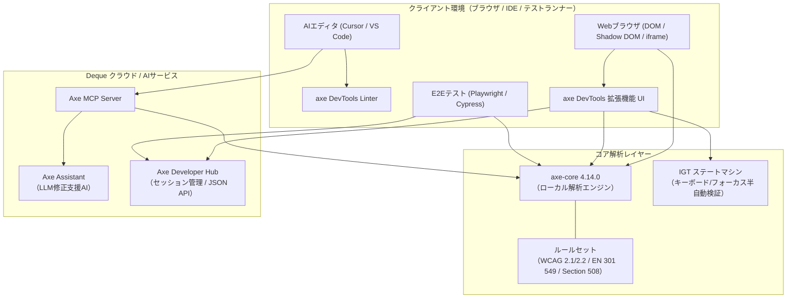

# **axe DevTools 調査レポート**

## **1. 基本情報**

* **ツール名**: axe DevTools
* **ツールの読み方**: アックス デブツールズ
* **開発元**: Deque Systems
* **公式サイト**: [https://www.deque.com/axe/devtools/](https://www.deque.com/axe/devtools/)
* **関連リンク**:
  * GitHub: [https://github.com/dequelabs/axe-core](https://github.com/dequelabs/axe-core) （コアエンジン）
  * DeepWiki: [https://deepwiki.com/dequelabs/axe-core](https://deepwiki.com/dequelabs/axe-core)
  * ドキュメント: [https://docs.deque.com/devtools-for-web/4/en/](https://docs.deque.com/devtools-for-web/4/en/)
  * レビューサイト: [Chrome Web Store](https://chromewebstore.google.com/detail/axe-devtools-web-accessib/lhdoppojpmngadmnindnejefpokejbdd) | [G2](https://www.g2.com/products/axe-devtools/reviews)
* **カテゴリ**: テスト自動化SaaS
* **概要**: Webおよびモバイルアプリケーションのアクセシビリティ（a11y）における問題を検出し、修正を支援する包括的なテストスイート。業界標準のaxe-coreエンジンをベースに、AIを活用した対話型ガイド付きテスト（IGT）やチャットボット（Axe Assistant）、エディタ統合MCP Serverを提供し、開発ライフサイクル全体でのWCAGおよびEN 301 549準拠を支援する。

## **2. 目的と主な利用シーン**

* **解決する課題**:
  * Webアクセシビリティ基準（WCAG 2.1/2.2、Section 508、EN 301 549等）への準拠確認コストの削減
  * 専門知識不足によるアクセシビリティ対応の遅延防止と誤検知精査の負担軽減
  * キーボード操作やモーダル挙動など、従来は人手が必要だった手動テスト領域の半自動化
* **想定利用者**: フロントエンド開発者、QAエンジニア、アクセシビリティ専門家、デザインシステム担当者
* **利用シーン**:
  * **開発時の即時チェック**: ブラウザ拡張機能やIDE拡張、MCP Serverを使用し、コーディング中やローカルプレビュー時にリアルタイムでアクセシビリティ問題を特定・修正する。
  * **CI/CDでの自動回帰テスト**: PlaywrightやCypress、Axe Developer Hubと統合し、プルリクエストごとにアクセシビリティテストを実行して品質低下を防ぐ。
  * **AI支援による詳細監査**: Axe Assistantに修正コード例を相談したり、Intelligent Guided Tests（IGT）で対話的に複雑なUI要素（モーダル、キーボード遷移等）を検証する。

### **2.1 代表的な利用フロー**

```mermaid
swimlane-beta TB
  subgraph User["開発者 / QA"]
    Step1["ブラウザやIDEでUIを実装・表示"]
    Step4["指摘箇所を確認し修正コードを適用"]
  end
  subgraph DevTools["axe DevTools (拡張機能 / Linter)"]
    Step2["ワンクリック自動スキャンまたはIGT実行"]
    Step3["違反内容・DOM要素・影響度を可視化"]
  end
  subgraph Assistant["Axe Assistant / MCP Server"]
    Step5["修正ガイド・コードサジェストを提供"]
  end
  subgraph Pipeline["CI/CD (Playwright / Hub)"]
    Step6["PR時に自動回帰テスト・品質ゲート判定"]
  end
  Step1 --> Step2
  Step2 --> Step3
  Step3 --> Step4
  Step4 --> Step5
  Step5 --> Step6
```

* **代表的な流れ**: 開発者がUIを実装後、ブラウザ拡張機能またはLinterでスキャンを実行すると、axe-coreが瞬時にルール検証を行います。検出された問題に対してはAxe AssistantやMCP Serverから具体的な修正コードを受け取り、修正後の成果物をCI/CD（Playwright統合やAxe Developer Hub）を通じて自動回帰テストにかけ、コンプライアンス準拠を維持します。

## **3. 主要機能**

* **自動スキャン (Automated Testing)**: ワンクリックでページ全体や指定コンポーネントをスキャンし、axe-coreエンジンに基づきWCAG違反を自動検出（誤検知ゼロ設計）。
* **最新規格・ルールへの自動準拠**: 2026年10月リリースのaxe-core 4.14.0により、WCAG 2.5.3対応の「label-content-name-mismatch」ルールがデフォルト有効化されたほか、欧州基準EN 301 549 v4.1.1への初期対応を実装。
* **Intelligent Guided Tests (IGT)**: 機械学習を活用したウィザード形式のテスト機能。キーボード操作（Automated Keyboard IGT）、モーダルダイアログ、インタラクティブ要素、画像代替テキストなどの複雑な手動検証を直感的な質問に答えるだけで実施可能（Pro版）。
* **Axe Assistant**: アクセシビリティのベストプラクティスとDequeナレッジベースを学習したAIチャットボット。検出された違反に対する具体的なHTML/CSS修正コードやアクセシブルネームの設定例を提示（Pro版/Add-on）。
* **Axe MCP Server**: Model Context Protocol (MCP) に対応し、CursorやWindsurfなどのAIエディタから直接axeのルール検証と修正コード生成をシームレスに実行可能。
* **axe DevTools Linter**: VS Code、JetBrains、CLI環境で動作する静的コード解析ツール。設定継承（`extends`）によるチーム標準化やApple Silicon Macネイティブ動作に対応。
* **Axe Developer Hub**: テスト実行セッションの集約、リポジトリ単位のプロジェクト管理API、Universal JSON（Needs Review出力含む）によるCI/CD連携とダッシュボード分析を提供。
* **コンポーネント単位スキャン & Auto Replay**: 単一のUI部品に絞ったスキャンや、修正確認を高速化するAuto Replay機能を搭載。

## **4. 動作原理・システム構成**

axe DevToolsは、ブラウザ内部でのローカルファーストなDOM解析エンジン（axe-core）を中核とし、AIアシスタントやプロジェクト管理を担うクラウドSaaSが疎結合に連携するハイブリッドアーキテクチャを採用しています。



* **アーキテクチャ特性**:
  * **ローカルファースト解析**: 主要なルール判定処理はすべてブラウザまたはNode.js実行環境上のメモリ内で完結します。WebページのDOM情報や機密データが自動的に外部サーバーへ送信されることはなく、高いプライバシー保護と低レイテンシを実現しています。
  * **ハイブリッドAI協調**: Axe AssistantによるAI相談やAxe Developer Hubへの結果保存、Jira連携を選択した場合のみ、暗号化通信を通じてクラウドサービスと通信します。
* **主要コンポーネントとデータフロー**:
  * **DOM・Shadow DOM走査**: axe-coreがページ全体のDOMツリーを走査し、複数の`iframe`やオープン/クローズドShadow DOM境界を越えてアクセシビリティツリーを構築します。
  * **ルール評価パイプライン**: 各要素に対してカラーコントラスト計算、ARIA属性整合性チェック、アクセシブルネームの妥当性評価（WCAG 2.5.3対応のLabel in Name等）を並列実行します。
  * **IGT（Intelligent Guided Tests）**: 自動判定できない主観的要素（ボタンの文脈適合性、キーボードトラップ等）に対し、ステートマシンが最小限の確認質問を生成してユーザーに回答を促します。
  * **Universal JSONエクスポート**: 違反（Violations）、合格（Passes）、要確認（Needs Review）、不完全（Incomplete）に構造化された標準フォーマットで結果を出力します。
* **特筆すべき要素技術**:
  * **ゼロ・フォールスポジティブ哲学**: 誤検知が1件でもあるルールはデフォルトで有効化せず、確実な問題のみを指摘する厳格なテスト設計。
  * **Model Context Protocol (MCP)**: AIエディタとの通信規格に準拠し、Cursor等のLLMがaxeの検証コンテキストを直接参照してコードを自律修正。

## **5. 開始手順・セットアップ**

* **前提条件**:
  * **ブラウザ拡張機能**: Google Chrome, Microsoft Edge, Mozilla Firefox
  * **CLI / ライブラリ**: Node.js (v18以上推奨)
  * **アカウント**: 無料版（基本スキャン）はアカウント不要。Pro版機能（IGT、結果保存、Axe Assistant等）の利用にはDequeアカウントが必要。
* **インストール/導入**:
  * **ブラウザ拡張機能**: Chrome Web Store、Firefox Add-ons、Edge Add-onsから「axe DevTools」をインストール。
  * **Playwright統合 (Free / OSS)**:

  ```bash
  npm install --save-dev @axe-core/playwright
  ```

  * **Playwright統合 (Pro / Enterprise)**:

  ```bash
  npm install --save-dev @axe-devtools/playwright
  ```

* **初期設定**:
  * **ブラウザ拡張機能**: インストール後、ブラウザの開発者ツール（F12）を開き、「axe DevTools」タブを選択。Proライセンスを保有している場合は「Log In」からサインイン。
  * **ライブラリ**: テストコード内で `@axe-core/playwright` から `AxeBuilder` をインポート。
* **クイックスタート**:
  * **ブラウザ拡張機能**: 「Scan ALL of my page」ボタンをクリックすると、数秒でページ内のアクセシビリティ違反が一覧表示される。
  * **Playwrightでの自動テスト例**:

  ```javascript
  import { test, expect } from '@playwright/test';
  import AxeBuilder from '@axe-core/playwright';

  test('アクセシビリティ自動スキャンテスト', async ({ page }) => {
    await page.goto('https://example.com');
    const accessibilityScanResults = await new AxeBuilder({ page }).analyze();
    expect(accessibilityScanResults.violations).toEqual([]);
  });
  ```

## **6. 特徴・強み (Pros)**

* **圧倒的な信頼性とグローバルシェア**: Google、Microsoft、W3C関係者も開発・利用に携わるaxe-coreエンジンを採用。「誤検知（False Positives）を出さない」厳格な思想により、開発者がアラートの精査に無駄な時間を割く必要がない。
* **最新規制・標準への極めて迅速な追従**: WCAG 2.2やEN 301 549 v4.1.1、WCAG 2.5.3（Label in Name）への対応が迅速に行われており、グローバル展開における法的リスク（米ADA法や欧州アクセシビリティ指令EAA）を最小化できる。
* **AIとIGTによる手動テスト領域の開拓**: 自動スキャンでカバーできないキーボード操作、フォーカス順序、モーダル制御などを、AI支援のIntelligent Guided Tests（IGT）で半自動化。専門家のいないチームでも高度な監査が可能。
* **Shift-Left開発体制の実現**: Linterによるコーディング時のチェック、MCP ServerによるAIエディタでの即時修正、CI/CDでの自動回帰テストまで、開発サイクルの最上流から品質を組み込める。
* **教育的で具体的なフィードバック**: 単に「違反」と示すだけでなく、問題の重大度、影響を受ける障害種別、修正すべきHTMLスニペット、Deque Universityの解説リンクがセットで提示される。

## **7. 弱み・注意点 (Cons)**

* **Pro版の価格改定とコスト負担**: Intelligent Guided TestsやAI機能を利用するためのProプランが月額$60/ユーザーとなっており、小規模開発者や中小規模チームには導入ハードルがやや高い。
* **完全自動化の限界**: 自動テストが検出できるのはアクセシビリティ問題全体の約57%にとどまり、残り43%はIGTや人間による手動確認が不可欠である（ツール導入＝100%準拠ではない）。
* **UIとルール説明の日本語ローカライズ不足**: コアエンジンのaxe-core自体は一部多言語対応を進めているものの、拡張機能UI、IGTの質問文、Axe Assistantの回答は英語が主体であり、英語に不慣れなチームでは初期の学習コストが生じる。
* **複雑なSPAや重厚なWebアプリでのスキャン負荷**: 巨大なDOMツリーや大量のiframeを抱えるアプリケーションでは、IGT実行時やページ全体のスキャンに数十秒を要する場合がある。

## **8. 料金プラン**

| プラン名 | 料金 | 主な特徴 |
|:---|:---|:---|
| **Free (Extension)** | 無料 | axe-coreベースの基本的なページ自動スキャン、問題検出、基本的な修正アドバイス |
| **Pro (Extension)** | $60/月/ユーザー | Intelligent Guided Tests (IGT), コンポーネント単位テスト, スキャン結果の保存・共有, Jira連携 |
| **Web Bundle** | 要問い合わせ | Pro拡張機能 + axe DevTools Linter, CLI, CI/CD統合, Axe Assistant, Axe Developer Hub |
| **Enterprise** | 要問い合わせ | 全機能 + オンプレミス/プライベートクラウド対応, SSO (SAML/OIDC), 専任サポート, セキュリティ監査対応 |

* **課金体系**: Pro版はユーザー単位の月額サブスクリプション。年間契約でのボリュームディスカウントあり。
* **無料トライアル**: Pro版の全機能を試用できる14日間の無料トライアルが提供されている。

## **9. 導入実績・事例**

* **導入企業**: Google, Microsoft, Salesforce, Adobe, US Bank, Expedia, Target, CVS Healthなど、フォーチュン100企業の多数が採用。
* **導入事例**:
  * **大手金融機関**: 法的コンプライアンス順拠のため全社的にaxe DevToolsを導入し、手動アクセシビリティ検証工数を50%以上削減すると同時に、リリース前の違反混入をほぼゼロ化。
  * **大手ECプラットフォーム**: デザインシステム構築時にコンポーネント単位のaxeテストを組み込み、新機能追加時のアクセシビリティ品質を均一化。
* **対象業界**: 公共機関、金融、医療、教育、Eコマース、SaaSなど、世界的な法的要件（ADA、EAA等）やCSRとしてアクセシビリティを重視する全業界。

## **10. サポート体制**

* **ドキュメント**: [Deque Docs](https://docs.deque.com/)にて各ツールの詳細なセットアップガイドやAPIリファレンスが完備されているほか、[Deque University](https://dequeuniversity.com/)を通じた体系的なアクセシビリティ学習コースが提供されている。
* **コミュニティ**: axe-coreのオープンソースGitHubリポジトリには世界中からコントリビュータが集まり、活発なIssue対応やディスカッションが行われている。また、Dequeが主催する世界最大級の無料アクセシビリティカンファレンス「axe-con」が毎年開催されている。
* **公式サポート**: ProおよびEnterpriseユーザー向けに、専用ヘルプデスク、メールサポート、チケットシステムが提供されており、Enterpriseプランでは専任テクニカルアカウントマネージャー（TAM）が付く。

## **11. エコシステムと連携**

### **11.1 API・外部サービス連携**

* **課題管理・コミュニケーション**: Jira, Azure DevOpsへのワンクリック課題登録。
* **CI/CDパイプライン**: GitHub Actions, GitLab CI, Jenkins, CircleCIとの連携。
* **AIエディタ・開発基盤**: Model Context Protocol (MCP) を通じたCursor、Windsurf、VS Code等とのリアルタイム連携。
* **Axe Developer Hub API**: プロジェクト管理、APIキー認証によるセッション取得・削除、Universal JSON連携。

### **11.2 技術スタックとの相性**

| 技術スタック | 相性 | メリット・推奨理由 | 懸念点・注意点 |
|:---|:---:|:---|:---|
| **React / Next.js** | ◎ | `@axe-core/react` により開発環境でリアルタイム検知が可能 | SSR時のレンダリング差異に注意 |
| **Vue.js / Nuxt** | ◎ | Vueコンポーネント向けのラッパーやテストユーティリティが充実 | 特になし |
| **Playwright / Cypress** | ◎ | 公式パッケージが提供されており、数行の記述でE2Eテストに統合可能 | テストスイート全体の実行時間がわずかに増加 |
| **Storybook** | ◎ | `@storybook/addon-a11y`（axe-core採用）によりカタログ上で検証可能 | 設定ファイルの共通化が必要 |
| **Apple Silicon (M1〜M4)** | ◎ | axe DevTools Linter 4.13.1以降でネイティブARM64バイナリを完全サポート | 特になし |

## **12. セキュリティとコンプライアンス**

* **認証**: Enterprise版においてSAML 2.0およびOIDCによるシングルサインオン（SSO）に対応。
* **データプライバシー・データ管理**: ブラウザ拡張機能およびLinterは原則ローカル環境のメモリ上で解析を実行し、ソースコードやDOMツリーを外部送信しない。Axe Assistant（AI機能）利用時のプロンプトや送信データもエンタープライズ規約に基づき保護される。
* **コンプライアンス準拠規格**: SOC 2 Type II認証取得済み。VPAT（Voluntary Product Accessibility Template）提供により米国連邦政府調達基準（Section 508）に適合。

## **13. 操作性 (UI/UX) と学習コスト**

* **UI/UX**: 各主要ブラウザ（Chrome/Edge/Firefox）の開発者ツール（F12）に1つのタブとして自然に統合されている。検査対象のUI要素をハイライト表示する「Inspect Node」や、スクリーンリーダー読み上げ情報の確認（Element Selector）が洗練されている。
* **学習コスト**: 基本的な自動スキャンは「ボタンを1回クリックするだけ」で完結するため、導入当日から即座に効果を実感できる。Intelligent Guided Testsもウィザード形式の選択肢に答えるだけであり、アクセシビリティの専門知識が浅いメンバーでも容易に運用可能。

## **14. ベストプラクティス**

* **効果的な活用法 (Modern Practices)**:
  * **多層防御（Shift Left）の実践**: エディタ内でのLinter / MCP Server利用 → ブラウザ拡張での手動プレビュー → PR作成時のPlaywright / CIテストという3段階のゲートを敷く。
  * **CIでの閾値設定**: 重篤な違反（`critical` / `serious`）はPRマージを即時ブロックし、中軽度の問題（`moderate` / `minor`）はIssue化して計画的に修正する。
  * **スプリントごとのIGT実行**: 自動テストでは拾えないキーボード操作やモーダル遷移を、週次やスプリント末にIGTを使って15〜30分程度集中チェックする。
* **陥りやすい罠 (Antipatterns)**:
  * **「自動スキャン全合格＝100%アクセシブル」という誤認**: 自動化で検出できるのは一部であるため、IGTや実際のスクリーンリーダー操作による手動確認を軽視しないこと。
  * **違反アラートの放置**: エラーを無視し続けるとアラート疲労に陥るため、False Positiveのないaxeの特性を活かし、指摘事項は速やかに修正するかIssueチケットに昇格させる。

## **15. ユーザーの声（レビュー分析）**

* **調査対象**: Chrome Web Store, G2, 開発者コミュニティ
* **総合評価**: 4.8 / 5.0 (Chrome Web Store), 4.6 / 5.0 (G2)
* **ポジティブな評価**:
  * 「Lighthouseと比較して誤検知が極めて少なく、修正アドバイスが具体的で開発現場で本当に信頼できる」
  * 「Intelligent Guided Testsのおかげで、専任のアクセシビリティエキスパートがいないチームでも自信を持ってリリースできるようになった」
  * 「Playwrightとの統合が驚くほどスムーズで、既存のCIテストパイプラインに即座に組み込めた」
* **ネガティブな評価 / 改善要望**:
  * 「Pro版が月額$60となり、個人開発者や少人数のスタートアップには少し高価に感じる」
  * 「UIやAxe Assistantの解説が英語メインのため、英語が苦手な日本人開発者には翻訳の手間がある」
* **特徴的なユースケース**: デザインシステム開発チームが全コンポーネントのPRチェッカーとして導入し、全社的なアクセシビリティ底上げを推進している事例が多数見られる。

## **16. 直近半年のアップデート情報**

* **2026-10-28**: **axe DevTools Extension 4.140.0** リリース。最新axe-core 4.14.0との同期、パフォーマンス最適化およびUI微調整を実施。
* **2026-10-15**: **axe DevTools Extension 4.139.0** リリース。スキャン実行エンジンと結果表示の安定性を向上。
* **2026-10-14**: **Axe Developer Hub アップデート**。Project Management APIの追加（APIキーによるプロジェクト/メンバー管理）、Universal JSONエクスポートにおける「Needs Review」出力のサポート、axe-core 4.14.0対応。
* **2026-10-08**: **axe DevTools Linter 4.14.0** リリース。`axe-linter.yml` におけるglob除外パターンのマッチング改善、`node_modules` ディレクトリの自動走査除外、Linterサーバーの修正。
* **2026-10-01**: **axe-core 4.14.0** リリース。WCAG 2.5.3（Label in Name）に準拠した `label-content-name-mismatch` ルールのデフォルト有効化、欧州標準 EN 301 549 v4.1.1 への初期サポート開始、アゼルバイジャン語ロケールの追加、コントラスト判定精度の向上。
* **2026-09-29**: **axe DevTools Extension 4.138.0** リリース。
* **2026-09-24**: **axe DevTools Extension 4.137.0** リリース。
* **2026-09-09**: **axe DevTools Extension 4.136.1** リリース。
* **2026-08-25**: **axe DevTools Extension 4.135.0** リリース。Element Selectorを強化し、ツリー走査時にスクリーンリーダー向けに各要素のアクセシブルネーム、ロール、メタデータを明瞭に読み上げるアクセシビリティ支援機能を拡充。
* **2026-08-19**: **axe DevTools Linter 4.13.1** リリース。Apple Silicon（ARM64）Mac向けネイティブバイナリの完全サポートおよび実行権限の修正。
* **2026-08-11**: **axe DevTools Linter 4.13.0** リリース。`axe-linter.yml` における設定継承機能（`extends`）を追加し、複数プロジェクト間でのルールセット共有を実現。
* **2026-07-20**: **axe DevTools Extension 4.132.0** リリース。
* **2026-05-19**: **axe DevTools Extension 4.129.1** リリース。Interactive Elements IGTの強化。
* **料金改定**: axe DevTools Proプランの標準価格が月額$60/ユーザーへ改定。

(出典: [Deque Release Notes](https://docs.deque.com/devtools-for-web/4/en/devtools-release-notes/), [axe-core GitHub Releases](https://github.com/dequelabs/axe-core/releases))

## **17. 類似ツールとの比較**

### **17.1 機能比較表 (星取表)**

| 機能カテゴリ | 機能項目 | axe DevTools | Google Lighthouse | WebAIM WAVE | Accessibility Insights |
|:---:|:---|:---:|:---:|:---:|:---:|
| **基本機能** | 自動スキャン | ◎<br><small>高精度・誤検知ゼロ設計</small> | ◯<br><small>axeベース・簡易評価</small> | ◯<br><small>視覚的アイコン表示</small> | ◎<br><small>axe-core内蔵</small> |
| **高度な検証** | ガイド付きテスト | ◎<br><small>AI活用 (IGT、Automated Keyboard)</small> | ×<br><small>非対応</small> | ×<br><small>非対応</small> | ◯<br><small>詳細な手動チェックリスト</small> |
| **自動化** | CI/CD & E2E統合 | ◎<br><small>Playwright, Cypress, Linter</small> | ◯<br><small>Lighthouse CI</small> | △<br><small>有料APIのみ</small> | ◯<br><small>Azure DevOps等</small> |
| **AI / 開発支援** | AIコード修正提案 | ◎<br><small>Axe Assistant, MCP Server</small> | ×<br><small>非対応</small> | ×<br><small>非対応</small> | ×<br><small>非対応</small> |
| **標準規格追従** | WCAG 2.2 / EN 301 549 | ◎<br><small>最新規格へ迅速追従</small> | △<br><small>更新が緩やか</small> | ◯<br><small>定期更新</small> | ◯<br><small>順次対応</small> |

### **17.2 詳細比較**

| ツール名 | 特徴 | 強み | 弱み | 選択肢となるケース |
|:---|:---|:---|:---|:---|
| **axe DevTools** | 業界標準・AI強化型テストスイート | 誤検知のない信頼性、IGTによる手動テスト効率化、MCP/AI連携 | Pro版が有料（$60/月）、英語中心 | 開発プロセスに本格的にアクセシビリティを組み込み、法的コンプライアンスを確実に達成したい場合 |
| **Google Lighthouse** | Chrome標準搭載の総合監査ツール | 無料、パフォーマンスやSEOと一括計測可能、手軽さ | a11y専用機能が浅く、手動テスト支援やAI修正機能がない | 開発初期のクイックチェックや、Web標準全体の概要を把握したい場合 |
| **WebAIM WAVE** | 視覚的なフィードバックに特化したツール | 画面上にアイコンで直接違反箇所が表示され直感的 | CI/CD自動化やチーム開発への統合が難しく、API利用は有料 | デザイナーやコンテンツ編集者が単一ページの表示状態を確認する場合 |
| **Accessibility Insights** | Microsoftが開発するアクセシビリティツール | 詳細な手動テスト手順（Assessment）が無料で利用可能 | 学習コストが高く、AIによる自動アシスタント機能は未搭載 | Windowsアプリ検証や、コストをかけずに詳細な手動チェックリストを実施したい場合 |

## **18. 総評**

* **総合的な評価**:
  * Webアクセシビリティテストにおけるデファクトスタンダード。オープンソースのaxe-coreが誇る「誤検知ゼロ」の信頼性を基盤に、Intelligent Guided Tests（IGT）による手動検証の効率化、Axe AssistantやMCP Serverによる最新AIエディタとの連携、そしてEN 301 549 v4.1.1やWCAG 2.5.3といった最新規制への迅速な対応により、開発者向けアクセシビリティツールとして最高水準の完成度を維持している。
* **推奨されるチームやプロジェクト**:
  * グローバル展開や欧米圏でのサービス提供を行い、厳格なアクセシビリティ法的要件（ADA、EAA）を遵守する必要がある企業。
  * デザインシステムを運用し、コンポーネントレベルから品質を保証したいフロントエンド開発チーム。
  * 専任のアクセシビリティ監査チームを持たず、開発者自身の手で効率的にシフトレフトを実践したい組織。
* **選択時のポイント**:
  * 無料の自動スキャンツール（Lighthouse等）ではカバーできないキーボード操作やモーダルなどの動的UI検証に課題を感じている場合、axe DevTools ProのIGT機能は専門家雇用に匹敵する投資対効果を発揮する。
