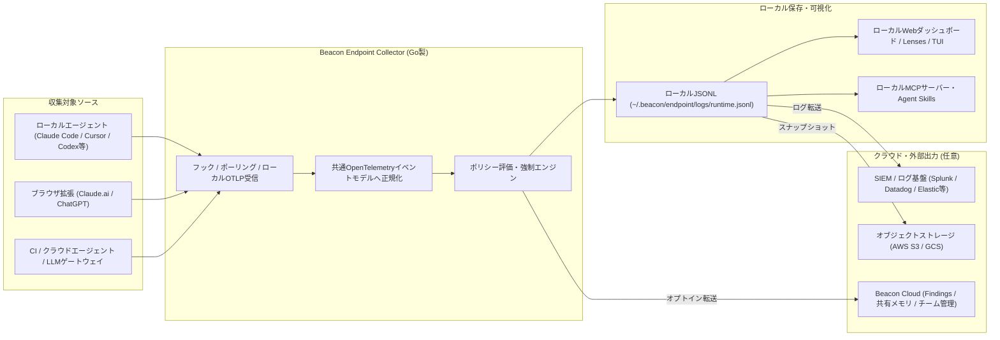

# **Beacon 調査レポート**

## **1. 基本情報**

* **ツール名**: Beacon
* **ツールの読み方**: ビーコン
* **開発元**: Asymptote Labs（共同創業者: Justin D'Souza / Shukan Shah）
* **公式サイト**: [https://beacon.sh/](https://beacon.sh/)
* **関連リンク**:
  * GitHub: [https://github.com/asymptote-labs/agent-beacon](https://github.com/asymptote-labs/agent-beacon)
  * ドキュメント: [https://docs.beacon.sh/](https://docs.beacon.sh/)
  * 開発元企業サイト: [https://asymptotelabs.ai/](https://asymptotelabs.ai/)
* **カテゴリ**: エージェントエコシステム/基盤
* **概要**: Beaconは、Claude Code、Cursor、Codex、OpenCode、Clineなど20以上のAIコーディングエージェント（ハーネス）を横断し、セッション履歴を統一フォーマットで記録・可視化するオープンソース（MITライセンス）のメモリ＆テレメトリ基盤です。ローカルファーストで動作し、過去のデバッグ手順や修正指示・リポジトリ固有の規約を抽出して、MCPやAgent Skills経由で別のエージェントからも再利用できる「自己改善型メモリ層」を提供します。また、有料のBeacon CloudやEnterprise基盤を組み合わせることで、リスク検知やポリシー強制（ブロック／承認要求）などのガバナンス機能も利用可能です。

## **2. 目的と主な利用シーン**

* **解決する課題**: AIコーディングエージェントを複数併用・切り替え（例：トークン上限やタスク適性に応じてClaude CodeとCodexやCursorを行き来する）すると、過去の試行錯誤や修正指示、プロジェクト固有のルールが各ツール内に閉じ込められ、セッション終了とともに失われてしまう「文脈・記憶の断絶」および「エージェントの行動監査・統制の欠如」という課題を解決します。
* **想定利用者**: 複数のAIコーディングツールを使い分けるソフトウェア開発者、AIエンジニアリング推進チーム、およびエンドポイントやCI上のAIエージェント利用を統制・監査したいセキュリティ／プラットフォームエンジニア。
* **利用シーン**:
  * **ツール横断のセッション引き継ぎとスキル再利用**: Claude Codeで苦労して解決したマイグレーション手順やデバッグ知見をスキル化し、翌日にCursorやCodex、OpenCodeのセッションで即座に呼び出して活用する。
  * **ローカルでのトークン消費・行動トレース監査**: `beacon traces` やローカルダッシュボードを使い、どのエージェントがどのコマンド・ファイル編集・MCP呼び出しを実行し、どれだけトークンを消費したかを一覧・再生する。
  * **リスク操作の検知とポリシー強制**: 機密情報のプロンプト貼り付けや破壊的コマンド、未認可MCPサーバーの呼び出しを検出し、組織ポリシーに基づいてブロックまたはユーザー承認を要求する。

### **2.1 代表的な利用フロー**

```mermaid
swimlane-beta TB
  subgraph User["開発者"]
    A["CLI導入と初期設定を実行"]
    E["トレース確認・スキル承認"]
  end
  subgraph Harness["コーディングエージェント"]
    B["コーディング・コマンド実行"]
    F["MCP / Skills経由で知見を再利用"]
  end
  subgraph BeaconLocal["Beacon ローカル基盤"]
    C["OTLP・フックで履歴を収集・正規化"]
    D["ローカルJSONLへ保存・可視化"]
  end
  subgraph CloudOrInfra["Beacon Cloud / 外部基盤"]
    G["Findings抽出・ポリシー強制・スキル生成"]
  end
  A --> B
  B -->|"イベント送信"| C
  C --> D
  D -->|"任意で転送"| G
  D --> E
  G -->|"知見・スキル提案"| E
  E --> F
```

* **代表的な流れ**: 開発者が `beacon endpoint install` でエンドポイントを導入した状態で各種エージェントを利用すると、BeaconがバックグラウンドでOTLPやフック経由で履歴を収集・正規化し、ローカルのJSONLへ保存します。開発者はローカルダッシュボードや任意連携したBeacon Cloud上でトレースや抽出されたスキル・セキュリティ指摘（Findings）を確認・承認し、次回以降はMCPやAgent Skillsを通じて別ハーネスからその知見を再利用します。

## **3. 主要機能**

* **クロスハーネス・セッション履歴収集**: Claude Code、Cursor、Codex CLI/Desktop、OpenCode、Cline、GitHub Copilot CLI、Antigravity CLI、Gemini CLIなど20以上のローカルエージェントに加え、ブラウザチャット（Claude.ai / ChatGPT拡張）、CIジョブ、LLMゲートウェイ（LiteLLM / Envoy / Portkey）、Agent SDKの履歴を単一のOpenTelemetryベースモデルへ正規化します。
* **自己改善メモリとAgent Skills自動抽出**: セッション中の繰り返し作業、エラー修正パターン、リポジトリ固有のルールを分析し、再利用可能な知識（Memories）やワークフロー定義（`SKILL.md` 形式のAgent Skills）として蒸留・提案します。
* **MCP（Model Context Protocol）連携**: ローカル完結型の `beacon mcp serve` と、Beacon Cloudの履歴・Findings・メモリを検索できるOAuth対応の `beacon-managed` MCPサーバー（`beacon mcp connect`）を提供し、各エージェントが過去の知見を自律的に参照できます。
* **ローカルダッシュボードとTUIブラウザ**: `beacon traces` によるターミナルUIおよび `beacon endpoint dashboard` による読み取り専用ローカルWebビューを提供。変更ファイル差分、トークン明細、セキュリティレビュー、承認タイムラインなどを表示するサンドボックス化HTMLビュー「Lenses」も利用可能です。
* **オフライン脅威スキャンとFindings分析**: `beacon scan` によるローカル環境の脅威検知機能や、Beacon Cloudによる3種類の自動インサイト（Security: 機密貼り付けや破壊的コマンド等の検知、Skill: 再利用可能ワークフローの草案化、Behavior: ループや非効率なモデル利用の検出）を提供します。
* **リアルタイム・ポリシー強制（Enforcement）**: macOS、Linux、Windows上でプロンプトやMCPツール呼び出し、パース済みコマンドを監視し、危険な操作に対して警告（Steer）、承認要求（Ask）、または実行ブロック（Block）を行うルールエンジンを備えています。
* **SIEM / オブジェクトストレージへの柔軟な転送**: デフォルトのローカルJSONL保存に加え、Splunk HEC、Datadog、Elastic、Microsoft Sentinel、CrowdStrike Falcon LogScale、Sumo Logic、Wazuh、AWS S3、GCS、CloudWatch Logsへ正規化済みテレメトリを転送できます。

## **4. 動作原理・システム構成**



* **アーキテクチャ**: Go言語で実装された**ローカルファーストのエンドポイントコレクター型アーキテクチャ**を採用しています。各エージェントが動作する開発者のローカルマシン（またはCI/クラウドサンドボックス）に常駐エージェントを配置し、デフォルトでは外部へデータを送信せずローカルに完結します。
* **主要コンポーネントとデータフロー**:
  * **収集レイヤー（Collectors & Adapters）**: 対象ハーネスに応じて、ネイティブHooks、OTLP（OpenTelemetry Protocol）受信、ファイル/APIポーリング、ブラウザ拡張、またはゲートウェイアダプタ（`beacon-gateway`）を組み合わせてイベントを捕捉します。
  * **正規化・記録レイヤー**: プロンプト、応答、ツール呼び出し、シェルコマンド、ファイル活動、承認履歴、MCP通信、トークン消費量を単一のOpenTelemetryベーススキーマに変換し、`~/.beacon/endpoint/logs/runtime.jsonl` へ追記保存します。
  * **利用・配信レイヤー**: 保存されたトレースは `beacon traces` やワンタイムシークレット付きURLで保護されたローカルダッシュボードで閲覧でき、さらにローカルMCP（`beacon mcp serve`）やAgent Skills（`~/.agents/skills` 等）を通じてエージェントへ還元されます。Beacon Cloudを有効化した場合のみ、暗号化通信でクラウド側へ転送され、Findings生成やチーム共有が行われます。
* **特筆すべき要素技術**:
  * **OpenTelemetry (OTel) 準拠スキーマとOpenLLMetry統合**: `@asymptote/sdk` を通じたOpenLLMetry計装やOTLP標準を採用し、既存Observability基盤との高い親和性を実現しています。
  * **サンドボックス化されたLenses**: 各トレースの専用ビュー（Lenses）を、Beacon本体や通常のネットワークAPIへアクセスできないサンドボックス化iframe内の単一HTMLとして実行する設計を採っています。
  * **署名検証・プロヴェナンス保証**: リリースバイナリはチェックサム署名（GPG）およびGitHub Attestation（ビルド来歴証明）に対応しています。

## **5. 開始手順・セットアップ**

* **前提条件**:
  * OS: macOS、Linux（Debian/Ubuntu/Fedora/RHEL/Rocky/Alma等）、Windows（x64 MSI対応）。
  * アカウント登録: ローカル利用のみ（OSS版）の場合はアカウント登録・クレジットカードともに不要。Beacon Cloudや `beacon-managed` MCPを使う場合は無料アカウント登録が必要。
* **インストール/導入**:

  ```bash
  # macOS (Homebrew)
  brew update
  brew trust asymptote-labs/tap
  brew tap asymptote-labs/tap
  brew install beacon
  beacon endpoint install

  # Linux (インストールスクリプト)
  curl -fsSL https://github.com/asymptote-labs/agent-beacon/releases/latest/download/install.sh | bash
  ```

  Windows環境ではGitHub Releasesから `BeaconEndpointAgent-<version>-x64.msi` をダウンロードし、`msiexec /i BeaconEndpointAgent-<version>-x64.msi` で導入できます。

* **初期設定**:
  * `beacon endpoint install` 実行時の対話ウィザードで、データ送信先を「Local（完全ローカル保持）」または「Beacon Cloud（クラウド転送）」から選択します。サインインしただけでは転送は開始されず、確認画面での明示的承認によって転送が有効化されます。
  * 同時に `~/.agents/skills` および `~/.claude/skills` へBeacon Skillsが配置されます（不要な場合は `beacon skills uninstall` で解除可能）。
  * Beacon Cloudを利用する場合、Claude CodeやCodex CLI、Cursor等に `beacon-managed` MCPサーバーを登録する `beacon mcp connect` を実行すると、初回接続時にOAuth認証が行われます（設定ファイルにトークン直書きはされません）。
* **クイックスタート**:
  * 普段通りClaude CodeやCursor、Codex等でコーディング作業を行います。
  * 履歴を確認するには、ターミナルで `beacon traces` を実行するか、`beacon endpoint dashboard` でローカルWebダッシュボードを開きます。生のイベントストリームは `~/.beacon/endpoint/logs/runtime.jsonl` で直接確認できます。

## **6. 特徴・強み (Pros)**

* **20以上のハーネスを網羅する圧倒的なカバレッジ**: 特定のIDEやモデルベンダーにロックインされず、CLIエージェント、IDE拡張、ブラウザチャット、CI、LLMゲートウェイまで単一のデータモデルで記録・横断検索できます。
* **「記録」から「自己改善・再利用」への閉ループ**: 単なるログ収集（Observability）にとどまらず、セッション内の修正指示や成功パターンをスキル（`SKILL.md`）やメモリへ蒸留し、MCP・Agent Skills経由で次世代セッションの性能を底上げします。
* **厳格なローカルファーストとデータ主権**: デフォルトでは全データがローカルJSONLに保存され、外部送信されません。既存SIEM（Splunk、Datadog、Elastic等）や自社S3/GCSバケットへの直接転送にも対応しています。
* **セキュリティ・ガバナンスとの統合**: メモリ共有だけでなく、機密漏洩検知や危険コマンドのリアルタイム・ポリシー強制（ブロック／承認）、MDM（Jamf/Intune/Fleet）による一括展開まで一気通貫でカバーします。

## **7. 弱み・注意点 (Cons)**

* **日本語対応の不足**: 公式サイト、ドキュメント、CLI・ダッシュボードUI、サポート窓口はいずれも英語中心であり、日本語ローカライズは提供されていません。
* **初期導入時の環境依存・ポート競合**: ローカルOTLPコレクターが使用する標準ポート等が他ツールと競合するとインストールが失敗・ロールバックする場合があり、ポート指定フラグでの回避が必要になることがあります。
* **OSごとの常駐サービス挙動差**: Windowsのユーザーモード導入時はLinuxの `systemd --user` やmacOSの `launchd` に相当する仕組みがないため、PIDファイル管理のバックグラウンドプロセスとなり、サインアウト時の継続やクラッシュ時の自動再起動に制約があります。
* **自動インサイト（Findings）のチューニング負担**: Beacon CloudのFindings生成機能は便利である一方、初期段階では低優先度のパターンが通知される場合があり、「Helpful / Not helpful」のフィードバックによる調整や運用ルールの整備が必要です。

## **8. 料金プラン**

| プラン名 | 料金 | 主な特徴 |
|---------|------|---------|
| **Open Source (ローカル)** | 無料 | MITライセンス。ローカルJSONL保存、ローカルダッシュボード、TUI、Otel/Elastic/S3/GCS転送、オフライン脅威スキャン。 |
| **Beacon Cloud** | 無料 ($0) | 20+エージェント統合タイムライン、月間制限なしの無料枠（50 Findingsまで、5ポリシー/50強制アクションまで）、MCPセッション検索、セッションリンク共有。 |
| **Beacon Cloud Pro** | $20/月<br>(年払いで25%割引・$15/月相当) | Findings無制限、ポリシー・強制アクション無制限、MCPフルアクセス（セッション・Findings・メモリ・スキル取得）、リアルタイムアラート、優先サポート。 |
| **Beacon Cloud Team** | $30/席/月 + 基本料$10/月<br>(年払い時は基本料$5/月・最大20席 / 月払い比較表表記 $40/席/月相当) | Proの全機能に加え、チーム共有ワークスペース、共有プライバシー設定、組織APIキー、CI・ボット用エージェント管理、メンバー/管理者ロール管理。 |
| **Enterprise** | カスタム見積 | 組織全体のガバナンス、Jamf/Intune/Fleetによるフリート展開、SSO/RBAC/監査ログ、自社S3バケット/リージョン指定、専任SLA・サポート。 |

* **課金体系**: 個人向けはアカウント単位の定額サブスクリプション（Cloud Pro）、チーム向けはシート単価＋基本料（Cloud Team）、エンタープライズは規模・要件に応じた個別見積もり。
* **無料トライアル**: クレジットカード登録不要で永久無料のOpen Source版およびBeacon Cloud（$0プラン）を利用可能です。

## **9. 導入実績・事例**

* **導入企業**: 具体的な導入企業名はプライバシーやセキュリティ上の理由から多くが非公開とされていますが、投資家である **Tower Research Capital** のセキュリティチームが内部でBeaconをテスト・採用していることが報じられています。
* **導入事例**: 大手・エンタープライズ企業のセキュリティチームが本番環境でAIエージェントの監視・ガバナンス用途に活用しているほか、開発者コミュニティではGitHubスター3,600件超を獲得し、複数エージェントを併用するエンジニアを中心に急速に普及しています。
* **対象業界**: ソフトウェア開発企業、金融・トレーディング（Tower Research Capital等）、セキュリティ意識の高いエンタープライズ開発組織。

## **10. サポート体制**

* **ドキュメント**: 公式ドキュメント（[https://docs.beacon.sh/](https://docs.beacon.sh/)）が整備されており、インストール手順、対応ランタイム別設定、イベントスキーマ、アーキテクチャ、MCP/Skills、Lenses仕様まで網羅されています。言語は英語のみです。
* **コミュニティ**: 公式Discordコミュニティ（[https://discord.gg/zdNChS2fBu](https://discord.gg/zdNChS2fBu)）およびGitHub Issues/Discussionsを通じて開発チームやユーザー同士の質問・要望交換が活発に行われています。
* **公式サポート**: 無料プランではコミュニティサポート、Pro/Teamプランではリアルタイムメールおよび優先サポート、Enterpriseプランでは専任チャネルおよび専用SLAが提供されます（英語対応）。

## **11. エコシステムと連携**

### **11.1 API・外部サービス連携**

* **API / SDK**: OpenTelemetry (OTLP) 準拠の標準プロトコルでイベントを受信するほか、Node.js/TypeScript等向けの `@asymptote/sdk` を提供し、OpenLLMetryを通じたAnthropic・OpenAI SDKやClaude Agent SDK、Vercel AI SDKの計装に対応しています。また、Beacon Cloud APIキーによるCI/ボット連携もサポートしています。
* **外部サービス連携**:
  * **コーディングエージェント/IDE**: Claude Code、Cursor、Codex CLI/Desktop、OpenCode、Cline、GitHub Copilot CLI、Gemini CLI、Antigravity CLI、VS Code、Devin、OpenHands、Kiro 等20以上
  * **ブラウザチャット**: Claude.ai、ChatGPT（Chromium / Firefox拡張）
  * **LLMゲートウェイ**: LiteLLM、Envoy（Envoy Gateway / Istio含む）、Portkey
  * **SIEM / ログ・ストレージ基盤**: Splunk HEC、Datadog、Elastic、Microsoft Sentinel、CrowdStrike Falcon LogScale、Sumo Logic、Wazuh、AWS CloudWatch Logs、AWS S3、Google Cloud Storage (GCS)

### **11.2 技術スタックとの相性**

| 技術スタック | 相性 | メリット・推奨理由 | 懸念点・注意点 |
|:---|:---:|:---|:---|
| **主要AIコーディングCLI/IDE (Claude Code / Cursor / Codex等)** | ◎ | 専用Hooks・プラグイン・OTLPアダプタが標準整備され導入が極めて容易 | 各ハーネスのアップデートに追従するためCLIの定期更新を推奨 |
| **MCP / Agent Skills対応エージェント** | ◎ | `beacon mcp connect` や `SKILL.md` によりメモリ・スキルを即座に共有可能 | クラウドMCP利用時はOAuth認証とデータ送信ポリシーの確認が必要 |
| **Node.js / TypeScript (Anthropic / OpenAI / Vercel AI SDK)** | ◎ | `@asymptote/sdk` および `experimental_telemetry` ハンドオフを公式サポート | 自作エージェントアプリ側への計装コード追加が必要 |
| **LLMゲートウェイ (LiteLLM / Envoy / Portkey)** | ◯ | `beacon-gateway` アダプタによりモデル通信を一元的にトレース可能 | ゲートウェイ構成側の設定変更が伴う |
| **Python汎用エージェント / 独自スクリプト** | △ | ローカルOTLPエンドポイントやJSONLフォーマット経由で連携可能 | 専用Python SDKよりも汎用OTel計装やゲートウェイ経由が中心 |

## **12. セキュリティとコンプライアンス**

* **認証**: Beacon CloudおよびEnterpriseではSSO（Okta等）、ロールベースアクセス制御（RBAC）、監査ログに対応。`beacon-managed` MCP接続時はOAuth認証を使用し、ローカル設定ファイルへ生トークンを書き込まない設計です。ローカルダッシュボードも起動ごとのワンタイムシークレットURLで保護されます。
* **データ管理**: デフォルトは完全ローカル保存（`~/.beacon/endpoint/logs/runtime.jsonl`）。クラウド転送時は通信経路に **TLS 1.2+**、保存データおよび自動バックアップに **AES-256** 暗号化を適用しています。LLMプロバイダー連携時はゼロデイデータ保持ポリシーを適用し、顧客コードのモデル学習利用を防止。Enterpriseでは自社AWS/Azure/GCP環境や自社バケットへのプライベート配置も可能です。なお、クラウド利用時の初期設定におけるデータ取り扱い・オプトアウト設定は導入時に確認することが推奨されます。
* **準拠規格**: 開発元のAsymptote Labsは **SOC 2 Type II** に準拠しており、Trust Centerにてセキュリティ・インシデント対応・データ保持ポリシーを公開しています。

## **13. 操作性 (UI/UX) と学習コスト**

* **UI/UX**: 開発者体験（DX）に優れており、Homebrewやワンライナーのインストールスクリプト、コピー＆ペースト用のセットアッププロンプトが用意されています。ターミナル上で高速にトレースをブラウズできる `beacon traces` と、変更差分・トークン内訳・セキュリティリスクを構造化表示するローカルWebダッシュボード（Lenses）の双方を備え、直感的に利用できます。
* **学習コスト**: 単一マシンのローカル履歴可視化だけであれば数分で習得可能です。一方、複数ハーネス間での `SKILL.md` 運用設計、Lensesの自作、あるいはエンタープライズ向けのポリシー強制ルール・SIEM転送パイプラインの構築には、OpenTelemetryやAgent Skills仕様に関する一定の学習コストがかかります。

## **14. ベストプラクティス**

* **効果的な活用法 (Modern Practices)**:
  * まずは「Local」モードで `beacon endpoint install` を導入し、データ送信を伴わない状態で複数ハーネス（Claude Code、Cursor、Codex等）のトレース収集と `beacon traces` による可視化を体験する。
  * 繰り返し実行しているデバッグ手順やリポジトリ固有のルールが溜まったら、`SKILL.md` 形式のAgent Skillsとして切り出し、Gitリポジトリや `~/.agents/skills` で管理して別エージェントからも参照させる。
  * ポリシー強制を導入する際は、いきなり「Block」にせず、Beacon Cloudの **Monitor mode（監視モード）** で影響範囲を検証してから本番適用する。
* **陥りやすい罠 (Antipatterns)**:
  * **OTLPポートの衝突放置**: 既に別のOpenTelemetryコレクター（4317/4318番ポート等）を稼働させている環境でデフォルト設定のまま導入し、バインドエラーを起こすケース。別ポート指定や既存パイプラインからの転送構成を検討すべきです。
  * **データ送信範囲の確認不足**: 機密コードを含む業務リポジトリで、意図せずクラウド転送やデフォルトのプライバシー設定のまま運用してしまうこと。組織要件に応じてLocalモード、Metadata-onlyモード、または自社SIEM/S3転送を使い分けることが重要です。

## **15. ユーザーの声（レビュー分析）**

* **調査対象**: Product Hunt、X (Twitter)、Hacker News（G2およびCapterraには2026年11月時点でAsymptote Labs製Beaconの専用レビューページは未掲載）
* **総合評価**: 5.0 / 5.0（Product Hunt：2026年11月2日にProduct of the Day 1位・Product of the Week 1位を獲得、約520 Upvotes）
* **ポジティブな評価**:
  * 「Claude CodeからCodexへトークン切れ等で切り替えるたびにプロジェクトを一から説明し直す問題（セッション間の記憶喪失）を根本から解決してくれる」（X上の開発者・インフルエンサーによる評価要約）
  * 「ローカルファーストのJSONL保存でデータの主権を保ったまま、必要に応じてBeacon Cloudや既存SIEMに繋げる柔軟性が高い」（技術コミュニティでの評価要約）
  * 「ワンライナーCLIやセットアッププロンプトによる導入の手軽さと、毎日レベルで改善が続く開発スピードが素晴らしい」（Product Hunt / GitHubコミュニティでの評価要約）
* **ネガティブな評価 / 改善要望**:
  * 「ローカルOTLPポートが既存サービスと競合した際にセットアップがロールバックされ、ポート変更などの手動対処が必要になる」（ドキュメント・ユーザーフィードバックより）
  * 「エージェントが実行をスキップしたのか、Beacon側のフックがイベントを取りこぼしたのかを切り分ける際、ローカルJSONLを直接確認する必要があり手間がかかる」（トラブルシューティングに関する指摘）
  * 「Beacon CloudのFindings通知やクラウドデータ利用設定は、ノイズやコンプライアンス要件に合わせて初期段階で丁寧に調整・オプトアウト確認をする必要がある」（レビュー・技術ブログでの指摘）
* **特徴的なユースケース**:
  * **複数エージェント間のシームレスな作業ハンドオフ**: Claude Codeで調査・設計した文脈をBeaconで記録し、別のコーディングエージェントにそのまま作業を引き継ぐワークフロー。
  * **セキュリティ・監査用のAIエージェントEDR**: 従来のEDRでは捉えきれないMCPツール呼び出しやプロンプト内の機密情報流出をリアルタイムで監視・ブロックする用途。

## **16. 直近半年のアップデート情報**

* **2026-11-20**: **v1.3.67 / v1.3.66** — Windows（システムモード・ユーザーモード双方）でのBeacon Cloud転送およびエンタープライズ強制機能のインストールに対応。さらにMDM経由でClaude CodeおよびCodexユーザーへMCPサーバーをプッシュ配信する機能や、パース済みコマンドに対する `dangerous_command` 制御・承認ルールを追加。
* **2026-11-19**: **v1.3.65** — Linux（amd64 / arm64）環境でのポリシー強制（Enforcement）を有効化。クレデンシャルルールおよび `rules diff` / `rules candidates` / lint機能を強化。
* **2026-11-18**: **v1.3.64** — ユーザーモードでのポリシー強制（Policy Enforcement）を有効化。
* **2026-11-13**: **v1.3.61** — Antigravity CLIのすべてのプロンプト記録とセッションストア同期に対応。Cursorのクラウドエージェントにおける推論・応答・ターン終了イベントの記録を追加。
* **2026-11-11**: **v1.3.60** — LLMゲートウェイのトラフィックをBeaconイベントとして記録する `beacon-gateway` モジュールと、組み込みの「Failures」Lensを追加。
* **2026-11-09**: **ext-v0.2.0** — Claude.aiおよびChatGPT向けのブラウザ拡張（Chromium / Firefox）のアップデートをリリース。
* **2026-10-20**: **シード資金調達発表** — Tower Research Ventures主導で550万ドル（$5.5M）のシードラウンド調達を発表し、エンタープライズ向けガバナンス・メモリ基盤の拡大を加速。

(出典: [GitHub Releases (asymptote-labs/agent-beacon)](https://github.com/asymptote-labs/agent-beacon/releases) / [Asymptote Labs 公式ブログ](https://asymptotelabs.ai/))

## **17. 類似ツールとの比較**

### **17.1 機能比較表 (星取表)**

| 機能カテゴリ | 機能項目 | Beacon | Claude-Mem | Agent Trace | Agent Governance Toolkit |
|:---:|:---|:---:|:---:|:---:|:---:|
| **メモリ・知識化** | クロスハーネス記憶・スキル抽出 | ◎<br><small>20+ハーネス横断・SKILL.md生成</small> | ◯<br><small>Claude Code中心に他ツールも対応</small> | ×<br><small>コード来歴の記録仕様に特化</small> | ×<br><small>メモリ共有機能なし</small> |
| **可視化・監査** | セッション/トレース記録・UI | ◎<br><small>OTel準拠・TUI/Web・Lenses</small> | ◯<br><small>My Work Web UI・SQLite検索</small> | ◯<br><small>VCS連動の来歴メタデータ標準</small> | ◯<br><small>Merkleツリー改ざん防止監査ログ</small> |
| **ガバナンス** | ポリシー強制・リスクブロック | ◎<br><small>プロンプト/MCP/コマンド制御</small> | △<br><small>&lt;private&gt;タグによる除外のみ</small> | ×<br><small>制御機能なし</small> | ◎<br><small>ACS v5・4段階特権リング・キルスイッチ</small> |
| **連携・標準化** | MCP / 既存SIEM連携 | ◎<br><small>MCP対応・Splunk/Datadog等連携</small> | ◯<br><small>MCP検索ツール提供</small> | ◯<br><small>ベンダーニュートラルなオープン仕様</small> | ◯<br><small>主要フレームワークSDK統合</small> |
| **非機能要件** | 日本語対応 | △<br><small>英語中心（日本語UI/Docなし）</small> | ◯<br><small>観測データの日本語生成モードあり</small> | △<br><small>英語中心</small> | △<br><small>英語中心</small> |

### **17.2 詳細比較**

| ツール名 | 特徴 | 強み | 弱み | 選択肢となるケース |
|---------|------|------|------|------------------|
| **Beacon** | 20+ハーネス対応のローカルファースト・テレメトリ＆自己改善メモリ層 | ハーネス横断の知見共有、OTel準拠、SIEM連携、リアルタイム強制まで一気通貫 | 日本語非対応、多機能ゆえのポート競合など初期設定の注意点あり | - |
| **Claude-Mem** | AI圧縮と段階的開示に特化した永続メモリプラグイン | トークン消費効率が極めて高く、GitHubスター11.8万超の巨大なコミュニティ | Claude Code中心の設計で、企業向けSIEM転送やポリシー強制機能は非搭載 | Claude Codeを主軸に低トークンコストで個人の記憶継続を強化したい場合 |
| **Agent Trace** | AI生成コードと人間コードを区別・追跡するオープン仕様 | VCSと連動したベンダーニュートラルな来歴標準フォーマット | 仕様とリファレンス実装が中心で、メモリ蒸留やダッシュボード等は提供しない | コードベースのAI貢献度・著作権や来歴をGit上で標準記録したい場合 |
| **Agent Governance Toolkit** | Microsoft製のエージェント向け決定論的セキュリティ基盤 | OWASP/NIST準拠のACS v5エンジンや特権リング、キルスイッチ等の堅牢性 | 自作エージェントアプリへのSDK組み込みが前提で、メモリ学習機能はない | 自社開発の自律型エージェントに厳格なゼロトラスト統制を組み込みたい場合 |

## **18. 総評**

* **総合的な評価**:
  * Beaconは、AIコーディングエージェントが単一ツールからマルチハーネス併用へと移行する現在において、「記憶の断絶」と「ガバナンスの欠如」という2大課題を同時に解決する極めて完成度の高い基盤です。MITライセンスの完全ローカルファースト設計により個人の開発者が安心して始められる一方、SOC 2 Type IIやSIEM連携・MDM配布・ポリシー強制を備えることでエンタープライズのセキュリティ要件にも応えています。
* **推奨されるチームやプロジェクト**:
  * Claude Code、Cursor、Codex、OpenCodeなど複数のコーディングエージェントを使い分けており、知見の属人化やセッションごとの再説明を減らしたい開発チーム。
  * 社内で利用されているAIエージェントのトークン消費量、実行コマンド、MCP利用状況を一元的に監査・統制したいプラットフォーム／セキュリティチーム。
* **選択時のポイント**:
  * 個人のClaude Code環境でトークン効率を最優先に記憶を圧縮・注入したい場合は「Claude-Mem」、コード来歴の標準仕様を求める場合は「Agent Trace」が有力です。対して、**複数のコーディングツールを横断したセッション記録・スキル自動抽出・既存SIEM連携やセキュリティポリシー強制**までを統合的に実現したい場合は、Beaconが最も有力な選択肢となります。
