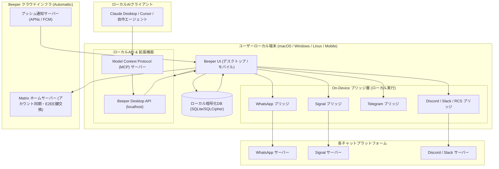

# **Beeper 調査レポート**

## **1. 基本情報**

* **ツール名**: Beeper
* **ツールの読み方**: ビーパー
* **開発元**: Automattic Inc.（創業者: Eric Migicovsky / Brad Murray。2024年にWordPress.comの親会社Automatticが買収し傘下で運営）
* **公式サイト**: [https://www.beeper.com/](https://www.beeper.com/)
* **関連リンク**:
  * GitHub: [https://github.com/beeper](https://github.com/beeper)
  * ドキュメント: [https://help.beeper.com/](https://help.beeper.com/)
  * 公式ブログ: [https://blog.beeper.com/](https://blog.beeper.com/)
  * 更新履歴: [https://www.beeper.com/changelog](https://www.beeper.com/changelog)
* **カテゴリ**: コラボレーション/生産性
* **概要**: Beeperは、WhatsApp、Signal、Telegram、Discord、Slack、Google Messages（RCS）、Instagramなど、15種類以上の主要チャットサービスを単一の受信トレイに統合するユニバーサルメッセージングクライアントである。分散型通信規格Matrixをベースとしたオープンソースのブリッジ技術と、端末上で直接各チャットと通信する「On-Device Connections」を採用し、エンドツーエンド暗号化（E2EE）を維持しながら快適なメッセージ管理環境を提供する。

## **2. 目的と主な利用シーン**

* **解決する課題**:
  * **アプリの乱立とコンテキストスイッチ**: 業務やプライベートでWhatsApp、Slack、Signal、Discord、Instagramなど複数アプリを常時起動する必要があり、通知の分散や確認漏れ、PCのメモリ消費が発生する課題を解消する。
  * **プライバシーとエンドツーエンド暗号化の維持**: 従来のクラウド集約型マルチチャットツールでは暗号化メッセージをサーバー側で復号する必要があったが、ローカル端末上でブリッジ処理を完結させることで暗号化通信の安全性を担保する。
  * **AIや自動化連携の分断**: チャットサービスごとにAPIの有無や形式が異なるため、ローカルAI（Claude DesktopやCursor等）からの横断的な検索・要約が困難だった課題を、MCP（Model Context Protocol）と統一デスクトップAPIにより解決する。
* **想定利用者**:
  * 複数のビジネスチャットやプライベートSNSを横断利用するリモートワーカー・フリーランス
  * 顧客対応やコミュニティ運営で複数アカウントのダイレクトメッセージを効率よく処理したいビジネスパーソン
  * ローカルAIアシスタントを活用してメッセージの要約・ドラフト作成を行いたいエンジニア・開発者
* **利用シーン**:
  * **統合インボックスでのメッセージ処理**: 朝の業務開始時に全プラットフォームの未読メッセージを1画面で確認し、キーボードショートカットのみで迅速に返信・アーカイブする。
  * **同一人物とのクロスネットワークチャット統合**: WhatsAppとSignalで同一人物とやり取りしているスレッドを1つのタイムラインにまとめ、文脈を見失わずにコミュニケーションを継続する。
  * **ローカルAIアシスタントによる横断検索・要約**: MCP経由でClaude Desktop等と接続し、「昨日全チャットで言及されたプロジェクトAの要点をまとめて」といったプロンプトを実行する。

### **2.1 代表的な利用フロー**

```mermaid
swimlane-beta TB
  subgraph User["ユーザー"]
    A["アカウント連携設定"]
    D["統合受信箱で未読確認・返信作成"]
    G["送信予約・既読非表示等のオプション設定"]
  end
  subgraph Beeper["Beeper クライアント"]
    B["ローカルブリッジ経由で接続確立"]
    E["複数ネットワークのメッセージを集約表示"]
    H["指定時刻に送信実行・ステータス更新"]
  end
  subgraph External["外部チャットサービス"]
    C["ネイティブE2EE暗号化セッション確立"]
    I["相手先ユーザーへメッセージ配信"]
  end
  subgraph AIAssistant["AIアシスタント (MCP連携)"]
    F["Desktop API経由で要約や返信ドラフト生成"]
  end
  A --> B
  B --> C
  C --> E
  E --> D
  D --> F
  F --> G
  G --> H
  H --> I
```

* **代表的な流れ**: ユーザーが各チャットの認証を行うと、Beeperのローカルブリッジが外部サービスとの間に直接E2EEセッションを確立します。受信メッセージは単一トレイに集約され、ユーザーはMCP経由のAI支援を活用して返信作成や送信予約を行い、安全に各サービスへ配信されます。

## **3. 主要機能**

* **マルチネットワーク統合インボックス**: WhatsApp、Signal、Telegram、Discord、Slack、Google Messages、Instagram、LinkedIn、Facebook Messenger、Viber、Twitter/Xなど15種類以上のネットワークを単一UIで一元管理。
* **On-Device Connections（ローカル直接接続）**: 端末内で各チャットネットワークとの接続と暗号化・復号処理を実行。クラウドサーバーに平文メッセージを預けることなく、ネイティブE2EEを保護。
* **クロスネットワーク・チャットマージ**: 異なるチャットサービス（例: WhatsAppとSignal）に存在する同一の相手とのスレッドを1つのタイムラインに統合して表示。
* **送信予約（Send Later）**: 送信相手のタイムゾーンや業務時間に合わせて、指定した日時にメッセージを自動配信するスケジュール機能。
* **チャットリマインダー・スヌーズ**: 後で対応したいメッセージを指定時間後に再通知させ、受信トレイを整理された状態（Inbox Zero）に保つ機能。
* **インコグニートモード（既読通知ブロック）**: メッセージを開いて内容を確認しても相手側に既読（Read Receipts）を付けずに閲覧できるステルス機能。
* **AI音声メモ文字起こし（Voice Note Transcription）**: 受信した音声メッセージをオンデバイスまたは高精度AIで自動的にテキスト化し、音声を再生できない環境でも内容を即座に把握可能。
* **ブラスト機能（Blasts）**: 複数の相手やグループに対して、個別のプライベートメッセージとして一斉配信を行える機能。
* **Beeper Desktop API & MCPサーバー**: ローカルホスト上で稼働するAPIおよびModel Context Protocol（MCP）サーバーを内蔵。Claude DesktopなどのAIアシスタントがチャットの検索や下書き作成をローカルで連携可能。
* **ユニバーサル検索とコマンドパレット**: `Cmd+K`（または `Ctrl+K`）のショートカットから、すべてのチャットネットワークを横断して会話や連絡先、過去ログをミリ秒単位で全文検索。

## **4. 動作原理・システム構成**

* **アーキテクチャ**: ローカルファースト（Local-First）と分散型Matrixプロトコルを融合させたハイブリッド構成。UIおよびブリッジ処理の大半はクライアント端末上で直接実行され、クラウド側はアカウント同期およびプッシュ通知リレーを担当する。



* **主要コンポーネントとデータフロー**:
  * **Beeperクライアント**: デスクトップ版は高速なネイティブモジュールを組み込んだTexts.com由来の高性能アーキテクチャを採用し、モバイル版はiOS（Swift）、Android（Kotlin）のネイティブ実装。
  * **On-Device Bridges**: 各チャットプロトコルのハンドラーがローカル端末で動作。QRコード認証やセッショントークンを用いて直接各チャットサーバー（WhatsApp、Signal等）と通信し、メッセージを受信トレイの統一フォーマットへ変換。
  * **暗号化ローカルデータベース**: 受信したメッセージ、キャッシュ、連絡先インデックスは端末内の暗号化SQLiteデータベースに保存され、オフライン時でも高速な全文検索が可能。
  * **Matrixプロトコル基盤**: デバイス間でのアカウント状態や暗号化設定の同期にはMatrixのOlm/Megolmプロトコル（E2EE）が使用され、Beeperのサーバー側でもメッセージ本文を復号できないゼロ知識アーキテクチャを維持。
  * **Desktop API & MCPサーバー**: デスクトップアプリ起動時にローカルホスト限定のAPIエンドポイントが立ち上がり、認証トークンを持つAIクライアント（Claude Desktopなど）に対して安全にメッセージデータへのアクセスを提供する。
* **特筆すべき要素技術**:
  * **mautrixブリッジエコシステム**: open-source Matrixコミュニティで実績のあるGo/Python製ブリッジを最適化して活用。
  * **Model Context Protocol（MCP）**: Anthropicが策定した標準プロトコルに対応し、外部AIモデルからのコンテキスト取得ツールとして機能。
  * **SQLCipher / 暗号化ローカルストア**: 端末内の全データがディスク暗号化され、マルウェアや不正アクセスから保護。

## **5. 開始手順・セットアップ**

* **前提条件**:
  * 対応OS: macOS 11以降、Windows 10/11、Linux（各ディストリビューション）、iOS 16以降、Android 9以降
  * アカウント登録: メールアドレス、Googleアカウント、またはApple ID
* **インストール/導入**:

  ```bash
  # macOS (Homebrew Cask を使用する場合)
  brew install --cask beeper

  # または公式サイトから各OS向けインストーラー（DMG / EXE / AppImage / deb）をダウンロード
  # iOS / Android は App Store / Google Play より「Beeper」をインストール
  ```

* **初期設定**:
  1. アプリを起動し、メールアドレスまたはGoogle/Appleアカウントでサインイン。
  2. 表示されるリカバリーキー（Recovery Key）を1Passwordなどのパスワードマネージャーに安全に保存（端末変更や再認証時に必須）。
  3. 設定画面（歯車アイコン）の「Chat Networks」から、接続したいサービス（例: WhatsApp、Signal、Slack、Discord）を選択。
  4. WhatsAppやSignalは表示されるQRコードを各スマートフォンの「リンクされたデバイス」からスキャンして連携。SlackやDiscordはOAuth/ログインを実行。
* **クイックスタート**:
  * 連携が完了すると、過去のチャットログと連絡先が自動的に同期され、統合受信箱に表示される。
  * `Cmd+K`（または `Ctrl+K`）を押してコマンドパレットを開き、連絡先名を入力して即座にチャットを開始する。

## **6. 特徴・強み (Pros)**

* **圧倒的な統合力**: 15種類以上の主要チャットアプリを1つの軽快なウィンドウに集約し、通知の散乱や複数アプリの起動負荷を一掃できる。
* **妥協のないプライバシー（On-Device Connections）**: ローカル端末で各サービスと直接暗号化通信を行うため、サードパーティのクラウドサーバーに平文メッセージが保存・中継されるリスクを排除。
* **実用的な生産性向上ツール群**: 送信予約、リマインダー、既読非表示（インコグニートモード）、AI音声文字起こしなど、標準のチャットアプリにはない高機能がすべてのネットワークで共通して利用可能。
* **先進的なAIエージェント親和性（MCP対応）**: デスクトップAPIとMCPサーバーが標準搭載されており、Claude Desktop等のローカルAIからチャットの横断検索やドラフト作成を安全に呼び出せる。
* **多言語・日本語UIの標準サポート**: 2026年のアップデートにより日本語を含む多言語UIが正式サポートされ、国内ユーザーもストレスなく利用可能。

## **7. 弱み・注意点 (Cons)**

* **無料プランにおける接続アカウント数上限**: 無料プランで連携できるチャットアカウント数は最大5個までに制限されており、プライベート用と仕事用で多数のアカウントを運用する場合は有料の「Beeper Plus」契約が必要。
* **iMessage連携におけるプラットフォーム制限**: 過去のAppleによる締め出し（Beeper Mini騒動等）を経て、AndroidやWindowsからのiMessage利用は大幅に制限されており、Mac実機を介さない形での完全なiMessage利用は困難。
* **各サービス固有の独自機能への非対応**: 各チャット固有のアニメーションスタンプ、一部の拡張リアクション、ボット専用のインタラクティブUI、一部の音声・ビデオ通話機能はBeeper上では再現されず、公式アプリを開く必要がある。
* **ローカルリソースの消費**: 多数のチャットネットワークのブリッジプロセスを端末ローカルで並列動作させるため、バックグラウンドでのメモリ（RAM）およびモバイル端末のバッテリー消費が単一アプリより増加する場合がある。

## **8. 料金プラン**

Beeperは広告掲載やユーザーデータの販売を行わず、プレミアムサブスクリプションによって収益化を行うフリーミアムモデルを採用している。

| プラン名 | 料金 | 主な特徴 |
|---------|------|---------|
| **Beeper Free** | 無料 ($0/月) | 最大5件のチャットアカウント連携、全対応ネットワークの統合受信箱、クロスプラットフォーム同期、基本検索機能 |
| **Beeper Plus** | $9.99/月 (年払い $99.99/年) | 最大10件のアカウント連携（1サービスあたり最大3アカウント）、送信予約、リマインダー、既読非表示モード、AI音声文字起こし、カスタムアプリアイコン・テーマ |
| **Beeper Plus Plus** | $30〜$49.99/月 | 無制限のアカウント連携、優先サポート、ヘビーユーザー・ビジネス用途向けのプロフェッショナル機能 |

* **課金体系**: ユーザー単位の月額または年額サブスクリプション（年払いの場合は2ヶ月分が実質無料）。
* **無料トライアル**: デスクトップアプリおよびモバイルアプリから「Beeper Plus」の無料トライアルが利用可能。

## **9. 導入実績・事例**

* **導入企業・利用層**: WordPress.comやTumblrを傘下に持つAutomattic社の全社的バックアップのもと、世界中のナレッジワーカー、リモートワーク企業、オープンソース開発者、テック系ジャーナリスト、フリーランスに広く利用されている。
* **導入事例**:
  * **複数クライアントを抱える受託エンジニア・デザイナー**: クライアントごとのSlack、Teams、Discord、WhatsAppの連絡窓口を1画面に統合し、見落としゼロとレスポンス速度の向上を実現。
  * **コミュニティマネージャー・モデレーター**: DiscordとTelegram、Twitter/XのDMを同時に監視し、重要メッセージのみをフィルタリングして効率的に対応。
* **対象業界**: IT・ソフトウェア開発、クリエイティブ受託、マーケティング、メディア、スタートアップなど、複数コミュニケーションツールを日常的に横断する業界。

## **10. サポート体制**

* **ドキュメント**: [Beeper Help Center](https://help.beeper.com/)にて、各チャットネットワークの接続手順、トラブルシューティング、リカバリーキー管理、セキュリティ解説などが網羅されたナレッジベースを提供。
* **コミュニティ**: 公式Redditコミュニティ（r/beeper）およびMatrix上のパブリックチャンネルにて、活発なユーザー間Q&Aや機能リクエストの議論が実施されている。
* **公式サポート**: アプリ内のヘルプチャット（Beeper Helpスレッド）から直接サポートチームに問い合わせが可能。Plus Plus契約者には優先対応レーンが提供される。

## **11. エコシステムと連携**

### **11.1 API・外部サービス連携**

* **API**:
  * **Beeper Desktop API**: デスクトップアプリ内でローカルHTTP/WebSocketサーバーが動作し、チャットリストの取得、メッセージ検索、メッセージ送信などの操作をローカルプログラムから実行可能。
  * **公式SDK**: TypeScript/JavaScript（`beeper/desktop-api-js`）、Python（`beeper/desktop-api-python`）、Go（`beeper/desktop-api-go`）、PHP、CLIツールが公式GitHubで公開。
  * **Model Context Protocol（MCP）連携**: Claude Desktop等から直接Beeperのチャット履歴を検索・参照できる `beeper/desktop-api-mcp`、Android用の `beeper/mcp-android` を提供。
* **外部サービス連携**:
  * 標準対応ネットワーク: WhatsApp、Signal、Telegram、Discord、Slack、Google Messages（RCS）、Google Chat、Instagram、Facebook Messenger、LinkedIn、Twitter/X、Viber、Tumblr、Matrix。
  * 自作・サードパーティブリッジ: `beeper/bridge-manager`（コマンドラインツール `bbctl`）を利用することで、ユーザーがセルフホストしたMatrixブリッジをBeeperアカウントに追加接続可能。

### **11.2 技術スタックとの相性**

| 技術スタック | 相性 | メリット・推奨理由 | 懸念点・注意点 |
|:---|:---:|:---|:---|
| **TypeScript / Node.js** | ◎ | 公式SDK（`desktop-api`）が提供されており、自動化スクリプトやカスタムBotの構築が極めて容易 | ローカルデスクトップアプリの起動が前提 |
| **Python** | ◎ | 公式SDK（`desktop-api-python`）があり、データ分析やAIエージェントへの組み込みがスムーズ | 同上 |
| **Claude / Cursor (MCP)** | ◎ | 公式MCPサーバー（`desktop-api-mcp`）により、設定ファイルを追記するだけでAIアシスタントからチャットを操作可能 | 読み取り・送信権限の管理に配慮が必要 |
| **Matrix プロトコルエコシステム** | ◎ | Matrix規格に完全準拠しており、Synapseや各種mautrixブリッジ資産をそのまま利活用可能 | Matrix特有の鍵管理（暗号化セッション検証）の理解が必要 |
| **クラウド完結型SaaS (Webhooks)** | △ | ローカルAPI中心の設計のため、外部Webサーバーから直接Webhooksを受信するにはトンネリング等の工夫が必要 | クラウド側ブリッジの直接公開APIは制限されている |

## **12. セキュリティとコンプライアンス**

* **認証**:
  * パスフレーズ認証およびワンタイムコードによる2要素認証（2FA）。
  * 端末間同期と暗号鍵の保護に専用の「リカバリーキー（Recovery Key）」を使用し、ゼロ知識暗号化を実現。
* **データ管理**:
  * **On-Device Connections**: WhatsAppやSignalなどのE2EE通信はローカル端末上で直接送受信・復号されるため、平文データがBeeperのクラウドサーバーを経由しない。
  * **ローカル暗号化**: 端末上のメッセージキャッシュおよびSQLiteデータベースは暗号化（SQLCipher等）されて保管。
  * **ゼロデータ広告ポリシー**: ユーザーのチャット内容やメタデータを広告ターゲティングや第三者への販売に利用しないことを規約で明記。
* **準拠規格**:
  * EU一般データ保護規則（GDPR）準拠。
  * 親会社Automatticの厳格なプライバシーおよびコンプライアンス基準に基づき運営。

## **13. 操作性 (UI/UX) と学習コスト**

* **UI/UX**:
  * SuperhumanやTexts.comの流れを汲む洗練されたミニマルなデザイン。
  * キーボードファーストで設計されており、矢印キーやショートカット（アーカイブ、既読化、ピン留め、スヌーズ）で一切マウスに触れずに全チャットを捌くことが可能。
  * ダークモード、ライトモード、カスタムアクセントカラーに対応し、視認性にも優れる。
* **学習コスト**:
  * 一般的なチャットユーザーであれば、インストール後にQRコードを読み取るだけで直感的に利用を開始でき、学習コストは極めて低い。
  * 複数アカウントのチャットマージや送信予約、MCPによるAI連携などの高度な機能を使いこなす場合でも、コマンドパレット（`Cmd+K`）に操作が体系化されているため習得が容易。

## **14. ベストプラクティス**

* **効果的な活用法 (Modern Practices)**:
  * **リカバリーキーの即時バックアップ**: 初期セットアップ時に発行されるリカバリーキーを、必ず安全なパスワードマネージャーに保管する（新端末ログイン時のメッセージ復号に不可欠）。
  * **プライバシー重視ネットワークでのOn-Device接続活用**: SignalやWhatsAppは可能な限りローカル接続を優先し、端末側のE2EEセグメント内で完結させる。
  * **クロスネットワークチャットの統合（Chat Merging）**: 仕事仲間や家族など複数のアプリで連絡を取り合っている相手はチャットを統合し、受信トレイの項目数を最小限に抑える。
  * **Claude Desktop等のローカルAIとの連携**: MCPサーバーを有効化し、過去ログの検索や多言語メッセージの要約・ドラフト作成を半自動化する。
* **陥りやすい罠 (Antipatterns)**:
  * **リカバリーキーの紛失**: リカバリーキーを控えておかないと、メイン端末の故障やOS再インストール時に過去の暗号化メッセージ履歴が復元できなくなる。
  * **不要なネットワークの常時接続**: 利用頻度の低いチャットネットワークをすべてローカル接続すると、バックグラウンドでのネットワーク通信とバッテリー消費が増加するため、必要なサービスに絞って運用する。
  * **非公式なiMessage回避策への過度な依存**: Appleのポリシーに反する非公式リレー手法に依存すると、突然のアカウント凍結や接続遮断のリスクがあるため推奨されない。

## **15. ユーザーの声（レビュー分析）**

* **調査対象**: Apple App Store、Google Play Store、Product Hunt、Reddit（r/beeper）、Trustpilot
* **総合評価**:
  * Apple App Store: 4.8 / 5.0
  * Product Hunt: Featured / #5 Product of the Day 獲得
  * Trustpilot / 一般レビュー: 約 3.6 / 5.0
* **ポジティブな評価**:
  * 複数アプリを行き来するストレスから完全に解放され、1つの受信トレイで全チャットを一望できる圧倒的な生産性の高さ。（App Store / Product Huntより要約）
  * On-Device接続への刷新により、プライバシーの懸念を持たずにWhatsAppやSignalのE2EEを維持できるようになった点。（Redditより要約）
  * 送信予約、リマインダー、既読非表示などのパワーユーザー向け機能が全チャットで横断して使える利便性。（Product Huntより要約）
* **ネガティブな評価 / 改善要望**:
  * 無料プランの5アカウント制限により、複数アカウントを多用するユーザーには月額$9.99の有料プラン契約が必要となる点。（Redditより要約）
  * 外部サービス側の仕様変更によって、たまに接続が切れてQRコードの再スキャンが必要になることがある点。（Trustpilotより要約）
  * 各チャット固有の高度なスタンプやリアクション、ボット機能が一部制限される点。（App Storeより要約）
* **特徴的なユースケース**:
  * 各国のクライアントと異なるメッセージアプリ（米国のSlack、欧州のWhatsApp、東欧・アジアのTelegramやViber）でやり取りするグローバル受託ワーカーが、時差対応のために「送信予約」と「統合受信トレイ」を駆使して業務を平準化するケース。

## **16. 直近半年のアップデート情報**

* **2026-11-05**: Android版 v4.64.0 がリリース。統合チャット（Merged Chats）に対する共有シートからの配信ネットワーク個別指定機能、On-Device接続のバッテリー・通信データ効率の最適化、Signalメディア共有の安定性向上を実施。
* **2026-10-20**: Viber連携が公式に追加。未送信下書き（Drafts）の全端末リアルタイム同期機能の強化、およびカスタムテーマエンジンの刷新が行われた。
* **2026-09-12**: Beeper Desktop v4.3.0 がリリース。日本語（Japanese）、スペイン語、フランス語、ポルトガル語のUIローカライズが正式追加され、Matrix、Signal、WhatsAppチャットにおけるネイティブ投票（Poll）の作成・回答機能が導入された。
* **2026-08-18**: チャットごとのカスタム通知音設定、および複数の相手に対して個別メッセージを一斉送信できる「Blasts」機能のUI改善が実施された。
* **2026-06-30**: Googleアカウントによるサインイン連携の拡充、およびクロスネットワークチャット統合時の連絡先名自動サジェスト機能がリリースされた。
* **2026-05-22**: Model Context Protocol（MCP）対応の公式MCPサーバー（`beeper/desktop-api-mcp`）およびDesktop APIクライアントライブラリ群が公開され、ローカルAIアシスタントとの双方向連携が大幅に強化された。

(出典: [Beeper Changelog](https://www.beeper.com/changelog) / [Beeper Blog](https://blog.beeper.com/))

## **17. 類似ツールとの比較**

### **17.1 機能比較表 (星取表)**

| 機能カテゴリ | 機能項目 | Beeper | Element | Ferdium / Franz | Texts.com |
|:---:|:---|:---:|:---:|:---:|:---:|
| **統合力** | 多ネットワーク統合 | ◎<br><small>15種以上の主要チャット</small> | △<br><small>ブリッジ設定が必要</small> | ◯<br><small>Web版をタブ集約</small> | ◎<br><small>Beeperに統合完了</small> |
| **セキュリティ** | On-Device E2EE | ◎<br><small>端末ローカルで完結</small> | ◎<br><small>ネイティブMatrix E2EE</small> | △<br><small>Webviewの隔離依存</small> | ◎<br><small>ローカルブリッジ型</small> |
| **AI・拡張性** | MCP / Desktop API | ◎<br><small>公式MCPサーバー完備</small> | △<br><small>Matrix Bot API中心</small> | ×<br><small>非対応</small> | △<br><small>Beeperへ機能継承</small> |
| **生産性機能** | 予約送信・既読管理 | ◎<br><small>全チャットで共通利用</small> | △<br><small>クライアント機能依存</small> | ×<br><small>各Web画面依存</small> | ◎<br><small>Beeperへ機能継承</small> |
| **プラットフォーム** | デスクトップ＆モバイル同期 | ◎<br><small>Mac/Win/Linux/iOS/Android</small> | ◎<br><small>全主要OS対応</small> | △<br><small>主にデスクトップ</small> | △<br><small>モバイルはベータ</small> |
| **非機能要件** | 日本語UI対応 | ◯<br><small>2026年に公式対応</small> | ◯<br><small>コミュニティ翻訳対応</small> | ◯<br><small>日本語UI対応</small> | △<br><small>英語中心</small> |

### **17.2 詳細比較**

| ツール名 | 特徴 | 強み | 弱み | 選択肢となるケース |
|---------|------|------|------|------------------|
| **Beeper** | 15以上の主要チャットを統合するローカルファーストクライアント | On-Device接続によるE2EE維持、洗練されたキーボードUI、MCPによるAI連携、予約送信などの独自機能 | 無料プランの接続数上限（5件）、iMessage利用制限 | 複数のチャットやSNSを日常的に併用し、生産性向上とAI連携を両立させたい個人・ビジネスパーソン |
| **Element** | 分散型Matrixプロトコル標準のリファレンスクライアント | 自社サーバーホスティングによる完全なデータ主権、政府・軍需機関でも採用される堅牢性 | 外部チャット連携にはSynapse等のサーバー側ブリッジ構築が必要で難易度が高い | 自社専用の独立したセキュア通信網を構築したい企業や政府機関 |
| **Ferdium / Franz** | 各チャットのWeb版を1つのブラウザ枠にまとめるWebviewラッパー | オープンソースで完全無料、アカウント数制限なし、Web版が存在するサービスなら何でも登録可能 | Webviewを多数起動するためメモリ消費が重い、横断検索や統一的な予約送信ができない | コストをかけず、単にブラウザのタブを別ウィンドウにまとめておきたいライトユーザー |
| **Texts.com** | ミニマル＆超高速を売りにしていたローカルチャットアプリ | 軽快なレスポンス、キーボード駆動の優れたUI/UX | Automattic買収に伴いBeeperブランドへ統合・一本化 | 現在はBeeperへ移行することが推奨される（Beeperの基盤技術として統合） |

## **18. 総評**

* **総合的な評価**:
  Beeperは、長年ユーザーを悩ませてきた「チャットアプリの乱立と断片化」に対する最も完成された回答の1つである。かつてのクラウド中継型から「On-Device Connections（端末内直接接続）」へとアーキテクチャを進化させたことで、WhatsAppやSignalなどのエンドツーエンド暗号化（E2EE）を損なうことなく、1つの超高速な受信トレイに統合することに成功した。さらに、2026年には日本語UI対応やModel Context Protocol（MCP）サーバーの内蔵を果たし、人間だけでなくローカルAIアシスタントとの協調作業基盤としても極めて魅力的なプラットフォームへと成長している。
* **推奨されるチームやプロジェクト**:
  * クライアントや外部パートナーごとに異なるチャットツールでの連絡を求められるフリーランス、受託開発者、コンサルタント。
  * 日常的にSlack、Discord、WhatsApp、SNSのDMを大量に処理し、受信トレイゼロ（Inbox Zero）を目指すナレッジワーカーや経営者。
  * Claude Desktopや自作のAIエージェントを活用し、メッセージの要約やドラフト作成を安全かつ自動化したい先進的なエンジニア。
* **選択時のポイント**:
  完全な自社インフラでのデータ囲い込みや政府レベルの主権管理が目的ならElementが適しているが、「すでに世界中で広く使われている既存の主要チャットサービスを、セキュアに1つのUIでまとめて快適に捌きたい」という実用性を最重視するのであれば、現時点でBeeperは最も完成度が高く、有力な選択肢である。
