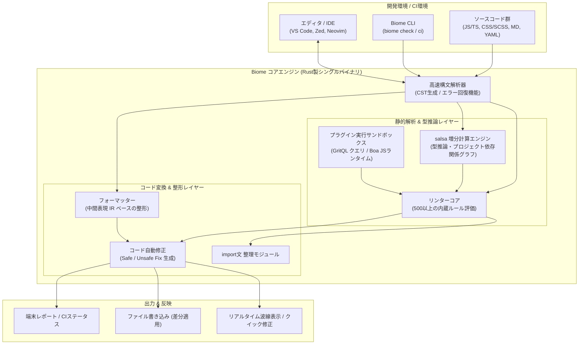

# **Biome 調査レポート**

## **1. 基本情報**

* **ツール名**: Biome
* **ツールの読み方**: バイオーム
* **開発元**: Biome Developers (コミュニティ主導)
* **公式サイト**: [https://biomejs.dev/](https://biomejs.dev/)
* **関連リンク**:
  * GitHub: [https://github.com/biomejs/biome](https://github.com/biomejs/biome)
  * DeepWiki: [https://deepwiki.com/biomejs/biome](https://deepwiki.com/biomejs/biome)
  * CodeWiki: [https://codewiki.google/github.com/biomejs/biome](https://codewiki.google/github.com/biomejs/biome)
  * ドキュメント: [https://biomejs.dev/guides/getting-started/](https://biomejs.dev/guides/getting-started/)
* **カテゴリ**: コード品質/静的解析
* **概要**: Biomeは、Webプロジェクトの健全性を維持するための高速なオールインワン・ツールチェーンです。Rustで構築されており、JavaScript、TypeScript、JSX、JSON、CSS、GraphQLに加え、Markdown、SCSS、YAMLのフォーマッターとリンターを単一のバイナリで提供します。PrettierやESLintの代替として設計されており、圧倒的な処理速度、シンプルなゼロコンフィグ志向、そして高度な静的解析を特徴としています。

## **2. 目的と主な利用シーン**

* **解決する課題**: 従来のJavaScript製ツール（ESLint、Prettier等）におけるパフォーマンスのボトルネック、複雑化する依存パッケージや設定ファイルの保守コスト、ツール間競合の解消。CI/CDパイプラインの実行時間短縮。
* **想定利用者**: Webフロントエンドエンジニア、Node.js/Bunバックエンド開発者、大規模モノレポを管理するプラットフォームエンジニア。
* **利用シーン**:
  * 大規模コードベースにおける高速な一括コードフォーマットおよび静的解析
  * CI/CDパイプラインでのコード品質チェック時間（実行待ち時間）の極小化
  * 新規Webプロジェクトにおける最小限の設定（`biome.json`）による素早い開発環境立ち上げ
  * VS CodeやZed、Neovimなどのエディタにおけるリアルタイムの診断と保存時フォーマット・インポート整理
  * Tailwind CSS（v4対応）を含むスタイルクラスの自動整列と重複・アンチパターンの検知

## **3. 主要機能**

* **超高速フォーマッター**: Prettierと約97%の高い互換性を維持しながら、25〜35倍以上の速度で動作。不完全なコード（構文エラーを含む状態）でも可能な限りフォーマットを復元。Markdown、SCSS、YAMLにも対応。
* **高精度リンター（500以上のルール内蔵）**: 推奨ルールセットに加え、ESLintやTypeScript-ESLint、React、Next.js、Vue、Playwright、Tailwind CSS向けのルールを網羅。詳細な診断情報と安全な自動修正コードを提示。
* **salsaベースの型推論エンジン**: `tsc` を背後で呼び出すことなく、Rustネイティブの増分計算フレームワーク（salsa）によって型情報を推論し、`noFloatingPromises` などの型認識ルールを高速に実行。
* **プラグインシステム（GritQL & JavaScriptプラグイン）**: 宣言的構文検索言語「GritQL」およびRust製JSエンジン「Boa」上で動作するJavaScriptプラグインをサポートし、独自のCST走査や自動修正ルールの作成が可能。
* **import文の自動整理 (Organize Imports)**: インポート文のソート、未使用importの除去、type-only importの分離などを高速に自動実行。
* **設定検証・診断コマンド (`biome inspect`)**: 解決された設定値、マッチする overrides、診断元の設定ファイルを可視化し、複雑なモノレポ設定のデバッグを容易化。
* **リアルタイムファイル監視（Watch Mode）**: `biome check --watch` や `biome lint --watch` により、ファイル変更を検知して差分のみを即座に再検証。
* **エディタ・LSP統合**: CLIだけでなく、Language Server Protocol（LSP）をネイティブサポートし、主要エディタとの親和性が高い。

## **4. 動作原理・システム構成**

Biomeは、Rust言語で記述された単一のネイティブバイナリとして動作するローカルファーストのツールチェーンです。ファイルI/Oから構文解析、型推論、コード整形、差分出力までの全工程を最適化されたパイプラインで並行処理します。



* **アーキテクチャ特性**:
  * **Concrete Syntax Tree (CST)**: 抽象構文木（AST）とは異なり、空白文字やコメント、セミコロンの位置情報を完全に保持するCSTを構築。構文エラーを含む壊れたコードでも途中で中断せず解析を続行可能。
  * **マルチスレッド並行処理**: Rayon等の並行ライブラリを活用し、マルチコアCPUの能力を限界まで引き出して数千〜数万ファイルを並行解析。
  * **salsa増分計算エンジン**: rust-analyzer等でも採用実績のある増分計算基盤を型推論に導入。ファイルの変更差分のみを再計算することで、エディタ上でもメモリ消費を抑えた即時フィードバックを実現。
  * **軽量サンドボックス実行 (Boa)**: JavaScriptプラグインはRustネイティブのJavaScript実装「Boa」上で動作し、ホスト環境から分離された安全かつ軽量な実行を保証。

## **5. 開始手順・セットアップ**

* **前提条件**:
  * Node.js / pnpm / yarn / bun のいずれかのパッケージマネージャー、またはRust（cargo）環境、あるいは独立バイナリの直接ダウンロード（HomebrewやTermux等も利用可能）。
  * アカウント登録や外部認証は一切不要。

* **インストール/導入**:

  ```bash
  # pnpmの場合（推奨: --save-exact によるバージョン固定）
  pnpm add --save-dev --save-exact @biomejs/biome

  # npmの場合
  npm install --save-dev --save-exact @biomejs/biome
  ```

* **初期設定**:

  ```bash
  # 設定ファイル（biome.json）の自動生成（Gitリポジトリを自動認識）
  pnpm dlx @biomejs/biome init
  ```

  生成された `biome.json` はデフォルトで推奨ルールが有効化されています。

* **クイックスタート**:

  ```bash
  # フォーマット、リント、import整理を一括チェック
  pnpm dlx @biomejs/biome check ./src

  # チェックと同時に安全な自動修正をファイルへ適用
  pnpm dlx @biomejs/biome check --write ./src

  # 設定やルールの適用状況をデバッグ表示
  pnpm dlx @biomejs/biome inspect config
  ```

## **6. 特徴・強み (Pros)**

* **圧倒的な処理速度**: Rustによるネイティブ実装とマルチスレッド並行処理により、PrettierやESLintと比較して20〜30倍以上高速に処理。数万行規模のモノレポでも数秒以内でチェックが完了。
* **真のオールインワン**: フォーマッター、リンター、import文整理、ファイル監視が単一ツールに集約されており、複数のツール間での依存衝突や設定の食い違い（PrettierとESLintの整形ルール衝突等）から完全に解放される。
* **充実した多言語サポート**: JavaScript/TypeScript/JSXのみならず、CSS、SCSS、GraphQL、JSON、さらにMarkdownやYAMLの解析・フォーマットに対応。
* **500以上のルールと高度な型推論**: ESLintの主要ルールを広範にカバー。さらにsalsa基盤の型推論により、重厚な型定義生成を伴わずに型認識リントを高速実行可能。
* **親切かつ美麗な診断メッセージ**: エラー箇所を行番号・コードスニペット・修正候補付きで明瞭にハイライトし、開発者体験（DX）を飛躍的に向上。
* **ゼロコンフィグに近い手軽さ**: デフォルトの `biome.json` のままで実用的なルールセットが整い、細かなプラグイン導入作業が不要。

## **7. 弱み・注意点 (Cons)**

* **完全な型チェッカーの代替ではない**: 型推論ルールを内蔵しているものの、TypeScriptコンパイラ（`tsc`）そのものを完全に置き換えるものではないため、CIパイプラインでは `tsc --noEmit` との併用が引き続き推奨される。
* **サードパーティエコシステムの成熟度**: 独自のJavaScriptプラグイン機能（Boa基盤）やGritQLによるカスタムルール作成が可能になったものの、10年以上の歴史を持つESLintのプラグイン資産（特殊な独自フレームワーク用ルールなど）の完全な移行には個別確認が必要。
* **ドキュメントの日本語対応**: 公式ドキュメントの主要ページは日本語化が進められているが、最新機能や一部の詳細リファレンスは英語が中心。

## **8. 料金プラン**

| プラン名 | 料金 | 主な特徴 |
|---|---|---|
| **OSS Community** | 無料 | すべてのCLI機能、フォーマッター、リンター、LSP、プラグイン機能を無制限で利用可能（MIT / Apache 2.0 デュアルライセンス）。 |
| **Sponsorship** | 任意寄付 | GitHub Sponsors / Open Collective を通じたプロジェクト支援。ロゴ掲載やDiscord専用チャンネルなどの特典。 |
| **Enterprise Support** | 個別見積もり | 大規模企業向けの導入支援、優先的な機能開発・Issue対応、SLA付き商用サポート。 |

* **課金体系**: 完全無料のオープンソースソフトウェア。利用量やシート数に応じた課金は一切なし。

## **9. 導入実績・事例**

* **導入企業**: AWS, Google, Microsoft, Discord, Vercel, Shopify, Cloudflare, Sentry など世界有数のテック企業で採用・コントリビューションが進む。
* **導入事例**:
  * **大規模モノレポのCI短縮**: 従来数分かかっていたリント＆フォーマットのCI実行時間を十数秒に短縮し、開発サイクルとインフラコストを劇的に改善。
  * **Vercelとの連携**: Vercelによる型推論エンジンの開発スポンサーシップを通じて、Next.jsエコシステムとの親和性が強化。
* **対象業界**: Webサービス、SaaS、メディア、ゲーム開発など、フロントエンドまたはNode.js基盤を持つすべての業界。

## **10. サポート体制**

* **ドキュメント**: 公式ドキュメント（[biomejs.dev](https://biomejs.dev/)）にスタートガイド、各ルールの詳細解説、移行ガイド、設定リファレンスが完備（多言語展開中）。
* **コミュニティ**: DiscordサーバーおよびGitHub Discussionsが非常に活発で、開発者やコアメンテナーからの迅速なフィードバックが得られる。
* **公式サポート**: 大規模エンタープライズ向けに商用サポート窓口が提供されている。

## **11. エコシステムと連携**

### **11.1 API・外部サービス連携**

* **API & LSP**: Language Server Protocol（LSP）標準に完全準拠し、VS Code、Zed、Neovim、WebStorm、Sublime Textなどのエディタ拡張からシームレスに利用可能。
* **CI/CD連携**: GitHub Actions（公式Action `biomejs/setup-biome` あり）、GitLab CI、CircleCIなどでの高速チェックに対応。
* **プラットフォーム対応**: Linux（x64/arm64）、macOS（Intel/Apple Silicon）、Windowsに加え、Termux（Android arm64/x64）向けのバイナリパッケージも提供。

### **11.2 技術スタックとの相性**

| 技術スタック | 相性 | メリット・推奨理由 | 懸念点・注意点 |
|:---|:---:|:---|:---|
| **TypeScript / JavaScript** | ◎ | ファーストクラスサポート。salsaによる型推論も統合され高速に動作。 | 特になし |
| **React / Next.js** | ◎ | JSX/TSXのネイティブパース、React Hook規則やNext.js特化ドメインルールを完備。 | 特になし |
| **Tailwind CSS (v4含む)** | ◎ | クラス名の自動ソート（`useTailwindSortedClasses`）や無効クラス検知を標準提供。 | 特になし |
| **Vue / Svelte / Astro** | ◯ | テンプレート構文やSFC内のスクリプト/スタイル解析に対応。ルール拡充中。 | 一部の特殊ディレクティブで例外設定が必要な場合あり |
| **Markdown / SCSS / YAML** | ◎ | v2.6でフルパーサーとフォーマッターが追加され、設定ファイルや文書も一元管理可能。 | 非常に複雑なSCSSマクロ構文は順次テスト拡充中 |
| **CSS / GraphQL** | ◯ | 標準構文およびCSS Modulesに対応。Stylelintからの移行コマンドあり。 | 特になし |

## **12. セキュリティとコンプライアンス**

* **ローカル完結型処理**: 解析およびフォーマット処理はすべてローカル環境またはCIランナー上で完結し、ソースコードやテレメトリが外部サーバーへ送信されることはない。
* **Boaサンドボックス実行**: 実行されるJavaScriptプラグインは分離されたBoaランタイム上で動作し、任意のシステムコールや不正なネットワークアクセスを遮断。
* **サプライチェーンの安全性**: 単一バイナリによる配布で膨大なnpm依存関係を持たないため、依存パッケージ経由のサプライチェーン攻撃リスクを大幅に低減。
* **ライセンス**: MIT License および Apache-2.0 のデュアルライセンスで提供され、商用プロジェクトでも安心して利用可能。

## **13. 操作性 (UI/UX) と学習コスト**

* **UI/UX**: ターミナル出力はカラーハイライトと正確な指摘箇所、修正コードの差分プレビューが表示され直感的。`biome inspect` コマンドにより「なぜこのルールが適用されたか」の設定追跡が極めて容易。
* **移行ツール（CLI Migration）**:
  * `biome migrate prettier`: `.prettierrc` から `biome.json` への設定移行。
  * `biome migrate eslint`: `.eslintrc` からのルール移行。
  * `biome migrate stylelint`: Stylelint設定からのルール移行。
* **学習コスト**: PrettierやESLintの概念をそのまま引き継いでいるため、Web開発経験者であれば学習コストはほぼゼロで即日導入可能。

## **14. ベストプラクティス**

* **効果的な活用法 (Modern Practices)**:
  * **`biome check --write` の一括運用**: フォーマット、リント、import整理を個別コマンドに分けず、統合コマンドで実行する。
  * **CIでの `biome ci` 活用**: CI環境では変更を許容しない `--error-on-warnings` や `biome ci` コマンドを用いて、パイプラインの高速ガードレールとして運用する。
  * **Tailwindクラスソートの標準化**: `useTailwindSortedClasses` を有効化し、チーム全体のクラス記述順を自動統一する。
  * **`tsc --noEmit` との分業**: Biomeでフォーマット・リント・型推論リントを高速実行し、最終的な厳密型検査のみ `tsc` に任せる。
* **陥りやすい罠 (Antipatterns)**:
  * **Prettier/ESLintとの重複実行**: 既存のフォーマッターとBiomeを同時に保存時実行すると、競合によりコードが意図せず書き換わるため、Biomeへ一本化するか拡張機能を無効化する。
  * **設定ファイルの過度な複雑化**: Biomeはゼロコンフィグ志向であるため、最初からすべてのルールを個別上書きせず、`recommended` プリセットをベースに必要最小限の調整にとどめる。

## **15. ユーザーの声（レビュー分析）**

* **調査対象**: GitHub Releases, Reddit, X (Twitter), 技術ブログコミュニティ
* **総合評価**: 4.8 / 5.0 相当（パフォーマンスと設定の平易さに関して熱狂的な支持を獲得）
* **ポジティブな評価**:
  * 「大規模モノレポでCIが10分から30秒になり、開発効率が劇的に上がった。」
  * 「ESLintのプラグイン地獄や依存関係のバージョン競合に悩まされることが完全になくなった。」
  * 「MarkdownやYAMLまでBiome一つで整形できるようになり、複数ツールの管理コストが激減した。」
  * 「エラー表示がどのツールよりも分かりやすく、修正の提案が親切。」
* **ネガティブな評価 / 改善要望**:
  * 「社内独自の極めてマニアックなESLintプラグインを移行するのに工夫が必要だった。」
  * 「Vue/Svelteなどのマルチフレームワーク環境では、まだ一部のニッチな構文でルールがスキップされることがある。」
* **特徴的なユースケース**:
  * 新規プロジェクトでのデフォルトツールチェーンとしての採用に加え、巨大なレガシーコードベースにおけるCIコスト削減目的での先行導入が進んでいる。

## **16. 直近半年のアップデート情報**

* **2026-10-21 (v2.6.2)**: パッチリリース。MarkdownおよびSCSSパーサーの安定性向上、Tailwindクラスソートルールの境界条件における修正。
* **2026-10-15 (v2.6.0)**: マイナーリリース。
  * **新言語の追加**: Markdown（CommonMark / GFM完全準拠）、SCSS（公式テストスイート90%以上互換）、YAMLのフルパーサー＆フォーマッターを導入。
  * **JavaScriptプラグイン (Developer Preview)**: Rust製JSランタイム「Boa」上で動作するカスタムリンタールール作成機能を公開。
  * **Tailwind CSS 統合の強化**: Tailwind v4対応のクラス自動ソート（`useTailwindSortedClasses`）およびアンチパターン検知ルールの追加。
  * **`biome inspect` コマンド**: 解決された設定値や適用overridesを可視化する設定診断コマンドを提供。
  * **salsaによる型推論エンジン刷新**: 増分計算フレームワークsalsaを採用し、型推論リントの効率と拡張性を大幅強化。
  * **Stylelint移行**: `biome migrate stylelint` コマンドの追加、59件のnurseryルールの安定版昇格。
  * **Termux対応**: Android arm64/x64 CLIパッケージの公式提供。
* **2026-06-25 (v2.5.0)**: マイナーリリース。
  * **リンタールール数が500件を突破**: 70以上のルールが安定版に昇格（Vue対応、型認識ルール、ファイル間リント等）。
  * **プラグインによるコード自動修正 (GritQL)**: プラグインで作成した独自ルールに対する safe/unsafe 自動修正（`--write`）のサポート。
  * **`delimiterSpacing` オプション**: ディスレクシア支援などを目的とした、区切り文字まわりのスペース挿入フォーマッターオプション。
  * **ウォッチモードのCLI統合**: `biome lint --watch` や `biome format --watch` を追加。
* **2026-05-09 (v2.4.15)**: パッチリリース。`useTestHooksInOrder`, `useVueNextTickPromise`, `noVueVOnNumberValues` などのルールの追加。
* **2026-05-01 (v2.4.14)**: パッチリリース。`useTestHooksOnTop` などのルールの追加や `noMisleadingReturnType` のバグ修正。

(出典: [GitHub Releases](https://github.com/biomejs/biome/releases), [CHANGELOG.md](https://github.com/biomejs/biome/blob/main/CHANGELOG.md))

## **17. 類似ツールとの比較**

### **17.1 機能比較表 (星取表)**

| 機能カテゴリ | 機能項目 | 本ツール (Biome) | Prettier | ESLint | oxlint |
|:---:|:---|:---:|:---:|:---:|:---:|
| **基本機能** | フォーマット | ◎<br><small>超高速・多言語対応</small> | ◎<br><small>業界標準・広範</small> | △<br><small>非推奨化・遅い</small> | -<br><small>非対応</small> |
| **基本機能** | リンティング | ◎<br><small>500+ルール内蔵</small> | ×<br><small>非対応</small> | ◎<br><small>最大のエコシステム</small> | ◯<br><small>高速リント特化</small> |
| **パフォーマンス** | 実行速度 | ◎<br><small>Rust製・並行処理</small> | △<br><small>JS製・並列度低</small> | △<br><small>JS製・大規模で低速</small> | ◎<br><small>Rust製・高速</small> |
| **言語・形式** | 対応範囲 | ◎<br><small>JS/TS/CSS/SCSS/MD/YAML</small> | ◎<br><small>極めて多種多様</small> | ◯<br><small>プラグインで拡張</small> | △<br><small>JS/TS中心</small> |
| **型認識解析** | ネイティブ型推論 | ◯<br><small>salsa内蔵（tsc不要）</small> | ×<br><small>非対応</small> | ◎<br><small>typescript-eslint（tsc依存）</small> | △<br><small>一部サポート中</small> |
| **プラグイン拡張** | カスタムルール | ◯<br><small>GritQL / Boa JS</small> | ◯<br><small>プラグイン可能</small> | ◎<br><small>極めて膨大な資産</small> | △<br><small>開発中</small> |

### **17.2 詳細比較**

| ツール名 | 特徴 | 強み | 弱み | 選択肢となるケース |
|---------|------|------|------|------------------|
| **Biome** | フォーマッターとリンターを統合したRust製オールインワンツールチェーン | 圧倒的な実行速度、Prettierとの高互換性、Markdown/SCSS/YAML対応、設定の簡潔さ | ESLintの歴史的なサードパーティプラグイン群の完全再現には移行検証が必要 | CI時間短縮やDX向上を重視するWebプロジェクト、ESLint/Prettierの設定地獄から脱却したい場合 |
| **Prettier** | Web開発におけるデファクトスタンダードのコードフォーマッター | 圧倒的な普及率、エディタ統合の成熟度、HTML/GraphQL等の安定した整形 | リント機能は持たない、大規模コードベースでの実行速度が課題 | 既にPrettierで安定稼働しており不満がないプロジェクト、Biome未対応の特殊テンプレート言語を扱う場合 |
| **ESLint** | JavaScriptエコシステムで最も普及している静的解析ツール | 巨大なプラグインエコシステム、あらゆるカスタム要件に対応できる柔軟性 | 設定（Flat Config含む）が複雑になりがち、フォーマット機能は切り離し推奨、大規模での処理速度 | フレームワーク独自の厳格な特殊ルールや、自社開発の高度なESLint独自ルールに依存している場合 |
| **oxlint** | Rust製の超高速JavaScript/TypeScriptリンター | ゼロコンフィグで動作し、ESLintより50〜100倍高速に動作 | フォーマッターは含まれず（Oxc別ツール）、ルールカバレッジは拡大途上 | 既存のPrettierやESLint構成を維持したまま、CIのリント速度のみを即座に引き上げたい場合 |

## **18. 総評**

* **総合的な評価**:
  Biomeは、Web開発におけるコード整形と静的解析のあり方を根本から再定義する強力な次世代ツールチェーンです。Rustによる圧倒的なパフォーマンスと、フォーマッター・リンター・import整理の一体化により、ツールの設定負荷とCI待ち時間を同時に解消します。さらにv2.6におけるMarkdown/SCSS/YAMLサポート、JavaScriptプラグイン基盤（Boa）、salsa増分型推論の導入によって、単なる「Prettier/ESLintの高速な代替」を超えた、Web開発環境の中核基盤としての地位を確立しています。
* **推奨されるチームやプロジェクト**:
  * CI/CDパイプラインの実行時間とインフラコストを削減したい開発チーム
  * 大規模なモノレポ（Turborepo, Nx等）を運用するプロジェクト
  * 新規に立ち上げるNext.js、React、Vue、Node.jsプロジェクト
  * ESLintとPrettierの設定衝突や依存関係の保守負担に悩まされているチーム
* **選択時のポイント**:
  既存プロジェクトに導入する場合は、`biome migrate prettier` や `biome migrate eslint` を活用して設定の互換性を確認し、まずはフォーマッターおよび基本リントから段階的に移行することをお勧めします。非常に特殊なESLint独自プラグインに依存している場合を除き、ほとんどの近代的なWebフロントエンド・フルスタックプロジェクトにおいて最良の選択肢となります。
