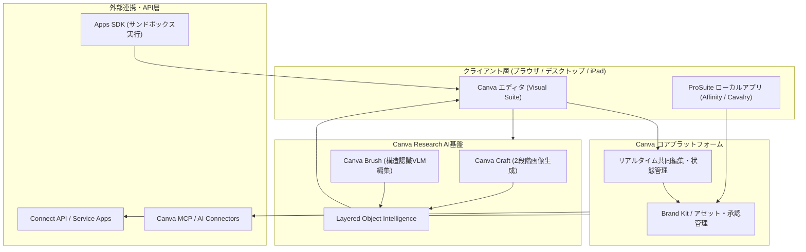

# **Canva 調査レポート**

## **1. 基本情報**

<!--
【ガイドライン】
- 必須: ツール名、開発元、公式サイト、カテゴリ、概要
- 概要は2-3文で簡潔に記述
-->

* **ツール名**: Canva
* **ツールの読み方**: キャンバ
* **開発元**: Canva Pty Ltd.
* **公式サイト**: [https://www.canva.com/](https://www.canva.com/)
* **関連リンク**:
  * ドキュメント: [Design School](https://www.canva.com/design-school/)
  * 開発者向け: [Canva Developers](https://www.canva.dev/)
  * レビューサイト: [G2](https://www.g2.com/products/canva/reviews) | [ITreview](https://www.itreview.jp/products/canva/reviews)
* **カテゴリ**: UI/UX/作図
* **概要**: Canvaは、単なるグラフィックデザインツールから、AIを全面的に統合した総合ビジュアルコミュニケーションプラットフォームへと進化を遂げた。2026年には会話型エージェント基盤「Canva AI 2.0」に加え、社内研究機関Canva Researchによる独自画像生成モデル「Canva Craft」およびデザイン特化VLM「Canva Brush」を発表し、編集可能なレイヤー単位での高精度なAI生成・編集を実現。さらにAffinity・Cavalry・Flourish・Leonardo.Aiを統合した「Canva ProSuite」や、Simtheory・Ortto統合によるマーケティング自動化機能も備え、初心者からプロクリエイター、エンタープライズまでをワンストップで支援する。

## **2. 目的と主な利用シーン**

<!--
【ガイドライン】
- 3-5項目を箇条書きで記述
- 想定利用者を具体的に記載
- 末尾に「代表的な利用フロー」をスイムレーンで添付する
-->

* **解決する課題**: 専門知識の有無にかかわらず、アイデア創出からデザイン制作、プロレベルの編集、広告配信、効果測定まで、クリエイティブなワークフロー全体を単一のプラットフォームで完結させる。
* **想定利用者**: 個人クリエイター、フリーランサー、中小企業のマーケティング担当者、大企業のブランド管理部門、プロのデザイナー（ProSuite経由）など、幅広い層を対象とする。
* **利用シーン**:
  * **AIによるコンテンツ制作・対話的編集**: 「Canva AI 2.0」や「Canva Craft / Canva Brush」を用い、プロンプトや対話指示だけで編集可能なマルチレイヤーのデザイン（プレゼン、SNS投稿、2K画像）を自動生成・一括修正。
  * **マーケティングキャンペーン**: 「Canva Grow 2.0」や買収したOrtto・MangoAIの技術を使い、ブランド情報に基づいた広告をAIで生成し、SNSやメール（Mailchimp / Klaviyo等）への直接配信から高度なマーケティング自動化・分析までを一元管理。
  * **動画・アニメーション制作**: 「Video 2.0」やCavalryの技術を活用し、テンプレートやAI機能を使ってプロフェッショナルなアニメーションを含む高品質な動画を短時間で作成。
  * **プロフェッショナルなデザイン作業**: 「Affinity」や「Canva ProSuite」を使い、高度な写真編集、ベクターデザイン、データ可視化（Flourish）を実施し、チーム向けテンプレートとして展開。
  * **チームでの共同作業**: ブランドキットや承認ワークフローで一貫性を保ちながら、Docs・Sheets・Whiteboards・Presentationsを横断してリアルタイムで共同編集。

### **2.1 代表的な利用フロー**

```mermaid
swimlane-beta TB
  subgraph User["ユーザー"]
    A[プロンプト・目的を入力]
    E[レイヤーを確認・微調整]
  end
  subgraph CanvaAI["Canva AI 2.0 (Craft / Brush)"]
    B[レイアウト計画・画像生成]
    D[編集可能レイヤーへ変換・反映]
  end
  subgraph Workspace["Canva エディタ / Brand Kit"]
    C[ブランド情報・テンプレートを参照]
  end
  subgraph External["外部連携 (SNS / Ortto / DAM)"]
    F[配信・マーケティング分析を実行]
  end
  A --> B
  B --> C
  C --> D
  D --> E
  E --> F
```

* **代表的な流れ**: ユーザーが目的やプロンプトを入力すると、Canva AI 2.0（Craft / Brush）がBrand Kitやテンプレートを参照して編集可能なマルチレイヤー構造でデザインを生成・修正する。ユーザーはエディタ上で細部を微調整した後、SNSやマーケティング自動化基盤（Ortto / Canva Grow）へ直接配信して効果測定まで完結できる。

## **3. 主要機能**

<!--
【ガイドライン】
- 5-10項目の主要機能を箇条書きで記述
- 各機能は1-2文で概要を説明
-->

* **独自AI基盤モデル (Canva Craft / Canva Brush)**: Canva Researchが開発した2段階生成モデル「Canva Craft」（最大2K解像度・55言語のテキスト描画対応）と、デザインのレイヤー構造を視覚的に理解して対話編集するVLM「Canva Brush」を搭載。
* **Canva AI 2.0 (会話型・エージェント機能)**: 独自「Canva Design Model」を中核に、過去の制作スタイルを学習する「Memory Library」、編集可能な要素を生成する「Layered Object Intelligence」、外部アプリと連携する「AI Connectors」を提供。
* **Canva ProSuite & Affinity**: プロ向け写真・ベクター・DTPツール「Affinity」（全ユーザー無料）に加え、2Dモーション「Cavalry」、データ可視化「Flourish」、プロ向けAI生成「Leonardo.Ai」をSSO・ガバナンス下で統合した「Canva ProSuite」を展開。
* **Canva Grow 2.0 & マーケティング自動化 (Ortto / MangoAI)**: ブランド情報を基に広告キャンペーンを自動生成し、マルチチャネル配信やHTMLメール連携（Mailchimp / Klaviyo等）、Orttoによるマーケティング自動化・効果分析までを一元管理。
* **Visual Suite (Docs / Sheets / Whiteboards / Presentations)**: 文書作成、スプレッドシート、ホワイトボード、プレゼンテーション、Webサイト作成を単一ファイル構造でシームレスに連携。
* **Video 2.0**: 直感的なタイムラインとAIによる自動編集機能を備えた、コンテンツ制作者向けの動画エディタ。
* **Canva Code 2.0 & Canva Forms**: HTMLやコード資産をインタラクティブな編集可能要素として取り込む「Canva Code 2.0」や、回答を自動データ化する「Canva Forms」を搭載。
* **ブランド管理・承認ワークフロー**: ロゴ、フォント、カラー、ブランド動画を集中管理し、エンタープライズ向けの厳格な承認フローとテンプレートロック機能を提供。

## **4. 動作原理・システム構成**

<!--
【ガイドライン】
- ツールの動作原理、システム構成（アーキテクチャ）、データの流れ、通信フローなどを記述
- クライアント・サーバー型、ローカルファースト、クラウド完結など、ツールのアーキテクチャ特性を明記
- 可能であればMermaidによる構成図やフロー図を含めること
-->

* **アーキテクチャ**: クラウドネイティブSaaS型アーキテクチャ（Webブラウザ上の高性能レンダリングエンジンと分散クラウドバックエンドの構成）。なお、プロ向けツール（Affinity等）はローカルデスクトップ・iPadアプリのネイティブ処理とクラウド同期を併用する。内部のインフラストラクチャ詳細は非公開であるが、公開されている範囲でAIモデルパイプラインとAPI構成を以下に整理する。
* **主要コンポーネントとデータフロー**:
  * **フロントエンド（エディタ層）**: Webブラウザや各OSアプリ上でベクター・テキスト・メディアをレイヤー構造としてリアルタイム描画し、WebSocket等を用いた複数人同時編集を実現する。
  * **Canva Research AIパイプライン**: 「Canva Design Model」を基盤とし、レイアウト計画モデルとレンダリングモデルの2段階で動作する画像生成モデル「Canva Craft」、およびライブキャンバスを読み取りコード変更と視覚チェックを反復するVLM「Canva Brush」が連携する。
  * **外部連携・拡張層**: サードパーティ製アプリを隔離実行する「Apps SDK」、外部バックエンド連携用の「Connect API（REST API / Service Apps）」、AIアシスタント連携用の「Canva MCPサーバー」、外部クラウドストレージやSlack等と繋ぐ「AI Connectors」で構成される。
* **特筆すべき要素技術**:
  * **Layered Object Intelligence**: 生成AIの出力を一枚のフラットなラスター画像としてではなく、テキスト・図形・背景が分離された編集可能なマルチレイヤー構造として出力・維持する技術。
  * **サンドボックス化された拡張実行環境**: Apps SDKによりサードパーティ製UI/ロジックをエディタ内の安全なサンドボックス上で動作させ、ホスト側のデータ保護と拡張性を両立している。



## **5. 開始手順・セットアップ**

<!--
【ガイドライン】
- アカウント作成から「Hello World」的な最初の動作確認までの手順
- 主要なコマンドや設定項目を記載
-->

* **前提条件**:
  * Webブラウザ（Chrome, Safari, Edgeなど）またはデスクトップ/モバイルアプリ（Windows, macOS, iOS, Android, iPadOS）。
  * アカウント作成（Google, Apple, Facebook, Email, SSO連携可）。
* **インストール/導入**:
  SaaS型のため基本はインストール不要（デスクトップ版やAffinity等のProSuiteアプリを利用する場合は公式サイトからダウンロード）。開発者向けCLIを利用する場合は以下を実行。

  ```bash
  # 一般利用（ブラウザで https://www.canva.com/ にアクセス）
  # 開発者向けCLI（Apps SDK / Connect API開発時）
  npm install -g @canva/cli
  ```

* **初期設定**:
  * アカウント作成後、利用目的（個人、小規模ビジネス、大企業、教育など）を選択すると最適なテンプレートが提案される。
  * Pro/Businessユーザーは「Brand Kit」にロゴ、フォント、カラーパレット、ブランド動画を登録。
* **クイックスタート**:
  * 「デザインを作成」ボタンをクリックし、作りたい形式（Instagram投稿、プレゼンテーション、ドキュメント等）を選択するか、「Canva AI」にプロンプトを入力して初稿を生成する。
  * テンプレートやAI生成結果のレイヤーを編集し、エクスポートまたはSNS・Webサイトへ直接公開して完了。

## **6. 特徴・強み (Pros)**

<!--
【ガイドライン】
- 3-5項目を箇条書きで記述
- 競合との差別化ポイントを明確に
-->

* **圧倒的な使いやすさと編集可能なAI**: 専門知識がなくても直感的に操作でき、Canva CraftやCanva Brushにより生成後の細かなレイヤー編集までAIと対話しながら高速に行える。
* **オールインワンの業務完結性**: デザインだけでなく、Docs/Sheets、印刷発注、SNS投稿管理、HTMLメール配信、Ortto等によるマーケティング自動化・分析まで単一基盤で完結する。
* **Affinity無料提供とProSuiteの統合**: 高価なプロ向けツール（Affinity）の無料利用に加え、CavalryやFlourish等を含むProSuiteにより、プロクリエイターと非デザイナー間のデータ受け渡しがシームレスになった。
* **マルチプラットフォーム**: Webブラウザ、デスクトップアプリ、モバイル/iPadアプリでシームレスに同期・連携。

## **7. 弱み・注意点 (Cons)**

<!--
【ガイドライン】
- 3-5項目を箇条書きで記述
- 日本語対応の状況は必ず含める
-->

* **デザインの画一化**: 人気のテンプレートをそのまま使うと、他社や他ユーザーとデザインが被る可能性がある。
* **AI利用回数の上限と追加コスト**: 無料版やPro/BusinessではPremium AI機能に月間利用回数の制限があり、ヘビーユーザーには高額な「AI Pass」の追加契約が必要になる場合がある。
* **学習コストの上昇**: Visual SuiteやAI 2.0、ProSuiteへと機能が急速に拡大したため、全機能を把握して使いこなす難易度が上がっている。
* **日本語対応**: UI、テンプレート、日本語フォント、およびCanva Craftのテキスト描画は日本語に対応しているが、一部の最新AI機能（Canva Brushのベータ機能や高度なコピーライティング等）は英語環境に比べて展開や精度に差が出る場合がある。

## **8. 料金プラン**

<!--
【ガイドライン】
- 表形式で整理することを推奨
- 最新の料金情報であることを確認
- 価格は通貨を明記（例: $10/月、¥1,000/月）
-->

※従来の「Canvaチームス（Teams）」は新規受付を終了し、1名から契約可能な「Canva Business」へ移行している。

| プラン名 | 料金（USD / 日本円目安） | 主な特徴 |
|---------|------|---------|
| **Canva 無料 (Free)** | 無料 | 基本機能、160万以上の無料テンプレート、**Affinity**基本利用、5GBストレージ、月間AI利用枠（制限あり） |
| **Canva Pro** | $18/月（年額 $144/年＝$12/月相当）<br>日本円: ¥1,180/月（年額 ¥8,300〜¥11,800/年） | 個人（1名）専用。360万以上のプレミアム素材、100GBストレージ、Brand Kit 5個、Canva Brush（ベータ）等拡張AI利用枠（約200回/月）、SNS予約投稿 |
| **Canva Business** | $25/ユーザー/月（年額 $250/ユーザー/年）<br>日本円: ¥1,880/ユーザー/月（年額 ¥18,800/ユーザー/年） | 1名から利用可。Proの全機能 + Brand Kit最大100個、承認ワークフロー、**Canva Grow 2.0 / マーケティング分析**、さらに拡張されたAI利用枠（約400回/月） |
| **Canva Enterprise** | 要問い合わせ（カスタム価格） | 大企業向け。SSO / SCIM、監査ログ、Brand Kit最大1,000個、1TBストレージ、専任サポート、AI出力のIP補償オプション |

* **課金体系**: 個人ライセンス（Pro）、またはユーザー数に応じたシート課金（Business / Enterprise）。ヘビーユーザー向けの追加オプションとして「AI Pass（約$100/ユーザー/月）」も用意されている。
* **無料トライアル**: ProおよびBusinessプランで無料トライアル（30日間等、キャンペーンにより変動）が利用可能。

## **9. 導入実績・事例**

<!--
【ガイドライン】
- 具体的な企業名を3-5社挙げる
- 導入事例がない場合は「公開事例なし。ただし、〜の分野での利用が報告されている」等
-->

* **導入企業**: FedEx, Salesforce, PayPal, Zoom, HubSpot, Mattel など、Fortune 500の90%以上が導入。
* **導入事例**: Zoom社では営業チームがCanvaを使用してプレゼン資料を内製化し、成約率を向上させた。また、教育機関や大手消費財メーカーでもブランドテンプレートを活用したコンテンツ内製化が進んでいる。
* **対象業界**: 全業界対応。特にマーケティング、教育、非営利団体、スタートアップ、エンタープライズの広報・営業部門での利用が多い。

## **10. サポート体制**

<!--
【ガイドライン】
- ドキュメント、コミュニティ、公式サポートの3項目を必ず含める
- URLがあれば記載
-->

* **ドキュメント**: 「[Design School](https://www.canva.com/design-school/)」および「[Help Center](https://www.canva.com/help/)」で豊富なチュートリアル・FAQを提供。開発者向けには「[Canva Developers Docs](https://www.canva.dev/docs/)」を整備。
* **コミュニティ**: Canva Design Community（公式コミュニティ・Facebook Group等）や教育者向けコミュニティなど、世界中に活発なユーザーコミュニティが存在。
* **公式サポート**: メールおよびチャットサポート（24時間対応や優先対応はプランによる）。Enterpriseは専任サクセスマネージャーが付く。

## **11. エコシステムと連携**

<!--
【ガイドライン】
- API、外部連携、技術スタックとの相性を包括的に記述
-->

### **11.1 API・外部サービス連携**

<!--
【ガイドライン】
- APIの有無と公開状況を明記
- 主要連携サービスを5-10個リストアップ
-->

* **API・開発者基盤**:
  * **Canva Connect API**: 外部システムからデザイン操作・生成・エクスポートを行うREST API。2026年にはユーザーを介さずアプリ単体でバックエンド連携できる「Service Apps」や、独自画像生成モデル「Canva Craft (`craft_v1_2k`)」のAPI提供、SheetsデータのAutofill API（プレビュー）に対応。
  * **Canva Apps SDK**: エディタ内で動作するアプリを開発できるTypeScriptファーストのSDK。`@canva/cli` やゼロコンフィグの `@canva/app-scripts`、Content Publisher Intent（GA）を提供。
  * **Canva MCPサーバー**: Model Context Protocol（MCP）に対応し、AIアシスタントからCanvaのエコシステムを直接操作可能。
* **外部サービス連携**:
  * **ストレージ / DAM**: Google Drive, Dropbox, Box, CI HUB
  * **SNS**: Instagram, Facebook, TikTok, LinkedIn, X (Twitter)
  * **マーケティング / メール / 自動化**: Ortto, Simtheory, HubSpot, Salesforce, Mailchimp, Klaviyo, Constant Contact
  * **コラボレーション**: Slack, Microsoft Teams, Gmail

### **11.2 技術スタックとの相性**

<!--
【ガイドライン】
- 主要なフレームワークや言語との相性を表形式で整理
- 相性: ◎ (非常に良い), ◯ (良い), △ (工夫が必要/一部非対応), × (非推奨)
-->

| 技術スタック | 相性 | メリット・推奨理由 | 懸念点・注意点 |
|:---|:---:|:---|:---|
| **React / TypeScript** | ◎ | 公式SDK（Canva Apps SDK）はTypeScriptファーストで設計されており、`@canva/app-scripts` による開発体験が良い。 | UIキットの制約があり、自由なデザインは難しい場合がある。 |
| **Node.js (Backend)** | ◎ | Connect API（REST API / Service Apps）経由でのデザイン自動生成や`craft_v1_2k`呼び出し、素材管理が容易。 | Autofill APIの一部機能はEnterprise中心の提供。レート制限に注意が必要。 |
| **MCP対応AIエージェント** | ◎ | 公式Canva MCPツールにより、Claudeや各種AIワークフローからデザイン検索・生成等を直接連携可能。 | 権限スコープや組織ポリシーの事前設定が必要。 |
| **Vanilla JS** | ◯ | Apps SDKはフレームワーク非依存で動作するため利用可能。 | Reactのようなコンポーネント管理ができないため、大規模アプリには不向き。 |

## **12. セキュリティとコンプライアンス**

<!--
【ガイドライン】
- 認証、データ管理、準拠規格の3項目を必ず調査
- 情報が見つからない場合は「公式サイトで公開されていない。問い合わせが必要。」と記載
-->

* **認証**: SSO（SAML 2.0）、MFA（多要素認証）、SCIMによるユーザープロビジョニングに対応（Enterprise）。
* **データ管理**: データは暗号化されて保存および転送される（TLS 1.2+）。エンタープライズ契約ではAI学習へのデータ利用オプトアウトやAI出力のIP補償オプションを提供。
* **準拠規格**: ISO 27001取得済み。SOC 2 Type II 準拠。GDPR、CCPA対応。

## **13. 操作性 (UI/UX) と学習コスト**

<!--
【ガイドライン】
- 実際の使用感や、類似ツールとの比較を含める
-->

* **UI/UX**: ドラッグ＆ドロップを基本とした直感的なUI。コンテキストに応じたメニュー表示や、Canva AI 2.0の対話型パネルなど、非デザイナーを迷わせない工夫が随所にある。
* **学習コスト**: 基本的なデザイン作成は数分で習得可能。ただし、Visual Suite（Docs/Sheets/Whiteboards）、マーケティング自動化（Grow 2.0/Ortto）、ProSuite（Affinity/Cavalry）まで含めると機能範囲が非常に広いため、用途に応じた段階的な習得が必要。

## **14. ベストプラクティス**

<!--
【ガイドライン】
- ツールを効果的に活用するための推奨事項や、避けるべきアンチパターンを記述
-->

* **効果的な活用法 (Modern Practices)**:
  * **Brand Kitと承認フローの徹底**: ロゴ、色、フォント、ブランド動画を登録し、Business以上の承認ワークフローを組み合わせることで、デザイン品質とガバナンスを両立する。
  * **Craft × Brushのハイブリッド編集**: ゼロからの素材生成にCanva Craftを使い、既存スライドやSNS投稿への一括適用・レイアウト修正にCanva Brushを活用することで制作時間を大幅に短縮する。
  * **ProSuiteとの役割分担**: 専門デザイナーがAffinityやCavalryでコア素材・テンプレートを作成し、マーケティングや営業チームがCanva上でローカライズ・量産する運用が効果的。
* **陥りやすい罠 (Antipatterns)**:
  * **テンプレートの過信**: そのまま使うと「Canvaっぽい」既視感のあるデザインになりがち。色やフォント、レイアウトをブランドに合わせてカスタマイズすべき。
  * **AIクレジット消費の無計画な運用**: 大量の一括生成を繰り返すと月間AI利用枠を早期に使い切るため、下書きと仕上げの使い分けを意識する。
  * **印刷用データの確認不足**: 画面上では綺麗でも、印刷解像度や断ち落とし設定を確認せずに入稿して失敗するケース。

## **15. ユーザーの声（レビュー分析）**

<!--
【ガイドライン】
- 必須調査サイト: G2, Capterra, ITreview（日本語レビュー）のうち該当するもの
- 総合評価スコアがあれば必ず記載
- ポジティブ・ネガティブ各3項目以上
-->

* **調査対象**: G2, Capterra, ITreview
* **総合評価**: 4.7/5.0（G2: 8,000件以上、Capterra: 13,400件以上のレビューで非常に高評価。ITreviewでも4.2〜4.5/5.0前後と高水準）
* **ポジティブな評価**:
  * 「非デザイナーでもプロのような資料やSNS画像が短時間で作れるようになった」
  * 「Affinityが無料で使えるうえ、豊富なテンプレートとAI機能でコストパフォーマンスが抜群」
  * 「チームでのリアルタイム共同編集やコメントへの画像添付機能が優秀で、フィードバックが高速化した」
* **ネガティブな評価 / 改善要望**:
  * 「プラン改定（TeamsからBusinessへの移行）やAIクレジット制限により、チーム規模が大きい場合やAI多用時のコスト感に不満がある」
  * 「高度なレタッチや複雑な印刷用CMYK制御は、Canva単体では限界がありAffinity等の専用ツールへの切り替えが必要」
  * 「クラウド依存のため、オフライン環境での作業や重い動画編集時のブラウザ動作に制約を感じることがある」
* **特徴的なユースケース**:
  * 教育現場での利用が定着しており、教師の教材作成や生徒の課題発表に加え、Canva Code等を活用したインタラクティブな学習コンテンツ制作も広がっている。

## **16. 直近半年のアップデート情報**

<!--
【ガイドライン】
- 日付の降順（新しいものが上）
- 既存の過去のアップデート情報を消去せず、その上に新しいアップデートを追記すること
-->

* **2026-11**: **大規模な組織再編とAI戦略へのリソース集中を発表**
  * 全社従業員の約22%（1,271名）に影響する組織再編を発表し、中核拠点への集約とともに次世代AIおよびVisual Suite開発への投資集中を表明。あわせてAffinityのiPad向けワークスペース統合等も継続強化。
* **2026-10-29**: **デザイン特化VLM「Canva Brush」発表**
  * Canva Researchが開発。デザインのレイヤー構造やスタイルを理解して対話的に編集を実行し、従来エージェント比で最大69%の高速化・46%のコスト削減を実現（Canva Pro向けにベータ提供開始）。
* **2026-10-22**: **独自画像生成基盤モデル「Canva Craft」発表**
  * Canva初のゼロから構築した独自画像生成基盤モデル。計画モデルとレンダリングモデルの2段階構成により最大2K解像度・55言語のテキスト描画に対応し、DesignArenaで高評価を獲得。Connect API（`craft_v1_2k`）でも提供開始。
* **2026-09**: **プロ向け統合スイート「Canva ProSuite」発表**
  * Affinity、Cavalry、Flourish、Leonardo.Aiを単一のエンタープライズSSO・管理基盤下に統合し、専門クリエイターと一般チームの連携を強化。
* **2026-08〜09**: **Visual Suite 100件以上の機能強化**
  * Docs、Sheets、Whiteboards、Presentationsの横断的なプロジェクト統合や、オフライン・オンライン連携機能を大幅拡充。
* **2026-07**: **7月期プロダクトアップデート**
  * 写真からブランドに沿ったグラフィックを生成する「Style Match」、エディタコメントへの画像添付、AI Post Writer、CI HUB連携、HTMLメール直接配信連携（Mailchimp / Klaviyo等）を追加。
* **2026-06**: **Canva Grow 2.0 & Canva AI 2.0ワークフロー拡大**
  * 広告制作・マルチチャネル配信・効果分析を統合したGrow 2.0の展開、および外部アプリ（Google Drive, Slack, HubSpot等）と連携するエージェント型AIワークフローを提供拡大。
* **2026-04**: **Canva AI 2.0発表（Canva Create）およびSimtheory / Orttoの買収**
  * 会話型・エージェント型の「Canva Design Model」、Memory Library、Layered Object Intelligence、Canva Code 2.0を発表。あわせてAIワークフローツール「Simtheory」とマーケティング自動化ツール「Ortto」を買収。
* **2026-02-23**: **CavalryとMangoAIの買収**
  * アニメーションソフトウェアの「Cavalry」と、動画広告パフォーマンス改善に特化した「MangoAI」を買収。
* **2025年後半**: **Imagination Era発表**
  * プロンプトからのデザイン自動生成、3Dエレメント生成、スタイル統一機能「Style Match」などを実装。
* **2025-10-20**: **Canva Create 2025**
  * 「クリエイティブ・オペレーティング・システム」構想を発表。**Affinityスイートの完全無料化**（全ユーザー対象）、中小企業向け「Canva Business」プランおよびAIマーケティング分析「Canva Grow」をリリース。
* **2025-05-15**: **Canva Enterprise発表**
  * 大企業向けのセキュリティ強化プラン。

(出典: [Canva Newsroom](https://www.canva.com/newsroom/news/) | [Canva What's New](https://www.canva.com/whats-new/) | [Canva Developers Changelog](https://www.canva.dev/docs/apps/changelog/))

## **17. 類似ツールとの比較**

<!--
【ガイドライン】
- 3-5個の類似ツールと比較
- **機能比較表（星取表）**と**詳細比較**の2つの観点で記述する
-->

### **17.1 機能比較表 (星取表)**

| 機能カテゴリ | 機能項目 | Canva | Adobe CC | Figma | Microsoft Designer |
|:---:|:---|:---:|:---:|:---:|:---:|
| **基本機能** | デザイン作成 | ◎<br><small>直感的・高速</small> | ◎<br><small>プロ品質</small> | ◯<br><small>Web/UI向け</small> | △<br><small>簡易的</small> |
| **AI機能** | 生成AI・AI編集 | ◎<br><small>Craft/Brush統合</small> | ◎<br><small>Firefly強力</small> | ◯<br><small>Figma Agent/Weave</small> | ◎<br><small>DALL-E系統合</small> |
| **専門性** | ベクター/写真/動画 | ◎<br><small>Affinity/ProSuite</small> | ◎<br><small>業界標準</small> | △<br><small>UI・Motion中心</small> | ×<br><small>非対応</small> |
| **ビジネス** | マーケティング分析/自動化 | ◎<br><small>Grow 2.0/Ortto</small> | △<br><small>一部ツール</small> | ×<br><small>なし</small> | ×<br><small>なし</small> |
| **非機能** | 日本語対応 | ◎<br><small>完全対応</small> | ◎<br><small>完全対応</small> | ◯<br><small>UI・ヘルプ対応</small> | ◯<br><small>対応</small> |

### **17.2 詳細比較**

| ツール名 | 特徴 | 強み | 弱み | 選択肢となるケース |
|---------|------|------|------|------------------|
| **Canva** | デザインからマーケティング、独自AI基盤（Craft/Brush）、プロ向けスイートまで一気通貫のプラットフォーム。 | 圧倒的な使いやすさ、Affinity無料付帯・ProSuite統合、Grow 2.0/Orttoによる高度な自動化、コストパフォーマンス。 | ピクセル単位の極めて高度なレタッチや商用印刷の精密制御はAdobe PS/Illustratorに分がある。 | コストを抑えて非デザイナーからプロまで使える統合デザイン環境を整えたい全ユーザー。 |
| **Adobe CC** | 業界標準のプロフェッショナルツール群。 | 機能の深さとエコシステムの広さ。プロの現場でのデファクトスタンダード。 | 高価。学習コストが高い。ツールごとの連携がCanvaほどシームレスではない。 | プロのデザイナー、商業印刷業界、映像制作会社。 |
| **Figma** | UI/UXデザインとプロトタイピングに特化。Code LayersやFigma Agent、Motion等を備える。 | Web/アプリデザインの効率性、エンジニアへの開発ハンドオフ（Dev Mode / MCP）機能。 | 印刷物や本格的な写真レタッチ、マーケティング自動化には不向き。 | Webサイトやアプリ開発のUI/UXデザインおよびフロントエンド連携を行う場合。 |
| **Microsoft Designer** | Microsoft 365と連携したAIデザインツール。 | Office製品との親和性。生成AIによる手軽な画像・バナー作成。 | 編集機能が限定的で、細かいレイアウト調整やチームでのブランド管理に向かない。 | Officeユーザーがプレゼン資料の画像を素早く作りたい場合。 |

## **18. 総評**

<!--
【ガイドライン】
- 総合評価、推奨チーム、選択ポイントの3項目を必ず含める
- 客観的で中立的な評価を心がける
-->

* **総合的な評価**:
  * Canvaは、従来の「初心者向けツール」という枠を超え、2026年の「Canva AI 2.0」、独自基盤モデル「Canva Craft / Canva Brush」、そしてプロ向け統合環境「Canva ProSuite」によって、**非デザイナーからプロクリエイター、マーケティング部門までを単一基盤で繋ぐ総合クリエイティブプラットフォーム**へと進化した。特にAffinityの無料提供と独自AIモデルによるレイヤー単位の対話編集は、Adobe一強だった市場構造を大きく変えるインパクトを持っている。
* **推奨されるチームやプロジェクト**:
  * マーケティングチーム、スタートアップ、中小企業全般。
  * デザインの内製化とマーケティング自動化を同時に進めたい組織、またはプロデザイナーが作成したテンプレートを現場で安全に量産したいエンタープライズ。
* **選択時のポイント**:
  * 「誰がどこまで使うか」が鍵。ノンデザイナーを含むチーム全体でスピードとブランド統一を重視するならCanvaが最適解となる。UI/UX設計とエンジニアへのコードハンドオフが主目的であればFigma、商業印刷や高度な映像・レタッチ専業であればAdobe CCとの併用・棲み分けを検討するとよい。
