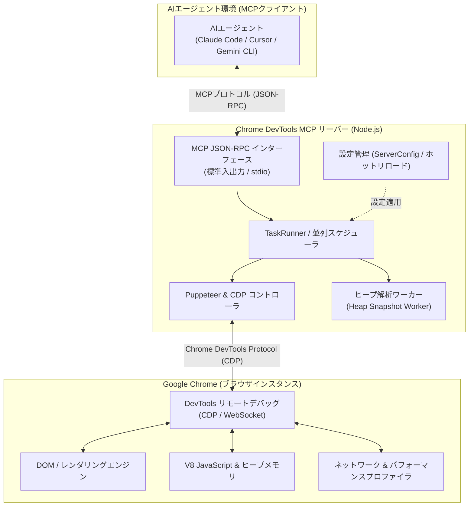

# **Chrome DevTools for agents 調査レポート**

## **1. 基本情報**

* **ツール名**: Chrome DevTools for agents
* **ツールの読み方**: クローム デブツールズ フォー エージェンツ
* **開発元**: Google LLC (Chrome DevTools チーム)
* **公式サイト**: [https://github.com/ChromeDevTools/chrome-devtools-mcp](https://github.com/ChromeDevTools/chrome-devtools-mcp)
* **関連リンク**:
  * GitHub: [https://github.com/ChromeDevTools/chrome-devtools-mcp](https://github.com/ChromeDevTools/chrome-devtools-mcp)
  * DeepWiki: [https://deepwiki.com/ChromeDevTools/chrome-devtools-mcp](https://deepwiki.com/ChromeDevTools/chrome-devtools-mcp)
* **カテゴリ**: MCPサーバー
* **概要**: AIコーディングエージェント（Claude Code、Cursor、Gemini CLI、GitHub Copilot、Kimi Codeなど）に対して、起動中のGoogle Chromeブラウザを直接制御・検査する能力を提供するModel Context Protocol (MCP) サーバーです。Puppeteerによるブラウザ自動化に加え、Chrome DevTools Protocol (CDP) ネイティブのパフォーマンスプロファイリング、V8ヒープスナップショット比較によるメモリリーク解析、CSSスタイルのインスペクションなど、開発者向けの高度な検証・デバッグ環境を提供します。

## **2. 目的と主な利用シーン**

* **解決する課題**: AIエージェントが生成したWebフロントエンドコードを検証する際、ソースコードのテキスト編集にとどまり、実際のブラウザ描画状態、レンダリング速度、コンソールエラー、ネットワーク障害、メモリリークを自律的に確認・修正できない課題を解決します。
* **想定利用者**: AIコーディングアシスタントを活用するフロントエンドエンジニア、Webパフォーマンスエンジニア、QA・テスト自動化エンジニア、自律型AIエージェントの開発者
* **利用シーン**:
  * **フロントエンド実装の自律的検証**: AIエージェントがUIコンポーネントを実装または修正した後、ブラウザで実際にレンダリングしてスクリーンショットを取得し、レイアウト崩れや表示仕様を視覚的に検証する。
  * **Core Web Vitals・パフォーマンスチューニング**: サイトのトレースデータを記録・抽出し、LCPやCLSなどのボトルネックを特定してパフォーマンス改善コードを提案・適用させる。
  * **V8ヒープスナップショットを用いたメモリリーク特定**: SPAなどの画面遷移前後でヒープスナップショットを取得・比較（`compare_heapsnapshots`）し、オブジェクトの解放漏れやリテイニングパスを自動特定する。
  * **コンソールエラーおよびネットワークリクエストの自動デバッグ**: APIのCORSエラー、4xx/5xxステータス、未捕捉のJavaScript例外をソースマップ付きスタックトレースでエージェントが即座に把握し修正する。
  * **CSS・スタイル崩れのピンポイント修正**: `get_css_style` ツールを用いて特定のDOM要素の計算済みCSSスタイルを取得し、意図しない上書きやセレクタの競合を解消する。

## **3. 主要機能**

* **パフォーマンス分析 (Performance Insights & Tracing)**: Chrome DevToolsのパフォーマンストレースを記録し、タイムライン、ロングタスク、Core Web Vitalsのボトルネックを抽出。チャンク分割バッファパーサーにより大規模なトレース記録も安定して解析可能です。
* **メモリデバッグ & ヒープスナップショット解析 (Memory & Heap Analysis)**: V8のヒープスナップショット取得、未接続状態でのオフライン解析、2つのスナップショット間の差分比較（`compare_heapsnapshots`）、ドミネータツリーやリテイニングパス（`retaining_paths`）の特定が可能です。
* **CSSスタイルインスペクション (`get_css_style`)**: 指定したDOM要素の適用中スタイルや計算済みCSSプロパティを取得・フォーマットし、AIがスタイルの齟齬を直接読み取れるようにします。
* **信頼性の高いブラウザ自動操作 (Puppeteer Automation)**: Puppeteerエンジンを内包し、要素の可視状態やネットワークアイドルを自動待機しながらクリック、テキスト入力、キー押下、ホバー、ページ遷移を安定して実行します。
* **高度なブラウザデバッグ (Console & Network Inspection)**: ネットワークリクエスト・レスポンスの詳細ログ、Cookie情報の検査、コンソールメッセージ（ソースマップ展開後のスタックトレース付き）の収集に対応しています。
* **UI・デバイスエミュレーション**: ビューポートサイズ変更、ライト/ダークテーマの切り替え、CPUスロットリング、ネットワーク遅延シミュレーション、モバイル端末エミュレーション、カスタムHTTPヘッダー付与が可能です。
* **Lighthouse監査 (Lighthouse Audits)**: 最新のLighthouseエンジン（v13.4+）をオンデマンドでバンドルロードし、パフォーマンス、アクセシビリティ、SEO、ベストプラクティスのスコアと改善提案を生成します。
* **TaskRunnerによる並列ツール実行**: 互いに独立したツール呼び出しや、異なるページ/タブに対するページスコープのツール操作を並行して実行し、エージェントの作業スループットを最大化します。
* **設定の動的ホットリロード (`--watchConfig`)**: サーバーの稼働中に設定ファイル（URL許可・拒否パターンなど）の更新を検知し、サーバーを再起動することなくリアルタイムで構成を再適用できます。
* **エージェントスキル (Agent Skills) & プラグイン連携**: CookieデバッグやLighthouseコントラストワークフローなどのスキル群、およびCursorやKimi Codeなどのプラグインマニフェストを標準装備しています。

## **4. 動作原理・システム構成**

* **アーキテクチャ**: ローカルファーストのクライアント・サーバー構成（Model Context Protocol準拠）。MCPクライアント（AIエージェント/IDE）とGoogle Chromeの間でプロキシサーバーとして動作し、プロセス間通信（IPC）およびDevToolsプロトコル（CDP）を介してブラウザを制御・検査します。
* **主要コンポーネントとデータフロー**:
  * **MCPクライアント (AIエージェント)**: Claude Code、Cursor、Gemini CLIなどのエージェント環境。標準入出力（stdio）またはSSEを介してMCP JSON-RPCメッセージを送受信。
  * **TaskRunner / ServerConfig**: ツールリクエストのスケジューリングと並列実行管理。`--watchConfig` による設定の動的ホットリロードや、URL制限（`allowedUrlPattern` / `blockedUrlPattern`）のフィルタリングを担当。
  * **Puppeteer / CDPコントローラ**: Chrome DevTools Protocol (CDP) のWebSocket接続を管理し、DOM操作、ナビゲーション、ネットワーク監視、パフォーマンス測定コマンドを実行。
  * **ヒープ解析ワーカー (Heap Snapshot Worker)**: メモリプロファイリングやヒープダンプ（`.heapsnapshot`）の解析・比較をバックグラウンドスレッドで非同期処理し、ブラウザ本体のブロッキングを防止。
  * **Google Chrome インスタンス**: 実際にレンダリングとスクリプト実行を行うブラウザプロセス。ローカルの新規インスタンスまたは `--autoConnect` / リモートデバッグポート経由の既存インスタンス。
* **特筆すべき要素技術**:
  * **Chrome DevTools Protocol (CDP)**: ブラウザの低レベルAPIに直接アクセスし、トレース記録、コンソールログ収集、CSS/DOM解析を実現。
  * **Puppeteer 自動化エンジン**: 安定した要素待機、クリック、キー入力、スクリーンショット撮影。
  * **マルチワーカー・並列パイプライン**: 複数タブ・複数ページの並行操作や、独立したツールの並列実行（TaskRunner）。



## **5. 開始手順・セットアップ**

* **前提条件**:
  * Node.js v20.19 以降（v22+ 推奨）
  * Google Chrome 安定版（最新版）
  * npm、pnpm、または uv 等のパッケージマネージャー
* **インストール/導入**:
  MCPクライアントの設定ファイル（例: `claude_desktop_config.json` や `.cursor/mcp.json`）に以下を追加します。

  ```json
  {
    "mcpServers": {
      "chrome-devtools": {
        "command": "npx",
        "args": [
          "-y",
          "chrome-devtools-mcp@latest"
        ]
      }
    }
  }
  ```

* **初期設定**:
  * **既存のChromeセッションへの自動接続**: Chrome 144以降を利用している場合、`--autoConnect` フラグを指定することで、起動中の通常ブラウザウィンドウへ簡単に接続可能です。
  * **設定ファイルのホットリロード**: `--config ./mcp-config.json --watchConfig` を指定することで、URLフィルタや実行時オプションをサーバー稼働中に動的反映できます。
  * **ヘッドレス実行**: バックグラウンドでの高速自動テスト時は `--headless --slim` を付与します。
* **クイックスタート**:
  MCPクライアントのチャット画面で以下のように指示します。

  ```
  https://example.com を開き、ページのスクリーンショットを撮ってCore Web Vitalsのスコアを分析してください。
  ```

## **6. 特徴・強み (Pros)**

* **Chrome公式のDevTools深層アクセス**: GoogleのChrome DevTools開発チーム自身が保守しているため、最新のCDP仕様やChrome機能（Chrome 144+のautoConnect等）に即座に対応します。
* **メモリ・パフォーマンスまで網羅する包括的ツール群**: クリックや文字入力といった表面的なブラウザ操作だけでなく、V8ヒープのリーク調査やLighthouse監査までAIが実行できる唯一無二のツールセットを提供します。
* **TaskRunnerによる並列化と高スループット**: 複数タブの同時操作や独立ツールの並列実行に対応しており、複雑なWebアプリケーションの回帰テストを高速に処理できます。
* **オープンソースかつ商用フリー**: Apache-2.0ライセンスで完全無償提供されており、外部APIキーやクラウド課金の心配なくローカル環境やCI環境でフル活用できます。

## **7. 弱み・注意点 (Cons)**

* **ブラウザ内データの露出リスク**: 普段のブラウジングプロファイルに接続した場合、Cookieや閲覧履歴、ローカルストレージの機密情報がAIクライアントに渡るリスクがあるため、専用の一時プロファイルやURLフィルタリング（`allowedUrlPattern`）の適用が推奨されます。
* **ヒープ解析・大規模トレース時のリソース消費**: 長時間のパフォーマンストレースや大規模Webアプリのヒープスナップショット比較を行う際、一時的にNode.jsプロセスおよびメモリの消費量が増加します。
* **英語中心のドキュメント**: エージェント向けツール説明やGitHubのREADME、スキル定義はすべて英語で記述されています（AIが日本語で操作指示・要約すること自体は問題なく動作します）。

## **8. 料金プラン**

| プラン名 | 料金 | 主な特徴 |
|---------|------|---------|
| **オープンソース (OSS)** | 無料 | Apache-2.0ライセンス。すべての機能（自動化、デバッグ、パフォーマンス分析、ヒープ解析）が永続的に無料。 |

* **課金体系**: 完全無料（オープンソースソフトウェア）
* **無料トライアル**: 該当なし（全機能が無制限に利用可能）

## **9. 導入実績・事例**

* **導入企業**: オープンソースソフトウェアのため単独の企業契約数は非公開ですが、世界中のWebフロントエンド開発者、SaaS企業、オープンソースAIプロジェクトでデファクトスタンダードとして導入されています。
* **導入事例**:
  * **Claude Code / Claude Desktop**: Anthropicの公式エージェント環境における推奨ブラウザMCPサーバーとして採用。
  * **Cursor / Windsurf**: AIネイティブエディタにおけるWeb開発時のライブプレビュー検証・自動デバッグ用途で広く活用。
  * **Kimi Code / Gemini CLI**: プラグインマニフェスト対応により、多様なAIエージェントフレームワークでブラウザ操作基盤として利用。
* **対象業界**: Web開発、SaaS開発、Eコマース、QAテスト自動化、AIエージェント受託開発全般

## **10. サポート体制**

* **ドキュメント**: GitHubリポジトリのREADME、`docs/` 配下のツールリファレンス、トラブルシューティングガイド、および `skills/` に収録されたワークフロー定義が完備されています。
* **コミュニティ**: GitHub IssuesおよびDiscussionsが活発に稼働しており、世界中の開発者コミュニティとGoogle Chromeチーム間で日々機能改善やバグ修正が行われています。
* **公式サポート**: Google Chrome DevToolsチームがアクティブにメンテナンスを行っており、週単位〜月単位で継続的なリリースとセキュリティ改善が提供されています。

## **11. エコシステムと連携**

### **11.1 API・外部サービス連携**

* **API**: Model Context Protocol (MCP) 標準に準拠したJSON-RPCインターフェースを提供。
* **主要連携環境**: Claude Code, Cursor, Windsurf, Gemini CLI, GitHub Copilot, Kimi Code, Roo Code, Cline などのMCPクライアント。
* **ブラウザ連携**: Google Chrome (Stable/Beta/Dev/Canary)、Chromium、Chromiumベースの各種ブラウザ。

### **11.2 技術スタックとの相性**

| 技術スタック | 相性 | メリット・推奨理由 | 懸念点・注意点 |
|:---|:---:|:---|:---|
| **MCP対応AIエージェント** | ◎ | 標準のMCP JSON-RPC仕様に従い、ゼロ設定に近い手軽さで連携可能 | クライアント側のタイムアウト設定に留意 |
| **Node.js (v20.19+ / v22+)** | ◎ | 公式推奨ランタイム。TaskRunnerや最新非同期APIをフル活用可能 | v20未満のレガシーNodeは非対応 |
| **Google Chrome / Chromium** | ◎ | DevToolsチーム公式のため、最新CDP機能やautoConnectに完全追従 | プライベートプロファイル接続時のセキュリティ管理が必要 |
| **Puppeteer** | ◎ | 内部エンジンとして採用されており、DOMセレクタや安定待機が強固 | 特になし |
| **Docker / CI環境** | ◯ | ヘッドレスモード（`--headless --slim`）でコンテナ内自動テストが可能 | フォントやChromium依存ライブラリのインストールが必要 |

## **12. セキュリティとコンプライアンス**

* **認証**: ローカル環境の標準入出力（stdio）を基本とし、外部ネットワークへの不要な露出はありません。リモート接続を行う場合は `--wsHeaders` によるカスタムヘッダー検証を設定可能です。
* **データ管理とプライバシー制御**:
  * `--no-performance-crux`: Chrome UX Report (CrUX) APIへのURL送信を停止します。
  * `--no-usage-statistics`: 匿名利用統計のGoogle送信を無効化します。
  * `--file-navigations`: ローカルファイルシステムへの `file:` URL遷移を明示的に禁止・制御可能です。
  * `--no-js-execution`: AIによる任意のJavaScript実行ツール（`evaluate_script`）を無効化し、読み取り専用の安全な検査に限定できます。
  * `--allow-unrestricted-paths`: ファイル保存・スクリーンショット書き出しのアクセス可能ディレクトリを制限します。
* **準拠規格**: Apache-2.0ライセンスのオープンソースプロジェクトとして透明性の高いコードベースを維持しています。

## **13. 操作性 (UI/UX) と学習コスト**

* **UI/UX**: サーバー自体はバックグラウンドプロセスとして動作し、ユーザーやエージェントはチャットUIを通じて自然言語で対話します。最新版ではエージェント向けツール説明（Tool Descriptions）が最適化されており、AIが自律的かつ高精度に適切なツールを選択します。
* **学習コスト**: クライアント設定に`npx -y chrome-devtools-mcp@latest` を追加するだけで利用開始できるため、導入における学習コストは極めて低いです。

## **14. ベストプラクティス**

* **効果的な活用法 (Modern Practices)**:
  * **設定ファイルの動的ホットリロード**: `--config` と `--watchConfig` を併用し、開発プロジェクトごとにアクセス許可ドメイン（`allowedUrlPattern`）やセキュリティ制限を柔軟に切り替える。
  * **非接続ヒープ分析の活用**: 取得した `.heapsnapshot` ファイルをブラウザセッション切断後も個別にロードして解析し、メモリ消費を最小限に抑えながらAIにメモリリークの原因コードを指摘させる。
  * **CI/CD環境でのスリム・ヘッドレス運用**: 自動テストパイプラインでは `--headless --slim --file-navigations` を指定し、リソース消費を抑制しつつローカルファイルアクセスを遮断する。
* **陥りやすい罠 (Antipatterns)**:
  * **個人プロファイルのリモートデバッグ開放**: 日常的に利用しているログイン済みブラウザプロファイルに対して無制限にリモートデバッグポートを開放することは、Cookieや認証情報の漏洩リスクにつながるため避ける。
  * **不要な外部送信設定の放置**: 社内機密環境で利用する場合は、`--no-performance-crux` と `--no-usage-statistics` を必ず指定して外部通信を遮断する。
  * **短時間の連続ヒープダンプ取得**: ヒープスナップショットの取得は一時的に大量のメモリを消費するため、不要になったスナップショットは `close_heapsnapshot` で速やかに破棄する。

## **15. ユーザーの声（レビュー分析）**

* **調査対象**: GitHubリポジトリ（Stars / Issues）、技術メディア、開発者コミュニティ（X、Zenn、Dev.to、Reddit）
* **総合評価**: 54,500+ Stars (GitHub), 5,800+ Forks
* **ポジティブな評価**:
  * 「AIエージェントにブラウザを持たせるツールの中で最も安定しており、公式ならではのCDP完全サポートが頼もしい」
  * 「V8ヒープスナップショットの差分比較（`compare_heapsnapshots`）によって、長年悩んでいたSPAのメモリリーク原因をAIが一発で特定してくれた」
  * 「Lighthouseスコアの測定から改善PRの作成までが完全自動化でき、フロントエンドの品質管理が劇的に効率化した」
  * 「TaskRunner導入による並列処理と設定ホットリロードによって、エージェントの待機時間が大幅に削減された」
* **ネガティブな評価 / 改善要望**:
  * 「大規模なWebアプリケーションでヒープダンプを連続取得すると、メモリを数GB消費することがある」
  * 「既存のChromeウィンドウに接続する際、起動オプションやフラグの設定で初学者が躓きやすい」
  * 「多機能化に伴いツールの種類が非常に多くなったため、エージェントへのシステムプロンプトで適切なツール利用順序を指示する必要がある」
* **特徴的なユースケース**:
  * CIパイプラインにおいて、PRごとにステージング環境でAIエージェントが自律的に回帰テスト、Lighthouse監査、Core Web Vitals測定を実施し、改善提案レポートをPRコメントとして自動投稿する統合QAループ。

## **16. 直近半年のアップデート情報**

* **2026-10-22**: v1.12.0 リリース。`--watchConfig` による設定ファイルの動的ホットリロード機能、TaskRunnerによる独立ツール呼び出しおよび別ページツールの並列実行、ブラウザ未接続でのオフラインヒープスナップショット分析、`--maxNavigationSaved` によるナビゲーション履歴数制御、Kimi Code プラグインマニフェストに対応。
* **2026-10-15**: v1.11.0 リリース。`analyze_heapsnapshot_contexts` MCPツールの追加、`performance_start_trace` への `ignoreCache` オプション追加、`--file-navigations` フラグによるローカルファイル遷移の明示的拒否設定、ヒープ比較ツールでのページネーションおよび `maxNameLength` トランケーション機能。
* **2026-09-23**: v1.10.0 リリース。`get_css_style` ツールの追加による要素CSSスタイルの直接取得・フォーマット対応、大規模トレース用のチャンク分割トレースバッファパーサー、設定ファイル（`--config`）のネイティブサポート。
* **2026-09-08**: v1.9.0 リリース。Agent Plugins 1.0 パッケージ対応、JavaScript実行ツールを無効化するセキュリティフラグ（`--no-js-execution`）、クッキーデバッグスキル（`cookie-debugging skill`）の追加、スクリーンキャストFPS設定オプション。
* **2026-08-25**: v1.8.0 リリース。`query_heapsnapshot` ツールの追加、PWA自動化ツールの追加、`list_console_messages` へのオプショナルなスタックトレース出力機能。
* **2026-08-10**: v1.7.0 リリース。`get_heapsnapshot_object_details` ツールの追加、ネイティブコンテキスト別ヒープオブジェクトフィルタリング、localhost判定ユーティリティ。
* **2026-07-14**: v1.6.0 リリース。Lighthouse 13.4.0 へのアップデート、`--allow-unrestricted-paths` 設定、実験的GCFエンコード応答（`experimentalGcfFormat`）の追加。
* **2026-07-03**: v1.5.0 リリース。`get_heapsnapshot_duplicate_strings` およびヒープスナップショット比較（`compare_heapsnapshots`）ツールの導入。
* **2026-06-23**: v1.4.0 リリース。公式 Agent Skills フォルダの公開。
* **2026-06-18**: v1.3.0 リリース。`get_heapsnapshot_dominators`、`retaining_paths`、`get_heapsnapshot_edges` ツールの追加によるメモリリーク詳細追跡の実現。
* **2026-06-08**: v1.2.0 リリース。構造化コンテンツ出力のための実験的 TOON サポート、Extension Service Worker ログの取得サポート、メモリデバッグツールの初期導入。
* **2026-05-26**: v1.1.0 リリース。`emulate` ツールへの `extraHttpHeaders` エミュレーション追加、Cursor 用 `plugin.json` 設定ファイルの自動バージョン管理対応。
* **2026-05-18**: v1.0.1 リリース。内部リファクタリングおよびバグ修正。
* **2026-05-18**: v1.0.0 リリース。正式メジャーバージョン1.0到達。ナビゲーション後の最新URL自動レポート、`evaluate_script` での `filePath` サポート。
* **2026-05-12**: v0.26.0 リリース
* **2026-03-11**: v0.20.0 リリース
* **2025-XX-XX**: Chrome 144以降における `--autoConnect` オプションの追加。既存のブラウザへのより簡単な接続をサポート。
* **2025-XX-XX**: パフォーマンス測定ツールの拡充（`performance_start_trace`, `performance_analyze_insight` など）。

(出典: [GitHub Releases](https://github.com/ChromeDevTools/chrome-devtools-mcp/releases) | [CHANGELOG](https://github.com/ChromeDevTools/chrome-devtools-mcp/blob/main/CHANGELOG.md) )

## **17. 類似ツールとの比較**

### **17.1 機能比較表 (星取表)**

| 機能カテゴリ | 機能項目 | 本ツール (Chrome DevTools for agents) | Playwright CLI | Browserbase | Puppeteer (直接利用) |
|:---:|:---|:---:|:---:|:---:|:---:|
| **基本機能** | ブラウザ自動操作 | ◎<br><small>AI向けPuppeteerツール化済み</small> | ◎<br><small>CLIベースのエージェント操作</small> | ◎<br><small>クラウド対応ブラウザ制御</small> | ◯<br><small>コード記述が必要</small> |
| **高度解析** | パフォーマンス / CWV | ◎<br><small>CDPネイティブトレース記録</small> | △<br><small>基本的なメトリクスのみ</small> | △<br><small>セッション録画中心</small> | ◯<br><small>カスタム実装が必要</small> |
| **高度解析** | メモリ / ヒープ解析 | ◎<br><small>V8ヒープ比較・リーク追跡</small> | ×<br><small>非対応</small> | ×<br><small>非対応</small> | △<br><small>ダンプ取得のみ自前処理</small> |
| **フロントエンド** | CSSスタイル検査 | ◎<br><small>`get_css_style` 完備</small> | △<br><small>スクリプト注入が必要</small> | △<br><small>スクリプト注入が必要</small> | ◯<br><small>API経由で取得可能</small> |
| **エージェント最適化** | MCPネイティブ連携 | ◎<br><small>公式MCPサーバー提供</small> | △<br><small>CLIツール（MCPラッパー要）</small> | ◯<br><small>MCPサーバー提供あり</small> | ×<br><small>自前でMCPサーバー実装要</small> |
| **エージェント最適化** | 並列処理・ホットリロード | ◎<br><small>TaskRunner & watchConfig</small> | △<br><small>プロセス個別起動</small> | ◯<br><small>クラウドセッション並列</small> | △<br><small>自前でプール管理要</small> |
| **運用性** | 導入コスト / 料金 | ◎<br><small>完全無料OSS・設定数行</small> | ◎<br><small>完全無料OSS</small> | △<br><small>従量課金SaaS</small> | ◯<br><small>無料OSSだが実装コスト大</small> |

### **17.2 詳細比較**

| ツール名 | 特徴 | 強み | 弱み | 選択肢となるケース |
|---------|------|------|------|------------------|
| **Chrome DevTools for agents (本ツール)** | Google公式のChrome DevTools連携MCPサーバー | CDPプロトコルへの深層アクセス、V8ヒープメモリ比較、Lighthouse監査、TaskRunner並列実行 | 大規模ヒープダンプ時のメモリ消費、設定オプションの把握が必要 | Cursor、Claude Code等のMCP対応AIエージェントで、フロントエンドのデバッグ・UI検証・パフォーマンス改善を即座に実現したい場合 |
| **Playwright CLI** | PlaywrightをベースにしたAIエージェント向けCLI | 複数ブラウザ（Chromium/Firefox/WebKit）対応、CLI経由の高速実行 | メモリプロファイリングやLighthouse連携は自前実装が必要 | 複数ブラウザエンジンでのE2Eテストや、CLIベースのエージェント自動化フローに組み込みたい場合 |
| **Browserbase** | クラウド完結型のAIエージェント向けブラウザインフラ | キャプチャ自動バイパス、セッション録画、インフラ管理不要 | クラウド利用料金が発生、ローカルアプリのデバッグにはトンネルが必要 | WebスクレイピングやWeb上の自律操作エージェントをクラウド上でスケーラブルに動かしたい場合 |
| **Puppeteer (直接利用)** | Node.js向けヘッドレスブラウザ自動化ライブラリ | 完全なプログラム制御、豊富なコミュニティ事例 | AIエージェントとの対話には自前でMCPサーバーやラッパーの構築が必要 | 固定のシナリオテストやスクレイピング処理を自前のコードで厳密に制御したい場合 |

## **18. 総評**

* **総合的な評価**:
  Chrome DevTools for agentsは、AIコーディングアシスタントにブラウザの「目」と「手」、そして「診断装置」を授ける画期的な公式MCPサーバーです。単なるクリックや文字入力の自動化にとどまらず、V8ヒープスナップショットの差分比較によるメモリリーク特定、CDPネイティブのパフォーマンストレース、要素単位のCSSスタイルインスペクション、Lighthouse監査までAIが一気通貫で実行できます。TaskRunnerによる並列実行や設定ホットリロード（`--watchConfig`）など、最新のエージェント実行環境を見据えた機能拡張が急速に進んでおり、フロントエンドエンジニアにとって必携のツールとなっています。
* **推奨されるチームやプロジェクト**:
  * Claude Code、Cursor、Gemini CLI、GitHub Copilot、Windsurf、Kimi CodeなどのMCP対応AIエージェントを開発ワークフローに組み込んでいるすべてのエンジニア。
  * SPA（React、Vue、Next.js等）のレンダリング崩れ、メモリリーク、Webパフォーマンス（Core Web Vitals）の改善に取り組むフロントエンド開発チーム。
  * CI/CDパイプラインにおいてAIによる自律的なUI回帰テストや品質監査を自動化したいQAチーム。
* **選択時のポイント**:
  クラウド上での大規模スクレイピングや外部Webサイト操作であればBrowserbase等のSaaSも有力ですが、「手元の開発中WebアプリケーションをAIに検査・デバッグ・パフォーマンス改善させたい」という目的においては、DevToolsの深部まで完全に統合された本ツールが最も強力かつ信頼性の高いデファクトスタンダードとなります。
