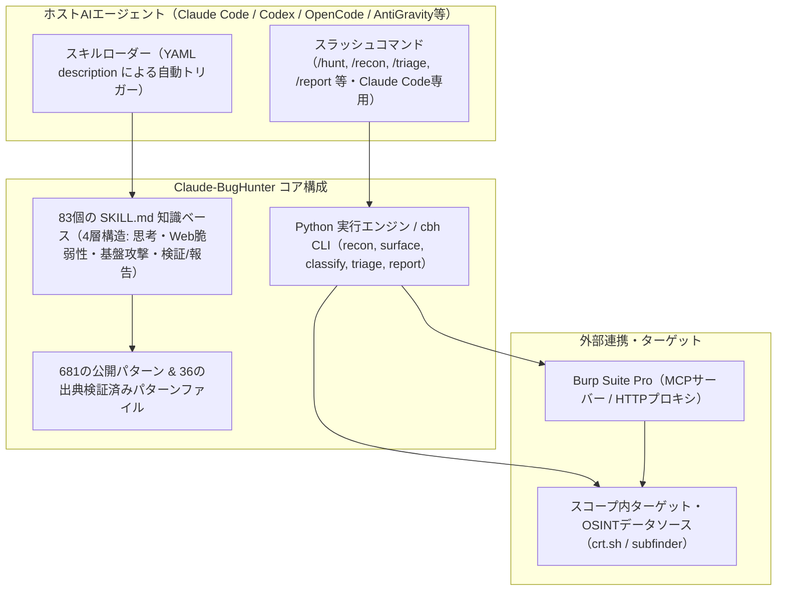

# **Claude-BugHunter 調査レポート**

## **1. 基本情報**

* **ツール名**: Claude-BugHunter
* **ツールの読み方**: クロード バグハンター / クロード・バグハンター
* **開発元**: Sachin Sharma（GitHubアカウント: `elementalsouls`）
* **公式サイト**: [https://elementalsouls.github.io/Claude-BugHunter/](https://elementalsouls.github.io/Claude-BugHunter/)
* **関連リンク**:
  * GitHub: [https://github.com/elementalsouls/Claude-BugHunter](https://github.com/elementalsouls/Claude-BugHunter)
  * ドキュメント: [https://elementalsouls.github.io/Claude-BugHunter/](https://elementalsouls.github.io/Claude-BugHunter/)
* **カテゴリ**: セキュリティ/脆弱性診断
* **概要**: Claude-BugHunterは、AnthropicのコマンドラインAIエージェント「Claude Code」をはじめとするAgent Skills対応エージェント向けに開発された、バグハンティングおよび外部レッドチーム運用特化のオープンソース・スキルバンドルである。83の専門スキル、15のスラッシュコマンド、24の脆弱性クラスにまたがる681の公開レポートパターン、さらにターミナルネイティブな決定的CLIランナー（`cbh`）とBurp Suite MCP連携を統合している。

## **2. 目的と主な利用シーン**

* **解決する課題**: 汎用的なAIコーディングエージェントは一般的な開発支援には優れるものの、バグバウンティやペネトレーションテストにおける体系的な偵察手順、実戦的な攻撃チェーン、厳格なスコープ遵守、誤検知（False Positive）の排除といった実務上の規律が不足しがちである。本ツールはこのギャップを埋め、AIを実戦的なセキュリティリサーチの副操縦士（Co-pilot）へと変換する。
* **想定利用者**: バグバウンティハンター、Webアプリケーションペネトレーションテスター、外部レッドチームオペレーター、セキュリティエンジニア。
* **利用シーン**:
  * **バグバウンティの初期偵察と攻撃対象領域の優先順位付け**: `crt.sh`や`subfinder`を用いたサブドメイン列挙から、API/認証エンドポイントのP1/P2/Killランク付けまでを自動化し、有望なターゲットを迅速に特定する。
  * **対話型の脆弱性ハンティングとBurp Suite連携**: テスト中のエンドポイントやパラメータを自然言語で伝えるだけで該当の`hunt-*`スキルが自動ロードされ、Burp Suite MCP経由でHTTPトラフィックの取得・リプレイ・検証を行う。
  * **トリアージ検証とプラットフォーム別レポート作成**: 発見した脆弱性候補に対して7つの検証ゲート（7-Question Gate）を適用し、PII（個人情報）やCookieを適切にマスキングした上で、HackerOne・Bugcrowd・Intigriti・Immunefi向けの提出用ドラフトを生成する。
  * **エンタープライズ外部境界のレッドチーム診断**: Microsoft 365 / Entra ID、Okta、VMware vCenter、主要SSL-VPNアプライアンス、クラウドIAM（AWS/Azure/GCP）などに対する2024〜2026年のCVEチェーンや設定不備を体系的に調査する。

### **2.1 代表的な利用フロー**

```mermaid
swimlane-beta TB
  subgraph User["ユーザー（リサーチャー）"]
    A["ターゲット設定・テスト内容を指示"]
    F["7-Question Gate結果・PoCを確認"]
  end
  subgraph Tool["Claude-BugHunter / Claude Code"]
    B["トピックに応じたhunt-*スキルを自動読込"]
    D["7-Question Gateで妥当性・スコープを検証"]
    E["PIIマスキングと提出用レポート案を生成"]
  end
  subgraph External["外部ツール・対象環境（Burp MCP / Web）"]
    C["偵察・HTTPトラフィック取得・検証リクエスト送信"]
  end
  A --> B
  B --> C
  C --> D
  D --> E
  E --> F
```

* **代表的な流れ**: ユーザーがClaude Code上でテスト対象の挙動やURLを指示すると、Claude-BugHunterが文脈に合ったスキルを自動ロードし、Burp MCPや`cbh` CLI経由で外部環境への偵察・検証を行う。得られた応答は7-Question Gateで誤検知やスコープ外が厳格にフィルタリングされ、証拠衛生処理を経たレポート案としてユーザーに返される。

## **3. 主要機能**

* **83の自動ロード型専門スキル（Agent Skills準拠）**: ユーザーがスキル名を明示的に指定しなくても、会話の内容に応じてトピック別にスキルが自動ロードされる。内訳はWebアプリ脆弱性クラス別の`hunt-*`スキル58種、エンタープライズ基盤攻撃スキル10種、レポーティング・検証スキル6種、偵察・OSINTスキル5種、手法・マインドセットスキル4種で構成されている。
* **681の公開レポートパターン（433件の個別出典検証済み）**: 24のコア脆弱性クラスにわたり、HackerOneの公開レポートやセキュリティアドバイザリから抽出された実戦的な検出パターン、バイパス表、A→B→Cの攻撃チェーン例（29種）を内蔵している。
* **15のスラッシュコマンドと`hunt`エンゲージメント基盤**: `/hunt`、`/recon`、`/surface`、`/triage`、`/validate`、`/report`などのスラッシュコマンドと、案件ごとのフォルダ構造（`scope.md`、`findings/`、`evidence/`等）を自動生成する`hunt`コマンドを提供する。
* **決定的CLIランナー（`cbh`）**: LLMを介さずに決定的・再現可能に動作するターミナルCLIを備えており、`cbh recon`（受動偵察）、`cbh surface`（攻撃面のP1/P2/Killランク付け）、`cbh classify`（URL形状からのスキル推定）、`cbh triage`（7-Question Gate判定）、`cbh report`（レポートドラフト生成）を実行できる。
* **7-Question Gateと誤検知防止ガード**: 「現在攻撃者がHTTPリクエストで再現可能か」「スコープ内か」「Never-submitリスト（Self-XSSや単なるヘッダ欠如等）に該当しないか」など7つの質問で検証し、1つでもNGなら即座に`KILL`（提出中止）または`DOWNGRADE`と判定する。
* **エンタープライズ外部境界およびモバイル攻撃マトリクス**: M365/Entra ID、Okta、SharePoint、VMware vCenter、主要SSL-VPN製品、AWS/Azure/GCP IAM、さらにAndroid APK・iOS IPAのリバースエンジニアリングパイプラインまで幅広い外部攻撃面をカバーする。
* **Burp Suite MCPおよびプロキシ統合**: `--burp`オプションによるプロキシ経由のトラフィック記録に加え、Burp MCPサーバー（ポート9876等）を介してAIがBurpのProxy履歴参照やRepeaterでのリクエスト再送を直接制御できる。
* **証拠衛生管理（Evidence Hygiene）とプラットフォーム別出力**: スクリーンショット撮影やHARファイルエクスポート時のCookie・他ユーザーPIIの墨消し（Redaction）手順を強制し、HackerOne、Bugcrowd（VRT対応）、Intigriti、Immunefi（Foundry PoC形式）、クライアント向けDOCX/MDレポートに出力する。

## **4. 動作原理・システム構成**

* **アーキテクチャ**: ローカルファーストのプラグイン＆CLIハイブリッド構成。中核となる知識ベースはオープン標準のAgent Skills形式（YAMLフロントマター付き`SKILL.md`群）で記述されており、ホストとなるAIエージェント（Claude Code、Codex CLI、OpenCode、Hermes Agent、Google AntiGravity）のローカル環境へインストールまたはプラグイン登録される。これに加え、Python標準ライブラリベースの決定的実行エンジン（`engine/`および`cbh` CLI）がローカルで補助処理を担う。



* **主要コンポーネントとデータフロー**:
  * **4層スキルスタック**: ①思考・規律層（`bb-methodology`、`redteam-mindset`）、②Webアプリ探索層（58の`hunt-*`スキル）、③境界基盤攻撃層（M365/Okta/vCenter/VPN/Cloud IAM等）、④検証・出荷層（`triage-validation`、`evidence-hygiene`、`report-writing`）の4層が段階的（Progressive Disclosure）にコンテキストへ読み込まれる。
  * **6フェーズ非線形ワークフロー**: `1. SCOPE（範囲定義）` → `2. RECON（偵察）` → `3. HUNT（探索）` → `4. VALIDATE（7-Question Gate検証）` → `5. CAPTURE（証拠衛生）` → `6. REPORT（提出）` の6フェーズで構成され、`recon/<target>/manifest.json` を介して偵察結果と攻撃面ランキングを安全に引き継ぐ。
  * **決定的検証・出力**: `cbh` CLIはPythonの`urllib`や`socket.getaddrinfo()`を用いて高速・安全に動作し、パストラバーサル防止や404ベースライン比較（Step 0ガード）、書き込み系HTTPメソッドの除外といった安全機構をコードレベルで強制する。
* **特筆すべき要素技術**:
  * **Agent Skills標準仕様への準拠**: `SKILL.md`の`name`・`description`長制限（Codex向けの1024文字制限など）やYAML安全性をCI上の`scripts/lint_skills.py`で自動検証し、複数エージェント間でのポータビリティを実現している。
  * **SHA-256拒否リストによる機密漏洩防止**: 開発リポジトリおよびCIゲートでは、過去の案件名やクライアント識別子が平文で混入しないようSHA-256ハッシュベースの識別子スキャンを実施している。
  * **意図的なスコープ境界（External-Only）**: 内部Active Directory攻撃（BloodHound、Kerberoasting等）、C2フレームワーク（Cobalt Strike等）、LSASSダンプやAV/EDR回避技術は設計上意図的に除外されており、外部境界の初期アクセス検証に特化している。

## **5. 開始手順・セットアップ**

* **前提条件**:
  * **OS**: macOS、Linux、Windows（WSL2またはPowerShell）。
  * **ソフトウェア**: Claude Code CLI（またはOpenAI Codex CLI、OpenCode、Hermes Agent、Google AntiGravity）、Python 3.9以上、Git。
  * **任意ツール**: `subfinder`（高精度なサブドメイン列挙用）、Burp Suite ProおよびBurp MCP拡張機能（対話型トラフィック操作用）。
  * **アカウント**: Claude-BugHunter自体はオープンソースでアカウント登録不要だが、ホストとなるClaude Code等を利用するためのAnthropicアカウント／API契約（または対応LLM契約）が必要。
* **インストール/導入**:
  * **方法A: Claude Code プラグインとして導入（推奨）**
    Claude Codeのセッション内で以下を実行すると、`claude-bughunter:` 名前空間で83スキルと15コマンドが導入される。

    ```text
    /plugin marketplace add elementalsouls/Claude-BugHunter
    /plugin install claude-bughunter@elementalsouls
    ```

  * **方法B: リポジトリクローン＋ローカルコピー導入（`hunt`スキャフォールドや`cbh`利用時）**

    ```bash
    git clone https://github.com/elementalsouls/Claude-BugHunter.git
    cd Claude-BugHunter

    # macOS / Linux（Claude Codeのみ）
    bash scripts/install.sh

    # 全対応ハーネス（Claude Code / Codex / OpenCode / Hermes / AntiGravity）＋Burp MCP連携
    bash scripts/install.sh --all --burp-mcp
    ```

    Windows（PowerShell）の場合は `pwsh ./scripts/install.ps1`（または `-All -BurpMcp`）を使用する。`cbh` CLI単体をグローバル導入したい場合は `pipx install git+https://github.com/elementalsouls/Claude-BugHunter` を実行する。
* **初期設定**:
  * Burp MCPと連携する場合は、Claude Code側にBurp MCPサーバーを登録する（またはインストーラーの`--burp-mcp`で他ハーネスへ設定を自動変換する）。プロキシ経由で`cbh`を使う場合は環境変数 `CBH_BURP_PROXY=http://127.0.0.1:8080` を設定する。
* **クイックスタート**:
  * **Claude Codeでの対話実行**: プロジェクトまたはターゲット用フォルダ（`hunt acme-bb`で生成）で `claude` を起動し、自然言語で指示を出す（例: `"Testing acme.com — an in-scope HackerOne target. Run recon and rank the surface."`）。
  * **`cbh` CLIでの動作確認**:

    ```bash
    # 受動偵察とライブホスト確認
    cbh recon example.com

    # URLパターンの分類（該当hunt-*スキルの提案）
    cbh classify "https://api.example.com/v1/users/42?next=https://evil.com"
    ```

## **6. 特徴・強み (Pros)**

* **実戦データに裏打ちされた圧倒的な知識量**: 83のスキルと681の公開レポートパターン（うち433件は`verify_citations.py`で一次出典URLと内容の整合性を検証済み）を収録しており、単なる一般論ではなく実在のバイパス手法や攻撃チェーン（29例）を参照できる。
* **誤検知とルール違反を防ぐ構造的ガード**: LLMが陥りがちな「理論上可能なだけのバグ」や「スコープ外の報告」を防ぐため、7-Question GateやStep 0の404ベースライン比較、Never-submitリストの自動チェックが組み込まれている。
* **マルチハーネス対応による高い柔軟性**: Claude Code専用機能（スラッシュコマンド、`hunt-dispatch`）に加え、中核となる83スキル自体は標準Agent Skills形式のため、OpenAI Codex CLI、OpenCode、Hermes Agent、Google AntiGravityでもそのまま知識資産として活用できる。
* **対話型AIと決定的CLIのハイブリッド運用**: 複雑なロジック推論や連鎖攻撃の検討はClaude Codeで行い、大量のサブドメイン列挙やCI/CDでの定型チェック、再現可能な検証は`cbh` CLIで行うという使い分けが可能である。

## **7. 弱み・注意点 (Cons)**

* **日本語ネイティブ対応の不足**: リポジトリのドキュメント、スキル定義（`SKILL.md`）、出力されるレポートテンプレートはすべて英語で記述されている。Claude Code等への指示は日本語でも行えるが、トリガー語彙やレポート提出フォーマットは英語前提となる。
* **AIエージェントの実行コスト（トークン消費）**: 多数のスキルや参照ファイルを読み込みながら長時間の偵察・探索セッションを行うと、Claude Code等のAPIクレジットやサブスクリプション利用枠（Pro/Maxプラン等）を急速に消費しやすい。
* **重複報告（Duplicate）と人間の検証の必要性**: 公開済みの既知パターンを網羅しているため、競合の激しい公開バグバウンティプログラムにそのまま適用すると既知の重複案件しか見つからない傾向がある。また、AIの誤検知（ハルシネーション）や、積極的悪用フェーズにおけるLLM側の安全ガードレール（拒否応答）に直面するケースも報告されている。
* **内部ネットワーク・Post-Exploitation非対応**: 設計上「外部攻撃面」に限定されているため、侵入後の内部Active Directory横展開（Kerberoasting、BloodHound等）やC2運用には対応していない。

## **8. 料金プラン**

| プラン名 | 料金 | 主な特徴 |
|---------|------|---------|
| **オープンソース版（MITライセンス）** | 無料 | 全83スキル、15スラッシュコマンド、681パターンライブラリ、`cbh` CLI、マルチハーネス対応インストーラーの全機能が利用可能 |
| **関連AI基盤コスト（別途必要）** | 従量課金または月額プラン | 本ツール自体は無料だが、対話型スキルを実行するにはClaude Code（Anthropic APIまたはClaude Pro/Maxプラン）やCodex CLI等の外部AIエージェント利用料が別途必要 |

* **課金体系**: ソフトウェア本体はMITライセンスの完全無料オープンソース（ドキュメントやコンテンツの一部は`LICENSE-CONTENT`に準拠）。商用プランや有料SaaS版は存在しない。
* **無料トライアル**: オープンソースのため制限なく試用可能。

## **9. 導入実績・事例**

* **導入企業**: 特定の商用導入企業名は公開されていない（個人セキュリティリサーチャー向けのOSSプロジェクトとして開発・公開されている）。
* **導入事例**: リポジトリ内の `ENGAGEMENTS.md` において、2件の認可済みペネトレーションテスト／エンゲージメントでの実戦検証結果が報告されているほか、DVWA、OWASP Juice Shop、Hacker101、PortSwigger Web Security Academy、testphp.vulnweb.com などの公開トレーニング環境でのベンチマーク・検証（`eval/`ディレクトリ）が行われている。GitHub上では9,100以上のスターを獲得し、バグバウンティコミュニティで広く参照されている。
* **対象業界**: サイバーセキュリティ（バグバウンティ、Webアプリ診断、外部レッドチーム支援）、ソフトウェア開発組織のセキュリティ検証。

## **10. サポート体制**

* **ドキュメント**: GitHub Pages上の公式ドキュメントサイト（[https://elementalsouls.github.io/Claude-BugHunter/](https://elementalsouls.github.io/Claude-BugHunter/)）にて、検索可能なスキルカタログ（`docs/skills.md`）、導入ガイド（`INSTALL.md`）、利用ガイド（`USAGE.md`）、アーキテクチャ解説（`docs/architecture.md`）、`cbh` CLIリファレンス（`docs/cbh-cli.md`）、マルチハーネス導入ガイド（`docs/multi-harness.md`）が整備されている。すべて英語。
* **コミュニティ**: GitHub Issues（バグ報告、新規スキル提案、誤検知報告用の各テンプレートあり）およびPull Requestsを通じてコミュニティからの貢献（v3での20スキル追加など）を受け付けている。
* **公式サポート**: 商用サポート窓口は存在しない。セキュリティ上の問題やバグはGitHub Issuesまたは開発者のGitHubプロフィール記載の連絡先を通じて報告する形式となっている。

## **11. エコシステムと連携**

### **11.1 API・外部サービス連携**

* **API**: 本ツール自体が外部向けのWeb APIサーバーを提供する形式ではないが、研究・パターン更新パイプライン（`research/`）においてHackerOneの公開開示レポートデータを取得・検証する仕組みを持つ。
* **外部サービス・ツール連携**:
  * **Claude Code**: プラグインマーケットプレイスおよびネイティブスキル・スラッシュコマンド連携。
  * **Burp Suite Pro / Community**: `--burp`フラグによるHTTPプロキシ連携、およびBurp MCPサーバー（BApp拡張機能）による双方向AI操作。
  * **マルチAIエージェント**: OpenAI Codex CLI、OpenCode、Hermes Agent、Google AntiGravity。
  * **偵察ツール**: `subfinder`、`crt.sh`（Certificate Transparencyログ）。
  * **報告プラットフォーム（出力フォーマット対応）**: HackerOne、Bugcrowd（VRTマッピング）、Intigriti、Immunefi（Foundry PoC統合）。

### **11.2 技術スタックとの相性**

| 技術スタック / 環境 | 相性 | メリット・推奨理由 | 懸念点・注意点 |
|:---|:---:|:---|:---|
| **Claude Code (CLI)** | ◎ | プラグイン機構、15のスラッシュコマンド、`hunt-dispatch`ルーターを含む全機能がネイティブ動作 | AnthropicのAPI/サブスク利用枠を消費する |
| **Burp Suite Pro + MCP** | ◎ | プロキシ履歴の自動取得やRepeater操作をAI会話から直接実行でき、最も効率的なワークフローを構築可能 | Burp側のMCP拡張セットアップが必要 |
| **OpenAI Codex CLI / OpenCode / AntiGravity** | ◯ | 83のAgent Skills知識ベースとBurp MCP設定変換に対応 | `/hunt`等のスラッシュコマンドや`hunt-dispatch`はClaude Code専用のため非対応 |
| **Python 3.9+ / CI環境** | ◯ | `cbh` CLIがPython標準ライブラリ中心で軽量動作し、定型偵察やトリアージの自動化に最適 | 高度な文脈判断を伴う脆弱性探索はLLM環境に依存する |
| **内部AD / C2基盤（Impacket等）** | × | 設計上「外部攻撃面のみ」を対象としており、内部ネットワーク攻撃は明示的に対象外 | 境界突破後のフェーズは専用ツールへ手動で引き継ぐ必要がある |

## **12. セキュリティとコンプライアンス**

* **認証**: 本ツール自体はローカル実行型のスキル集およびCLIであり、独自のユーザー認証機能やログイン機構は持たない。対象システムへのテスト時は、オペレーターが各自の正規アカウントや認可されたテスト資格情報を扱う。外部サービス（Anthropic APIやHackerOne API等）を利用する際は、各環境の認証設定（環境変数 `<YOUR_API_KEY>` 等）に依存する。
* **データ管理**: 偵察結果やエンゲージメント記録（`~/Targets/<name>/` や `recon/<target>/`）はすべてユーザーのローカルストレージに保存される。ツール開発元のクラウドへテスト対象データが送信されることはない（ただし、対話型AIエージェントの性質上、コンテキストに含めた情報は利用中のLLMプロバイダへ送信される）。`evidence-hygiene`スキルにより、提出資料からのCookie・PIIの自動マスキング手順が提供されるほか、開発リポジトリ自体もCI（`skill-lint.yml`）とSHA-256識別子チェックによって機密情報の混入を防止している。
* **準拠規格**: 商用SaaSではないためSOC2やISO27001等の企業認証は取得していない。`SECURITY.md`にてCFAA（米国コンピュータ詐欺・不正利用防止法）等の各国法規および認可されたテスト範囲（Bug Bountyスコープや署名済みRoE）の遵守を明記しており、無許可の標的や0-day兵器化への利用を禁止している。

## **13. 操作性 (UI/UX) と学習コスト**

* **UI/UX**: 専用GUIは持たず、Claude Code等のAIエージェントの対話型ターミナルUI、および`cbh` CLIのテキスト出力で操作する。スキル名を暗記して呼び出す必要がなく、自然な英語（または日本語）でテスト状況を説明するだけで適切な`hunt-*`スキルが自動ロードされる点は直感的で扱いやすい。`cbh recon`や`cbh surface`の出力もMarkdown表形式で整理され視認性が高い。
* **学習コスト**: Claude CodeやBurp Suiteの基本操作に慣れているセキュリティエンジニアであれば、導入から数分で使い始めることができる。ただし、7-Question Gateの厳格な運用や、AIの提案する仮説を鵜呑みにせず手動で裏付けを取る判断力、さらに誤検知を見抜く基礎的なWebセキュリティ知識が求められるため、完全な初心者には一定の学習コストが伴う。

## **14. ベストプラクティス**

* **効果的な活用法 (Modern Practices)**:
  * **プラグイン導入またはタグ固定によるサプライチェーン保護**: `SECURITY.md`でも推奨されている通り、本番運用ではコミットSHAが固定されるプラグインマーケットプレイス経由で導入するか、クローン後に特定のタグ・コミットへチェックアウトして内容をレビューした上でインストールする。
  * **`cbh`とBurp MCPの役割分担**: 大規模なサブドメイン列挙や初期分類（50ホスト以上）は決定的でトークンを消費しない`cbh recon`・`cbh surface --burp`で行い、有望なP1エンドポイントの深掘り検証だけをClaude Code＋Burp MCPの対話ループに委ねることで、コストと精度を最適化できる。
  * **7-Question Gateの徹底**: 報告書を作成する前に必ず`/triage`または`cbh triage`を通し、実際のHTTPリクエストによる再現性とビジネスインパクト（データの流出や権限昇格等）が証明できているかを確認する。
* **陥りやすい罠 (Antipatterns)**:
  * **公開バグバウンティでの完全自動放置**: 既知の公開パターンをそのまま自動実行するだけでは、他のハンターが既に報告済みの重複（Duplicate）や誤検知を量産する原因になる。AIは「仮説生成と整理の補助」と割り切り、ビジネスロジックの穴は人間が深掘りする必要がある。
  * **キャッシュされたビルドURLでの誤報告**: SPAのソースマップ（`.map`）等を検証する際、デプロイによるビルドハッシュのローテーションを考慮せず古いURLの404を「修正済み」と誤認したり、Step 0の404ベースライン確認を怠ってソフト404を脆弱性と誤認するケースに注意する。
  * **AIガードレールによる作業中断への未対策**: 攻撃ペイロードの生成を直接求めるとLLMの安全フィルタに抵触して拒否応答が出ることがあるため、検証目的（認可済みテストのPoC確認・防御評価）を明確に文脈へ含め、実通信のリプレイはBurp Suite側で行う運用が推奨される。

## **15. ユーザーの声（レビュー分析）**

* **調査対象**: 本ツールは個人開発のオープンソースプロジェクトであり、G2、Capterra、ITreviewといった商用SaaS向けレビューサイトへの登録はない。そのため、Reddit（`r/bugbounty`、`r/ClaudeAI`）、DEV Community、技術ブログ記事等のコミュニティ議論から評判を調査した。
* **総合評価**: 商用レビューサイト上のスコアはない（参考指標として、GitHubリポジトリは2026年5月の公開から約半年で9,100以上のスターを獲得しており、コミュニティの注目度は非常に高い）。
* **ポジティブな評価**:
  * **体系的な学習・メンターとしての優秀さ**: 初級〜中級のバグハンターから「体系的な調査手法（Methodology）を学び、テストすべき攻撃ベクトルを漏れなく洗い出す対話型メンターとして非常に優れている」と評価されている（Reddit `r/bugbounty` 等の議論より要約）。
  * **レポート作成の劇的な省力化**: 調査結果やPoCのメモから、HackerOneやBugcrowdのVRT基準に沿ったクリーンで提出可能なレポートドラフトを素早く生成できる点が高く評価されている（DEV Community 記事より要約）。
  * **ツール乱立の解消**: 多数の脆弱性クラス別知識とチェックリストが1つのCLI環境に統合されているため、コンテキストを切り替えずに調査に集中できる点が好評である。
* **ネガティブな評価 / 改善要望**:
  * **誤検知（False Positive）の発生**: 汎用LLMと同様、理論上の挙動や低影響な事象を「Critical / High」と過剰評価するケースがあり、人間の目による裏付け検証が必須との指摘が多い（Reddit `r/bugbounty` より要約）。
  * **重複案件（Duplicate）の罠とビジネスロジックの限界**: 公開パターン集をそのまま流すだけでは競争の激しい公開プログラムで新規バグを見つけるのは難しく、深い業務文脈を要するビジネスロジック脆弱性の発見には依然として人間の直感が必要とされている。
  * **トークン消費と安全フィルタ**: 長時間の自律探索を行うとClaude Pro/Max等の利用枠を急速に消費する点や、攻撃的な検証フェーズでLLMの拒否応答に引っかかる場合がある点が課題として挙げられている。
* **特徴的なユースケース**: 完全自動のバグ発見機としてではなく、「偵察データの整理・優先度付け」と「発見後のトリアージ検証および高品質な英語レポート作成」という、ハンターの事務的・定型的な負荷が高い工程を自動化する副操縦士としての活用が最も成果を上げている。

## **16. 直近半年のアップデート情報**

* **2026-11-16**: 実行エンジンおよびCLIの堅牢化アップデート（PR #90〜#150群）。エンゲージメントのカバレッジ台帳管理の厳格化、OpenAPIスイープ時の書き込みメソッド除外保証、リダイレクト先を追跡しない安全な偵察記録、コンカレントOSINT処理の分離、モック検証と実案件データの隔離、およびAgent Skills文字数制限（1024文字）への自動適合などを実施。
* **2026-06-05**: **v2.1** リリース。コミュニティ貢献による20種の新規`hunt-*`スキル追加（合計51→71スキル）、`SKILL.md`検証およびSHA-256機密スキャンを行うCIスキルリンター導入、GitHub Pagesドキュメントサイト公開、`cbh recon` / `cbh report`のパストラバーサル修正や`hunt.sh`のシェルインジェクション対策（#13）を実施。（※その後`Unreleased`開発ブランチにて、スキル数を83種へ拡大、433件の個別公開レポート出典検証パイプライン、Windows PowerShellネイティブインストーラー、Claude Codeプラグインマーケットプレイス対応、OpenCode/Codex/Hermes/AntiGravityへのマルチハーネス対応を追加実装）
* **2026-05-25**: **v2.0** リリース。公開レポートのキュレーションを574→681パターンへ拡充し、HTTP/2 Single-Packet Attackの詳細リファレンス（145行）や29個のA→B→C攻撃チェーン例、Okta・vCenter・Cloud IAM等のゼロレポートスキル補完、`ENGAGEMENTS.md`による実案件検証記録を追加。

(出典: [Claude-BugHunter Releases](https://github.com/elementalsouls/Claude-BugHunter/releases) / [CHANGELOG.md](https://github.com/elementalsouls/Claude-BugHunter/blob/main/CHANGELOG.md))

## **17. 類似ツールとの比較**

### **17.1 機能比較表 (星取表)**

| 機能カテゴリ | 機能項目 | Claude-BugHunter | security-audit-skill | Burp Suite | Tsunami Security Scanner |
|:---:|:---|:---:|:---:|:---:|:---:|
| **基本機能** | 脆弱性知識・検出パターン | ◎<br><small>83スキル・681公開パターン内蔵</small> | ◎<br><small>10種以上の攻撃クラス体系・敵対的検証</small> | ◎<br><small>業界標準DASTスキャナー（Pro版）</small> | ◯<br><small>高確度・高深刻度RCE等に特化</small> |
| **AI自律性** | AIエージェント統合 | ◎<br><small>Claude Code / Codex等マルチハーネス対応</small> | ◎<br><small>Skills CLI準拠・並列監査ループ</small> | ◯<br><small>Burp AT導入・MCPサーバー対応</small> | ×<br><small>非AI（決定的スキャナー）</small> |
| **攻撃・検証** | HTTPプロキシ/通信操作 | ◯<br><small>Burp MCP / `--burp`経由で連携</small> | ×<br><small>コード監査・ローカル実行検証が中心</small> | ◎<br><small>Proxy/Repeater/Intruder標準搭載</small> | △<br><small>ネットワークポート・サービス単位</small> |
| **品質管理** | 誤検知抑制・トリアージ機構 | ◎<br><small>7-Question Gateと4種のFPガード</small> | ◎<br><small>敵対的検証ループとカバレッジ台帳</small> | ◯<br><small>スキャン確度分類あり</small> | ◎<br><small>誤検知を極小化する設計思想</small> |
| **運用・報告** | バグバウンティ報告支援 | ◎<br><small>H1/Bugcrowd(VRT)/Intigriti出力＆PII保護</small> | △<br><small>監査レポート出力のみ</small> | ◯<br><small>HTML/XMLレポート出力</small> | △<br><small>JSON/プロトコルバッファ出力</small> |
| **コスト** | 導入コスト（ソフトウェア） | ◎<br><small>無料OSS（外部LLM利用料は別途）</small> | ◎<br><small>無料OSS（外部LLM利用料は別途）</small> | △<br><small>Community無料 / Proは$499/年〜</small> | ◎<br><small>完全無料OSS</small> |
| **非機能要件** | 日本語対応 | △<br><small>ドキュメント・テンプレート英語のみ</small> | △<br><small>ドキュメント英語中心</small> | △<br><small>UI・ドキュメント英語中心</small> | △<br><small>ドキュメント英語中心</small> |

### **17.2 詳細比較**

| ツール名 | 特徴 | 強み | 弱み | 選択肢となるケース |
|---------|------|------|------|------------------|
| **Claude-BugHunter** | Claude Code等のAIエージェントを外部攻撃面のバグハンティング・レッドチーム運用に特化させるスキルバンドル＆CLI | 実戦的な公開レポートパターン681件、7-Question Gate、バグバウンティ向け報告生成、Burp MCP連携 | 内部AD攻撃や動的スキャナー自体は非搭載、英語前提、LLMトークン消費が大きい | バグバウンティや外部Web/境界ペネトレーションテストをAIと協調して効率化したい場合 |
| **security-audit-skill** | Cloudflare製のコーディングエージェント向け多段階セキュリティ監査・敵対的検証スキル | ソースコード監査におけるハルシネーション排除、サンドボックス隔離とカバレッジ台帳の厳密さ | 主対象がソースコード監査・ホワイトボックステストであり、外部ブラックボックステスト向けではない | 自社開発リポジトリやOSSコードベースの脆弱性監査をAIエージェントで自動化したい場合 |
| **Burp Suite** | Webセキュリティ診断・ペネトレーションテストの業界標準統合ツールキット | 高精度なHTTPプロキシ、Repeater/Intruder、Pro版の強力な自動スキャナーとBAppエコシステム | Pro版は有料（$499/年〜）、手動操作や調査計画の組み立てには熟練を要する | 本格的なWeb診断基盤として必須の場合（Claude-BugHunterとMCP連携で併用するのが最適） |
| **Tsunami Security Scanner** | Google製の拡張可能な汎用ネットワークセキュリティスキャナー | 大規模ネットワークに対して高確度かつ誤検知の少ないRCE等の重大脆弱性を自動スキャン可能 | Webアプリ固有のビジネスロジックや複雑な認可不備（IDOR等）の探索には不向き | 自社管理の多数のサーバー・公開IP資産に対し、既知の重大脆弱性を定期スキャンしたい場合 |

## **18. 総評**

* **総合的な評価**:
  * Claude-BugHunterは、汎用的なAIコーディングエージェント（Claude Code等）に対して「セキュリティリサーチャーの実戦知」と「誤検知を防ぐ厳格な規律」を注入する、極めて完成度の高いオープンソース・スキルバンドルである。単なるプロンプト集にとどまらず、681の公開パターン（うち433件は一次出典検証済み）、7-Question Gate、エンゲージメントフォルダ管理、さらにはPython製の決定的CLI（`cbh`）とBurp MCP連携までを一貫したワークフローとして統合している点が特筆に値する。一方で、公開パターンを自動適用するだけでは既知の重複案件になりやすいというAIバグハンティングの構造的限界や、英語中心・LLMトークン消費といった注意点も存在する。
* **推奨されるチームやプロジェクト**:
  * Claude CodeとBurp Suite Proを組み合わせて活用しているバグバウンティハンターやペネトレーションテスター。
  * 外部攻撃面（Webアプリ、API、M365/Okta等の認証基盤、クラウドIAM）の調査計画立案から証拠整理・クライアント報告書作成までのリードタイムを短縮したいレッドチーム。
  * 体系的な脆弱性ハンティング手法やトリアージ基準を実戦形式で学びたい中堅・ジュニアセキュリティエンジニア。
* **選択時のポイント**:
  * 本ツールは「全自動でバグを見つけてくれる魔法のボタン」ではなく、リサーチャーの調査効率と報告品質を引き上げる**副操縦士（Co-pilot）**として導入すべきである。ソースコード中心のホワイトボックス監査が主目的なら `security-audit-skill`、大規模資産の定期スキャンなら `Tsunami Security Scanner`、トラフィック操作の基盤には `Burp Suite` を選び、Claude-BugHunterはそれらを統括する「頭脳とワークフローの拡張層」として組み合わせるのが最も効果的である。
