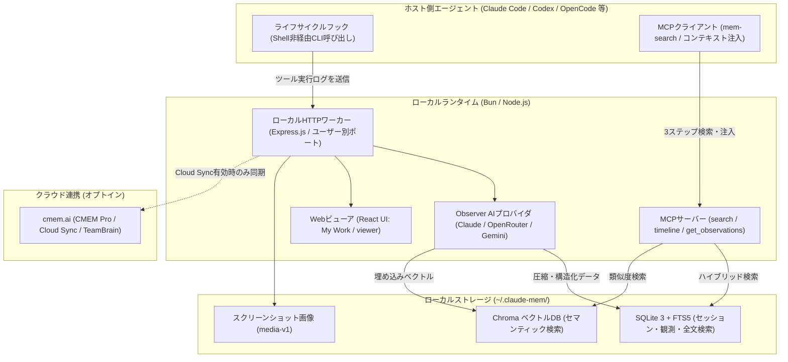

# **Claude-Mem 調査レポート**

## **1. 基本情報**

* **ツール名**: Claude-Mem
* **ツールの読み方**: クロード メム
* **開発元**: Alex Newman (thedotmack)
* **公式サイト**: [https://claude-mem.ai/](https://claude-mem.ai/)（[https://cmem.ai/](https://cmem.ai/) へリダイレクト）
* **関連リンク**:
  * GitHub: [https://github.com/thedotmack/claude-mem](https://github.com/thedotmack/claude-mem)
  * ドキュメント: [https://docs.claude-mem.ai/](https://docs.claude-mem.ai/)
* **カテゴリ**: AIモデル拡張/プラグイン
* **概要**: Claude-Memは、Claude CodeをはじめとするAIコーディングエージェント向けに設計されたオープンソース（Apache 2.0）の永続メモリエンジンである。セッション中のツール実行やファイル操作をバックグラウンドで自動キャプチャしてAIで要約・圧縮し、ローカルのSQLiteおよびベクトルデータベースに保存することで、次回のセッション開始時に関連する過去の文脈を自動注入・検索可能にする。

## **2. 目的と主な利用シーン**

* **解決する課題**: AIコーディングエージェントは、新しいセッションを開始したり `/clear` を実行したりするたびに過去の経緯を忘却（コンテキスト・アムネジア）し、同じファイルの再読み込みや既知のバグの再発、開発者への再質問を繰り返すという課題を抱えていた。Claude-Memはこのセッション間の記憶断絶を解消する。
* **想定利用者**: Claude Code・Cursor・Codex・OpenCodeなどを日常的に利用するソフトウェア開発者、AIエンジニア、および開発プロセスや知見を共有したい開発チーム。
* **利用シーン**:
  * 複数日・複数セッションにまたがる大規模な機能実装やリファクタリングにおける作業文脈の継続
  * 過去に解決したバグの原因・修正方針・アーキテクチャ上の意思決定の自然言語検索（MCP経由）
  * Webダッシュボード（My Work / `/viewer`）を用いた複数エージェントの稼働状況・人間への引き継ぎ事項・観測履歴の可視化

### **2.1 代表的な利用フロー**

```mermaid
swimlane-beta TB
  subgraph User["ユーザー"]
    A["コーディングタスクを指示"]
    F["次期セッションで続きを指示"]
  end
  subgraph Agent["コーディングエージェント (Claude Code等)"]
    B["ファイル読込・編集・コマンド実行"]
    E["注入された要約とMCP検索で文脈を把握"]
  end
  subgraph Worker["Claude-Mem ワーカー・Observer"]
    C["フック経由で操作を受信・AI圧縮"]
  end
  subgraph Storage["ローカルDB (SQLite・Chroma)"]
    D["観測データと要約を永続化"]
  end
  A --> B
  B --> C
  C --> D
  F --> E
  D -->|"SessionStart時にインデックス注入"| E
```

* **代表的な流れ**: ユーザーがエージェントに開発タスクを指示すると、エージェントのツール実行がライフサイクルフック経由でClaude-Memのローカルワーカーへ送られ、ObserverエージェントによってAI圧縮された上でSQLite・Chromaに保存される。次回セッション開始時には、保存された過去の重要インデックスが自動的にエージェントへ注入され、必要に応じてMCPツールで詳細を取得する。

## **3. 主要機能**

* **ライフサイクルフックによる自動観測**: `SessionStart`、`UserPromptSubmit`、`PreToolUse`、`PostToolUse`、`Stop`、`SessionEnd` などのフックを通じ、開発者の手動操作なしでプロンプトやファイル編集・コマンド結果を自動記録する。
* **ObserverエージェントによるAI圧縮**: 記録された生の操作ログをバックグラウンドのObserverモデル（Anthropic、OpenRouter、Gemini、またはホスト型CMEM Pro）が解析し、構造化された観測データ（Observation）とセッション要約へ圧縮する。
* **段階的開示（Progressive Disclosure）による文脈注入**: 新規セッション開始時には全履歴ではなく軽量なインデックスのみを注入し、エージェントが必要な項目だけを後から展開する仕組みにより、コンテキストウィンドウとトークン消費を抑える。
* **3ステップMCP検索ツール（`mem-search`）**: `search`（インデックス検索・約50〜100トークン/件）、`timeline`（前後の時系列文脈取得）、`get_observations`（対象IDの詳細取得）の3段階のMCPツールを提供し、高精度かつ低コストな過去履歴検索を実現する。
* **コードナビゲーション・明示的記憶保存**: Tree-sitterを活用したコード検索・アウトライン取得ツール（`smart_search`、`smart_outline`、`smart_unfold`）や、任意の知見を明示的に保存する `save_memory` ツールを備える。
* **Webビューア & My Workダッシュボード**: ローカルワーカーが提供するWeb UIにより、エージェントのリアルタイムなリクエスト進捗・人間への引き継ぎキュー（My Work）や、過去の観測履歴・セッション・設定（`/viewer`）をブラウザ上で確認・操作できる。
* **マルチエージェント & クラウド同期（Cloud Sync / TeamBrain）**: Claude CodeだけでなくOpenCode、Codex、Cursor、Gemini CLI、OpenClaw、Antigravity CLI等に対応し、オプトインで `cmem.ai` への双方向クラウド同期やチーム共有機能（TeamBrain）を利用できる。

## **4. 動作原理・システム構成**



* **アーキテクチャ**: ローカルファーストのクライアント・サーバー構成を採用している。ホスト側のAIコーディングエージェントが発火するライフサイクルフックから `claude-mem` CLI経由でローカルHTTPワーカー（Express.js 5ベース、Bunでプロセス管理）へデータを送信し、ローカル環境内で完結して記憶の生成と検索を行う。
* **主要コンポーネントとデータフロー**:
  * データは `~/.claude-mem/claude-mem.db`（SQLite 3）に永続化され、FTS5によるキーワード全文検索とChromaベクトルデータベースによるセマンティック検索のハイブリッド検索を構成する。
  * ツール実行時のスクリーンショット等の画像データもローカルの `~/.claude-mem/media-v1/` に保持され、Cloud Syncが有効な場合のみクラウドへアップロードされる。
* **特筆すべき要素技術**:
  * フック実行にシェル文字列評価を介さない単一コマンド（`claude-mem hook <agent> <event>`）を採用し、高速性とクロスプラットフォーム互換性（WindowsでのGit Bash不要化等）を確保している。
  * Progressive Disclosure（段階的開示）アーキテクチャにより、初期プロンプトへの過剰なコンテキスト詰め込みを防いでいる。

## **5. 開始手順・セットアップ**

* **前提条件**:
  * Node.js `^20.19.0` または `>=22.12.0`
  * 対応するAIエージェント（Claude Code、Codex、OpenCode、Cursor、Gemini CLI等）
  * Bun（JavaScriptランタイム/プロセスマネージャー。未導入時はインストーラーが自動導入）および `uv`（ベクトル検索用Pythonパッケージマネージャー。未導入時は自動導入）
  * アカウント登録は任意（ローカルプロバイダや自身のAPIキーを使う場合は不要。Hosted ObserverであるCMEM Pro利用時のみメールリンクでサインイン）
* **インストール/導入**:

  ```bash
  # 対話型インストーラー（マシン上の対応エージェントを自動検出してセットアップ）
  npx claude-mem install

  # 特定のエージェント/IDEを指定して導入する場合の例
  npx claude-mem install --ide opencode
  npx claude-mem install --ide antigravity

  # Claude Code内のプラグインマーケットプレイスから導入する場合
  # /plugin marketplace add thedotmack/claude-mem
  # /plugin install claude-mem
  ```

  > **注意**: `npm install -g claude-mem` はSDK/ライブラリのみのインストールとなりフックやワーカーが登録されないため、必ず `npx claude-mem install` または `/plugin` コマンドを使用する。

* **初期設定**:
  * 初回起動時に `~/.claude-mem/settings.json` が自動生成される。Observerに使うAIプロバイダ（CMEM Pro、Anthropicプラン、OpenRouter、Gemini APIキー等）を選択する。アカウント操作をスキップしたい場合は `CLAUDE_MEM_ONLINE_OPTIN=false` または `--provider` フラグを指定する。
  * 日本語で観測データを生成したい場合は `~/.claude-mem/settings.json` に `"CLAUDE_MEM_MODE": "code--ja"` を設定する。
* **クイックスタート**:
  * 導入後にエージェントを再起動して通常通りプロンプトを入力すると、バックグラウンドで自動的に観測が開始される。2回目以降のセッション開始時から過去のインデックスが自動注入される。既存リポジトリの知識を最初から読み込ませたい場合は `/learn-codebase` を実行する。

## **6. 特徴・強み (Pros)**

* **導入の容易さと完全自動化された記憶サイクル**: インストーラーを実行するだけでフック・ワーカー・DB・MCPサーバーが一括構成され、以後は開発者が「メモを取る」意識をせずともセッションを跨いだ記憶が維持される。
* **トークン効率を重視した3ステップ検索**: 全履歴を毎回プロンプトに流し込むのではなく、インデックス確認→時系列確認→必要IDのみ詳細取得という段階的開示により、コンテキストウィンドウの圧迫とAPIコストを抑制できる。
* **圧倒的なマルチエージェント対応**: Claude Codeを主軸としつつ、OpenCode、Codex、Cursor、Gemini CLI、OpenClaw、Antigravity CLI、T3 Codeなど15以上のツールに対応し、環境を跨いだ記憶統合（`CLAUDE_MEM_SESSION_START_INCLUDE_ALL_SOURCES`）も可能。
* **ローカルファースト＆オープンソース**: Apache 2.0ライセンスで公開されており、デフォルトではすべての記憶データがローカルマシン内のSQLiteに保存されるため、機密性の高いコードベースでも導入しやすい。

## **7. 弱み・注意点 (Cons)**

* **バックグラウンドプロセスと環境依存の複雑さ**: Bun製のローカルワーカーや各エージェント固有のフック仕様に依存するため、OS（特にWindows PowerShell環境）やPATH設定、ネットワーク制限下でのtree-sitter等のバイナリ取得でトラブルが発生する場合がある（トラブル時は `npx claude-mem doctor` や `repair` での診断が必要）。
* **コンテキスト肥大化・トークン消費へのチューニング要否**: 観測データが蓄積すると、セッション開始時の注入量やObserverモデルによるバックグラウンド推論コスト（ローカルAPIキー利用時）が増加するため、`code--chill` モードや注入件数の調整が求められる。
* **日本語対応の状況**: GitHubのREADME翻訳（`docs/i18n/README.ja.md`）や観測出力の日本語モード（`code--ja`）は用意されているが、WebビューアのUIや公式ドキュメント（`docs.claude-mem.ai`）の主要言語は英語中心となっている。

## **8. 料金プラン**

| プラン名 | 料金 | 主な特徴 |
|---------|------|---------|
| **OSS版（セルフホスト/ローカル）** | 無料（Apache 2.0） | ローカルSQLite + Chromaで完結。Observerには自身のAnthropicプランまたはOpenRouter / Gemini APIキーを使用（API利用料は別途自己負担） |
| **CMEM Pro** | $30/月 | 30日間無料トライアル付き。ホスト型Observer（自身のLLMプラン枠を消費しない）、複数端末間のCloud Sync、プライベートMCPリンクを提供 |
| **CMEM Heavy** | $70/月 | CMEM Proの全機能に加え、より大きなホスト型Observer利用枠を提供 |
| **CMEM Max** | $100/月 | 最大規模のホスト型Observer利用枠および安全上限付きの従量課金超過対応 |
| **CMEM TeamBrain** | パイロット提供（要問い合わせ） | チーム共有ワークスペース、メンバー別帰属表示、発見事項・タスクのチーム共有機能（デザインパートナー向けフェーズ） |

* **課金体系**: ソフトウェア本体（OSS版）は無料。クラウド版（CMEM Pro / Heavy / Max）は月額サブスクリプション制。
* **無料トライアル**: CMEM Proには30日間の無料トライアルが用意されている（決済方法の登録が必要。トライアル終了後はサブスクリプション登録をしない限り自動的に自身のAnthropicプランへフォールバックする）。

## **9. 導入実績・事例**

* **導入企業・スポンサー状況**: 公式サイト上で個別企業の大規模導入事例ページは公開されていないものの、Vercel OSS Program（2026）に採択されており、GreptileやSerpApiなどがプロジェクトスポンサー/パートナーとして名を連ねている。
* **コミュニティでの利用規模**: GitHubリポジトリは118,000スター・10,000フォーク超を獲得しており、個人開発者からスタートアップ、エンタープライズの開発チームまで幅広く日々のAIコーディングワークフローに組み込まれている。ZennやQiitaなどの日本の技術コミュニティでも導入・運用ノウハウが多数公開されている。
* **対象業界**: ソフトウェア開発、AIアプリケーション開発、Webサービス開発全般。

## **10. サポート体制**

* **ドキュメント**: 公式ドキュメントサイト（[https://docs.claude-mem.ai/](https://docs.claude-mem.ai/)）が非常に充実しており、クイックスタート、アーキテクチャ解説、フックリファレンス、検索ツールガイド、トラブルシューティング、各種エージェント連携ガイドが体系的に整理されている。
* **コミュニティ**: GitHubのIssues・Discussions・Pull Requestsが極めて活発に稼働している。
* **公式サポート**: OSS版はGitHubコミュニティベースのサポート。CMEM Pro / TeamBrain等の商用プランに関する問い合わせは公式サイト（[https://cmem.ai/](https://cmem.ai/)）経由で受け付けている。

## **11. エコシステムと連携**

### **11.1 API・外部サービス連携**

* **API / プロトコル**: ローカルワーカーはExpress.jsベースのHTTP API（観測データの記録・検索・ビューア配信用）を提供し、AIエージェント向けにはModel Context Protocol（MCP）サーバー（`search`、`timeline`、`get_observations`、`smart_search`、`save_memory` 等）を公開している。
* **外部サービス・エージェント連携**:
  * **AIコーディングエージェント / IDE**: Claude Code、OpenCode（1.3.4以降）、Codex、Cursor、Gemini CLI、T3 Code、Antigravity CLI、OMP（Oh My Pi）、Pi、DeepSeek Harness、Grok Bot、OpenClaw Gateway（検索のみ対応としてCopilot CLI、Goose、Roo Code、Warp、Zed）
  * **Observer LLMプロバイダ**: Anthropic（Claude Agent SDK）、OpenRouter、Google Gemini、CMEM Pro（Hosted）
  * **通知・チャット連携**: OpenClaw経由でのTelegram、Discord、Slackへのリアルタイム観測フィード配信

### **11.2 技術スタックとの相性**

| 技術スタック / 環境 | 相性 | メリット・推奨理由 | 懸念点・注意点 |
|:---|:---:|:---|:---|
| **Claude Code** | ◎ | ファーストクラス対応。プラグインマーケットプレイスおよび全ライフサイクルフックに完全対応 | 自動更新時のキャッシュ管理やCode Modeとの干渉など最新追従が重要 |
| **OpenCode / Codex / Cursor** | ◎ | `npx claude-mem install --ide` でネイティブ統合・セッション記録と検索の両方に対応 | ホスト側のフック承認プロンプトや設定更新への追従が必要 |
| **OpenClaw / Antigravity CLI** | ◎ | 専用インストーラーおよび公式セットアップガイドが提供されている | Gateway連携時はワーカーの常駐管理を意識する必要がある |
| **Roo Code / Copilot CLI / Zed** | △ | MCP経由での過去メモリ検索には対応 | ホストフック非対応のため、これら単体のセッション活動は自動記録されない |

## **12. セキュリティとコンプライアンス**

* **認証**: OSS版のローカルワーカーはローカルマシン上で動作しアカウント認証不要。CMEM ProやCloud Syncを利用する場合はメールマジックリンクによる認証を行い、ローカルにメモリキーを保存する。
* **データ管理**:
  * **ローカルファースト**: 観測データ（SQLite）・ベクトルデータ（Chroma）・スクリーンショット（`media-v1/`）はすべてローカルの `~/.claude-mem/` 配下に保存され、Cloud Syncを有効化しない限り外部へ送信されない。
  * **シークレット除外**: `<private>` タグで囲んだ内容は長期保存や検索インデックスから除外されるほか、正規表現ベースの自動サニタイズ（シークレット検知・マスキング）機構を備える。
  * **テレメトリ**: 匿名利用統計（PostHog）がデフォルトで有効だが、厳格なプロパティホワイトリスト（`ALLOWED_PROPERTY_KEYS`）により生プロンプトやソースコード・ファイルパスは送信されない。`npx claude-mem telemetry disable` で無効化可能。
* **準拠規格**: SOC2やISO27001などの第三者認証取得状況については公式サイトで公開されていない。エンタープライズ要件での利用時は個別確認が必要。

## **13. 操作性 (UI/UX) と学習コスト**

* **UI/UX**: 一度インストールすればCLIやIDE上のエージェントの裏側で黒子として動作するため、普段の開発体験を阻害しない。さらにローカルワーカーのURLにアクセスすることで、My Work（現在の作業・引き継ぎキュー）および `/viewer`（記憶ストリーム・検索・設定）をモダンなReact製Web UIで直感的に閲覧・管理できる。
* **学習コスト**: 基本的な利用における学習コストは非常に低い（ゼロコンフィグに近い）。ただし、Observerのモデル選定、メモリ注入量の最適化、`<private>` タグの運用、複数エージェント間のソース統合などを使いこなすには公式ドキュメントの「Context Engineering」の理解が役立つ。

## **14. ベストプラクティス**

* **効果的な活用法 (Modern Practices)**:
  * **既存プロジェクトへの即時適用**: 新規導入直後は過去の履歴がないため、必要に応じて `/learn-codebase` コマンドを実行してコードベース全体の構造を初期記憶として取り込んでおくと効果的である。
  * **ノイズ削減モードの活用**: 記録が過剰でトークンを消費する場合は、`~/.claude-mem/settings.json` で `CLAUDE_MEM_MODE` を `code--chill`（再発見が困難な重要情報のみ記録）や `code--ja` に調整する。
  * **3ステップ検索の徹底**: エージェントに過去履歴を参照させる際は、最初から全文を取得させず `mem-search` スキルの `search` → `timeline` → `get_observations` の順で絞り込ませる。
* **陥りやすい罠 (Antipatterns)**:
  * **`npm install -g claude-mem` での誤導入**: グローバルインストールではフックやワーカーが登録されないため、必ず `npx claude-mem install` またはプラグインコマンドを使うこと。
  * **機密情報の無防備な入力**: 環境変数や一時的な認証情報をプロンプトに貼る際は `<private>` タグで囲む習慣をつけないと、意図せずローカルDBや同期先に残るリスクがある。
  * **問題発生時の手動ファイル編集**: フックやDBの不整合が起きた際に手動で設定ファイルを書き換えるのではなく、まず `npx claude-mem doctor` や `npx claude-mem repair` で診断・修復を行うことが推奨される。

## **15. ユーザーの声（レビュー分析）**

* **調査対象**: Zenn、Qiita、Reddit、開発者ブログ等の技術コミュニティ投稿（G2、Capterra、ITreviewへの専用製品ページの登録は確認できず）
* **総合評価**: コミュニティ発のOSSとして極めて高い支持を獲得しており、GitHubスター数は118,000件を超える。
* **ポジティブな評価**:
  * 「セッションを跨ぐたびにリポジトリ構造や過去の修正経緯を説明し直すストレスから解放された」（Zenn / Qiita等の複数レビューより要約）
  * 「Claude Codeにポン付けするだけでバックグラウンドで自動的にメモを取ってくれる手軽さが優秀」（技術ブログレビューより要約）
  * 「インデックスから必要なIDだけ詳細取得するProgressive Disclosure設計により、無駄なトークン消費が抑えられている」（コミュニティ評価より要約）
* **ネガティブな評価 / 改善要望**:
  * 「自動注入される情報量が増えすぎるとセッション開始時のコンテキストを圧迫するため、注入設定のチューニングが必要」（Qiita等の運用記事より要約）
  * 「テレメトリ設定やバックグラウンドワーカーの挙動、Windows環境でのフックPATH問題など、導入時に環境面を確認する手間がある」（技術ブログ・GitHub Issuesより要約）
  * 「Claude Code標準の `CLAUDE.md` 運用だけで十分か、外部プラグインを入れるべきか迷うケースがある」（Zennの比較記事より要約）
* **特徴的なユースケース**:
  * Claude Codeでの開発中にハマったエラー原因と解決策を `save_memory` や自動観測で蓄積し、別日にCursorやOpenCodeから同じプロジェクトの過去知見をMCP経由で引き出すクロスエージェント開発。

## **16. 直近半年のアップデート情報**

* **2026-11-20 (v16.0.2)**: 自動更新時のキャッシュスイープ処理において、実行中のClaude Codeセッションが読み込んでいるプラグインバージョンフォルダを誤って削除しないよう `.in_use` プロセス生存確認ロジック（macOS/BSDでの `ps` 時刻差対策）を修正。
* **2026-11-19 (v16.0.1)**: Windows環境で `claude-mem` 稼働中にCodexのログインやトークン更新が失敗する問題（`auth.json` のハードリンク起因の置換エラー）を修正。
* **2026-11-18 (v16.0.0)**: 「My Work」UIを全面刷新。ユーザーの確認・対応が必要なリクエストを最上部に配置し、リストの折りたたみ表示、モバイル・キーボード・スクリーンリーダー対応を強化。
* **2026-11-17 (v15.21.0 / v15.20.0)**: Claude Code 2.1.323以降の実験的機能「Code Mode」が `claude-mem` 有効時に無効化されてしまう問題を修正（`tool.call` フックから `session.append` 読取へ移行）。また `settings.json` が不正なJSONでもワーカーが起動できるよう耐障害性を向上。
* **2026-11-16 (v15.19.0)**: My Work画面内の「Where this came from」から、Claude CodeやCodexの既存会話へ直接メッセージを送信して会話を継続できる機能を追加。
* **2026-11-12〜15 (v15.18.2〜v15.18.5)**: Gemini CLI（Windows PowerShell）でのフックコマンド構文エラー修正、Codexプラグイン更新後のフック承認リセット回避、ルール注入重複の解消、および不安定なネットワーク環境下での `tree-sitter-cli` インストール復旧対応を実施。

（出典: [GitHub Releases](https://github.com/thedotmack/claude-mem/releases)）

## **17. 類似ツールとの比較**

### **17.1 機能比較表 (星取表)**

| 機能カテゴリ | 機能項目 | Claude-Mem | Mem0 | Letta | Context7 |
|:---:|:---|:---:|:---:|:---:|:---:|
| **基本機能** | セッション横断メモリ | ◎<br><small>フックで自動記録・圧縮・注入</small> | ◎<br><small>汎用APIで事実抽出・永続化</small> | ◎<br><small>OS型の階層メモリを自己編集</small> | ×<br><small>セッション記憶ではなく文書提供</small> |
| **導入・運用** | コーディングCLI連携 | ◎<br><small>15以上のエージェントへ自動組込</small> | △<br><small>SDK/APIをアプリへ組込む設計</small> | △<br><small>専用ランタイム上のエージェント構築</small> | ◎<br><small>MCPで主要AIエディタへ即連携</small> |
| **検索・効率** | トークン最適化機構 | ◎<br><small>3段階の段階的開示検索</small> | ◯<br><small>ベクトル+グラフ検索で抽出</small> | ◯<br><small>Core/Archivalメモリ階層管理</small> | ◎<br><small>バージョン指定で最新文書のみ注入</small> |
| **外部知識** | 最新ライブラリ文書供給 | ×<br><small>自身の作業履歴が対象</small> | ×<br><small>ユーザー・対話記憶が対象</small> | ×<br><small>エージェント状態管理が対象</small> | ◎<br><small>公式ドキュメント・コード例を供給</small> |
| **非機能要件** | 日本語対応 | ◯<br><small>観測生成(code--ja)対応・UI英語</small> | ◯<br><small>多言語テキストの抽出に対応</small> | ◯<br><small>多言語LLM対応・ドキュメント英語</small> | △<br><small>主に英語ドキュメント中心</small> |

### **17.2 詳細比較**

| ツール名 | 特徴 | 強み | 弱み | 選択肢となるケース |
|---------|------|------|------|------------------|
| **Claude-Mem** | AIコーディングエージェント特化の永続メモリプラグイン | ゼロ設定に近い自動記録、ローカルファースト、3ステップ検索による省トークン | 汎用AIアプリ開発用のSDKではなく開発環境プラグインが主用途 | Claude CodeやCursor等での日々の開発文脈を自動記憶させたい場合 |
| **Mem0** | あらゆるAIアプリに組み込める汎用メモリレイヤー/SDK | LangChain等への組み込みが容易、Add/SearchのシンプルなAPI設計 | 既存CLIツールへの自動フック機能は持たない | 自社開発のチャットボットやAIサービスにユーザー記憶機能を追加したい場合 |
| **Letta** | MemGPT後継のステートフル・エージェントランタイム | エージェント自身が階層メモリを能動的に編集・管理する高度な自律性 | 概念とアーキテクチャの学習コストが高く、導入が大掛かり | 長期自律稼働する複雑なステートフルエージェントをゼロから構築する場合 |
| **Context7** | 最新ライブラリドキュメントをLLMへ供給するMCPサーバー | 学習データの古さによるAPIハルシネーションを劇的に削減 | ユーザー固有の過去作業履歴やバグ修正経緯は記憶しない | 最新ライブラリの正確な仕様参照が目的の場合（Claude-Memと併用可能） |

## **18. 総評**

* **総合的な評価**:
  * Claude-Memは、AIコーディングエージェントが抱える「セッションを跨ぐと文脈がリセットされる」という最大のペインに対し、フックによる自動収集・AIによる構造化圧縮・段階的開示による省トークン検索という極めて洗練された解を提示している。ローカルファーストかつApache 2.0のOSSとして提供されており、個人からチームまで導入のハードルが低い点も高く評価できる。
* **推奨されるチームやプロジェクト**:
  * Claude Code、OpenCode、Codex、CursorなどのAIコーディングエージェントを日常的に使い込み、複数セッションにわたる設計判断やトラブルシューティングの文脈を失いたくないソフトウェア開発者および開発チームに強く推奨できる。
* **選択時のポイント**:
  * 「自前のAIアプリに記憶を組み込みたい」場合はMem0やLetta、「最新ライブラリのドキュメントを参照したい」場合はContext7が適しているが、「普段使っているコーディングエージェントにプロジェクトの記憶を持たせたい」という目的においてはClaude-Memが第一選択となる。なお、Context7とは競合せず補完関係にあるため、MCPサーバーとして併用することでより高い開発生産性を引き出せる。
