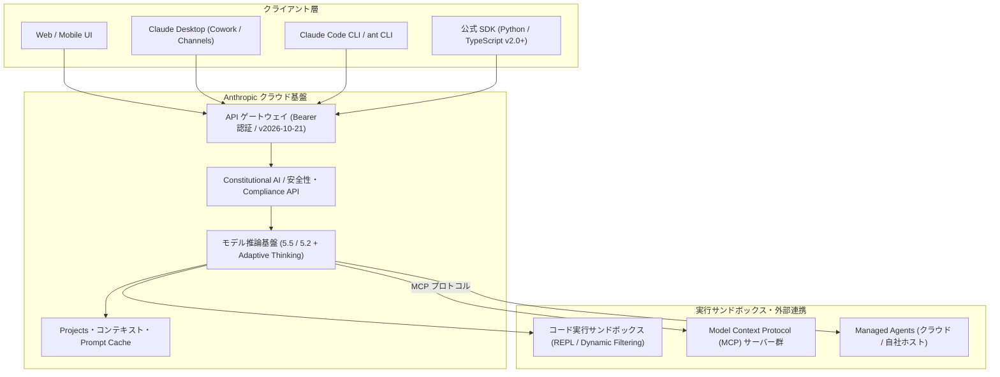

# **Claude 調査レポート**

## **1. 基本情報**

* **ツール名**: Claude
* **ツールの読み方**: クロード
* **開発元**: Anthropic
* **公式サイト**: [https://claude.ai/](https://claude.ai/)
* **関連リンク**:
  * ドキュメント: [https://docs.anthropic.com/](https://docs.anthropic.com/)
  * APIドキュメント: [https://docs.anthropic.com/en/api/getting-started](https://docs.anthropic.com/en/api/getting-started)
  * リリースノート: [https://docs.anthropic.com/en/release-notes/overview](https://docs.anthropic.com/en/release-notes/overview)
  * セキュリティ / Trust Center: [https://trust.anthropic.com/](https://trust.anthropic.com/)
* **カテゴリ**: 基盤モデル/LLMチャット
* **概要**: Anthropic社が開発した、安全性（Constitutional AI）と高い推論能力を重視した最先端の大規模言語モデル（LLM）およびAIプラットフォーム。最新のClaude 5.5ファミリー（Opus / Sonnet / Haiku）およびFable 5.2 / Mythos 5.2を搭載し、1Mトークンの長大なコンテキスト処理とAdaptive Thinkingを提供する。チャットやArtifactsに加え、自律型コーディングエージェント「Claude Code」、ローカル業務自動化「Claude Cowork」、さらにはClaude Sheets・Whiteboards・Meetingsといったチーム協業スイートまで幅広く展開している。

## **2. 目的と主な利用シーン**

* **解決する課題**: 複雑なソフトウェア開発や大規模コードベースの保守、長文ドキュメントの分析・要約、および自律型エージェントやチーム協業ツールによる知識労働の効率化。
* **想定利用者**: ソフトウェアエンジニア、研究者、データサイエンティスト、ビジネスアナリスト、コンテンツ制作者、エンタープライズチーム。
* **利用シーン**:
  * **自律的コーディング支援**: 「Claude Code」やIDE・CLI連携により、機能実装、大規模マイグレーション、デバッグ、リファクタリングを自動化。
  * **オフィス業務・チーム協業**: 「Claude Sheets」「Claude Whiteboards」「Claude Meetings」「Claude Data」を活用し、スプレッドシート編集、ブレスト整理、Google Meetでのリアルタイム議事録・成果物作成を実施。
  * **ドキュメント・データ分析**: 論文、契約書、財務レポートなど最大1Mトークン規模の長文資料やCSV/JSONデータを読み込み、構造化・可視化を実行。
  * **エンタープライズ自動化**: Model Context Protocol (MCP) やManaged Agentsを通じ、社内システム・クラウド環境と連携した自律タスクを実行。

### **2.1 代表的な利用フロー**

```mermaid
swimlane-beta TB
  subgraph User["ユーザー"]
    A["目的・プロンプト・ファイルを入力"]
    F["Artifacts・成果物を確認・承認"]
  end
  subgraph Claude_UI["Claude (Web / Desktop)"]
    B["コンテキスト・Projects・メモリ読込"]
    E["回答・Artifacts・Sheets等を生成"]
  end
  subgraph Agent_Sandbox["推論・サンドボックス実行環境"]
    C["Adaptive Thinkingで推論・コード実行"]
  end
  subgraph External_Tools["外部サービス・MCPサーバー"]
    D["Web検索・GitHub・社内データを取得"]
  end
  A --> B
  B --> C
  C -->|"MCP / Dynamic Filtering"| D
  D -->|"構造化結果を返却"| C
  C --> E
  E --> F
```

* **代表的な流れ**: ユーザーがWebまたはDesktopアプリからタスクを指示すると、ClaudeがProjectsやメモリを参照しつつ推論エンジン（Adaptive Thinking）を起動し、必要に応じてサンドボックス内でのコード実行やMCP経由の外部ツール連携（Dynamic FilteringによるWeb検索含む）を行ってArtifactsや協業ドキュメントとして出力する。

## **3. 主要機能**

* **Claude 5.5 / 5.2 モデルファミリー**:
  * **Claude Fable 5.2 / Mythos 5.2**: 複雑なコーディング、科学・数学的推論、長期エージェントタスク向けの最新最上位モデル（Mythos 5.2はCyber/Life Sciences Verification Program向け）。
  * **Claude Opus 5.5**: 常時Adaptive Thinkingを備え、高度な企業知識労働やエージェント型開発に対応するフラッグシップモデル。
  * **Claude Sonnet 5.5**: 高い実行速度と深い推論のバランスに優れた主力モデル。
  * **Claude Haiku 5.5**: 低遅延・低コストで分類、データ抽出、サブエージェント実行に適した高速モデル。
* **1Mトークン長文コンテキスト・Adaptive Thinking**: 統一された1Mトークン入力・最大128K出力トークンに対応し、問題の難易度に応じて思考トークン量を動的に調整するAdaptive Thinkingを搭載。
* **Artifacts & インタラクティブコネクタ**: 生成したコード、React UI、SVG図表などを別ペインで即時プレビュー・編集可能。Adobe、Atlassian、HubSpotなどのパートナーアプリをClaude画面内で直接操作できるネイティブ埋め込みにも対応。
* **協業スイート (Sheets / Whiteboards / Meetings / Data)**: 自然言語で数式生成やセル編集を行うスプレッドシート、リアルタイム共有キャンバス、Google Meetに参加し議事録や成果物を更新する会議エージェント、ライブデータ可視化機能を提供。
* **Dynamic Filtering Web検索 & コード実行**: セキュアなサンドボックス内でコードを実行し、Web検索結果やHTMLを動的にフィルタリングしてからコンテキストに取り込むことで精度とトークン効率を両立。
* **Projects & クロスセッションメモリ**: 関連資料やSystem PromptをまとめるProjects機能に加え、チャット・Claude Code・Coworkを横断してユーザーの好みや文脈を保持するメモリ機能を搭載。
* **エージェント機能 (Claude Code / Cowork / Computer Use)**: ターミナル向け「Claude Code」、ローカルファイル自動処理「Claude Cowork」、画面操作を行う「Computer Use (Beta)」により、自律的な実務遂行を実現。

## **4. 動作原理・システム構成**

* **アーキテクチャ**: Anthropicのクラウドインフラ上で稼働するマルチテナントSaaS（Web / iOS・Android / Claude Desktop）を中核としつつ、開発者・エンタープライズ向けにREST API（およびAWS Bedrock / Google Vertex AI）、ローカルCLI/デスクトップ実行環境（Claude Code / Cowork）、自社ホスト可能なサンドボックス（Managed Agents）を組み合わせたハイブリッド構成を採用している。
* **主要コンポーネントとデータフロー**:



* **特筆すべき要素技術**:
  * **Constitutional AI（憲法AI）**: 明文化された原則に基づきモデル自身が有害出力を評価・抑制するアライメント手法。
  * **Dynamic Filtering（動的フィルタリング）**: Web検索やフェッチ結果を直接コンテキストに流し込まず、コード実行サンドボックス内のスクリプトで必要な情報のみを抽出する仕組み。
  * **Model Context Protocol (MCP)**: 外部データソースや業務アプリとClaudeを標準化されたJSON-RPCベースのインターフェースで安全に接続するオープンプロトコル。
  * **Prompt Caching & Batch API**: 繰り返しの多いシステムプロンプトや大規模資料をキャッシュ（5分/1時間保持）し、非同期バッチ処理と合わせてAPIコストを大幅に削減。

## **5. 開始手順・セットアップ**

* **前提条件**:
  * メールアドレスまたはGoogleアカウント（Web / Desktop / モバイル利用時）
  * API利用時はAnthropic Consoleアカウントと課金設定（Python 3.10+ または Node.js 18+ 推奨）
* **インストール/導入**:
  * Web版はブラウザから `claude.ai` へアクセス。iOS / Android / macOS / Windowsアプリ（Desktop版は `Stable` と `Latest` のリリースチャネル切替に対応）を提供。
  * 開発者向けSDK（v2.0以降、Apache 2.0ライセンス）およびCLIの導入例:

  ```bash
  # Python SDK のインストール
  pip install anthropic

  # TypeScript / Node.js SDK のインストール
  npm install @anthropic-ai/sdk
  ```

* **初期設定**:
  * 環境変数にAPIキーを設定（APIバージョン `2026-10-21` 以降のSDKでは標準の `Authorization: Bearer` ヘッダーを使用）。

  ```bash
  export ANTHROPIC_API_KEY="<YOUR_API_KEY>"
  ```

* **クイックスタート**:
  1. [claude.ai](https://claude.ai/) にアクセスしログイン。
  2. 入力欄に「ReactでToDoリストアプリのコードを書いて」と入力。
  3. Artifactsウィンドウで動作するアプリが即座にプレビューされることを確認する。

## **6. 特徴・強み (Pros)**

* **業界最高水準の推論・コーディング能力**: Claude Fable 5.2やOpus 5.5 / Sonnet 5.5は、複雑なロジック実装、大規模リファクタリング、科学・数学的推論において高い精度と指示従順性を誇る。
* **自然で高品質な日本語表現**: 日本語のニュアンスや文脈を的確に捉え、ビジネス文書から技術解説まで自然で違和感のない文章を生成する。
* **充実したエージェントと協業エコシステム**: Claude Code、Claude Cowork、MCP、さらにSheets / Whiteboards / Meetings / Dataの統合により、単なるチャットを超えた実務のエンドツーエンド自動化が可能。
* **高い安全性とエンタープライズガバナンス**: Constitutional AIによる安全性に加え、SOC 2 Type II、ISO 27001、ISO 42001、Compliance API、Zero Data Retention (ZDR) など企業導入要件を満たす。

## **7. 弱み・注意点 (Cons)**

* **ネイティブの画像生成機能がない**: ChatGPTやGeminiのようなテキストからのネイティブ画像生成（写真・イラスト生成）は非対応であり、SVG/HTML描画や外部ツール連携での対応が必要となる。
* **使用量制限（レートリミット）**: FreeプランやProプランでは5時間ごとのローリング制限や週間上限があり、長文コンテキストやエージェント機能を連続使用すると上限に達しやすい（ヘビーユーザーはMax / Ultraプランが必要）。
* **動画・音声のネイティブ処理**: 画像認識（1メッセージ最大20枚）には優れるが、長尺動画や音声ファイルの直接アップロード・解析はGeminiに一歩譲る。
* **日本語対応**: Web / DesktopのUIは日本語化されており実用上問題ないが、新機能（MeetingsやFable 5.2の最新ドキュメント等）の公開や一部ベータ機能は英語が先行する傾向がある。

## **8. 料金プラン**

### **コンシューマー / チーム / エンタープライズプラン**

| プラン名 | 料金 | 主な特徴 |
|---------|------|---------|
| **Free** | 無料 | 基本チャット、Web検索、コード実行、Artifacts、メモリ（5時間/週間制限あり、Projects最大5件）。 |
| **Pro** | $20/月<br>($200/年) | Freeの約5倍の利用枠。Opusモデル、無制限Projects、Claude Code、Sheets/Whiteboards (Beta)、Chrome連携。 |
| **Max** | $100/月 | Proの約5倍の利用枠。ピーク時の優先アクセス、拡張出力上限（月額課金のみ）。 |
| **Ultra** | $200/月 | Proの約10倍の週間利用枠。認証済みアカウントでの5時間スロットリング緩和、追加APIクレジット枠。 |
| **Team** | Standard: $25/名/月 ($20年払)<br>Premium: $125/名/月 ($100年払) | 2〜150名向け。一括請求、管理コンソール、SSO、Claude Code / Cowork / Meetings (Beta)。Premiumは5倍の利用枠。 |
| **Enterprise** | $20/名/月 (年払・20名〜)<br>＋ API従量課金 | SCIM、監査ログ、Compliance API、カスタムデータ保持ポリシー、RBAC、HIPAA対応（BAA）。 |

### **API従量課金（100万トークンあたり）**

| モデル | 入力料金 | 出力料金 | キャッシュ読込 |
|---------|---------|---------|-------------|
| **Claude Haiku 5.5** *(100Kトークン以下)* | $0.10 | $0.50 | $0.01 |
| **Claude Sonnet 5.5** | $2.00 | $10.00 | $0.10 |
| **Claude Opus 5.5** | $4.00 | $20.00 | $0.20 |
| **Claude Fable 5.2** | $8.00 | $40.00 | $0.20 |

* **課金体系**: Web版はユーザー/シート単位（Enterpriseは基本料＋API従量）、API版はトークン単位。Batch API利用時は入力・出力ともに50%割引、Prompt Caching書込は保持時間により1.25倍（5分）または2倍（1時間）。
* **無料トライアル**: なし（Freeプランが利用可能）。

## **9. 導入実績・事例**

* **導入企業**: **GitLab**, **Notion**, **Quora**, **DuckDuckGo**, **Bridgewater Associates**
* **導入事例**:
  * **GitLab**: 開発プラットフォーム内でのコード提案やチャット・セキュリティ支援機能にClaudeを採用。
  * **Notion**: Notion AIのバックエンドの一つとしてClaudeを活用し、ドキュメント要約や文章作成支援を提供。
  * **Quora**: AIチャットプラットフォーム「Poe」において、主要モデルとしてClaudeシリーズを提供。
* **対象業界**: ソフトウェア開発、ナレッジ管理、金融、ライフサイエンス、法務、教育など。

## **10. サポート体制**

* **ドキュメント**: [Anthropic Docs](https://docs.anthropic.com/) および [Release Notes](https://docs.anthropic.com/en/release-notes/overview) にて、API仕様、SDK v2移行ガイド、プロンプトエンジニアリング、クックブックを公開。
* **コミュニティ**: 公式DiscordサーバーやGitHubリポジトリ（SDK・MCP関連）にて開発者同士の知見共有が活発。
* **公式サポート**: ヘルプセンター（チャット/メール）を提供。Team/Enterpriseプランでは優先サポート、専任アカウントマネージャー、Compliance APIによる監査支援が利用可能。

## **11. エコシステムと連携**

### **11.1 API・外部サービス連携**

* **API**: REST API（最新バージョン `2026-10-21`、`Authorization: Bearer` 認証）に加え、AWS BedrockおよびGoogle Cloud Vertex AI経由で提供。なお、`2026-10-21` 以降のAPIでは `temperature`、`top_p`、`top_k` などの従来サンプリングパラメータが廃止され、システム側の適応制御へ統一されている。
* **Model Context Protocol (MCP)**: GitHub、Slack、Google Drive、PostgreSQLなど多様な外部データソースやローカルツールと安全に双方向接続できるオープン標準。
* **外部サービス連携**: Google Workspace、Microsoft 365、Google Meet（Claude Meetings）、Adobe・Atlassian・HubSpot（ネイティブアプリ埋め込みコネクタ）、Enterprise向けCompliance API連携。

### **11.2 技術スタックとの相性**

| 技術スタック | 相性 | メリット・推奨理由 | 懸念点・注意点 |
|:---|:---:|:---|:---|
| **Python** | ◎ | 公式SDK (`anthropic` v2.0+) がApache 2.0で提供され、型安全性と非同期処理に優れる。 | SDK v2.0 / API `2026-10-21` では `temperature` 等の廃止に伴う移行対応が必要。 |
| **TypeScript / Node.js** | ◎ | 公式SDK (`@anthropic-ai/sdk` v2.0+) によりWebアプリやMCPサーバー開発が容易。 | 同上（最新APIヘッダー仕様への追従が必要）。 |
| **AWS (Bedrock)** | ◎ | VPC内閉域利用やIAM連携、クロスリージョン推論が利用可能。 | Anthropic直販APIより最新モデルの反映に数日〜数週間の差が出る場合がある。 |
| **Google Cloud (Vertex AI)** | ◎ | Vertex AI Model Gardenから利用でき、マルチリージョン高速モードにも対応。 | 同上。 |

## **12. セキュリティとコンプライアンス**

* **認証**: Team / EnterpriseプランでSAML SSO、2要素認証、SCIMプロビジョニング、ロールベースアクセス制御（RBAC）に対応。
* **データ管理**: APIおよび商用プラン（Team / Enterprise）のデータはデフォルトでモデルの学習に使用されない。Enterpriseではカスタムデータ保持ポリシーやZero Data Retention (ZDR) の構成が可能。
* **準拠規格**: **SOC 2 Type I / Type II**、**ISO/IEC 27001:2022**、**ISO/IEC 42001:2023**（AIマネジメントシステム）、**HIPAA**（Enterprise/APIの適格構成でBAA締結可）。詳細は [Anthropic Trust Center](https://trust.anthropic.com/) で公開。

## **13. 操作性 (UI/UX) と学習コスト**

* **UI/UX**: Artifactsにより会話と成果物を分離してプレビューでき、さらにClaude SheetsやWhiteboardsの統合により、ブラウザ上で直接表計算や図解の共同編集が行える。Claude Desktopでは安定版と最新版のリリースチャネル切替も可能。
* **学習コスト**: 基本的なチャット利用は直感的で学習コストが低い。一方、Projectsのコンテキスト設計、MCPサーバーの構築、Claude Codeの高度な自動化ワークフローを使いこなすには一定の技術的理解が必要となる。

## **14. ベストプラクティス**

* **効果的な活用法 (Modern Practices)**:
  * **Adaptive Thinkingの活用**: 複雑な設計やデバッグ時はOpus 5.5 / Fable 5.2の適応的推論に委ね、不要な `temperature` 指定（API v2.0ではエラー）を避ける。
  * **Prompt Cachingによるコスト最適化**: 巨大なコードベースやシステム指示をキャッシュし、反復呼び出しのコストとレイテンシを削減する。
  * **XMLタグとProjectsの併用**: 入力データをXMLタグで構造化し、Projectsに必要な資料のみを厳選して登録する。
* **陥りやすい罠 (Antipatterns)**:
  * **旧APIパラメータの残存**: `2026-10-21` APIへの移行時に `temperature` や `top_p` をリクエストに残したままにすると400エラーとなるため注意が必要。
  * **スコープ無制限のメモリ・MCP連携**: エージェントに過剰な権限や無関係なメモリを読み込ませると、コンテキスト汚染や意図しない操作リスクが高まる。

## **15. ユーザーの声（レビュー分析）**

* **調査対象**: G2, Capterra, X (Twitter)
* **総合評価**: **4.6〜4.7 / 5.0** (G2)、**4.6 / 5.0** (Capterra・750件以上のレビュー、肯定的評価86%以上)
* **ポジティブな評価**:
  * 「深い推論能力と長文コンテキスト（1Mトークン）の読解精度が高く、大規模なコードベースや資料の分析に最適。（G2 / Capterraより要約）」
  * 「Claude CodeやArtifactsを使った開発・プロトタイピングの生産性が圧倒的に高い。（G2 / Capterraより要約）」
  * 「日本語の文章作成において不自然な翻訳調が少なく、実務の文書作成にそのまま使える。」
* **ネガティブな評価 / 改善要望**:
  * 「ヘビーな開発作業やピーク時間帯に、5時間制限や週間メッセージ上限に引っかかりやすい。（G2 / Capterraより要約）」
  * 「ネイティブの画像生成機能がないため、クリエイティブ用途では他ツールを併用する必要がある。」
  * 「複数ステップの長時間タスクでは、まれにコンテキストの追跡にばらつきが出ることがある。（Capterraより要約）」
* **特徴的なユースケース**:
  * エンジニアがClaude CodeとMCPを組み合わせ、リポジトリ解析からテスト修正・PR作成までを半自動化。
  * ビジネスチームがClaude MeetingsでGoogle Meetの議論をリアルタイムにまとめ、Claude WhiteboardsやSheetsへ即座に構造化。

## **16. 直近半年のアップデート情報**

* **2026-11-17**: **Claude Desktop リリースチャネル導入**: 安定重視の「Stable」と日次で新機能を試せる「Latest」チャネルの切り替えに対応。
* **2026-11-12**: **Claude Meetings (Beta) およびオフィス協業ツール群を展開**: Team/Enterprise向けにGoogle Meetへ参加して議事録・成果物をリアルタイム作成する「Claude Meetings」を公開。11月にかけて「Claude Sheets」「Claude Whiteboards」(Beta)、「Claude Data」(GA)、パートナーアプリのネイティブ埋め込みコネクタを順次ロールアウト。
* **2026-11-09**: **Claude Fable 5.2 / Claude Mythos 5.2 リリース**: 複雑な技術・科学・コーディング課題向けの最新モデルを公開（5.1比で生成速度最大30%向上）。Mythos 5.2はCyber/Life Sciences Verification Program向けに提供。
* **2026-10-21**: **APIバージョン `2026-10-21` および SDK v2.0 リリース**: `Authorization: Bearer` 認証への移行、`temperature` 等サンプリングパラメータの廃止、クライアントSDK・CLIのApache 2.0ライセンス化を実施。
* **2026-10-07**: **Claude Haiku 5.5 リリース**: サブエージェントや分類・データ抽出など低遅延・大量処理向けの高速モデルを公開。
* **2026-09-28**: **Claude Sonnet 5.5 リリース**: 従来比30%以上の高速化とコスト削減を実現した主力モデルを公開。
* **2026-09-22**: **Claude Opus 5.5 リリース**: 常時Adaptive Thinkingを搭載し、従来Opusよりコスト効率を高めた（入力$4/出力$20 per 1Mトークン）フラッグシップモデルを公開。
* **2026-05-28**: **Claude Opus 4.8 リリース**: 1Mトークンのコンテキストウィンドウをサポートし、Adaptive thinkingによるトークン効率が向上した最高性能モデルが登場。
* **2026-05-19**: **Claude Managed Agents 自社ホスト機能追加**: Anthropicのインフラに加え、自社ホスト環境でのエージェントの安全な実行（Self-hosted sandboxes）が可能になった。
* **2026-04-16**: **Claude Opus 4.7 リリース**: 複雑な推論やエージェンティックコーディングに優れたモデルが登場。
* **2026-04-08**: **Claude Managed Agents (Public Beta) 公開**: Claudeを自律型エージェントとして実行するための、安全なサンドボックスと組み込みツールを備えたフルマネージド実行環境。
* **2026-01-XX**: **Claude Code v2.1 リリース**: ターミナルベースのエージェント機能が強化され、タスク管理やカスタムキーバインディングが追加された。
* **2025-11-24**: **Claude 4.5 Opus/Sonnet/Haiku リリース**: 推論能力、速度、コスト効率が大幅に向上した新モデルファミリーが登場。
* **2025-12-09**: **MCP (Model Context Protocol) のオープン標準化**: 外部ツール連携のためのプロトコルを公開し、エコシステムの拡大を発表。
* **2025-10-XX**: **Claude Computer Use (Beta) 公開**: AIが画面操作を行う機能がAPI経由で利用可能になった。
* **2025-09-XX**: **Claude Code (Beta) 公開**: 開発者向けの自律型コーディングエージェントの提供を開始。

(出典: [Anthropic Release Notes](https://docs.anthropic.com/en/release-notes/overview) / [Anthropic News](https://www.anthropic.com/news))

## **17. 類似ツールとの比較**

### **17.1 機能比較表 (星取表)**

| 機能カテゴリ | 機能項目 | 本ツール (Claude) | ChatGPT | Gemini | Grok | DeepSeek |
|:---:|:---|:---:|:---:|:---:|:---:|:---:|
| **モデル性能** | 推論・論理的思考 | ◎<br><small>Fable 5.2 / Opus 5.5</small> | ◎<br><small>GPT-5.4 Thinking</small> | ◎<br><small>Gemini 4 Argon</small> | ◎<br><small>Grok 4.5</small> | ◎<br><small>DeepSeek-V4-Pro</small> |
| **開発支援** | 自律エージェント・コーディング | ◎<br><small>Claude Code / MCP</small> | ◯<br><small>Codex CLI / Canvas</small> | ◯<br><small>Antigravity / Skills</small> | ◯<br><small>Grok Build / CLI</small> | ◯<br><small>Agentic Coding</small> |
| **UI/UX・協業** | プレビュー・共同作業 | ◎<br><small>Artifacts / Sheets</small> | ◎<br><small>Canvas / Excel連携</small> | ◯<br><small>Workspace連携</small> | △<br><small>標準チャット中心</small> | △<br><small>標準チャット中心</small> |
| **検索・情報** | リアルタイム検索 | ◯<br><small>Dynamic Filtering</small> | ◎<br><small>ChatGPT Search</small> | ◎<br><small>Google検索統合</small> | ◎<br><small>Xリアルタイム情報</small> | ◯<br><small>Web検索対応</small> |
| **マルチモーダル** | 画像・動画生成 | ×<br><small>非対応（SVG可）</small> | ◎<br><small>画像生成対応</small> | ◎<br><small>Imagen / 動画理解</small> | ◎<br><small>画像生成対応</small> | ×<br><small>テキスト/コード中心</small> |
| **コスト** | APIコスト効率 | ◯<br><small>Haiku 5.5等で最適化</small> | ◯<br><small>GPT-5.5 Instant等</small> | ◯<br><small>Flash系で低価格</small> | ◯<br><small>中価格帯</small> | ◎<br><small>圧倒的低価格・OSS</small> |

### **17.2 詳細比較**

| ツール名 | 特徴 | 強み | 弱み | 選択肢となるケース |
|---------|------|------|------|------------------|
| **本ツール (Claude)** | 「安全性」と「推論・コーディング」に強み。Claude Code・MCP・Sheets/Meetingsなど実務統合が充実。 | 高精度なコード生成、自然な日本語、Artifactsと協業スイート、1Mコンテキスト。 | ネイティブ画像生成や動画入力に非対応、ヘビー利用時のレート制限。 | ソフトウェア開発、複雑な文書・データ分析、MCPを活用した業務自動化を重視する場合。 |
| **ChatGPT** | 圧倒的な汎用性とマルチモーダル対応。GPT-5.5 InstantとGPT-5.4 Thinkingを搭載。 | Search、画像生成、Canvas、Excel/Sheets統合などオールインワンの完成度。 | 高度な推論モードは上位プランに限定される場合がある。 | 検索・画像生成・対話・業務連携を1つのツールで幅広く完結させたい場合。 |
| **Gemini** | Googleエコシステムとの深い統合とネイティブマルチモーダル性能（Gemini 4 Argon / 3.8）。 | 動画・音声を含む長大コンテキスト処理、Google Workspaceとのシームレスな連携。 | 微細なコーディング制御や開発者向けエージェント体験ではClaudeに譲る場面がある。 | Google Workspace中心の業務、動画・音声解析、GCP連携を重視する場合。 |
| **Grok** | xAIによる開発でX（旧Twitter）のリアルタイムデータへの直接アクセスが最大の特徴（Grok 4.5）。 | 最新トレンドの即時把握、推論労力（Low/Medium/High）の制御。 | オフィス協業スイートやエンタープライズ向けSaaSエコシステムは発展途上。 | SNS上のリアルタイム情報分析や、OpenAI互換APIでの迅速な組み込みを求める場合。 |
| **DeepSeek** | オープンウェイトと圧倒的な低価格APIを実現する高性能モデル群（DeepSeek-V4シリーズ）。 | 1Mコンテキスト標準対応ながら極めて低いAPI単価、セルフホストの選択肢。 | データ保管場所（地政学的リスク）への懸念、日本語ニュアンスのばらつき。 | コスト最優先の大量バッチ処理や、自社環境でのオープンモデル運用を行う場合。 |

## **18. 総評**

* **総合的な評価**:
  Claudeは2026年後半に入り、Claude 5.5ファミリーおよびFable 5.2 / Mythos 5.2の投入によって推論・コーディング性能をさらに引き上げるとともに、Claude Code・Cowork・MCP・協業スイート（Sheets / Whiteboards / Meetings / Data）を統合した総合的な「実務エージェント基盤」へと進化した。ネイティブ画像生成を持たない点やプランごとの利用上限には留意が必要だが、知識労働とソフトウェア開発の生産性向上においては極めて高い完成度を誇る。
* **推奨されるチームやプロジェクト**:
  * ソフトウェア開発チーム（Claude CodeやMCPを用いた設計・実装・大規模リファクタリング）。
  * リサーチ、法務、金融、コンサルティングなど長文資料の精密な分析・作成を要するチーム。
  * 高品質な日本語コンテンツ作成や、Sheets/Whiteboards/Meetingsを活用した協業ワークフローを構築したい組織。
* **選択時のポイント**:
  * 「コーディング支援」「文章・分析の質」「エージェント連携（MCP）」を最優先するならClaudeが最有力候補となる。
  * 画像生成を含めた汎用的なオールインワン体験を求めるならChatGPT、Google Workspaceや動画・音声解析を重視するならGemini、APIコストやOSS運用を最優先するならDeepSeekとの比較検討が有効である。
