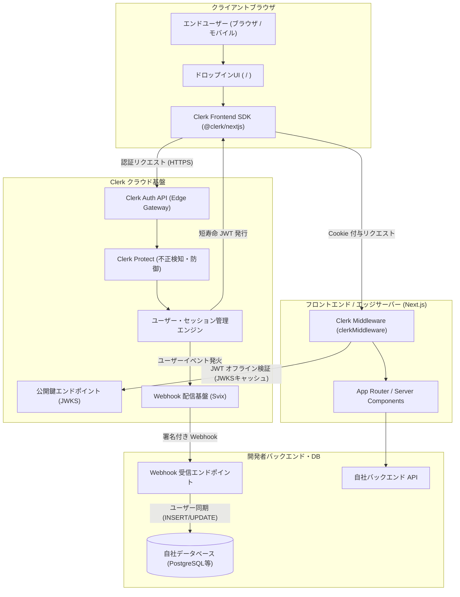

# **Clerk 調査レポート**

## **1. 基本情報**

* **ツール名**: Clerk
* **ツールの読み方**: クラーク
* **開発元**: Clerk, Inc. (米国サンフランシスコ)
* **公式サイト**: [https://clerk.com/](https://clerk.com/)
* **関連リンク**:
  * GitHub: [https://github.com/clerk/javascript](https://github.com/clerk/javascript)
  * ドキュメント: [https://clerk.com/docs](https://clerk.com/docs)
  * レビューサイト: [G2](https://www.g2.com/products/clerk-dev/reviews) | [Product Hunt](https://www.producthunt.com/products/clerk)
* **カテゴリ**: 認証/ID管理
* **概要**: Clerkは、ReactやNext.jsをはじめとするモダンWeb・モバイル環境向けに特化した認証およびユーザー管理のフルマネージドSaaSです。美しくデザインされたドロップインUIコンポーネント、堅牢なセッション管理、パスキーやソーシャルログイン、B2Bマルチテナント組織管理、そしてAIエージェント向け認証（Agent Auth）までを包括的に提供し、開発者が認証の自前実装に費やす工数を最小化します。

## **2. 目的と主な利用シーン**

* **解決する課題**:
  * 認証・認可の自前実装に伴うセキュリティリスク（Cookie漏洩、CSRF/XSS対策、パスワードハッシュ管理等の不備）の解消
  * サインイン・サインアップ画面、パスワードリセット、プロフィール管理、MFA（多要素認証）画面などのフロントエンド開発・保守負担の削減
  * B2B SaaSに不可欠なマルチテナント組織管理（チーム作成、メンバー招待、RBAC、SAML/OIDCエンタープライズSSO、SCIMディレクトリ同期）の開発長期化の回避
  * AIエージェントや自動化スクリプトが安全にWebアプリにアクセスするためのアイデンティティ制御基盤の確立
* **想定利用者**: フロントエンドエンジニア、Fullstackエンジニア、Web開発チーム、B2B/B2C SaaSスタートアップ、個人開発者
* **利用シーン**:
  * **Next.js (App Router) によるWebサービス立ち上げ**: わずか数行のコンポーネント配置で本番運用のサインイン・プロフィール管理を即座に導入
  * **B2B SaaSのマルチテナント・エンタープライズ対応**: 企業単位のワークスペース分離、権限管理、OktaやMicrosoft Entra ID（旧Azure AD）とのSSO連携をノーコード・ローコードで提供
  * **パスワードレス認証の導入**: パスキー（WebAuthn）やGoogle/GitHubソーシャルログイン、メールマジックリンクを標準活用し、エンドユーザーの離脱率を低減
  * **AIエージェント連携（Agent Auth）**: Personal Agent ProtocolやModel Context Protocol（MCP）を通じて、認可されたAIエージェントにセキュアな操作権限を委譲

### **2.1 代表的な利用フロー**

```mermaid
swimlane-beta TB
  subgraph EndUser["エンドユーザー"]
    A["ログイン画面で認証方式を選択 (OAuth / パスキー等)"]
    D["セッション確立・保護された画面へアクセス"]
  end
  subgraph Frontend["フロントエンド (Next.js)"]
    B["Clerk コンポーネント (SignIn) で認証要求送信"]
    C["短寿命JWTセッションCookieを受領・状態更新"]
  end
  subgraph ClerkCloud["Clerk 認証基盤"]
    E["クレデンシャル検証・多要素認証 (MFA) 実行"]
    F["セッショントークン発行 & Webhookイベント送信"]
  end
  subgraph Backend["バックエンド / DB"]
    G["Webhook (Svix) でユーザー作成・同期処理"]
  end
  A --> B
  B --> E
  E --> F
  F --> C
  C --> D
  F --> G
```

* **代表的な流れ**: エンドユーザーがフロントエンドの `<SignIn />` コンポーネントで認証を行うと、リクエストはClerk認証基盤に送信され、クレデンシャル検証やMFAが実行されます。認証成功後、Clerkからセキュアな短寿命JWTセッションCookieが発行されてフロントエンドの状態が更新され、保護されたページへの遷移が完了します。同時に、バックグラウンドでSvix経由のWebhookイベント（`user.created` 等）が開発者のバックエンドへ配信され、自社データベースへのユーザー同期が行われます。

## **3. 主要機能**

* **ドロップインUIコンポーネント**: `<SignIn />`、`<SignUp />`、`<UserProfile />`、`<UserButton />`、`<OrganizationSwitcher />` など、完成された美しい認証・管理UIを即座に埋め込み可能。
* **多彩な認証ストラテジー**: Google、GitHub、Apple、Discord、Microsoft、Slackなど20以上のソーシャルログイン、メール/SMSマジックリンク、ワンタイムパスワード（OTP）、パスキー（WebAuthn）にネイティブ対応。
* **セキュアなセッション管理**: カスタムサブドメイン（`clerk.yourdomain.com`）を用いたファーストパーティHTTP-only Cookieと、短寿命JWT（デフォルト60秒TTL）の自動ローテーション機構。
* **B2Bマルチテナント組織管理 (Clerk Organizations)**: テナント単位のワークスペース作成、招待状送信、カスタムロールおよびパーミッション設定（RBAC）、組織切り替えUIを提供。
* **エンタープライズSSO & ディレクトリ同期**: SAML 2.0、OIDCプロトコルによるエンタープライズIdP（Okta、Microsoft Entra ID、Google Workspace、JumpCloud等）連携およびSCIMディレクトリ同期。
* **セキュリティ防御 (Clerk Protect)**: ブルートフォース攻撃検知、HaveIBeenPwnedと連携した漏洩パスワードの利用ブロック、ボット遮断、ドメイン別サインアップレートリミットを標準搭載。
* **Core 3 SDK & モダンReact統合**: 完全に状態管理されたフック（`useSignIn`, `useSignUp`, `useCheckout`, `useWaitlist`）と、条件付き表示を一本化した `<Show />` コンポーネントによる高度なカスタマイズ性。
* **AIエージェント向け認証 (Clerk for Agent Auth & MCP)**: Model Context Protocol（MCP）サーバーによる開発環境連携や、Personal Agent Protocolに基づく自律エージェントのアイデンティティ委譲・認可制御。
* **監査ログ & 開発者API**: アプリケーション監査ログを取得する `GET /v1/logs` REST APIや、Svix基盤による暗号署名付きWebhook通知。
* **Clerk CLI & アカウントレスセットアップ**: ターミナルから `clerk init` や `clerk deploy` を実行し、アカウント作成不要のプレビュー環境から本番デプロイまでを素早く完結。

## **4. 動作原理・システム構成**



* **アーキテクチャ**: クラウド完結型マネージドSaaSと、フロントエンド・エッジ・バックエンド向けSDKが疎結合に連携するハイブリッド型アーキテクチャです。ユーザー認証のコアロジックやセッション保持はClerkのクラウド基盤が担当し、アプリケーション側は提供されたSDKを通じてセッション検証やUIレンダリングを行います。
* **主要コンポーネントとデータフロー**:
  * **Frontend SDK (`@clerk/nextjs` / `@clerk/clerk-js`)**: クライアント側のセッション状態をReact Context等で保持し、UIコンポーネントの表示やトークンの自動リフレッシュを制御。
  * **Clerk Auth API & Core Engine**: 認証処理、暗号化パスワード検証、二要素認証トークン発行、テナント組織データの管理を一括実行。
  * **Edge Middleware (`clerkMiddleware`)**: Next.js等のエッジ/サーバーレイヤーで、リクエストヘッダーに含まれるJWTをローカル検証（JWKSキャッシュ利用）。Clerk APIへの外部HTTPリクエストを行わずにミリ秒未満でセッションの有効性を確認。
  * **Webhook配信基盤 (Svix)**: ユーザーの作成・変更・削除イベントをキューイングし、リトライ機能と暗号署名を伴って開発者サーバーへ確実に通知。
* **特筆すべき要素技術**:
  * **短寿命JWT（TTL 60秒）**: セッショントークンの有効期間を極小化し、万が一トークンが傍受されても被害を最小化。バックグラウンドで自動的にリフレッシュを実施。
  * **ファーストパーティCookie運用**: カスタムサブドメイン（CNAME設定）を用いることで、モダンブラウザにおけるサードパーティCookie廃止規制（ITP等）の影響を回避し、高いセキュリティを担保。
  * **Svixによる高信頼Webhook**: Webhook配信のデファクトスタンダードであるSvixを採用し、メッセージの改ざん防止（HMAC署名）と配信順序の保証を提供。
  * **RFC 8628 (OAuth Device Authorization Grant)**: CLIツールや画面入力が制限されたスマートデバイス向けに、セキュアな認可コード連携を実現。

## **5. 開始手順・セットアップ**

* **前提条件**:
  * Node.js 20.9.0 以降
  * Next.js 14 / 15 / 16 (App Router 推奨) または React, Vite, Remix, Expo プロジェクト
  * Clerk アカウント（またはアカウントレスCLIを利用）
* **インストール/導入**:

  ```bash
  pnpm add @clerk/nextjs
  ```

* **初期設定**:
  1. プロジェクトルートの `.env.local` にAPIキーを設定します（※実際のキー値はClerkダッシュボードから取得し、プレースホルダーを置き換えます）：

  ```env
  NEXT_PUBLIC_CLERK_PUBLISHABLE_KEY=<YOUR_PUBLISHABLE_KEY>
  CLERK_SECRET_KEY=<YOUR_SECRET_KEY>
  ```

  2. ルートディレクトリに `middleware.ts` を作成し、Clerkのミドルウェアを設定します：

  ```typescript
  import { clerkMiddleware } from "@clerk/nextjs/server";

  export default clerkMiddleware();

  export const config = {
    matcher: [
      // 静的ファイルと内部Next.jsファイルを除外
      "/((?!_next|[^?]*\\.(?:html?|css|js(?!on)|jpe?g|webp|png|gif|svg|ttf|woff2?|ico|csv|docx?|xlsx?|zip|webmanifest)).*)",
      // APIルートとTRPCルートを常に保護
      "/(api|trpc)(.*)",
    ],
  };
  ```

  3. `app/layout.tsx` でアプリケーション全体を `<ClerkProvider>` でラップします：

  ```tsx
  import { ClerkProvider } from "@clerk/nextjs";
  import "./globals.css";

  export default function RootLayout({
    children,
  }: {
    children: React.ReactNode;
  }) {
    return (
      <ClerkProvider>
        <html lang="ja">
          <body>{children}</body>
        </html>
      </ClerkProvider>
    );
  }
  ```

* **クイックスタート**:
  `app/page.tsx` 等で、認証状態に応じたボタンやプロファイルUIを配置します：

  ```tsx
  import {
    SignInButton,
    SignUpButton,
    UserButton,
    Show,
  } from "@clerk/nextjs";
  import { auth } from "@clerk/nextjs/server";

  export default async function HomePage() {
    const { userId } = await auth();

    return (
      <main style={{ padding: "2rem" }}>
        <h1>Clerk 認証デモ</h1>

        {/* 未ログイン時にサインイン/サインアップボタンを表示 */}
        <Show when="signedOut">
          <SignInButton mode="modal">
            <button>ログイン</button>
          </SignInButton>
          <SignUpButton mode="modal">
            <button style={{ marginLeft: "1rem" }}>アカウント登録</button>
          </SignUpButton>
        </Show>

        {/* ログイン時にユーザーボタンとIDを表示 */}
        <Show when="signedIn">
          <div style={{ display: "flex", alignItems: "center", gap: "1rem" }}>
            <UserButton />
            <p>ようこそ！ユーザーID: {userId}</p>
          </div>
        </Show>
      </main>
    );
  }
  ```

## **6. 特徴・強み (Pros)**

* **圧倒的な開発者体験（DX）とタイム・トゥ・マーケットの極小化**: サインイン、サインアップ、多要素認証（MFA）、プロフィール変更、パスワードリセットなどのフロントエンド画面が完全に作り込まれており、数行のコードを貼り付けるだけで本番品質のUIが稼働します。
* **Next.jsおよびモダンReactエコシステムとの最高峰の統合**: App Router、React Server Components (RSC)、Server Actions、Middlewareとの親和性が極めて高く、最新のCore 3 SDKではReact 19 Concurrent機能やレンダリング最適化に完全対応しています。
* **スタートアップに優しい「50,000 MRU」無料枠とFirst Day Free設計**: 無料プランで最大50,000人の月間リテンションユーザー（MRU）を収容可能であり、登録後24時間以内に再訪しなかった一時的ユーザーを課金対象から除外する「First Day Free」ポリシーを採用しているため、バウンスアクセスによるコスト急騰が防げます。
* **B2Bマルチテナント機能の標準装備**: 組織作成、メンバー招待、カスタムRBAC（権限設定）、エンタープライズSAML/SCIMが体系化されており、B2B SaaSに必要なエンタープライズ向け機能を後付けする工数が大幅に削減されます。
* **次世代AIエージェント対応の先駆性**: Model Context Protocol（MCP）サーバーの提供や、自律型AIエージェントがセキュアに認証認可を行う「Clerk for Agent Auth」を早期に実用化しており、AI時代を見据えたID基盤としての地位を確立しています。

## **7. 弱み・注意点 (Cons)**

* **自社データベースとのデータ同期アーキテクチャの必須性**: ユーザー情報（メール、名前、メタデータ等）のマスターがClerk側に保存されるため、自前のデータベース（PostgreSQLやMySQL等）で外部キー連携を行いたい場合、Svix経由のWebhookイベントをリッスンして同期処理を実装する必要があります。
* **プロプライエタリSaaSによるベンダーロックイン**: オープンソース（Better AuthやSelf-hosted Supabase等）と異なりバックエンドはClerk独自のマネージドクラウドに依存するため、将来的に他社サービスや自前実装へ移行する際の切り戻しコストが高くなります。
* **スケール時および特定エンタープライズ機能のコスト増加**: 無料枠（50,000 MRU）を超えた場合の従量課金（$0.02/MRU）や、SAML SSO、高度な監査ログ、カスタムドメイン追加などを利用する際のBusinessプラン（$300/月〜）への移行ハードルが小規模事業者にとってコスト負担となる場合があります。
* **日本語ローカライズの適用限界**: `@clerk/localizations` パッケージにより主要コンポーネントの日本語表示は可能ですが、ダッシュボード管理画面や一部のエラーメッセージ、特殊なエッジケース画面で英語表記が残ることがあり、完全な日本語対応を求める場合はカスタム辞書のオーバーライドが必要です。

## **8. 料金プラン**

最新の公式料金体系に基づき整理します。Clerkは「Monthly Retained Users (MRU: 登録翌日以降に再訪した月間ユーザー数)」を指標として採用しています。

| プラン名 | 料金 | 主な特徴 |
|---------|------|---------|
| **Free (Hobby)** | 無料 | ・最大 50,000 MRU / アプリケーション<br>・無制限のアプリケーション作成<br>・基本ソーシャルログイン、メール/SMS認証、パスキー<br>・標準UIコンポーネント、コミュニティサポート |
| **Pro** | $25/月<br><small>(年払い約$20/月)</small> | ・50,000 MRUを含む (超過分 $0.02/MRU)<br>・Clerkブランディングの非表示<br>・カスタムセッション有効期間設定<br>・パスワード複雑性ルール、許可/拒否リスト<br>・SMS認証の従量利用、カスタムCSS/テーマ |
| **Business** | $300/月<br><small>(年払い約$250/月)</small> | ・50,000 MRUを含む (超過分 $0.02/MRU)<br>・10シートの管理ダッシュボードアカウント含む<br>・SOC 2 Type II レポートの開示<br>・30日間の監査・アプリケーションログ保存<br>・高度なClerk Protect (IP/国制限、レートリミット)<br>・優先サポート対応 |
| **Enterprise** | 要問い合わせ<br><small>(年間契約)</small> | ・99.99% 稼働率SLA<br>・HIPAA対応 (BAA締結)<br>・専任テクニカルアカウントマネージャー (TAM)<br>・カスタムSIEMログシンク (Datadog等への転送)<br>・移行支援（ホワイトグローブマイグレーション） |

* **B2B Organizations アドオン**: 基本的な組織機能は無料プランでも利用可能ですが、無制限の組織メンバー、カスタムロールセット、ドメイン検証等を利用する場合は月額約$100（年払い$85/月、100アクティブ組織を含む。追加は$1/組織/月）の拡張が可能です。
* **課金体系**: MRU（Monthly Retained Users）単位。登録当日に訪れて以降戻ってこないユーザーをカウントしない「First Day Free」ルールが全プランに適用されます。
* **無料トライアル**: Freeプランはクレジットカード登録不要で期間の制限なく恒久的に利用可能です。

## **9. 導入実績・事例**

* **導入企業**:
  * **Trading Experts**: ウォール街出身者によって設立されたオンライントレーディング教育プラットフォーム。Clerkを採用してユーザー認証および有料会員ステータス管理を一本化し、数週間かかると見込まれた認証インフラ構築を即日で完了。
  * **Supabase コミュニティ連携**: 多くのNext.js × Supabaseプロジェクトにおいて、高度なフロントエンド認証UIとしてClerkをフロントエンドに採用し、バックエンドDBにSupabaseを接続するハイブリッドアーキテクチャが公式推奨例として多数稼働。
  * **RedwoodJS コミュニティ**: RedwoodJSの創始者らをはじめ、モダンフルスタック開発環境における公式パートナーとして広く推奨・導入。
* **導入事例から見る効果**:
  * 認証まわりのユーザーサポート（パスワードリセットの不達、MFAトラブル、セッションタイムアウトなど）に関する問い合わせ件数が大幅に減少。
  * エンジニアが認証のメンテナンスから解放され、コア機能の開発に注力できることでタイム・トゥ・マーケットが平均3〜5倍加速。
* **対象業界**: B2B SaaS、フィンテック、教育テクノロジー、個人開発プロダクト、AIアプリケーション、Web3/クリプト領域など多岐にわたる。

## **10. サポート体制**

* **ドキュメント**: [https://clerk.com/docs](https://clerk.com/docs) にてNext.js、React、Remix、Nuxt、Expo、Node.jsなどのフレームワーク別クイックスタート、Core 3 SDKマイグレーションガイド、インタラクティブテーマエディタ、APIリファレンスが極めて高密度に提供されています。
* **コミュニティ**: 公式Discordサーバー（世界各国の数万人規模の開発者が参加し、開発チームや創業者も日常的に投稿）、GitHub Discussions、公式X（Twitter）コミュニティが活発に運営されています。
* **公式サポート**:
  * Free/Pro: コミュニティサポートおよびWebフォーム/メールによるチケット制サポート
  * Business/Enterprise: 優先キュー付きサポート、専任Slackチャンネル、SLAに基づく対応時間保証、専任カスタマーサクセス・TAM（テクニカルアカウントマネージャー）
  * 言語: 主に英語（ドキュメントの一部翻訳やAIチャットによる多言語サポートあり）

## **11. エコシステムと連携**

### **11.1 API・外部サービス連携**

* **API**:
  * **Clerk Backend API**: サーバーサイドからユーザー作成、メタデータ更新、セッション破棄等を実行できる完全なRESTful API。
  * **Application Logs API (`GET /v1/logs`)**: 2026年10月に公開された、監査ログ・アクセスログをプログラムやAIエージェントから直接クエリできるAPI。
  * **Clerk Frontend API**: SDK内部で使用されるセッショントークン発行・ローテーション用API。
* **外部サービス連携**:
  * **ソーシャルIDプロバイダー**: Google, GitHub, Apple, Discord, Slack, Microsoft, Facebook, GitLab, Twitch, X (Twitter) など20社以上
  * **エンタープライズIdP**: Okta, Microsoft Entra ID (Azure AD), Google Workspace, JumpCloud, OneLogin, Ping Identity (SAML / SCIM)
  * **ホスティング・インフラ**: Vercel (マーケットプレイス連携・一括環境変数注入), AWS, Cloudflare, Netlify
  * **データベース / バックエンド**: Supabase, Neon, Convex, Hasura, PlanetScale, Firebase, Prisma
  * **Webhook**: Svix基盤による安全なイベント配信

### **11.2 技術スタックとの相性**

| 技術スタック | 相性 | メリット・推奨理由 | 懸念点・注意点 |
|:---|:---:|:---|:---|
| **Next.js (App Router)** | ◎ | 公式最優先サポート。RSC、Server Actions、Middleware専用ヘルパー完備 | バージョンアップ（Next.js 15/16）時の追従が早いが、SDKの破壊的変更に注意 |
| **React (SPA / Vite)** | ◎ | `@clerk/clerk-react` によるドロップインコンポーネントとReact 19対応 | 静的ホスティングの場合、セキュアCookie運用のためのドメイン設計に注意 |
| **React Native / Expo** | ◎ | `@clerk/clerk-expo` によるネイティブOAuth、SecureStore連携 | WebAuthn/パスキーの一部プラットフォーム固有設定が必要 |
| **Remix / TanStack Start** | ◯ | 公式SDK提供。フルスタックSSRでのセッション管理に対応 | Next.js向けほど情報や専用コンポーネントが成熟していない場合がある |
| **Nuxt / Vue.js** | ◯ | 公式Nuxt SDK (`@clerk/nuxt`) が提供されており、Vue環境でも利用可能 | React系に比べてサードパーティコミュニティの事例数が少なめ |
| **Python / Go / Ruby** | △ | Backend SDKまたは直接REST API・JWKSを検証して利用可能 | フロントエンドUIコンポーネントの恩恵は受けられず、API連携が主 |

## **12. セキュリティとコンプライアンス**

* **認証**:
  * パスキー（WebAuthn）標準対応、TOTP（Google Authenticator等）、SMSワンタイムパスコード
  * 多要素認証（MFA）の強制ポリシー設定
  * RFC 8628 (OAuth Device Authorization Grant) 対応によるCLIやIoTデバイス認証
* **データ管理**:
  * 通信時暗号化（TLS 1.3）および保存時暗号化（AES-256）
  * 短寿命JWT（TTL 60秒）によるトークン漏洩時の有効期間極小化
  * カスタムサブドメイン構成によるHTTP-onlyファーストパーティCookieでのセッション保持
* **準拠規格**:
  * **SOC 2 Type II**: 年次監査をクリアした強固な内部統制とセキュリティ体制
  * **HIPAA**: Enterprise契約およびBAA（Business Associate Agreement）締結により医療データ取り扱いアプリにも対応
  * **GDPR / CCPA**: 利用規約・プライバシーポリシー同意チェックボックスのUI組み込み、データエクスポート・削除要求に対応
  * **EU-U.S. Data Privacy Framework (DPF)**: 大西洋間データ移転規制に準拠

## **13. 操作性 (UI/UX) と学習コスト**

* **UI/UX**:
  * **エンドユーザー向けUI**: コンポーネントのデザイン完成度が非常に高く、デフォルトでAppleやStripeのような洗練されたタイポグラフィとマイクロインタラクションを備えています。ダークモード対応やTailwind CSS、shadcn/uiとの調和が容易です。
  * **開発者向け管理画面 (Clerk Dashboard)**: ユーザー検索、セッションの強制破棄、権限変更、Webhookログの閲覧、APIキー管理が直感的なGUIから行えます。
* **学習コスト**:
  * **極めて低い**: Next.jsアプリへの導入であれば、チュートリアルに沿って10〜15分程度でログイン画面を立ち上げることが可能です。
  * **注意点**: ユーザーデータを自社データベース（Prisma等）と常時同期させる設計を行う際、Svix Webhookの署名検証や冪等性（Idempotency）の設計に関するバックエンドの理解が求められます。

## **14. ベストプラクティス**

* **効果的な活用法 (Modern Practices)**:
  * **Server Componentsでの認証判定**: クライアント側でローディングスピナーを出すのではなく、Next.jsのRSC内で `const { userId } = await auth();` を呼び出すことで、ネットワーク往復ゼロで保護されたコンテンツを即座に描画する。
  * **Svix Webhookによる冪等なユーザー同期**: `user.created`, `user.updated`, `user.deleted` のイベントを自社APIでリッスンし、Webhook IDを用いた重複排除とリトライ耐性を持たせた同期ロジックを設計する。
  * **カスタムドメイン（CNAME）の即時適用**: 本番公開時には必ず `clerk.yourdomain.com` などのサブドメインを割り当て、サードパーティCookie制限の影響を受けない安全なファーストパーティCookie構成を敷く。
  * **Core 3 `<Show>` コンポーネントの活用**: 従来の `<SignedIn>` や `<Protect>` を個別に組み合わせるのではなく、Core 3で新設された `<Show when="signedIn">` やロール指定を活用して宣言的なUI制御を行う。
* **陥りやすい罠 (Antipatterns)**:
  * **Webhookの署名検証の省略**: 開発の容易さを優先してSvixの署名ヘッダー（`svix-id`, `svix-timestamp`, `svix-signature`）の検証をスキップすると、任意の悪意あるリクエストで自社DBのユーザーテーブルが改ざんされる脆弱性を招く。
  * **クライアント側の認証情報のみを信用するAPI設計**: フロントエンドの `useUser()` の情報だけで重要な決済やデータ更新を実行せず、必ずサーバーサイド（Server ActionsやRoute Handlers）の `await auth()` でセッションを再検証する。
  * **環境変数のプレースホルダー放置やテストキーの混同**: テスト環境キーと本番環境キーを取り違えたり、環境変数の設定漏れで本番リリース時に認証が破綻するケースに注意する。

## **15. ユーザーの声（レビュー分析）**

* **調査対象**: G2, Product Hunt, Reddit (`r/nextjs`, `r/reactjs`), Zenn, Qiita
* **総合評価**: 4.8 / 5.0 (Product Hunt), 2.9 / 5.0 (G2 - レビュー数4件の少数サンプル), 国内外のモダンフロントエンドコミュニティにおいて圧倒的シェアと高評価
* **ポジティブな評価**:
  * 「Next.js App Routerでの認証導入において、最もストレスがなく美しい選択肢。UI作成とバリデーションを完全に丸投げできる。」
  * 「50,000 MRUの無料枠とFirst Day Free（初回日無料）ポリシーのおかげで、個人開発やシード期のスタートアップでも費用を気にせず使える。」
  * 「B2B SaaSで求められる組織作成やメンバー招待、ロール権限のUIが最初から揃っており、開発工数を数ヶ月分短縮できた。」
* **ネガティブな評価 / 改善要望**:
  * 「ユーザーのマスターデータが外部SaaSにあるため、リレーショナルDBで外部キー制約を直接貼れず、Webhook同期の実装が必須になる。」
  * 「クローズドソースのマネージドサービスであるため、将来的な大幅な価格改定やサービス仕様変更が起きた場合の移行リスクが怖い。」
  * 「セッションCookieの有効期限延長など、一部の標準的な設定項目が上位プランに隔離されている点が少し窮屈に感じる。」
* **特徴的なユースケース**:
  * **B2BマルチテナントSaaSのMVP**: 小規模チームがエンタープライズ顧客からの「SSO対応」「組織ごとの権限分離」の要求に数日で対応する事例。
  * **AIエージェントのアクセス認可**: 2026年後半、Clerk for Agent AuthおよびMCPサーバーを用いて、人間と自律AIエージェントの権限を同一ダッシュボードで分離統制する先端事例が増加中。

## **16. 直近半年のアップデート情報**

* **2026-10-30**: **Application Logs API の一般提供**
  * `GET /v1/logs` エンドポイントが公開され、監査ログやアプリケーションログをプログラムや自律型AIエージェントから直接照会可能に。
* **2026-10-30**: **Clerk for Agent Auth (Private Beta) の発表**
  * open OAuth標準およびPersonal Agent Protocolに基づき、自律型AIエージェントがセキュアにWebアプリケーションに認証・アクセスできる次世代認証基盤を発表。
* **2026-10-15**: **Clerk Protect の新規サインアップ制限の強化**
  * 不正な大量アカウント作成を防ぐため、ドメイン単位および共有インフラからの1時間あたりのサインアップ上限を設定可能に。
* **2026-09-24**: **セルフサービス Directory Sync の提供開始**
  * `<OrganizationProfile />` コンポーネント内にSCIM設定タブが統合され、顧客企業のIT管理者が自らOktaやEntra IDとのディレクトリ同期を設定可能に。
* **2026-09-12**: **Next.js向けアカウントレスセットアップ & Clerk CLI 刷新**
  * `clerk init` コマンドにより、事前のClerkアカウント作成なしにワンライナーでNext.jsアプリに開発用認証環境をプロビジョニング可能に。
* **2026-09-05**: **OAuth Device Authorization Grant (RFC 8628) のサポート**
  * CLIツールやスマートテレビ、IoTデバイスなど画面入力が制約された環境向けに、ブラウザ連携による標準認可フローに対応。
* **2026-08-18**: **Core 3 SDK の最適化とバンドルサイズ削減**
  * React 19 Concurrent Renderingへのネイティブ対応を進め、クライアントバンドルサイズを大幅削減（Gzipで約50KBの軽量化）。
* **2026-07-08**: **パスキー（WebAuthn）第二要素認証のデフォルト化**
  * 新規インスタンスにおいて、パスキーをサインイン時および再検証時の第二要素（2FA）として標準で利用可能に設定。

(出典: [Clerk Changelog](https://clerk.com/changelog))

## **17. 類似ツールとの比較**

### **17.1 機能比較表 (星取表)**

| 機能カテゴリ | 機能項目 | Clerk | Better Auth | Supabase (Auth) | Auth0 (Okta) |
|:---:|:---|:---:|:---:|:---:|:---:|
| **UI・DX** | ドロップインUIコンポーネント | ◎<br><small>極めて高品質な既製UI</small> | ◯<br><small>コミュニティ製/自作主体</small> | △<br><small>基本ヘルパーのみ</small> | ◎<br><small>Universal Login画面</small> |
| **フレームワーク統合** | Next.js (App Router) 親和性 | ◎<br><small>最優先・専用ヘルパー完備</small> | ◎<br><small>TypeScript特化で快適</small> | ◯<br><small>SSRヘルパーあり</small> | ◯<br><small>公式Next.js SDKあり</small> |
| **マルチテナント** | B2B組織・チーム管理 | ◎<br><small>UI/ロール/招待まで完備</small> | ◯<br><small>プラグインで対応可能</small> | △<br><small>DBテーブル自作が必要</small> | ◎<br><small>Organizations機能完備</small> |
| **提供形態** | オープンソース / セルフホスト | ×<br><small>クラウドSaaS専業</small> | ◎<br><small>完全オープンソース</small> | ◎<br><small>オープンソース/セルフホスト可</small> | ×<br><small>クラウドSaaS専業</small> |
| **データ整合性** | 自社DB直接連携 (同一DB) | △<br><small>Svix Webhook同期が必要</small> | ◎<br><small>自社DBにテーブル同居</small> | ◎<br><small>PostgreSQLに完全統合</small> | △<br><small>Webhook/Action同期</small> |
| **料金プラン** | 無料枠 (無料プラン規模) | ◎<br><small>50,000 MRU (初回日無料)</small> | ◎<br><small>セルフホスト無料</small> | ◎<br><small>50,000 MAUまで無料</small> | △<br><small>7,500 MAUまで</small> |
| **先端機能** | AIエージェント対応 (MCP/Agent Auth) | ◎<br><small>MCP & Agent Auth対応</small> | ◯<br><small>MCP認証プラグインあり</small> | △<br><small>標準MCPは別レイヤー</small> | △<br><small>API中心の構成</small> |
| **非機能要件** | 日本語ドキュメント・対応 | ◯<br><small>UI翻訳あり/一部英語残存</small> | △<br><small>コミュニティ翻訳中心</small> | ◯<br><small>日本語コミュニティ活発</small> | ◎<br><small>完全な日本語UI/サポート</small> |

### **17.2 詳細比較**

| ツール名 | 特徴 | 強み | 弱み | 選択肢となるケース |
|---------|------|------|------|------------------|
| **Clerk** | モダンフロントエンド特化のフルマネージド認証SaaS | ドロップインUIによる圧倒的な開発スピード、50,000 MRUの無料枠、洗練されたB2B組織機能とAI対応 | 自社DBとのWebhook同期が必要、プロプライエタリSaaSゆえのロックイン | Next.js/Reactで最速でサービスを立ち上げたいスタートアップやB2B SaaS |
| **Better Auth** | TypeScript特化のオープンソース認証フレームワーク | 自社DB（Prisma/Drizzle）にテーブルが同居し完全制御可能、豊富なプラグイン | UIコンポーネントの作り込みが必要、自前ホスティング・インフラ運用の責任 | ユーザーデータを自社DB内で完結させたい場合や、OSS・ベンダーフリーを重視する場合 |
| **Supabase (Auth)** | BaaS（Backend as a Service）に統合された認証基盤 | PostgreSQLの行レベルセキュリティ（RLS）と直結、DBと一体運用の手軽さ | 複雑なB2BマルチテナントUIや招待フローを自作する必要がある | データベースとしてSupabaseを全面採用し、RLSを活用したアプリを構築する場合 |
| **Auth0** | エンタープライズ市場でデファクトスタンダードの老舗IDaaS | 膨大なエンタープライズ機能、実績、強固な監査対応、充実した日本語サポート | 無料枠が小さく（7,500 MAU）、スケール時の費用が高額になりやすい | 大手企業向けの厳格なセキュリティ要件や、既存のOkta/エンタープライズ基盤との統合 |

## **18. 総評**

* **総合的な評価**:
  * Clerkは、Next.jsを中心としたモダンフロントエンドエコシステムにおいて、開発者体験（DX）とデザイン完成度で他を圧倒する最先端の認証基盤です。認証UIの構築、パスキーやMFA、B2Bマルチテナント管理といった数ヶ月単位のエンジニアリング工数を、わずか数分〜数時間の導入作業に圧縮できます。
  * 2026年に入り、Core 3 SDKの刷新によるReact 19・Concurrentレンダリング最適化、50,000 MRUの良心的な無料枠、そしてModel Context Protocol（MCP）やAgent AuthによるAIエージェント対応を矢継ぎ早に投入しており、モダンWeb開発における最有力な選択肢としての地位を確固たるものにしています。
* **推奨されるチームやプロジェクト**:
  * **スタートアップ・個人開発チーム**: 認証の実装・保守にエンジニアのリソースを割かず、コアなプロダクト価値の開発に全力を注ぎたいチーム。
  * **Next.js (App Router) を採用するプロジェクト**: Server Components、Server Actions、Middlewareとシームレスに調和する認証レイヤーを求めているプロジェクト。
  * **B2B SaaSプロダクト**: チームごとのワークスペース分離、メンバー招待、カスタムロール、将来的なSAML SSO対応を最初から視野に入れている事業体。
* **選択時のポイント**:
  * 自社データベース（PostgreSQL等）にユーザーのマスターデータを直接保持し、外部キー制約を強固に保ちたい場合は、Better AuthやSupabase等の「同一DB同居型」が候補となります。
  * 一方で、UI構築・セッション管理・パスキー対応・不正ログイン防御などの重厚なインフラを完全にマネージド化し、タイム・トゥ・マーケットを最優先する場合は、Clerkが圧倒的に最適な選択肢となります。
