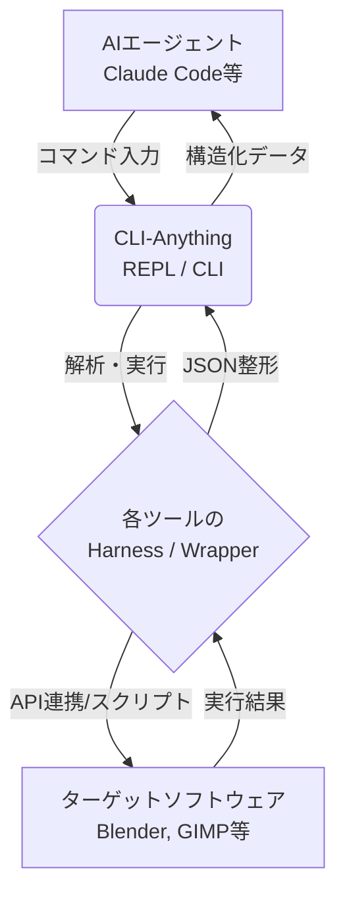

# **CLI-Anything 調査レポート**

## **1. 基本情報**

* **ツール名**: CLI-Anything
* **ツールの読み方**: シーエルアイエニシング
* **開発元**: HKUDS
* **公式サイト**: [https://hkuds.github.io/CLI-Anything/](https://hkuds.github.io/CLI-Anything/)
* **関連リンク**:
  * GitHub: [https://github.com/HKUDS/CLI-Anything](https://github.com/HKUDS/CLI-Anything)
* **カテゴリ**: 開発者ツール
* **概要**: CLI-Anythingは、GUIベースのソフトウェアや各種APIを、AIエージェントが制御可能な構造化されたCLI（コマンドラインインターフェース）に変換・生成するツールである。

## **2. 目的と主な利用シーン**

* **解決する課題**: AIエージェントが既存のプロフェッショナル向けソフトウェア（GUIアプリケーションなど）を直接操作できないという課題。
* **想定利用者**: AIエージェント開発者、自動化エンジニア
* **利用シーン**:
  * AIコーディングエージェント（Claude Code、Pi、OpenCodeなど）にGUIツール（GIMP、Blenderなど）の操作機能を付与する。
  * 複数のWebサービスのAPIを統合し、統一されたCLIインターフェースを提供する。
  * GUIの自動化処理を脆弱なUI操作（RPAなど）から堅牢なCLI操作へ置き換える。

## **3. 主要機能**

* **CLI自動生成**: ターゲットソフトウェアのソースコードを分析し、CLIを自動生成する（分析、設計、実装、テスト作成など全7フェーズ）。
* **CLI-Hub**: エージェントが自律的に発見・インストールできるCLIパッケージのレジストリ機能。
* **インタラクティブREPL**: AIエージェントおよび人間が対話的に操作できる統一されたREPLインターフェース（履歴機能、進捗表示などを備える）。
* **JSON出力モード**: 各コマンドに `--json` フラグを備え、機械可読な構造化データをAIエージェントに提供する。
* **テスト駆動生成**: 単体テスト、E2Eテストを含む堅牢なテストスイートを自動生成し、実ソフトウェアによる検証を行う。

## **4. 動作原理・システム構成**

* **アーキテクチャ**: ローカル環境またはコンテナ上で実行される、AIエージェントとGUIアプリケーション/API間のコマンドラインプロキシ（ラッパー）構成。
* **主要コンポーネントとデータフロー**:
  * AIエージェントからのコマンド入力をCLI-Anythingが受け取り、解析する。
  * コマンドは生成されたCLIラッパー（Python/Clickベース）を通して、対象ソフトウェアのバックエンドシステム（APIやCLIモード、スクリプト実行等）へ変換される。
  * 実行結果は `--json` フラグにより構造化されたJSONとして抽出され、AIエージェントに返却される。



* **特筆すべき要素技術**:
  * **テスト駆動生成 (TDD Pipeline)**: CLIラッパー生成時にソースコード解析からテスト実装までを自律的に構築。
  * **CLI-Hub**: エージェントが自律的に発見・インストールできるレジストリシステム（JSONインデックスベース）。

## **5. 開始手順・セットアップ**

* **前提条件**:
  * Python 3.10以降
  * ターゲットとなるソフトウェア（GIMP、Blenderなど）
  * サポートされているAIコーディングエージェント（Claude Code、Piなど）
* **インストール/導入**:

  Claude Code（プラグイン）の場合：

  ```bash
  # Marketplaceを追加
  /plugin marketplace add HKUDS/CLI-Anything
  # プラグインのインストール
  /plugin install cli-anything
  ```

* **クイックスタート**:

  ```bash
  # GIMP用のCLIを自動生成
  /cli-anything ./gimp
  ```

## **6. 特徴・強み (Pros)**

* AIエージェント向けに最適化されたJSON出力を標準搭載している。
* GUIのスクリーンショットやピクセルクリックに依存しないため、自動化が堅牢で安定している。
* 既存の強力なプロフェッショナルソフトウェア（Blender、LibreOfficeなど）の機能を妥協なく直接利用できる。
* 一度のコマンドでアーキテクチャ設計からテスト実装、PyPIへのパッケージ公開準備まで全自動で行える。

## **7. 弱み・注意点 (Cons)**

* 高度な言語モデル（Claude Opus 4.6やGPT-5.4など）に依存しており、小規模なモデルでは出力品質が低下する可能性がある。
* ターゲットソフトウェアのソースコードがない（コンパイル済みバイナリのみ）場合、生成されるCLIの品質に制限が出る。
* CLIの機能網羅率を高めるには、複数回の対話的リファイン処理（`/cli-anything:refine`）が必要になる場合がある。
* 日本語対応は限定的（README等の一部のドキュメントのみ日本語化されている）。

## **8. 料金プラン**

| プラン名 | 料金 | 主な特徴 |
|---------|------|---------|
| **オープンソース** | 無料 | Apache License 2.0 にて提供。全機能が利用可能。 |

* **課金体系**: なし（OSS）
* **無料トライアル**: 該当なし

## **9. 導入実績・事例**

* **導入企業**: オープンソースプロジェクトのため、具体的な企業名は非公開。
* **導入事例**:
  * GIMP、Blender、Inkscape等のクリエイティブツールのCLI化。
  * LibreOffice、OBS Studio等のプロダクティビティツールのCLI化。
  * Slay the Spire IIなどのゲーム操作の自動化。
* **対象業界**: AI開発、ソフトウェア自動化、クリエイティブ制作の自動化。

## **10. サポート体制**

* **ドキュメント**: GitHubリポジトリ上の README、HARNESS.md、QUICKSTART.md が充実している。
* **コミュニティ**: GitHub Issues や Discussions を通じたオープンソースコミュニティによるサポート。
* **公式サポート**: なし（コミュニティベース）

## **11. エコシステムと連携**

### **11.1 API・外部サービス連携**

* **API**: ツール自体はCLIジェネレーターであり、外部ツール（Mailchimp、Zoom等）のAPIをラップするCLIの生成に対応している。
* **外部サービス連携**: Claude Code、Pi Coding Agent、OpenCode、OpenClaw、CodexなどのAIコーディングエージェントに直接プラグイン/拡張機能として組み込むことが可能。

### **11.2 技術スタックとの相性**

| 技術スタック | 相性 | メリット・推奨理由 | 懸念点・注意点 |
|:---|:---:|:---|:---|
| **Python (3.10+)** | ◎ | ツールの基盤言語であり、Click等のライブラリと親和性が高い。 | 特になし。 |
| **Claude Code** | ◎ | 公式にプラグインとしてサポートされており、ワンコマンドで導入可能。 | 特になし。 |
| **Pi / OpenCode / Codex** | ◯ | プラグインやスクリプトとして拡張機能を提供している。 | 各エージェント固有のインストール手順が必要。 |

## **12. セキュリティとコンプライアンス**

* **認証**: 生成されるCLI自体には認証機構は含まれないが、ZoomなどのOAuth2等の認証が必要なAPIをラップする場合はその機構を実装できる。
* **データ管理**: 基本的にローカルで動作するため、ソースコードやデータはユーザー環境に留まる。
* **準拠規格**: オープンソースソフトウェアであり、特定のセキュリティ認証（SOC2など）は取得していない。

## **13. 操作性 (UI/UX) と学習コスト**

* **UI/UX**: 統一されたREPLスキンにより、CLIでありながら進捗表示やプロンプトのカラーリングなど、視覚的に分かりやすい操作感を提供する。
* **学習コスト**: AIエージェントにコマンドを指示するだけでCLIが生成されるため、導入は容易。ただし、既存のCLIの機能を拡張・調整するには生成手法（HARNESS.md）の理解が必要。

## **14. ベストプラクティス**

* **効果的な活用法 (Modern Practices)**:
  * ソフトウェアのフル機能が必要な場合、ダミーの実装ではなく必ず実際のソフトウェア（バックエンド）を呼び出すように設計する。
  * コマンドの実行結果をエージェントに検証させるため、`--json` モードを積極的に活用する。
* **陥りやすい罠 (Antipatterns)**:
  * エクスポート処理で単にコマンドがエラーなく終了したことだけを確認し、実際の出力ファイル（PDFのヘッダーやZIP構造など）の検証を怠ること。

## **15. ユーザーの声（レビュー分析）**

* **調査対象**: GitHub リポジトリ (Stars, Issues)
* **総合評価**: GitHub Stars 34.5k と非常に高い注目を集めている。
* **ポジティブな評価**:
  * "CLI-Anything works on any software with a codebase — no domain restrictions or architectural limitations."（あらゆるソフトウェアに対応できる汎用性の高さ）
  * テストの堅牢さ（100% pass rate across all 2,280 tests）が評価されている。
* **ネガティブな評価 / 改善要望**:
  * ターゲットソフトウェアがコンパイル済みバイナリのみの場合など、ソースコードに依存するアプローチの限界に関する指摘がある。
* **特徴的なユースケース**:
  * CLIを通じてSlay the Spire IIをAIがプレイするゲーム自動化の事例が報告されている。

## **16. 直近半年のアップデート情報**

* **2026-06-25**: v0.4.0 をリリース。CLI-Matrixによる複数CLIワークフローのサポート、ArcGIS ProやCalibreなど30の新規CLI追加、セキュリティ強化を実施。
* **2026-04-24**: v0.3.0 をリリース。Live2D、EEZ Studio CLI、OpenRefine CLI、TinyFish Web Agent CLIなどの新CLI Harnessを追加し、バグ修正やテスト強化を実施。
* **2026-04-15**: CLI-Hub v0.2.0 をリリース。複数ソースからのパッケージインストール対応やフロントエンドの改善。

(出典: [GitHub Releases](https://github.com/HKUDS/CLI-Anything/releases))

## **17. 類似ツールとの比較**

### **17.1 機能比較表 (星取表)**

| 機能カテゴリ | 機能項目 | 本ツール | AutoGPT | Claude Code |
|:---:|:---|:---:|:---:|:---:|
| **基本機能** | CLI自動生成 | ◎<br><small>7フェーズの独自パイプライン</small> | ×<br><small>非対応</small> | ×<br><small>非対応</small> |
| **連携・拡張性** | AIコーディングエージェント連携 | ◎<br><small>Claude Code等へプラグイン提供</small> | △<br><small>単体ツールとしての利用が主</small> | ◎<br><small>自身がエージェントとして動作</small> |
| **品質保証** | 自動テストの生成 | ◎<br><small>単体・E2Eテストを自動生成</small> | ×<br><small>非対応</small> | ◯<br><small>プロンプトにより自律的に実行</small> |
| **非機能要件** | 日本語対応 | △<br><small>一部ドキュメントのみ</small> | ◯<br><small>プロンプト次第で可能</small> | ◯<br><small>プロンプト次第で可能</small> |

### **17.2 詳細比較**

| ツール名 | 特徴 | 強み | 弱み | 選択肢となるケース |
|---------|------|------|------|------------------|
| **本ツール** | AIエージェント用のCLIラッパー生成に特化 | 実ソフトウェアを直接操作する堅牢なCLIを生成できる | ターゲットソフトウェアのソースコード解析が必要 | 既存のGUIソフトやAPI群を自動化パイプラインに組み込みたい場合 |
| **AutoGPT** | GUIで構築可能な自律エージェントプラットフォーム | GUIビルダーによる直感的なワークフロー作成、汎用的なタスク解決能力が高い | 複雑なGUIソフトの直接操作には向かない | 独自のワークフローを持つエージェントを作り、一般的な自動化を行いたい場合 |
| **Claude Code** | ターミナルで動作する自律型コーディングエージェント | CLI環境にネイティブ対応し、複雑な計画立案から実行まで自律的に行う | エディタ機能そのものは持たない | 既存のCLIベースのワークフローにAIの自律的な支援を組み込みたい場合 |

## **18. 総評**

* **総合的な評価**:
  * CLI-Anythingは、AIエージェントの能力を劇的に引き上げる画期的なツールである。RPAのような脆弱なUI操作に頼るのではなく、実ソフトウェアを操作する堅牢な構造化CLIを自動生成するアプローチは非常に実用的で信頼性が高い。2280件ものテストをクリアしている点も、エンタープライズやプロユースに耐えうる品質を証明している。
* **推奨されるチームやプロジェクト**:
  * AIエージェントを自社ワークフローに組み込みたい開発チーム。
  * 大量のGUI操作作業を自動化し、エラー率を低下させたい自動化エンジニアチーム。
* **選択時のポイント**:
  * AIを活用した自動化において、GUIの不安定さ（セレクタの変更や表示タイミングへの依存など）に課題を感じている場合、本ツールによるCLI化は最良の解決策となり得る。
