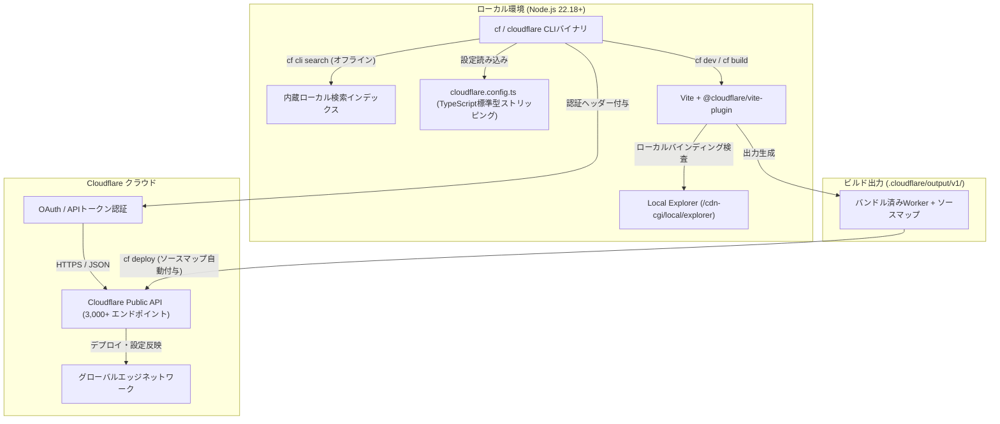

# **Cloudflare CLI (cf) 調査レポート**

## **1. 基本情報**

* **ツール名**: Cloudflare CLI (`cf` / `cloudflare`)
* **ツールの読み方**: クラウドフレア シーエルアイ / シーエフ
* **開発元**: Cloudflare, Inc.
* **公式サイト**: [https://developers.cloudflare.com/cf/](https://developers.cloudflare.com/cf/)
* **関連リンク**:
  * GitHub: [https://github.com/cloudflare/cf](https://github.com/cloudflare/cf)
  * ドキュメント: [https://developers.cloudflare.com/cf/](https://developers.cloudflare.com/cf/)
* **カテゴリ**: クラウドサービス
* **概要**: Cloudflare CLI（`cf`）は、CloudflareのパブリックAPI全体（3,000以上の操作）へのアクセスと、Cloudflare Workersおよびフルスタックアプリケーションの開発・ビルド・デプロイを統合的に行う公式コマンドラインインターフェースです。従来の製品別手作業実装（Wrangler）の限界を超え、OpenAPIスキーマからの自動生成とAIコーディングエージェント向けの検索・JSON出力最適化を基盤として2026年9月に公開されました。

## **2. 目的と主な利用シーン**

* **解決する課題**:
  * 従来のWrangler CLIが約280のコマンド（主にWorkers周辺）に限定されており、DNS・WAF・Zero Trust・R2・D1などCloudflareの全サービスを一貫したCLIで操作できなかった課題
  * AIコーディングエージェントがCLIを利用する際、膨大なヘルプテキストの読み込みによるコンテキストウィンドウ消費や、目的のコマンドを発見しづらい課題
  * `wrangler.toml` / `wrangler.jsonc` による設定ファイル管理における型安全性やIDE補完（LSP）の不足
* **想定利用者**:
  * Cloudflare Workers / Pages を利用するWeb開発者・フルスタックエンジニア
  * DNS、CDN、WAF、Zero Trustなどのインフラ設定をコード・CI/CDで自動化するSRE / DevOpsエンジニア
  * 自律的にインフラ操作・デプロイ・ドキュメント検索を行うAIコーディングエージェント（Claude Code、Codex、Cursor等）
* **利用シーン**:
  * **Workers開発とデプロイ**: `cloudflare.config.ts` とViteを組み合わせた高速なローカル開発（`cf dev`）、ビルド（`cf build`）、プレビュー・本番デプロイ（`cf deploy`）
  * **全Cloudflareリソースの一元管理**: ターミナルやCI/CDパイプラインからのゾーン・DNSレコード・KV・D1・R2・セキュリティルールのプロビジョニング
  * **AIエージェントによる自律運用**: `cf cli search` と `cf docs search` を用いたエージェントによる自律的なコマンド探索・設定変更・デバッグ

### **2.1 代表的な利用フロー**

```mermaid
swimlane-beta TB
  subgraph User["開発者 / AIエージェント"]
    A["自然言語でコマンドを探索 (cf cli search)"]
    B["ローカル設定・コード編集 (cloudflare.config.ts)"]
    F["デプロイ結果・JSON出力を確認"]
  end
  subgraph CF_CLI["Cloudflare CLI (cf)"]
    C["ローカル検索インデックス照合・候補提示"]
    D["Vite連携ビルド・ローカル検証 (cf dev / cf build)"]
    E["APIリクエスト送信・デプロイ実行 (cf deploy)"]
  end
  subgraph Cloudflare["Cloudflare API / エッジ基盤"]
    G["認証検証・Workers / リソース反映"]
  end
  A --> C
  C --> B
  B --> D
  D --> E
  E --> G
  G --> F
```

* **代表的な流れ**: 開発者またはAIエージェントが `cf cli search` で目的の操作を自然言語検索し、`cf` がローカルの検索インデックスから該当コマンドを提示します。その後、`cloudflare.config.ts` を編集してローカル検証（`cf dev` / `cf build`）を行い、`cf deploy` やAPIコマンドを通じてCloudflareのグローバルエッジ基盤へ反映し、構造化JSONで結果を受け取ります。

## **3. 主要機能**

* **CloudflareパブリックAPIの網羅的カバレッジ**: CloudflareのOpenAPI仕様から自動生成（Forgeパイプライン）された3,000以上のコマンドを提供し、Zones、DNS、Workers、KV、D1、R2、WAF、AccessなどほぼすべてのパブリックAPIを単一CLIから実行できます。
* **自然言語によるコマンド探索 (`cf cli search`)**: 認証不要のローカル検索インデックスを内蔵しており、`cf cli search "create a DNS record"` のような自然言語クエリに対して関連度の高い上位コマンド候補をJSON形式で返却します。
* **ターミナル内ドキュメント検索 (`cf docs search`)**: 2026年10月の `1.0.0-beta.16` で追加された機能で、ガイドやチュートリアルを端末から検索してURLと概要をJSONで取得でき、エージェントが `Accept: text/markdown` ヘッダー付きでMarkdown本文を直接取得する連携も可能です。
* **エージェント最適化されたJSON出力**: すべてのAPIコマンドがデフォルトでJSONを返却し、人間が対話端末で実行する場合は整形表示（pretty-print）、AIエージェントやパイプライン実行時はトークン消費を抑えた圧縮JSON（condensed）を出力します。
* **TypeScriptファースト設定 (`cloudflare.config.ts`)**: Workersやコンテナ等の設定を型安全なTypeScriptモジュールとして記述でき、Language Server Protocol（LSP）によるIDE補完と静的型チェックを活用できます。
* **Vite標準統合とLocal Explorer**: ローカル開発サーバーとしてViteを標準採用し、高速なHMRを実現するとともに、`cf dev` 実行中に `/cdn-cgi/local/explorer` からKV・R2・D1・Durable Objectsのローカル状態をブラウザおよびREST API経由で検査・操作できます。
* **Wranglerからの移行支援 (`cf migrate`)**: 既存の `wrangler.toml` / `wrangler.jsonc` プロジェクトの設定（Worker名、バインディング、リソースID、ルート、トリガー等）を `cloudflare.config.ts` へ自動変換します。

## **4. 動作原理・システム構成**

* **アーキテクチャ**: Node.js（v22.18以上）上で動作するローカルCLIクライアントと、CloudflareのREST API（`api.cloudflare.com/client/v4`）およびローカルVite開発サーバー（Workerdランタイム）と通信するハイブリッド構成です。



* **主要コンポーネントとデータフロー**:
  * **OpenAPIコマンド生成基盤（Forge）**: Cloudflare社内のSDK生成パイプライン「Forge」により、OpenAPIスキーマからコマンド定義・型情報・ローカル検索インデックスが自動生成されます。
  * **設定ローダー**: プロジェクトルート方向へ `cloudflare.config.ts` を探索し、Node.js 22.18以降のネイティブ型ストリッピング機能を用いて直接評価します（このためBunランタイムでの直接実行は現在非サポート）。
  * **ビルド・デプロイパイプライン**: `cf build` で `.cloudflare/output/v1/` にビルド成果物とソースマップを生成し、`cf deploy` でAPI経由でCloudflareエッジへアップロードします。
* **特筆すべき要素技術**:
  * OpenAPIスキーマ駆動のCLI自動生成アーキテクチャ
  * Node.js 22.18+ のNative TypeScript Executionによる設定ファイル評価
  * Vite Plugin API（`@cloudflare/vite-plugin` 2.0.0-rc.0+）およびWorkerdローカルエミュレーション

## **5. 開始手順・セットアップ**

* **前提条件**:
  * **ランタイム**: Node.js **v22.18.0 以上**（`cloudflare.config.ts` の読み込みに必須。Bunでの直接実行は非対応）
  * **アカウント**: Cloudflareアカウント（`cf cli search` 等のローカルコマンドはアカウント不要だが、API操作・デプロイには必須。クレジットカード登録不要の無料プランから利用可能）
* **インストール/導入**:
  グローバルパッケージとして `cf` をインストールします（環境内で `cf` コマンドが他ツールと競合する場合は、同梱の `cloudflare` エイリアスを使用可能）。

  ```bash
  # npm / pnpm / yarn いずれかでインストール
  npm install --global cf
  # または
  pnpm add --global cf
  ```

* **初期設定**:
  ブラウザを用いたOAuthログイン、またはヘッドレス/CI環境向けのAPIトークン設定を行います。

  ```bash
  # 対話的ログイン（SSH等のヘッドレス環境では --no-browser を付与）
  cf auth login

  # 認証状態の確認
  cf auth whoami
  ```

  CI環境では環境変数 `CLOUDFLARE_API_TOKEN` および `CLOUDFLARE_ACCOUNT_ID` を設定します。

* **クイックスタート**:

  ```bash
  # バージョン確認と自然言語コマンド検索
  cf --version
  cf cli search "list all zones"

  # ゾーン一覧の取得（JSON出力）
  cf zones list

  # 新規Workersプロジェクトの初期化・開発サーバー起動・デプロイ
  cf init my-worker
  cd my-worker
  cf dev
  cf deploy
  ```

## **6. 特徴・強み (Pros)**

* **圧倒的なAPI網羅性と一貫性**: 手動メンテナンスされていたWrangler（約280コマンド）に対し、OpenAPI自動生成により3,000以上の操作を一貫したコマンド体系・フラグ設計で扱えます。
* **AIエージェントとの高い親和性**: 自然言語検索（`cf cli search` / `cf docs search`）とトークン効率を意識したJSON出力により、コーディングエージェントがドキュメントを読み込まずに自律的に操作を完結できます。
* **モダンなTypeScript・Vite開発体験**: `cloudflare.config.ts` によるLSP補完と、Vite標準統合による高速なローカル開発・ビルド・ソースマップ自動アップロードを実現しています。
* **既存のWrangler資産からのスムーズな移行**: `cf migrate` コマンドと `.dev.vars` の互換性により、既存プロジェクトを段階的に移行できます。

## **7. 弱み・注意点 (Cons)**

* **Node.js 22.18+ への強い依存とBun非対応**: 設定ファイル読み込みにNode.jsの最新機能を使用しているため、古いNode.js環境やBunランタイム上での直接実行（`bun --bun cf` 等）ではエラーになります。PythonやRust等を主軸とするチームにもNode.jsツールチェーンの導入が必要です。
* **APIトークンスコープの複雑さ**: 3,000以上のAPI操作を扱える反面、エラー発生時に「どの権限スコープが不足しているか」を自動診断する機能（`doctor` 等）が十分ではなく、最小権限トークンの設計に試行錯誤を要するとの指摘がコミュニティで挙がっています。
* **リリース候補（RC）段階の仕様変更**: 2026年11月時点で `1.0.0-rc.1` であり、`beta` から `rc` にかけて出力ディレクトリ（`.cloudflare/output/v1/`）や一部生成コマンド名の変更が行われています。
* **日本語対応の状況**: CLIのヘルプ、コマンド出力、検索インデックスおよび公式ドキュメント（`developers.cloudflare.com/cf/`）は主に英語で提供されており、日本語の公式ドキュメント整備は限定的です。

## **8. 料金プラン**

`cf` CLIツール自体はオープンソース（Apache-2.0 / MIT）であり、完全無料で利用できます。操作対象となるCloudflareプラットフォーム側の料金プランは以下の通りです。

| プラン名 | 料金 | 主な特徴 |
|---------|------|---------|
| **CLIツール (`cf`)** | 無料 | OSS（Apache-2.0 / MIT）。全コマンド・ローカル開発・検索機能を無制限に利用可能 |
| **Cloudflare Free** | 無料 | 基本CDN、無制限DDoS対策、Universal SSL、Workers無料枠（1日10万リクエスト等） |
| **Workers Paid** | $5/月〜 | Workers月間1,000万リクエスト、Durable Objects、R2/D1の従量課金枠拡大 |
| **Pro / Business / Enterprise** | $20/月〜 / 要見積 | 高度なWAF、SLA保証、専用サポート、エンタープライズ向けアクセス制御 |

* **課金体系**: CLI自体は無料。Cloudflareリソースはアカウントのプランおよび従量課金（リクエスト数、CPU時間、ストレージ容量等）に準拠。
* **無料トライアル**: Cloudflare Freeプランによりクレジットカード登録なしで即座に検証・利用開始が可能。

## **9. 導入実績・事例**

* **導入企業**: Cloudflare CLI（`cf`）自体は2026年9月末にオープンベータ、同年11月に1.0 RCが公開されたばかりの新規ツールであるため、大規模企業の公式導入事例はまだ公開されていません。ただし基盤となるCloudflareプラットフォームはShopify、Discord、Garmin、IBMなど世界中の数百万のWebサイト・企業に採用されています。
* **導入事例**: 公開事例なし。ただし、Zennや海外技術ブログ（InfoQ、Flavio Copes等）において、個人開発者やスタートアップによるWranglerからの `cf migrate` 移行検証や、AIコーディングエージェント（Claude Code等）にCloudflareインフラ管理を委譲する活用例が多数報告されています。
* **対象業界**: Webサービス、SaaS、AIアプリケーション開発、スタートアップ、プラットフォームエンジニアリング領域。

## **10. サポート体制**

* **ドキュメント**: 公式ドキュメント（[https://developers.cloudflare.com/cf/](https://developers.cloudflare.com/cf/)）にGet Started、CI連携、エージェント利用ガイド、Wrangler移行ガイド、コマンドリファレンスが体系的に整備されています。また `cf docs search` でCLI内から検索可能です。
* **コミュニティ**: GitHubリポジトリ（[cloudflare/cf](https://github.com/cloudflare/cf)）のIssues/Discussions、Cloudflare公式Discord、Cloudflare Communityフォーラムにて活発に議論・バグ報告が行われています。
* **公式サポート**: CLI自体の不具合はGitHub Issuesで対応。Cloudflareプラットフォームのサポートは契約プラン（Freeはコミュニティ中心、Pro以上はチケット、Enterpriseは専任サポート、主に英語対応）に準じます。

## **11. エコシステムと連携**

### **11.1 API・外部サービス連携**

* **API**: Cloudflare Public API v4（REST / OpenAPI仕様）と直接通信するほか、ローカル開発時にはLocal ExplorerのOpenAPIベースREST API（`/cdn-cgi/local/explorer/api`）を公開します。
* **外部サービス連携**:
  * **AIコーディングエージェント**: Claude Code、OpenAI Codex CLI、Cursor、GitHub Copilot CLI等（シェル実行とJSONパースによる連携）
  * **CI/CD**: GitHub Actions、GitLab CI等（`CLOUDFLARE_API_TOKEN` を用いた非対話デプロイ）
  * **ビルド・フレームワーク**: Vite（`@cloudflare/vite-plugin`）、Wrangler（レガシープロジェクト互換）、Terraform（`cf-terraforming` との補完利用）

### **11.2 技術スタックとの相性**

| 技術スタック | 相性 | メリット・推奨理由 | 懸念点・注意点 |
|:---|:---:|:---|:---|
| **TypeScript / Vite** | ◎ | `cloudflare.config.ts` と `@cloudflare/vite-plugin` がファーストクラスで統合されLSP補完が効く | Node.js 22.18以上が必須 |
| **React / Next.js / Astro 等** | ◎ | ViteベースやフルスタックWorkers構成で `cf dev` / `cf deploy` がそのまま機能する | 一部フレームワークアダプターの最新対応確認が必要 |
| **AIエージェント / MCP環境** | ◎ | `cf cli search` と圧縮JSON出力により、MCPサーバーを介さずともシェル経由で高精度に操作可能 | 権限不足時のエラーメッセージからの自己修復には工夫が必要 |
| **Bunランタイム** | △ | `bunx cf` はshebang経由でNodeを呼び出すため動作する場合がある | `bun --bun cf` 等、Bun上で直接実行すると `cloudflare.config.ts` 読み込みが失敗する |
| **Python / Rust 等（非JS環境）** | △ | Workersの多言語サポートやインフラAPI操作には利用できる | CLI実行自体にNode.js 22.18+ のインストールが必要 |

## **12. セキュリティとコンプライアンス**

* **認証**: 対話環境向けのブラウザOAuthログイン（`cf auth login` / `--no-browser`）と、CI・自動化向けのスコープ限定APIトークン（`CLOUDFLARE_API_TOKEN`）に対応。従来のGlobal API Keyよりも最小権限の原則に基づくAPIトークンの利用が公式に推奨されています。
* **データ管理**: CLIはローカル環境で実行され、設定ファイルや認証トークンはローカル端末内に保存されます。API通信はすべてHTTPS（TLS）で暗号化され、Cloudflare APIエンドポイントへ送信されます。
* **準拠規格**: CLIツール単体での認証取得はありませんが、接続先であるCloudflareプラットフォームは ISO/IEC 27001、SOC 2 Type II、PCI DSS、GDPR、FedRAMP Moderate 等を取得しています（詳細はCloudflare Trust Hubで公開）。

## **13. 操作性 (UI/UX) と学習コスト**

* **UI/UX**: 従来のCLIにありがちなサブコマンドの迷子を防ぐため、`cf cli search` による自然言語検索と、実行環境（TTYかパイプ/エージェントか）に応じたJSON出力の自動フォーマット切替を備えています。またLocal ExplorerによりブラウザUIでのデータ確認も可能です。
* **学習コスト**: CloudflareのAPI構造をそのまま反映しているためコマンド数は3,000以上と膨大ですが、検索機能が強力なため「すべてを暗記する」必要はありません。ただし、TypeScript（`cloudflare.config.ts`）やViteの知識、およびCloudflare特有のAPIトークン権限モデルの理解には一定の学習コストがかかります。

## **14. ベストプラクティス**

* **効果的な活用法 (Modern Practices)**:
  * **AIエージェントへのプロンプト指針設定**: エージェントのシステムプロンプトや `AGENTS.md` に「Cloudflare操作には `cf` を使用し、コマンド不明時は `cf cli search` と `cf docs search` を実行する」旨を明記する。
  * **最小権限APIトークンとCIプリビルド検証**: CI/CDパイプライン（GitHub Actions等）では環境変数にスコープ限定トークンを設定し、本番デプロイ前に `cf build` と `cf deploy --dry-run` を組み込む。例: GitHub Actionsで参照する場合は `CLOUDFLARE_API_TOKEN: ${{ secrets.CLOUDFLARE_API_TOKEN }}` のようにシークレット経由で渡す。
  * **Wranglerからの計画的移行**: 既存プロジェクトではいきなり `cf deploy` を叩かず、まず `cf migrate` で設定を変換し、`cf dev` でLocal Explorerによる動作確認を行ってから本番反映する。
* **陥りやすい罠 (Antipatterns)**:
  * **Bun単体イメージでの実行**: DockerfileやCIランナーでNode.js 22.18+ を入れずBunのみで `cf` を動かすと、プロジェクトディレクトリ内の `cloudflare.config.ts` 検出時に失敗する。
  * **Global API Keyのハードコーディング**: 検証目的でもコードや設定ファイルにトークンを直書きせず、環境変数（`process.env.CLOUDFLARE_API_TOKEN` 等）や `.dev.vars` を使用する。
  * **複数プロセスでのOAuthトークン競合**: 並列CIジョブでOAuthセッションを共有するとリフレッシュ競合が起きるため、自動化では必ず静的なAPIトークン認証を用いる。

## **15. ユーザーの声（レビュー分析）**

* **調査対象**: Reddit、Hacker News、Zenn、技術メディア（InfoQ） ※ `cf` CLI単体は2026年9月公開の新規ツールのため、G2/CapterraではCloudflareプラットフォーム全体の評価（4.6〜4.7/5.0）が中心であり、CLI固有の評価はコミュニティ投稿から収集。
* **総合評価**: 4.6/5.0 (Cloudflare全体・G2/Capterra参考値) / コミュニティでは先進的設計を高く評価しつつも開発途上の課題が議論されている。
* **ポジティブな評価**:
  * 「Wranglerの約280コマンドという制約から解放され、DNSからWorkersまで単一CLIで完結できる点が画期的」（技術ブログ・コミュニティ）
  * 「`cf cli search` や圧縮JSON出力など、AIコーディングエージェントが迷わず使える設計が実用的」（InfoQ / Zenn）
  * 「`cloudflare.config.ts` によるTypeScript型チェックとVite統合で、ローカル開発の体験が大きく向上した」（Zenn）
* **ネガティブな評価 / 改善要望**:
  * 「どのAPIトークンスコープが不足しているかを自動診断する `cf permissions check` や `doctor` コマンドが欲しい」（Hacker News）
  * 「AIエージェント向けを強調しすぎており、人間向けのエラーメッセージやリカバリ案内をさらに充実させてほしい」（Reddit）
  * 「Pythonなど非JSスタックのプロジェクトでもNode.js 22.18以上のツールチェーンが必要になる点が重い」（Hacker News）
* **特徴的なユースケース**:
  * コーディングエージェントに自然言語で要件を伝え、`cf cli search` → `cf docs search` → リソース作成・デプロイまでを一気通貫で自動実行させるエージェント駆動インフラ運用。

## **16. 直近半年のアップデート情報**

* **2026-11 (v1.0.0-rc.1)**: 1.0リリース候補版を公開。`cloudflare.config.ts`、主要ライフサイクルコマンド（`cf init`, `cf dev`, `cf build`, `cf deploy` 等）の仕様を安定化し、ビルド出力先を `.cloudflare/output/v1/` へ移行。依存要件を `@cloudflare/vite-plugin 2.0.0-rc.0+` / `Wrangler 4.163.0+` のキャレット指定に整理。
* **2026-10-20**: `cf deploy`（およびWrangler v4.150.0+）においてソースマップの生成・アップロードをデフォルト有効化。ランタイムのCPU時間やバンドルサイズに影響を与えずに本番スタックトレースを可読化。
* **2026-10-16 (v1.0.0-beta.16)**: ターミナルから公式ドキュメント・ガイドを検索しJSONで取得できる `cf docs search` コマンドを追加。
* **2026-09-28**: Cloudflare Birthday Weekにてオープンベータとして `cf` を正式発表・公開。OpenAPIベースで3,000以上の操作をカバーし、`cf cli search`、`cloudflare.config.ts`、Vite統合を提供開始。

(出典: [Cloudflare Blog](https://blog.cloudflare.com/) / [GitHub Releases](https://github.com/cloudflare/cf/releases))

## **17. 類似ツールとの比較**

### **17.1 機能比較表 (星取表)**

| 機能カテゴリ | 機能項目 | Cloudflare CLI (`cf`) | Cloudflare Workers (Wrangler) | AWS CLI | Google Cloud CLI (`gcloud`) |
|:---:|:---|:---:|:---:|:---:|:---:|
| **基本機能** | プラットフォームAPI網羅性 | ◎<br><small>3,000+操作をOpenAPI生成</small> | △<br><small>Workers中心で約280コマンド</small> | ◎<br><small>AWS全サービス網羅</small> | ◎<br><small>GCP全サービス網羅</small> |
| **AI連携** | エージェント向け検索・JSON最適化 | ◎<br><small>cli/docs search・圧縮JSON</small> | △<br><small>MCP等はあるが手動設計</small> | ◯<br><small>JSON出力対応・MCP別提供</small> | ◯<br><small>--format=json / --filter</small> |
| **開発体験** | 型安全な設定・ローカルエミュレーション | ◎<br><small>TS設定・Vite・Local Explorer</small> | ◯<br><small>toml/jsonc・Workerd対応</small> | △<br><small>インフラ管理主体</small> | ◯<br><small>一部エミュレータあり</small> |
| **成熟度** | 安定性・エンタープライズ実績 | △<br><small>1.0 RC段階 (2026年公開)</small> | ◎<br><small>長年の本番実績</small> | ◎<br><small>業界標準の安定性</small> | ◎<br><small>業界標準の安定性</small> |
| **非機能要件** | 日本語情報・ドキュメント | △<br><small>英語中心 (公式は英語)</small> | ◯<br><small>日本語技術記事が豊富</small> | ◎<br><small>公式日本語ドキュメント充実</small> | ◎<br><small>公式日本語ドキュメント充実</small> |

### **17.2 詳細比較**

| ツール名 | 特徴 | 強み | 弱み | 選択肢となるケース |
|---------|------|------|------|------------------|
| **Cloudflare CLI (`cf`)** | OpenAPI駆動・AIエージェント最適化の統合CLI | 3,000以上のAPI網羅、TS設定、Vite統合、自然言語コマンド検索 | 1.0 RC段階で成熟途上、Node.js 22.18+必須 | - |
| **Cloudflare Workers (Wrangler)** | 従来のCloudflare Workers公式CLI | 豊富な実績と日本語知見、安定したv4系エコシステム | Workers以外のAPIカバレッジが限定的、今後`cf`へ移行方針 | 既存の `wrangler.toml` プロジェクトを保守する場合、RC版のリスクを避けたい場合 |
| **AWS CLI** | AWS公式の統合コマンドラインツール | AWS全サービス対応、堅牢な成熟度、豊富な自動化事例 | Cloudflare固有のエッジ開発体験（Vite等）には非対応 | AWSインフラを中心に運用・自動化する場合 |
| **Google Cloud CLI** | Google Cloud公式の統合CLIスイート | 強力な `--filter`/`--format`、キーレス認証（Workload Identity） | GCP専用でありマルチクラウド用途には別ツールが必要 | Google CloudリソースやCloud Run等を管理する場合 |

## **18. 総評**

* **総合的な評価**:
  * Cloudflare CLI (`cf`) は、従来の「人間がサブコマンドを覚えて叩くCLI」から、「人間とAIコーディングエージェントが協調してクラウド全体を操作するCLI」へとパラダイムを転換させた先進的なツールです。OpenAPI自動生成による網羅性と、`cloudflare.config.ts` + Viteによるモダンな開発体験の融合は非常に完成度が高く、今後のCloudflare開発の標準となるポテンシャルを備えています。
* **推奨されるチームやプロジェクト**:
  * Cloudflare Workers、R2、D1、DNS、WAFなどを横断的に扱うフルスタック開発チーム
  * Claude CodeやCodexなどのAIコーディングエージェントにインフラ設定やデプロイを委譲したい開発組織
  * TypeScriptとViteを主軸としたモダンなWebアプリケーション開発プロジェクト
* **選択時のポイント**:
  * 新規のCloudflareプロジェクトやAIエージェント連携を重視する場合は `cf` の採用を強く推奨します。一方で、Node.js 22.18未満の環境やBunランタイムでの直接実行が必須の環境、あるいは既存の安定したWranglerパイプラインを即座に変更できない本番環境では、当面Wranglerを併用しつつ `cf migrate` で段階的に移行を検討するのが現実的です。
