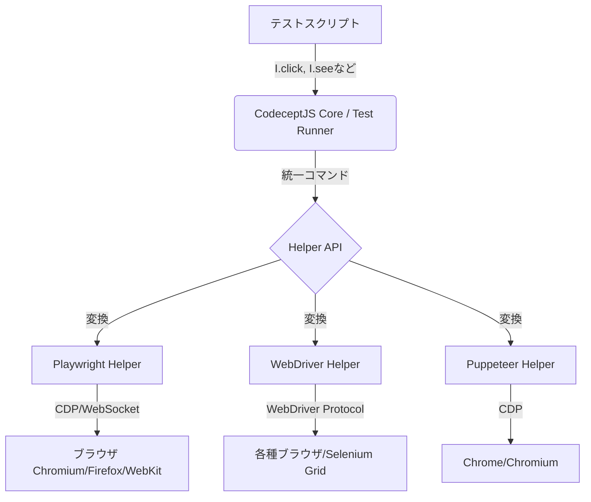

# **CodeceptJS 調査レポート**

## **1. 基本情報**

<!--
【ガイドライン】
- 必須: ツール名、開発元、公式サイト、カテゴリ、概要
- 概要は2-3文で簡潔に記述
-->

* **ツール名**: CodeceptJS
* **ツールの読み方**: コードセプトジェイエス
* **開発元**: CodeceptJS Team (Originally by DavertMik)
* **公式サイト**: [https://codecept.io/](https://codecept.io/)
* **関連リンク**:
  * GitHub: [https://github.com/codeceptjs/CodeceptJS](https://github.com/codeceptjs/CodeceptJS)
  * ドキュメント: [https://codecept.io/basics/](https://codecept.io/basics/)
* **カテゴリ**: テスト/QA
* **概要**: CodeceptJSは、Playwright, WebDriver, Puppeteerなどの様々なテストバックエンドを統一されたAPIで操作できる、Node.jsベースのE2E(End-to-End)テストフレームワークです。「ユーザーの視点」からテストシナリオを記述することに重点を置いており、可読性が高くメンテナンスしやすいテストコードの作成を目指しています。

## **2. 目的と主な利用シーン**

<!--
【ガイドライン】
- 3-5項目を箇条書きで記述
- 想定利用者を具体的に記載
-->

* **解決する課題**: 複雑なテストコードの記述を簡素化し、非開発者でも理解しやすいBDD(ビヘイビア駆動開発)スタイルのテストシナリオを作成することで、開発チーム全体の品質保証活動を効率化します。
* **想定利用者**: QAエンジニア、フロントエンド開発者、バックエンド開発者など、ウェブアプリケーションの品質保証に関わるすべての担当者。
* **利用シーン**:
  * ウェブアプリケーションのUIテスト自動化 (クロスブラウザ対応)
  * API（REST, GraphQL）のテスト自動化
  * モバイルアプリケーション（ネイティブ、Web）のテスト自動化
  * BDD（ビヘイビア駆動開発）プラクティスの導入

## **3. 主要機能**

<!--
【ガイドライン】
- 5-10項目の主要機能を箇条書きで記述
- 各機能は1-2文で概要を説明
-->

* **シナリオ駆動のテスト記述**: `I.click()`, `I.see()`, `I.fillField()` のように、ユーザーの行動を模した直感的で自然言語に近いコマンドでテストを記述できます。
* **マルチバックエンド対応**: Playwright, WebDriver, Puppeteer, Appiumなどのバックエンドをプロジェクト要件に応じて選択・切り替え可能です。テストコードの主要部分は変更する必要がありません。
* **インタラクティブデバッグ**: `pause()`コマンドによりテスト実行を一時停止し、ブラウザの状態で対話的にコマンドを試しながらテストを構築・デバッグできます。
* **ページオブジェクトモデル**: UIの要素とロジックをページごとにカプセル化することで、テストコードの再利用性とメンテナンス性を向上させます。
* **AIによるテスト支援とAgent基盤**: OpenAIなどのAI SDKと連携し、セレクタ変更で失敗したテストを自動修復する「heal plugin」や、AIに期待値を判定させる「Decision helper」を提供。さらに、`init:agent` コマンドによりMCP(Model Context Protocol)と連携した自律的エージェント基盤をサポートします。
* **豊富なレポート機能**: 標準でHTML, XML, JSON形式のレポートを生成でき、スクリーンショットやビデオ記録も簡単に組み込めます。
* **機密データマスキング**: レポートやログ出力に含まれるパスワードなどの機密情報を、正規表現を用いて自動的にマスクする機能を持ちます。

## **4. 動作原理・システム構成**

* **アーキテクチャ**: ローカル実行型のNode.jsベースのクライアント・サーバー構成。テストコード（シナリオ）を記述するフロントエンド部分と、実際のブラウザ操作を行うバックエンド部分（Playwright, WebDriverなど）を分離したアーキテクチャを採用しています。
* **主要コンポーネントとデータフロー**:
  * **Test Runner (Mocha/CodeceptJS Core)**: ユーザーが記述したテストシナリオを解析・実行します。
  * **Helper API**: Playwright, WebDriver, Puppeteerなどの様々な実行エンジンのAPIの違いを吸収し、統一されたインターフェース（`I.click()`など）を提供します。
  * **Backend Engines**: 実際にブラウザを起動し、コマンドを実行するエンジンです。
* **特筆すべき要素技術**:
  * **Promiseチェーンの隠蔽**: 内部的にすべてのコマンドをPromiseとしてキューに積み、同期的（非同期を意識させない形）に実行する仕組みを持っています。
  * **AI機能連携**: MCP (Model Context Protocol) などを通じて、生成AIやLLMと連携し、テストの自動修復やシナリオ生成を支援するアーキテクチャが組み込まれています。



## **5. 開始手順・セットアップ**

<!--
【ガイドライン】
- アカウント作成から「Hello World」的な最初の動作確認までの手順
- 主要なコマンドや設定項目を記載
-->

* **前提条件**:
  * Node.js (v18以上推奨)
* **インストール/導入**:

  ```bash
  npm init codeceptjs .
  # インタラクティブなセットアップウィザードが起動します
  ```

* **初期設定**:
  * `codecept.conf.js` または `codecept.conf.ts` ファイルで、使用するヘルパー（Playwright, WebDriver等）やブラウザの設定を行います。
* **クイックスタート**:

  ```bash
  # テストの作成
  npx codeceptjs gt
  # テストの実行
  npx codeceptjs run --steps
  ```

## **6. 特徴・強み (Pros)**

<!--
【ガイドライン】
- 3-5項目を箇条書きで記述
- 競合との差別化ポイントを明確に
-->

* **圧倒的な可読性**: テストシナリオが自然言語に近く、ビジネス要件をそのままテストコードに落とし込みやすいため、仕様書としても機能します。
* **学習コストの低さ**: シンプルなAPIと非常に充実した公式ドキュメントにより、テスト自動化の初学者でも比較的容易に学習を開始できます。
* **バックエンドの柔軟性**: プロジェクトの要件に応じて最適なテスト実行エンジン（例: Playwrightの高速性、WebDriverの広範なブラウザ対応）を選択・併用できます。
* **強力なデバッグ機能**: インタラクティブデバッグ機能は、複雑なシナリオを効率的に作成・修正する上で非常に強力です。

## **7. 弱み・注意点 (Cons)**

<!--
【ガイドライン】
- 3-5項目を箇条書きで記述
- 日本語対応の状況は必ず含める
-->

* **抽象化のオーバーヘッド**: 統一APIは便利ですが、バックエンド固有の高度な操作を行いたい場合、ラッパーを介さず直接APIを呼び出すなどの工夫が必要になることがあります。
* **日本語情報の少なさ**: 公式ドキュメントは英語で非常に充実していますが、日本語の技術記事やコミュニティサポートはまだ限定的です。
* **実行速度**: 内部的にライブラリをラップしているため、各バックエンドを直接利用する場合と比較して、わずかにオーバーヘッドが発生する可能性があります。

## **8. 料金プラン**

<!--
【ガイドライン】
- 表形式で整理することを推奨
- 最新の料金情報であることを確認
- 価格は通貨を明記（例: $10/月、¥1,000/月）
-->

CodeceptJSはMITライセンスで提供されるオープンソースソフトウェアであり、すべての機能を無料で利用できます。

| プラン名 | 料金 | 主な特徴 |
|---------|------|---------|
| **オープンソース** | 無料 | 全機能を利用可能。コミュニティによるサポート。 |
| **商用サポート** | 有料 (個別見積) | [sdclabs](https://sdclabs.com/)による有償のトレーニング、コンサルティング、導入支援が提供されている。 |

* **課金体系**: なし (ツール自体は無料)
* **無料トライアル**: なし (オープンソースのため不要)

## **9. 導入実績・事例**

<!--
【ガイドライン】
- 具体的な企業名を3-5社挙げる
- 導入事例がない場合は「公開事例なし。ただし、〜の分野での利用が報告されている」等
-->

* **導入企業**: Porsche, Percona など、世界中の多くの企業でウェブアプリケーションのテスト自動化に利用されています。公式サイトでは複数の導入事例が紹介されています。
* **導入事例**: Porscheでは、複数のチーム、異なるフレームワーク間でのテスト品質の標準化に貢献。Perconaでは、複雑なデータベース監視ツールのUIテストをシンプルに記述できる点を評価しています。
* **対象業界**: IT、自動車、データベースなど、業界を問わず幅広く利用されています。

## **10. サポート体制**

<!--
【ガイドライン】
- ドキュメント、コミュニティ、公式サポートの3項目を必ず含める
- URLがあれば記載
-->

* **ドキュメント**: [公式サイト](https://codecept.io/basics/)に非常に詳細なドキュメント、チュートリアル、APIリファレンスが整備されています。
* **コミュニティ**: [GitHub Discussions](https://github.com/codeceptjs/CodeceptJS/discussions)や[Slack](https://bit.ly/codeceptjs-slack)があり、開発者や他のユーザーと活発に情報交換が行われています。
* **公式サポート**: オープンソースのため公式の無料サポートはありませんが、前述の通り有償の商用サポートを利用できます。

## **11. エコシステムと連携**

<!--
【ガイドライン】
- API、外部連携、技術スタックとの相性を包括的に記述
-->

### **11.1 API・外部サービス連携**

<!--
【ガイドライン】
- APIの有無と公開状況を明記
- 主要連携サービスを5-10個リストアップ
-->

* **API**: 独自のヘルパーを作成することで、内部APIを拡張したり、外部APIと連携したりすることが容易です。
* **外部サービス連携**:
  * **CI/CD**: Jenkins, GitLab CI, GitHub Actionsなど、主要なCI/CDツールと簡単に連携できます。
  * **テスト管理**: [Testomat.io](https://testomat.io/) (姉妹プロジェクト) との親和性が高く、シームレスな連携が可能です。
  * **レポート**: Allure Reportなどの外部レポートツールとも連携できます。

### **11.2 技術スタックとの相性**

<!--
【ガイドライン】
- 主要なフレームワークや言語との相性を表形式で整理
- 相性: ◎ (非常に良い), ◯ (良い), △ (工夫が必要/一部非対応), × (非推奨)
-->

| 技術スタック | 相性 | メリット・推奨理由 | 懸念点・注意点 |
|:---|:---:|:---|:---|
| **Node.js (Express/NestJS)** | ◎ | 同言語のため親和性が高い。APIテストも容易。 | 特になし。 |
| **React/Vue/Angular** | ◎ | どのフロントエンドフレームワークでも問題なくテスト可能。 | コンポーネント単体テストは別途Jest等が必要。 |
| **Mobile (Appium)** | ◯ | Appiumヘルパーを通じてモバイルアプリのテストも記述可能。 | Appium自体のセットアップが必要。 |

## **12. セキュリティとコンプライアンス**

<!--
【ガイドライン】
- 認証、データ管理、準拠規格の3項目を必ず調査
- 情報が見つからない場合は「公式サイトで公開されていない。問い合わせが必要。」と記載
- 「不明」「見つからず」のみの記載は避ける
-->

* **認証**: CodeceptJSはテストフレームワークであり、直接的な認証機能はありません。テスト対象のアプリケーションの認証方式（SSO, 2段階認証など）に合わせてテストを記述します。
* **データ管理**: テストデータはユーザーが管理します。v3.7.5以降、ログやレポートに出力される認証情報などの機密データを自動でマスクする機能が追加され、安全性が向上しています。
* **準拠規格**: 開発用のテストツールであるため、ISO27001やSOC2などの認証は直接の対象ではありません。

## **13. 操作性 (UI/UX) と学習コスト**

<!--
【ガイドライン】
- 実際の使用感や、類似ツールとの比較を含める
-->

* **UI/UX**: CUIベースのツールですが、コマンド体系が分かりやすく整理されています。特にインタラクティブデバッグ機能は、テスト作成時の試行錯誤を容易にし、非常に高い開発体験を提供します。
* **学習コスト**: JavaScript/TypeScriptの基本的な知識があれば、1-2日で基本的なテストを作成できるようになります。公式ドキュメントが初学者向けに丁寧に作られているため、学習コストは低いと言えます。

## **14. ベストプラクティス**

<!--
【ガイドライン】
- ツールを効果的に活用するための推奨事項や、避けるべきアンチパターンを記述
- 公式ドキュメントのBest Practicesや、熟練エンジニアの知見を参考にする
-->

* **効果的な活用法 (Modern Practices)**:
  * **Page Object Model (POM)**: 画面要素と操作ロジックをページオブジェクトとして分離し、再利用性を高める。
  * **Data Management**: テストデータを外部ファイルやAPI経由で動的に生成・クリーンアップし、テスト間の依存性を排除する。
  * **Custom Helpers**: 頻繁に使用する複雑なロジックはカスタムヘルパーとして実装し、テストシナリオをシンプルに保つ。
* **陥りやすい罠 (Antipatterns)**:
  * **Hardcoded Waits**: `I.wait(5)` のような固定待機を避け、`I.waitForElement()` などのスマートウェイターを使用する。
  * **Complex Logic in Scenarios**: テストシナリオ内に複雑な条件分岐やループを書くことは避け、ヘルパーやページオブジェクトに移譲する。

## **15. ユーザーの声（レビュー分析）**

<!--
【ガイドライン】
- 必須調査サイト: G2, Capterra, ITreview（日本語レビュー）のうち該当するもの
- 追加調査サイト: App Store, Google Play, X(Twitter), Reddit等
- 総合評価スコアがあれば必ず記載
- ポジティブ・ネガティブ各3項目以上
-->

* **調査対象**: GitHub Issues/Discussions, Stack Overflow, X(Twitter), 技術ブログ
* **総合評価**: 多くの開発者から「テストコードが読みやすい」「セットアップが簡単」「デバッグが強力」といった点で高く評価されています。特にBDDスタイルでの記述のしやすさが支持されています。
* **ポジティブな評価**:
  * 「BDDスタイルのテストを簡単に書けるのが素晴らしい。QAチームと開発者のコミュニケーションが円滑になった。」
  * 「Playwrightの強力な機能を、より人間が読みやすいシンプルなAPIで利用できるのが気に入っている。」
  * 「インタラクティブポーズ機能は、複雑なテストシナリオをデバッグする上で絶対に欠かせない。」
* **ネガティブな評価 / 改善要望**:
  * 「バックエンドドライバのバージョンアップへの追従が、本体のリリースより少し遅れることがある。」
  * 「TypeScriptの型定義が、より完全になるとさらに嬉しい。」
  * 「WebStormなどのIDEでステップ定義へのジャンプがうまく機能しないことがある。」
* **特徴的なユースケース**:
  * 複数のブラウザエンジン（Chromium, Firefox, WebKit）でのテストを、同一のテストコードで並列実行し、クロスブラウザテストを効率化している事例が多く報告されています。

## **16. 直近半年のアップデート情報**

<!--
【ガイドライン】
- 日付の降順（新しいものが上）
- 3-10項目をリストアップ
- 各項目に日付と概要を含める
- **情報源の優先順位**:
  1. GitHubリポジトリの `CHANGELOG.md`
  2. GitHub Releases
  3. 公式ブログ / ニュース
- 情報源のURLを記載
-->

* **2026-10-12 (v4.2.1)**:
  * **AI機能の強化**: AI SDKを用いた「Decision helper」が追加され、自然言語によるアサーション判定が可能になりました。
  * **エージェント基盤の整備**: `init:agent` コマンドが追加され、MCP(Model Context Protocol)サーバーと連携したコーディングエージェントのセットアップが容易になりました。
  * **CDPBrowserの拡張**: 試験的なLightpandaヘルパーの追加や、ブラウザのパフォーマンスに関する改善が行われました。
* **2026-09-22 (v4.2.0)**:
  * クリップボード検証機能 (`seeInClipboard` など) が追加され、コピー＆ペーストのテストが容易になりました。
  * `Playwright` などのヘルパーでARIA roleに基づいた要素検索機能が強化されました。
* **2026-07-30 (v4.1.0)**:
  * テストの再実行に関するバグ修正や、ES Modules (ESM) としてMochaのテストファイルを読み込む機能が強化されました。
* **2026-05-06 (v4.0.0-rc.20)**: 次期メジャーバージョンに向けたリリース。MCP (Model Context Protocol) 連携機能の修正が行われました。
* **2026-05-01 (v4.0.0-rc.18)**:
  * **MCP連携の大幅強化**: `snapshot`ツール、`pause_session`ツールなどが追加され、シェルセッションのライフサイクルやテストごとのプラグイン上書きが可能になりました。
  * **screencastプラグイン**: `subtitles`プラグインに代わる`screencast`プラグインが追加されました。
  * **v4移行ガイドの提供**: v4.xへの移行ガイドとESM専用のコードサンプルが追加されました。
* **2026-04-23 (v3.7.9)**: セキュリティ上の重要な修正（`axios`や`xmldom`の更新）を含むメンテナンスリリースが行われました。
* **2026-04-21 (v4.0.0-rc.14)**:
  * **ページオブジェクトのフックとData Objects**: ページオブジェクトのライフサイクルフックとData Objectsが追加されました。
  * **リッチテキストエディタのサポート**: `fillField`コマンドがリッチテキストエディタに対応しました。
* **2026-01-16 (v3.7.6)**: 依存パッケージの更新やバグ修正を含むメンテナンスリリースが行われました。
* **2026-01-09 (v4.0.0-beta)**: 次期メジャーバージョンであるv4.0の開発が活発化しており、ベータ版のリリースが続いています。

(出典: [GitHub Releases](https://github.com/codeceptjs/CodeceptJS/releases), [npm Registry](https://www.npmjs.com/package/codeceptjs))

## **17. 類似ツールとの比較**

<!--
【ガイドライン】
- 3-5個の類似ツールと比較
- **機能比較表（星取表）**と**詳細比較**の2つの観点で記述する
-->

### **17.1 機能比較表 (星取表)**

<!--
【記載ルール】
- 縦軸に主要機能、横軸にツールを配置
- 記号の意味:
  - ◎: 非常に優れている / カタログスペック以上の機能 / 独自強み
  - ◯: 対応している / 標準的な機能
  - △: 一部対応 / 制限あり / アドオンが必要
  - ×: 非対応
  - -: 不明 / 該当なし
- 中立性を保つため、比較対象のツールが得意とする機能も平等にリストアップすること
-->

| 機能カテゴリ | 機能項目 | CodeceptJS | Playwright | Cypress | Selenium |
|:---:|:---|:---:|:---:|:---:|:---:|
| **基本機能** | 可読性 (BDD) | ◎<br><small>自然言語に近い</small> | ◯<br><small>AIエージェント対応</small> | △<br><small>プラグイン要</small> | △<br><small>Cucumber連携要</small> |
| **基本機能** | マルチバックエンド | ◎<br><small>切替可能</small> | ×<br><small>独自エンジン</small> | ×<br><small>独自エンジン</small> | ◎<br><small>多言語・多ブラウザ</small> |
| **開発体験** | デバッグ | ◎<br><small>対話的Pause</small> | ◎<br><small>Trace Viewer/UI Mode</small> | ◎<br><small>タイムトラベル</small> | △<br><small>ログ中心</small> |
| **AI機能** | エージェント/修復 | ◎<br><small>AI修復/Decision</small> | ◎<br><small>Playwright Test Agents搭載</small> | △<br><small>プラグイン等</small> | △<br><small>サードパーティ製</small> |
| **拡張性** | モバイルテスト | ◯<br><small>Appium連携</small> | △<br><small>実験的</small> | ×<br><small>非対応</small> | △<br><small>Appium別ツール</small> |

### **17.2 詳細比較**

<!--
【ガイドライン】
- 定性的な違いや、どのようなユーザーに向いているかを記述
-->

| ツール名 | 特徴 | 強み | 弱み | 選択肢となるケース |
|---------|------|------|------|------------------|
| **CodeceptJS** | (本ツール) | 非常に高い可読性、学習コストの低さ、バックエンドの柔軟性、AI機能(Decision, MCP等)。 | 抽象化によるオーバーヘッド、バックエンド固有機能の使いにくさ。 | 非エンジニアを含むチームで、仕様書のように読めるテストを書きたい場合。バックエンドを柔軟に変えたい場合。 |
| **Playwright** | Microsoft製のモダンなE2Eテストツール | 高速実行、豊富なデバッグ機能、ネイティブのAIエージェント機能(Test Agents)。 | 高機能ゆえにAPIが膨大で学習コストがやや高い。 | 最高の実行速度と最新の機能(AIエージェント等)を求める場合。 |
| **Cypress** | 開発者体験に優れるテストフレームワーク | 優れたデバッグ体験、インタラクティブなGUIでのテスト実行。 | 複数タブや複数オリジンへの対応に制約あり。 | フロントエンド開発者が開発フローの中で素早くコンポーネントやE2Eをテストしたい場合。 |
| **Selenium** | 最も歴史のあるブラウザ自動化ツール | 対応言語・ブラウザが最も豊富、巨大なコミュニティ。 | セットアップが煩雑、実行が比較的遅い、APIが古い。 | 多様なレガシーブラウザ環境や、JavaScript以外の言語でテストを書きたい場合。 |

## **18. 総評**

<!--
【ガイドライン】
- 総合評価、推奨チーム、選択ポイントの3項目を必ず含める
- 客観的で中立的な評価を心がける
-->

* **総合的な評価**:
  CodeceptJSは、テストコードの「可読性」と「メンテナンス性」を最優先事項と考えるチームにとって、非常に優れた選択肢です。多様なバックエンドを統一的なAPIで扱える柔軟性を持ち、強力なデバッグ機能やAIによるテスト支援など、開発体験を向上させるための機能も積極的に取り入れています。安定したテスト自動化フレームワークとして成熟しており、初心者から上級者まで幅広いユーザーにおすすめできます。
* **推奨されるチームやプロジェクト**:
  * BDD（ビヘイビア駆動開発）を導入・強化したいチーム。
  * QAエンジニアと開発者が共同でテストシナリオを作成・保守するプロジェクト。
  * 複数のウェブ/モバイルアプリケーションを、統一された手法でテストしたい組織。
* **選択時のポイント**:
  チームがテストコードの「書きやすさ」と「人間にとっての読みやすさ」を最も重視するならば、CodeceptJSは第一候補となるでしょう。より低レイヤーの制御や最高の実行速度を求めるならPlaywright単体を、開発者による迅速なフィードバックサイクルとデバッグ体験を重視するならCypressを比較検討するのが適切です。
