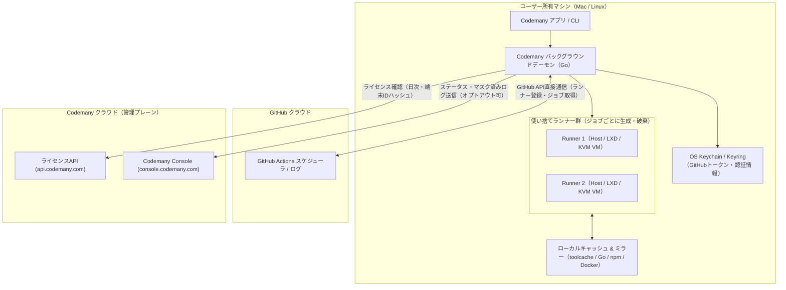

# **Codemany 調査レポート**

## **1. 基本情報**

* **ツール名**: Codemany
* **ツールの読み方**: コードメニー
* **開発元**: Rainbow Labs Inc.（創業者: Arpit Agarwal）
* **公式サイト**: [https://codemany.com/](https://codemany.com/)
* **関連リンク**:
  * ドキュメント: [https://codemany.com/docs](https://codemany.com/docs)
  * Webコンソール: [https://console.codemany.com/](https://console.codemany.com/)
  * 料金ページ: [https://codemany.com/pricing](https://codemany.com/pricing)
  * 変更履歴 (Changelog): [https://codemany.com/changelog](https://codemany.com/changelog)
  * Product Hunt: [https://www.producthunt.com/products/codemany](https://www.producthunt.com/products/codemany)
* **カテゴリ**: CI/CD周辺ツール
* **概要**: Codemanyは、開発者やチームが既に所有しているApple Silicon MacやLinuxマシン（または自社クラウドアカウント上のVM）を、GitHub Actionsのセルフホストランナーとして簡単に運用できるツールである。ワークフローファイルの `runs-on` を1行変更するだけで、ジョブごとに新しい使い捨て（Single-use / Just-in-Time）ランナーを自動起動・破棄し、従来の分単位課金ではなく月額固定料金で高速なCI実行環境を提供する。

## **2. 目的と主な利用シーン**

* **解決する課題**: AIコーディングエージェント（Claude Code等）の普及によりPull Requestやコミット頻度が急増するなか、GitHubホストランナー（特に高価なmacOSランナー）の分単位課金の高騰や、コールドスタート・キュー待ちによるビルド遅延、さらに従来の常駐型セルフホストランナーで発生しがちな「ジョブ間のワークスペース汚染（汚れ）」やメンテナンス負荷を解消する。
* **想定利用者**:
  * iOS / macOSアプリ（Xcodeビルド）を開発しており、GitHubホストのmacOSランナー費用やビルド時間に課題を抱える個人・チーム
  * AIコーディングエージェントを多用し、CIの実行分数が急増しているスタートアップ・開発者
  * ソースコードやビルド成果物を外部CIクラウドに出さず、自社ネットワーク・自社ハードウェア内で完結させたいチーム
* **利用シーン**:
  * **オフィスや自宅の遊休Mac mini / MacBookのCI活用**: 机の上やラックにあるApple Silicon MacをそのままXcode/SwiftやARM64ビルドの高速ランナーとして稼働させる。
  * **Linuxサーバーでの並列テスト・Dockerビルド**: 既存のUbuntu/Debianサーバーや自社GCP/Hetzner/DigitalOcean上のマシンで、ローカルキャッシュやミラーを効かせた高速CIを実行する。
  * **AIエージェント駆動開発における高頻度CI**: エージェントが1日に何十回・何百回もプッシュする環境で、従量課金を気にせず定額でCIを回し続ける。

### **2.1 代表的な利用フロー**

```mermaid
swimlane-beta TB
  subgraph User["開発者"]
    A["コード変更をプッシュ"]
    E["ビルド結果・ログを確認"]
  end
  subgraph GitHub["GitHub Actions"]
    B["ワークフローを検知しジョブをキュー"]
    D["ジョブログを集約・表示"]
  end
  subgraph Codemany["Codemany デーモン / ランナー"]
    C1["JiTランナーを登録・起動"]
    C2["ジョブを実行（ローカル環境 / VM）"]
    C3["終了後に作業フォルダを破棄・新ランナー待機"]
  end
  A --> B
  B -->|"runs-on: self-hosted, codemany"| C1
  C1 --> C2
  C2 -->|"実行ログ送信"| D
  C2 --> C3
  D --> E
```

* **代表的な流れ**: 開発者がコードをプッシュすると、GitHub Actionsが `runs-on: [self-hosted, codemany]` ラベルに一致するランナーへジョブを割り当てる。ローカルマシン上のCodemanyデーモンがジョブごとに新しいランナーをJust-in-Timeで起動してジョブを実行し、完了後は作業ディレクトリを完全に破棄（VMモード時はVM自体を破棄）して次の待機ランナーを補充する。

## **3. 主要機能**

* **使い捨て（Single-use / Just-in-Time）セルフホストランナー**: 各ジョブの実行ごとに新しいランナーをGitHubへ登録・起動し、ジョブ完了後に登録解除と作業ディレクトリの完全消去を行う。これにより従来のセルフホストランナーで問題になりやすい前ジョブの残留ファイルによるビルド破壊を防ぐ。
* **1行変更での簡単なワークフロー移行**: `.github/workflows/*.yml` の `runs-on` を `[self-hosted, codemany]`（Linux指定時は `[self-hosted, Linux, codemany]`）に変更するだけで移行でき、手動での `config.sh` 実行やランナー管理スクリプトが不要。
* **Apple Silicon Macネイティブ対応（Xcode / Homebrew活用）**: macOS 14以降のApple Silicon Macに対応し、マシンにインストール済みのXcode、iOSシミュレータ、Homebrewパッケージ、Docker（Colima等）をそのまま利用して高速にビルドを実行する。
* **Linux KVMによるジョブ単位のVM分離（オプトイン）**: Linux環境では、最速のホスト実行モード（`host`）やLXD分離に加え、KVMを用いてジョブごとにUbuntu 24.04ベースのクリーンな仮想マシンを起動・破棄する `vm` モードを選択できる。VM内はGitHubホストランナーに近いディレクトリ構成（`/opt/hostedtoolcache`、`/home/runner/work`）を持ち、Dockerとパスワードなし `sudo` が利用できる。
* **ローカルツールキャッシュとパッケージミラー**: `actions/setup-node` や `setup-go` 等がダウンロードするツール群を `~/.codemany/toolcache` に保持（20GB上限で自動プルーニング）し、事前ウォームアップ（`codemany integrations prewarm`）にも対応する。LinuxではGo（`GOPROXY`）、npm、Docker Hubの読み取り専用ローカルミラー、および公開リポジトリ用のGitミラーを自動提供し、コールドスタートを大幅に短縮する。
* **複数リポジトリ間でのランナー共有・自動リバランス**: 1台のマシンを複数のリポジトリやOrganization全体で共有できる。待機中の余剰ランナーをジョブ待ちのリポジトリへ自動的に振り分け、マシンのメモリ（1ジョブあたり4GB目安）・CPU（2コア目安）・ディスク容量に応じて同時実行数を自動調整する。
* **Codemany Console と LANダッシュボード**: Web上の [Codemany Console](https://console.codemany.com/) から全マシンの稼働状況、ジョブ履歴、シークレットマスク済みのリアルタイムログを確認でき、リモートから「新規ジョブの一時停止（Pause New Jobs）」や同時実行数変更が可能。ローカルネットワーク内では `http://codemany.local:8825` で読み取り専用ダッシュボードを閲覧できる。
* **ワンクリックSSHアクセスとクラウドマシン自動プロビジョニング**: Codemanyが稼働するマシンへポート22の開放やルーター設定なしで暗号化されたSSH接続（アプリ内クリックまたは `codemany ssh`）が可能。また、Macアプリ上からユーザー自身のGoogle Cloud（Workload Identity Federation対応）、Hetzner、DigitalOceanアカウントへUbuntu 24.04ランナーマシンを自動作成・管理（Google Cloudでは月額上限キャップ設定付き）できる。
* **自動アップデートと自己修復（Self-healing）**: Codemany本体およびGitHub Actionsランナーバイナリの更新は、実行中のジョブが完了するまで待機してから自動適用される。クラッシュ時の指数バックオフ再起動や、Macのスリープ抑止（Keep-awake）機能も備える。

## **4. 動作原理・システム構成**

* **アーキテクチャ**: ローカルファーストの「ハイブリッド・オーケストレーション構成」。ビルドのスケジューリングとWeb UI/ログ表示はGitHub Actions側が担い、ランナーのライフサイクル管理・実行・キャッシュ保持はユーザー所有マシン上のネイティブアプリおよび軽量Goデーモンが実行する。Codemanyのクラウドサーバー（`api.codemany.com` / `console.codemany.com`）はライセンス検証、アカウント設定同期、任意で有効化したコンソール表示・クラウドマシン起動のみを担当し、**ソースコードやGitHubトークンはCodemanyサーバーを経由しない**。



* **主要コンポーネントとデータフロー**:
  * **ネイティブUI & CLI (`codemany`)**: macOSではメニューバー常駐アプリ（`launchd` エージェント連携）、Linuxでは `.deb` デスクトップアプリまたは `systemd` サービスとして動作するCLIを提供する。
  * **認証情報の保管**: GitHubトークンはmacOSではログインキーチェーン内の専用項目（`com.codemany.vault`）、Linuxではユーザー限定パーミッションのファイルまたはデスクトップキーリングに保存され、Codemanyサーバーには送信されない（トライアル開始時のアカウント確認で一度API経由検証されるが保存・ログ記録はされない）。
  * **ジョブ実行と隔離**: デフォルトの `host` モードではユーザー権限で直接実行して最高速度・キャッシュ共有を優先する（Linuxの公開リポジトリ向けには専用スロットユーザーで分離）。より強い隔離が必要なLinux環境では、LXDコンテナまたはKVMによるQEMU/KVM仮想マシンをジョブ単位で起動し、完了後に破棄する。
  * **リソースサイジング**: 1ランナーあたりメモリ4GB・ディスク15GB・パフォーマンスコア2基を基準とし、システム用にメモリ4GB・ディスク20GBを予約した上で同時実行数（最大32）を算出する。
* **特筆すべき要素技術**:
  * **Just-in-Time ランナーライフサイクル管理**: GitHubのEphemeral/JITランナー登録APIをバックグラウンドデーモンが自動制御し、クラッシュ検知時は5秒〜5分の指数バックオフで代替ランナーを立ち上げる。
  * **Google Cloud Workload Identity Federation**: クラウドマシン連携時に長期的なサービスアカウントキーを発行・保存せず、短期トークン（最大1時間）でCompute Engineインスタンスを制御する設計を採用している。

## **5. 開始手順・セットアップ**

* **前提条件**:
  * **ハードウェア / OS**:
    * macOS: Apple Silicon（M1/M2/M3/M4等）搭載Mac、macOS 14（Sonoma）以降
    * Linux: 64-bit（amd64 / arm64）かつ `systemd` を備えたディストリビューション（Ubuntu 22.04/24.04、Debian 12以降、Fedora等）
  * **アカウント**: 対象リポジトリの管理者（Admin）またはOrganizationオーナー権限を持つGitHubアカウント（14日間無料トライアル時はクレジットカード不要）
* **インストール / 導入**:
  * **macOS**: [公式サイトのダウンロードページ](https://codemany.com/download) からDMG（署名・公証済み）を取得し、`Applications` フォルダへドラッグして起動する。
  * **Linuxサーバー（ワンライナー）**:

    ```bash
    curl --proto '=https' --tlsv1.2 -fsSL https://codemany.com/install.sh | sh
    ```

  * **Linux（Debian / Ubuntu aptリポジトリ経由）**:

    ```bash
    curl --proto '=https' --tlsv1.2 -fsSLo codemany.gpg https://codemany.com/download/linux/apt/codemany-archive-keyring.gpg
    gpg --show-keys --with-colons codemany.gpg | grep -qx 'fpr:::::::::92EAE8F4E140E71FE883C291DBC1D8717AE5E521:' && sudo install -m 644 codemany.gpg /usr/share/keyrings/codemany-archive-keyring.gpg
    echo "deb [signed-by=/usr/share/keyrings/codemany-archive-keyring.gpg] https://codemany.com/download/linux/apt stable main" | sudo tee /etc/apt/sources.list.d/codemany.list
    sudo apt update && sudo apt install codemany codemany-desktop
    ```

* **初期設定**:
  1. Macアプリを起動（Linuxサーバーの場合は `codemany setup-link` を実行して表示されたURLをブラウザで開く）。
  2. 「Sign in with GitHub」からデバイスコード認証等でGitHubアカウントを連携する（14日間無料トライアルが自動開始）。
  3. ランナーを提供するリポジトリまたはOrganizationを選択する（公開リポジトリはセキュリティ上デフォルトで無効であり、必要な場合のみ個別にオプトイン）。
  4. 必要に応じて「Codemany Runners App」をGitHub上で承認・インストールする。
* **クイックスタート**:
  対象リポジトリの `.github/workflows/ci.yml` などで `runs-on` を1行変更してプッシュする（GitHub Actionsの式構文を含むワークフロー例）。

  ```yaml
  name: CI
  on: [push, pull_request]
  jobs:
    build:
      runs-on: [self-hosted, codemany]
      steps:
        - uses: actions/checkout@v4
        - run: echo "Running on Codemany!"
  ```

  Linuxマシンに限定したい場合は `runs-on: [self-hosted, Linux, codemany]` と指定する。

## **6. 特徴・強み (Pros)**

* **圧倒的なコスト削減と月額固定制**: GitHubホストのmacOSランナー（約$0.062/分）を大量に使う場合、月額数百ドルに達する請求を、手持ちのハードウェアと月額$20（2台まで）の固定費に抑えられる。ビルド時間が長引いても追加課金が発生しない。
* **実機Apple Silicon等による高速ビルド（公称平均3.0倍高速）**: 公式の夜間ベンチマーク（[codemanyhq/bench](https://github.com/codemanyhq/bench)）において、プライベートコードのビルドがGitHub標準2コアランナー比で1.6倍〜4.6倍（SwiftLintで約4.1倍、Hugoで約4.6倍）高速化されている。
* **セルフホストランナー特有の運用負債からの解放**: ジョブごとの使い捨てランナー化、作業フォルダの自動破棄、ツールキャッシュの上限管理・自動掃除、アプリとランナーバイナリの自動アップデートにより、従来のDIYセルフホスト運用で必要だった保守作業がほぼ不要になる。
* **コードとシークレットの完全なローカル保持**: ソースコード、ビルド成果物、GitHubトークンがCodemanyのサーバーへ送信されないため、機密性の高いリポジトリでも導入しやすい。
* **Mac・Linux混在環境やクラウド拡張への柔軟な対応**: 1つのアカウントで手元のMac、オンプレミスLinuxサーバー、自社クラウド（GCP/Hetzner/DigitalOcean）上のVMを統合管理でき、ワークフローの `runs-on` ラベルで実行先を容易に振り分けられる。

## **7. 弱み・注意点 (Cons)**

* **日本語非対応**: アプリUI、Webコンソール、公式ドキュメント、サポート（XのDM等）のすべてが英語のみであり、日本語のローカライズや日本語サポート窓口は提供されていない。
* **ホストモードはサンドボックスではない（セキュリティ上の注意）**: デフォルトの `host` モードではジョブがユーザー権限で実行されるため、ジョブ間のファイル残留は防げるものの、ホストマシンのローカルファイルやネットワークへアクセス可能となる。不特定多数がPRを出せる公開リポジトリでの利用は推奨されず、専用マシン・専用ユーザーの利用やLinuxの `vm` 分離モードの検討が必要。
* **WindowsおよびIntel Mac非対応**: 2026年11月時点でWindowsマシンおよびIntel製Macには対応しておらず、Apple Silicon Mac（macOS 14+）または64-bit Linux（systemd環境）が必須となる。
* **ビルド環境の事前準備はユーザー依存**: LinuxのVMモードを除き、ランナー上にGitHubホストランナーのような巨大なプリインストール環境は用意されないため、Xcodeや特定のCLIツール等はユーザー側のマシンにインストールしておく必要がある。
* **恒久無料プランがない**: 14日間の無料トライアル（カード不要）はあるものの、継続利用には最低$20/月の有償プランへの加入が必要。

## **8. 料金プラン**

| プラン名 | 料金 | 主な特徴 |
|---------|------|---------|
| **14日間無料トライアル** | 無料（14日間） | クレジットカード登録不要。サインインと同時に自動開始し、全機能・2台までのマシンを試用可能 |
| **Codemany Pro** | $20/月 | MacまたはLinuxマシン2台まで含まれ、各マシン上のランナー数・実行分数無制限。以降1台追加ごとに+$10/月（例: 3台=$30/月、5台=$50/月） |

* **課金体系**: マシン台数（スロット）単位の月額固定サブスクリプション（実行分数による従量課金なし）。サブスクリプションはGitHubの個人アカウントまたはOrganization単位で契約する（個人用リポジトリとOrganization用リポジトリの両方で使う場合はそれぞれ契約が必要）。オフライン環境でもライセンスは7日間有効。
* **無料トライアル**: 14日間（クレジットカード登録不要、いつでもキャンセル可能）。

## **9. 導入実績・事例**

* **導入企業**: 2026年11月5日のローンチから間もない新興サービスであるため、大手エンタープライズによる公開導入事例はまだ少ない。公式サイトの「Featured on」やProduct Huntコメント欄では、開発元（Rainbow Labs Inc. / Amaltash）自身のほか、**Haplo AI**（JC氏による「CIコストが$215から$4へ削減された」とのコメント）など、AI開発・スタートアップ領域での利用が報告されている。
* **導入事例**: 開発者Arpit Agarwal氏は、AIコーディングエージェント（Claude Code）を用いた開発でPR数が月58件から1,560件へ急増し、GitHub Actionsの月額請求が約$10から$582へ膨れ上がった実体験を契機にCodemanyを開発・自社導入している。また公式サイト上のライブ統計では、全ユーザー合計で1,260ドル以上・41,230分以上のCIコスト・時間削減を達成している（2026年11月時点）。
* **対象業界**: ソフトウェア開発、モバイルアプリ開発（iOS/macOS）、AIスタートアップ、個人開発者・少人数チーム。

## **10. サポート体制**

* **ドキュメント**: [公式ドキュメント](https://codemany.com/docs) が非常に充実しており、クイックスタート、Mac/Linux/クラウドマシン設定、分離モード、トラブルシューティング、FAQ、競合比較、さらに全ページをMarkdown形式および `llms.txt` / `llms-full.txt` として公開しており、AIエージェントによる調査・参照も容易。
* **コミュニティ**: 専用の公式DiscordやSlackコミュニティの案内はないが、Product HuntのローンチスレッドやHacker News（Show HN）の議論、Indie Hackers等で開発者との活発なやり取りが行われている。
* **公式サポート**: アプリ内の「Send Feedback…」機能（開発元のプライベートIssueトラッカーへ直接送信）および、開発者Arpit Agarwal氏のX（[@arpwal](https://x.com/arpwal)）へのダイレクトメッセージで対応（英語のみ）。

## **11. エコシステムと連携**

### **11.1 API・外部サービス連携**

* **API**: エンドユーザー向けの公開REST APIやSDKは提供されていないが、ローカルCLI（`codemany`）およびマシン管理用の管理トークン（`codemany admin-token`）、Webコンソール（`console.codemany.com`）を通じて自動化・遠隔操作が可能。
* **外部サービス連携**:
  * **GitHub / GitHub Actions**: OAuth / Fine-grained PAT / GitHub App（Codemany Runners App）および `gh` CLI連携
  * **Google Cloud**: Workload Identity Federation連携によるCompute EngineランナーVM自動作成・月額上限管理
  * **Hetzner Cloud / DigitalOcean**: APIトークン連携によるクラウドLinuxランナーVM自動作成・管理
  * **Docker / Colima**: Mac上のColima自動インストール・死活監視、Linux上のDockerエンジン・Docker Hubプルミラー連携
  * **Homebrew**: CocoaPods、fastlane、xcbeautify、SwiftLint、XcodeGen、Git LFS等の自動インストール連携
  * **Xcode**: `xcode-select` と連動した `xcode-<version>` ラベルの自動付与、iOSシミュレータ管理

### **11.2 技術スタックとの相性**

| 技術スタック | 相性 | メリット・推奨理由 | 懸念点・注意点 |
|:---|:---:|:---|:---|
| **iOS / macOS (Swift / Xcode)** | ◎ | 手元のApple Silicon MacとXcode/シミュレータをそのまま使い、GitHub macOSランナー比で数倍の速度・固定費でビルド可能 | Apple Silicon Mac（macOS 14+）の所有が必要 |
| **Go / Node.js / Python / Rust** | ◎ | `~/.codemany/toolcache` による `actions/setup-*` キャッシュ共有や、LinuxでのGo/npmローカルミラーにより高速化 | 初回実行時はキャッシュが空のため通常通りのダウンロードが発生 |
| **Docker / コンテナビルド** | ◎ | LinuxのVMモード・LXDモードではDockerとビルドキャッシュが標準利用可能。Docker Hubミラーも自動構成 | MacではDocker DesktopまたはColimaの事前稼働が必要 |
| **Windows (.NET / WinUI等)** | × | Windowsマシンに非対応のため実行不可 | クロスコンパイル以外ではGitHubホスト等の別ランナーが必要 |

## **12. セキュリティとコンプライアンス**

* **認証**: GitHub連携はOAuthデバイスフロー、GitHub CLI、またはPersonal Access Token（Fine-grained PAT推奨）を使用。WebコンソールはGitHub OAuth（`read:org` スコープのみ、1時間セッションCookie `__Host-codemany_console`）で認証し、Organizationの管理者や課金担当者のみに操作権限を限定する。ワンクリックSSHはデバイスごとの公開鍵認証とホスト鍵ピン留め（E2E暗号化）を採用。
* **データ管理**:
  * ソースコード・ビルド成果物・ジョブ作業ディレクトリはすべてユーザー所有マシン内に留まり、Codemanyサーバーへ送信されない。
  * GitHubトークンはmacOSキーチェーン（`com.codemany.vault`）またはLinuxキーリングに保存。
  * コンソール機能を有効にしている場合のみ、ランナー状態とシークレットマスク済みのジョブログが送信される（`codemany console off` で完全停止可能）。
  * サブスクリプション管理・ライセンスDBにはGoogle Cloud Firestore、決済にはStripe、通信保護・CDNにはCloudflareを使用。MacアプリはAppleによる署名・公証済み、Linux aptリポジトリとインストールスクリプトはPGP鍵で署名されている。
* **準拠規格**: SOC2やISO27001等の第三者セキュリティ認証の取得については公式サイトで公開されていない。問い合わせが必要（[X @arpwal](https://x.com/arpwal) 宛）。

## **13. 操作性 (UI/UX) と学習コスト**

* **UI/UX**: macOSネイティブアプリ（メニューバー常駐＋メインウィンドウ）およびLinuxデスクトップアプリは、Overview・Runs・Machines・Repositoriesの4軸で直感的に設計されており、節約できた金額（$）や分数がリアルタイムで可視化される。スマホからQRコードでLANダッシュボードを開ける工夫も凝らされている。
* **学習コスト**: 既存のGitHub Actionsユーザーであれば、ワークフローの `runs-on` を1行変更するだけで済むため学習コストは極めて低い。LinuxでのKVM VMモード構築やCLI自動化もドキュメントが簡潔に整理されている。

## **14. ベストプラクティス**

* **効果的な活用法 (Modern Practices)**:
  * **`self-hosted` をラベルの先頭に置く**: `runs-on: [self-hosted, codemany]` のように必ず `self-hosted` を指定し、設定ミスで高価なGitHubホストランナーへ誤ってジョブが流れるのを防ぐ。
  * **Fine-grained PATとOIDCの併用**: GitHubトークンは対象リポジトリのみに絞った有効期限付きFine-grained PATを使用し、クラウドへのデプロイ認証にはマシン上に長期キーを置かずGitHub ActionsのOIDCを利用する。
  * **共有ツールキャッシュのPre-warm**: `codemany integrations prewarm` を実行し、よく使うNode.jsやGo等のバージョンを事前にキャッシュへ格納しておく。
* **陥りやすい罠 (Antipatterns)**:
  * **無防備な公開リポジトリの有効化**: 公開リポジトリを安易に有効化すると、外部からの悪意あるPRでローカルマシン上のファイルにアクセスされるリスクがある（必要な場合は必ずLinuxのVM分離モードまたは隔離された専用マシンを使用する）。
  * **`host` モードと `vm` モードの特性誤認**: Macの `host` モードではジョブがローカルユーザー権限で動くため、ジョブが `$HOME` 配下の設定ファイルを書き換えるとマシン全体に影響する。専用Macまたは専用ユーザーアカウントでの運用が推奨される。

## **15. ユーザーの声（レビュー分析）**

* **調査対象**: Product Hunt、Hacker News (Show HN)、公式サイト掲載のユーザーフィードバック（2026年11月時点ではG2、Capterra、ITreview等のBtoBレビューサイトには未掲載）
* **総合評価**: Product Huntにて2026年11月21日に **#3 Product of the Day**（200+ upvotes）を獲得。
* **ポジティブな評価**:
  * 「GitHub Actionsの請求額が月$215から$4に劇的に下がった」（Haplo AI / JC氏）と、特にコスト削減効果への反響が大きい。
  * 手元のApple Silicon Macをそのまま使える点と、1行変更ですぐに使い捨てランナーが動く手軽さが高く評価されている。
  * LAN内ダッシュボードやワンクリックSSHなど、複数台運用を見据えた細かな配慮が開発者から好評。
* **ネガティブな評価 / 改善要望**:
  * 「すべてのリポジトリで本当に3倍速くなるのか？（Dockerプルやキャッシュ復元の比重が大きい場合はどうか）」（Gal Dayan氏）といった、ワークロード依存性への現実的な疑問。
  * 「MacがスリープしたりWi-Fiが途中で切れたりしたらどうなるか」（Igor Martynyuk氏）というノートMac運用時の安定性への懸念（これに対し開発者はスリープ抑止と最大3回のリトライで対応）。
  * 「Windowsマシンへの対応予定はあるか」（David氏）など、Windowsサポートを望む声。
* **特徴的なユースケース**:
  * AIコーディングエージェント（Claude Code等）を並列稼働させて大量のPRを生成する開発者が、暴騰するCI課金を抑えるために自宅のMac miniや余剰Linux PCをCI専用機として再活用するケース。

## **16. 直近半年のアップデート情報**

Codemanyは2026年10月5日の初回パブリックリリース（v0.1.0）以降、極めて高頻度でアップデートが行われている。

* **2026-11-24 (v1.9.0 / v1.8.0)**: フリート全体の耐障害性を大幅強化（スリープ抑止、自己監視ウォッチドッグ、コンソールからのヘルス確認・再起動、アップデート健全性チェック）。ワンクリックSSHのデバイス別鍵認証を本番有効化、MacアプリのOverviewヘッダーUI統一。
* **2026-11-21 (v1.2.0〜v1.2.2)**: Dockerエンジンに到達可能な場合のみ `docker` ラベルを広告するよう修正。アイドル状態のランナーをドレインしてヘルパーがスムーズに再起動・アップデートできるように改善。
* **2026-11-20 (v0.79.0〜v1.0.0)**: Linux向けに厳格分離（strictly confined）されたLXD専用Snapパッケージのデフォルトトラック対応を実装。
* **2026-11-16 (v0.74.0〜v0.75.0)**: Macアプリからフリート内の他Macへリモートで「Update Now」を実行できる機能を追加。公式サイトに「What has CI cost you?」ライブ計算機（Calculator）を統合。
* **2026-11-09〜11-11 (v0.69.0〜v0.71.0)**: キャッシュのLAN共有状態表示と大容量アップロード時のダウンロード保持改善、Macアプリの「Add Machine」UI刷新およびクラウドマシンBeta対応。
* **2026-10-10〜10-11 (v0.16.0〜v0.17.0)**: Linux版の正式サポート開始、およびGoogle Cloud / Hetzner / DigitalOceanへのクラウドマシン自動追加機能を実装。

(出典: [Codemany Changelog](https://codemany.com/changelog))

## **17. 類似ツールとの比較**

### **17.1 機能比較表 (星取表)**

| 機能カテゴリ | 機能項目 | Codemany | GitHub Actions (Hosted) | act | Blacksmith |
|:---:|:---|:---:|:---:|:---:|:---:|
| **実行環境** | 自社/手元Mac・Linux活用 | ◎<br><small>Apple Silicon Mac / Linux両対応</small> | ×<br><small>クラウドのみ（DIY時は別管理）</small> | ◯<br><small>ローカルDocker上で擬似実行</small> | ×<br><small>Blacksmithクラウド上</small> |
| **実行環境** | macOSネイティブビルド | ◎<br><small>手元のM1〜M4 Macを定額利用</small> | ◯<br><small>利用可だが分単価が高額</small> | ×<br><small>macOSイメージ非対応</small> | ◯<br><small>Apple Silicon対応（分単位課金）</small> |
| **コスト** | 定額制（分単価なし） | ◎<br><small>$20/月〜（2台・実行時間無制限）</small> | ×<br><small>無料枠超過後は分単位従量課金</small> | ◎<br><small>完全無料（OSS）</small> | ×<br><small>無料枠後は分単位従量課金</small> |
| **運用性** | 使い捨てランナー自動管理 | ◎<br><small>ジョブごとに自動生成・破棄</small> | ◎<br><small>フルマネージドで自動破棄</small> | △<br><small>ローカルテスト用でありCI本番非対応</small> | ◎<br><small>フルマネージドで高速実行</small> |
| **セキュリティ** | コードの外部非送信 | ◎<br><small>自社マシン内で完結</small> | ×<br><small>GitHubクラウド上で実行</small> | ◎<br><small>完全ローカル実行</small> | ×<br><small>外部SaaSクラウド上で実行</small> |
| **非機能要件** | 日本語対応 | ×<br><small>英語のみ</small> | ◎<br><small>公式ドキュメント日本語対応</small> | △<br><small>英語中心（コミュニティ記事多数）</small> | ×<br><small>英語のみ</small> |

### **17.2 詳細比較**

| ツール名 | 特徴 | 強み | 弱み | 選択肢となるケース |
|---------|------|------|------|------------------|
| **Codemany** | 所有Mac/Linuxを使い捨てGitHub Actionsランナー化する商用ツール | 定額$20/月〜で無制限実行、Apple Silicon Macの実力をフル活用、コードが外部に出ない | Windows非対応、日本語非対応、ハードウェア管理自体は自社持ち | 既にMacやLinuxサーバーを保有しており、CI費用削減・ビルド高速化・ローカル完結を両立したい場合 |
| **GitHub Actions (Hosted)** | GitHub公式のマネージドCI/CDランナー | インフラ管理ゼロ、全OS（Linux/macOS/Windows）対応、豊富な公式イメージ | macOSや大規模Linuxランナーの分単価が高く、AIエージェント時代の高頻度CIで高額になりやすい | インフラを一切持ちたくなく、Windowsビルドや標準環境の即時スケーリングが最優先の場合 |
| **act (nektos/act)** | GitHub ActionsワークフローをローカルDockerで模擬実行するOSS CLI | 完全無料、プッシュ前にローカルで素早くワークフローをデバッグ可能 | GitHub本番トリガーの自動化ランナーではなく、macOS/Windowsジョブに非対応 | 本番CIの置き換えではなく、ローカル開発環境でのワークフロー検証・デバッグを行いたい場合 |
| **Blacksmith** | 高速CPU・キャッシュを備えたマネージドのGitHub Actions互換ランナー | 1行変更で即座に高速なクラウドランナーを利用可能、ハードウェア所有不要 | 分単位の従量課金であり、長時間のビルドや高頻度実行ではコストが膨らむ | ハードウェアを所有せず、マネージドSaaSのままビルド速度を上げたい場合 |

## **18. 総評**

* **総合的な評価**:
  * Codemanyは、AIコーディングエージェントの普及に伴って顕在化した「CI/CDの分単位課金爆発」と「セルフホストランナーの運用・清掃の煩雑さ」という2つのペインを的確に突いた、非常に実用性の高いCI/CD周辺ツールである。2026年11月の公開直後からほぼ連日のペースで機能追加と安定化が進められており、今後のさらなる成長が期待できる。
* **推奨されるチームやプロジェクト**:
  * Apple Silicon Macを既に保有し、Xcode/iOS/macOSビルドの時間とGitHub Actions請求額に悩む開発チーム
  * Claude Code等のAIエージェントを活用して高頻度にPR・CIを回しているスタートアップや個人開発者
  * セキュリティポリシーやコンプライアンス上、ソースコードを自社ネットワークや自社クラウドアカウント外に出したくない組織
* **選択時のポイント**:
  * ハードウェアを既に所有しているか、または自社クラウド（GCP等）で定額VMを運用する意思がある場合は、BlacksmithやDepot等の従量課金型マネージドランナーよりもCodemanyの方が圧倒的にコスト優位性が高い。一方で、Windowsビルドが必須である場合や、日本語ドキュメント・エンタープライズ向けSOC2認証等が必須要件となる場合は、GitHubホストランナーや他のCI/CDプラットフォームとの併用を検討すべきである。
