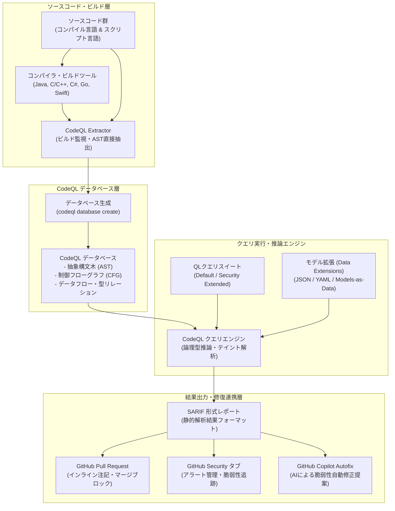

# **CodeQL 調査レポート**

## **1. 基本情報**

* **ツール名**: CodeQL
* **ツールの読み方**: コードキューエル
* **開発元**: GitHub
* **公式サイト**: [https://codeql.github.com/](https://codeql.github.com/)
* **関連リンク**:
  * GitHub: [https://github.com/github/codeql](https://github.com/github/codeql)
  * ドキュメント: [https://codeql.github.com/docs/](https://codeql.github.com/docs/)
* **カテゴリ**: セキュリティ/静的解析
* **概要**: GitHubが開発・提供するセマンティックコード解析エンジン。ソースコードを抽象構文木や制御フロー、データフローのリレーショナルデータベースとして抽出し、オブジェクト指向論理型クエリ言語「QL」で検索することで、複雑な脆弱性やバグを高精度に特定する。GitHub Advanced Security（GHAS）のコードスキャン中核技術として利用されている。

## **2. 目的と主な利用シーン**

* **解決する課題**:
  * 従来の正規表現・構文パターンマッチング型SASTでは検知が困難な、クロスファイル・ディープデータフロー起因の脆弱性（SQLインジェクション、SSRF、デシリアライゼーション等）の確実な発見
  * 新たに報告された脆弱性パターン（CVE）が組織内の他リポジトリに存在しないかを横断調査するバリアント分析の自動化
  * 組織固有のセキュリティポリシーやコーディング基準に合わせた柔軟なカスタムルールの実装
* **想定利用者**:
  * セキュリティエンジニア / AppSecチーム
  * 開発者 / フルスタックエンジニア
  * オープンソースソフトウェアのメンテナ
* **利用シーン**:
  * GitHub ActionsパイプラインでのPull Request作成・更新時における自動スキャンとマージ前ブロック
  * セキュリティ研究者によるゼロデイ脆弱性の探索およびバリアント分析（Variant Analysis）
  * GitHub Copilot Autofixと連携した、検知された脆弱性に対するAI自動修正コードの即時適用

### **2.1 代表的な利用フロー**

```mermaid
swimlane-beta TB
  subgraph Developer["開発者・セキュリティ担当"]
    A[機能開発・コードコミット]
    G[指摘箇所の確認・Autofix適用]
  end
  subgraph GitHubEnv["GitHub・CIワークフロー"]
    B[PR作成・Actionジョブ起動]
    E[SARIFアップロード・セキュリティ統合]
  end
  subgraph CodeQLEngine["CodeQL 解析エンジン"]
    C[言語抽出・CodeQL DB構築]
    D[QLクエリスイート実行・データフロー解析]
  end
  subgraph SecurityHub["セキュリティ管理 (PR・タブ)"]
    F[PRインライン注記・アラート発行]
  end
  A --> B
  B --> C
  C --> D
  D --> E
  E --> F
  F --> G
```

* **代表的な流れ**: 開発者がコードをコミットしてPull Requestを作成すると、GitHub Actions上でCodeQLワークフローが自動トリガーされる。CodeQLエンジンがビルドをトレースしてコードをリレーショナルデータベース化し、標準または拡張QLクエリスイートを実行してデータフロー解析を行う。解析結果はSARIF形式で出力されてGitHubにアップロードされ、PRの差分行へのインライン警告表示やCopilot Autofixの自動修正提案として開発者に還元される。

## **3. 主要機能**

* **セマンティックコード解析**: コードを単なるテキストやASTだけでなく、制御フロー（CFG）、呼び出しグラフ、型情報、データフローを含むリレーショナルデータベースとして表現・解析。
* **宣言型論理クエリ言語「QL」**: Datalogをベースにしたオブジェクト指向論理プログラミング言語。述語論理を用いて複雑なセキュリティ脆弱性の条件をシンプルかつ厳密にモデル化可能。
* **ディープテイントトラッキング**: ユーザー入力やリクエストパラメータなどの未信頼なデータソース（Source）から、危険な実行関数（Sink）に至るまでの汚染経路を、サニタイザやバリデータの影響を考慮しながら追跡。
* **モデル拡張（Data Extensions / Models-as-Data）**: サードパーティ製ライブラリのソース・シンク・サマリー情報を、YAMLやJSON形式（v2.27.3以降）で外部定義して解析エンジンに注入可能。
* **GitHub Advanced Security & Copilot Autofix連携**: GitHubのセキュリティタブおよびPull Requestの差分上に直接アラートを表示し、CopilotのLLMを活用して修正コミット案をワンクリックで生成・適用。
* **クロスプラットフォームCLIとLinux arm64ネイティブ対応**: Windows, macOS, Linuxに加え、2026年9月（v2.27.0）よりLinux arm64環境へ正式対応。ローカル開発環境や外部CI（GitLab CI, Jenkins）でも同一の解析を実行可能。
* **GitHub Actionsワークフロー自体の解析**: `actions/unpinned-tag` や環境変数インジェクション、キャッシュポイズニング検知など、CI/CDパイプライン自体のサプライチェーンリスク検証を標準サポート。

## **4. 動作原理・システム構成**

CodeQLは、ソースコードのビルドプロセスから構造情報を抽出し、専用データベースを構築した上で論理クエリを実行する「DB指向のセマンティック解析パイプライン」を採用している。



* **アーキテクチャ**:
  * **抽出フェーズ（Extraction）**: コンパイル言語（Java, C/C++, C#, Go, Swift）ではコンパイラのプロセス呼び出しをフック・監視して正確なASTや型シグネチャを抽出する。インタプリタ言語（JavaScript/TypeScript, Python, Ruby）では直接構文解析を行う。
  * **データベース生成（Database Creation）**: 抽出したトークン、構文関係、制御フロー、データフローを独自リレーショナルデータベースとしてパッケージ化。
  * **クエリ評価フェーズ（Query Execution）**: CodeQLエンジンがQLクエリパック（標準OWASP/CWEスイートやカスタムパック）を評価。Datalog由来の最適化された推論アルゴリズムにより、大規模コードベースでも効率的にテイント伝播経路を導出する。
  * **結果エクスポート（Reporting）**: OASIS標準規格であるSARIF（Static Analysis Results Interchange Format）形式に出力し、GitHub Code Scanningや各種開発ツールに受け渡す。

## **5. 開始手順・セットアップ**

* **前提条件**:
  * GitHubアカウント
  * パブリックリポジトリ（無料）、またはGitHub Code Security / GHASライセンスが有効なプライベートリポジトリ
  * ローカルCLI利用時は対応OS（Linux x86_64/arm64, macOS, Windows）
* **インストール/導入**:
  * **GitHub Actionsワークフロー例**:
    リポジトリの `.github/workflows/codeql.yml` に以下を定義する。

  ```yaml
  name: "CodeQL Analysis"
  on:
    push:
      branches: [ "main" ]
    pull_request:
      branches: [ "main" ]
  jobs:
    analyze:
      name: Analyze
      runs-on: ubuntu-latest
      permissions:
        actions: read
        contents: read
        security-events: write
      steps:
      - name: Checkout repository
        uses: actions/checkout@v4
      - name: Initialize CodeQL
        uses: github/codeql-action/init@v3
        with:
          languages: javascript-typescript, python
      - name: Autobuild
        uses: github/codeql-action/autobuild@v3
      - name: Perform CodeQL Analysis
        uses: github/codeql-action/analyze@v3
  ```

* **初期設定**:
  * **Default Setup（推奨）**: GitHubリポジトリの「Settings」→「Code security and analysis」→「Code scanning」で「Set up: Default」を選択すれば、ワークフローYAMLを手動作成することなく自動構成・実行される。
  * **Advanced Setup**: カスタムクエリの指定やビルドコマンドのカスタマイズが必要な場合はワークフローYAMLを直接編集する。
* **クイックスタート**:
  * パブリックリポジトリであれば設定画面から1クリックで有効化可能。最初のPR作成時に自動でスキャンが実行され、脆弱性検出時にはインラインアノテーションが表示される。

## **6. 特徴・強み (Pros)**

* **圧倒的な検出精度と低誤検知率**: 単純なテキスト正規表現や単純構文木マッチングではなく、高度なパス依存・インタープロシージャル（関数間）データフロー解析を行うため、実害のないノイズアラート（False Positive）が非常に少ない。
* **GitHubエコシステムとの完全な融合**: GitHub Actions、Pull Request画面、Securityタブ、GitHub Copilot Autofixとシームレスに結合しており、開発者が慣れ親しんだ開発サイクルを一切妨げずにDevSecOpsを実現できる。
* **クエリの表現力と拡張性**: 独自のQL言語により、自社固有のフレームワークや社内APIのセキュリティ仕様に合わせたクエリを柔軟に作成可能。さらにJSON/YAML形式のModels-as-Data拡張により、最小限の記述でカスタムライブラリのモデリングを追加できる。
* **オープンソースに対する完全無償提供**: パブリックリポジトリであれば、すべての高度なセマンティック解析機能とGitHub統合を完全に無料で無制限に利用可能。

## **7. 弱み・注意点 (Cons)**

* **QL言語の学習コスト**: 独自の宣言型論理プログラミング言語であるため、カスタムクエリを新規作成・デバッグするには一定の専門知識（述語論理、関係代数、コンパイラ理論）が必要。
* **解析時間とマシンリソースの消費**: 厳密なビルドトラッキングと全探索的なデータフロー解析を実行するため、単純なリンターや高速な軽量SAST（Semgrepなど）に比べてスキャン時間が長くなりやすい。
* **言語サポートの範囲**: 主要な11言語（C/C++, C#, Go, Java, Kotlin, JavaScript, TypeScript, Python, Ruby, Swift, Rust）をカバーしているが、SonarQubeなどがサポートするCOBOL, ABAP, Apex, PHPなどのレガシー/特定エンタープライズ言語には未対応。
* **英語中心のドキュメント**: GitHubの基本UIは日本語対応しているものの、CodeQLの詳細なクエリリファレンス、CLIドキュメント、エラーメッセージ、コミュニティ議論は英語が主流である点に注意が必要。

## **8. 料金プラン**

CodeQLの解析機能は、パブリックリポジトリでは無料、プライベートリポジトリでは「GitHub Code Security」または「GitHub Advanced Security (GHAS)」のライセンスアドオンとして提供される。

| プラン名 | 料金 | 主な特徴・含まれる機能 |
|---|---|---|
| **Public Repositories** | 無料 | パブリックリポジトリ向け。CodeQL解析、セキュリティタブ統合、標準クエリスイートを全機能無料で利用可能。 |
| **GitHub Code Security** | $30 / コミッター / 月 | プライベートリポジトリ向け。CodeQLコードスキャン、Copilot Autofix、依存関係レビュー、Dependabot有料機能を含む。 |
| **GitHub Secret Protection** | $19 / コミッター / 月 | プライベートリポジトリ向け。シークレットスキャン、プッシュプロテクション、有効性検証（個別契約用）。 |
| **GitHub Advanced Security (フル)** | $49 / コミッター / 月 | Code Security ($30) と Secret Protection ($19) をセットにした完全版。Enterprise/Teamのアドオンとして提供。 |

* **課金体系**: 過去90日以内にセキュリティ機能が有効なプライベートリポジトリにコミットをプッシュした「ユニーク・アクティブコミッター数」に基づく課金。同一組織内であれば複数リポジトリにコミットしても1名として重複排除される。Botアカウントは除外。
* **無料トライアル**: GitHub Enterpriseトライアル環境において、GHASの全機能を一定期間検証可能（営業担当窓口または管理ポータルから申請）。

## **9. 導入実績・事例**

* **導入企業**: Microsoft, Google, Uber, NASA, Lyft, Adobe など世界中の主要テック企業やグローバル組織。
* **導入事例**:
  * **Microsoft**: Windows, Azure, Officeなどの超大規模コードベースにおいて、1つの脆弱性が発見された際に同一パターンを持つ潜在的脆弱性をCodeQLのバリアント分析で網羅的に一網打尽に検出し、プロアクティブな修正を実施。
  * **Uber**: 数千のマイクロサービスを抱える環境でCodeQLをCIに組み込み、開発速度を落とさずにクリティカルなインジェクション脆弱性を未然に排除。
* **対象業界**: ソフトウェア・SaaS開発、金融機関、自動車・組込システム、防衛・宇宙航空、政府・公共機関など、厳格なセキュリティ保証とサプライチェーン保護が求められるあらゆる分野。

## **10. サポート体制**

* **ドキュメント**: 公式ドキュメント（[codeql.github.com/docs](https://codeql.github.com/docs/)）に詳細なチュートリアル、QL言語仕様、各言語向けモデリングガイド、SARIF連携マニュアルが完備。
* **コミュニティ**: GitHubリポジトリ（`github/codeql`）のDiscussionsおよびIssuesで活発なディスカッションが行われており、セキュリティ研究者やGitHubエンジニアから直接フィードバックが得られる。
* **公式サポート**: GitHub Enterprise契約組織には、24時間365日のEnterprise Premium Supportおよびセキュリティスペシャリストによるアドバイザリー支援が提供される。

## **11. エコシステムと連携**

### **11.1 API・外部サービス連携**

* **API**: GitHub REST APIおよびGraphQL APIにより、Code Scanningのアラート一覧取得、ステータス変更（解決・除外）、SARIFファイルの直接アップロードを完全自動化可能。
* **外部サービス連携**:
  * **VS Code**: 公式拡張機能「CodeQL for VS Code」により、ローカル環境でCodeQLデータベースの生成、クエリの編集・実行、ASTビューア、パス可視化をインタラクティブに実行可能。
  * **CI/CDツール**: CodeQL CLIを使用することで、GitLab CI, Jenkins, Azure DevOps, Bitbucket Pipelinesなどの外部CI基盤でも解析を実行し、結果をGitHubまたは自社ダッシュボードに送信可能。

### **11.2 技術スタックとの相性**

| 技術スタック | 相性 | メリット・推奨理由 | 懸念点・注意点 |
|:---|:---:|:---|:---|
| **GitHub Actions** | ◎ | 純正Action（`codeql-action`）により数行の設定またはDefault Setupで即時稼働 | 特になし |
| **JavaScript / TypeScript** | ◎ | ビルド不要で解析可能。Fastify, Next.js, Vercel Functions等のモデリングが充実 | 大規模モノレポでは解析ステップのメモリ設定に注意 |
| **Python** | ◎ | インタプリタ言語のためビルド不要。Django, Flask, FastAPI等のデータフローを完全捕捉 | 動的メタプログラミングを多用したコードは追跡が限定される場合あり |
| **Java / Kotlin** | ◎ | Kotlin 2.4 / K2コンパイラ対応。Spring Framework等の主要Webスタックを高精度解析 | ビルド監視を伴うためコンパイル時間分のオーバーヘッドが発生 |
| **Go** | ◎ | Go 1.27標準ライブラリモデル完備。Autobuildが強力で導入が容易 | 特になし |
| **C / C++** | ◯ | 複雑なポインタ操作やメモリ破損のディープテイント解析が可能 | 正確なビルドコマンド指定が必須。解析時間は長め |
| **C# (.NET)** | ◎ | ASP.NET CoreやLINQのクエリ精度が高く、誤検知対策が進展 | ビルド環境（SDKバージョン）の一致が必要 |
| **Swift** | ◯ | Swift 6.3対応。iOS/macOSネイティブアプリのセキュリティ診断に対応 | macOS 27/Xcode 27でのビルド制約に注意 |
| **Rust** | ◯ | 実験的サポートから着実にクエリ拡充。暗号化検証などが進化中 | C/C++に比べるとまだクエリ数が発展途上 |
| **PHP** | × | 公式サポート対象外 | 他のSASTツール（SonarQubeやPsalm、PHPStan）を併用推奨 |

## **12. セキュリティとコンプライアンス**

* **認証**: GitHubの認証基盤に完全準拠。SAML SSO, SCIM, FIDO2/WebAuthn 2要素認証をサポート。
* **データ管理**: クラウド解析では暗号化通信（TLS 1.3）およびGitHubインフラ内で安全に処理。機密性の高いソースコードを社外に出せない場合は、Self-hosted Runnerを利用して社内ネットワーク内でCodeQL解析を完結させ、SARIFメタデータのみを連携可能。
* **準拠規格**: OWASP Top 10, CWE Top 25, SANS Top 25, CERT, DISA-STIGなどの業界セキュリティ標準にマッピングされた「Security Extended」クエリスイートを提供。

## **13. 操作性 (UI/UX) と学習コスト**

* **UI/UX**: GitHubのPull Request差分行に直接アノテーションが表示され、脆弱性の危険度・データフロー経路（SourceからSinkまでのステップ）・推奨される修正方針が一目で理解できる。Copilot Autofixにより、修正差分プレビューを確認してそのままコミットできるなど、業界最高水準の開発者体験（DX）を誇る。
* **学習コスト**: 標準の「Default Setup」で運用する限り、開発チーム側の学習コストは実質ゼロ。ただし、社内フレームワーク用のカスタムQLクエリや高度なデータ拡張モデルを自作する場合は、QL言語および静的解析理論の習得に数週間程度の学習を要する。

## **14. ベストプラクティス**

* **効果的な活用法 (Modern Practices)**:
  * **Default Setupから開始**: まずはGitHub標準のDefault Setupで運用を開始し、開発者の負担を最小限に抑えながらカバレッジを確保する。
  * **PRマージブロックの段階的適用**: 最初からすべてのアラートでCIを落とすのではなく、まずは「Critical / High」の脆弱性のみを必須チェック（Required Status Check）に設定する。
  * **Copilot Autofixの積極活用**: 検知された脆弱性に対して提示されるAI修正案を活用し、修正にかかるトリアージ時間を大幅に短縮する。
  * **Models-as-Dataによる社内ライブラリ拡張**: 社内共通ライブラリの入出力データフローをJSON/YAMLでモデリングし、解析精度を組織全体で向上させる。
* **陥りやすい罠 (Antipatterns)**:
  * **初日からの全クエリスイート有効化**: 「Security Extended」や実験的クエリを最初から全有効化すると、大量のアラートでトリアージが麻痺（アラート疲れ）する。
  * **コンパイル言語のビルド設定無視**: コンパイル言語（C/C++, Java等）でAutobuildが失敗しているのに警告を無視すると、コードがDB化されず解析カバレッジが著しく低下する。

## **15. ユーザーの声（レビュー分析）**

* **調査対象**: G2, Reddit (r/netsec, r/devops), Gartner Peer Insights, Tech Blogs
* **総合評価**: 4.3 / 5.0 (G2)
* **ポジティブな評価**:
  * 「GitHub Actionsとの完全な統合とPR画面でのインライン表示により、開発者が作業フローから離れずにセキュリティ修正できる。」
  * 「バリアント分析が極めて強力。ゼロデイ脆弱性が公表された際、社内の全リポジトリから類似コードを数分で洗い出せた。」
  * 「単純な構文マッチングツールに比べてテイント解析が賢く、実害のない誤検知に悩まされる回数が圧倒的に減った。」
* **ネガティブな評価 / 改善要望**:
  * 「QL言語が極めて難解。独自のカスタムルールを書くためのドキュメントやサンプルがもっと充実してほしい。」
  * 「大規模なリポジトリではビルドとデータフロー解析に時間がかかり、PRのCI完了待ち時間が増加する。」
  * 「プライベートリポジトリにおけるGHASのライセンス費用が比較的高価で、小規模チームには敷居が高い。」
* **特徴的なユースケース**:
  * 社内のセキュリティ研究チームがCVEの詳細を分析した上でカスタムQLクエリを即日作成し、GitHubのマルチリポジトリバリアント分析（MRVA）を実行して社内数千リポジトリの潜在リスクを数時間で特定・一括トリアージする高度な活用。

## **16. 直近半年のアップデート情報**

* **2026-10-20 (v2.27.3)**:
  * データ拡張（Data extensions / Models-as-data）で従来のYAML形式に加えJSON形式（コメント記述対応）のネイティブサポートを追加。
  * macOS 27 / Xcode 27におけるコンパイル言語のautobuild / manual buildサポート制限（Appleのmulti-archバイナリ廃止への追従）。
  * GitHub Actionsデータベースのダウングレードに関する不具合修正。
* **2026-10-07 (v2.27.2)**:
  * CLIの標準エラー出力における警告・エラー表示を明示化（`ERROR:` / `WARNING:` プレフィックスを付与）。
  * `codeql query compile` に `--dil-constants` フラグを追加。YAMLデータ拡張における32bit整数範囲外の厳格検証。
* **2026-09-22 (v2.27.1)**:
  * Kotlin 2.4.20 サポート追加および Kotlin K2 コンパイラでの抽出精度向上。
  * Go 1.27 標準ライブラリ向けデータフローモデルの拡充。
  * C/C++ テイントフローおよびフローサマリーモデルを追加。
  * C# LINQ / ASP.NET Core の誤検知抑制、GitHub Actionsセキュリティクエリ（`actions/unpinned-tag`）での `actions.lock` 連携。
* **2026-09-09 (v2.27.0)**:
  * Linux arm64 (`linux-arm64`) ネイティブ対応の正式サポート開始（プラットフォーム別CLIおよびバンドルの提供）。
  * Java 9 および 10 サポートの非推奨化（2027年1月削除予定）。
  * 汎用マルチプラットフォーム zip 配布の非推奨化とプラットフォーム個別アーカイブへの完全移行。
* **2026-08-19 (v2.26.3)**:
  * GitHub Actions ワークフローに対するセキュリティ検証（環境変数インジェクション、キャッシュポイズニング検知等）の解析精度向上。
  * JavaScript / TypeScript / Vue のソースモデリング対応、`@fastify/rate-limit` レート制限モデリング追加。
* **2026-07-23 (v2.26.2)**:
  * アラートメッセージ内のレガシー記法（`[["text" | "url"]]`）の廃止（`$@` プレースホルダーへの完全移行）。
  * Swift 6.3 の完全解析サポート追加。
* **2026-07-15 (v2.26.1)**:
  * Rust 暗号化チェック（`rust/hard-coded-cryptographic-value`）における算術・ビット演算のバリア扱いによる誤検知削減。
  * C/C++ models-as-data における変数の source/sink 利用サポート廃止。
* **2026-07-08 (v2.26.0)**:
  * CLIパフォーマンス改善（Gitリポジトリ操作の冗長コマンド最小化）。
  * Go（`go/unhandled-writable-file-close`）および Python（`py/modification-of-locals`）の誤検知抑制。
* **2026-05-21 (v2.25.5)**:
  * C/C++ の解析改善（`fscanf` 等のモデル拡充）。
* **2026-05-05 (v2.25.4)**:
  * Swift 6.3.1 対応、JavaScript/TypeScript での Vercel serverless functions（`@vercel/node`）サポート追加。

(出典: [CodeQL Releases](https://github.com/github/codeql/releases) / [CodeQL Changelog](https://codeql.github.com/docs/codeql-overview/codeql-changelog/))

## **17. 類似ツールとの比較**

### **17.1 機能比較表 (星取表)**

| 機能カテゴリ | 機能項目 | CodeQL | SonarQube | Snyk Code | Semgrep |
|:---:|:---|:---:|:---:|:---:|:---:|
| **解析深度** | ディープテイント解析 | ◎<br><small>DB化による高精度追跡</small> | ◯<br><small>標準的なデータフロー</small> | ◯<br><small>AI統合型解析</small> | △<br><small>Pro版でクロスファイル対応</small> |
| **カスタマイズ** | クエリ表現力 | ◎<br><small>論理型QL言語で自在に記述</small> | △<br><small>XPathやカスタムJavaプラグイン</small> | △<br><small>設定中心・限定的</small> | ◎<br><small>YAML構文パターンで直感的</small> |
| **プラットフォーム** | GitHub統合 | ◎<br><small>純正・Copilot Autofix直結</small> | ◯<br><small>PRデコレーション対応</small> | ◯<br><small>PRチェック連携</small> | ◯<br><small>PRコメント連携</small> |
| **言語網羅性** | 対応言語数 | ◯<br><small>主要11言語</small> | ◎<br><small>30言語以上を網羅</small> | ◯<br><small>主要Web/モバイル言語</small> | ◯<br><small>30言語以上の構文対応</small> |
| **解析速度** | CIスキャン所要時間 | △<br><small>ビルド監視・重厚な解析</small> | ◯<br><small>差分解析で比較的高速</small> | ◎<br><small>AIエンジンによる超高速解析</small> | ◎<br><small>構文木ベースで極めて高速</small> |
| **コスト** | OSS向け無償利用 | ◎<br><small>パブリックリポジトリ完全無料</small> | ◎<br><small>Community版OSS無料</small> | ◯<br><small>月間スキャン上限あり無料</small> | ◎<br><small>OSS版無料</small> |

### **17.2 詳細比較**

| ツール名 | 特徴 | 強み | 弱み | 選択肢となるケース |
|---------|------|------|------|------------------|
| **CodeQL** | GitHub純正のセマンティックコード解析エンジン | 深いデータフロー・テイント解析の精度、GitHub & Copilot Autofixネイティブ統合、QLによる極めて柔軟なバリアント分析 | QLの学習コストが高い、コンパイル言語のビルド追跡に伴うスキャン時間の長さ | GitHubをメイン基盤としており、重大な脆弱性の徹底検出を最優先したい開発・セキュリティ組織 |
| **SonarQube** | 業界標準のコード品質＆セキュリティ管理プラットフォーム | 30以上の広範な言語サポート、セキュリティだけでなく技術的負債やコードの保守性指標を網羅可視化 | 深い脆弱性（複雑なテイントパス）の検出精度はCodeQLに譲る場合がある、オンプレサーバー運用負荷 | 単一ツールでコード品質・規約遵守・セキュリティを全社一元管理したい場合、GitLab/Bitbucket環境 |
| **Snyk Code** | AIを活用した超高速な開発者フレンドリーSAST | クラウドAIによるミリ秒単位の高速スキャン、IDEプラグインの優れた修正体験、Snykエコシステム（SCA/コンテナ）統合 | 独自ルールの作成自由度が低い、大規模組織でのライセンスコストが高価 | 開発者のIDE上でリアルタイムに修正させたい現場、CIの実行速度を最優先したいアジャイル開発 |
| **Semgrep** | パターンマッチングと軽量テイント解析を融合したSAST | YAMLでソースコードそのままのパターンでカスタムルールを即座に作成可能、超高速スキャン | 無料版ではファイル間データフロー解析が限定的（Proエンジンが必要） | 軽量かつ高速に自社固有の禁止APIやコーディング規約をルール化してガードレールを敷きたい場合 |

## **18. 総評**

* **総合的な評価**:
  * CodeQLは、コードをリレーショナルデータベースとして捉え、論理型クエリ言語で脆弱性を追跡する「現時点で最も先進的かつ深層まで到達できるSASTエンジン」である。GitHub Advanced SecurityおよびGitHub Copilot Autofixとのシームレスな統合により、脆弱性の検出からAIによる自動修正提案・適用までを開発者のPRフロー内でワンストップに完結できる卓越した開発者体験を提供する。
* **推奨されるチームやプロジェクト**:
  * GitHubをプライマリリポジトリとして開発を推進しているすべてのエンタープライズ・Web開発チーム。
  * 外部からの攻撃リスクが高い公開Webアプリケーションや、複雑なビジネスロジックを抱える金融・インフラ系システム。
  * オープンソースソフトウェアのメンテナ（完全無料で最高水準のセキュリティスキャンを導入可能）。
* **選択時のポイント**:
  * **リポジトリ基盤**: GitHub中心であればCodeQL（GHAS / Code Security）が第一候補。GitLabやオンプレミス中心、または30言語以上のレガシー資産混在環境であればSonarQubeが適する。
  * **解析速度とルールの手軽さ**: PRの待ち時間を数秒〜数十秒に抑え、手軽にカスタムルールを書きたい場合はSemgrepが有力。一方で、「多少のCI時間をかけてでもSQLインジェクションやSSRFなどの致命的なクロスファイル脆弱性を徹底的に根絶したい」場合はCodeQLが最適解となる。
