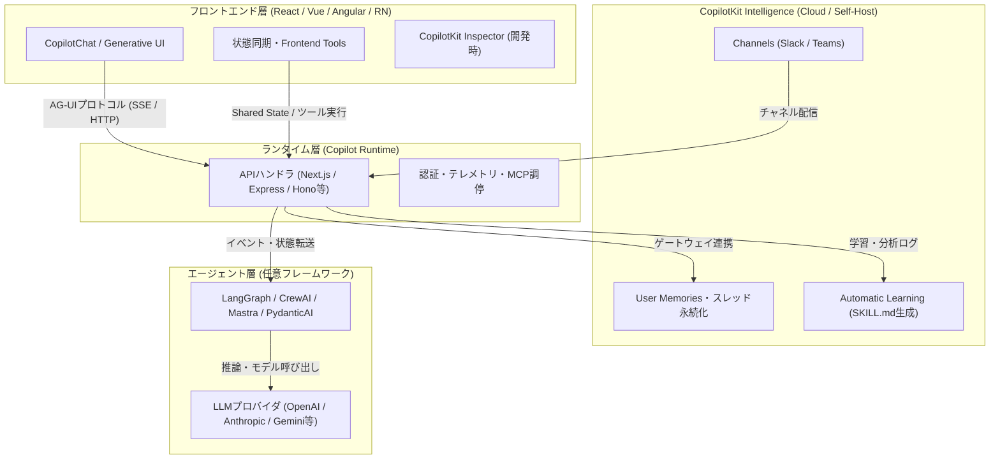

# **CopilotKit 調査レポート**

## **1. 基本情報**

* **ツール名**: CopilotKit
* **ツールの読み方**: コパイロットキット
* **開発元**: Tawkit, Inc.
* **公式サイト**: [https://www.copilotkit.ai/](https://www.copilotkit.ai/)
* **関連リンク**:
  * GitHub: [https://github.com/CopilotKit/CopilotKit](https://github.com/CopilotKit/CopilotKit)
  * DeepWiki: [https://deepwiki.com/CopilotKit/CopilotKit](https://deepwiki.com/CopilotKit/CopilotKit)
  * CodeWiki: [https://codewiki.google/github.com/CopilotKit/CopilotKit](https://codewiki.google/github.com/CopilotKit/CopilotKit)
  * ドキュメント: [https://docs.copilotkit.ai/](https://docs.copilotkit.ai/)
  * レビューサイト: [Product Hunt](https://www.producthunt.com/products/copilotkit)
* **カテゴリ**: エージェント開発プラットフォーム
* **概要**: React・Vue・Angular・React Nativeなどのアプリケーションに、AIチャットや動的なGenerative UIを迅速に組み込むためのオープンソースSDKおよび運用基盤。標準プロトコルであるAG-UI（Agent-User Interaction）を介してLangGraph・CrewAI・Mastra等の多様なAIエージェントバックエンドと接続し、共有状態管理やHuman-in-the-Loopを備えたインタラクティブなAI体験を構築できる。

## **2. 目的と主な利用シーン**

* **解決する課題**: アプリケーション内に高度なAIエージェントやチャットボットをゼロから実装する際にかかるフロントエンドUI・ストリーミング通信・状態同期の膨大な開発工数を削減する。
* **想定利用者**: React/Next.js、Vue、Angular開発者、AIプロダクトを構築するフルスタックエンジニアおよびプラットフォームチーム
* **利用シーン**:
  * SaaS製品へのアプリ内AIアシスタント機能（チャットUI・サイドバー・ポップアップ）の追加
  * ユーザーの意図やエージェント状態に応じて動的にUIを生成・操作するGenerative UI（A2UI連携含む）の実装
  * SlackやMicrosoft Teamsなどの外部チャネルとアプリ内エージェントを統合した業務支援Copilotの構築
  * CopilotKit IntelligenceとInspectorを活用した、本番会話ログからの自動学習（`SKILL.md`生成）と継続的改善

### **2.1 代表的な利用フロー**

```mermaid
swimlane-beta TB
  subgraph User["ユーザー"]
    A["目的・プロンプトを入力"]
    F["Generative UIを確認・承認"]
  end
  subgraph Frontend["フロントエンド (CopilotKit SDK)"]
    B["アプリ状態と入力を送信"]
    E["UIコンポーネントを動的描画"]
  end
  subgraph Runtime["Copilot Runtime / Intelligence"]
    C["認証・ツール調停・AG-UI変換"]
  end
  subgraph Agent["AIエージェント (LangGraph等)"]
    D["推論・ツール実行・状態更新"]
  end
  A --> B
  B -->|"AG-UIイベント送信"| C
  C --> D
  D -->|"ストリーム応答・状態差分"| C
  C -->|"AG-UIイベント配信"| E
  E --> F
```

* **代表的な流れ**: ユーザーがCopilotKitのUIコンポーネントから指示を入力すると、Frontend SDKが現在のアプリケーション状態とともにRuntimeへ送信し、AG-UIプロトコルを介してバックエンドのAIエージェントへ受け渡される。エージェントの推論結果やツール実行結果はストリーミングでフロントエンドへ返却され、Generative UIの動的描画やHuman-in-the-Loopの確認プロンプトとしてユーザーに提示される。

## **3. 主要機能**

* **AG-UIプロトコル連携 (AG-UI 1.0)**: バックエンドエージェントとフロントエンドUIを双方向イベントストリームで接続するオープン標準プロトコル。メッセージチャンク、ツール呼び出し、状態差分を統一的に扱う。
* **Generative UI & A2UI連携**: テキスト応答に留まらず、ユーザーの意図やエージェントの状態に基づき、実行時にReact/Vue/AngularコンポーネントやGoogleのA2UI仕様に準拠した宣言的UIを動的に生成・描画する。
* **マルチフレームワークUIコンポーネント**: `CopilotChat`、`CopilotSidebar`、`CopilotPopup`、`CopilotTextarea`などの既製UIをReact、Vue（`@copilotkit/vue`）、Angular（`@copilotkit/angular`）、React Native向けにネイティブ提供。
* **Shared State & Frontend Tools**: エージェントとUIコンポーネントがリアルタイムでアプリケーション状態を読み書きできる同期機能と、エージェントからフロントエンド関数を呼び出す`useFrontendTool`を提供。
* **Human-in-the-Loop (HITL)**: 重要な操作や外部API実行の前に、エージェントが一時停止してユーザーの確認・承認・追加入力を求めるインタラクティブワークフローを構築可能。
* **CopilotKit Inspector**: 開発ビルドに組み込まれるエージェント専用デバッグオーバーレイ。AG-UIイベントストリームのリアルタイム可視化や、会話スレッドをフォークして別ルートを試すサンドボックス再生機能を備える。
* **CopilotKit Intelligence**: 本番運用向けの上位レイヤー。クロスセッションのユーザーメモリ管理、会話継続性、利用履歴から再利用可能なエージェントスキル（`SKILL.md`）を抽出するAutomatic Learningを提供する。
* **Managed Channels**: 同じエージェントバックエンドをWebアプリ内だけでなく、SlackやMicrosoft Teamsなどのチャットチャネルへ直接配信・統合する機能（静的JSXの画像レンダリングやインタラクティブカードに対応）。

## **4. 動作原理・システム構成**

* **アーキテクチャ**: クライアント・サーバー型の**3層モジュラーアーキテクチャ**（Frontend Layer / Runtime Layer / Agent Layer）を採用し、各層をオープン標準の**AG-UIプロトコル**で疎結合に連携させる構成となっている。これにより、フロントエンドやエージェントフレームワークを個別に差し替えることが可能。



* **主要コンポーネントとデータフロー**:
  * **Frontend Layer**: アプリ内に組み込まれるSDK群。ユーザー入力とアプリの現在状態（コンテキスト）を収集し、Server-Sent Events（SSE）等を通じてRuntimeへ送信する。
  * **Runtime Layer**: Next.js App Router、Express、Hono、Bun、Deno、Cloudflare Workersなどにマウントされるリクエストハンドラ。認証、LLMプロバイダとの接続、MCP（Model Context Protocol）ツールの調停、AG-UIイベントの変換を担う。
  * **Agent Layer**: 実際の推論とツール実行を担当する層。LangGraph、CrewAI、Mastra、PydanticAI、AG2、Microsoft Agent Framework、あるいはBuilt-in AgentとAG-UIアダプター経由で接続する。
* **特筆すべき要素技術**:
  * **AG-UI v2 / MCP Apps**: イベント駆動のストリーミング仕様により、長時間のエージェント実行や複数サブエージェントの協調動作、Opaque Originによる安全なMCP Appsウィジェットの埋め込みを実現している。
  * **インフラ・隔離技術**: CopilotKit Intelligenceはクラウド版のほか、Kubernetes（Helmチャート）やAWS ECS/Fargateを用いたVPC内セルフホスト構成に対応している。

## **5. 開始手順・セットアップ**

* **前提条件**:
  * Node.js環境（Next.js、React、Vue、Angularなどのプロジェクト）
  * LLMプロバイダ（OpenAI、Anthropic、Google Gemini等）のAPIキー、または自前のエージェントバックエンド
  * OSS版のみの利用であればアカウント登録・クレジットカード登録は不要
* **インストール/導入**:

  新規プロジェクトの作成:

  ```bash
  npx copilotkit@latest create -f <framework>
  ```

  既存プロジェクトへの導入:

  ```bash
  npx copilotkit@latest init
  ```

* **初期設定**:
  * 環境変数ファイル（`.env`等）にLLMプロバイダのAPIキー（例: `OPENAI_API_KEY=<YOUR_API_KEY>` や `process.env.OPENAI_API_KEY` 参照）を設定。
  * アプリケーションルートに `CopilotKit` プロバイダーを配置し、サーバー側に Copilot Runtime エンドポイント（例: `/api/copilotkit`）をマウント。
* **クイックスタート**:
  * 画面コンポーネント内に `<CopilotChat />` や `<CopilotSidebar />` を配置し、`useFrontendTool` フックでアプリ操作を登録する。
  * 開発サーバー起動後、画面隅に表示される **CopilotKit Inspector** オーバーレイからAG-UIイベントの流れやツール呼び出しをリアルタイムに確認できる。

## **6. 特徴・強み (Pros)**

* **圧倒的な開発スピードと豊富なUI**: 既製のチャットUI・テキストエリア・Generative UI基盤が揃っており、ゼロからストリーミングや状態同期を実装する工数を大幅に削減できる。
* **フレームワーク非依存のエコシステム**: AG-UIプロトコルにより、フロントエンドはReact/Vue/Angular/React Native、バックエンドはLangGraph/CrewAI/Mastra/PydanticAI等を自由に組み合わせられる。
* **開発から本番学習までの一貫したDX**: 開発時の **Inspector** によるイベント追跡・サンドボックス再生から、本番時の **Intelligence** によるメモリ永続化・Automatic Learning（`SKILL.md`化）までシームレスに繋がる。
* **OSSとエンタープライズの両立**: コアフレームワークはMITライセンスで完全無料・自己ホスト可能でありながら、大規模運用向けのVPC/KubernetesデプロイやSlack/Teamsチャネル配信にも対応する。

## **7. 弱み・注意点 (Cons)**

* **バックエンドのエージェント構築知識が必要**: CopilotKitは「UIおよびエージェント接続レイヤー」を担うため、複雑な推論フローやRAGなどのエージェントロジック自体はLangGraphやCrewAI等のバックエンド側で設計する必要がある。
* **破壊的変更やフック移行への追従**: AG-UI v2アーキテクチャへの移行に伴い、従来の `useCopilotAction` から `@copilotkit/react-core/v2` の `useFrontendTool` や `useDefaultRenderTool`（Zodスキーマ必須）への移行が推奨されるなど、バージョンアップ時の仕様確認が求められる。
* **日本語情報の少なさ**: 公式ドキュメントやDiscordコミュニティは英語が中心であり、日本語の技術記事やサポートリソースは限定的である。

## **8. 料金プラン**

| プラン名 | 料金 | 主な特徴 |
|---------|------|---------|
| **Open Source (Self-Hosted)** | 無料 | MITライセンス。コアSDK（React/Vue/Angular等）、Copilot Runtime、AG-UI接続、Inspectorを自前環境で無制限に利用可能。 |
| **Developer (Copilot Cloud)** | 無料 | マネージドクラウドの無料枠。AG-UIストリーム、基本的なユーザーメモリ、テスト・小規模プロジェクト向け機能を提供。 |
| **Pro / PAYG (従量課金)** | $49/月〜 | 月間10,000インタラクション等の利用枠を含み、超過分は従量課金（Pay-As-You-Go）。Discordサポート付き。 |
| **Team / Enterprise** | カスタム | Copilot Intelligence全機能、データレイクハウス連携、SSO/SAML、監査ログ、Kubernetes/AWS ECSによるVPCセルフホスト、専任サポート。 |

* **課金体系**: オープンソース版は完全無料。マネージドクラウド（Copilot Cloud / Intelligence）は月額基本料＋インタラクション数・MAU等の従量課金、またはエンタープライズ向けシート・カスタム契約。
* **無料トライアル**: Copilot CloudのDeveloperプランにより、クレジットカード不要で開始可能。

## **9. 導入実績・事例**

* **導入企業**: Cisco、Deloitte、Tripadvisor、Tavily、LangChain、Mastraなど
* **導入事例**: 大手IT・コンサルティング企業やAIスタートアップにおいて、自社SaaSへのアプリ内Copilot実装や、業務システム向けのインタラクティブなエージェントUI構築に活用されている。
* **対象業界**: ソフトウェア開発、SaaSベンダー、ITコンサルティング、旅行・ECプラットフォーム

## **10. サポート体制**

* **ドキュメント**: セットアップガイド、APIリファレンス、LangGraph・CrewAI・Mastra等との連携Cookbookが充実している。[公式ドキュメント](https://docs.copilotkit.ai/)
* **コミュニティ**: 活発なDiscordコミュニティおよびGitHub Discussionsが存在し、開発者同士やメンテナーとの質疑応答が行われている。
* **公式サポート**: Proプラン以上でDiscord優先サポート、Teamプラン以上でSlackサポート、Enterpriseプランでは専任エンジニアリングサポートとSLAが提供される。

## **11. エコシステムと連携**

### **11.1 API・外部サービス連携**

* **API・プロトコル**: AG-UI 1.0プロトコル、Copilot Runtime API、MCP（Model Context Protocol / MCP Apps）、Google A2UI仕様に対応。
* **外部サービス連携**: OpenAI、Anthropic、Google Gemini等の主要LLMに加え、LangGraph、CrewAI、Mastra、PydanticAI、AG2、Microsoft Agent Frameworkなどのエージェントフレームワーク、さらにManaged Channels経由でSlack・Microsoft Teamsと連携可能。

### **11.2 技術スタックとの相性**

| 技術スタック | 相性 | メリット・推奨理由 | 懸念点・注意点 |
|:---|:---:|:---|:---|
| **Next.js / React** | ◎ | ファーストクラスでサポート。豊富なHooks、Generative UI、Runtimeハンドラを完備。 | v1.71+では`useFrontendTool`等のv2系フックへの移行が推奨される |
| **Vue 3** | ◎ | `@copilotkit/vue` によりネイティブなComposablesとスロットベースのコンポーネントを提供。 | React版に比べるとコミュニティ事例がまだ少なめ |
| **Angular** | ◎ | `@copilotkit/angular` によりネイティブコンポーネント、Signals、Generative UI（v1.85.0〜）に対応。 | モノレポ内でも0.x系の独自バージョンスコープで管理されている |
| **React Native** | ◯ | プレビルド済みチャットUI（`CopilotChat`, `CopilotModal`等）を提供し、モバイルアプリへ組込可能。 | Web版（Next.js等）に比べ一部高度な機能に差がある場合がある |
| **Python (FastAPI等)** | ◯ | バックエンドエージェント用Python SDKが提供されており、LangGraphやPydanticAIと好相性。 | フロントエンドUI自体はWeb/モバイル側（JS/TS）で構築する必要がある |

## **12. セキュリティとコンプライアンス**

* **認証**: エンタープライズ環境向けにSSO（SAML）、SCIMプロビジョニング、ロールベースアクセス制御（RBAC）をサポート。
* **データ管理**: Kubernetes（Helm）やAWS ECS/Fargateを用いたVPC・オンプレミス内へのセルフホスト（CopilotKit Intelligence含む）に対応し、データレジデンシー要件を満たせる。クライアントの匿名テレメトリは `COPILOTKIT_TELEMETRY_DISABLED` によりオプトアウト可能。また、v1.80.0以降MCP AppsウィジェットのOpaque Origin化などフロントエンド隔離も強化されている。
* **準拠規格**: **SOC 2 Type II** に準拠。SIEMシステムへの監査ログストリーミングにも対応。

## **13. 操作性 (UI/UX) と学習コスト**

* **UI/UX**: 提供されるチャット・サイドバー・ポップアップコンポーネントはTailwind CSS等で柔軟にスタイルをカスタマイズでき、既存プロダクトのデザインシステムに自然に溶け込む。
* **学習コスト**: React・Vue・Angularの標準的な開発経験があればUI組み込みの学習コストは低い。ただし、Shared Stateの設計やAG-UIイベントのライフサイクル、および接続先エージェント（LangGraph等）の構築には一定の学習が必要。

## **14. ベストプラクティス**

* **効果的な活用法 (Modern Practices)**:
  * `@copilotkit/react-core/v2` の `useFrontendTool` とZodスキーマを組み合わせて型安全なツール定義を行い、`useDefaultRenderTool` やA2UI連携でリッチなGenerative UI（チャートや承認フォーム等）を描画する。
  * 開発時は **CopilotKit Inspector** のPlayground機能を活用して会話スレッドをフォークし、エージェントの分岐挙動や状態遷移をテストする。
  * 本番運用では **Automatic Learning** でユーザーとの対話軌跡から `SKILL.md` を抽出し、人間がレビューした上でエージェントのスキルを継続的に改善する。
* **陥りやすい罠 (Antipatterns)**:
  * AG-UI v2系ランタイム環境下で旧来の `useCopilotAction` をそのまま使用し、ツール結果が返らない等の不整合を起こすこと。
  * エージェント側のShared Stateとフロントエンド側のローカル状態を二重管理し、UI表示の競合を発生させること。
  * 機密情報を含むアプリ状態を無条件にコンテキストとしてLLMへ渡してしまうこと（必要なデータのみにスコープを絞る設計が必須）。

## **15. ユーザーの声（レビュー分析）**

* **調査対象**: Product Hunt、Reddit（r/LocalLLM、r/SaaS等）
* **総合評価**: 4.7/5.0 (Product Hunt)
* **ポジティブな評価**:
  * 既製のReactコンポーネント（`<CopilotSidebar />` や `<CopilotTextarea />`）により、ボイラープレートを書かずにプロトタイプやデモを最速で立ち上げられる。
  * 単なるチャットボットに留まらず、アプリの状態をエージェントと共有しフォーム入力やUI描画まで行える点がエンドユーザー体験を大きく向上させる。
  * MITライセンスのオープンソースであるため、コアプロダクトのロジックがベンダーロックインされず安心して採用できる。
* **ネガティブな評価 / 改善要望**:
  * アプリのコンテキストをエージェントへ安全に受け渡す際のセキュリティ設計や状態管理のベストプラクティスを把握するまでに学習が必要。
  * マルチステップタスクや長期メモリの管理など、高度なエージェント機能を使いこなすにはバックエンド側のフレームワーク知識も求められる。
  * 伝統的なB2Bレビューサイト（G2/Capterra）上の日本語レビューや導入事例はまだ少ない。
* **特徴的なユースケース**:
  * ハッカソンや新規AIプロダクトの迅速なMVP立ち上げ、および既存SaaS管理画面への「画面文脈を理解するAIアシスタント」の後付け実装。

## **16. 直近半年のアップデート情報**

* **2026-11-20**: **v1.90.0リリース**。ランタイムへのフレームワークレベルテレメトリの追加、およびCopilotKitバージョン情報をIntelligenceゲートウェイへ送信してクライアントバージョンに応じた最適化を行う機能を追加。
* **2026-11-17**: **v1.89.0リリース**。長時間のIntelligenceスレッドにおけるパフォーマンスと信頼性を改善し、UI上での個別エージェント表示名（Display Names）設定およびMCP Appsのモデルコンテキスト共有機能を拡張。
* **2026-11-13**: **v1.88.0リリース**。CopilotKit Intelligence経由でのサーバーサイドエージェント実行（Server-side agent runs）、より詳細なLearningキャプチャ機能を追加し、チャット描画とツールコール処理を改善。
* **2026-11-06**: **v1.85.0リリース**。Angular向けのネイティブGenerative UIを導入し、Intelligence実行への分析コンテキスト転送およびA2UIレンダリングの信頼性を向上。
* **2026-10-28**: **channels/v0.12.0リリース**。SlackやMicrosoft Teams向けManaged Channelsで静的JSXの画像レンダリングとネイティブボタン・カルーセルレイアウトのカード統合を実現、あわせてTeams等のセキュリティ修正を実施。
* **2026-10-24**: **v1.80.0リリース**。Automatic Learning向けの返信評価・コメント収集機能、連続ツールコールの折りたたみ表示、MCP AppsウィジェットのデフォルトOpaque Origin化によるセキュリティ強化を実施。
* **2026-09**: **CopilotKit Inspector刷新 / AG-UI 1.0確定**。React・Vue・Angular対応のリアルタイムAG-UIイベント監視・サンドボックス再生ツール「Inspector」を公開し、AG-UI 1.0仕様およびGoogle A2UI連携を強化。
* **2026-06-05**: v1.59.5リリース。
* **2026-05-29**: v1.59.0リリース。
* **2026-05-26**: v1.58.0リリース。React Native向けにプレビルドされたチャットUI（CopilotChat, CopilotModal等）を追加し、Web版とのパリティギャップを解消。
* **2026-05-21**: v1.57.4リリース。LangGraphAgentにおけるヘッダー伝播の修正、匿名のテレメトリ送信のエンドポイント変更（オプトアウトは可能）。

(出典: [GitHub Releases](https://github.com/CopilotKit/CopilotKit/releases) / [CopilotKit Blog](https://www.copilotkit.ai/blog))

## **17. 類似ツールとの比較**

### **17.1 機能比較表 (星取表)**

| 機能カテゴリ | 機能項目 | CopilotKit | Vercel AI SDK (AI SDK 7) | LangChain / LangGraph | CrewAI |
|:---:|:---|:---:|:---:|:---:|:---:|
| **UI・UX** | 既製UIコンポーネント | ◎<br><small>React/Vue/Angular向け完備</small> | ◯<br><small>AI Elementsや基本フックを提供</small> | △<br><small>基本はバックエンド中心</small> | ×<br><small>UIは外部構築</small> |
| **UI・UX** | Generative UI / A2UI | ◎<br><small>Shared StateとA2UIに密連携</small> | ◎<br><small>React Server Components連携が強力</small> | ×<br><small>UI生成は対象外</small> | ×<br><small>UI生成は対象外</small> |
| **エージェント** | オーケストレーション | ◯<br><small>AG-UI経由で外部エージェント接続</small> | ◎<br><small>ToolLoopAgent / WorkflowAgent</small> | ◎<br><small>LangGraphによる高度な制御</small> | ◎<br><small>Crews/Flowsによる協調制御</small> |
| **開発・運用** | デバッグ・監視基盤 | ◎<br><small>InspectorとIntelligenceを提供</small> | ◎<br><small>OTel連携・AI Gateway完備</small> | ◎<br><small>LangSmithによる深いトレーシング</small> | ◯<br><small>CrewAI AMPを提供</small> |
| **エンタープライズ** | セルフホスト・準拠 | ◎<br><small>MIT・SOC 2 Type II・K8s/ECS</small> | ◯<br><small>OSSだがVercel基盤との親和性高</small> | ◯<br><small>OSS・LangSmith Enterprise</small> | ◯<br><small>OSS・AMP Enterprise</small> |
| **非機能要件** | 日本語リソース | △<br><small>公式は英語中心</small> | △<br><small>公式は英語中心</small> | ◯<br><small>日本語記事・翻訳が豊富</small> | △<br><small>英語中心</small> |

### **17.2 詳細比較**

| ツール名 | 特徴 | 強み | 弱み | 選択肢となるケース |
|---------|------|------|------|------------------|
| **CopilotKit** | フロントエンドUIとエージェントをAG-UIで繋ぐフルスタックSDK | React/Vue/Angular対応の既製UI、Shared State、Inspectorによる高いDX | バックエンドの複雑な推論制御自体は外部フレームワークを併用 | 既存Web/モバイルアプリに高機能なCopilot UIを最短で組み込みたい場合 |
| **Vercel AI SDK (AI SDK 7)** | TypeScriptでAIエージェントを構築・実行・監視する統合SDK | `ToolLoopAgent`や`WorkflowAgent`、400+モデル対応Gateway、Next.jsとの統合 | Node.js 22+・ESM必須。Vue/Angular向けUI資産はCopilotKitに劣る | Next.js/Vercel環境でTypeScript統一のフルスタックエージェントを作る場合 |
| **LangChain** | LLMアプリ・ステートフルエージェント開発の標準バックエンド基盤 | 圧倒的な連携数、LangGraphによる堅牢な状態制御、MCP公式統合 | フロントエンドUI自体は提供しないためUI層は別途実装が必要 | 複雑なマルチステップ推論やRAGを含むバックエンド基盤を構築する場合 |
| **CrewAI** | 役割ベースの自律型エージェントを協調させるPythonフレームワーク | CrewsとFlowsの柔軟な組み合わせ、LangChain非依存の軽量・高速実行 | UI層を持たないため、ユーザー向け画面にはCopilotKit等との併用が必要 | 複数エージェントの分業・協調によるバックエンド自動化を構築する場合 |

## **18. 総評**

* **総合的な評価**:
  CopilotKitは、Web・モバイルアプリケーションにAIエージェントを組み込むための「UIおよび接続レイヤー」として非常に完成度の高いソリューションである。2026年後半にかけてReactだけでなくVue・Angularへのネイティブ対応を広げ、AG-UI 1.0とA2UI連携、デバッグツール「Inspector」、さらには会話からスキルを自動学習する「CopilotKit Intelligence」まで統合したことで、プロトタイピングからエンタープライズの本番運用までを一貫して支える基盤へと進化している。
* **推奨されるチームやプロジェクト**:
  * 自社のSaaSや業務アプリ（React/Next.js、Vue、Angular）に、単なるチャットを超えた「アプリを操作・可視化するCopilot機能」を組み込みたい開発チーム。
  * LangGraph、CrewAI、Mastra等で構築したバックエンドエージェントを、統一されたプロトコル（AG-UI）でフロントエンドやSlack/Teamsへ展開したいチーム。
* **選択時のポイント**:
  「フロントエンドのAI体験（Generative UI・Shared State・HITL）をいかに速く、保守性高く構築するか」が課題であればCopilotKitが最有力となる。一方、VercelエコシステムでTypeScript完結のサーバーレスエージェントを組む場合はVercel AI SDK、バックエンドの複雑なオーケストレーション自体を構築する場合はLangGraphやCrewAIと組み合わせる前提で選定するとよい。
