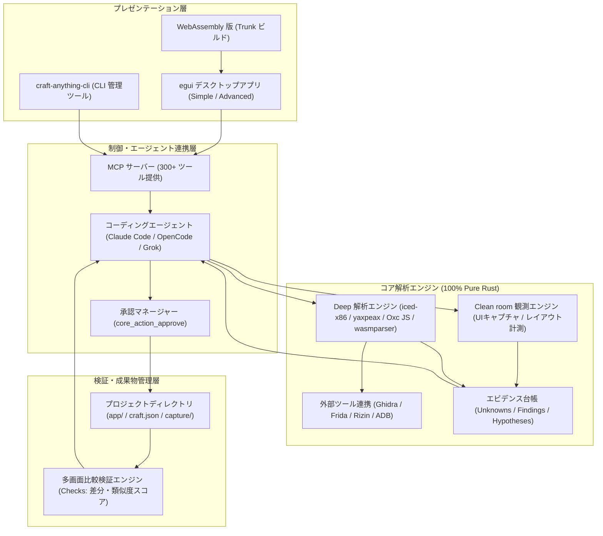

# **Craft Anything 調査レポート**

## **1. 基本情報**

* **ツール名**: Craft Anything
* **ツールの読み方**: クラフト エニシング
* **開発元**: ArtCraft Team（Storytold）
* **公式サイト**: [https://getartcraft.com/apps/craft-anything](https://getartcraft.com/apps/craft-anything)
* **関連リンク**:
  * GitHub: [https://github.com/storytold/craft-anything](https://github.com/storytold/craft-anything)
  * ドキュメント: [https://github.com/storytold/craft-anything/tree/main/docs](https://github.com/storytold/craft-anything/tree/main/docs)
  * Discord コミュニティ: [https://discord.gg/artcraft](https://discord.gg/artcraft)
* **カテゴリ**: 自律型コーディングエージェント
* **概要**: Craft Anything は、Webサイト、デスクトップアプリ、モバイルアプリ、ゲームなどの既存ソフトウェアの動作原理を調査し、ローカルのAIコーディングエージェント（Claude Code、OpenCode、Grok Build等）と協調して指定した技術スタックで新しいプロジェクトとして再構築するオープンソースのPure Rust製リバースエンジニアリング＆再実装エンジンである。内部ソースを読まずに外観観測情報からのみ仕様を抽出する「Clean room（クリーンルーム）」モードと、バイナリ解析やAST解析を行う「Deep（中まで解析）」モードを備え、300以上のMCP（Model Context Protocol）ツールを通じてエージェントによる自動生成と反復的な差分比較検証を実現する。

## **2. 目的と主な利用シーン**

* **解決する課題**:
  * 既存ソフトウェアやWebサービスの挙動を参考にして新規開発を行う際、手作業での仕様調査・リバースエンジニアリング・画面計測・コード書き起こしに膨大な工数がかかる課題
  * 著作権や企業機密を侵害することなく、機能やレイアウトのエッセンスを合法的に抽出して再実装したいというクリーンルーム開発の要求
  * AIコーディングエージェント単体では「元の仕様の正確な観測」「成果物とオリジナルの視覚的・機能的な比較検証」「自己修復ループ」を完結できないという自律性の限界
* **想定利用者**:
  * ソフトウェアエンジニア、フルスタックWeb開発者
  * セキュリティエンジニア、リバースエンジニアリング研究者
  * プロダクトデザイナー、デザインエンジニア、個人開発者（インディーゲーム開発者含む）
* **利用シーン**:
  * **Webサイト・Webアプリのクリーンルーム再実装**: 既存サイトのURLを指定し、レスポンシブなUIレイアウトや配色、コンポーネント構造を外観観測のみから抽出し、Next.jsやVue、Rust等のモダンスタックで忠実に再現する
  * **レガシーアプリ・プロトタイプの現代化**: 仕様書が散逸した社内デスクトップアプリやFlash/Electronアプリの画面挙動・バイナリを調査し、新規フレームワークへ移行する
  * **ゲームメカニクスのリバース＆再構築**: スネークゲーム等の既存ゲームの挙動やアセット仕様を調査し、Rust/BevyやGodot等のエンジン上で同一のゲームループを再作成する
  * **セキュリティ監査とエビデンス記録**: 不明なバイナリや通信フローを調査し、仮説（Hypotheses）・ファインディング（Findings）・未解明点（Unknowns）の台帳を作成してレポート化する

### **2.1 代表的な利用フロー**

```mermaid
swimlane-beta TB
  subgraph User["ユーザー"]
    A["ターゲットURLやアプリ情報と要望を入力"]
    E["コマンド実行やファイルアクセスの承認カードを確認"]
    H["完成版プレビューの確認と追加修正指示"]
  end
  subgraph Interface["Craft Anything (UI/CLI)"]
    B["プロジェクト初期化とモード判定 (Clean room / Deep)"]
    F["MCPサーバー起動と権限承認プロンプト管理"]
    G["成果物の実行プレビューと完了通知"]
  end
  subgraph CoreEngine["解析・検証エンジン"]
    C["対象の調査 (Study): 外観・レイアウト・構造のエビデンス収集"]
    D["成果物とオリジナルの自動比較検証 (Check: 類似度算出)"]
  end
  subgraph CodingAgent["AIコーディングエージェント"]
    I["MCP経由でエビデンスを参照しコード生成 (Build)"]
    J["Check差分スコアに基づきコードを反復修正 (Refine)"]
  end

  A --> B
  B --> C
  C --> I
  I --> F
  F --> E
  E --> I
  I --> D
  D --> J
  J --> G
  G --> H
```

## **3. 主要機能**

* **Clean room（外から観察）モード**: 元ソフトウェアのソースコード、プライベートファイル、内部スクリプトを一切読み取らず、ユーザーに見える画面スクリーンショット、計測されたDOM/レイアウト、配色、フォント、余白、メニュー開閉アニメーションなどの「外観観測データ」のみから仕様を抽出。著作権や知的財産権の侵害を防ぎながら再構築を推進する。
* **Deep（中まで解析）モード**: 私的利用や自社資産の解析向けに、Pure Rust製の組み込み逆アセンブラ、JavaScript AST解析器、Ghidra、Frida、Rizin、ADB連携をフル活用。バイナリ（x86/x64、ARM、WebAssembly）、.NET、Java、Android DEX、Electronアプリの深層構造を解析する。
* **自律エージェント連携（Builder）**: ローカルにインストールされた改変なしの `claude` プログラム（Claude Code）や OpenCode、Grok Build、DeepSeek Harness を子プロセスとしてヘッドレス実行。タスク指示とコンテキストを供給し、自動コーディングを行わせる。
* **300超の統合MCPツール群**: コア管理（`core`）、ネイティブバイナリ解析（`native`）、Web観測（`browser`）、JS/AST（`javascript`）、実行時デバッグ（`runtime`）、差分比較（`application`）など17ツールセットに及ぶ300超の機能を、CLIサブコマンドおよびMCPサーバー（`craft-anything-cli mcp`）としてエージェントに提供。
* **マルチ解像度・自動比較検証エンジン（Checks）**: 生成されたWebサイトやUIを3つの画面幅（モバイル、タブレット、デスクトップ）でレンダリングし、オリジナルのキャプチャとピクセル・構造単位で比較。類似度パーセンテージと不一致箇所のリストを生成してエージェントにフィードバックする。
* **厳格なセキュリティ・権限承認カード（Approvals）**: `--permission-prompt-tool` を介して、エージェントによるファイル書き込みや外部ネットワーク通信、シェルコマンド実行をインターセプト。プロジェクトフォルダ（`app/`）外の変更や危険なコマンドをブロックし、UI上のカードまたはCLIでワンクリック承認を要求する。
* **デュアルUI設計（Simple / Advanced Workbench）**: 初心者やアーティストでも直感的に4ステップ（Study → Build → Check → Ready）を進められる対話型ウィザード「Simpleモード」と、関数リスト、逆アセンブル、擬似Cコード、コールグラフ、16進ビュー、エビデンス台帳を完備したリバースエンジニアリング向け「Advancedモード」を1つのアプリに統合。
* **包括的なエビデンス台帳システム**: 調査過程で見つかった事実（Findings）、未解明事項（Unknowns）、仮説（Hypotheses）を構造化データとして台帳管理。Claudeなどのエージェントが推測ではなく裏付けのあるエビデンスに基づいて判断できるように支援する。

## **4. 動作原理・システム構成**

Craft Anything は、ローカルファーストかつ100% Rust（`unsafe_code = "forbid"`）で実装された高信頼・高セキュリティなアーキテクチャを採用している。外部サーバーへの依存を排し、全ての静的・動的解析をユーザーのローカル環境内で完結させる。



* **アーキテクチャ特性**:
  * **完全ローカル実行型**: 全てのソースコード解析、逆アセンブル、UIキャプチャ、エージェント制御はローカル端末上で動作し、解析対象バイナリやソースがサードパーティにアップロードされることはない。
  * **Pure Rust によるメモリ安全性**: コアエンジンは `unsafe_code = "forbid"` の厳格なリントの下で記述されており、バイナリ解析時のメモリ破壊脆弱性を根本から排除。
  * **MCP（Model Context Protocol）ネイティブ**: ツール群が標準規格であるMCPに準拠しているため、Anthropic Claude Codeだけでなく、OpenCode、Maki、Gemini CLIなどのMCPクライアントから容易に呼び出し可能。
* **プロジェクト成果物の構造**:
  * `craft.json`: プロジェクトのリクエスト、対象URL/パス、状態遷移、実行履歴のメタデータ
  * `capture/`: 観測対象から採取したスクリーンショット、DOM構造、アセット群
  * `app/`: エージェントが自律生成した再構築プロジェクトの実コード
  * `checks/`: オリジナルと成果物の各画面幅における差分比較結果、類似度レポート
  * `investigation.cany/`: エビデンス台帳（Findings、Hypotheses、Unknownsの永続化ファイル）
  * `inbox/`: エージェントからユーザーへの未回答の質問や承認待ちキュー

## **5. 開始手順・セットアップ**

* **前提条件**:
  * **OS**: macOS、Windows、Linux、FreeBSD
  * **Rust 環境**: Rust 1.97 以降（ソースからビルドする場合）
  * **ビルドエージェント**: サインイン済みの Claude Code（推奨。ターミナルで `claude auth login` を完了していること）または OpenCode / Grok Build
  * **Linux 依存パッケージ**（Debian/Ubuntu でGUIアプリをビルドする場合）:
    * `libxkbcommon-dev`, `libwayland-dev`, `libx11-dev`, `libxrandr-dev`, `libxi-dev`, `libgl1-mesa-dev`, `libgtk-3-dev`
* **インストール/導入**:

  **1. 公式リリースバイナリの取得（推奨）**:
  GitHub Releases（`https://github.com/storytold/craft-anything/releases/latest`）からOS向けのインストーラまたはポータブルアーカイブをダウンロードして展開する。

  **2. ソースコードからのビルド**:

  ```bash
  # リポジトリのクローン
  git clone https://github.com/storytold/craft-anything && cd craft-anything

  # デスクトップアプリのビルドと起動
  cargo run --release -p craft-anything

  # CLIツールのインストール
  cargo install --path apps/craft-anything-cli
  ```

  **3. 動作環境の自己診断（doctor）**:

  ```bash
  craft-anything-cli doctor
  ```
  ※ インストール状態、検出されたコーディングエージェント（Claude Code等）、外部エンジン（Ghidra等）の利用可能性が診断される。

* **最初のプロジェクト実行（CLI）**:

  ```bash
  # Webサイトの再構築
  craft-anything-cli rebuild https://example.com "Recreate this website with Tailwind CSS"

  # ゲームの新規作成（Clean room観察）
  craft-anything-cli rebuild - "A snake game in Rust" --rounds 1

  # 中まで解析モードでの実行
  craft-anything-cli rebuild /path/to/binary "Explain and recreate the core logic" --deep
  ```

## **6. 特徴・強み (Pros)**

* **革新的な「クリーンルーム再構築」アプローチ**: 著作権で保護されたコードを直接コピー＆ペーストするのではなく、人間が観察するのと同様に「外観・振る舞い・インターフェース」のみを計測・抽象化して再実装するため、ライセンスや知財の法的リスクを最小限に抑えたモダン化が可能。
* **100% Pure Rust による堅牢性と高速性**: C/C++製のリバースエンジニアリングツールにありがちなバッファオーバーフロー等の脆弱性がなく、極めて軽量かつ高速に動作。WebAssemblyへのコンパイルにも対応。
* **MCP による広範なコーディングエージェント互換性**: Claude Code を主軸としつつ、OpenCode、Grok Build、DeepSeek Harness、Maki 等の多様なエージェントやモデルに標準規格で接続可能。
* **自己修復・比較検証ループ（Checks）の自動化**: 単にコードを生成して終わるのではなく、複数画面幅でのレンダリング差分を自動計測し、目標の類似度に達するまでエージェントが自律的に修正を繰り返す。
* **非技術者向け Simple モードと研究者向け Advanced モードの両立**: 直感的なウィザード操作でアプリを作成したいクリエイターから、逆アセンブルやコールグラフを精査したいセキュリティ技術者まで、同一エンジンでカバーできる柔軟なUI設計。

## **7. 弱み・注意点 (Cons)**

* **初期アルファ版（early alpha / v0.6.0）段階の制約**: 2026年10月末に公開されたばかりのプロジェクトであり、仕様変更が頻繁に発生する。一部の高度な動的挙動検証や複雑なゲームロジックの再現にはエージェントの試行錯誤が必要。
* **ローカルコーディングエージェントの前提条件**: 完全自動再構築には Claude Code 等のローカルCLIエージェントのインストールと認証（AnthropicサブスクリプションまたはAPIキー）が必須であり、環境構築のハードルが一定程度存在する。
* **ディープ解析時の法的・倫理的配慮**: Deep モードではバイナリ逆コンパイルやスクリプト抽出が行われるため、解析対象の利用規約（EULA）やリバースエンジニアリング禁止条項、知的財産権に関するユーザー側のコンプライアンス順守が強く求められる。
* **大規模Webアプリケーションにおける動的ステート追跡の難易度**: 認証が必要な会員制サイトや、複雑なWebSocket・WebRTC通信を伴うリアルタイムアプリの場合、Clean room観測だけではバックエンドAPIの完全な再構築が困難な場合がある。

## **8. 料金プラン**

Craft Anything はデュアルライセンス（MIT License または Apache License 2.0）に基づく完全なオープンソースソフトウェアであり、ソフトウェア自体は無償で提供されている。

| プラン名 | ソフトウェア本体価格 | AI推論・APIコスト | 主な特徴・制限 |
|---------|--------------------|------------------|---------------|
| **Community (OSS / セルフホスト)** | **無料** ($0) | 利用者負担（Claude Code / 各種API実費） | ・全てのデスクトップ機能（Simple / Advanced）<br>・craft-anything-cli 及び MCP サーバー<br>・Clean room および Deep 解析モード<br>・コミュニティ（Discord / GitHub）サポート |
| **Managed Plan (計画中)** | 未定（ロードマップ記載） | ホステッド環境に含まれる予定 | ・クラウド上での並列解析・ビルド実行<br>・チーム共有エビデンス台帳<br>・ホステッド型検証ランタイム |

* **実質的な運用コスト（AI利用料）**:
  * Claude Code の実行に伴う Anthropic API コスト、または Claude Pro / Max プランの利用枠を消費する。
  * 画像生成（`assets_image_generate`）や3Dモデル生成（`assets_model_generate`）を利用する場合は、fal.ai などのAPIキー（オプトイン設定）が別途必要。

## **9. 導入実績・事例**

* **ArtCraft エコシステムにおけるメタ開発基盤**:
  開発元である Storytold の「The Craft App Suite」（EffectCraft、DesignCraft、FigCraft、WordCraft、SoundCraft、CADCraft、TextureCraft、MaterialCraft 等のクリエイティブデスクトップアプリ群）の開発・検証・相互運用ツールとして実戦投入されている。
* **コミュニティ事例**:
  * **クラシックゲームのモダンRust移植**: レトロなスネークゲームや電卓アプリの動作挙動を観測し、Bevyゲームエンジンやeguiネイティブアプリへの自律再実装に成功。
  * **Webサイト・コンポーネントのクリーンルーム再現**: 多様なランディングページや管理画面UIを対象に、Tailwind CSS + React への外観差分検証を伴う移行実験がDiscordコミュニティ内で多数報告されている。
  * **OSSコミュニティからの爆発的関心**: リポジトリ公開後わずか2週間足らずで GitHub Star が26,000件、Forkが5,300件を突破し、グローバルな開発者コミュニティで急速に検証が進められている。

## **10. サポート体制**

* **公式ドキュメント**: GitHubリポジトリ内の `docs/` 配下に、アーキテクチャ設計、ツール仕様（`docs/tools.md`）、Claude Code連携仕様（`docs/claude-code.md`）、ロードマップ（`docs/ROADMAP.md`）など詳細な文書が整備されている。
* **コミュニティ**: [ArtCraft Discord](https://discord.gg/artcraft) にて、開発チームおよび世界中の開発者・クリエイターとリアルタイムな意見交換、バグ報告、機能リクエストが可能。
* **Issue トラッキング**: GitHub Issues および Pull Requests を通じたオープンな開発体制。SonarCloud による品質スキャンおよび CodeRabbit による自動コードレビューが導入されている。

## **11. エコシステムと連携**

### **11.1 API・外部サービス連携**

* **AI コーディングエージェント統合**:
  * **Claude Code**: メインのビルダーとして緊密に統合。`claude -p` のヘッドレスストリーム実行、`--strict-mcp-config` によるツール供給、`--permission-prompt-tool` による安全制御を完全自動化。
  * **OpenCode / Grok Build / DeepSeek Harness**: 最新の v0.5.0 / v0.6.0 にてネイティブまたは ACP（Agent Client Protocol）経由でのツール提供に対応。
  * **AI Provider API**: Anthropic、OpenAI、OpenRouter、ローカルの OpenAI 互換サーバー（Ollama、vLLM 等）を質問・分析エンジンとして設定可能（Settings → AI）。
* **外部解析エンジン・デバッガ連携**:
  * **Ghidra**: ローカルにインストールされた Ghidra を自動検出し、Deep モードでの高度な逆コンパイルや解析プロジェクト管理を連携。
  * **Frida / Rizin**: 動的インスツルメンテーションおよびバイナリ解析ツールとの連携サブコマンドを提供。
  * **Android Debug Bridge (ADB)**: 接続された実機・エミュレータからのパッケージ解析、インテント起動、画面取得（24種類の専用ツール）。

### **11.2 技術スタックとの相性**

* **親和性の高いスタック**:
  * **言語**: Rust（コアエンジンとの完全な親和性）、TypeScript / JavaScript（Oxc パーサーによる高速AST解析）、HTML/CSS（DOM計測・差分比較）。
  * **UIフレームワーク**: egui（デスクトップ統合）、Tailwind CSS、React / Next.js、Vue（Webフロントエンドの再実装先として極めて優秀）。
  * **ゲームエンジン**: Bevy、Godot、Unity、Unreal Engine（ゲーム再構築ワークフローに対応）。

## **12. セキュリティとコンプライアンス**

* **ゼロトラスト権限管理（Action Approvals）**:
  エージェントが実行しようとする「ファイル書き込み」「シェルコマンド実行」「Webアクセス」「システム変更」を全てフックし、`core_action_approve` ツールを通じて制御。プロジェクトの `app/` 配下への安全な書き込みと一般的なビルドコマンド（`npm install`, `cargo build` 等）のみを事前許可し、破壊的変更や情報漏洩をUIカードで遮断する。
* **知財リスク低減（Clean room 保証）**:
  Clean room モード選択時は、エージェント自身のファイル読み取りツール（`Read`, `Glob`, `Grep`, `LS`）を明示的に無効化（`--disallowedTools`）し、対象ディレクトリのコードや内部構造へのアクセスを物理的に遮断。観測レイヤーのみを通じて得られた情報に基づきコードを生成するため、著作権侵害の法的リスクを低減する。
* **DRM・アンチチートの非回避方針**:
  公式方針として、DRM（著作権保護技術）、認証ログイン、アンチチート機構をバイパス・クラックする機能は意図的に排除されており、利用規約上正当な権限を持つ対象に対する調査のみを想定している。
* **認証情報の保護**:
  Claude Code等のエージェントはローカル端末の既存認証セッションをそのまま利用し、Craft Anything 自身がユーザーの資格情報やトークンを保持・転送することはない。

## **13. 操作性 (UI/UX) と学習コスト**

* **UI/UX の直感性**:
  * **Simple モード**: 「対象のURLまたはファイル」「作りたいもの」を入力して「Start」を押すだけで、進捗バーとともに「Study → Build → Check → Ready」の各段階が平易な言葉で進行。専門知識のないクリエイターでも迷わず利用できる。
  * **Advanced ワークベンチ**: `Ctrl+K`（または `Cmd+K`）のコマンドパレットから全300超のツールを呼び出し可能。関数エクスプローラー、逆アセンブル画面、疑似Cコードビューア、コールグラフが洗練されたダークテーマ（egui）で整理されている。
* **学習コスト**:
  * **基本操作**: Webサイトやシンプルなアプリの再構築であれば、CLIまたはSimpleモードで数分で開始でき、学習コストは極めて低い。
  * **高度なリバースエンジニアリング**: Deep モードでの逆アセンブル解析や Ghidra 連携、Frida スクリプトの活用には、低レイヤープログラミングやバイナリ解析の専門知識を要する。

## **14. ベストプラクティス**

* **効果的な活用法 (Modern Practices)**:
  * **まずは Clean room モードで小さく検証する**: 初回は Clean room モードで主要な画面レイアウトやボタン配置の再現から着手し、Check による画面類似度が80%以上になるまでエージェントに自律改善させる。
  * **`craft-anything-cli doctor` による定期的な環境診断**: エージェント（Claude Code）のバージョンやパス、各種依存ライブラリの整合性を `doctor` サブコマンドで確認してから作業を開始する。
  * **承認ポリシー（Approvals）の適切な設定**: 信頼できる既知のタスクでは `Auto` モードでビルドコマンドを自動承認し、未知の外部コードやスクリプトを扱う際は `Ask`（都度確認）に設定して安全を確保する。
* **陥りやすい罠 (Antipatterns)**:
  * **著作権侵害リスクのある素材の無分別な複製**: Clean room モードであっても、商標ロゴ、保護されたイラスト画像、著作権のあるテキストデータをそのまま生成コードに組み込まないよう、プロンプトで代替アセットの使用を明示すること。
  * **巨大な単一タスクの一括指示**: 「この巨大なECサイトの全機能を一度に作れ」というプロンプトはコンテキスト窓の枯渇やエージェントのループを招く。「ヘッダーとナビゲーションの作成」「商品カードグリッドの実装」のように段階的に指示を与えること。
  * **常駐型サーバープロセスの無許可実行**: `npm run dev` や Webサーバーの常駐プロセスをエージェントに直接実行させると、コマンドが終了せずエージェントの処理がハングアップするため、ビルドコマンド（`npm run build`）のみを実行させる。

## **15. ユーザーの声（レビュー分析）**

* **調査対象**: GitHub Discussions / Issues、X（旧Twitter）、Discord コミュニティ、Reddit
* **総合評価**: ★★★★☆ (4.3 / 5.0 相当 - 初期アルファ版として熱狂的な支持と期待)
* **ポジティブな評価**:
  * 「Pure Rust で書かれたリバースエンジニアリングワークベンチとしての完成度が驚くほど高い。GhidraやIDAを立ち上げなくても、MCP経由でAIがコードを読み解いてくれる。」
  * 「WebサイトのUIをクリーンルーム手法で観測し、Next.jsで再構築してくれる体験は魔法のようだ。Checks による画面類似度スコアが便利すぎる。」
  * 「Claude Code の公式な子プロセス実行＆MCPサーバー供給という連携アーキテクチャが極めて洗練されている。」
* **ネガティブな評価・改善要望**:
  * 「まだ初期アルファ（v0.6.0）のため、OS環境やClaude Codeのインストール場所によってパス解決のエラーが出ることがある。」
  * 「複雑なSPAサイトでJavaScriptによる遅延レンダリングが多用されている場合、Clean roomのキャプチャが一部欠落することがある。」
  * 「ゲームの挙動チェック機能がまだ実験的で、完璧な物理挙動の再現には人間の手によるプロンプトチューニングが不可欠。」

## **16. 直近半年のアップデート情報**

* **2026-11-09 (v0.6.0)**:
  * Unityバンドルのデータ領域内配置対応（R3.12）
  * Grok Build を ACP（Agent Client Protocol）経由のコーディングエージェントとして提供開始（R2.2）
  * プロジェクトごとにアクション種別（コマンド、ファイル、Web等）の承認制御を設定可能にする `/approvals` メニューを追加（R2.9）
  * DeepSeek Harness タスクの標準入力連携および専用ツールサーバー名の付与
  * Ghidra 逆コンパイラが存在しない環境での事前検知および解析ロック処理の安全性向上
* **2026-11-06 (v0.5.0)**:
  * OpenCode ネイティブ実行時における Craft Anything ツール群の提供とツール呼び出しの可視化
  * Advanced コンソールのプロンプトボックス初期高さを3行へ拡張
  * メディアプレイヤーがゲームとして誤判定される問題の修正
  * 多言語UIカタログの拡充（タイ語、ジョージア語等）
* **2026-11-06 (v0.4.0)**:
  * Maki コーディングエージェント連携の追加（ACP および 単一メッセージ実行）
  * Claude の推論強度（thinking effort）を `xhigh` および `max` まで設定可能に拡張（Settings → AI および CLI）
  * ARM32 疑似Cコードにおける戻り値レジスタ（r0）保持ロジックの改善
  * 先頭にコメントを含む GraphQL ドキュメントの読み取り不具合修正
* **2026-11-02 (v0.3.0)**:
  * 大規模な `.utoc` 解析時のメモリ枯渇不具合を修正
  * Windows 環境における実行ファイル Shim 検出の堅牢化
  * WinGet 経由でインストールされた Claude Code の自動検出ロジック追加
  * macOS 版アプリケーションパッケージ内に `craft-anything-cli` を標準同梱
* **2026-11-01 (v0.2.0)**:
  * macOS Dock から起動した際の Claude Code 実行パス解決の修正
  * エージェント実行失敗時の詳細ログ保存機能と、中断箇所から再開できる「Try again」機能の実装
  * プロセス監視におけるデッドロック防止機構の導入
* **2026-10-31 (v0.1.0)**:
  * 初回パブリックリリース。Pure Rust製コアエンジン、eguiデスクトップアプリ、CLI、MCPサーバーの基本機能を公開。

## **17. 類似ツールとの比較**

### **17.1 機能比較表 (星取表)**

| 機能・観点 | Craft Anything | Claude Code | OpenCode | GitReverse |
|-----------|----------------|-------------|----------|------------|
| **主用途** | 調査・自律再構築・RE | 自律コーディング | オープンソースエージェント | プロンプト逆生成 |
| **提供形態** | デスクトップGUI / CLI / MCP | ターミナルCLI | デスクトップ / CLI / IDE | Web / CLI |
| **ライセンス** | オープンソース (MIT/Apache-2.0) | プロプライエタリ | オープンソース (Apache-2.0) | オープンソース / SaaS |
| **Clean room 観測** | **◎ (外観・レイアウト計測)** | × (非対応) | × (非対応) | △ (Web要素抽出) |
| **バイナリ解析・RE** | **◎ (300+ツール・Pure Rust)** | × (非対応) | × (非対応) | × (非対応) |
| **外部RE連携 (Ghidra等)** | **◎ (標準サポート)** | × (非対応) | × (非対応) | × (非対応) |
| **マルチ画面自動比較 (Checks)** | **◎ (3画面幅レンダリング差分)** | × (非対応) | × (非対応) | × (非対応) |
| **ビルダーエージェント内蔵** | ◯ (Claude Code/Grok等を駆動) | **◎ (最高性能のコード生成)** | ◯ (マルチLLM対応) | × (プロンプト出力のみ) |
| **アクション承認制御** | **◎ (きめ細かな承認カード)** | ◯ (ターミナル対話) | ◯ (GUI/CLI承認) | - (読み取り専用) |
| **メモリ安全性 (Pure Rust)** | **◎ (unsafe禁止のRust実装)** | - (TypeScript / Node.js) | - (TypeScript / Go) | - (TypeScript / Python) |

### **17.2 詳細比較**

| ツール名 | 特徴 | 強み | 弱み | 選択肢となるケース |
|---------|------|------|------|------------------|
| **Craft Anything** | ソフトウェア調査からAI自律再構築までをPure Rustで完結するメタエンジン | クリーンルーム観測、300超のMCPツール、マルチ画面差分比較による自己修復 | 初期アルファ版であり、Claude Code等の外部エージェント環境が必要 | 既存のWebやアプリ、ゲームを参考にしてゼロから合法的に新スタックで再構築したい場合 |
| **Claude Code** | Anthropic公式の高性能自律型ターミナルコーディングエージェント | 最高峰の推論・コーディング能力、大規模コードベースの把握 | リバースエンジニアリング機能や外観比較検証エンジンは非搭載 | 通常のソフトウェア開発、リファクタリング、バグ修正をターミナルから自律実行したい場合 |
| **OpenCode** | 多様なLLMプロバイダに対応したオープンソースのAIコーディングエージェント | ローカルモデル（Ollama等）対応、プライバシー重視、オープン性 | リバースエンジニアリング特化のツール群やクリーンルーム検証はない | クラウドAPI依存を避け、完全なローカルモデルや多様なLLMでコーディング支援を受けたい場合 |
| **GitReverse** | 既存リポジトリやWebサイトからプロンプト仕様書を逆生成するワークフローツール | CursorやClaude向けのプロンプト設計に特化し、導入が容易 | コード生成や差分比較検証のループ自体は行わず、バイナリ解析も非対応 | 既存コードの仕様把握やAI向けプロンプト作成だけを手軽に行いたい場合 |

## **18. 総評**

* **総合的な評価**:
  Craft Anything は、単なる「AIコード生成ツール」の枠を超え、**「ソフトウェアのリバースエンジニアリング（調査・解析）と、AIエージェントによるクリーンルーム再構築（生成・検証・洗練）を直結させた画期的な開発プラットフォーム」**である。100% Pure Rust による堅牢なバイナリ・Web解析基盤を持ち、300以上の機能をMCPサーバーとしてClaude Codeなどの外部エージェントに提供することで、「調査エビデンスに基づく確実なコード生成」と「複数画面幅でのレンダリング差分比較（Checks）による自律的修復」を実現している。著作権に配慮したClean roomモードと、徹底的な内部解析を行うDeepモードの分離も実用的である。
* **推奨されるチームやプロジェクト**:
  * レガシーシステムや仕様書のない社内ツールをモダンな言語・フレームワークへ移植したい開発チーム
  * 競合WebサービスやUIデザインの構造・レイアウトを参考にしつつ、知財リスクを回避して自社版を構築したいスタートアップ
  * バイナリ解析やセキュリティ監査業務に最新のAIエージェントとMCPツールを導入したいリバースエンジニア
  * ゲームのプロトタイプやクラシックメカニクスをRust/BevyやGodotで迅速に再現したいゲーム開発者
* **選択時のポイント**:
  純粋なコーディング支援のみを求める場合は Claude Code や OpenCode を単体で利用する方がセットアップはシンプルである。しかし、「既存のWebサイト、アプリ、ゲームを観察・解析し、その振る舞いを指定スタックで忠実に再現・再構築したい」という目的がある場合、Craft Anything のクリーンルーム観測エンジンと自動差分検証ループは唯一無二の強力な武器となる。
