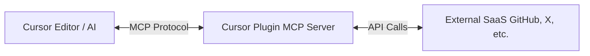

# **Cursor Plugins 調査レポート**

## **1. 基本情報**

* **ツール名**: Cursor Plugins
* **ツールの読み方**: カーソルプラグイン
* **開発元**: Cursor
* **公式サイト**: https://github.com/cursor/plugins
* **関連リンク**:
  * GitHub: https://github.com/cursor/plugins
* **カテゴリ**: 開発者ツール
* **概要**: Cursor AIエージェントのための公式プラグイン群を提供するオープンソースのリポジトリ。MCP (Model Context Protocol) サーバーやスキル定義を含んでおり、多数の開発ツール、フレームワーク、SaaS製品と連携するための仕様および実装を公開している。

## **2. 目的と主な利用シーン**

* **解決する課題**: AIエディタが外部システムやSaaSと連携できず、閉じた環境でのみ動作するという制限を解消する。
* **想定利用者**: Cursorを使用する開発者、AI連携機能を追加したいユーザー。
* **利用シーン**:
  * GitHub, Salesforce, Google Workspace等のSaaSのデータをAIで読み取ってコードを書く。
  * MCPサーバーを通じて独自の社内ツールや外部APIとCursorを連携させる。
  * 新しいCursorプラグインを独自に作成するための参考実装として活用する。

## **3. 主要機能**

* **MCPサーバーの統合**: 各SaaS・ツールごとに `mcp.json` などのMCPサーバー定義を提供し、Cursorエージェントが利用できるようにする。
* **各種SaaS連携プラグイン**: Google Workspace, Salesforce, GitHub, Zoom, X, Slackなど多数のSaaSサービスとの連携プラグインを標準搭載している。
* **独自のスキルとルール定義**: プラグインごとに `skills/` や `rules/` (.mdcファイル) などのエージェントスキルとルールを定義し、タスクの実行手順を細かく制御できる。
* **Agent Compatibility**: エージェントがCLIやバリデーションを監査・連携するための `agent-compatibility` 等の開発ツールを提供する。
* **プラグイン仕様の公開**: `.cursor-plugin/plugin.json` などの独自プラグイン開発のためのマニフェストと仕様を提供する。

## **4. 動作原理・システム構成**

* **アーキテクチャ**: ローカルファーストのクライアント・サーバー構成（CursorクライアントとMCPサーバーによる連携アーキテクチャ）。
* **主要コンポーネントとデータフロー**:
  * **Cursor Client**: ユーザーが操作し、AIのプロンプトを入力するエディタ本体。
  * **MCP Servers**: 各プラグインごとにMCPサーバーが起動し、SaaSや外部ツールのAPIと通信する。
  * **データフロー**: AIエージェントがプラグインのスキルに基づきMCPプロトコルを利用して外部のMCPサーバーに問い合わせ、その結果をプロンプトコンテキストに統合する。
* **特筆すべき要素技術**:
  * **Model Context Protocol (MCP)**: 外部ツールとの統一された通信インターフェース。
  * **マニフェストファイル (.cursor-plugin)**: `plugin.json` や `marketplace.json` によってプラグインのメタデータとスキルを管理する仕組み。



## **5. 開始手順・セットアップ**

* **前提条件**:
  * Cursorのインストール。
  * 連携先サービスのアカウントやAPIキーが必要な場合がある。
* **インストール/導入**:

  ```bash
  git clone https://github.com/cursor/plugins.git
  ```

* **初期設定**:
  * 各プラグイン（例: `github`, `x`, `google-drive`）ディレクトリ内のREADME等に従い、API認証の設定を行う。
* **クイックスタート**:
  * Cursorの機能を通じてMCPサーバーやプラグインを読み込ませる。

## **6. 特徴・強み (Pros)**

* 圧倒的な数のSaaSとサードパーティツールの連携が標準で提供されている。
* GitHub上のオープンソースとして公開されているため、実装の透明性が高く、自作プラグイン作成の参考にできる。
* Cursor本体と密接に連携するよう設計されており、エージェントワークフロー (`pstack`, `thermos` など) の深いカスタマイズが可能。

## **7. 弱み・注意点 (Cons)**

* 各種SaaSとの連携には外部APIの設定や認証情報の管理が各自必要になる場合がある。
* オープンソースプロジェクトのため、開発スピードが速く仕様が頻繁に変わる可能性がある。
* 日本語対応の公式ドキュメントは提供されていない（GitHub上の仕様書と実装は英語）。

## **8. 料金プラン**

| プラン名 | 料金 | 主な特徴 |
|---------|------|---------|
| **無料プラン** | 無料 | オープンソース (MIT License) で利用可能。※利用するSaaS側での利用料金は別途発生する場合あり |

* **課金体系**: なし (OSS)
* **無料トライアル**: なし

## **9. 導入実績・事例**

* **導入企業**: オープンソースのため具体的な導入企業は非公開だが、多くのCursorユーザーが利用している。
* **導入事例**: 個人開発者やAIエンジニアによるCursor上でのツール連携の仕組み構築に利用されている。
* **対象業界**: ソフトウェア開発、ITサービス、AI研究等。

## **10. サポート体制**

* **ドキュメント**: GitHubリポジトリのREADMEと各プラグインのディレクトリ内のドキュメント。
* **コミュニティ**: GitHubのIssue/Pull Requestを利用したコミュニティドリブンな開発。
* **公式サポート**: サポート窓口の種類: GitHub Issues / 対応言語: 英語

## **11. エコシステムと連携**

### **11.1 API・外部サービス連携**

* **API**: MCP (Model Context Protocol) を利用。
* **外部サービス連携**: Google Workspace (Gmail, Drive, Docs), Microsoft Teams, Salesforce, HubSpot, X (Twitter), Zoom, Playwright, GitHubなど多数。

### **11.2 技術スタックとの相性**

| 技術スタック | 相性 | メリット・推奨理由 | 懸念点・注意点 |
|:---|:---:|:---|:---|
| **Cursor Editor** | ◎ | ネイティブ互換の公式リポジトリ | 特になし |
| **Model Context Protocol (MCP)** | ◎ | MCPプロトコルベースで構築されている | 仕様変更への追随が必要 |

## **12. セキュリティとコンプライアンス**

* **認証**: 各SaaSのAPIキーやOAuth等を利用して接続。
* **データ管理**: データはローカルのCursorクライアントと指定のMCPサーバー間で処理される。
* **準拠規格**: オープンソースライブラリであり、コンプライアンス要件は利用者が構築する環境や接続先SaaSに依存する。公式サイトで特定の認証取得は公開されていない。

## **13. 操作性 (UI/UX) と学習コスト**

* **UI/UX**: Cursorエディタ内にシームレスに統合されるため、UIはCursorのAIチャットやプロンプトに依存する。
* **学習コスト**: プラグインの利用者としての学習コストは低いが、独自のMCPサーバーやプラグインを開発する場合は、仕様を理解するための学習が必要。

## **14. ベストプラクティス**

* **効果的な活用法 (Modern Practices)**:
  * 公式リポジトリの `create-plugin` ディレクトリを活用して新しいエージェントプラグインの足場を作る。
  * `thermos` や `pstack` などの開発ツールカテゴリのプラグインを利用して、並行処理や厳格なコードレビューワークフローを導入する。
* **陥りやすい罠 (Antipatterns)**:
  * 古いMCP仕様に基づいてプラグインを実装すると、エージェントとの連携が失敗する可能性がある。

## **15. ユーザーの声（レビュー分析）**

* **調査対象**: GitHub (Star/Fork)
* **総合評価**: 13.3k Stars (GitHub)
* **ポジティブな評価**:
  * 多様なSaaSとの連携を素早く実装するための公式リファレンスとして非常に有用。
  * MCPの採用により、拡張性の高さが評価されている。
* **ネガティブな評価 / 改善要望**:
  * G2、Capterra、ITreviewにレビューの登録なし。オープンソースのため、一般的なSaaSレビューサイトでの評価は限定的。
* **特徴的なユースケース**:
  * X (Twitter) APIを用いた投稿自動化や、Google BigQueryを用いた分析クエリの自動生成などのエージェント開発に利用。

## **16. 直近半年のアップデート情報**

* **2026-10-20**: XプラグインにSpaces, Communities, Lists機能が追加され、関連するMCPガイドが再構築された。Jobberプラグインがサードパーティとして追加された。
* **2026-10-20**: Xプラグインのガイドが更新され、無料ツール群やPINの保存の動作改善が行われた。

(出典: [GitHub Commits](https://github.com/cursor/plugins/commits/main) )

## **17. 類似ツールとの比較**

### **17.1 機能比較表 (星取表)**

| 機能カテゴリ | 機能項目 | Cursor Plugins | Cline | GitHub Copilot Extensions |
|:---:|:---|:---:|:---:|:---:|
| **基本機能** | MCPサーバー連携 | ◎<br><small>ネイティブ統合、多数提供</small> | ◯<br><small>MCP対応可能</small> | △<br><small>独自の拡張基盤</small> |
| **連携数** | サードパーティ連携 | ◎<br><small>広範なSaaSや開発ツール</small> | ◯<br><small>対応可能だが個別のMCP設定が必要</small> | ◯<br><small>GitHubエコシステム中心</small> |
| **拡張性** | 独自ルールの定義 | ◎<br><small>skillsやrulesでの詳細定義</small> | ◯<br><small>プロンプトによる指示</small> | △<br><small>制限あり</small> |
| **非機能要件** | 日本語対応 | △<br><small>英語ドキュメントのみ</small> | △<br><small>コミュニティレベル</small> | ◯<br><small>公式ドキュメントあり</small> |

### **17.2 詳細比較**

| ツール名 | 特徴 | 強み | 弱み | 選択肢となるケース |
|---------|------|------|------|------------------|
| **Cursor Plugins** | Cursor専用のプラグイン群 | Cursorエディタでの最適化、多彩なSaaSとのMCP連携 | 他エディタでは使えない | Cursorをメインエディタとして使っている場合 |
| **Cline** | VS Code拡張機能のAIエージェント | 様々なモデルの切り替えやMCPサーバーの利用が可能 | UIがVS Codeのサイドバーに依存 | VS Code上で柔軟にエージェントを構築したい場合 |
| **GitHub Copilot Extensions** | GitHub Copilotの拡張 | GitHubのサービスとの強力な連携 | 外部SaaSの自由な連携には開発が必要 | GitHubエコシステムにロックインされている場合 |

## **18. 総評**

* **総合的な評価**:
  * CursorのAIエージェントをただのコードジェネレーターから、日常業務や他のSaaSデータを組み合わせた包括的なアシスタントへと昇華させるための強力な連携機能群。オープンソースで仕様が公開されている点も、開発者コミュニティにとって大きなメリットである。
* **推奨されるチームやプロジェクト**:
  * Cursorを利用しているすべての開発チーム。特に外部SaaS (GitHub, Salesforce, X, Google Workspace等) のデータと連動してコード生成や業務自動化を行いたいチームに最適。
* **選択時のポイント**:
  * Cursorの能力を最大限に引き出すためには必須と言えるプラグイン群であり、公式の豊富なサンプルは自作MCPサーバー実装の強力なリファレンスとなる。
