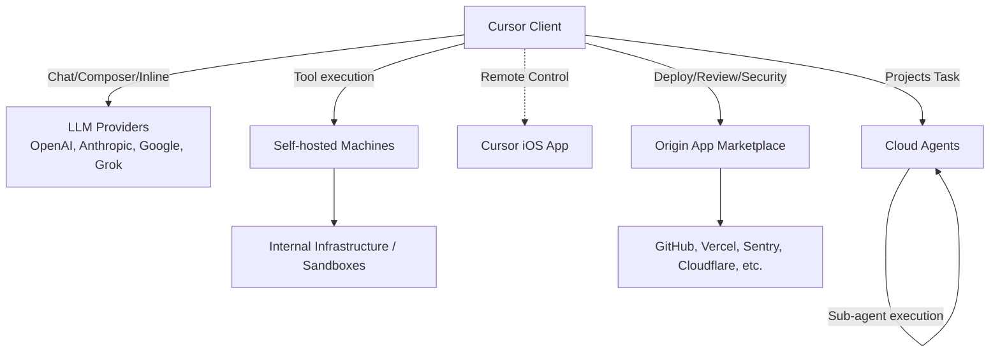

# **Cursor 調査レポート**

## **1. 基本情報**

* **ツール名**: Cursor
* **ツールの読み方**: カーソル
* **開発元**: Anysphere, Inc.
* **公式サイト**: [https://cursor.com/](https://cursor.com/)
* **関連リンク**:
  * ドキュメント: [https://cursor.com/docs](https://cursor.com/docs)
* **カテゴリ**: AIコードエディタ
* **概要**: Cursorは、AIとの協調を前提に設計された次世代のコードエディタです。広く普及しているVisual Studio Code (VS Code) のフォークをベースにしており、使い慣れた開発環境に、コードベース全体を理解する強力なAI機能を深く統合しています。

## **2. 目的と主な利用シーン**

* **解決する課題**: 従来のAIコーディングツールが持つ、コードベース全体の文脈理解の欠如や、エディタとの連携の浅さを解消し、開発ワークフロー全体を高速化する。
* **想定利用者**: 最新のAI技術を活用して開発効率を最大化したい個人開発者から、チーム全体の生産性向上を目指す企業まで幅広く利用される。
* **利用シーン**:
  * 大規模なコードベースのリファクタリングや機能追加
  * 新しいライブラリやフレームワークの迅速なキャッチアップ
  * コードの自動生成、デバッグ支援、テストコード作成
  * 自然言語での指示による、ファイル横断的なコード編集
  * PRのレビューやドキュメント作成の自動化

## **3. 主要機能**

* **AIチャット**: エディタ内でAIと対話し、コードの生成、修正、デバッグを依頼可能。`@`シンボルで特定のファイルやシンボルをコンテキストに含めることができる。
* **インライン編集 (Cmd/Ctrl + K)**: 自然言語の指示により、既存のコードをその場で直接編集・生成する。
* **Composer (Cmd/Ctrl + I)**: 複数のファイルを同時に作成・編集できる機能。プロジェクト全体にわたる変更を一括で適用可能。
* **コードベース全体への理解**: プロジェクト全体のファイルをインデックス化し、依存関係や構造を理解した上で、ファイル横断的なコード生成・修正を行う。
* **Projects機能**: 数か月にわたる作業のコンテキストを維持し、数千のサブエージェントにタスクを委譲して並行作業を行う。クラウド上の独立したコンピューターで実行されるため、ローカルPCを閉じても作業が継続する。
* **Remote Control**: Cursor iOSアプリからローカルで実行中のエージェントを確認し、やり取りができる機能。
* **Self-hosted machines**: コードベースやシークレット情報を社内ネットワーク内に留めたまま、セルフホストのインフラ上でエージェントにツール呼び出しを実行させる機能。AWS LambdaやVercelなどのサンドボックスでも実行可能。
* **Rollouts & Security Review**: PR作成時に変更を展開して各環境でのヘルス状態（正常、リグレッション等）を監視するRollouts機能、およびPR上の脆弱性を検出するSecurity Review機能。
* **モデル選択の柔軟性**: OpenAI(GPT-4o), Anthropic(Claude 3.5 Sonnet), Google(Gemini 1.5 Pro)に加え、Grokモデルへのアクセスもサポートし、最新・最強のLLMを切り替えて利用可能。

## **4. 動作原理・システム構成**

* **アーキテクチャ**: ローカルクライアント（VS Codeフォーク）とクラウド上のエージェントインフラストラクチャを組み合わせたハイブリッド構成。
* **主要コンポーネントとデータフロー**:
  * ローカルクライアントはコード編集とインデックス作成を行い、必要なコンテキストを抽出してAIモデルに送信する。
  * Cloud Agents（Projectsなどの実行用）はクラウド上で独自のコンテキスト（ファイル群）を維持し、ローカルやクラウドのリソースを使って並行処理を行う。
  * Self-hosted machinesを利用することで、特定の処理やツール実行をクラウドに送信せず、自社ネットワーク内のワーカープールで安全に処理することができる。
* **特筆すべき要素技術**:
  * Origin APIを通じた拡張アプリとの連携。
  * マルチエージェントによる動的なタスクスケジューリングとコンテキスト共有。



## **5. 開始手順・セットアップ**

* **前提条件**:
  * OS: macOS, Windows, Linux
  * アカウント: GitHubアカウントまたはGoogleアカウント、Eメールでのサインアップが可能
* **インストール/導入**:
  公式サイトからインストーラーをダウンロードして実行します。

  ```bash
  # macOS (Homebrewを使用する場合)
  brew install --cask cursor
  ```

* **初期設定**:
  1. インストール後の初回起動時に、VS Codeの設定、拡張機能、キーバインドをワンクリックでインポート可能。
  2. `cursor` コマンドをCLIにインストール（コマンドパレットから `> Install 'cursor' command`）。
* **クイックスタート**:
  * エディタを開き、`Cmd+L` (または `Ctrl+L`) でチャットパネルを開く。
  * `Cmd+K` (または `Ctrl+K`) でエディタ内で直接AIに指示を出し、コードを生成させる。

## **6. 特徴・強み (Pros)**

* **VS Codeベースの優れたUX**: 既存のVS Codeユーザーが、使い慣れたキーバインド、テーマ、拡張機能をほぼそのまま利用でき、学習コストが極めて低い。
* **深いコードベース理解**: 単一ファイルだけでなく、プロジェクト全体の文脈を理解するため、リポジトリ全体にまたがる複雑な変更やリファクタリングにも対応できる。
* **高度なAIエージェント機能**: 単純なコード補完に留まらず、自律的なエージェントが計画を立て、ブラウザ操作やコマンド実行を伴う複雑なタスクを遂行できる。
* **開発ワークフロー全体の支援**: CLI連携、デバッグ支援、コードレビュー機能など、コーディングだけでなく開発プロセス全体をカバーするエコシステムを構築している。

## **7. 弱み・注意点 (Cons)**

* **パフォーマンス**: AI機能、特にインデックス作成やエージェント実行時に、マシンのリソースを消費し、エディタの動作が遅くなる場合がある。
* **料金**: GitHub Copilotなど他のAIコーディング支援ツールと比較すると、基本的な有料プランの月額料金が高めに設定されている。
* **料金プランの複雑化**: 利用量に応じた複数の上位プラン（Pro, Pro+, Ultra）があり、自身の利用量に最適なプランを選択するのが難しい場合がある。
* **日本語対応**: UIは日本語化されているが、AIモデルの日本語での指示理解や生成精度は、英語に劣る場合がある。

## **8. 料金プラン**

| プラン名 | 料金 | 主な特徴 |
|---------|------|---------|
| **Free** | 無料 | 基本的なAIチャットと限られたエージェントリクエスト。 |
| **Plus** | $8/月 | Cursor、Grok Chat/Voice/Imagine/BuildおよびGrok APIへのアクセス。AI利用量のプールを共有。 |
| **Premium** | $30/月 | Plusの4倍の利用量。最新のGrokモデル、クラウドエージェント、Originを介したコードホスティング、AIコードレビュー。サードパーティモデルはAPIリスト価格で利用可能。 |
| **Super** | $100/月 | Plusの15倍の利用量。ピーク時における優先アクセス。 |
| **Ultra** | $200/月 | Plusの50倍の利用量。全製品およびモデルへの最速アクセス。 |
| **Teams** | $30+/ユーザー/月 | プールされた利用量。集中請求、チーム全体のプライバシー設定、SAML/OIDC SSOなど。 |
| **Enterprise** | カスタム | 請求書払い、SCIM管理、高度な監査ログやネットワーク制御などの高度なセキュリティ機能。 |

* **課金体系**: ユーザー単位の月額サブスクリプション（X Subscription Corp経由での提供）。
* サードパーティモデル（OpenAI、Anthropic、Googleなど）はPremiumプラン以上であっても使用量に応じてAPIリスト価格で別途請求される。

## **9. 導入実績・事例**

* **導入企業**: 公式サイトによると、Fortune 500の半数以上の企業で利用されている。Stripe, OpenAI, Datadog, Figma, Adobeなどの先進的なテクノロジー企業が名を連ねる。
* **導入事例**: Stripe社CEOのPatrick Collison氏は「Stripeの従業員の間で爆発的に広がり、最高の開発者は皆Cursorを使っている」とコメントしており、トップレベルの開発現場で支持されていることがわかる。
* **対象業界**: ソフトウェア開発、AI研究、Webサービスなど、高度なコーディングが必要とされるあらゆる業界。

## **10. サポート体制**

* **ドキュメント**: [公式ドキュメント](https://cursor.com/docs)が整備されており、機能の詳細や使い方を確認できる。
* **コミュニティ**: [Discordサーバー](https://cursor.com/community)や[公式フォーラム](https://forum.cursor.com/)には活発なコミュニティがあり、ユーザー同士での情報交換や開発者へのフィードバックが行われている。
* **公式サポート**: Teamsプラン以上で、優先的なEメールサポートが提供される。

## **11. エコシステムと連携**

### **11.1 API・外部サービス連携**

* **API**: 外部ツール連携のためのMCP (Model Context Protocol) をサポートしており、カスタムツールをAIエージェントに提供可能。また、Origin APIを通じてアプリ連携が可能。
* **外部サービス連携**:
  * **Origin App Marketplace**: デプロイ(Cloudflare, Vercel等)、CI(CircleCI等)、コードレビュー(CodeRabbit等)、セキュリティ(Sentry, Socket Security等)、プロジェクト管理(Linear等)など、20以上のアプリと連携。一般にも公開され、サードパーティがアプリを提供可能。
  * **GitHub**: PRの自動レビュー、要約生成、エージェントによる修正など、GitHubワークフローと深く連携する`Bugbot`機能を提供。
  * **VS Code拡張機能**: VS Codeの豊富な拡張機能エコシステムをそのまま利用可能。

### **11.2 技術スタックとの相性**

| 技術スタック | 相性 | メリット・推奨理由 | 懸念点・注意点 |
|:---|:---:|:---|:---|
| **TypeScript / JavaScript** | ◎ | 文脈理解が非常に深く、型定義やインポートの自動修正が強力。 | 特になし。 |
| **Python** | ◎ | データサイエンスやWeb開発において、ライブラリの使用法を含めた的確な提案が可能。 | 特になし。 |
| **Rust / Go** | ◯ | 静的型付け言語の構造をよく理解し、ボイラープレートの削減に貢献。 | 非常に複雑なマクロやジェネリクスで稀に誤提案がある。 |
| **Flutter / React Native** | ◯ | UI構築のコード生成が得意。 | シミュレーター連携などは別途設定が必要。 |

## **12. セキュリティとコンプライアンス**

* **認証**: SSO (SAML/OIDC) に対応 (Teamsプラン以上)。
* **データ管理**: チーム管理者が組織全体でプライバシーモードを強制でき、コードがモデル学習に使用されるのを防げる。AIが実行するコマンドはサンドボックス化され、安全性が確保されている（macOSおよびLinuxに対応）。Enterpriseプランでは、より詳細な監査ログやネットワーク制御も提供される。
* **準拠規格**: SOC 2 Type II、ISO27001、ISO42001、および AIUC-1 認証を取得している。

## **13. 操作性 (UI/UX) と学習コスト**

* **UI/UX**: VS Codeとほぼ同じUI/UXを提供しており、非常に直感的で使いやすい。既存のVS Codeユーザーであれば、迷うことなく操作できる。
* **学習コスト**: VS Codeの経験があれば、学習コストはほぼゼロ。AI機能のプロンプトや使い方に慣れる時間は必要だが、基本的な操作はすぐに習得できる。

## **14. ベストプラクティス**

* **効果的な活用法 (Modern Practices)**:
  * **.cursorrulesの活用**: プロジェクトルートに `.cursorrules` ファイルを作成し、AIに従わせたいコーディング規約や振る舞いを記述することで、生成コードの品質を均一化する。
  * **Composerによるマルチファイル編集**: 大規模なリファクタリングや機能追加時は、チャットではなく `Cmd+I` (Composer) を使い、依存関係のある複数ファイルを一括で編集させる。
  * **@Symbolsの活用**: `@Files`, `@Codebase`, `@Docs` などを使い分け、AIに必要なコンテキストを明示的に与えることで回答精度を上げる。
* **陥りやすい罠 (Antipatterns)**:
  * **コンテキスト過多**: 必要以上のファイルを `@` で読み込ませると、トークン消費が増えるだけでなく、AIが混乱して回答精度が下がることがある。
  * **盲目的な適用**: AIが生成したコードをレビューせずに適用すること。特にセキュリティに関わる部分は人間による確認が必須。

## **15. ユーザーの声（レビュー分析）**

* **調査対象**: G2, 公式フォーラム, 各種技術ブログ
* **総合評価**: 4.7/5.0 (G2)
* **ポジティブな評価**:
  * 「コードベース全体を理解してくれるため、ファイル横断的な質問やリファクタリングが非常に簡単になった」
  * 「Cmd+Kでのインライン編集は、一度使うと元に戻れないほど生産性が上がる」
  * 「VS Codeの環境をそのまま引き継げるので、移行のハードルが全くなかった」
* **ネガティブな評価 / 改善要望**:
  * 「AI機能を使うと、時々動作が重くなることがある」
  * 「GitHub Copilotに比べて価格が高いのがネック」
  * 「Vimキーバインドのサポートが不完全で、一部の操作が機能しないことがある」
* **特徴的なユースケース**:
  * 大規模なレガシーコードの解析やドキュメント作成に活用し、キャッチアップ時間を大幅に短縮した事例。

## **16. 直近半年のアップデート情報**

* **2026-10-13**: Origin App Marketplaceが公開され、Cloudflare、Linear、Sentryなどの連携アプリが利用可能に。サードパーティによるアプリの公開もサポート。
* **2026-10-06**: ローカルで実行中のエージェントをCursor iOSアプリから監視・操作できるRemote Control機能をリリース。
* **2026-09-23**: デプロイメントを監視するRollouts機能と、PRの脆弱性を報告するSecurity Review機能をリリース（Teams/Enterprise向け）。
* **2026-09-10**: 大規模なタスクを多数のクラウドサブエージェントに委譲し、コンテキストを共有して並行実行するProjects機能をリリース。
* **2026-09-02**: 社内インフラやサンドボックス環境でエージェントによるツール実行を安全に行うためのSelf-hosted machinesをサポート。動的ワーカープールのスケジューリング機能も導入。
* **2026-05-07**: 「Security Reviewer」と「Vulnerability Scanner」のセキュリティ関連機能を追加。

(出典: [Cursor Changelog](https://cursor.com/changelog))

## **17. 類似ツールとの比較**

### **17.1 機能比較表 (星取表)**

| 機能カテゴリ | 機能項目 | 本ツール (Cursor) | GitHub Copilot | Devin Desktop | VS Code |
|:---:|:---|:---:|:---:|:---:|:---:|
| **基本機能** | エディタ統合 | ◎<br><small>完全統合</small> | ◯<br><small>拡張機能</small> | ◎<br><small>完全統合</small> | -<br><small>ベース</small> |
| **カテゴリ特定** | コードベース理解 | ◎<br><small>RAG+インデックス</small> | △<br><small>限定的</small> | ◎<br><small>Cascade</small> | ×<br><small>なし</small> |
| **エンタープライズ** | マルチファイル編集 | ◎<br><small>Composer/Projects</small> | ◯<br><small>Copilot Edits</small> | ◎<br><small>Cascade</small> | ×<br><small>なし</small> |
| **非機能要件** | 日本語対応 | ◯<br><small>UI日本語化可</small> | ◎<br><small>完全対応</small> | ◯<br><small>対話可</small> | ◎<br><small>完全対応</small> |

### **17.2 詳細比較**

| ツール名 | 特徴 | 強み | 弱み | 選択肢となるケース |
|---------|------|------|------|------------------|
| **Cursor** | VS CodeベースのAIネイティブエディタ。 | 深い文脈理解、Composerによる強力な編集機能、既存VS Code環境との互換性。 | ベースのVS Code更新に追従するラグがある。独自の拡張機能ストアはない（VS Code用を使う）。 | コードベース全体にまたがる複雑なタスクをAIに任せたい場合。 |
| **GitHub Copilot** | 各種エディタの拡張機能として提供。 | 導入が手軽、多くのエディタに対応、比較的安価。GitHubプラットフォームとの連携。 | エディタのUIそのものを変更できないため、統合体験はCursorに劣る場合がある。 | 既存のエディタ環境を変えたくない場合。GitHub中心の開発フローの場合。 |
| **Devin Desktop** | ライブプレビューとCascadeエージェントを特徴とするAIエディタ。 | 直感的なプレビュー機能、強力なエージェント機能。 | コミュニティやエコシステムがまだ発展途上。 | フロントエンド開発などで即時プレビューを重視する場合。 |
| **VS Code** | 世界で最も使われているコードエディタ。Cursorのベース。 | 無料、軽量、圧倒的な拡張機能数。 | AI機能は拡張機能に依存し、標準では搭載されていない。 | AI機能を必要としない、または自分で拡張機能を選んで環境構築したい場合。 |

## **18. 総評**

* **総合的な評価**:
  * Cursorは、単なるAI補完ツールではなく、「AIとのペアプログラミング」を次のレベルに引き上げる統合開発環境と言える。VS Codeの堅牢な基盤の上に、コードベース全体を深く理解する独自のAI機能を構築することで、開発体験を根本から変革するポテンシャルを持つ。
* **推奨されるチームやプロジェクト**:
  * 大規模で複雑なコードベースを扱うチームや、新しい技術を迅速に取り入れる必要のあるスタートアップに特に推奨できる。既存のVS Code環境からの移行コストが低いため、個々の開発者がボトムアップで導入を試しやすいのも利点。
* **選択時のポイント**:
  * ファイル横断的なリファクタリングや、自然言語での複雑な指示によるコード生成を重視するならば、現状最も有力な選択肢。GitHub Copilotなどの補完ツールに物足りなさを感じている開発者にとって、大きな生産性向上をもたらす可能性がある。ただし、月額料金と要求されるマシンリソースは、導入前に検討すべきトレードオフとなる。
