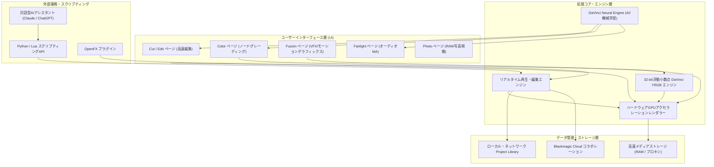

# **DaVinci Resolve 調査レポート**

## **1. 基本情報**

<!--
【ガイドライン】
- 必須: ツール名、開発元、公式サイト、カテゴリ、概要
- 概要は2-3文で簡潔に記述
-->

* **ツール名**: DaVinci Resolve
* **ツールの読み方**: ダビンチリゾルブ
* **開発元**: Blackmagic Design
* **公式サイト**: [https://www.blackmagicdesign.com/products/davinciresolve](https://www.blackmagicdesign.com/products/davinciresolve)
* **関連リンク**:
  * ドキュメント: [https://www.blackmagicdesign.com/products/davinciresolve/training](https://www.blackmagicdesign.com/products/davinciresolve/training)
  * レビューサイト: [Capterra](https://www.capterra.com/p/209733/DaVinci-Resolve/) | [ITreview](https://www.itreview.jp/products/davinci-resolve/reviews)
* **カテゴリ**: 動画編集
* **概要**: 編集、カラーコレクション、ビジュアルエフェクト（VFX）、モーショングラフィックス、オーディオポストプロダクション、静止画RAW現像を単一のソフトウェアに統合したオールインワン環境。v21でのPhotoページ追加やv21.1での対話型AIアシスタント（Claude/ChatGPT等）統合をはじめとするDaVinci Neural Engineの劇的な進化により、ハリウッド映画から個人クリエイターまで幅広く支持されている。

## **2. 目的と主な利用シーン**

<!--
【ガイドライン】
- 3-5項目を箇条書きで記述
- 想定利用者を具体的に記載
- 末尾に「代表的な利用フロー」をスイムレーンで添付する
-->

* **解決する課題**: ポストプロダクションの各工程（編集・色調整・VFX・音響・静止画現像）で別々のアプリケーションを往復する非効率さや、データ変換に伴う品質劣化・エラーを解消し、単一の統合環境でシームレスな制作パイプラインを提供する。
* **想定利用者**: プロの映像編集者、カラリスト、VFXアーティスト、サウンドエンジニア、フォトグラファー、YouTuber・動画配信者、映像制作を学ぶ学生。
* **利用シーン**:
  * 劇場公開映画、テレビCM、ドラマシリーズのハイエンドなカラーグレーディングおよびコンポジット処理
  * YouTube動画やSNSショート動画における、AIテキストベース編集や自動字幕生成、音声整音を活用した高速ワークフロー
  * Blackmagic Cloudを活用した、ディレクター・エディター・カラリスト間のリアルタイム共同編集
  * 動画撮影と同時に撮影されたキービジュアル写真のPhotoページを用いたシームレスなRAW現像とルックマッチング

### **2.1 代表的な利用フロー**

<!--
【ガイドライン】
- ツールを実際に使う際の代表的な流れを、アクター（ユーザー、AIエージェント、ツール、外部サービス等）ごとのスイムレーンで示す
- Mermaidの swimlane-beta を使用し、向きは TB（上から下）に固定する
- subgraph の表示名に ・ や全角記号、( ) [ ] などの記号を含める場合は、必ず subgraph ID["表示名"] のように引用符で囲む。ID自体にも記号を使わず、ASCIIの識別子にすること
- 逆向き矢印の直後にインラインラベルを付ける記法（A <--|ラベル| B）は使用しない。逆向きの関係は始点・終点を入れ替えた順方向エッジ（B -->|ラベル| A）で記述すること
- レーン（subgraph）は3〜5個、ステップは4〜8個程度に収め、図内のレーン名・ステップ名は日本語で簡潔に記述する
-->

```mermaid
swimlane-beta TB
  subgraph User["ユーザー"]
    A[素材の読み込みと編集指示]
    E[カラー調整と音声最終チェック]
    G[完成映像の書き出し]
  end
  subgraph AIAssistant["AIアシスタント / Neural Engine"]
    B[自然言語でラフ編集・素材検索]
    D[音声分離・文字起こし自動実行]
  end
  subgraph Core["DaVinci Resolve コア"]
    C[タイムライン自動構築]
    F[ノードベースのグレーディング処理]
  end
  subgraph Cloud["Blackmagic Cloud"]
    H[チーム間でのプロジェクト同期]
  end
  A --> B
  B --> C
  C --> D
  D --> E
  E --> F
  F --> G
  G --> H
```

* **代表的な流れ**: ユーザーが撮影素材を取り込んで自然言語やショートカットで指示を出すと、対話型AIアシスタントやNeural Engineがセマンティック検索やラフカット、文字起こしを支援します。生成されたタイムライン上でユーザーが高度なノードカラーグレーディングやFairlight音響調整を行い、最終出力を書き出すと同時にBlackmagic Cloud経由でプロジェクト全体がチームへ安全に共有されます。

## **3. 主要機能**

<!--
【ガイドライン】
- 5-10項目の主要機能を箇条書きで記述
- 各機能は1-2文で概要を説明
-->

* **編集 (Edit / Cut ページ)**: 高速なラフカットを行うCutページと、トラックベースの精密なノンリニア編集を行うEditページを完備。AI IntelliScriptによるテキストベース編集やダイナミックトリム機能に対応。
* **カラー (Color ページ)**: ハリウッド標準のノードベースカラーグレーディング環境。PowerWindows™、クオリファイアー、HDRパレット、フィルムの質感を再現するFilm Look Creatorを搭載。
* **Fusion (Fusion ページ)**: 完全統合型のノードベースVFX・モーショングラフィックス環境。3D合成、パーティクルシステム、ロトスコープに加え、v21以降でKrokodoveツール群が拡充。
* **Fairlight (Fairlight ページ)**: 最大2,000トラックのリアルタイム処理が可能なプロフェッショナルDAW。Fairlightフォルダトラックによる整理やAI Audio Assistantによる自動ミキシングに対応。
* **Photo ページ (v21 / v21.1 新機能)**: 静止画のインポート、RAW現像、ノードベースのカラーコレクションを行う専用ページ。Fujifilm GFX/X、Leica SL、Sony Alpha等の主要フォーマットやMicro Color Panel等のハードウェア操作に対応。
* **対話型AIアシスタント統合 (v21.1 新機能 / Studio版)**: ClaudeやChatGPT CodexなどのLLMアシスタントを内蔵。日常会話の自然言語指示でプロジェクト解析、ビン整理、バッチレンダリング予約を実行可能。
* **DaVinci AI Neural Engine**: IntelliSearch（テキスト・被写体による超高速セマンティック検索）、AI CineFocus（撮影後の被写界深度・ボケ調整）、AI Animated Subtitles、Magic Maskなどの先進機械学習ツール群。
* **Blackmagic Cloud & コラボレーション**: 複数マシン・複数拠点のエディター、カラリスト、音響エンジニアが同一タイムラインでリアルタイムに作業可能なクラウド協調基盤。

## **4. 動作原理・システム構成**

<!--
【ガイドライン】
- ツールの動作原理、システム構成（アーキテクチャ）、データの流れ、通信フローなどを記述
- クライアント・サーバー型、ローカルファースト、クラウド完結など、ツールのアーキテクチャ特性を明記
- 可能であればMermaidによる構成図やフロー図を含めること（Mermaid内のノードや説明テキストは原則日本語表記で作成する）
- subgraph の表示名に ・ や全角記号、( ) [ ] などの記号を含める場合は、必ず subgraph ID["表示名"] のように引用符で囲む。ID自体にも記号を使わず、ASCIIの識別子にすること
- 逆向き矢印の直後にインラインラベルを付ける記法（A <--|ラベル| B）は使用しない。逆向きの関係は始点・終点を入れ替えた順方向エッジ（B -->|ラベル| A）で記述すること
- 要素技術や内部で使われている仕組みを解説
-->

* **アーキテクチャ**: ローカルファーストの高性能デスクトップクライアントを基盤とし、マルチGPU並列処理パイプラインと、Blackmagic Cloudによるリレーショナルデータベース同期を統合したハイブリッドアーキテクチャ。
* **主要コンポーネントとデータフロー**:
  * ユーザーのUI操作は各機能ページ（Edit/Color/Fusion等）からリアルタイム再生エンジンに送られます。
  * 映像・音声処理パイプラインは、GPU上で32-bit浮動小数点DaVinci YRGB色空間にて非破壊処理されます。
  * 機械学習モデル（DaVinci Neural Engine）はGPU/NPUの専用Tensorコアを活用してオンデバイスで高速推論を実行します。
  * プロジェクト情報はPostgreSQLベースのProject LibraryまたはBlackmagic Cloud DBに逐次トランザクションとして安全に記録されます。



* **特筆すべき要素技術**:
  * **DaVinci YRGB Color Managed**: カメラRAWの広色域を劣化させることなく扱う32-bit浮動小数点処理カラーマネジメント。
  * **ハードウェアアクセラレーション**: NVIDIA CUDA、Apple Metal、AMD OpenCLに最適化され、複数GPUの同時分散演算に対応。
  * **Neural Engine NPU最適化**: Apple SiliconのNeural EngineやNVIDIA Tensor Core向けに最適化され、IntelliSearchやMagic Maskを極低レイテンシで処理。
  * **OpenFX (OFX) 拡張規格**: 業界標準のOFXプラグインインターフェースに準拠し、サードパーティ製エフェクトを低オーバーヘッドでホスト可能。

## **5. 開始手順・セットアップ**

<!--
【ガイドライン】
- アカウント作成から「Hello World」的な最初の動作確認までの手順
- 主要なコマンドや設定項目を記載
-->

* **前提条件**:
  * OS: macOS 14.0以降、Windows 10/11 (64-bit)、Linux (Rocky Linux / CentOS 7.3以降)
  * メモリ: 最低16GB（FusionやAI機能利用時は32GB以上を強く推奨）
  * GPU: 最低4GB VRAM（4K編集やNeural Engine利用時は8GB〜16GB以上のVRAMを推奨）
  * アカウント: 無料版は登録のみで利用可能、Cloudコラボレーション利用時はBlackmagic Cloud IDが必要
* **インストール/導入**:
  * 公式サイトのサポートページまたは製品ページから、OSに合ったインストーラー（無償版「DaVinci Resolve」または有償版「DaVinci Resolve Studio」）をダウンロードして実行します。
* **初期設定**:
  1. 初回起動時のセットアップウィザードに従い、解像度（1080p / 4K）やキーボードショートカット設定を選択。
  2. `環境設定 (Preferences) > システム > メモリ＆GPU` にて、使用するGPUおよび処理モード（CUDA / Metal）が正しく認識されていることを確認。
  3. `メディアストレージ` にて、高速なSSDをキャッシュ・プロキシ保存先として指定。
* **クイックスタート**:
  1. 「新規プロジェクト」を作成し名前を付ける。
  2. 「Media」ページまたは「Edit」ページに動画・静止画ファイルをドラッグ＆ドロップしてメディアプールに登録。
  3. クリップをタイムラインに配置し、「Cut」または「Edit」ページで不要部分をトリミング。
  4. 「Color」ページに移動し、プライマリカラーバーやノードを使って露出と彩度を調整。
  5. 「Deliver」ページへ進むか、メニューバーから「クイックエクスポート」を選択し、H.264/H.265またはProRes形式で書き出しを実行。

## **6. 特徴・強み (Pros)**

<!--
【ガイドライン】
- 3-5項目を箇条書きで記述
- 競合との差別化ポイントを明確に
-->

* **統合型ポストプロダクション**: 編集、カラー、VFX、音声MA、写真現像が単一アプリケーション内で完結し、外部ツール間の中間ファイル書き出しやXMLコンフォームの手間とトラブルをゼロにできる。
* **充実した無償版**: 4K/60fps出力に対応し、ウォーターマーク（透かし）なしで商用利用も可能。有償版と同等のコアエンジンを無償で体験できる。
* **業界最高水準のカラーサイエンス**: ハリウッドの劇場映画で長年デファクトスタンダードとして使われており、高精細な諧調表現と自由度の高いノードベース調整が可能。
* **恒久的な買い切りモデル**: 有償版「DaVinci Resolve Studio」は一度ライセンス（ドングルまたはアクティベーションキー）を購入すれば、将来のメジャーバージョンアップ（v19→v20→v21等）も基本的に追加料金なしで利用できる。
* **先進AIと対話型AIアシスタントの統合**: IntelliSearchによる超高速セマンティック検索や、Claude/ChatGPTとの対話型アシスタント連携により、メディア管理やルーチンワークを自動化できる。

## **7. 弱み・注意点 (Cons)**

<!--
【ガイドライン】
- 3-5項目を箇条書きで記述
- 日本語対応の状況は必ず含める
-->

* **急峻な学習曲線**: 機能が非常に多く、特にノードベースのColorやFusion、本格DAWのFairlightは、レイヤー型ソフト（After EffectsやPremiere等）に慣れたユーザーにとって概念の習得に時間を要する。
* **高いハードウェア要求**: 4K RAW編集、複雑なFusionノード、IntelliSearchやMagic MaskなどのAI処理を快適に動作させるには、強力なGPUと大容量VRAM（16GB以上推奨）が必須となる。
* **日本語による専門情報の制限**: 基本的な操作手順は日本語マニュアルや解説書籍が豊富だが、複雑なFusionスクリプトや高度なカラーマネジメント（ACES/DaVinci YRGBのパイプライン構築）に関しては英語ソースが中心となる。

## **8. 料金プラン**

<!--
【ガイドライン】
- 表形式で整理することを推奨
- 最新の料金情報であることを確認
- 価格は通貨を明記（例: $10/月、¥1,000/月）
-->

| プラン名 | 料金 | 主な特徴 |
|---------|------|---------|
| **DaVinci Resolve (無料版)** | 無料 | 編集、カラー、VFX、Fairlight、Photoページの基本機能、最大4K/60fps書き出し、商用利用可能。 |
| **DaVinci Resolve Studio** | $295（約47,800円・買い切り） | DaVinci Neural Engineの全AI機能、対話型AIアシスタント連携、120fps/32K出力、高度な空間・時間ノイズ除去、複数GPU演算対応、ステレオスコピック3Dツールなど。 |

* **課金体系**: ソフトウェア買い切り型（永続ライセンス）。過去の全メジャーアップデートが無償提供されてきた実績があり、ランニングコストが極めて低い。
* **無料トライアル**: なし（無料版が無期限・機能制限なしで常用可能なため実質的にトライアルを兼ねる）。
* **追加クラウドサービス**: Blackmagic Cloudのプロジェクトライブラリ共有ストレージは月額課金（小規模プランは無料枠あり、容量に応じた従量・月額制）。

## **9. 導入実績・事例**

<!--
【ガイドライン】
- 具体的な企業名を3-5社挙げる
- 導入事例がない場合は「公開事例なし。ただし、〜の分野での利用が報告されている」等
-->

* **導入企業**: 20th Century Studios, Marvel Studios, Netflix, Warner Bros. Discovery, 世界中の映画・CMポストプロダクションスタジオ。
* **導入事例**:
  * 映画『アバター: ウェイ・オブ・ウォーター』: 4K 3D高フレームレート（HFR）制作における高度なカラーグレーディング。
  * 映画『トップガン マーヴェリック』: コックピット実写素材の緊密な色再現とHDRフィニッシング。
  * 映画『デューン 砂の惑星 PART2』: 独自のフィルム調テクスチャと壮大な砂漠の色彩設計。
* **対象業界**: 映画・テレビ放送、CM・プロモーションビデオ制作、Webメディア・YouTube制作、写真スタジオ、教育機関。

## **10. サポート体制**

<!--
【ガイドライン】
- ドキュメント、コミュニティ、公式サポートの3項目を必ず含める
- URLがあれば記載
-->

* **ドキュメント**: 日本語を含む多言語の公式トレーニングブック（PDF形式）、サンプルプロジェクト素材、4,000ページ超のリファレンスマニュアルが無償提供されている。
* **コミュニティ**: Blackmagic Design公式コミュニティフォーラムが世界規模で活発に稼働しており、エンジニアや認定トレーナーが直接回答する。国内外のYouTubeチュートリアルやユーザーグループも多数存在。
* **公式サポート**: Studio版（有償版）のユーザーには、Blackmagic Design正規代理店および公式サポートチームによるメール・電話でのテクニカルサポートが提供される。

## **11. エコシステムと連携**

<!--
【ガイドライン】
- API、外部連携、技術スタックとの相性を包括的に記述
-->

### **11.1 API・外部サービス連携**

<!--
【ガイドライン】
- APIの有無と公開状況を明記
- 主要連携サービスを5-10個リストアップ
-->

* **API**: Python (2.7/3.6+) および Lua に対応したスクリプティングAPIを公開。タイムライン生成、レンダリング自動化、クリップメタデータ更新などをプログラマブルに制御可能。
* **対話型AIアシスタント連携 (v21.1)**: ClaudeやChatGPT等のLLM APIとネイティブに連携し、チャット入力によるプロジェクト内バッチ処理が可能。
* **外部サービス連携**:
  * **Blackmagic Cloud**: プロジェクトのクラウド同期およびプレゼンテーション共有。
  * **Frame.io**: クラウドレビューコメントとタイムラインマーカーの双方向リアルタイム同期。
  * **動画配信プラットフォーム**: YouTube, Vimeo, TikTok, X (Twitter) への直接エンコード＆アップロード連携。
  * **他社NLEとの互換性**: XML, EDL, AAFを介したPremiere ProやFinal Cut Pro、Avid Media Composerとのタイムライン相互運用。

### **11.2 技術スタックとの相性**

<!--
【ガイドライン】
- 主要なフレームワークや言語との相性を表形式で整理
- 相性: ◎ (非常に良い), ◯ (良い), △ (工夫が必要/一部非対応), × (非推奨)
-->

| 技術スタック | 相性 | メリット・推奨理由 | 懸念点・注意点 |
|:---|:---:|:---|:---|
| **Python** | ◎ | 公式スクリプトAPIを標準搭載し、パイプライン自動化が容易 | 一部高度なGUIトリガーはStudio版が必要 |
| **Lua** | ◎ | Fusionページのネイティブスクリプト言語として最適化 | Pythonに比べライブラリ資産が限られる |
| **OpenFX (C/C++)** | ◎ | サードパーティ製エフェクト・トランジション開発規格 | プラグインの実装品質により安定性が左右される |
| **Metal / CUDA** | ◎ | macOSおよびWindows/LinuxのGPUパイプラインに深く最適化 | ハードウェアおよびドライバのバージョン管理が必要 |

## **12. セキュリティとコンプライアンス**

<!--
【ガイドライン】
- 認証、データ管理、準拠規格の3項目を必ず調査
- 情報が見つからない場合は「公式サイトで公開されていない。問い合わせが必要。」と記載
- 「不明」「見つからず」のみの記載は避ける
-->

* **認証**: ローカル運用時はOSのユーザーアカウント制御に準拠。Blackmagic Cloud利用時はBlackmagic IDによる二要素認証（2FA）および組織ベースのアクセス制御をサポート。
* **データ管理**: プロジェクトデータはオンプレミスのPostgreSQLまたはローカルディスクに完全隔離して保存可能。メディアファイル自体の暗号化やネットワーク分離ストレージ（SAN/NAS）運用に完全対応。
* **準拠規格**: ハリウッドの大手スタジオや配信プラットフォームが要求するセキュリティ監査基準（TPN: Trusted Partner Network等）に準拠したセキュアなスタジオ環境での運用実績が多数存在。

## **13. 操作性 (UI/UX) と学習コスト**

<!--
【ガイドライン】
- 実際の使用感や、類似ツールとの比較を含める
-->

* **UI/UX**: 制作フロー順に並んだ画面下部のページタブ（Media, Cut, Edit, Fusion, Color, Fairlight, Deliver, Photo）を切り替えて作業する明快な設計。Cutページは直感的で初学者にも扱いやすいが、ColorやFusionはプロ仕様のUI密度を持つ。
* **学習コスト**: 全体として学習コストは高い。特にノードツリーを用いたシリアル/パラレル/レイヤーノードの合成理論や、Fusionの空間概念は従来のタイムライン編集者にとって習得の壁となりやすい。ただし、公式トレーニングブックや解説動画が完備されているため独学環境は整っている。

## **14. ベストプラクティス**

<!--
【ガイドライン】
- ツールを効果的に活用するための推奨事項や、避けるべきアンチパターンを記述
- 公式ドキュメントのBest Practicesや、熟練エンジニアの知見を参考にする
-->

* **効果的な活用法 (Modern Practices)**:
  * **Blackmagic Proxy Generatorの活用**: バックグラウンドで自動的に1080p ProResまたはH.265プロキシを生成し、ワンクリックで元素材と切り替えて軽快に編集する。
  * **ノードツリーのテンプレート化 (PowerGrade)**: カラーページで汎用的な露出・コントラスト・スキントーン・フィルムルックのノード構造をPowerGradeに保存し、作品全体の色調統一を高速化する。
  * **プロジェクトライブラリの自動バックアップ**: 予期せぬクラッシュやデータベース破損に備え、Project Libraryの自動バックアップ設定を有効化しておく。
* **陥りやすい罠 (Antipatterns)**:
  * **メジャーアップデート前のバックアップ不備**: v20からv21やv21.1へアップデートする際、プロジェクトライブラリのデータベース構造が更新されるため、アップデート前の完全バックアップを行わないと旧バージョンへのロールバックができなくなる。
  * **GPUドライバの放置**: 推奨されるStudioドライバ（NVIDIAの場合）以外の古いドライバを使用していると、AI機能や高解像度レンダリング時にGPUクラッシュが発生しやすい。

## **15. ユーザーの声（レビュー分析）**

<!--
【ガイドライン】
- 必須調査サイト: G2, Capterra, ITreview（日本語レビュー）のうち該当するもの
- 追加調査サイト: App Store, Google Play, X(Twitter), Reddit等
- 総合評価スコアがあれば必ず記載
- ポジティブ・ネガティブ各3項目以上
-->

* **調査対象**: Capterra, G2, ITreview
* **総合評価**: 4.8 / 5.0 (Capterra), 4.7 / 5.0 (G2)
* **ポジティブな評価**:
  * 「無料版とは思えないほど多機能。個人クリエイターの映像制作なら無料版だけで商業レベルの作品が作れる」
  * 「カラーグレーディングの柔軟性と表現力は圧倒的。一度ノードの便利さに慣れるとレイヤー型のLumetriカラーには戻れない」
  * 「Adobeのようなサブスクリプション課金ではなく、1度の買い切りで何年も最新バージョンを使い続けられるのが経済的に素晴らしい」
  * 「v21で追加されたPhotoページやIntelliSearchなどのAI機能が強力で、作業効率が年々向上している」
* **ネガティブな評価 / 改善要望**:
  * 「PCのハードウェアスペックが低いと、プレビューがカクついたりレンダリングが頻繁に止まる」
  * 「Fusionの操作性が独特でAfter Effectsからの移行が非常に難しく、学習時間がかなり取られる」
  * 「多機能すぎてボタンや設定項目が多すぎ、どこにどの機能があるのか直感的に分かりにくい」
* **特徴的なユースケース**:
  * Premiere Proで編集したシーケンスをXML形式でエクスポートし、DaVinci Resolveで高精度なカラーグレーディングとノイズ除去のみを行って仕上げるハイブリッドワークフロー。

## **16. 直近半年のアップデート情報**

<!--
【ガイドライン】
- 日付の降順（新しいものが上）
- 3-10項目をリストアップ
- 各項目に日付と概要を含める
- 情報源のURLを記載（永続リンク）
-->

* **2026-10-27 (v21.1.2)**: 
  * タイムラインの編集点選択精度の向上と、投げ縄（Lasso）選択によるダイナミックトリミングトリガーを追加。
  * Editミキサー上へのラウドネスメーター直接表示、OGrafの再生パフォーマンスが最大4倍高速化。
  * Linux環境でのOGrafおよびLottieグラフィックスの完全サポート。
  * Apple Silicon（Mシリーズ）環境でのIntelliSearch解析速度が最大14倍高速化、Magic Maskキャッシュのディスク消費を最適化。
* **2026-10-06 (v21.1.1)**: 
  * タイムライン再生の安定性向上パッチ。Photoページにおける特定カメラRAWのEXIFメタデータ保持不具合およびFairlightのオートメーション処理のバグを修正。
* **2026-09-08 (v21.1)**: 
  * **対話型AIアシスタント統合 (Studio版)**: Claude、Claude Code、ChatGPT Codex等のLLMと連携し、自然言語によるメディア整理・プロジェクト設定・バッチレンダリング指示に対応。
  * **Photoページの機能拡充**: Fujifilm GFX/Xシリーズ、Leica SL、Sony Alpha等のネイティブRAW読み込みをサポートし、Micro Color Panel等の物理コントロールパネルからの現像パラメータ調整に対応。
  * **Fusionツールの強化**: 25種類以上の新Krokodoveツール群を追加し、3D/シェイプアニメーション機能を大幅に強化。
* **2026-05-28 (v21.0 正式リリース)**: 
  * **Photoページの新設**: 静止画のインポート、RAW現像、ノードカラーグレーディングに対応した新ページを追加。
  * **IntelliSearch**: 会話セリフ、被写体、特定オブジェクトをセマンティックに検索できる高速AIツール。
  * **AI CineFocus**: 撮影後の映像に対して被写界深度や絞り値（ボケ味）を仮想的に変更できるAI深度エフェクト。
  * **AI Speech Generator**: 少量の音声サンプルからカスタム音声モデルを生成するテキスト読み上げ機能。
  * **Fairlightフォルダトラック**: 複雑に肥大化したオーディオトラックを階層構造でスッキリ整理・管理。
* **2026-05-14 (v21 Public Beta 3)**: 
  * MultiMasterコラボレーションのトリムパス改善、Sony Alpha 7 Vのライブキャプチャサポート、静止画カラーマネジメントの向上。

(出典: [製品アップデート情報](https://www.blackmagicdesign.com/products/davinciresolve/whatsnew))

## **17. 類似ツールとの比較**

<!--
【ガイドライン】
- 3-5個の類似ツールと比較
- 機能比較表（星取表）と詳細比較の2つの観点で記述する
-->

### **17.1 機能比較表 (星取表)**

| 機能カテゴリ | 機能項目 | DaVinci Resolve | Adobe Premiere Pro | Apple Creator Studio (Final Cut Pro) | AviUtl |
|:---:|:---|:---:|:---:|:---:|:---:|
| **映像編集** | タイムライン編集 | ◎<br><small>Edit/Cut二重構成</small> | ◎<br><small>業界標準NLE</small> | ◯<br><small>マグネティックタイムライン</small> | ◯<br><small>トラック編集</small> |
| **カラー処理** | カラーグレーディング | ◎<br><small>ノード式・ハリウッド標準</small> | ◯<br><small>Lumetri Color</small> | ◯<br><small>標準カラーボード</small> | △<br><small>プラグイン拡張</small> |
| **VFX・合成** | モーショングラフィックス | ◎<br><small>Fusion内蔵(ノード式)</small> | △<br><small>After Effects別アプリ</small> | ◯<br><small>Motion別アプリ/連携</small> | ◯<br><small>プラグイン拡張</small> |
| **音声処理** | オーディオMA | ◎<br><small>Fairlight(2000ch)</small> | ◯<br><small>基本ミキサー/Audition</small> | ◯<br><small>Logic Pro連携</small> | △<br><small>基本音声機能のみ</small> |
| **静止画現像** | RAW写真現像 | ◎<br><small>Photoページ標準搭載</small> | ×<br><small>Lightroom/Ps別アプリ</small> | ◯<br><small>Pixelmator Pro連携</small> | ×<br><small>非対応</small> |
| **AI機能** | AI編集・アシスタント | ◎<br><small>IntelliSearch/LLM連携</small> | ◯<br><small>Adobe Sensei/Firefly</small> | ◯<br><small>Apple Intelligence</small> | ×<br><small>非搭載</small> |
| **料金形態** | コストパフォーマンス | ◎<br><small>強力な無料版・買い切り</small> | ×<br><small>月額サブスクリプション</small> | △<br><small>月額サブスク/個別買い切り</small> | ◎<br><small>完全フリーソフト</small> |

### **17.2 詳細比較**

| ツール名 | 特徴 | 強み | 弱み | 選択肢となるケース |
|---------|------|------|------|------------------|
| **DaVinci Resolve** | ポストプロダクション統合環境 | 業界最高峰のカラー、無料版の充実、買い切りライセンス、LLMアシスタント連携 | 急峻な学習コスト、ハイスペックGPUの要求 | カラーに妥協したくない映像制作、ランニングコストを抑えたいクリエイター。 |
| **Adobe Premiere Pro** | 世界標準の動画編集ソフトウェア | Photoshop/After Effects等との連携、圧倒的なユーザー数とチュートリアルの多さ | 継続的なサブスクリプション費用、クラッシュ頻度 | 制作プロダクションの標準仕様に合わせる必要がある場合、Adobeスイート中心の制作。 |
| **Apple Creator Studio** | Appleプロクリエイティブアプリの統合サブスク | Final Cut Pro/Logic Pro/Pixelmatorの包括利用、Apple Siliconへの極限最適化 | Mac/iPad専用（Windows非対応）、サブスク契約必須 | Mac環境メインで動画・音楽・画像をシームレスに制作したいAppleユーザー。 |
| **AviUtl** | 日本発の無料拡張型動画編集ソフト | 完全無料、極めて軽量、有志による豊富なプラグインエコシステム | 初期導入難度が高い、UIの旧式化、Mac非対応 | 低スペックPC環境でコストをかけずに動画編集を始めたいホビーユーザー。 |

## **18. 総評**

<!--
【ガイドライン】
- 総合評価、推奨チーム、選択ポイントの3項目を必ず含める
- 客観的で中立的な評価を心がける
-->

* **総合的な評価**:
  DaVinci Resolveは、ポストプロダクションに必要な全行程（カット編集、ノードカラーコレクション、Fusion VFX、Fairlight音声MA、RAW写真現像）を1つのアプリケーション内で完結させた、現代の映像制作ソフトウェアの最高峰である。無料版であっても主要なプロフェッショナル機能の大半が利用可能であり、有償のStudio版でもサブスクリプションではなく永続ライセンスの買い切り方式を維持している。v21でのPhotoページ新設や、v21.1におけるClaude/ChatGPT等の対話型AIアシスタント統合、最大14倍高速化されたIntelliSearchなど、最先端AI技術の導入スピードも業界トップクラスである。

* **推奨されるチームやプロジェクト**:
  * **色彩・映像美を追求する映画・CM制作チーム**: ハリウッド映画の現場で培われた最高水準のカラーサイエンスとHDRワークフローが必要なプロジェクト。
  * **少人数・個人クリエイター**: 編集から音声整音、サムネイル用静止画現像までをツールを切り替えずに一人で完結させたいYouTuberや映像作家。
  * **ランニングコストを削減したい制作プロダクション**: Adobe Creative Cloud等の高額なサブスクリプション費用を見直し、長期的かつ安定した買い切りライセンスへ移行したい企業。

* **選択時のポイント**:
  最大の障壁は「ノードベースの操作体系への適応（学習コスト）」と「快適に動作させるためのGPUスペック（PC環境投資）」である。しかし、これらをクリアできるのであれば、プロレベルの映像制作環境としては競合を圧倒するコストパフォーマンスと完成度を誇る。まずは無償版を導入し、Cut/Editページでの基本編集やカラーノードの感触を確かめてみることを強く推奨する。
