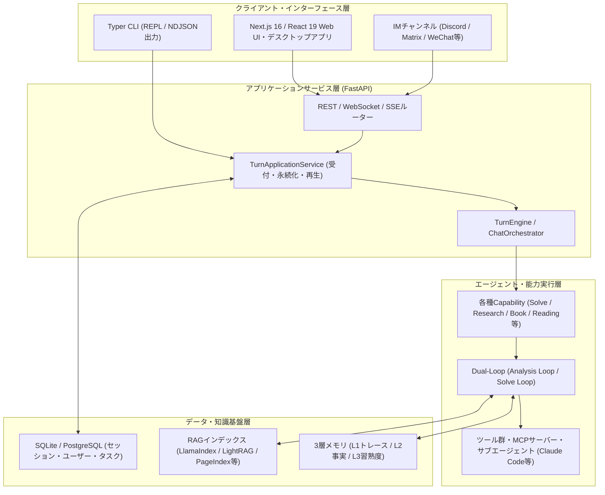

# **DeepTutor 調査レポート**

## **1. 基本情報**

* **ツール名**: DeepTutor
* **ツールの読み方**: ディープチューター
* **開発元**: HKUDS (香港大学 Data Intelligence Lab / Chao Huang氏らの研究グループ、プロジェクトリード: Bingxi Zhao氏)
* **公式サイト**: [https://deeptutor.info/](https://deeptutor.info/)
* **関連リンク**:
  * GitHub: [https://github.com/HKUDS/DeepTutor](https://github.com/HKUDS/DeepTutor)
  * ドキュメント: [https://docs.deeptutor.info/](https://docs.deeptutor.info/)
  * 研究論文 (arXiv): [https://arxiv.org/abs/2604.26962](https://arxiv.org/abs/2604.26962)
* **カテゴリ**: 特定用途AIアシスタント
* **概要**: DeepTutorは、香港大学（HKU）のデータインテリジェンスラボ（HKUDS）が開発する、オープンソース（Apache 2.0）のエージェントネイティブ学習ワークスペースです。一般的なステートレスのAIチャットとは異なり、マルチエージェントによる対話・問題解決・リサーチ機能と、複数の検索エンジンを選択できるRAG知識ベース、さらに学習者の理解度を追跡・可視化する3層メモリを統合し、教材の読解から演習、ノート作成、定着管理までを一貫して支援します。

## **2. 目的と主な利用シーン**

* **解決する課題**: 汎用LLMチャットはセッションをまたいだ学習履歴の保持や、手元の教科書・論文の正確なページ番号に基づく指導、学習者の弱点に応じた動的なカリキュラム調整が苦手でした。DeepTutorは持続的なメモリと根拠（グラウンディング）に基づく知識検索により、ハルシネーションを抑えつつ長期的な個別指導を実現します。
* **想定利用者**: 大学・大学院の学生、専門分野を独学する社会人・エンジニア、論文調査や資料整理を行う研究者、および自社や教育機関向けのプライベートなAIチューター基盤を構築したい開発者・管理者。
* **利用シーン**:
  * **専門書・論文の精読と構造化**: PDFやEPUBの教材を知識ベース化し、ページ引用付きの質疑応答（Immersive Reading）やインタラクティブな「生きた書籍（Living Book）」へのコンパイルを行う。
  * **段階的な問題解決と定着演習**: 数式やプログラミング課題のステップバイステップ解説（Deep Solve）、問題集からの弱点分析・出題（Practice / Question Bank）、理解度に応じた学習計画（Mastery Path）の実行。
  * **自律型リサーチとエージェント連携**: 複数ソースを横断した深層調査（Deep Research）や、Manimを用いた数学アニメーション生成、さらにCLIやIMボット（Discord / Feishu / WeChat等）を通じた他エージェントとの協調学習。

### **2.1 代表的な利用フロー**

```mermaid
swimlane-beta TB
  subgraph User["学習者（ユーザー）"]
    A["教材アップロード・学習目標を入力"]
    E["回答・図解を確認し演習に回答"]
  end
  subgraph DeepTutor["DeepTutor ランタイム"]
    B["Analysis Loop：理解度と知識ギャップを分析"]
    D["Solve Loop：解説・問題・ノートを生成しメモリ更新"]
  end
  subgraph RAG["知識ベース・メモリ層"]
    C["マルチエンジンRAG検索・L1〜L3メモリ参照"]
  end
  subgraph External["外部LLM・検索・CLI"]
    F["LLM推論・Web検索・コード実行"]
  end
  A --> B
  B --> C
  C --> F
  F --> D
  D --> E
```

* **代表的な流れ**: 学習者が教材と質問・目標を入力すると、DeepTutorはまずAnalysis LoopでL1〜L3メモリと知識ギャップを診断し、選択されたRAGエンジン（LlamaIndexやLightRAG等）から根拠資料を抽出します。その上で外部LLMや検索ツールと連携してSolve Loopで解説や演習問題を生成し、学習結果をメモリへ永続化して次の学習サイクルに活かします。

## **3. 主要機能**

* **マルチモード統合ワークスペース**: Chat、Deep Solve（段階的解法）、Deep Research（深層調査）、Quiz/Practice（演習）、Mastery Path（習熟パス）、Immersive Reading（没入型読書）、Visualize / Math Animator（図解・Manim数式動画生成）、Video Lesson（音声解説付き動画レッスン）などが単一ランタイムと共通のセッションコンテキスト上でシームレスに連携します。
* **マルチエンジンRAG（Knowledge Center）**: 知識ベースごとに検索エンジンを選択でき、デフォルトの **LlamaIndex**（ハイブリッド検索＋再ランキング＋FAISS）のほか、**LightRAG**（グラフRAG）、**GraphRAG**、**PageIndex**（推論ベースのページ引用検索）、**WeKnora**、**Kiwix**（ZIMアーカイブ）、さらに既存の **Obsidian** ボルトや **MarginNote 4**、GitHubリポジトリ・ドキュメントURLの定期同期にも対応しています。
* **検査・編集可能な3層メモリ（L1 / L2 / L3）**: 対話トレース（L1）、抽出された事実・好み（L2）、統合された習熟度・理解状態（L3）の3層構造で長期記憶を管理します。ブラックボックスではなくMemory Graphとして根拠リンク付きで可視化・手動編集・削除が可能です。
* **Living Book（Book Engine）とLearning Notebook**: 知識ベースやノートから章立てのアウトラインを提案・生成し、テキスト・クイズ・フラッシュカード（Anki形式 `.txt` エクスポート対応）・インタラクティブHTML・概念グラフ等のブロックで構成された「生きた書籍」を構築できます。ノートブックでは「Dito」アシスタントと行単位で対話・推敲が可能です。
* **Partners（永続的サブエージェント）と外部エージェント連携**: 独自のペルソナ（Soul Template）、メモリ、知識ベース、IMチャンネル（Discord、Telegram、Feishu、WeChat、Zulip、Matrix等）を持つ自律型パートナーを作成できます。また、Claude Code、Codex、Grok CLI、ACP（Agent Client Protocol）準拠プロセスをサブエージェントとして呼び出すことも可能です。
* **高度なドキュメント解析とマルチモーダル対応**: MinerU（ローカル/クラウド）、Docling（ローカル/リモートServe）、Apache Tika、PyMuPDF4LLM、markitdown、LiteParseなどのパーサーを選択でき、PDF内の図表や数式をVisionモデルで解析・引用して視覚的な演習に活用できます。
* **エージェントネイティブCLI & Python SDK**: 対話型REPL（`deeptutor chat`）に加え、他エージェントから機械的に呼び出せるワンショット実行（`deeptutor run ... --format json` によるNDJSONイベントストリーム出力）や `DeepTutorApp` Python SDKを備えています。

## **4. 動作原理・システム構成**



* **アーキテクチャ**: ローカルファーストを基本としつつマルチユーザー・サーバー運用にも対応するクライアント・サーバー型モジュラーアーキテクチャです。バックエンドは **Python 3.11〜3.14 / FastAPI + Uvicorn**、フロントエンドは **Next.js 16 / React 19 / Tailwind CSS** で構成され、デスクトップ版（Open DeepTutor）はこれらをバンドルして動作します。また、実験的パスとしてTypeScript製チャットエンジン（`packages/chat-engine`）も併設されています。
* **主要コンポーネントとデータフロー**:
  * CLI、WebSocket（`unified_ws.py`）、Python SDK（`DeepTutorApp`）のすべての入口が、まず永続化を担う `TurnApplicationService` に集約されます。
  * リクエストは `TurnEngine` と `ChatOrchestrator` を経て適切なCapabilityへルーティングされ、各ターンのイベントは `StreamBus` 経由でセッションストアへ保存されるため、通信切断後の再接続・リプレイ（Replay）や中断再開が安全に行えます。
  * 設定ファイルは `data/user/settings/` 配下のJSONで一元管理され、ワークスペース単位で教材・知識ベース・メモリ・ノートが分離されます。
* **特筆すべき要素技術**:
  * **Dual-Loop Agent System**: 学習者の状態評価を行う「Analysis Loop」と、教材生成・指導を行う「Solve Loop」を分離した設計（arXiv:2604.26962）により、単発プロンプトでは困難な一貫した個別指導を実現しています。
  * **バージョン管理型インデックス**: 知識ベースの再インデックス時は `version-N` ディレクトリを新規作成し、読み込み・ベクトル検証・検索プローブに成功した場合のみ切り替えるため、再構築中のデータ破損を防ぎます。
  * **プラグイン・モジュール分離**: v1.7.0以降、コアパッケージ（`deeptutor`）と機能別ホイール（`deeptutor-knowledge`、`deeptutor-books` 等）が分離され、必要な機能のみを選択的に有効化できます。

## **5. 開始手順・セットアップ**

* **前提条件**:
  * **デスクトップ版**: macOS（Apple Silicon / Intel）または Windows x64（PythonやNode.jsの事前導入は不要）。
  * **Docker版**: Dockerエンジンが動作する環境。
  * **PyPI / CLI版**: Python 3.11〜3.14、フルWeb版を使う場合は Node.js 20.9+。
  * アカウント登録やクレジットカードは不要ですが、クラウドLLMを使う場合は各プロバイダーのAPIキー（Ollama等のローカルLLMを使う場合は不要）が必要です。
* **インストール/導入**:

  ```bash
  # 方法1: DockerでフルWebアプリを即時起動（推奨・最短）
  docker run --rm --name deeptutor \
    -p 127.0.0.1:3782:3782 \
    -v deeptutor-data:/app/data \
    ghcr.io/hkuds/deeptutor:latest

  # 方法2: PyPIからフルパッケージ（Webアプリ＋CLI）をインストール
  mkdir -p my-deeptutor && cd my-deeptutor
  python -m pip install -U "deeptutor[full]"
  ```

* **初期設定**:
  * PyPI版の場合はセットアップウィザードを実行してポートやLLMプロバイダー（OpenAI、Anthropic、Gemini、DeepSeek、Ollama等）を設定します。環境変数や設定画面（**Settings → Providers**）から `<YOUR_API_KEY>` を設定します。

  ```bash
  deeptutor init
  ```

* **クイックスタート**:

  ```bash
  # Webアプリとバックエンドを起動（デフォルトで http://127.0.0.1:3782 が開く）
  deeptutor start

  # CLIのみで対話セッションを開始する場合
  deeptutor chat
  ```

## **6. 特徴・強み (Pros)**

* **「学習」に特化した一貫ワークフロー**: 単なるRAGチャットボットではなく、書籍化（Book）、習熟パス（Mastery Path）、問題演習（Practice）、ノート（Dito）、カレンダー、Anki連携まで学習サイクル全体が1つのコンテキストでつながっています。
* **圧倒的なRAGとデータソースの柔軟性**: LlamaIndex、LightRAG、GraphRAG、PageIndexといった最新RAG手法を知識ベース単位で使い分けられるほか、Obsidian・MarginNote 4・Kiwix・GitHubリポジトリと直接連携できる点は他ツールにない強みです。
* **完全なデータ主権と高い拡張性**: Apache 2.0ライセンスでローカル完結（Ollama＋ローカル埋め込みモデル）が可能なため機密研究資料も安心して投入でき、MCPサーバーや独自Skills、他社コーディングエージェントまで統合できます。
* **エージェントから操作しやすい設計**: `--format json` によるNDJSONストリーミング出力と `SKILL.md` の提供により、外部のAIエージェントがDeepTutorを「学習・調査ツール」として組み込むことが容易です。

## **7. 弱み・注意点 (Cons)**

* **初期セットアップと運用の技術的ハードル**: デスクトップ版やDocker版で導入は容易になったものの、LightRAGやMinerU（PDF高度解析）、Manim（数式アニメーション）などの拡張機能をフル活用するには依存関係の調整やハードウェア資源（メモリ/GPU）への配慮が必要です。
* **ローカル小規模モデルの精度依存**: 完全オフラインで小規模なローカルLLMを使用した場合、複雑なツール呼び出しや構造化出力（JSON生成）、長文の推論においてクラウドの最上位モデル（ClaudeやGPT系）に比べ出力が不安定になる傾向があります。
* **日本語対応の状況**: UI（日本語選択可）、README、音声読み上げ（Edge TTS等）、ドキュメント処理は日本語に対応しており実用レベルですが、新機能のUIラベルやエラーメッセージ、詳細ドキュメント（`deeptutor.info`）の一部は英語または中国語が先行・中心となっている箇所があります。

## **8. 料金プラン**

DeepTutor自体は完全なオープンソースソフトウェアであり、公式から有料のクラウドSaaSプランやサブスクリプションは提供されていません。

| プラン名 | 料金 | 主な特徴 |
|---------|------|---------|
| **オープンソース版 (Self-Hosted / Desktop)** | 無料 | Apache 2.0ライセンス。全機能・全モジュールをローカルPCや自社サーバーで利用可能 |
| **外部LLM / API利用料** | 従量課金（各社規定） | OpenAI、Anthropic、Google Gemini等のクラウドAPIを利用する場合に別途発生（Ollama等のローカルモデル利用時は0円） |

* **課金体系**: ソフトウェア利用料は完全無料。外部AIプロバイダーや検索API（Firecrawl、SearchApi等）を接続した場合のみ、各サービス側での課金が発生します。
* **無料トライアル**: オープンソースのため試用期限や機能制限はありません。

## **9. 導入実績・事例**

* **導入企業**: 特定の商用導入企業リストは公開されていません。ただし、GitHub上で **62,700以上のスター** と **7,500以上のフォーク** を獲得しており（2026年11月時点）、世界中の大学研究室、個人開発者、AIエンジニアコミュニティで広く利用されています。
* **導入事例**:
  * 大学・大学院における論文サーベイや専門書（PDF/EPUB）の読解支援、および講義資料からの練習問題・フラッシュカード自動生成。
  * Obsidianで構築した個人の技術メモ・知識ベースと連携させた、開発者向けのパーソナルリサーチ・コード学習環境としての活用。
  * 家族・教育者向けの「学習者／保護者（Learner / Guardian）」アカウント分離機能を用いた、進捗確認付きの家庭学習環境構築。
* **対象業界**: 教育・EdTech、学術研究機関（大学・ラボ）、ソフトウェア開発、個人学習・リスキリング分野。

## **10. サポート体制**

* **ドキュメント**: 公式ドキュメントサイト（[https://docs.deeptutor.info/](https://docs.deeptutor.info/)）およびリポジトリ内の開発者向けハンドブック（`docs-for-dev/`）が整備されており、インストール手順、CLIリファレンス、アーキテクチャ、コンテナ運用まで詳細に網羅されています。
* **コミュニティ**: 公式 [Discordサーバー](https://discord.gg/eRsjPgMU4t)、GitHub Discussions / Issues、Feishu（Lark）グループ、WeChatグループが活発に稼働しており、ロードマップ投票（Issue #498）やバグ報告が日々行われています。
* **公式サポート**: OSSプロジェクトのため有償のSLA付きサポートや電話窓口はありません。不具合や要望はGitHub Issuesまたはメンテナンスチームへのメール（`bingxizhao39@gmail.com`）を通じてコミュニティベースで対応されます。

## **11. エコシステムと連携**

### **11.1 API・外部サービス連携**

* **API**: FastAPIベースのREST API、双方向ストリーミング用のWebSocket（`/ws`）、およびTutorBot向けのHTTP/SSE APIを提供しています。また、`DeepTutorApp` によるPython SDKおよび `--format json` によるCLIパイプライン連携が可能です。
* **外部サービス連携**:
  * **LLMプロバイダー**: OpenAI、Anthropic、Google Gemini、DeepSeek、NVIDIA NIM、DashScope、Ollama、Lemonade、GitHub Copilot、OpenAI Codex等25種類以上のプロバイダー。
  * **RAG・ナレッジソース**: LlamaIndex、LightRAG、GraphRAG、PageIndex、Obsidian、MarginNote 4、Kiwix、WeKnora、Tencent IMA、GitHubリポジトリ。
  * **検索・スクレイピング**: DuckDuckGo、Firecrawl、Serply、SearchApi、DeepSeek Web Search。
  * **エージェント・CLI・プロトコル**: MCP（Model Context Protocol）サーバー、ACP（Agent Client Protocol）、Claude Code、Codex、Grok CLI、Antigravity CLI。
  * **メッセージング・学習ツール**: Discord、Telegram、WeChat、Feishu、Zulip、Matrix（E2EE対応）、Anki（フラッシュカード出力）、iCalendar（`.ics`出力）。

### **11.2 技術スタックとの相性**

| 技術スタック | 相性 | メリット・推奨理由 | 懸念点・注意点 |
|:---|:---:|:---|:---|
| **Python (3.11〜3.14 / FastAPI)** | ◎ | コア実装言語であり、Python SDK（`DeepTutorApp`）やカスタムモジュール・ツール開発がネイティブに可能 | GraphRAGや一部拡張はPython 3.14未満の制約を受ける場合がある |
| **Docker / コンテナ環境** | ◎ | GHCR公式イメージと `docker-compose.yml` が提供されており、依存関係を隔離して即座にデプロイ可能 | 永続ボリューム（`/app/data`）と環境変数の設定管理が必要 |
| **Next.js / TypeScript** | ◯ | フロントエンドがNext.js 16 / React 19で構築されており、型契約（`web/contracts/`）を通じたUI拡張が容易 | バックエンドの知識ベースやRAGコアはPython依存 |
| **Obsidian / Markdown環境** | ◎ | 既存のObsidianボルトを直接読み書き・同期でき、ノートや書籍をMarkdownでエクスポート可能 | 大規模ボルトの初回インデックスには処理時間がかかる |

## **12. セキュリティとコンプライアンス**

* **認証**: デフォルトはシングルユーザー（ローカル利用）ですが、`auth.json` を有効化することでマルチユーザー認証（管理者・一般ユーザー・学習者／保護者ロール、`/register`・`/admin/users` 管理画面）に対応します。モデル、知識ベース、ツール、コード実行権限をユーザーごとに付与・制限でき、プライベート／パブリックオリジン分離や短命JWEチケットによるデバイス連携（`/handoff`）も実装されています。
* **データ管理**: ローカルファースト設計により、教材・チャット履歴・3層メモリ・認証情報（`data/system/user-secrets/`）はすべて自己管理下のストレージ（SQLite / PostgreSQLおよびローカルディレクトリ）に保存されます。通信経路の保護として、オプションで `fastapi-guard` によるレート制限・IP許可/拒否リスト・XSS/SQLi攻撃パターンスキャン（`security_guard`）を有効化でき、Matrix連携ではE2EEもサポートしています。
* **準拠規格**: OSSとして配布されているため、SOC2やISO27001、ISMAPといったクラウドサービス向けの第三者認証は取得していません（利用組織自身のインフラ管理に依存します）。なお、2026年11月のv1.7.4ではCI成果物からのデスクトップ署名鍵漏洩インシデントに対し、即座に公開鍵のローテーションとワークフロー承認ゲート導入を実施するなど、迅速なセキュリティ対応体制が取られています。

## **13. 操作性 (UI/UX) と学習コスト**

* **UI/UX**: Next.js 16とTailwind CSSを用いたモダンで視認性の高い3ペイン／ワークスペース型UI（Home、Learning、Resources）を採用しています。ダークモード対応、サイドバーのカスタマイズ、PDF連続ズームや画像ビューア、選択テキストの即座の音声読み上げやチャット引用など、学習体験に最適化された操作性を持っています。
* **学習コスト**: 基本的なチャットやPDF読解は直感的ですが、RAGエンジンの使い分け、ドキュメントパーサーの選定、3層メモリの調整、Skills/MCPの追加など機能が非常に多いため、全機能を使いこなすには公式ドキュメントを参照しながら段階的に習得する必要があります。

## **14. ベストプラクティス**

* **効果的な活用法 (Modern Practices)**:
  * **用途に応じたRAGエンジンの選択**: 一般的な教科書や論文の正確なページ引用には「LlamaIndex」または「PageIndex」、複数資料間の概念のつながりを重視する場合は「LightRAG」を選ぶなど、知識ベースごとに最適なエンジンを使い分ける。
  * **ワークスペースの分離と定期チェック**: 科目や研究プロジェクトごとにワークスペース（Content Workspace）を分けてコンテキストの混線を防ぎ、定期的に `deeptutor doctor --online` や `deeptutor book health` で環境とソースの健全性を確認する。
  * **Living Book＋Ankiの反復学習**: 教材からBookを生成し、重要な用語や問題をフラッシュカード化してAnkiへエクスポートすることで、AIとの対話的理解と間隔反復による暗記を組み合わせる。
* **陥りやすい罠 (Antipatterns)**:
  * **埋め込み（Embedding）設定の無計画な変更**: 公開済みLightRAG等のインデックス作成時と異なる埋め込みモデル・次元数に変更するとクエリや増分更新が失敗するため、プロバイダー変更時は再インデックスを計画的に行うこと。
  * **設定ファイルと `.env` の混同**: v1.7系ではランタイム設定は `data/user/settings/` 配下のJSONで管理されており、従来の `.env` だけでは反映されない設定項目がある点に注意が必要です。
  * **無制限な外部公開**: マルチユーザー認証や `security_guard`（`fastapi-guard`）、適切なリバースプロキシ境界を設定しないままバックエンドポート（`:8001` 等）をインターネットへ直接公開することは避けるべきです。

## **15. ユーザーの声（レビュー分析）**

* **調査対象**: Reddit（r/LocalLLaMA、r/selfhosted 等）、GitHub Discussions / Issues、技術ブログ・YouTubeレビュー（G2・Capterra・ITreview等のBtoB SaaSレビューサイトには未掲載）。
* **総合評価**: 商用SaaSレビューサイト上の数値スコアはありませんが、GitHub上では62,700スター超と極めて高い支持を集めています。
* **ポジティブな評価**:
  * 「汎用チャットとは違い、自分の教科書や論文の正確なページに根ざして教えてくれるため、試験勉強や研究の効率が劇的に上がる」
  * 「Ollamaやローカル埋め込みモデルと組み合わせて完全オフラインで動かせるため、未公開の研究データや個人ノートを安心して投入できる」
  * 「L1〜L3メモリが可視化されて自分で編集できる設計や、Claude Code等のCLIエージェントと連携できる拡張性が素晴らしい」
* **ネガティブな評価 / 改善要望**:
  * 「機能が豊富で開発スピードが速いため、ローカル環境でMinerUやManimなどの拡張機能を含めて完璧にセットアップするには多少の試行錯誤が必要」
  * 「小規模なローカルLLMだけで動かすと、複雑なマルチエージェント処理やJSON出力でフォーマット崩れや推論の弱さが出ることがある」
  * 「初期の頃から設定項目が多く、初心者にはRAGエンジンやパーサーの選択肢の違いが分かりにくい」
* **特徴的なユースケース**:
  * 研究者が最新のarXiv論文群と自身のObsidianノートを統合し、Deep ResearchとLiving Bookを組み合わせてオリジナルの分野別教科書を自動編纂する事例。
  * 開発者がClaude CodeやCodexをPartnersとして接続し、未知のコードベースやフレームワークの学習をハンズオン形式で進める活用法。

## **16. 直近半年のアップデート情報**

* **2026-11-20 (v1.7.4)**: デスクトップ版セキュリティアップデート。GitHub Actions成果物での署名認証情報露出を受け、macOS/Windowsアプリのランタイム検証用公開鍵を新規交換し、リリースワークフローにメンテナー承認ゲートを導入。
* **2026-11-15 (v1.7.3)**: PDFリーダーの連続ズーム・画像ビューア追加、Bookの章・セクション単位の差分プレビュー付き編集とアンドゥ対応、DeepSeek/SearchApi検索やACP（Agent Client Protocol）ローカルサブエージェント連携を追加。
* **2026-11-06 (v1.7.2)**: チャット・Mastery Path・Readingでの選択テキスト音声読み上げ（Read aloud）追加、モデル設定の一括インポート対応、Apple Silicon/Intel MacおよびWindows向けデスクトップインストーラーの整備。
* **2026-10-28 (v1.7.0)**: パッケージのモジュール分割（`deeptutor[full]` とコア分離）、刷新された学習ワークスペースUI、ブロックベースノートブック＋「Dito」アシスタント、音声解説付きVideo Lesson機能を導入。
* **2026-10-08 (v1.6.14)**: 教材内の図表・PDFページを直接参照した視覚的演習、障害復旧可能な知識ベースインデックス作成、YouTube/Bilibili動画学習のReading統合、管理型プラグインシステムを追加。
* **2026-08-30 (v1.6.1)**: ファーストパーティのLightRAG統合、ベンダーキーの一元管理、検索可能な設定ナビゲーターを導入。
* **2026-05-22 (v1.4.0)**: 3層メモリ（L1/L2/L3）、Auto Mode、LlamaIndexベースのRAGリファクタリング、VisualizeとAnimatorの統合を実施。

(出典: [HKUDS/DeepTutor Releases](https://github.com/HKUDS/DeepTutor/releases))

## **17. 類似ツールとの比較**

### **17.1 機能比較表 (星取表)**

| 機能カテゴリ | 機能項目 | DeepTutor | NotebookLM | Obsidian | OpenClaw | abceed |
|:---:|:---|:---:|:---:|:---:|:---:|:---:|
| **基本機能** | 資料根拠の対話・解説 | ◎<br><small>マルチエンジンRAG</small> | ◎<br><small>高精度グラウンディング</small> | △<br><small>プラグイン依存</small> | ◯<br><small>ローカルファイル参照</small> | ◯<br><small>英語教材特化</small> |
| **学習機能** | 演習・習熟度管理 | ◎<br><small>問題生成・3層メモリ</small> | △<br><small>簡易ガイド・クイズ</small> | △<br><small>コミュニティプラグイン</small> | ×<br><small>汎用タスク向け</small> | ◎<br><small>AIスコア予測・推薦</small> |
| **カスタマイズ** | 自己ホスト・OSS性 | ◎<br><small>Apache 2.0・完全OSS</small> | ×<br><small>クラウドSaaSのみ</small> | △<br><small>ローカルだが非OSS</small> | ◎<br><small>完全OSS・ローカル</small> | ×<br><small>商用SaaS</small> |
| **拡張性** | エージェント・外部連携 | ◎<br><small>MCP・CLI・IMボット</small> | ×<br><small>外部連携限定的</small> | ◎<br><small>豊富なプラグイン</small> | ◎<br><small>IM・ブラウザ・OS操作</small> | ×<br><small>閉じた学習環境</small> |
| **導入容易性** | セットアップの手軽さ | △<br><small>Docker/設定が必要</small> | ◎<br><small>ブラウザで即利用</small> | ◯<br><small>アプリ導入のみ</small> | △<br><small>CLI/環境構築が必要</small> | ◎<br><small>アプリで即利用</small> |
| **非機能要件** | 日本語対応 | ◯<br><small>UI・音声対応</small> | ◯<br><small>日本語音声概説対応</small> | ◎<br><small>完全日本語対応</small> | ◯<br><small>LLM依存で対応</small> | ◎<br><small>日本向けサービス</small> |

### **17.2 詳細比較**

| ツール名 | 特徴 | 強み | 弱み | 選択肢となるケース |
|---------|------|------|------|------------------|
| **DeepTutor** | 学習特化のエージェントネイティブ・ローカルワークスペース | マルチRAG・3層メモリ・Book生成・完全OSS | 高度な機能を使う際の初期設定や資源要件 | 自前の教材や論文でプライバシーを守りつつ本格的なAI個別指導環境を作りたい場合 |
| **NotebookLM** | Google製の資料根拠型AIリサーチ・ノートアシスタント | セットアップ不要、ハルシネーションが極めて少ない、音声概説が優秀 | ソース数・容量制限があり、カスタマイズや自己ホスト不可 | 手軽にPDFやWeb資料をまとめて音声で聴いたり要約・質問したい場合 |
| **Obsidian** | ローカルファーストのMarkdownナレッジベース | 圧倒的な軽量性、グラフビュー、数千のプラグインによる知識蓄積 | 標準ではAI個別指導や高度なRAGパイプラインを持たない | 長期的な個人の思考・メモ蓄積を主目的とする場合（DeepTutorと併用も可能） |
| **OpenClaw** | チャットアプリ経由でPC操作等を行う汎用パーソナルエージェント | ブラウザ操作やOS自動化、日常タスクの代行能力が高い | 学習・教育向けの習熟度管理や教科書生成機能はない | 学習支援ではなく日常業務やPC作業の自動化アシスタントが欲しい場合 |
| **abceed** | 英語学習・TOEIC対策に特化した商用AI学習アプリ | 商用教材の豊富さ、AIによる精度の高いスコア予測・問題推薦 | 英語以外の分野や自前資料のRAG学習には使えない | 英語試験対策など定型カリキュラムで即座に学習を始めたい場合 |

## **18. 総評**

* **総合的な評価**:
  * DeepTutorは、単なる「PDFとチャットするツール」の枠を大きく超え、学習者の理解度モデル（3層メモリ）と多様な検索エンジン（LightRAG / LlamaIndex / PageIndex）、さらに書籍化・問題演習・数式可視化・外部エージェント連携までを統合した、現時点で最も先進的なオープンソースAI学習プラットフォームの一つです。
* **推奨されるチームやプロジェクト**:
  * 専門書や大量の論文を読み解く必要がある研究者・大学院生・エンジニア。
  * 機密資料や社内ドキュメントを外部クラウドに送信せず、ローカルLLM環境でセキュアな教育・研修環境を構築したい企業や教育機関。
  * AIエージェント（Claude Code等）から呼び出せる知識・調査基盤を探している開発者。
* **選択時のポイント**:
  * 「ブラウザを開いてすぐ手軽に資料を要約したい」場合はNotebookLMが手軽さで勝りますが、「自分の学習進捗や弱点を記憶し、教科書から問題集・フラッシュカードまで一貫して育てながら深く学びたい」「データを完全に手元に置きたい」という明確な目的がある場合、DeepTutorは極めて有力な選択肢となります。
