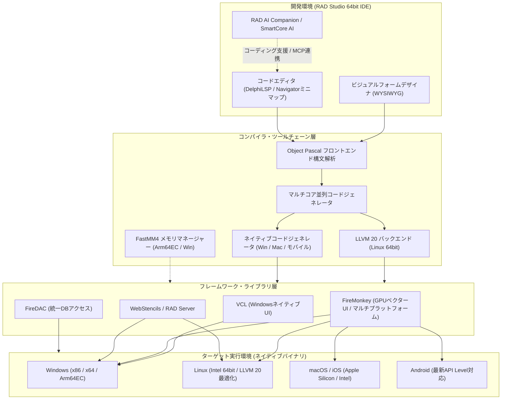

# **Delphi 調査レポート**

## **1. 基本情報**

* **ツール名**: Delphi
* **ツールの読み方**: デルファイ
* **開発元**: Embarcadero Technologies (エンバカデロ・テクノロジーズ)
* **公式サイト**: [https://www.embarcadero.com/jp/products/delphi](https://www.embarcadero.com/jp/products/delphi)
* **関連リンク**:
  * ドキュメント: [http://docwiki.embarcadero.com/](http://docwiki.embarcadero.com/)
  * ストア: [https://www.embarcadero.com/jp/app-development-tools-store/delphi](https://www.embarcadero.com/jp/app-development-tools-store/delphi)
  * レビューサイト: [G2](https://www.g2.com/products/embarcadero-delphi/reviews) | [Capterra](https://www.capterra.com/p/169308/Delphi/)
* **カテゴリ**: IDE/エディタ
* **概要**: Object Pascal言語を使用する統合開発環境（IDE）です。「RAD (Rapid Application Development)」の先駆けとして知られ、コンポーネントをドラッグ＆ドロップで配置するだけでGUIアプリケーションを構築できる生産性の高さが特徴です。現在は単一のコードベースからWindows (x86/x64/Arm64EC), macOS, iOS, Android, Linux向けのネイティブアプリケーションを生成できるクロスプラットフォーム開発環境として進化しており、最新バージョン（13.2 Florence）ではLLVM 20ベースのコンパイラ最適化、マルチコア並列コード生成、IDEへのNavigator統合、SmartCore AIやMCPConnectによるAI連携機能が強化されています。

## **2. 目的と主な利用シーン**

* **解決する課題**:
  * Windowsデスクトップアプリ開発におけるUI構築やイベント配線にかかる工数の削減。
  * 複数OS（デスクトップ・モバイル・サーバー）に対応したアプリを少ないエンジニアリソースで開発・保守。
  * データベース接続を含む基幹・業務アプリケーションの迅速かつ安定した長期運用。
* **想定利用者**:
  * 業務システムや社内基幹システムを開発するSIer・社内SE。
  * パッケージソフトウェアベンダー（ISV）および受託開発企業。
  * 現場端末・産業機器・POSシステム向けネイティブアプリ開発者。
* **利用シーン**:
  * **Windows業務アプリケーション**: VCLフレームワークを活用し、高速かつOS標準に忠実なリッチデスクトップアプリを構築。
  * **マルチデバイスアプリ**: FireMonkey (FMX) フレームワークにより、単一UI設計からiOS/Android/macOS/Windows対応アプリを同時展開。
  * **高負荷バックエンド/REST API**: Linux Intel 64-bitネイティブバイナリ（LLVM 20最適化）としてRAD ServerやWebStencilsを活用したWebサービスを実行。
  * **組み込みデータベース連携**: InterBaseやSQLiteを内包し、オフライン環境でも動作するスタンドアロン・エッジ端末アプリ。

### **2.1 代表的な利用フロー**

```mermaid
swimlane-beta TB
  subgraph User["開発者"]
    A[フォームデザイナでUIコンポーネント配置]
    D[AI支援・Navigatorミニマップでコード実装]
    G[統合デバッガで動作検証・プロファイリング]
  end
  subgraph IDE["RAD Studio IDE"]
    B[双方向プロパティ・イベントバインド]
    C[RAD AI Companion・シンボル補完支援]
    F[DelphiLSP解析・ブレークポイント制御]
  end
  subgraph Toolchain["Delphiコンパイラ・ツールチェーン"]
    E[並列コード生成・LLVM 20最適化コンパイル]
  end
  subgraph Target["ターゲット実行環境"]
    H[Windows / macOS / Linux / iOS / Android ネイティブ実行]
  end
  A --> B
  B --> C
  C --> D
  D --> E
  E --> F
  F --> G
  E --> H
```

* **代表的な流れ**: 開発者がビジュアルデザイナ上でコンポーネントを配置すると、IDEがフォーム定義とコードを双方向同期します。RAD AI CompanionやNavigatorミニマップを活用してビジネスロジックを実装し、マルチコア並列コンパイラ（LinuxはLLVM 20バックエンド）によって高速にネイティブバイナリへビルドされ、即座にターゲットOS上で実行・デバッグ検証を行えます。

## **3. 主要機能**

* **Delphi LLVM 20 Linux 64-bitコンパイラ**: Linux Intel 64-bit向けツールチェーンをLLVM 20へ全面刷新。モダンリンカーと強化されたDWARFデバッグ情報を提供し、ランタイム性能を2〜4倍（特定処理で最大7倍）向上させます。
* **マルチコア並列コード生成 (Parallel Code Generation)**: Linux Intel 64-bitおよびWindows Arm64ECコンパイラにおいて複数CPUコアを活用した並列生成に対応し、大規模プロジェクトのビルド時間を最大14倍短縮します。
* **NavigatorのIDE標準統合**: 人気の生産性プラグインNavigatorが標準機能として組み込まれ、コード構造のミニマップ表示（アクティブライン、Error Insight、ブレークポイント可視化）とGotoダイアログによる高速シンボルジャンプを提供します。
* **OpenTools APIフォーマッター拡張**: `IOTACodeFormatterServices` および `IOTACodeFormatter` インターフェースが新設され、サードパーティ製コードフォーマッターをIDEへシームレスに組み込めます。
* **Windows on Arm (Arm64EC) ランタイム最適化**: Arm64ECネイティブバイナリ生成に対応し、FastMM4ベースのメモリマネージャーを標準採用。近代化されたランタイムパッケージ（BPL）の動的ロードに対応しています。
* **VCL (Visual Component Library)**: WindowsネイティブAPIを直接ラップした成熟のUIフレームワーク。Windows 11スタイルや新しいナビゲーションコントロールをサポートし、極めてレスポンシブなGUIを構築可能です。
* **FireMonkey (FMX) & Style Designer**: GPUアクセラレーションによるベクターベースのクロスプラットフォームUIフレームワーク。進化したStyle Designerにより、各OSに合わせたスタイル（色、フォント、背景）を視覚的に管理できます。
* **SmartCore AI & MCPConnect**: OpenAI, Claude, Gemini, Ollamaなどを手軽にアプリへ統合できるコンポーネント群に加え、Model Context Protocol (MCP) を経由したAIエコシステム連携が強化されています。
* **RAD AI Companion**: 自然言語によるコード補完、リファクタリング、ドキュメント生成を支援するIDE統合型AIアシスタント。
* **FireDAC**: Oracle, SQL Server, MySQL, PostgreSQL, SQLite, InterBaseなど多種多様なデータベースへ高速ネイティブ接続を提供する統一データアクセスライブラリ。
* **WebStencils & RAD Server**: サーバーサイドデータ処理とHTMLテンプレートを統合し、HTMX等と連携したモダンWebアプリやRESTful APIバックエンド（MEAP）を迅速に構築可能。

## **4. 動作原理・システム構成**

Delphiは、開発環境自体からランタイムに至るまで、仮想マシンやインタープリタを介さず「CPUネイティブコードの直接生成」を核としたローカルファーストのクライアント・アーキテクチャを採用しています。



* **アーキテクチャ特性**:
  * **ローカル完結型ネイティブ開発**: 開発環境はWindows上で動作する64ビットIDE。コード編集からコンパイル、デバッグまでローカルマシン上で自己完結し、外部クラウドへの接続なしでも全機能を利用可能です（AI機能利用時のみ外部LLM APIと通信）。
  * **双方向コードジェネレーション**: フォームデザイナでコンポーネントを配置・設定すると、プロパティ情報はフォームファイル（`.dfm` または `.fmx`）に保存され、宣言部とイベントハンドラ雛形がPascalソースコード（`.pas`）へ自動生成・双方向バインドされます。
* **主要コンポーネントとデータフロー**:
  * **DelphiLSP (Language Server Protocol)**: バックグラウンドで構文解析とシンボル解決を常時実行し、Navigatorミニマップやコード補完、LSIFによる超高速定義ジャンプを実現。
  * **ハイブリッドコンパイラパイプライン**: フロントエンドでObject Pascalの構文・型チェックを行った後、ターゲットプラットフォームに応じてネイティブバックエンドまたはLLVM 20最適化バックエンドを選択。マルチコア並列コード生成によりCPUスレッド数に応じた高速コンパイルを行います。
* **特筆すべき要素技術**:
  * **LLVM 20統合**: Linux Intel 64-bitコンパイラにおいて最新のLLVM中間表現（IR）生成と最適化パスを導入し、サーバー向け高スループット処理に最適化。
  * **Arm64EC (Emulation Compatible)**: Windows on Arm環境において、x64エミュレーションコードとArm64ネイティブコードの同一プロセス内相互運用を可能にし、既存プラグインを活かしつつArmネイティブの速度を享受。
  * **FastMM4高効率メモリアロケータ**: マルチスレッド環境におけるメモリアロケーション競合を抑える実証済みのメモリアロケータをWindows Arm64EC向けにも標準適用。

## **5. 開始手順・セットアップ**

* **前提条件**:
  * **OS**: Windows 10 (64-bit) または Windows 11 (64-bit)
  * **推奨スペック**: 4コア以上のCPU、8GB以上のRAM（16GB以上推奨）、SSD空き容量20GB〜60GB（選択プラットフォームによる）
  * **アカウント**: Embarcaderoアカウント (EDNアカウント)
* **インストール/導入**:
  公式サイトからWebインストーラ（GetItインストーラ）またはISOイメージをダウンロードして実行します。

  ```bash
  # GUIインストーラを実行し、必要なプラットフォームを選択
  radstudio_setup.exe
  ```

* **初期設定**:
  1. インストール時に保有ライセンスキー（またはCommunity Editionの無償ライセンスキー）を入力してアクティベーション。
  2. ターゲットプラットフォーム（Windows, Linux, macOS/iOS, Android SDK/NDK）を選択して追加コンポーネントをダウンロード。
  3. IDE初回起動時にUIテーマ（ダーク/ライト）およびCode Insight（DelphiLSP）の動作モードを選択。
* **クイックスタート**:
  1. IDEを起動し、「ファイル > 新規作成 > Windows VCL アプリケーション - Delphi」を選択。
  2. 画面右のツールパレットから「TButton」および「TEdit」をフォーム上へドラッグ＆ドロップ。
  3. 配置したボタンをダブルクリックし、イベントハンドラ内に以下を記述：
     ```pascal
     procedure TForm1.Button1Click(Sender: TObject);
     begin
       ShowMessage('Hello, ' + Edit1.Text + '! RAD Studio 13.2 へようこそ。');
     end;
     ```
  4. F9キー（または緑の実行ボタン）を押下すると、即座にコンパイルされネイティブデスクトップアプリが起動します。

## **6. 特徴・強み (Pros)**

* **圧倒的なGUI開発生産性 (RAD)**: フォームデザイナ、オブジェクトインスペクタ、ツールパレットの連携により、業務画面のUIレイアウトからデータベース連結までを数クリックで構築可能。プロトタイピングから実運用まで最速のスピードを誇ります。
* **並列コンパイルとLLVM 20による卓越したビルド・実行性能**: マルチコア並列コード生成により大規模コードベースの再ビルド時間を最大14倍短縮。Linux 64-bitではLLVM 20最適化により高負荷サーバー処理で2〜4倍の性能向上を実現しています。
* **単一コードベースからの真のネイティブコンパイル**: 仮想マシンやWebラッパーを介さず、Windows (x86/x64/Arm64EC), Linux, macOS, iOS, Android向けのCPUネイティブ機械語バイナリを出力。高速な起動と低メモリ消費を両立します。
* **脅威的な後方互換性と長期運用性**: 10年〜20年前に書かれたVCLコードやビジネスロジックが、最新のDelphiでも軽微な修正で動作。企業の基幹システムや長寿命パッケージソフトの保守において無類の信頼性を誇ります。
* **最新機能を取り込んだモダンな開発体験**: 人気ツールNavigatorのIDE標準統合（ミニマップ、Goto機能）、SmartCore AIおよびMCPConnectによるLLM連携、三項演算子など、近代的なIDE・言語拡張が継続的に投入されています。

## **7. 弱み・注意点 (Cons)**

* **Object Pascal言語の人材確保の難しさ**: 言語としての構文は平易で可読性が高いものの、Java, C#, Python, TypeScript等のC系構文言語に比べて国内エンジニア市場の人口が少なく、新規採用時の学習期間を考慮する必要があります。
* **高額なライセンス費用**: 個人・小規模向けの無料Community Editionが存在するものの、年間売上$5,000を超える商用利用や、Linux/クライアントサーバーDB接続を必要とする場合はProfessional版（約$1,599〜）やEnterprise版（約$3,999〜）の高額な初期費用および年間保守サブスクリプションが発生します。
* **実行ファイルサイズと静的リンク**: ランタイムライブラリを単一の実行可能バイナリに静的リンクする設計のため、シンプルなアプリでも配布サイズが数MB〜十数MB程度になります（ただしDLL地獄を回避できるメリットと表裏一体）。
* **日本語技術リソースとコミュニティの偏り**: IDE本体やDocWikiの日本語対応は維持されているものの、直近の最新機能（13.2の新機能やLLVM 20コンパイラオプション等）に関する最新Tipsやサードパーティ製コンポーネントのドキュメントは英語圏のフォーラムが先行します。

## **8. 料金プラン**

| プラン名 | 料金 (税別概算) | プラットフォーム | 主な機能・対象 |
|---|---|---|---|
| **Community Edition** | 無料 | Win / Mac / iOS / Android | 売上$5,000未満の個人・小規模組織・学習者向け。Professional相当の機能を無償利用可能（商用利用制限あり）。 |
| **Professional** | 約 $1,599 (初年度保守込) | Win / Mac / iOS / Android | 個人開発者・中小企業向け。ローカルDB接続、VCL/FMXコンポーネント、Navigator統合IDE。 |
| **Enterprise** | 約 $3,999 (初年度保守込) | Win / Mac / iOS / Android / Linux | SIer・中堅〜大企業向け。クライアント/サーバーDBリモート接続（FireDAC全対応）、Linuxネイティブコンパイル（LLVM 20）、RAD Serverライセンス同梱。 |
| **Architect** | 約 $5,999 (初年度保守込) | 全プラットフォーム | エンタープライズ大規模基幹向け。Enterprise全機能に加え、Aqua Data StudioなどのDB管理ツール、Sencha Ext JSライセンス、テスト自動化ツールを同梱。 |

* **課金体系**: 永続ライセンス（Perpetual）＋年次アップデートサブスクリプション（保守更新）。2年目以降は年間更新費用を支払うことで新バージョンやサポートを継続利用可能。
* **無料トライアル**: 全エディションの機能を網羅した30日間の無料評価版が公式サイトから入手可能。

## **9. 導入実績・事例**

* **導入企業**: 全世界の製造業、医療機器メーカー、金融機関、物流・流通、小売りチェーン、官公庁などで幅広く採用。
* **代表的な導入事例**:
  * **POSレジ・店舗端末システム**: レスポンス速度と周辺ハードウェア（バーコードリーダー、レシートプリンタ、釣銭機）のダイレクト制御が求められる大手量販店レジ。
  * **医療用画像診断・PACSビューア**: 大容量DICOM画像のリアルタイムレンダリングと、高信頼性・無停止運用が要求される医療現場端末。
  * **工場生産ライン制御・SCADA**: PLCやシリアル通信機器と直結し、ミリ秒単位の応答と24時間365日の連続稼働が求められる製造現場の監視制御PC。
  * **金融機関・保険会社の窓口端末**: 勘定系データベースと暗号化通信で連動し、長期間安定運用される大量トランザクション処理システム。
* **対象業界**: 組み込み機器制御、FA/製造、医療、流通小売、金融・証券、長期保守が必要な企業基幹システム。

## **10. サポート体制**

* **ドキュメント**: 公式ドキュメントサイト [DocWiki](http://docwiki.embarcadero.com/) にて、言語仕様、クラスライブラリリファレンス、新機能チュートリアルが網羅的に公開（日本語版ポータルも提供）。
* **コミュニティ**: 公式フォーラム（Embarcadero Community）、世界的な開発者ポータル（DelphiPraxis）、日本の技術コミュニティ（Qiita, Zenn, エンバカデロ日本公式セミナー）において活発なQ&Aや技術共有が実施されています。
* **公式サポート**: アップデートサブスクリプション加入者向けに、Webチケット制の技術サポート窓口、修正パッチ（Hotfix）の先行提供、専任サポートエンジニアによる障害対応が提供されています。

## **11. エコシステムと連携**

### **11.1 API・外部サービス連携**

* **REST / Cloud API**: 標準コンポーネント群（`TRESTClient`, `TRESTRequest`, `TRESTResponse`）により、外部RESTful Webサービスとの接続やJSONデータの双方向シリアライズをノンコード/ローコードで構成可能。
* **AI・LLM連携 (SmartCore AI / MCPConnect)**: OpenAI, Anthropic Claude, Google Gemini, ローカルLLM (Ollama) とのAPI通信コンポーネントを標準装備。さらにModel Context Protocol (MCP) を介したツール連携にも対応。
* **クラウド・Office連携**: AWS SDKコンポーネント、Azure接続ライブラリ、Microsoft Office COM/OLEオートメーションコンポーネントを標準搭載。

### **11.2 技術スタックとの相性**

| 技術スタック | 相性 | メリット・推奨理由 | 懸念点・注意点 |
|:---|:---:|:---|:---|
| **Windows API / Win32 / Win64** | ◎ | VCLがWinAPIを直接ラップしており、Windows新機能（Win11スタイル等）やハードウェア制御をオーバーヘッドなしで利用可能。 | Windows固有機能に密結合するとマルチプラットフォーム移植性が低下。 |
| **RDBMS (Oracle, SQL Server, MySQL, Postgres)** | ◎ | FireDACによる強力なデータアクセス抽象化により、接続ドライバの変更だけで複数DBに対応可能。配列バインドによる超高速一括更新に対応。 | 独自SQL方言やストアドプロシージャを多用する場合は移植時の調整が必要。 |
| **Linux (Server/Cloud)** | ◎ | LLVM 20ベースの最適化コンパイラにより、高パフォーマンスなバックエンドデーモンやマイクロサービスを単一バイナリでデプロイ可能。 | GUIアプリとしてのLinux対応（FMX Linux）はサードパーティ提供またはアドオン扱い。 |
| **Python** | ◯ | 「Python4Delphi (P4D)」および「DelphiFMX4Python」により、Delphi製GUIとPythonの機械学習/データ解析ライブラリを相互連携可能。 | 実行環境へのPythonランタイムのセットアップ・依存関係管理が必要。 |
| **モダンWebフロントエンド (React / Vue)** | △ | WebStencilsやRAD ServerをRESTバックエンドとして利用可能だが、SPAフロントエンドのコードベースとは完全に分離した設計が必要。 | Node.jsエコシステムと直接のビルドパイプライン共有は行えない。 |

## **12. セキュリティとコンプライアンス**

* **認証**: OAuth2, OpenID Connect, JWT (JSON Web Token) のクライアント実装コンポーネントを標準搭載し、Entra IDやGoogleアカウント連携に対応。
* **データ保護・暗号化**: FireDACにおける通信路暗号化（SSL/TLS）、InterBase連携時の透過的データ暗号化 (TDE / AES-256)、パスワードハッシュや公開鍵暗号ライブラリを標準サポート。
* **OSセキュリティ準拠**: コードサイニング署名ツール連携、ASLR (Address Space Layout Randomization)、DEP (Data Execution Prevention) フラグのコンパイラ標準有効化、Apple App StoreやGoogle Playストアのサンドボックス要件・最新API Levelへの適合。

## **13. 操作性 (UI/UX) と学習コスト**

* **UI/UX**: ビジュアルフォームデザイナによるWYSIWYG設計は直感的で、ドラッグ＆ドロップでコンポーネントを配置し、オブジェクトインスペクタでプロパティを設定するだけで動く画面が完成します。13.2で統合されたNavigatorミニマップとGotoナビゲーションにより、数千行を超えるユニットファイルでも迷わず目的のコードへ到達できます。
* **学習コスト**: Object Pascal言語は英語の平文に近い文法構造を持ち、型安全でポインタの扱いも抽象化されているため、文法自体の習得難易度は低めです。ただし、VCLおよびFMXの豊富なコンポーネントクラス階層や、FireDACのメモリキャッシュ構造を把握して自在に使いこなすには数週間の実践学習が必要です。

## **14. ベストプラクティス**

* **効果的な活用法 (Modern Practices)**:
  * **UIとビジネスロジックの分離**: フォーム（View）内に直接ロジックを書かず、データモジュールやViewModelクラス（MVVMパターン）にロジックを委譲してユニットテスト可能性を高める。
  * **マルチコア並列コンパイルの最大活用**: 13.2で導入された並列コード生成を有効化し、ビルド待ち時間を最小化して開発サイクルを短縮する。
  * **NavigatorとLSPの併用**: ミニマップのError Insightやブレークポイント表示を活用し、エディタ内で素早く視認・ナビゲーションを行う。
  * **SmartCore AIによるボイラープレート自動化**: DTOの定義やSQLマッピングコードの記述にRAD AI Companionを活用し、実装ミスを防止。
* **陥りやすい罠 (Antipatterns)**:
  * **神フォーム (God Form) の生成**: ボタンのクリックイベントにDB接続から計算ロジック、画面遷移まで全てをベタ書きし、将来的な改修やマルチデバイス移植が困難になる。
  * **uses句の循環参照**: ユニット同士が無計画に参照し合い、コンパイルエラーや初期化順序の不具合を引き起こす（Interface部のusesを最小限にし、Implementation部で参照する）。

## **15. ユーザーの声（レビュー分析）**

* **調査対象**: G2.com (評価 4.2/5.0, 100件以上), Capterra (評価 4.3/5.0), Reddit (r/delphi), エンバカデロユーザーフォーラム。
* **総合評価**: デスクトップアプリケーション、特にWindows環境における開発速度とコンパイル速度、資産の長期間互換性に関しては世界最高峰の評価を維持しています。バージョン13.2でのLLVM 20刷新や並列ビルド、Navigator統合も大好評です。
* **ポジティブな評価**:
  * 「20年以上前に開発した業務システムが、最新のRAD Studioでもほぼ手を加えずにWindows 11ネイティブアプリとしてリビルドできた。」
  * 「マルチコア並列コード生成により、数万行規模のプロジェクトのリビルドが瞬時に終わる。開発リズムが途切れない。」
  * 「Navigatorが標準搭載されたことで、サードパーティ製ツールの追加設定なしにミニマップナビゲーションが使えて快適。」
* **ネガティブな評価 / 改善要望**:
  * 「Enterprise版やArchitect版のライセンス価格が非常に高く、零細企業や個人受託者には金銭的ハードルが高い。」
  * 「新規プロジェクトで採用しようとしても、Pascalを書ける若手エンジニアの採用・調達が極めて困難。」
  * 「IDEが長時間使用で重くなることがあり、メモリ消費やLSPの再起動が必要になる場面がまだ残っている。」

## **16. 直近半年のアップデート情報**

* **2026-09-17**: **RAD Studio 13.2 Florence リリース**
  * **Delphi LLVM 20 Compiler for Linux (Intel 64-bit)**: Linux 64-bitコンパイラおよびツールチェーンをLLVM 20へ全面刷新。モダンリンカーと強化されたデバッグ情報を搭載し、ランタイム実行速度を2〜4倍（最大7倍）高速化。
  * **マルチコア並列コード生成 (Parallel Code Generation)**: Linux Intel 64-bitおよびWindows Arm64ECコンパイラにおいて並列コード生成をサポートし、ビルド時間を最大14倍短縮。
  * **NavigatorのIDE標準統合**: エディタミニマップ（アクティブライン、Error Insight、ブレークポイント注釈）および高速シンボルジャンプ（Gotoダイアログ）をIDE標準機能として統合。
  * **OpenTools APIフォーマッター拡張**: サードパーティ製コードフォーマッターを統合するための `IOTACodeFormatterServices` / `IOTACodeFormatter` インターフェースを提供。
  * **Windows Arm64EC 最適化**: FastMM4ベースのDelphiメモリマネージャーを標準採用し、近代化ランタイムパッケージ（BPL）に対応。
  * **UIコントロール & AI強化**: 新しいVCLナビゲーションコントロール、FireMonkey Style Designerの機能拡充、SmartCore AIおよびMCPConnectによるAI連携機能の拡充。
* **2026-05-20**: **RAD Studio Community Edition Florence 提供開始 & 新開発ワークフロー発表**
  * Florence世代に対応した無料のCommunity Editionが公開され、最新機能を学習者や小規模開発者へ開放。
  * 将来的なツールチェーン近代化に向けた新しいRAD Studioワークフロー構想を発表。
* **2026-03-20**: **RAD Studio 13.1 Florence Update 1 リリース**
  * Windows on Arm (Arm64EC) Delphiネイティブコンパイラの基礎対応。
  * 直感的なUIスタイル管理を可能にする新しいFireMonkey Style Designerの導入。
  * BookmarksアドオンのIDE標準統合。
  * iOS 26およびAndroid API-Level 36.1サポート、DelphiLSPのLSIF対応によるコードナビゲーション高速化。
* **2025-10-13**: **RAD Studio 13 Florence 初回リリース**
  * Windows 64-bit対応の完全64ビットIDEの提供開始。
  * SmartCore AIコンポーネントパックおよびRAD AI Companionの初搭載。
  * Object Pascal言語拡張（三項演算子 / `if` 式構文の導入）。
  * WebBroker/WebStencilsのセッション管理などWeb開発機能の刷新。

(出典: [Embarcadero Blogs - RAD Studio](https://blogs.embarcadero.com/category/rad-studio/))

## **17. 類似ツールとの比較**

### **17.1 機能比較表 (星取表)**

| 機能カテゴリ | 機能項目 | Delphi | Visual Studio (C# / .NET) | IntelliJ IDEA (Kotlin / Java) | Visual Studio Code |
|:---:|:---|:---:|:---:|:---:|:---:|
| **GUIビジュアル開発** | フォームデザイナ | ◎<br><small>VCL / FMX (双方向RAD)</small> | ◎<br><small>WinForms / WPF / MAUI</small> | △<br><small>Swing/FX (別途プラグイン)</small> | ×<br><small>標準機能なし</small> |
| **ネイティブ性能** | ネイティブ機械語出力 | ◎<br><small>LLVM 20 / 並列生成</small> | ◯<br><small>.NET Native / AOT</small> | △<br><small>JVM主体 (GraalVM)</small> | ×<br><small>JS/TSランタイム依存</small> |
| **マルチプラットフォーム** | 単一コードベース展開 | ◎<br><small>Win, Mac, Linux, iOS, Android</small> | ◯<br><small>.NET MAUI (Linux公式外)</small> | ◯<br><small>Compose Multiplatform / KMP</small> | △<br><small>Electron/拡張機能依存</small> |
| **DBデータアクセス** | 統合データアクセス | ◎<br><small>FireDAC (多種DB高速直結)</small> | ◯<br><small>ADO.NET / Entity Framework</small> | ◯<br><small>JDBC / Database Tools</small> | △<br><small>拡張機能依存</small> |
| **IDEナビゲーション** | ミニマップ・シンボル | ◎<br><small>標準統合Navigator / LSP</small> | ◯<br><small>スクロールバーマップ</small> | ◎<br><small>Search Everywhere / 構造</small> | ◯<br><small>ミニマップ標準搭載</small> |
| **AIコーディング支援** | AIモデル統合 | ◯<br><small>RAD AI / SmartCore / MCP</small> | ◎<br><small>GitHub Copilot緊密連携</small> | ◎<br><small>JetBrains AI Assistant</small> | ◎<br><small>Copilot / Cursor / 各種拡張</small> |
| **導入コスト** | ライセンス価格 | △<br><small>商用Pro版以上は高額</small> | ◯<br><small>Community版 / Pro版</small> | ◯<br><small>Community版 / サブスク</small> | ◎<br><small>完全無料 (OSS)</small> |

### **17.2 詳細比較**

| ツール名 | 特徴 | 強み | 弱み | 選択肢となるケース |
|---|---|---|---|---|
| **Delphi** | RADツールの元祖。完全ネイティブコンパイルによる超高速起動とUI設計。 | ドラッグ＆ドロップによる圧倒的GUI生産性、LLVM 20最適化、マルチコア並列ビルド、20年超の長期互換性。 | Pascal人材の少なさ、商用ライセンス費用。 | Windows高機能デスクトップ業務アプリ、産業機器制御、単一コードでのマルチデバイス展開。 |
| **Visual Studio** | Microsoft標準の総合開発環境。.NETエコシステムの中心。 | Windows環境での最高水準の親和性、C#の巨大なエコシステムと豊富なライブラリ、Azure連携。 | クロスプラットフォーム（MAUI）のLinux未対応、巨大なIDEフットプリント。 | C# / .NETを中心としたエンタープライズ業務システムやWindows専用アプリ。 |
| **IntelliJ IDEA** | JetBrains社が誇るJVM言語向けの最高峰IDE。 | 強力な静的解析、リファクタリング支援、Kotlin Multiplatformとの親和性。 | ビジュアルGUIデザイナは弱く、コード中心のUI構築が前提。 | Java/KotlinによるWebバックエンド、Androidネイティブアプリ、KMPマルチプラットフォーム開発。 |
| **Visual Studio Code** | 軽量かつ拡張性に優れたデファクトスタンダードのエディタ。 | 圧倒的な軽快さ、膨大な拡張機能エコシステム、無料利用可能、多言語サポート。 | 統合RADデザイナやネイティブGUIビルド環境を自前で構築する必要がある。 | Webフロントエンド、スクリプト開発、マイクロサービス開発、軽量なコード編集。 |

## **18. 総評**

* **総合的な評価**:
  Delphiは、「視覚的で直感的なGUIアプリケーションを最も短時間で完成させる」というRADの本質的価値において、今なお他の追随を許さないトップクラスの統合開発環境です。2026年9月リリースのRAD Studio 13.2 Florenceにより、Linux Intel 64-bitコンパイラがLLVM 20へ刷新されて大幅なパフォーマンス向上を果たし、マルチコア並列コード生成によるビルド高速化、IDEへのNavigator標準統合、SmartCore AIやMCPConnectによる最新AIエコシステムの取り込みなど、近年の開発者が求めるモダンな開発体験が着実に実装されています。
* **推奨されるチームやプロジェクト**:
  * **既存Delphi資産のモダナイゼーション**: 過去数十年分のVCLコード資産を保持しながら、Windows 11対応やクラウド連携、Arm64EC対応へと進化させたいプロジェクト。
  * **ハードウェア連携・FA/医療系アプリ**: シリアル通信、PLC、医療画像デバイスなどを低レイテンシかつ高安定性で直接制御する必要がある現場システム。
  * **少人数でのクロスプラットフォーム開発**: 単一の専任チームでWindows, macOS, iOS, Android向けネイティブアプリを同時に開発・保守したいチーム。
* **選択時のポイント**:
  Object Pascalというプログラミング言語の採用に伴う人材採用のハードルと、商用エディションの高額なライセンス費用が主な検討事項となります。しかし、それらを補って余りある圧倒的な画面開発スピード、単一コードベースによるマルチデバイス展開力、そして長期にわたる高い後方互換性は、長期運用を前提とするビジネスアプリケーションにおいて極めて強力な競争優位性を提供します。
