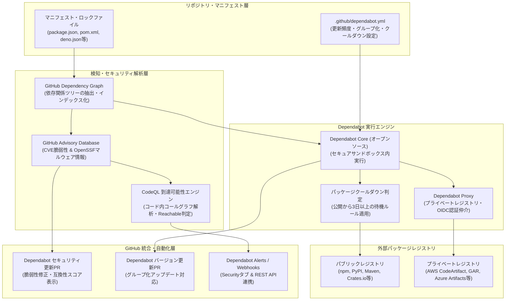

# **Dependabot 調査レポート**

## **1. 基本情報**

* **ツール名**: Dependabot
* **ツールの読み方**: ディペンダボット / デペンダボット
* **開発元**: GitHub (Microsoft)
* **公式サイト**: [https://github.com/dependabot](https://github.com/dependabot)
* **関連リンク**:
  * GitHub: [https://github.com/dependabot/dependabot-core](https://github.com/dependabot/dependabot-core)
  * ドキュメント: [https://docs.github.com/ja/code-security/dependabot](https://docs.github.com/ja/code-security/dependabot)
* **カテゴリ**: 依存関係更新/管理
* **概要**: Dependabotは、GitHubにネイティブ統合された依存関係自動更新および脆弱性管理ツールです。プロジェクトのマニフェストファイルを監視し、既知の脆弱性（CVE）やマルウェア検知時にセキュリティ修正PRを自動起票するほか、定期的なバージョン更新PRを作成します。CodeQLと連携した「到達可能性分析」やサプライチェーン攻撃を防ぐ「パッケージクールダウン」など、最新のDevSecOpsトレンドに即した高度な防御機能を標準で備えています。

## **2. 目的と主な利用シーン**

* **解決する課題**:
  * 依存ライブラリの脆弱性・悪意あるパッケージ放置によるサプライチェーン侵害リスク
  * 依存関係の手動更新にかかる膨大な運用コストと「塩漬け（依存関係の陳腐化）」の防止
  * 大量のアラート通知による「アラート疲れ（Alert Fatigue）」と、修正優先度の判断難
  * パッケージ新規公開直後の乗っ取りやゼロデイ混入による即時被害リスク
* **想定利用者**:
  * GitHubを利用するすべてのソフトウェア開発者・エンジニア
  * アプリケーションセキュリティ（AppSec）およびDevSecOps推進担当者
  * オープンソースソフトウェア（OSS）のメンテナおよび組織のセキュリティ管理者
* **利用シーン**:
  * **到達可能性分析に基づく優先トリアージ**: 脆弱性アラート発生時、自社コードがその脆弱な関数を実際に呼び出しているか（Reachable判定）を確認し、真に危険な問題から優先的に修正する。
  * **セキュリティアップデートの自動修正**: 脆弱性や悪意あるパッケージが検知された際、安全な最小修正バージョンへのPRを自動起票し、CIテスト通過後に迅速にマージする。
  * **パッケージクールダウンを適用した計画的バージョン更新**: リリース直後の不安定・改ざんリスクを回避するため、公開後3日以上経過した安定版パッケージのみを定期的にグループ化してPR作成する。

### **2.1 代表的な利用フロー**

```mermaid
swimlane-beta TB
  subgraph User["開発者・メンテナ"]
    A[リポジトリにdependabot.ymlを配置]
    F[到達可能性判定とCI結果を確認]
    G[PRを承認・マージ]
  end
  subgraph Dependabot["Dependabot (GitHub)"]
    B[マニフェスト解析と更新スケジュール監視]
    D[新バージョン・脆弱性を検知]
    E[更新PRを作成・互換性スコア算出]
  end
  subgraph External["外部レジストリ・脆弱性DB"]
    C[レジストリ公開情報・Advisory照合]
  end
  A --> B
  B --> C
  C --> D
  D --> E
  E --> F
  F --> G
```

* **代表的な流れ**: 開発者がリポジトリに設定ファイルを配置（またはGitHubの設定でセキュリティ更新を有効化）すると、Dependabotが依存関係ツリーを解析します。外部レジストリの新着リリースやGitHub Advisory Databaseの脆弱性情報を常時照合し、更新対象が見つかると自動でプルリクエストを起票します。開発者はCodeQLによる到達可能性ラベルや互換性スコア、CIテストの結果を確認し、安全性を確認した上でワンクリックでマージします。

## **3. 主要機能**

* **到達可能性分析 (Reachability Analysis)**: CodeQL静的解析エンジンと連携し、脆弱性を含むライブラリ関数が自コード内で実際に呼び出されているかを判定（JavaScript / TypeScript向けパブリックプレビュー）。アラートに「Reachable」「Potentially reachable」「Unreachable」のラベルを付与し、修正トリアージの優先順位付けを劇的に効率化。
* **パッケージクールダウン (Package Cooldown)**: バージョン更新において、パッケージがレジストリに新規公開されてから最低3日間の待機期間を経てPRを作成するデフォルト保護機能。公開直後のサプライチェーン攻撃（急遽混入されたマルウェアや乗っ取りバージョン）を自動防御。
* **悪意あるパッケージ（Malware）検知**: OpenSSFのmalicious-packagesリポジトリを取り込んだGitHub Advisory Databaseと連携し、意図的なマルウェアやタイポスクワッティングパッケージを検知・警告。
* **Dependabot Alerts**: リポジトリの依存グラフを常時解析し、既知の脆弱性（CVE）やマルウェアを検知してGitHubのSecurityタブやメール、Webhookで即座にアラートを発行。
* **Dependabot Security Updates**: 脆弱性アラートが発生した際、影響を受ける脆弱性を解消する最小限の修正バージョンへのアップデートPRを自動起票。
* **Dependabot Version Updates**: `.github/dependabot.yml` の定義に基づき、指定したスケジュール（日次、週次、月次）で依存ライブラリの最新バージョンへの更新PRを作成。npm, pip, Maven, Gradle, Go modules, Cargo, Docker, Terraformに加え、DenoやPre-commit hooksにも対応。
* **グループ化アップデート (Grouped Updates)**: 複数の依存関係更新やセキュリティアップデートを1つのPRにまとめ、ディレクトリをまたいだ同名パッケージもグループ化可能。PR過多による開発者の疲弊（PR疲れ）を低減。
* **互換性スコア (Compatibility Score)**: 世界中のGitHubパブリックリポジトリにおけるCIテスト通過状況を統計解析し、該当アップデートによるテスト通過率（%）をバッジ表示してマージの安全性を可視化。
* **OIDC認証 & Dependabot Proxy**: AWS CodeArtifact、Google Artifact Registry、Azure DevOps、Cloudsmith等のプライベートレジストリ向けにOIDC認証をサポート。仲介プロキシ「Dependabot Proxy」はMITライセンスのオープンソースとして公開。
* **自動リベース & 自動マージ連携**: ベースブランチの変更やコンフリクト発生時に自動でPRをリベース。GitHub ActionsやリポジトリのAuto-merge機能と組み合わせることでパッチ更新の完全自動マージが可能。

## **4. 動作原理・システム構成**

Dependabotは、GitHubプラットフォーム上で常時稼働するメタデータ収集パイプラインと、セキュアな隔離環境内で依存関係解決を行う更新エンジンが連携するクラウドネイティブ・SaaSアーキテクチャを採用しています。



* **アーキテクチャ**:
  * **依存グラフ（Dependency Graph）層**: リポジトリ内のマニフェストやロックファイルを構文解析し、プロジェクトが依存する全パッケージおよび推移的（間接）依存関係のツリーをGitHub内部にインデックス化。
  * **脆弱性・到達可能性評価**: GitHub Advisory Database（CVE、OpenSSF Malicious Packages）と依存グラフをリアルタイムで照合。脆弱性が検知された場合は、CodeQLセマンティックエンジンがソースコードのコールグラフを走査し、脆弱な関数が実際にコードから到達可能かを判定。
  * **Dependabot Coreサンドボックス実行**: バージョン更新や修正PR作成時、短寿命（エフェメラル）の隔離コンテナ内でオープンソースの `dependabot-core`（Ruby製）が実行。マニフェスト更新スクリプトやパッケージマネージャのネイティブコマンドを安全に実行し、ロックファイルを再生成。
  * **認証・ネットワーク仲介**: プライベートレジストリへのアクセス時は、OIDCトークンを用いて一時的なクレデンシャルを発行し、Dependabot Proxy経由で安全に通信。

## **5. 開始手順・セットアップ**

* **前提条件**:
  * GitHubアカウントおよびGitHubリポジトリ（パブリックまたはプライベート）
  * サポートされているパッケージマネージャのマニフェストファイル（`package.json`, `requirements.txt`, `pom.xml`, `go.mod`, `deno.json` など）
* **インストール/導入**:
  GitHubのネイティブ機能として組み込まれているため、外部ツールのインストール作業は不要。
* **初期設定**:
  1. **セキュリティ更新の有効化**:
     * リポジトリの「Settings」タブ >「Code security and analysis」を開く。
     * 「Dependabot alerts」および「Dependabot security updates」を有効（Enable）にする。
  2. **定期バージョン更新の設定**:
     * リポジトリのルートに `.github/dependabot.yml` を作成してコミットする。

  ```yaml
  version: 2
  updates:
    - package-ecosystem: "npm"
      directory: "/"
      schedule:
        interval: "weekly"
      groups:
        dependencies:
          patterns:
            - "*"
    - package-ecosystem: "github-actions"
      directory: "/"
      schedule:
        interval: "weekly"
  ```

* **クイックスタート**:
  設定ファイルをコミットすると、GitHubが自動的に設定を検証し、初回の依存関係スキャンを開始。脆弱性が見つかれば即座にセキュリティPRが起票され、指定スケジュールに従ってバージョン更新PRが作成される。

## **6. 特徴・強み (Pros)**

* **GitHub完全ネイティブ統合**: 追加のSaaSアカウント登録やAPIトークン発行が一切不要で、GitHubのUI、Pull Request、Securityタブ、GitHub Actionsと完全に調和。
* **到達可能性分析による的確なトリアージ**: CodeQL連携により、単なるバージョンマッチングにとどまらず自社コードが脆弱な関数を呼んでいるかを判定できるため、無駄なアラート対応工数を削減可能。
* **パッケージクールダウンによるサプライチェーン攻撃防御**: 新規リリース後3日間の待機ルールにより、パッケージ乗っ取りやゼロデイマルウェアが混入したバージョンを誤って取り込むリスクを自動遮断。
* **互換性スコア**: 世界中のGitHubリポジトリにおけるCIテスト結果を集約した通過率が表示されるため、マージ判断を直感的に行える。
* **完全無料で利用可能**: パブリックリポジトリはもちろん、プライベートリポジトリであってもAlerts、Security Updates、Version Updatesの基本機能がすべて無料。

## **7. 弱み・注意点 (Cons)**

* **GitHub専用設計**: オーケストレーション基盤がGitHubに特化しているため、GitLabやBitbucket、オンプレミスの独自Gitホスティング環境ではSaaSとしての利用ができない（CoreエンジンはOSSだが自前ホスティング構築が必要）。
* **設定の柔軟性の限界**: Renovateと比較すると、複雑な正規表現によるパッケージマッチングや独自のオートマージ条件、柔軟なモノレポ個別設定などのカスタマイズ性では一歩譲る。
* **PRの英文表記**: GitHubのWeb UIや公式ドキュメントは日本語化されているものの、Dependabotが自動生成するプルリクエストのタイトル、コミットメッセージ、リリースノート要約は原則英語で出力される。
* **到達可能性分析の言語範囲**: 到達可能性分析（Reachability Analysis）は現在JavaScript / TypeScript向けに先行提供されており、PythonやJavaなど他言語への完全展開は順次拡大中。

## **8. 料金プラン**

| プラン名 | 料金 | 主な特徴 |
|---------|------|---------|
| **GitHub Free** | 無料 | Dependabot Alerts, Security Updates, Version Updatesがパブリック/プライベートともに無制限で無料利用可能。 |
| **GitHub Team** | $4/ユーザー/月 | 基本機能に加え、組織レベルでのセキュリティポリシー設定、チーム権限管理、監査ログ連携。 |
| **GitHub Enterprise** | $21/ユーザー/月 | 組織横断のセキュリティ概要ダッシュボード、高度なコンプライアンス管理、OIDCによるプライベートレジストリ連携。 |
| **GitHub Advanced Security (GHAS)** | アドオン契約 | プライベートリポジトリにおけるCodeQL静的解析、到達可能性分析（Reachability Analysis）、シークレットプッシュ保護のフル機能。 |

* **課金体系**: GitHubの基本ライセンスに準拠。Dependabotの基本機能自体に追加課金は発生しない。
* **無料トライアル**: パブリックリポジトリは永年完全無料。プライベートリポジトリもGitHub Freeプランで無料利用可能。

## **9. 導入実績・事例**

* **導入企業**: Microsoft, Google, Meta, Amazon, Shopify, Spotify, Netflixを含むGitHubを利用する世界中の数百万組織・企業。
* **導入事例**:
  * **Shopify**: 数千を超えるマイクロサービスおよびRuby/JavaScriptリポジトリにおいてDependabotを活用し、依存ライブラリの陳腐化を防止。
  * **Homebrew**: パッケージマネージャ自身の依存関係および配布パッケージのセキュリティ維持にDependabotを標準採用。
* **対象業界**: Web開発、モバイルアプリ、金融FinTech、クラウド基盤、エンタープライズSaaSなど、ソフトウェア開発を行う全産業。

## **10. サポート体制**

* **ドキュメント**: [GitHub Docs (日本語)](https://docs.github.com/ja/code-security/dependabot) に詳細な仕様、設定リファレンス、トラブルシューティングが豊富に整備。
* **コミュニティ**: [GitHub Community Discussions](https://github.com/orgs/community/discussions) にて活発にQ&Aや機能リクエストが交わされている。
* **公式サポート**: GitHubの公式サポート窓口（契約プランに応じたSLAサポート、Enterprise向け専任サポート）が利用可能。

## **11. エコシステムと連携**

### **11.1 API・外部サービス連携**

* **API**: GitHub REST APIおよびGraphQL APIに対応。アラート一覧の取得、Webhookイベント受送信（`dependabot_alert`）、PRの一括管理、設定情報のプログラム取得が可能。2026年10月の改修により、REST APIのアラート情報に `version_requirement` が追加され、取り下げアラートに `410 Gone` が返される仕様に刷新。
* **外部サービス連携**:
  * **Slack / Microsoft Teams**: GitHub公式アプリを通じて、クリティカルな脆弱性アラートやセキュリティPRの通知を即時受信。
  * **CI/CDパイプライン**: GitHub Actionsと連動し、Dependabotが起票したPRに対して自動テスト、静的解析、Auto-mergeワークフローを実行。
  * **プライベートレジストリ**: AWS CodeArtifact、Google Artifact Registry、Azure Artifacts、JFrog Artifactory、Cloudsmith等とOIDC連携。

### **11.2 技術スタックとの相性**

| 技術スタック | 相性 | メリット・推奨理由 | 懸念点・注意点 |
|:---|:---:|:---|:---|
| **JavaScript / TypeScript (npm/yarn/pnpm)** | ◎ | 到達可能性分析（Reachability Analysis）対応。ロックファイル完全整合。 | パッケージ数が多くPR頻度が高まりやすいためグループ化推奨。 |
| **Deno** | ◎ | 2026年にネイティブ対応。`deno.json` / `deno.jsonc` のバージョン更新に対応。 | 比較的新しい機能のため一部複雑なインポートマップ設定は事前検証推奨。 |
| **Python (pip/poetry/uv)** | ◎ | uv workspacesおよびPoetryの最新依存グラフに対応。 | 解決に時間を要する巨大モノレポではタイムアウト設定に留意。 |
| **Java / Kotlin (Maven/Gradle)** | ◯ | マルチモジュールプロジェクトやGradleプラグイン更新に対応。 | 複雑な動的Gradleビルドスクリプトで一部解決制限が生じる場合あり。 |
| **Go** | ◎ | `go.mod` / `go.sum` の完全パースと推移的依存の整理をサポート。 | メジャーバージョン更新時のモジュールパス変更は手動確認推奨。 |
| **Docker / コンテナ** | ◯ | Dockerfile内のベースイメージタグ更新に対応。 | マルチステージビルドで複数ベースイメージがある場合の挙動を確認。 |
| **IaC (Terraform / OpenTofu)** | ◎ | レジストリおよびGitモジュールの最新追跡に対応。 | バージョン更新によるプロバイダー互換性破壊に注意。 |
| **Git フック (Pre-commit)** | ◎ | 2026年に `.pre-commit-config.yaml` のネイティブ更新をサポート。 | 特になし。タグ指定・SHA指定のリビジョンを自動更新。 |

## **12. セキュリティとコンプライアンス**

* **認証**: GitHubアカウントの認証基盤および権限モデル（Fine-grained Personal Access Tokens、GitHub Apps）を利用。プライベートレジストリ向けにはOIDC認証による短寿命クレデンシャルを採用し、固定APIキーの漏洩リスクを排除。
* **データ管理**: 依存関係の解析およびロックファイル再生成処理は、GitHub管理下の完全に隔離されたエフェメラルコンテナ（サンドボックス）で実行。ソースコードが外部サーバーへ送信されることはない。クローズされたセキュリティアラートは2年間のフルアクセス保持ポリシーのもと安全に管理。
* **準拠規格**: SOC 1, SOC 2 Type II, SOC 3, ISO/IEC 27001, ISO/IEC 27701, FedRAMP Tailored認証など、GitHub全体の国際的セキュリティ・コンプライアンス基準に準拠。

## **13. 操作性 (UI/UX) と学習コスト**

* **UI/UX**: 通常のPull Request一覧画面やリポジトリの「Security」タブ内にシームレスに組み込まれており、エンジニアが日常的に使い慣れたUIでトリアージからマージまでを完結できる。互換性スコアや到達可能性ラベルが視覚的にわかりやすく配置されている。
* **学習コスト**: 極めて低い。セキュリティアップデートであればボタン1つの有効化で即日運用を開始でき、バージョン更新もシンプルなYAMLファイル数行で定義可能。

## **14. ベストプラクティス**

* **効果的な活用法 (Modern Practices)**:
  * **グループ化アップデート（Grouped Updates）の導入**: セマンティックバージョニング（マイナー/パッチ）やエコシステム単位でPRをグループ化し、PR作成数を劇的に削減する。
  * **パッケージクールダウンの維持**: デフォルトの3日間クールダウンを維持し、サプライチェーン攻撃による悪意ある新着パッケージの取り込みを未然に防ぐ。
  * **到達可能性判定によるアラートトリアージ**: CodeQL連携による「Reachable」アラートを最優先で対応し、「Unreachable」な推移的依存関係は計画更新に回すことでアラート疲れを防止。
  * **GitHub ActionsとのAuto-merge連携**: CIテストが全通過したマイナー・パッチ更新PRに対し、自動承認・自動マージ（auto-merge）を有効化してメンテナンス工数を極小化する。
* **陥りやすい罠 (Antipatterns)**:
  * **アラート放置による形骸化**: 大量のアラートを未読のまま放置し、真に危険なセキュリティ脆弱性を見落とす（グループ化やスケジュール調整でノイズを抑えることが肝要）。
  * **テスト自動化を伴わない自動マージ**: 単体テストやE2Eテストが不十分なリポジトリで自動マージを設定し、本番環境でのデグレ障害を引き起こす。
  * **レガシーPRコメントコマンドへの依存**: `@dependabot merge` などの非推奨化されたPRコメントコマンドをCIや運用手順に残したままにし、自動化パイプラインが停止する。

## **15. ユーザーの声（レビュー分析）**

* **調査対象**: GitHub Community, Reddit (r/devops, r/programming), G2, 各種技術ブログ
* **総合評価**: 4.7 / 5.0（GitHub標準機能として圧倒的な支持を獲得）
* **ポジティブな評価**:
  * 「GitHubを開くだけで脆弱性修正PRが届いており、CIが通っていればマージするだけで済む圧倒的な手軽さ。」
  * 「到達可能性分析（Reachability Analysis）のおかげで、本当に自社コードに影響がある脆弱性だけに集中できるようになった。」
  * 「パッケージクールダウンが標準導入されたことで、npmの乗っ取り攻撃などに対する安心感が大幅に増した。」
* **ネガティブな評価 / 改善要望**:
  * 「Renovateに比べると、正規表現による複雑なルール分岐やマージ戦略のカスタマイズが物足りないことがある。」
  * 「モノレポ構成で依存関係が多岐にわたる場合、PRが乱立してレビュー負荷が高くなる（グループ化設定が必須）。」
  * 「自動起票されるPRの解説文が英語のみなので、日本語での要約や解説があるとジュニア層にも優しい。」
* **特徴的なユースケース**:
  * **Pre-commitフックとGitHub Actionsの自動追従**: アプリケーションコードだけでなく、開発用リンターのGitフックリビジョンやCIアクションのハッシュ更新をDependabotに一任し、開発基盤全体のモダン化を完全自動化。

## **16. 直近半年のアップデート情報**

* **2026-10-28**: 到達可能性分析（Reachability Analysis）のパブリックプレビューを開始（JavaScript / TypeScript）。CodeQLと連携し、脆弱性を含む関数がコードから実際に呼び出されているかを判定（Reachable / Potentially reachable / Unreachable）。
* **2026-10-20**: Dependabot Alerts REST API および Webhook に `version_requirement` フィールドを追加。外部ツールによるロックファイルの手動パースが不要に。
* **2026-10-13**: 取り下げられたアラート（Withdrawn alerts）の検知強化。Webhook (`dependabot_alert`) に `withdrawn` アクションを追加し、REST API呼び出しが `410 Gone` を返すよう改善。
* **2026-09-25**: クローズされたセキュリティアラートに対する2年間のデータ保持ポリシー（Archival Storageへの移行およびCSVエクスポート機能）を適用。
* **2026-07-28**: 悪意あるパッケージ（Malicious Packages）アラートの拡大。GitHub Advisory DatabaseがOpenSSFのmalicious-packagesリポジトリを取り込み、マルウェア検知を強化。
* **2026-07-14**: バージョンアップデートにおけるパッケージクールダウン（Package Cooldown）をデフォルト有効化。新規リリースから最低3日間待機してPRを作成しサプライチェーン攻撃を防御。
* **2026-06-09**: Denoエコシステムのサポートを追加（`deno.json` / `deno.jsonc` によるバージョンアップデート対応）。
* **2026-05-19**: Python 3.9の非推奨化およびプライベートレジストリ向けOIDC認証サポートの拡大（Cloudsmith、Google Artifact Registry）。
* **2026-04-23**: Python（pip、uv、Poetry）向けのDependabotベース依存関係グラフサポートを追加。
* **2026-03-10**: Pre-commitフック（`.pre-commit-config.yaml`）のネイティブ自動アップデート対応。

(出典: [GitHub Changelog - Dependabot](https://github.blog/changelog/label/dependabot/))

## **17. 類似ツールとの比較**

### **17.1 機能比較表 (星取表)**

| 機能カテゴリ | 機能項目 | 本ツール (Dependabot) | Renovate | Snyk Open Source | Socket |
|:---:|:---|:---:|:---:|:---:|:---:|
| **基本機能** | 自動更新PR | ◎<br><small>GitHub完全統合・即座に開始</small> | ◎<br><small>極めて高度な設定・自動化</small> | ◯<br><small>修正PR自動作成</small> | ◯<br><small>差分アラート対応</small> |
| **セキュリティ** | 到達可能性分析 | ◎<br><small>CodeQL連携 (JS/TS先行)</small> | △<br><small>外部ツール連携が必要</small> | ◎<br><small>DeepCode/Snyk独自解析</small> | ◯<br><small>静的AI振る舞い解析</small> |
| **サプライチェーン防御** | クールダウン / マルウェア検知 | ◎<br><small>標準3日待機 & OpenSSF連携</small> | ◯<br><small>設定による待機ルール対応</small> | ◯<br><small>独自マルウェアDB照合</small> | ◎<br><small>AIによる悪意コード即時検知</small> |
| **設定柔軟性** | カスタマイズ性 | ◯<br><small>YAMLによる標準設定</small> | ◎<br><small>正規表現・プリセット等無制限</small> | ◯<br><small>WebUI中心の設定</small> | ◯<br><small>ダッシュボード・CLI設定</small> |
| **プラットフォーム** | マルチGit対応 | △<br><small>GitHub専用 (CoreはOSS)</small> | ◎<br><small>GitHub/GitLab/Bitbucket/Gitea</small> | ◎<br><small>主要Gitホスティング対応</small> | ◎<br><small>GitHub/GitLab等対応</small> |
| **利用コスト** | 料金体系 | ◎<br><small>基本機能完全無料</small> | ◎<br><small>OSS完全無料 (セルフホスト)</small> | △<br><small>フリー枠あり・大規模は高額</small> | △<br><small>フリー枠あり・組織向け有償</small> |

### **17.2 詳細比較**

| ツール名 | 特徴 | 強み | 弱み | 選択肢となるケース |
|---------|------|------|------|------------------|
| **Dependabot** | GitHub公式の依存関係管理・脆弱性修正ツール | GitHub完全ネイティブ統合、CodeQL連携の到達可能性分析、標準パッケージクールダウン、完全無料 | 設定の極度なカスタマイズ性はRenovateに劣る、GitHub専用 | GitHubを利用しており、手軽に安全かつ高精度な依存関係管理・セキュリティ対策を導入したい場合。 |
| **Renovate** | 圧倒的な柔軟性を誇るオープンソースの自動化ツール | 極めてきめ細かな設定（正規表現マッチング、カスタムルール、オートマージ）、マルチプラットフォーム対応 | 設定ファイルが肥大化しやすく、導入の学習コストや運用設計が必要 | 複雑な依存関係管理ポリシーを持つ大規模モノレポや、GitLab/Bitbucket環境での利用。 |
| **Snyk Open Source** | セキュリティと脆弱性検知に特化した専門プラットフォーム | 業界最高水準の脆弱性データベース、詳細な修正パッチ案内、IDEプラグインとのリアルタイム連携 | バージョン自動更新ツールとしてはRenovateほど柔軟ではない、商用大規模利用ではコスト増 | 脆弱性管理とセキュリティガバナンス（SAST/コンテナ含む）を一元管理したいセキュリティチーム。 |
| **Socket** | 依存関係の振る舞い分析に特化したサプライチェーンセキュリティ | AIを用いたタイポスクワッティング・難読化コード・環境変数不正取得などのマルウェア検出に特化 | 単純なライブラリのバージョン更新・PR作成の機能は補完的位置づけ | パッケージ公開直後の乗っ取りやゼロデイ・マルウェアの混入阻止を最優先課題とする場合。 |

## **18. 総評**

* **総合的な評価**:
  Dependabotは、GitHubエコシステムにおけるセキュリティ・依存関係管理のデファクトスタンダードである。導入コストが実質ゼロでありながら、脆弱性修正PRの自動起票や定期的なバージョン更新を実現できる。さらに、2026年にはCodeQLと連携した「到達可能性分析（Reachability Analysis）」や「パッケージクールダウン」といった先進的な機能が標準装備され、長年の課題であった「アラート疲れ」や「サプライチェーン攻撃」に対する防御力が飛躍的に向上した。
* **推奨されるチームやプロジェクト**:
  GitHubを利用するすべての開発チームおよびオープンソースプロジェクト。特に、依存関係の手動更新に追われているチームや、脆弱性アラートが多すぎてトリアージに苦慮している開発組織には必須のソリューションである。
* **選択時のポイント**:
  GitHubユーザーであれば、まずはDependabotのセキュリティ更新と基本的なバージョン更新を有効化することが強く推奨される。その上で、他プラットフォーム（GitLab等）との共通化や、複雑極まるモノレポ更新ルールが必要な場合にはRenovateを、より包括的な全社脆弱性監査プラットフォームを求める場合にはSnykやSocketとの併用を検討するのが最適なアプローチである。
