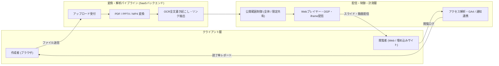

# **Docswell 調査レポート**

## **1. 基本情報**

* **ツール名**: Docswell
* **ツールの読み方**: ドクセル
* **開発元**: 株式会社アプルーシッド (Uplucid, Inc.)
* **公式サイト**: [https://www.docswell.com/](https://www.docswell.com/)
* **関連リンク**:
  * 会社概要: [https://www.uplucid.com/](https://www.uplucid.com/)
  * ヘルプセンター: [https://support.uplucid.com/docs/docswell/](https://support.uplucid.com/docs/docswell/)
  * マガジン: [https://www.docswell.com/magazine/](https://www.docswell.com/magazine/)
* **カテゴリ**: スライド/プレゼンテーション
* **概要**: PDFやPowerPointファイルをアップロードするだけで、ブラウザ上で閲覧可能な高画質スライドプレイヤーを生成するサービス。さらに動画の掲載・限定共有や画像ベースPDFの自動OCR全文書き起こしにも対応し、スライドと動画を一元管理できる日本発のナレッジ共有プラットフォーム。

## **2. 目的と主な利用シーン**

* **解決する課題**:
  * ファイル添付によるメール送付の容量制限（PPAP問題等）や、スマートフォンでの閲覧性の悪さの解消。
  * スライド資料の内容を更新した際に、配布済みのURLが無効になる問題の解決（URL維持更新）。
  * 誰がどこまで資料を読んだかわからないという、共有後のトラッキング課題の解決。
  * 社内ポリシー上YouTube等の一般動画サイトを利用できない企業における、セキュアな動画共有課題の解決。
* **想定利用者**:
  * **エンジニア・登壇者**: 勉強会資料やLT動画の共有。
  * **企業の広報・採用担当**: 会社紹介資料や採用ピッチ資料、インタビュー動画の公開。
  * **営業・マーケティング**: ホワイトペーパーやサービス紹介資料の配布、ウェビナーアーカイブの公開。
* **利用シーン**:
  * 技術勉強会やカンファレンスでの登壇スライド・動画アーカイブ公開
  * 採用サイトや自社ホームページへの「会社紹介スライド」および「紹介動画」の埋め込み
  * SNS（X/Twitter, Facebook）での資料拡散（OGP対応）や、リンクを知っている人のみへの限定共有

### **2.1 代表的な利用フロー**

```mermaid
swimlane-beta TB
  subgraph Creator["作成者・登壇者"]
    A[スライドPDFや動画をアップロード]
    B[公開範囲とメタ情報を設定]
    F[URL共有やWebサイトへ埋め込み]
  end
  subgraph Docswell["Docswell"]
    C[Web変換・OCR全文書き起こし]
    D[専用URL・埋め込みコード発行]
    G[アクセス解析・読了率を集計]
  end
  subgraph Viewer["閲覧者"]
    E[ブラウザで閲覧・リンククリック]
  end
  A --> B
  B --> C
  C --> D
  D --> F
  F --> E
  E --> G
```

* **代表的な流れ**: 作成者がPDF・PowerPointやMP4動画をアップロードして公開範囲を設定すると、Docswell側でWebプレイヤーへの変換とテキスト抽出（画像PDFのOCRを含む）が行われ、専用URLと埋め込みコードが発行されます。閲覧者がブラウザから資料や動画を参照すると、閲覧履歴や読了率がDocswell上で集計され、作成者が効果測定を行えます。

## **3. 主要機能**

* **スライド共有・埋め込み**: PDF/PowerPointをアップロードし、フルHD対応のWebプレイヤーとして公開。ブログやWebサイトへの埋め込み（iframe）にも対応。
* **動画掲載・限定共有**: MP4などの動画をアップロードし、スライド同様にWebプレイヤーとして公開・Webサイト埋め込みが可能。一般公開は無料で利用でき、有料のBusinessプランではURLを知る人のみ閲覧できる限定共有にも対応。
* **画像PDFの全文書き起こし (OCR)**: Google NotebookLM等で生成された画像ベースのスライドや、Adobe Illustrator等でアウトライン化されたPDFでも、アップロード時に自動でOCR文字起こしを行い、検索エンジンやサイト内検索での発見可能性を向上。
* **コレクション機能**: 複数のスライドや動画をまとめて「コレクション」として公開できる機能。シリーズものの資料やイベントごとのアーカイブに便利。
* **リンクの保持**: スライド内に埋め込まれたハイパーリンクを自動検出し、閲覧者がクリックして外部サイトへ遷移可能にする。
* **スライドの差し替え更新**: 発行されたURL（リンク）を変更することなく、スライドの中身だけを最新版に更新可能。
* **アクセス解析**: PV数だけでなく、どのページがよく読まれているか（1ページ単位の読了率等）の分析が可能（詳細解析はBusinessプラン）。
* **はてなID連携**: はてなIDを設定することで、スライドがはてなブックマークされた際に通知を受け取れる。
* **フォルダ公開機能 (Groupfile)**: 姉妹サービスの法人向け「Groupfile」にて、フォルダ単位で資料を整理・全文検索可能なポータルとして一括公開できる機能。

## **4. 動作原理・システム構成**

* **アーキテクチャ**: クラウド完結型のマルチテナントSaaSとして提供されている（サーバー構成やソースコード等の内部実装は非公開のため、公開されている機能仕様に基づく処理フローを記述）。
* **主要コンポーネントとデータフロー**:
  * **アップロード・変換パイプライン**: ユーザーがアップロードしたPDF/PowerPointから各ページの画像・レイアウトとハイパーリンクを抽出し、テキストを含まない画像ベースPDFに対してはOCRエンジンで全文書き起こしを実行して検索インデックスを生成する。動画（MP4）はWebストリーミング再生用に最適化される。
  * **公開制御・配信層**: コンテンツごとの公開設定（「全体公開」または「URLを知っている人のみ限定公開」）に基づきアクセス制御を行い、OGPメタデータの生成、ブラウザ向けプレイヤー表示、および外部サイト向けiframe埋め込み配信を行う。
  * **計測・外部連携層**: 閲覧者のページ遷移や滞在状況を集計して管理画面へフィードバックするほか、設定されたGoogle Analytics（GA4）タグへのイベント送信や、はてなブックマーク連携通知を処理する。



* **特筆すべき要素技術**: PDF内のハイパーリンク座標を保持したWebプレイヤー変換技術、およびAI生成スライド等の非テキストPDFをインデックス可能にする自動OCRパイプラインが採用されている。

## **5. 開始手順・セットアップ**

* **前提条件**:
  * Webブラウザ（Chrome, Safari, Edge等）
  * アカウント作成（メールアドレス、Google/X/GitHubアカウントでのSSO対応。無料プランはクレジットカード登録不要）
* **インストール/導入**:
  * インストール不要（SaaS）。ブラウザから公式サイト（[https://www.docswell.com/](https://www.docswell.com/)）にアクセスして利用開始。
* **初期設定**:
  * アカウント作成後、プロフィール（アイコン、自己紹介、Webサイトリンク）を設定することで信頼性が向上する。
* **クイックスタート**:
  1. ログイン後、画面右上の「アップロード」ボタンをクリック。
  2. PDFまたはPowerPointファイル（動画の場合はMP4）をドラッグ＆ドロップ。
  3. タイトル、説明文、カテゴリ、タグ、公開設定（全体公開／限定公開）を選択して「公開」をクリック。

## **6. 特徴・強み (Pros)**

* **日本発・日本語対応**: 管理画面からサポートまで完全日本語対応。画像PDFの自動OCR文字起こしにも対応しており、日本語のドキュメント検索精度が高く国内ユーザーにリーチしやすい。
* **マルチメディア・限定共有対応**: スライドだけでなく動画も扱え、Businessプランでは動画の限定共有も可能なため、YouTube利用が制限される企業のウェビナーアーカイブや製品デモ共有にも対応できる。
* **スライド更新機能**: 多くの競合ツールでは再アップロードでURLが変わってしまうが、DocswellはURL維持での更新が標準機能として提供されており、運用が非常に楽。
* **リンクの有効化**: PDF内のリンクがクリッカブルになるため、参考記事や自社サイトへの誘導導線として強力に機能する。

## **7. 弱み・注意点 (Cons)**

* **グローバルなリーチ**: ユーザーの多くが日本国内であるため、英語圏や全世界に向けて発信したい場合はSpeaker DeckやSlideShareの方が有利な場合がある。
* **無料プランの表示・機能制限**: 無料プランではスライドプレイヤー内にドクセルのロゴや関連スライドへの誘導が表示されるほか、限定公開の上限（20点まで）や動画の限定共有非対応などの制限がある。
* **本格的ビジネス利用は有料**: ロゴ・関連スライドの非表示、無制限の限定公開、1ページ単位の詳細アクセス解析やGA4連携には、有料のBusinessプラン（月額6,600円税込）以上の契約が必要。

## **8. 料金プラン**

| プラン名 | 料金 | 主な特徴 |
|---|---|---|
| **フリープラン** | 無料 | 無制限の公開資料・一般公開動画、限定公開は20点まで、Web埋め込み、URL維持更新、簡易アクセス解析（ドクセルロゴ表示あり）。 |
| **Businessプラン** | ¥6,600/月（税込） | ドクセルロゴ・関連スライドの非表示、無制限の限定公開（動画の限定共有含む）、1ページ単位の詳細アクセス解析、Google Analytics埋め込み対応。 |
| **Groupfile**（法人向け姉妹サービス） | ¥38,000/月〜 | ユーザー数無制限。フォルダ公開機能による資料ポータル構築、Zip・動画共有、自社資料のページ単位全文検索など。 |

* **課金体系**: 基本無料。機能拡張のための月額サブスクリプション（請求書払い・年額一括払いは要問い合わせ）。
* **無料トライアル**: 基本機能が永年無料で利用可能。

## **9. 導入実績・事例**

* **導入企業**: 株式会社SmartHR, クラスメソッド株式会社, 合同会社DMM.com など、多くのIT企業・スタートアップが利用。
* **導入事例**:
  * **SmartHR**: 採用ピッチ資料をDocswellで公開し、採用サイトに埋め込み。候補者に事前情報を効果的に提供。
  * **エンジニア個人**: QiitaやZennの記事内に、解説用のスライドとして埋め込み利用。
* **対象業界**: IT・Web業界を中心に、製造業や教育機関、医療機関（論文発表資料等）でも利用が広がっている。

## **10. サポート体制**

* **ドキュメント**: [UPLUCID Service Support](https://support.uplucid.com/docs/docswell/) に詳細なマニュアルやFAQ（SlideShareからの移行手順、埋め込み方法等）が整備されている。
* **コミュニティ**: ユーザーフォーラムはないが、X（旧Twitter）でのシェアや言及が活発。ドクセルマガジンでの月別人気スライドランキング発表などコミュニティ活性化施策がある。
* **公式サポート**: 問い合わせフォームからのメールサポートに対応。日本企業ならではの丁寧な対応が期待できる。

## **11. エコシステムと連携**

### **11.1 API・外部サービス連携**

* **API**: 公開APIは提供されていない。
* **外部サービス連携**:
  * **Google Analytics**: トラッキングIDを設定することで、自身のGA4でアクセス解析が可能（Businessプラン等）。
  * **SNS連携**: X (Twitter), Facebook, LinkedIn等へのシェア時に最適なOGP画像（サムネイル）を生成。
  * **はてなブックマーク**: はてなID連携によりブックマーク通知を受信可能。

### **11.2 技術スタックとの相性**

| 技術スタック | 相性 | メリット・推奨理由 | 懸念点・注意点 |
|:---|:---:|:---|:---|
| **PowerPoint** | ◎ | そのままアップロード可能。アニメーションは反映されないがレイアウトは保持される。 | フォント埋め込み推奨 |
| **PDF出力ツール**<br>(Keynote, Slidev, NotebookLM等) | ◎ | PDF経由でのアップロードが最も安定的。画像PDFも自動OCRで検索対象化される。 | 特になし |
| **動画編集ソフト** | ◎ | MP4形式で出力した動画をそのままアップロード可能。 | ファイルサイズ制限に注意 |
| **WordPress** | ◎ | 専用の埋め込みコード、またはURLを貼るだけでカード表示が可能（テーマによる）。 | 特になし |

## **12. セキュリティとコンプライアンス**

* **認証**: メールアドレス、またはGoogle/X/GitHubアカウントによるソーシャルログイン。
* **データ管理**: プライバシーポリシーに基づき、登録情報やアクセス情報を管理。全体公開のほか「URLを知っている人のみ閲覧可能」な限定公開設定により、社内外の限定共有にも対応する。
* **準拠規格**: ISO27001やSOC2などの第三者認証取得状況については公式サイトで公開されていない。法人向け有償契約時は個別契約の締結やセキュリティチェックシートへの記入に柔軟に対応しているため、詳細は運営元への問い合わせが必要。

## **13. 操作性 (UI/UX) と学習コスト**

* **UI/UX**: シンプルでモダンなUI。ドラッグ＆ドロップでのアップロードから公開設定までが直感的に行える。日本語UIのため迷うことがない。
* **学習コスト**: 非常に低い。ファイルを選択してアップロードボタンを押すだけで完了する。

## **14. ベストプラクティス**

* **効果的な活用法 (Modern Practices)**:
  * **採用資料のアップデート**: 頻繁に変更される会社情報や数値データを、同じURLのまま最新版に差し替え続ける運用。
  * **コレクション活用**: 「2026年登壇資料まとめ」のように、複数のスライドや動画をコレクション機能でグルーピングしてプロフィール代わりにする。
  * **AI生成スライドの検索最適化**: NotebookLMなどで作成した画像ベースPDFもそのままアップロードすることで、自動OCR書き起こしによる検索流入を獲得する。
  * **リンク誘導**: スライドの最終ページに関連リンク（採用ページ、製品ページ）を配置し、クリッカブルな状態で誘導を図る。
* **陥りやすい罠 (Antipatterns)**:
  * **アニメーション多用**: アップロード時に静止画（PDF/画像）として処理されるため、アニメーション前提の構成は避ける（動画としてアップロードする場合はOK）。
  * **細かすぎる文字**: スマホで閲覧されることが多いため、PCでの作成時よりも文字サイズを大きくする。

## **15. ユーザーの声（レビュー分析）**

* **調査対象**: ITreview、X (Twitter)、技術ブログ、はてなブックマーク
* **総合評価**: 4.5 / 5.0前後（ITreviewより引用）。日本国内のエンジニア・デザイナー・企業広報から高い支持を得ており、「日本版SlideShareの正当進化」として定着している。
* **ポジティブな評価**:
  * 「完全日本語対応でUIがわかりやすく、SlideShareやSpeaker Deckよりも日本語検索で探しやすい」（ITreview・技術ブログより要約）
  * 「URLを変えずにスライドを差し替えられるため、SNSやブログに貼ったリンクが死なないのが便利」（ITreview・Xより要約）
  * 「フルHDで文字が潰れず、スマホでも綺麗に閲覧でき、限定公開も使い分けやすい」（ITreviewより要約）
* **ネガティブな評価 / 改善要望**:
  * 「無料プランではスライド端にドクセルのロゴや関連誘導が表示されるため、デザインと干渉することがある」（ITreviewより要約）
  * 「海外のスライド共有ツールと比較すると、デザインの遊び心やグローバルな拡散力は控えめ」（ITreview・Xより要約）
  * 「ロゴ非表示や詳細なアクセス解析などのビジネス向け機能を使うには有料プランが必要」（ITreviewより要約）
* **特徴的なユースケース**:
  * 技術カンファレンスの登壇者が、発表スライドとその動画アーカイブを両方Docswellにアップロードし、コレクションでまとめて公開する事例。
  * セキュリティポリシーでYouTubeを利用できない企業が、会社紹介や製品デモ動画をBusinessプランの限定共有で顧客へ案内する事例。

## **16. 直近半年のアップデート情報**

* **2026-03-30**: **動画の掲載・限定共有機能を正式リリース** - β版を経て動画単体の掲載・共有機能を正式リリースし、「スライド・動画共有サービス」へ進化。一般公開は無料、BusinessプランではURLを知る人のみへの限定共有に対応。
* **2026-03-26**: **画像PDFの全文書き起こし（OCR）機能に対応** - Google NotebookLM等で生成された画像ベースPDFや、Illustrator等でアウトライン化されたPDFに対し、アップロード時の自動OCR文字起こしに対応し検索性を大幅に向上。
* **2026-03-18**: **Groupfile フォルダ公開機能** - 姉妹サービスのGroupfileにて、フォルダ単位で資料ポータルを構築できる「フォルダ公開機能」の提供を開始。
* **2026-02-16**: **セミナーBizリニューアル** - Docswellのスライドを活用したセミナー開催支援サービスがアップデート。
* **2025-08-21**: **はてなID連携機能** - はてなIDを設定することで、スライドがはてなブックマークされた際に通知を受け取れる機能を追加。
* **2025-06-09**: **動画アップロード・コレクション機能** - スライドだけでなく動画（MP4）のアップロードに対応。また、複数のコンテンツをまとめるコレクション機能をリリース。

(出典: [ドクセルマガジン](https://www.docswell.com/magazine/) / [PR TIMES（株式会社アプルーシッド プレスリリース一覧）](https://prtimes.jp/main/html/searchrlp/company_id/60342))

## **17. 類似ツールとの比較**

### **17.1 機能比較表 (星取表)**

| 機能カテゴリ | 機能項目 | Docswell | Speaker Deck | SlideShare | Google Slides |
|:---:|:---|:---:|:---:|:---:|:---:|
| **基本機能** | 日本語検索・OCR | ◎<br><small>非常に強い（画像PDFもOCR対応）</small> | △<br><small>弱い</small> | ◯<br><small>普通</small> | ◎<br><small>強い</small> |
| **運用** | 差替更新 | ◎<br><small>URL維持で更新可</small> | ×<br><small>再アップロード必要</small> | ◯<br><small>可能</small> | ◎<br><small>常時最新</small> |
| **メディア** | 動画共有 | ◎<br><small>MP4掲載・限定共有可</small> | ×<br><small>非対応</small> | △<br><small>制限あり</small> | △<br><small>埋め込みのみ</small> |
| **機能** | リンク機能 | ◎<br><small>クリッカブル</small> | ◎<br><small>対応（2025年12月〜）</small> | ×<br><small>非対応</small> | ◎<br><small>対応</small> |

### **17.2 詳細比較**

| ツール名 | 特徴 | 強み | 弱み | 選択肢となるケース |
|---|---|---|---|---|
| **Docswell** | 日本発、動画・OCR対応 | 日本語対応、URL維持更新、動画掲載・限定共有、画像PDFのOCR | グローバルリーチ | 国内向けの資料公開、継続更新資料、動画アーカイブ、セキュアな限定共有 |
| **Speaker Deck** | 開発者人気No.1 | シンプル、広告少ない、PDF完全再現 | アニメーション不可、動画不可、日本語検索弱 | エンジニアへのブランディング、海外向けデザイン重視 |
| **SlideShare** | 老舗、最大手 | ユーザー数が桁違いに多い、SEO | 広告が多い、日本語対応が微妙 | 全世界へのリーチ、海外SEO重視 |
| **Google Slides** | 編集・共有一体型 | ブラウザで編集してそのまま共有可 | 埋め込みプレイヤーがやや重い | 編集機能を重視する場合、アニメーション必須の場合 |

## **18. 総評**

* **総合的な評価**:
  * Docswellは、**「日本人が日本で使うスライド・動画共有サービス」** としての最適解と言える。SlideShareやSpeaker Deckの弱点（日本語検索、更新の手間）を解消しつつ、動画の掲載・限定共有や画像PDFの自動OCR全文書き起こしを備えたことで、AI時代にも対応したマルチメディアなナレッジ共有プラットフォームへと進化した。特に「URLを変えずに中身を更新できる」点は、継続的にメンテナンスが必要な会社案内や採用資料において決定的なメリットとなる。
* **推奨されるチームやプロジェクト**:
  * **採用・広報チーム**: 会社紹介資料やカルチャーデック、インタビュー動画の公開場所として最適。
  * **国内向けマーケティング・営業**: ホワイトペーパー配布やウェビナーアーカイブの公開、YouTube代替の限定動画共有。
* **選択時のポイント**:
  * **ターゲットが日本国内**であれば、Docswellが最もユーザー体験が良い。
  * **動画も一緒に見せたい・限定共有したい**場合、YouTubeではなく資料と同じ場所で管理できるDocswellが便利。
