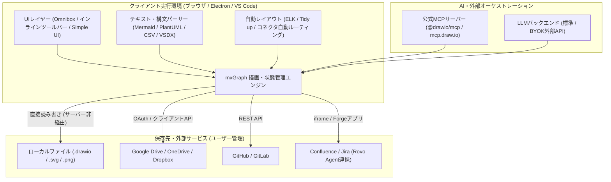

# **draw.io (diagrams.net) 調査レポート**

## **1. 基本情報**

* **ツール名**: draw.io (diagrams.net)
* **ツールの読み方**: ドロー・アイオー / ダイアグラムス・ドット・ネット
* **開発元**: JGraph Ltd
* **公式サイト**: [https://app.diagrams.net/](https://app.diagrams.net/)
* **関連リンク**:
  * GitHub: [https://github.com/jgraph/drawio](https://github.com/jgraph/drawio)
  * DeepWiki: [https://deepwiki.com/jgraph/drawio](https://deepwiki.com/jgraph/drawio)
  * ドキュメント: [https://www.drawio.com/docs/](https://www.drawio.com/docs/)
  * 情報サイト: [https://www.drawio.com/](https://www.drawio.com/)
  * レビューサイト: [G2](https://www.g2.com/products/draw-io/reviews) | [Capterra](https://www.capterra.com/p/181384/draw-io/)
* **カテゴリ**: UI/UX/作図
* **概要**: Webブラウザおよびデスクトップ（Electron）上で動作する無料のオープンソース作図ツール。フローチャート、UML、ER図、クラウド構成図など多様な図をアカウント登録なしで作成でき、データはGoogle Drive、OneDrive、GitHub、ローカルデバイスなど任意の保存先に保存できる。2026年にはAIによる図生成機能、公式MCPサーバー（`@drawio/mcp`）、ELK/Tidy upによる自動レイアウト、編集可能なテキスト/Mermaid変換などが大幅に強化された。

## **2. 目的と主な利用シーン**

* **解決する課題**:
  * 高価な専用ソフト（Visioなど）を使わずに、高品質な技術図・業務図を作成したい
  * インストールやアカウント登録不要で、どのPCからでも安全に図を編集したい
  * テキストベース（Mermaid/CSV/自然言語）とGUI作図の双方を組み合わせて設計図を効率的にメンテナンスしたい
* **想定利用者**: ソフトウェアエンジニア、インフラ/クラウドアーキテクト、デザイナー、学生、ビジネスパーソン全般
* **利用シーン**:
  * ソフトウェア設計図（UML、ER図、シーケンス図）の作成とGit管理
  * AWS/Azure/GCPなどのクラウド構成図の作成
  * 業務フローチャート・組織図・CSVデータからの表/構造図の生成
  * AIアシスタント（Claude、ChatGPT、Cursor、VS Code Copilot等）と連携した作図自動化

### **2.1 代表的な利用フロー**

```mermaid
swimlane-beta TB
  subgraph User["ユーザー"]
    A[プロンプト入力または図形配置]
    E[GUI上で細部を編集・スタイル調整]
    G[エクスポートまたは保存形式を選択]
  end
  subgraph Editor["draw.io エディタ"]
    B[AI Generate / Mermaid・CSV解析]
    C[mxGraphエンジンで図形描画]
    D[Tidy up / ELKで自動レイアウト]
  end
  subgraph AI_MCP["外部AI / MCPサーバー"]
    B2[MCP経由で図構造XMLを生成]
  end
  subgraph Storage["保存先ストレージ"]
    F[ローカル / Google Drive / GitHub等へ保存]
  end
  A --> B
  A --> B2
  B2 --> C
  B --> C
  C --> D
  D --> E
  E --> G
  G --> F
```

* **代表的な流れ**: ユーザーはWeb版やデスクトップ版での直接作図に加え、内蔵のAI Generate機能・テキスト構文（Mermaid/CSV）・外部AI（`@drawio/mcp`）から図を生成し、draw.ioエディタ上の`mxGraph`エンジンおよび自動レイアウト（ELK/Tidy up）で整形した後、ローカルやクラウドストレージ・Gitリポジトリへ保存します。

## **3. 主要機能**

* **豊富な図形ライブラリとマルチカラー対応**: フローチャート、UML、BPMN、ネットワーク機器（AWS 2026最新記法、GCP3、Azure、Cisco等）など膨大なステンシルを標準搭載。3D図形や主要ライブラリで複数色の個別指定（マルチカラー）やカスタムシャドウに対応している。
* **編集可能なテキスト・Mermaid・CSVからの図生成**: `Arrange > Insert > Mermaid` や `Insert > From Text` により、Mermaid記法・PlantUML・SQL・CSVから図を生成可能。生成された図は単なる静的画像ではなく編集可能なネイティブ図形コンテナとして配置され、再編集時も手動のスタイル変更を保持できる。
* **AI Generate機能と公式MCPサーバー（`@drawio/mcp`）**: ツールバーのAI Generate機能（OpenAI、Anthropic、Google Gemini等のカスタムAPIキー/BYOK設定にも対応）による自然言語からの図生成に加え、公式MCPサーバー（`https://mcp.draw.io/mcp` および `npx @drawio/mcp`）によりClaude、ChatGPT、Cursor、VS Codeなどから直接 `.drawio` 図を生成・インラインプレビューできる。
* **高度な自動レイアウト（ELK / Tidy up / Style My Diagram）**: ELK（Eclipse Layout Kernel）を活用した自動整列や、提案型の「Tidy up」レイアウトエンジン、ロールや属性に応じて統一スタイルを適用する「Style My Diagram」機能を備える。
* **Exploreビューアとプレゼンテーションモード**: 複雑な図をステップごとに辿れるExploreビューア（2026年10月刷新）や、レーザーポインター・ドラッグパン・ライトボックス表示に対応したプレゼンテーション機能を搭載。
* **コマンドパレット（Omnibox）とインラインツールバー**: メニュー検索・アクション実行・選択図形の書式変更を素早く行えるOmniboxや、図形選択時に表示されるインラインツールバーにより操作効率を高めている。
* **多様な保存先とインポート/エクスポート**: Google Drive、OneDrive、Dropbox、GitHub、GitLab、ローカルデバイスを保存先に選択可能。`.drawio` (XML) のほか、PNG、JPEG、SVG（編集データ埋め込み可）、PDF、HTML出力や、Visio（`.vsdx`）・Gliffyのインポートに対応。
* **VS Code連携とAtlassian統合**: VS Code拡張機能によるエディタ内作図や、Confluence/Jira向けアプリ（Atlassian Rovo対応のdraw.io Diagrams Agentを含む）によるエンタープライズ連携を提供する。

## **4. 動作原理・システム構成**

* **アーキテクチャ**: **クライアントサイド完結型（ローカルファースト / ゼロサーバーストレージ）のWebアプリケーション**を基本とする。コアライブラリである `mxGraph`（`mxgraph/`、`js/grapheditor/`、`js/diagramly/`）がブラウザ内のJavaScriptランタイム上で直接描画・編集・XMLシリアライズを実行する。デスクトップ版（`drawio-desktop`）は同一のWebエンジンをElectronでラップしてオフライン実行を可能にしており、外部アプリ組み込み用には `embed.diagrams.net` によるiframe + `postMessage` APIアーキテクチャを採用している。



* **主要コンポーネントとデータフロー**:
  * **ゼロサーバー保存**: 作図中のXMLモデルおよび編集履歴はクライアントメモリ内で管理され、保存時のみユーザーが指定したストレージ（ローカル、Google Drive、GitHub等）へ直接書き込まれる。draw.ioのサーバーへ図形データが永続保存されることはない。
  * **SVG/PNG埋め込み形式**: `.svg` や `.png` 形式でエクスポートする際、画像データ内部のメタデータにdraw.ioのXML定義を埋め込む仕組みを持ち、プレビュー表示と再編集を単一ファイルで両立する。
  * **AI・MCP連携パス**: 内蔵のGenerate機能や外部MCPクライアント（Claude、Cursor等）からのリクエストは、プロンプトからXML/Mermaid構造を生成し、クライアント側のパーサー・レイアウトエンジンを通じて編集可能なネイティブ図形としてキャンバスに展開される。
* **特筆すべき要素技術**:
  * **mxGraph**: 長年実績のあるクライアントサイドJavaScriptグラフ描画エンジン。SVG/HTMLベースの精密な座標制御、コネクタ自動ルーティング、カスタムシェイプ描画を担う。
  * **DOMPurify / セキュリティサンドボックス**: 外部テキストやSVG取り込み時のXSS対策として最新のDOMPurify（v3.4系）を組み込み、デスクトップ版ではローカルファイルアクセスの安全性を担保している。
  * **Service Workerによるオフラインキャッシュ**: Web版でもService Workerによりリソースキャッシュとオフラインフォールバックをサポートする。

## **5. 開始手順・セットアップ**

* **前提条件**:
  * モダンなWebブラウザ（Chrome、Firefox、Edge、Safariなど）
  * アカウント登録は不要（Google Drive、OneDrive、GitHub等と連携する場合のみ各サービスの認証を使用）
* **インストール/導入**:
  * **Web版**: インストール不要。[https://app.diagrams.net/](https://app.diagrams.net/) にアクセスするだけで即座に利用開始できる。
  * **デスクトップ版 / コンテナ版**: [GitHub Releases](https://github.com/jgraph/drawio-desktop/releases) からWindows/macOS/Linux用インストーラーを入手できるほか、セルフホスト用に公式Dockerイメージ（`jgraph/drawio`）も提供されている。
  * **公式MCPサーバー（AIアシスタント連携）**:

    ```bash
    # ローカルMCPツールサーバーの起動例（Claude Desktop / Cursor等から呼び出し）
    npx @drawio/mcp
    ```

* **初期設定**:
  * 初回アクセス時に「保存先」（Device、Google Drive、OneDrive、GitHubなど）を選択する。
  * 言語設定（メニューの言語アイコン等から日本語を選択可能）。
  * AI Generate機能で独自APIキーを使う場合は、`Extras > Configuration` から `<YOUR_API_KEY>` やエンドポイント設定を構成できる。
* **クイックスタート**:
  1. [https://app.diagrams.net/](https://app.diagrams.net/) にアクセス。
  2. 「Create New Diagram」をクリック。
  3. 「Blank Diagram」またはテンプレート（フローチャート、AWS構成図など）を選択して「Create」をクリック。
  4. キャンバスへ図形をドラッグ＆ドロップするか、`Arrange > Insert > Mermaid` / `Generate` から図を生成して保存する。

## **6. 特徴・強み (Pros)**

* **完全無料かつオープンソース**: Web版・デスクトップ版ともに機能制限や作成図数制限なしで無料利用できる。
* **クライアントサイド処理による高い安全性**: 作図データがdraw.ioのサーバーに送信・保存されないため、機密性の高いシステム構成図や社内資料でも安心して利用できる。
* **テキスト・AI・GUIのハイブリッド作図**: 手動での精密な作図に加え、編集可能なMermaid/CSV変換、Tidy up自動レイアウト、公式MCPサーバー（`@drawio/mcp`）によるAI生成までシームレスに組み合わせられる。
* **エンジニアフレンドリーな開発連携**: GitHub/GitLabへの直接保存、VS Code拡張機能、SVG埋め込みによる差分確認と再編集の両立など、ドキュメントをコードと同様に扱う運用に最適化されている。

## **7. 弱み・注意点 (Cons)**

* **リアルタイムコラボレーションの制限**: Google Drive連携時などは複数人での同時編集が可能だが、MiroやFigmaなどのリアルタイム共同編集に特化したSaaSに比べると、カーソル追従や付箋・コメント中心のワークショップ体験では劣る。
* **大規模図面でのパフォーマンス低下**: 数千要素を超える巨大な図面を単一ページで扱うと、ブラウザの描画負荷が高くなり動作が重くなる場合がある。
* **自由描画・デザイン表現の限界**: 構造化された作図に特化しているため、手書き風のラフな描画（Excalidraw）や高度なUIデザイン・プロトタイピング（Figma）には向かない。
* **日本語対応の状況**: エディタUIは日本語に完全対応しているが、公式ドキュメント（[drawio.com/docs](https://www.drawio.com/docs/)）、ブログの最新情報、GitHub Issue・サポート窓口は英語が中心となる。

## **8. 料金プラン**

| プラン名 | 料金 | 主な特徴 |
|---------|------|---------|
| **Web / Desktop版** | **無料** | 全機能利用可能（図数・期間制限なし）。保存先はユーザーが管理。 |
| **公式MCPサーバー (`@drawio/mcp`)** | **無料** | OSSパッケージおよびホスト型MCP App（`mcp.draw.io`）として無償提供。 |
| **Confluence / Jira Cloud** | 有料 | Atlassian Marketplace経由でのユーザー数課金。Zero EgressやRovo連携等を含む。 |
| **Confluence / Jira Data Center** | 有料 | オンプレミス・大規模エンタープライズ環境向けのライセンス。 |

* **課金体系**: Web版・デスクトップ版は完全無料。Atlassian製品（Confluence / Jira）への統合アプリのみ、契約ユーザー数に応じた従量課金となる。
* **無料トライアル**: Atlassian版にはAtlassian Marketplace標準の30日間無料トライアルがある（Confluence Cloud小規模チーム向け無料枠の提供実績もあり）。

## **9. 導入実績・事例**

* **導入企業・評価**: 世界中のソフトウェア企業、金融機関、教育機関、個人開発者に広く採用されている。Atlassianエコシステムにおいても高い評価を獲得しており、**Atlassian Partner of the Year 2026: Enterprise Apps** を受賞している。
* **導入事例**:
  * 企業の社内システム構成図・クラウドアーキテクチャの標準ドキュメントツールとしての全社導入（Confluence連携）
  * オープンソースプロジェクトにおけるGitHubリポジトリ内の設計図管理
  * SharePoint（Microsoft Marketplace版エディタ）やGoogle Workspaceアドオンを通じた業務フロー図の共有
* **対象業界**: IT・ソフトウェア業界を中心に、製造、金融、教育、官公庁まで全業界。

## **10. サポート体制**

* **ドキュメント**: [公式ドキュメント](https://www.drawio.com/docs/) および [公式ブログ](https://www.drawio.com/blog/) に詳細なユーザーガイド、FAQ、新機能解説が掲載されている（英語中心）。
* **コミュニティ**: [GitHub Issues / Discussions](https://github.com/jgraph/drawio) や Stack Overflow などで活発に質問・バグ報告・情報交換が行われている。
* **公式サポート**: 無料のWeb版・デスクトップ版ユーザー向けの個別サポートはないが、GitHub経由での不具合報告が可能。Atlassian（Confluence / Jira）版やSharePoint版の商用ライセンス契約ユーザーには公式のエンタープライズサポートが提供される。

## **11. エコシステムと連携**

### **11.1 API・外部サービス連携**

* **API / 組み込み**: URLパラメータ制御や `embed.diagrams.net` を用いたiframe + `postMessage` 通信（`embedLoaded` イベント等）により、自社Webアプリへエディタを組み込める。
* **MCP連携**: 公式MCPサーバー（`@drawio/mcp` / `https://mcp.draw.io/mcp`）により、Claude、ChatGPT、Cursor、VS Code GitHub Copilot、Claude Code等のAIエージェントと直接連携。
* **外部サービス連携**:
  * **ストレージ**: Google Drive、OneDrive、Dropbox、GitHub、GitLab
  * **ドキュメント・業務基盤**: Confluence、Jira（Atlassian Rovo Agent連携含む）、SharePoint（Microsoft Marketplaceアプリ）、Google Docs/Sheets/Slidesアドオン、Notion（埋め込み）、Trello
  * **開発環境**: VS Code（公式推奨拡張機能）

### **11.2 技術スタックとの相性**

| 技術スタック | 相性 | メリット・推奨理由 | 懸念点・注意点 |
|:---|:---:|:---|:---|
| **VS Code** | ◎ | 拡張機能でIDE内から直接 `.drawio` / `.drawio.svg` を編集でき、Git運用と相性が良い。 | 巨大ファイルではエディタが重くなる場合がある。 |
| **GitHub / GitLab** | ◎ | XMLやSVGファイルをリポジトリに直接保存・バージョン管理可能。 | 生XMLはPR差分が読みにくいため、SVG形式での保存が推奨される。 |
| **Atlassian (Confluence / Jira)** | ◎ | 公式統合アプリとRovo Agentにより、ページ文脈と同期したAI図生成・更新が可能。 | 有料ライセンスが必要。 |
| **AIアシスタント (MCP対応)** | ◎ | `@drawio/mcp` により自然言語から `.drawio` 図の生成とチャット内プレビューが可能。 | 複雑な配置は生成後にGUIでの微調整が推奨される。 |
| **Google Workspace** | ◯ | Google Drive保存による共同編集やDocs/Slidesアドオンでの埋め込みが可能。 | 連携時にGoogleアカウントおよび最小権限の許可が必要。 |

## **12. セキュリティとコンプライアンス**

* **認証**: draw.io本体へのアカウント登録やログインは不要。クラウド保存先（Google Drive、OneDrive、GitHub等）を利用する場合のみ、各プロバイダーのOAuth/認証を利用する。
* **データ管理**: クライアントサイド処理により作図データはブラウザやローカル端末内で処理され、draw.ioのサーバーに保存されない。Atlassian Cloud向けには外部へのデータ流出を防ぐZero Egress構成のアプリも提供されている。またAI機能についても企業ポリシーに応じて無効化設定やBYOK（自社管理LLMエンドポイント）の指定が可能。
* **準拠規格**: Web版自体はクライアント側ツールのため、データの保管コンプライアンスはユーザーが選択した保存先（ローカル、Google Workspace、GitHub等）に依存する。Atlassian Marketplace版等のエンタープライズ製品については、Atlassian Cloud Fortifiedプログラムやセキュリティ要件に対応している（詳細はAtlassian MarketplaceのTrust情報参照）。

## **13. 操作性 (UI/UX) と学習コスト**

* **UI/UX**: VisioやOfficeソフトに近い直感的なインターフェースを採用。2026年にはメニューやアクション・書式変更を一括検索できるコマンドパレット風の「Omnibox」、選択図形用の「インラインツールバー」、モダンな「Simple Modern」テーマの拡充により、操作性がさらに向上している。
* **学習コスト**: 低い。ドラッグ＆ドロップとコネクタ接続だけで基本的な図がすぐ描ける。レイヤー、カスタムスタイルルール、ELK詳細設定などの高度な機能は段階的に習得できる。

## **14. ベストプラクティス**

* **効果的な活用法 (Modern Practices)**:
  * **VS Code + `.drawio.svg` 運用**: 設計図をSVG（編集データ埋め込み）形式でGit管理すると、GitHub上でのプレビュー閲覧とVS Code/draw.ioでの再編集を1ファイルで両立できる。
  * **Mermaid / AI生成とGUI仕上げの併用**: 初期構造はAI Generateや `@drawio/mcp`、Mermaid構文で素早く生成し、細部のレイアウトや注釈はGUIと「Tidy up」で整える。
  * **スタイルルールの活用**: 「Style My Diagram」やテンプレートを活用し、チーム内で配色・フォント・AWS/GCP記法を統一する。
* **陥りやすい罠 (Antipatterns)**:
  * **1ファイルへの過度な詰め込み**: 巨大な1枚のキャンバスに全システムを描くと描画が重くなるため、ページ分割やファイル分割を行う。
  * **編集データなしの画像エクスポート**: 通常のPNG/JPEGとして保存し元の `.drawio` ファイルを破棄すると、後から図形単位で再編集できなくなる。
  * **自動生成図の手動レイアウト上書き**: Mermaidコンテナ内の図形配置を手動で大きく動かした後にテキスト側を再パースすると、配置がリセットされる点に注意する（色・フォント等のスタイルは保持される）。

## **15. ユーザーの声（レビュー分析）**

* **調査対象**: G2、Capterra、GitHub Discussions
* **総合評価**: 4.4/5.0 (G2・450件以上) / 4.6/5.0 (Capterra・750件以上)
* **ポジティブな評価**:
  * 「完全無料で登録も不要、それでいてVisioの代替として十分な機能を備えている」
  * 「豊富なアイコンライブラリ（AWS/ネットワーク等）とドラッグ＆ドロップの直感的な操作性が素晴らしい」
  * 「ローカル保存やGoogle Drive/GitHub連携など、データの保存場所を自分でコントロールできる安心感がある」
* **ネガティブな評価 / 改善要望**:
  * 「メニューやパネルが多く、初見ではUIがやや古く雑然として見えることがある」
  * 「要素数が非常に多いエンタープライズ規模の図面では動作が重くなることがある」
  * 「無料版には個別のカスタマーサポートがない（またデスクトップ版の自動保存周りに改善の余地がある）」
* **特徴的なユースケース**:
  * ソフトウェア開発チームによるGitHubリポジトリ内でのアーキテクチャ図管理
  * ネットワークエンジニアによる物理/論理トポロジー図の作成
  * 学生や研究者による論文・技術資料向けの図表作成

## **16. 直近半年のアップデート情報**

* **2026-11-17**: v32.7.4 リリース（`Insert > From Text` へのTable追加によりCSVから編集可能なテーブル図を生成可能に、Embedモードの `embedLoaded` イベント追加、DOMPurify 3.4.18更新、Trelloカード上のビューア修正等）
* **2026-11-13**: v32.7.3 リリース（アクション・メニュー・書式を横断検索できるコマンドパレット風 **Omnibox** 追加、Simple UIへのレイアウト選択・Simple Modernテーマの大幅刷新、テキストからの編集可能な図生成の強化）
* **2026-11-06**: v32.7.0 および公式MCP連携公開（**Tidy up** 自動レイアウトエンジン、ルールベースで配色を整える **Style My Diagram**、新Lightboxビューアを追加。また公式MCPサーバー `@drawio/mcp` / `mcp.draw.io` を通じたClaude・ChatGPT・VS Code・Cursorでの作図対応を発表）
* **2026-10-29**: Confluence Cloud向け **draw.io Diagrams agent for Atlassian Rovo** を公開（Rovoによる編集可能なAI図生成やページ文脈との同期に対応）
* **2026-10-21**: v32.6.0 リリース（図形選択用のインラインツールバー追加、力学モデルを用いたExploreビューア・スプリング移動・プレゼンテーションのレーザーポインター機能追加、コネクタの自動ルーティング強化）
* **2026-09-17**: Microsoft Marketplace向けに **draw.io Diagram Editor for SharePoint** を公開
* **2026-08-04**: AI **Generate** ツールを刷新（プロンプトからの編集可能な図生成精度と反復修正機能を向上、AWS 2026記法ライブラリや3D図形のマルチカラー対応も順次展開）
* **2026-07-03**: **編集可能なMermaid図** のサポート強化（Mermaidコンテナ内での手動スタイル維持と再パースの両立）
* **2026-06-26**: ELK（Eclipse Layout Kernel）を用いた自動レイアウト機能を強化
* **2026-05-27**: v30.0.4 リリース（GCP3ステンシルの更新など）
* **2026-05-26**: v30.0.3 リリース（DOMPurifyのアップグレード、UI改善、マルチカラー対応の拡張など）
* **2026-05-09**: v30.0.0 リリース（メジャーリリース: アダプティブカラーのページ設定追加、フローティングウィンドウの状態保持など）
* **2026-02-22**: v29.5.2 リリース（バグ修正）
* **2026-01-08**: v29.3.0 リリース（機能改善）

(出典: [GitHub Releases](https://github.com/jgraph/drawio/releases) / [ChangeLog](https://github.com/jgraph/drawio/blob/dev/ChangeLog) / [draw.io Blog](https://www.drawio.com/blog/))

## **17. 類似ツールとの比較**

### **17.1 機能比較表 (星取表)**

| 機能カテゴリ | 機能項目 | draw.io | Miro | Lucidchart | Visio |
|:---:|:---|:---:|:---:|:---:|:---:|
| **基本機能** | 精密な技術作図 (UML/構成図) | ◎ | ◯ | ◎ | ◎ |
| **コラボレーション** | リアルタイム共同編集 | ◯<br><small>G Drive連携時</small> | ◎<br><small>非常に強力</small> | ◎ | △ |
| **コスト** | 無料プランの充実度 | ◎<br><small>全機能無料</small> | △<br><small>ボード数制限あり</small> | △<br><small>オブジェクト数制限</small> | ×<br><small>有料のみ</small> |
| **プラットフォーム** | オフライン利用 | ◎<br><small>Desktop版/PWA</small> | ×<br><small>非対応</small> | △ | ◎ |
| **開発者向け** | VS Code / Git連携 | ◎ | △ | × | × |
| **AI・自動化** | AI作図 / MCP連携 | ◯<br><small>AI Generate/MCP対応</small> | ◎<br><small>Miro AI/Sidekicks</small> | ◯<br><small>Lucid AI搭載</small> | △ |

### **17.2 詳細比較**

| ツール名 | 特徴 | 強み | 弱み | 選択肢となるケース |
|---------|------|------|------|------------------|
| **draw.io** | 無料・高機能・セキュア | 完全無料、登録不要、ローカル/Git保存の自由度、VS Code・MCP連携 | 付箋を使ったブレストや大規模リアルタイム共同編集ではMiroに劣る | コストをかけずに本格的な技術図を作成したい場合。セキュリティ重視・Git管理したい開発チーム。 |
| **Miro** | 無限キャンバス・コラボ | チームでのアイデア出し、ホワイトボード機能、豊富な外部連携とMiro AI | 作図専用ツールに比べオフライン利用不可・有料プランのコストがかかる | チームでのブレインストーミング、ワークショップ、アジャイル計画。 |
| **Lucidchart** | 統合型作図SaaS | 豊富なテンプレート、データ連携機能、エンタープライズガバナンス | 無料版の制限が厳しく、継続利用には有料プランが必要 | 大企業での標準クラウド作図ツールとして統制を効かせたい場合。 |
| **Visio** | 伝統的な作図ツール | Microsoft Office連携、詳細な図形制御 | 高価、ブラウザ中心の軽量な共有やGit連携には不向き | 既にMicrosoft 365/Visio資産で統一されている企業環境。 |

## **18. 総評**

* **総合的な評価**:
  * 無料で利用できる作図ツールとして圧倒的な完成度を誇る定番ツール。2026年後半のアップデートにより、従来の「登録不要・セキュア・無料」という強みに加え、公式MCPサーバー（`@drawio/mcp`）、AI Generate、編集可能なMermaid/CSV変換、Tidy up自動レイアウト、Omniboxなど次世代の作図ワークフローにも対応した。
* **推奨されるチームやプロジェクト**:
  * 予算を抑えたいスタートアップや個人開発者
  * GitHub/GitLabやVS Codeで設計ドキュメントを管理しているソフトウェア開発チーム
  * データを外部SaaSサーバーに預けたくないセキュリティ要件の厳しいプロジェクト
  * ClaudeやCursorなどのAIアシスタントと連携して構成図を効率よく生成したいエンジニア
* **選択時のポイント**:
  * コストゼロで高品質な技術図・業務図を描き、ファイルやGitで管理したいなら **draw.io** が最適。
  * 複数人でのリアルタイムなブレインストーミングや付箋ワークを中心に据えるなら **Miro** を検討するとよい。
