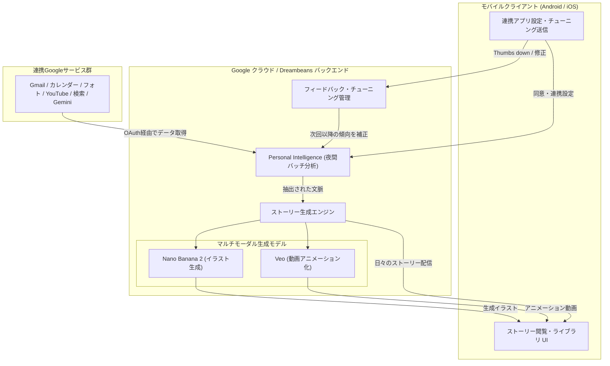

# **Dreambeans 調査レポート**

## **1. 基本情報**

* **ツール名**: Dreambeans
* **ツールの読み方**: ドリームビーンズ
* **開発元**: Google (Google Labs)
* **公式サイト**: [https://labs.google/dreambeans](https://labs.google/dreambeans)
* **関連リンク**:
  * ドキュメント (公式ブログ): [https://blog.google/innovation-and-ai/models-and-research/google-labs/dreambeans/](https://blog.google/innovation-and-ai/models-and-research/google-labs/dreambeans/)
* **カテゴリ**: 特定用途AIアシスタント
* **概要**: Dreambeansは、Google Labsが開発した実験的なAIアプリです。ユーザーの同意のもとでGoogleアカウントデータ（Gmail、Google カレンダー、Google フォト、YouTube、Google 検索履歴、Geminiなど）を連携させ、毎日パーソナライズされた有限の「ストーリー（beans）」を自動生成します。Nano Banana 2による独自のイラスト生成に加え、Veoによる動画アニメーション化にも対応しており、無限スクロールに代わる新しい情報体験を提供します。

## **2. 目的と主な利用シーン**

* **解決する課題**: ユーザーが日々直面するデジタルノイズや無限のスクロール（doomscrolling）を減らし、自分にとって本当に重要な情報や興味関心・予定に焦点を当てられるようにする。
* **想定利用者**: 米国およびインド在住の18歳以上で、個人のGoogleアカウントを利用しているユーザー（2026年9月より米国で無料一般公開、同年11月よりインドへ提供拡大）。
* **利用シーン**:
  * 朝一番にその日の予定や関連するトピック（例：友人の訪問と近隣のレストラン提案）を、厳選された10〜14件程度のストーリーで確認する。
  * 趣味や新しい関心事（例：新しいペットの飼育方法、レシピ、旅行計画）に関する情報を深掘りし、ライブラリに保存する。
  * 自分の思い出や日常の出来事を、AIが生成した水彩画風のイラストやVeoによるショートアニメーションで楽しむ。

### **2.1 代表的な利用フロー**

```mermaid
swimlane-beta TB
  subgraph User["ユーザー"]
    A["連携Googleサービスと出力言語を設定"]
    E["朝に配信されたストーリーを閲覧"]
    F["詳細確認・保存やチューニングを実施"]
  end
  subgraph Dreambeans["Dreambeans (アプリ・バックエンド)"]
    B["設定されたデータソースの同意を管理"]
    D["有限のストーリーカード群を配信"]
    G["フィードバックを次回生成へ反映"]
  end
  subgraph GoogleServices["連携Googleサービス"]
    C1["Gmail・カレンダー・写真・YouTube・検索・Geminiから文脈を抽出"]
  end
  subgraph GenAI["生成AIモデル群"]
    C2["Nano Banana 2・Veo等でイラスト・動画を生成"]
  end
  A --> B
  B --> C1
  C1 --> C2
  C2 --> D
  D --> E
  E --> F
  F --> G
```

* **代表的な流れ**: ユーザーが連携するGoogleサービスを選択すると、夜間にDreambeansのバックエンドが対象データから文脈を抽出し、生成AIモデル群でイラストやアニメーション付きのストーリーを作成して翌朝アプリへ配信します。ユーザーの閲覧やフィードバック（チューニング）は翌日以降の生成精度向上に活かされます。

## **3. 主要機能**

* **Personal Intelligenceとの連携**: ユーザーの明示的な同意のもと、Gmail、Google カレンダー、Google フォト、YouTube、Google 検索の履歴、およびGeminiのデータを統合し、日常の文脈や関心を横断的に理解する。
* **日々のストーリー生成（Daily Drop）**: 連携したデータからユーザーに関連性の高いトピックやイベントを抽出し、無限フィードではなく毎日10〜14件程度の有限な「ストーリー」として朝に配信する。
* **Nano Banana 2によるイラスト生成**: 各ストーリーに対して画像生成AI「Nano Banana 2」を用いて独自のイラストを作成する。Google フォトの顔認識（face grouping）が有効な場合、ユーザーや家族・ペットなどを反映したパーソナライズ画像が生成される。
* **Veoによるストーリーの動画アニメーション化**: Googleの動画生成モデル「Veo」を統合し、特定のストーリー内のイラストを短い動画クリップとして動的にアニメーション化できる。
* **チューニング機能とプライバシー管理**: 不適切な提案や誤認識に対して「Thumbs down」やチューニングボタンで修正フィードバックを送れるほか、連携アプリの個別オン/オフや履歴の完全削除がプロフィール設定から行える。
* **深掘りアクションとライブラリ保存**: 気になるストーリーをタップするとライブのWeb情報へアクセスして予約や検索などのアクションにつなげたり、お気に入りのストーリーを個人ライブラリに保存したりできる。

## **4. 動作原理・システム構成**

* **アーキテクチャ**: クラウド完結型のパーソナルAIパイプラインと、モバイルネイティブクライアント（Android / iOS）で構成される。Google Labsの実験的アプリであるため詳細な内部アーキテクチャは非公開だが、公開情報に基づき夜間の非同期バッチ処理による生成モデルを採用している。
* **主要コンポーネントとデータフロー**:
  * **モバイルクライアント (iOS / Android)**: OAuth認証、連携データソースの同意管理、翌朝のストーリー閲覧UI、ライブラリ保存、およびチューニングフィードバックの送信を担う。
  * **データ統合・コンテキスト抽出層 (Personal Intelligence)**: 許可されたGmail、カレンダー、フォト、YouTube、検索履歴、Geminiのデータを夜間に横断分析し、直近の予定・購買・興味関心の結びつきを抽出する。
  * **マルチモーダル生成層**: 抽出された文脈をもとにテキストストーリーを生成し、Nano Banana 2で水彩画風などのパーソナライズイラストを描画、さらに一部のストーリーではVeoを用いて画像を短尺動画へ変換する。
* **特筆すべき要素技術**:
  * **非同期・有限配信設計**: リアルタイムのチャット応答ではなく夜間バッチ処理で有限のストーリーセット（beans）を生成する設計により、複数アプリに跨る深い推論と画像・動画生成のレイテンシを吸収しつつデジタルウェルビーイングを担保している。
  * **Google フォト顔グルーピング連携**: ユーザーの許可範囲内でGoogle フォトの人物・ペット認識を活用し、生成イラストへの本人反映を実現している。



## **5. 開始手順・セットアップ**

* **前提条件**:
  * 米国またはインドに在住していること。
  * 18歳以上であること。
  * 個人のGoogleアカウント（Gmail）を持っていること。（2026年9月以降、米国ではGoogle AI Ultraサブスクリプションやウェイトリストは不要となった）
* **インストール/導入**:
  * iOS（App Store）またはAndroid（Google Play）から「Dreambeans」アプリをダウンロードする。
* **初期設定**:
  * アプリを起動し、個人のGoogleアカウントでログインする。
  * 出力言語を選択する（英語のほか、インド展開に伴いヒンディー語など13のインド地域言語から選択可能）。
  * Dreambeansと連携するGoogleサービス（Gmail、カレンダー、フォト、YouTube、検索履歴、Gemini）を選択・許可する（最低1つの連携が必要）。
* **クイックスタート**:
  * 初期設定完了後、最初の夜間処理を経て、翌朝（最大1日以内）に最初のストーリーコレクションが配信される。

## **6. 特徴・強み (Pros)**

* **無料で利用可能なGoogleエコシステム横断のパーソナライズ**: 2026年9月以降は有料サブスクリプション不要で利用でき、GmailからYouTube、Geminiまでのデータを横断してプロアクティブな提案を受け取れる。
* **Nano Banana 2とVeoによる高い視覚的魅力**: ストックフォトではなくユーザー自身や身の回りの文脈を反映したイラストやアニメーション動画が生成され、パステル調の洗練されたUIと相まって高い体験価値を提供する。
* **デジタルウェルビーイングを重視した設計**: 無限スクロールを排し、1日1回・有限数のストーリーに絞ることで情報過多やdoomscrollingを防ぐ設計思想が高く評価されている。
* **粒度の細かいプライバシー制御**: 連携するGoogleアプリを個別にオン/オフでき、フィードバック履歴の確認や生成データの完全削除（Delete my data）がアプリ内からいつでも実行できる。

## **7. 弱み・注意点 (Cons)**

* **日本国内・日本語は未対応**: 2026年11月時点で提供地域は米国とインドのみ、対応言語は英語とインドの13地域言語（計14言語）に限られており、日本語対応および日本での提供は未定である。
* **1ストーリーあたり単一言語出力の制約**: 複数言語のデータを横断して文脈を理解することは可能だが、出力言語は設定した1言語のみに固定される（例：ヒングリッシュのような言語混在出力には非対応）。
* **文脈の誤解釈やイラストの不自然さ**: 実験段階のアプリであるため、家族やペットの数を誤認したり、既に何度も訪れた店を推薦したりすることがあるほか、Google フォト由来の顔反映イラストが時に不自然・シュール（creepy/silly）に見える場合がある。
* **広範な個人データへのアクセス懸念と反映遅延**: Gmailや検索履歴、写真など機密性の高いデータをAIに連携させることへの心理的ハードルがあり、また夜間バッチ処理のためチューニング結果が即座には反映されない。

## **8. 料金プラン**

| プラン名 | 料金 | 主な特徴 |
|---------|------|---------|
| **一般公開プラン（米国・インド）** | 無料 | 18歳以上の個人Googleアカウントで利用可能。連携機能、イラスト・Veo動画生成など全機能を提供。 |

* **課金体系**: 2026年6月の初期リリース時は「Google AI Ultra」サブスクリプション加入者かつウェイトリスト通過者限定だったが、2026年9月10日に米国で無料一般公開へ移行し、2026年11月3日のインド展開でも無料提供されている。
* **無料トライアル**: アプリ自体が無料で提供されている（対象地域・年齢制限あり）。

## **9. 導入実績・事例**

* **導入企業**: 一般消費者向けの実験的パーソナルアプリであるため、法人向けの公開導入事例はなし。
* **導入事例**:
  * 新しいペット用品を購入したGmailの領収書履歴から、犬のしつけのヒントや近隣のドッグフレンドリーなスポットを提案。
  * Google カレンダーの「友人の訪問」や旅行予定と、検索履歴・YouTubeの視聴傾向を掛け合わせ、滞在先のレストランやアクティビティをイラスト付きで提案。
* **対象業界**: 一般消費者向け（ライフスタイル・パーソナルアシスタンス）。

## **10. サポート体制**

* **ドキュメント**: 公式ブログおよび公式サイト（[https://labs.google/dreambeans](https://labs.google/dreambeans)）にFAQ・ヘルプ情報が掲載されている。
* **コミュニティ**: 専用の公式フォーラムは設けられておらず、Google LabsやReddit等でユーザー間の情報交換が行われている。
* **公式サポート**: 実験的なGoogle Labs製品であるため、アプリ内のフィードバック機能（Thumbs down・問題報告）を通じたサポートが中心となる。

## **11. エコシステムと連携**

### **11.1 API・外部サービス連携**

* **API**: 外部開発者向けの公開APIやSDKは提供されていない。
* **外部サービス連携**: Googleの自社サービス群（Gmail、Google カレンダー、Google フォト、YouTube、Google 検索、Gemini）とOAuthベースでネイティブ連携する。他社製SaaSとの直接連携機能はない。

### **11.2 技術スタックとの相性**

| 技術スタック | 相性 | メリット・推奨理由 | 懸念点・注意点 |
|:---|:---:|:---|:---|
| **各種Googleサービス** | ◎ | ネイティブで統合されており、アプリ内からワンタップで連携・解除が可能。 | Dreambeans側の連携設定は他のAI機能（Gemini Apps等）の拡張設定とは独立して管理される。 |
| **iOS / Android モバイル環境** | ◎ | 両プラットフォーム向けにネイティブアプリが提供されており、通知や保存が快適。 | Webブラウザ版は提供されておらず、モバイルアプリ専用となっている。 |
| **Web / 外部開発基盤** | × | 該当なし。 | 公開APIやWebhookが存在しないため、外部システムへの組み込みは不可。 |

## **12. セキュリティとコンプライアンス**

* **認証**: 個人のGoogleアカウントによるOAuth/SSO認証（Google Workspace管理下の法人アカウントではなく個人アカウントが対象）。
* **データ管理**: アプリ内のプロフィール設定から、連携するGoogleサービス（Gmail、フォト等）のオン/オフを個別に制御可能。フィードバック履歴の確認・削除や「Delete my data」による生成データの一括削除にも対応している。
* **準拠規格**: Googleの標準的なプライバシーポリシー（[https://policies.google.com/privacy](https://policies.google.com/privacy)）およびGoogle Labs利用規約に準拠する。

## **13. 操作性 (UI/UX) と学習コスト**

* **UI/UX**: 無限スクロールを排し、パステルカラーを基調とした視覚的でミニマルなカード型UIを採用している。CNETなどのメディアやアプリストアのレビューでも、洗練された美しいデザインとアニメーション表現が高く評価されている。
* **学習コスト**: 初期設定で連携したいGoogleサービスを選択すれば、あとは毎朝自動でストーリーが届く受動的な体験であるため、プロンプトエンジニアリング等の知識は不要で学習コストは極めて低い。

## **14. ベストプラクティス**

* **効果的な活用法 (Modern Practices)**:
  * 複数のGoogleサービス（Gmail、カレンダー、写真、YouTube、検索、Gemini）をバランスよく連携させ、単一アプリでは得られない横断的な文脈提案を引き出す。
  * 気に入ったストーリーや旅行・趣味のアイデアはライブラリへ保存し、実際の予定や検索アクションへつなげる。
  * 不適切な提案や誤認識があった場合は積極的に「Thumbs down」やチューニング機能を使い、翌日以降のパーソナライズ精度を磨く。
* **陥りやすい罠 (Antipatterns)**:
  * フィードバックがリアルタイムに即座反映されると期待すること（実際には夜間バッチ処理のため翌日以降の配信から反映される）。
  * 連携するアプリを1つだけに極端に制限し、プロアクティブな提案の幅や関連性を狭めてしまうこと。

## **15. ユーザーの声（レビュー分析）**

* **調査対象**: Apple App Store, Google Play, 関連テックメディア (CNET, PCMag, Droid Life, Tom's Guide)
* **総合評価**: 4.8〜4.9 / 5.0 (Apple App Store、1,000件以上のユーザー評価に基づく)
* **ポジティブな評価**:
  * 無限スクロール（doomscrolling）を止め、1日約10件程度の有限ストーリーで完結する設計が精神衛生上よいと高評価（Tom's Guide / CNET）。
  * パステル調で視覚的に洗練されたUIや、Google フォトを活用したパーソナライズイラスト・アニメーションがユニークで楽しいとの声が多い。
  * 連携データソースを細かく制御・削除できるプライバシー管理の透明性が評価されている。
* **ネガティブな評価 / 改善要望**:
  * Google フォトの顔認識をもとに生成される家族やペットのAIイラストが、時にシュールまたは不気味（creepy / silly）に見えることがある（Droid Life）。
  * 古い情報をもとにしたり、ペットの数を間違えたり、既に何度も訪れた地元レストランを推薦したりと文脈の誤解釈が見られる。
  * Gmail・写真・検索履歴などへの広範なアクセス許可に抵抗を感じるユーザーが少なくない。
  * 一部のローカルスポット提案や情報カードが、純粋なパーソナル提案というより一般的な推薦や広告のように感じられるという指摘がある（App Storeレビュー）。
* **特徴的なユースケース**:
  * 買い物履歴（Gmail）と予定（カレンダー）、さらにGeminiや検索履歴を掛け合わせた、休日の過ごし方やペット・旅行関連のアイデア出し。

## **16. 直近半年のアップデート情報**

* **2026-11-03**: 初の海外展開としてインドでの提供を開始。英語に加え13のインド地域言語（ヒンディー語、ベンガル語、テルグ語、マラーティー語、タミル語、ウルドゥー語、グジャラート語、カンナダ語、マラヤーラム語、オディア語、パンジャーブ語、アッサム語、ネパール語）の計14言語に対応。また、動画生成モデル「Veo」によるストーリーのアニメーション化およびGeminiデータの連携にも対応。
* **2026-09-10**: 米国におけるウェイトリストおよびGoogle AI Ultraサブスクリプションの制限を撤廃し、個人のGoogleアカウントを持つ18歳以上の全米国ユーザー向けに無料一般公開。
* **2026-06-03**: Dreambeans アプリの初期リリース（Android/iOS）。米国の一部Google AI Ultraユーザー向けに提供開始。

(出典: [Google Blog - Google Labs](https://blog.google/innovation-and-ai/models-and-research/google-labs/) / [Dreambeans公式サイト](https://labs.google/dreambeans))

## **17. 類似ツールとの比較**

### **17.1 機能比較表 (星取表)**

| 機能カテゴリ | 機能項目 | Dreambeans | Gemini (Google) | ChatGPT (OpenAI) | Google Discover |
|:---:|:---|:---:|:---:|:---:|:---:|
| **基本機能** | パーソナライズド情報提供 | ◎<br><small>個人データ横断で毎日生成</small> | ◯<br><small>対話形式で提供</small> | ◯<br><small>対話・Memory機能で提供</small> | ◯<br><small>検索や閲覧履歴に基づくニュース</small> |
| **基本機能** | プロアクティブな提案 | ◎<br><small>毎朝自動で有限ストーリー配信</small> | △<br><small>基本はプロンプト起点</small> | △<br><small>基本はプロンプト起点</small> | ◯<br><small>フィード形式で受動的に閲覧</small> |
| **連携・拡張** | Google個人データ連携 | ◎<br><small>Gmail・写真・YouTube・Gemini等</small> | ◯<br><small>Workspace連携に対応</small> | △<br><small>外部コネクタ・ファイル経由</small> | ×<br><small>メールや予定との深い連携なし</small> |
| **生成能力** | 画像・動画パーソナライズ | ◎<br><small>Nano Banana 2 + Veoで本人反映</small> | ◯<br><small>汎用的な画像・動画生成</small> | ◯<br><small>汎用的な画像生成</small> | ×<br><small>生成機能なし</small> |
| **利用環境** | 日本語・日本国内対応 | ×<br><small>米国・インドのみ（英語等14言語）</small> | ◎<br><small>日本語・日本国内で広く提供</small> | ◎<br><small>日本語・日本国内で広く提供</small> | ◎<br><small>日本語・日本国内で標準提供</small> |

### **17.2 詳細比較**

| ツール名 | 特徴 | 強み | 弱み | 選択肢となるケース |
|---------|------|------|------|------------------|
| **Dreambeans** | 個人のデータを元に毎日有限のストーリーを生成 | 広範なGoogleサービス連携、Nano Banana 2・Veoによる独自ビジュアル、無料 | 米国・インド限定で日本語非対応、能動的な質問には不向き | - |
| **Gemini (Google)** | Googleの対話型AIアシスタント（Gemini 4 Argon等） | 高度なマルチモーダル推論、Workspace連携、日本語完全対応 | 受動的な朝の情報ダイジェスト体験は限定的 | 能動的にタスク処理や質問・調査を行いたい場合 |
| **ChatGPT (OpenAI)** | OpenAIの汎用対話型AI（GPT-5ファミリー等） | 高い汎用性、Search・Canvas機能、豊富なエコシステム | Googleの個人データ（写真・YouTube等）への直接アクセスは弱い | 幅広い知識探索や文書作成・コーディング等の汎用用途 |
| **Google Discover** | 興味関心に基づくニュースフィード | 最新ニュースやトレンド収集に強く、日本語で即利用可能 | 個人の予定やメール、写真と連動したストーリー生成は不可 | 世の中のニュースや興味分野の記事を手軽に読みたい場合 |

## **18. 総評**

* **総合的な評価**:
  * Dreambeansは、Googleが持つパーソナルデータ（メール、予定、写真、YouTube、検索、Gemini）を最大限に活用し、ユーザーにとって本当に重要な情報を有限の「ストーリー」として届ける意欲的なAIアプリです。2026年9月の無料一般公開、11月のVeo動画化対応とインド展開（14言語対応）を経て、実験的なプレビューから実用的なコンシューマー向けAI体験へと大きく前進しました。無限スクロールを止めさせ、視覚的かつパーソナライズされた情報体験を提供する設計は高く評価できます。
* **推奨されるチームやプロジェクト**:
  * ビジネスチームでの業務利用というよりは、Googleエコシステムを日常的に活用している個人ユーザー（現状は米国・インド在住者）が、日々の予定や趣味・生活の発見を楽しむ用途に適しています。
* **選択時のポイント**:
  * 能動的にAIへ質問や作業を依頼したい場合はGeminiやChatGPTが適していますが、毎朝受動的に自分だけのパーソナライズされたトピックをイラストや動画とともに楽しみたい場合にはDreambeansが独自の選択肢となります。ただし日本国内・日本語は未対応であるため、日本からの利用には今後の展開を待つ必要があります。
