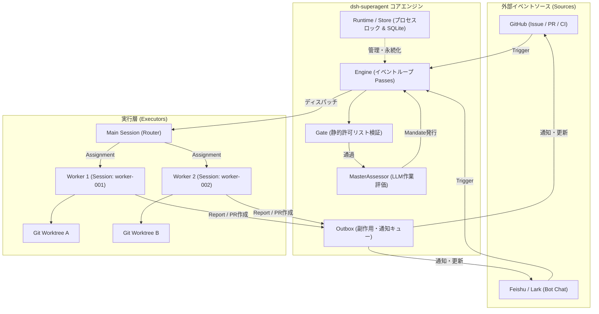

# **dsh-superagent-prototype 調査レポート**

## **1. 基本情報**

* **ツール名**: dsh-superagent-prototype（パッケージ・システム内呼称: dsh-superagent）
* **ツールの読み方**: ディーエスエイチ・スーパーエージェント・プロトタイプ / ディーエスエイチ・スーパーエージェント
* **開発元**: DeepSeek-AI（DeepSeek Harness Team）
* **公式サイト**: [DeepSeek Harness 公式サイト](https://www.deepseek.com/en/harness/)
* **関連リンク**:
  * GitHub: [deepseek-ai/dsh-superagent-prototype](https://github.com/deepseek-ai/dsh-superagent-prototype)
  * ドキュメント: [dsh-superagent Docs](https://github.com/deepseek-ai/dsh-superagent-prototype/tree/main/docs)
  * 設計論文 / 記事: [Exploring Super-agent Design: Towards a More Autonomous Agent System](https://github.com/deepseek-ai/dsh-superagent-prototype)
* **カテゴリ**: 自律型コーディングエージェント
* **概要**: DeepSeekの研究チームが公開した、単一のGitHubリポジトリ（およびFeishu）を常時監視してプロアクティブに開発タスクを遂行する自律型コーディングエージェントの研究プロトタイプ（Research Prototype）である。「人間の注意力を可能な限り奪わず、最大の価値を提供する（Take as little human attention as possible, and give as much value as possible）」という徹底した設計思想のもと、中央ルーター（Router）と独立ワーカー（Worker）からなるアーキテクチャを採用し、タスクごとに独立したセッションとディレクトリで並行作業を行う。

## **2. 目的と主な利用シーン**

* **解決する課題**:
  * **人間の注意力の枯渇（Human Attention Bottleneck）**: 従来のコーディングエージェントは途中経過の報告や細かい確認質問、雑多なチャット返答によって人間の認知リソースを過剰に浪費していた。本ツールは「人間が介入すべき瞬間（判断・レビュー・障害）」のみに発言を絞ることでチームのノイズを最小化する。
  * **単一セッションによるブロッキング**: 1つのプロンプト・セッション内で複数の作業を行うと、長時間のビルドやテストでコンテキストが汚染・停止し、他メンバーからの割り込みに対応できなかった。本ツールはRouter-Worker分離により、重いタスクが進行中でも新規リクエストを並行して受け付ける。
  * **未認可リクエストやボット無限ループによる暴走**: 許可リスト（Allowed list）や二層評価（GateとAssessment）、イミュータブルな委任状（Mandate）により、悪意あるPRやボット同士の連鎖発言、過剰な自動PR作成を構造的に防ぐ。
* **想定利用者**:
  * **リポジトリメンテナー / テックリード**: 夜間や不在時でも、Issueのバグ再現や修正ドラフトPRを自律的に作成させ、朝一にレビューを行いたいエンジニア。
  * **ソフトウェア開発チーム**: GitHub IssueやFeishuチャット上で `@agent` メンションを飛ばすだけで、バックグラウンドで修正作業を進めてもらい、結果をプルリクエストで受け取りたい開発者。
  * **AIエージェント・アーキテクチャ研究者**: 従来の「LLMチャットラッパー」を超え、OSのスケジューリングやメモリ管理、権限分離の概念を取り入れた次世代自律型エージェントの参照実装を学びたい研究者。
* **利用シーン**:
  * **Issueからの自動バグ再現・ドラフトPR生成**: 開発者がIssueでメンションすると、エージェントが要件を評価して専用ワークスペースを展開し、修正とテストを実行してドラフトPRを作成・報告。
  * **CIテスト失敗やレビュー指摘への自動追従**: プルリクエストに紐づくスレッドの更新を購読し、CIの失敗ログを解析して修正コミットを追加。
  * **Feishu/Larkチャットからのカジュアルなタスク依頼**: チャット上でメンションされた機能要望や調査依頼を受け付け、GitHubリポジトリ上でチケットを発行して作業。
  * **Web監視パネルによるチーム監督**: 「今、人間の判断を必要としているチケット」が最上部に整理されたダッシュボードを通じ、最小限の時間でエージェントを監督・承認。

### **2.1 代表的な利用フロー**

```mermaid
swimlane-beta TB
  subgraph User["ユーザー / 開発者"]
    A["Issueやチャットで @agent メンションして依頼"]
    F["Webパネルで質問に回答 / PRをレビュー"]
  end
  subgraph Router["Router (メインセッション)"]
    B["Trigger受信: Gate認可とAssessment評価"]
    C["Mandateを発行しTicketを作成・作業を割り当て"]
  end
  subgraph Worker["Worker (個別作業セッション)"]
    D["Git Worktree環境でコード編集・テスト実行"]
    E["必要時に質問を構造化送信 / ドラフトPRを作成"]
  end
  subgraph Platform["外部基盤 (GitHub / Feishu)"]
    A1["Webhook/ポーリングでイベントを発行"]
    E1["PR・コメント・ブランチの反映"]
  end
  A --> A1
  A1 --> B
  B --> C
  C --> D
  D --> E
  E --> E1
  E1 --> F
```

* **代表的な流れ**: 開発者がGitHub IssueやFeishu上でメンションすると、外部基盤のイベントがRouterに届く。Routerは送信者が許可リストに載っているかをGateで確認し、MasterAssessorがタスクを評価してMandate（認可情報）付きTicketを作成する。Ticketは独立したWorkerセッションとGit Worktreeディレクトリに割り当てられ、Workerが自律的に修正・テストを実行する。作業中は余計な途中経過を報告せず、明確な質問が必要な場合やPRが完成した場合のみ通知を行い、開発者はWebパネルやGitHub上でレビューを実施する。

## **3. 主要機能**

* **Router-Worker分離アーキテクチャ**: 全体のイベント監視と認可判定を担う「Router（メインセッション）」と、チケットごとに起動される独立した「Worker（作業セッション）」を完全に分離。重い処理が走ってもシステム全体がブロッキングされない。
* **二層評価システム (Gate & Assessment)**: 受信したトリガー（Trigger）をまず静的なルール（許可リスト・スコープ）でフィルタリングする「Gate」と、LLMを用いてタスクの受託可否と範囲を厳格に判定する「Assessment」の2段階で評価。
* **イミュータブルな Mandate（委任認可）機構**: チケット作成時にポリシーバージョン、許容スコープ、送信者権限を記録した「Mandate」を発行。途中でプロンプトインジェクション等があっても初期に承認された範囲を超える操作をコードレベルで拒絶。
* **最小注意コスト型コミュニケーションプロトコル**: 「作業中は沈黙を守り、人間が判断すべき事項または成果物が出来た時だけ発言する」仕様。質問時は自由文の長文ではなく構造化された単一の質問を送信。
* **バックグラウンドジョブ自動昇格（5秒ルール）**: Workerセッション内で実行されたシェルコマンドが5秒を超えた場合、自動的にtmuxバックグラウンドジョブへ移行。長時間ビルドやテスト中もエージェントが入力を受け付けられる。
* **人間介入特化型 Web パネル**: DeepSeek HarnessのWeb UIに「Superagent」タブを提供。Overview、Source、Trigger、Eval、Execution、Settingsの6画面で構成され、「今、人間の助けを待っているチケット」を最上位に一覧表示。
* **マルチソース監視 (GitHub & Feishu)**: GitHubのIssue、Pull Request、コメント、CI通知のポーリング/Webhook監視に加え、Feishu/Larkのチャットボット連携を標準サポート。
* **Agent-guided Setup（対話型エージェントセットアップ）**: `SETUP.md` の指示に基づき、外部のコーディングエージェント（Antigravity、Claude Code等）がユーザーに対話形式で1問ずつ質問しながら環境構築・ラッパー生成を代行。

## **4. 動作原理・システム構成**

* **アーキテクチャ**: ローカルホストまたは専用サーバー常駐型のマルチセッション・イベント駆動アーキテクチャ。DeepSeek Harness（DSH）およびCordisフレームワークを基盤とし、ストレージ・コンピュート・外部連携が疎結合に設計されている。
* **主要コンポーネントとデータフロー**:
  * **Runtime (`src/app/runtime.ts`)**: アプリケーションのコンポジションルート。Storeの初期化、プロセスの排他ロック（`proper-lockfile`）、ライフサイクル（起動・停止・シグナルハンドリング）を管理。
  * **Engine (`src/core/engine.ts`)**: 2秒間隔およびイベント駆動で走るイベントループ（Passes）を統括。SourceからのTriggerを受け取り、バッチ単位で評価・ディスパッチを行う。
  * **MasterAssessor (`src/core/assessor.ts`)**: 受信トリガーに対してGate認可を行い、LLMセッションを用いて作業妥当性を評価。承認時はイミュータブルなMandateを生成。
  * **DshExecutor (`src/executor/`)**: チケットごとに `worker-<ticket-id>` という独立セッションを作成し、`<stateDir>/work/<ticket-short-name>` にGit Worktree作業ディレクトリを配置してコード編集とコマンド実行を行う。
  * **Outbox & Effects (`src/infra/outbox.ts`)**: GitHubへのPR作成やコメント投稿、Feishuへのメッセージ送信などの副作用をキュー管理し、冪等性を担保しながら確実に配信。
  * **Web UI (`src/client/`)**: React 18で構築されたDSH Web拡張画面。チケットのステータス遷移や手動リトライ、ポリシー設定を提供。



* **特筆すべき要素技術**:
  * **Cordis 4.x マイクロカーネル**: 依存性注入とライフサイクル管理を担うプラグイン基盤。すべての機能がサービスとして疎結合に登録される。
  * **Git Worktree**: 単一リポジトリを複数Workerで共有しながら、ワーキングツリーとHEADを完全に分離。ブランチの競合を起こさずに並行してビルドやテストを実行可能。
  * **tmux バックグラウンドセッション**: 5秒以上かかる長時間のシェルコマンドを即座にtmuxジョブに逃がすことで、Workerのコンテキストがロックされるのを防ぎ、途中割り込みを可能にする。
  * **proper-lockfile & SQLite**: ステートディレクトリの二重起動防止と、チケット・トリガー・ポリシー履歴の耐障害性ストレージ。

## **5. 開始手順・セットアップ**

* **前提条件**:
  * Node.js 22.19+ または 24+、pnpm 11+
  * Git 2.32+、tmux、Python 3.8+
  * GitHub CLI (`gh`) 2.48+
  * DeepSeek Harness (`dsh`) 0.2.1-alpha.2+
  * LLMプロバイダ（DeepSeek API等のAPIキーがDSH側に設定されていること）
  * エージェント専用のGitHubアカウント（自身の個人アカウントではなく専用アカウントを用意）

* **インストール/導入**:

  ```bash
  # リポジトリのクローン
  git clone https://github.com/deepseek-ai/dsh-superagent-prototype.git
  cd dsh-superagent-prototype

  # 依存関係のインストール（frozen-lockfile推奨）
  pnpm install --frozen-lockfile

  # ビルドと型チェック
  pnpm check
  ```

* **初期設定**:
  1. **エージェント専用CLIラッパーの作成**:
     オペレーター個人のクレデンシャルと混ざらないよう、専用のconfigディレクトリを持つラッパー `gh-agent` を作成する。

     ```bash
     mkdir -p ~/.local/bin
     cat << 'EOF' > ~/.local/bin/gh-agent
     #!/bin/sh
     GH_CONFIG_DIR="$HOME/.config/gh-agent" exec gh "$@"
     EOF
     chmod +x ~/.local/bin/gh-agent

     # エージェント専用アカウントでログイン
     gh-agent auth login
     ```

  2. **DeepSeek Harness 専用プロファイルの作成**:
     常用プロファイルと分離するため、`superagent` プロファイルを作成してバンドルを組み込む。

* **クイックスタート**:
  本ツール最大の特徴として、セットアップはコーディングエージェントに支援させることが推奨されている。普段利用しているAIコーディングアシスタント（Claude CodeやAntigravity等）に対し以下のように指示する：

  ```text
  Read SETUP.md in this repository and set up dsh-superagent with me.
  ```

  エージェントが `SETUP.md` に従い、リポジトリ名、エージェントアカウント名、許可ユーザーリストなどを1問ずつ質問し、計画を提示した上で自動構成を完了させる。

## **6. 特徴・強み (Pros)**

* **「人間の注意コスト最小化」への徹底したこだわり**: 従来のAIエージェントのように作業中の独り言や無駄な挨拶を垂れ流さず、結果やブロッカーが出た時だけ簡潔に発言するため、チーム開発におけるノイズが極めて少ない。
* **Router-Worker分離による非ブロッキング並行性**: タスクごとにGit WorktreeとWorkerセッションを切り離すため、1つのタスクが重いビルドやテストで時間を要していても、別の緊急Issueやレビュー依頼を並行処理できる。
* **OSライクな堅牢なスケジューリングと状態管理**: 5秒を超えるコマンドのtmux自動退避、30分タイムアウト時のプロセス強制回収、障害発生時のステート復元など、従来の単一プロンプトラッパーとは一線を画すOS水準の堅牢性。
* **厳格な認可とポリシー駆動**: 誰がどのIssueで指示できるかをGateとMandateで二重ロック。プロンプトインジェクションによる権限昇格や意図しないリポジトリ破壊を根本から抑止。
* **洗練された監視Webパネル**: 「今、人間の介入が必要なチケット」が最上部に整理され、ワンクリックで質問への回答や再評価が行える優れた運用UX。

## **7. 弱み・注意点 (Cons)**

* **研究プロトタイプとしての公開（非公式製品）**: 公式のDeepSeek製品ではなく、あくまでリサーチプロトタイプ（Research Prototype）である。コードやAPIの破壊的変更、未解決の不具合が含まれる可能性がある。
* **単一リポジトリ（Single Repository）への限定**: 1つのdsh-superagentインスタンスは単一のGitHubリポジトリを対象に設計されている。複数リポジトリにまたがる作業やモノレポ横断の統合制御には向かない。
* **ホストOS権限での実行（`danger-full-access`）**: WorkerセッションはオペレーターのOSユーザー権限で直接シェルコマンドを実行する。環境を安全に保つためには、専用のLinuxユーザーを作成するかコンテナ内で実行する運用が強く推奨される。
* **日本語ドキュメントおよび自然言語運用の制約**: ドキュメントおよび内蔵プロンプトはすべて英語で記述されている。日本語でのIssue指示やコメントにもLLMの能力次第で応答は可能だが、システムメッセージやプロンプトテンプレートの調整が必要となる場合がある。
* **DeepSeek Harnessエコシステムへの依存**: スタンドアロンのCLIツールではなく、DeepSeek Harness（DSH）およびCordisフレームワークのバンドルとして動作するため、稼働環境のセットアップ要件が多い。

## **8. 料金プラン**

| プラン名 | 料金 | 主な特徴 |
|:---|:---:|:---|
| **オープンソース (MIT)** | **無料** | ソースコード全体、Web管理パネル、全ドキュメントを自由に利用・改変可能 |
| **LLM API利用料** | **従量課金** | DeepSeek API（またはOpenAI互換API）のトークン消費に応じた実費が発生 |

* **課金体系**: ソフトウェア自体は完全無料のオープンソース。評価（Assessor）および実行（Worker）で消費されるLLMのトークン費用のみがAPIプロバイダに対して発生する。
* **無料トライアル**: 各種LLMプロバイダの初回クレジット等を利用することで実質無料で動作検証が可能。

## **9. 導入実績・事例**

* **導入企業**: DeepSeek社内開発チーム（DeepSeek Harness Team）
* **導入事例**: DeepSeek社内の日常的なソフトウェア開発業務においてドッグフーディングされており、コードベース自体の多くがコーディングエージェントによって作成・リファクタリングされている。また、設計論文「Exploring Super-agent Design: Towards a More Autonomous Agent System」において、ノイズの多いGitHubストリームを効率的にさばくシミュレーション結果が報告されている。
* **対象業界**: AI研究機関、OSSリポジトリ開発チーム、DevOps自動化を推進する先進的テック企業。

## **10. サポート体制**

* **ドキュメント**: リポジトリ内の `docs/` ディレクトリに、設計哲学（000）からドメインモデル（001）、認可（002）、実行（003）、プロンプト（004）、パネル（005）、デプロイ（006）、アーキテクチャ（007）、クックブック（008）まで、極めて体系的で網羅的な英語ドキュメントが完備されている。
* **コミュニティ**: GitHub IssuesおよびDiscussionsを中心としたオープンソースコミュニティ。
* **公式サポート**: 公式な商業サポートやSLAは提供されていない（研究用プロトタイプのため、利用者の自己責任運用となる）。

## **11. エコシステムと連携**

### **11.1 API・外部サービス連携**

* **GitHub**: GitHub CLI (`gh`) をラップしたコマンド経由で、Issue、Pull Request、コメント、CIステータスの読み取りおよび書き込みをフル自動化。
* **Feishu / Lark**: `lark-cli` を通じたメッセージ送受信、ボット連携、チャットグループメンバーのポリシー自動同期に対応。
* **DeepSeek Harness (DSH)**: DSHのセッションコントローラー、システムプロンプト注入、ツールレジストリ、Web UIと完全にネイティブ連携。
* **LLMバックエンド**: DeepSeek-V3やDeepSeek-R1をはじめ、OpenAI API規格に準拠した各種LLMプロバイダと接続可能。

### **11.2 技術スタックとの相性**

| 技術スタック | 相性 | メリット・推奨理由 | 懸念点・注意点 |
|:---|:---:|:---|:---|
| **TypeScript / Node.js** | ◎ | コアシステムの実装言語であり、Cordis・DSHプラグインとして最高水準の親和性 | Node 22.19+ / 24+ のモダン環境が必要 |
| **Git Worktree** | ◎ | チケットごとの並行開発ディレクトリ作成に標準採用されており、相性抜群 | リポジトリのローカルクローン管理が必要 |
| **tmux** | ◎ | 5秒ルールによる長時間コマンドのバックグラウンド自動退避に必須のコンポーネント | 実行環境へのtmux事前インストールが必須 |
| **Python** | ◯ | セットアップスクリプトや拡張スクリプト、データ処理の記述に利用可能 | コアランタイム自体はNode.js基盤 |
| **Docker / コンテナ環境** | ◯ | ホストOSの安全な隔離環境として専用コンテナ内で運用する構成に最適 | Worktree作成やtmuxセッションの取り扱いに設定工夫が必要 |

## **12. セキュリティとコンプライアンス**

* **認証**: オペレーター個人のクレデンシャルとは完全に分離された専用のGitHubアカウント・CLIラッパー（`gh-agent`）を使用。Feishuボットについても専用のApp ID/Secretによる最小限の権限付与を原則とする。
* **データ管理**: すべてのチケット状態、トリガー履歴、ポリシー設定はローカルホストのステートディレクトリ（SQLiteデータベースおよびファイル）に保存され、外部のSaaS等に無断送信されることはない。
* **準拠規格**: 研究プロトタイプのためSOC2やISO27001等の第三者認証は取得していない。Workerセッションは `danger-full-access` でホストOSのユーザー権限を直接持つため、本番サーバーにデプロイする際は専用のOSユーザー作成またはDockerコンテナによるサンドボックス化が必須のベストプラクティスとされている。

## **13. 操作性 (UI/UX) と学習コスト**

* **UI/UX**: DeepSeek Harness Web UIの専用サイドバー「Superagent」からアクセス可能なWebパネルが極めて直感的。状態（Overview）、トリガー履歴（Trigger）、認可判定結果（Eval）、チケット進行状況（Execution）が整理され、「今、人間に何が求められているか」が即座に把握できる。
* **学習コスト**: 初期セットアップは `SETUP.md` に従ったAIエージェントとの対話で完了するため導入自体のハードルは低い。ただし、Cordisのプラグイン構造やPolicy（Gate/Mandate）、プロンプトのオーバーライド機構を深くカスタマイズするには中級以上のアーキテクチャ理解が求められる。

## **14. ベストプラクティス**

* **効果的な活用法 (Modern Practices)**:
  * **許可リスト（Allowed list）を最初は1〜2名に限定する**: 導入初期は運用担当者のみを許可リストに登録し、エージェントの挙動とPR品質を十分に検証してからチーム全体へ開放する。
  * **初期は「observe」モードで稼働させる**: 自動実行（accept）ではなく、エージェントが何を行う予定だったかを記録のみ行う「observe（観測）」モードで数日間走らせ、プロンプトの調整を行う。
  * **Git Worktree専用の独立クローンを用意する**: 開発者が普段触るワーキングディレクトリとは別に、エージェント専用のローカルリポジトリクローンを `~/src/` 配下に配置する。
* **陥りやすい罠 (Antipatterns)**:
  * **オペレーター自身の個人アカウントでエージェントを動かす**: エージェントが投稿したコメントやPRがすべて個人の発言として扱われ、通知がループしたりチームの混乱を招く。必ず専用のボットアカウントを用意すること。
  * **日常利用のOSユーザー権限で無防備に常駐させる**: Workerはシェルコマンドを無制限に実行できるため、万一の誤作動でホームディレクトリ内の重要ファイルが削除・変更される恐れがある。専用OSアカウントで分離すること。
  * **プロンプトを長く複雑にしすぎる**: ノイズを減らそうとして過剰なルールをプロンプトに詰め込むと、モデルの指示追従性が悪化する。不要なプロンプトは削り、短く厳格な指示にとどめることがドキュメントでも強調されている。

## **15. ユーザーの声（レビュー分析）**

* **調査対象**: GitHub Discussions/Issues、Reddit（r/LocalLLaMA, r/MachineLearning）、X（旧Twitter）、テック系AIコミュニティ
* **総合評価**: リサーチプロトタイプでありながら、「人間の注意力を最小化する」というこれまでにない設計思想と、完成度の高いドキュメント・アーキテクチャに対して開発者・研究者から極めて高い評価と関心が集まっている。
* **ポジティブな評価**:
  * 「エージェントがやたらと通知してきて開発に集中できない問題に、明確な設計思想で回答を出している点が素晴らしい。」
  * 「Router-WorkerアーキテクチャとGit Worktreeによる並列化が非常に合理的。長時間ビルドでもエージェント全体が止まらない。」
  * 「000から008まで体系化されたドキュメントが、今後の自律型エージェント設計の教科書として役立つ。」
* **ネガティブな評価 / 改善要望**:
  * 「公式製品ではなくプロトタイプなので、本番環境への導入にはハードルがある。」
  * 「単一リポジトリ前提の作りなので、大規模なマイクロサービスや複数リポジトリの横断タスクに対応してほしい。」
  * 「DeepSeek Harness基盤が前提となっており、スタンドアロンCLIとして気軽に試すにはやや大掛かり。」
* **特徴的なユースケース**:
  * チームが退勤した後の夜間にIssueを走査させ、朝出社した時点でテスト済みの修正PRと明快な確認質問だけが届いている「夜間自律ワーカー」としての活用。

## **16. 直近半年のアップデート情報**

* **2026-10-31**: 研究プロトタイプ `dsh-superagent` の初回パブリック公開（コミット `6337fc8`、バージョン `0.1.0`）。設計論文「Exploring Super-agent Design: Towards a More Autonomous Agent System」で論じられたRouter-Workerアーキテクチャ、Gate/Mandate認可機構、Git Worktree並列実行、Web監視パネルを実装したリファレンスコードをOSSとしてリリース。

(出典: [GitHub リポジトリ コミット履歴](https://github.com/deepseek-ai/dsh-superagent-prototype/commits/main))

## **17. 類似ツールとの比較**

### **17.1 機能比較表 (星取表)**

| 機能カテゴリ | 機能項目 | dsh-superagent-prototype | Devin | Claude Code | OpenHands | Google Jules |
|:---:|:---|:---:|:---:|:---:|:---:|:---:|
| **アーキテクチャ** | Router-Worker並行処理 | ◎<br><small>セッション・Worktree分離</small> | ◯<br><small>クラウド環境内並行</small> | ×<br><small>単一セッション対話型</small> | △<br><small>単一ランタイムベース</small> | ◯<br><small>クラウド非同期実行</small> |
| **チーム連携** | 最小注意コスト設計 | ◎<br><small>沈黙・単一質問プロトコル</small> | △<br><small>チャット通知が多め</small> | ◯<br><small>CLIでの対話完結</small> | △<br><small>標準的なチャットUI</small> | ◯<br><small>PRベースのやり取り</small> |
| **権限管理** | Gate/Mandate認可 | ◎<br><small>イミュータブルな委任状</small> | ◯<br><small>クラウドサンドボックス</small> | △<br><small>コマンドごとの都度承認</small> | ◯<br><small>Dockerコンテナ隔離</small> | ◯<br><small>GitHub App権限連携</small> |
| **実行環境** | ローカル/自己ホスト | ◎<br><small>ローカル常駐型OSS</small> | ×<br><small>完全SaaS・クラウド</small> | ◎<br><small>ローカルCLI</small> | ◎<br><small>ローカルDocker / OSS</small> | ×<br><small>Googleクラウド基盤</small> |
| **ライセンス・費用** | OSS・無償利用 | ◎<br><small>MITライセンス</small> | ×<br><small>高額月額サブスク</small> | △<br><small>CLI無償・API従量課金</small> | ◎<br><small>MITライセンス</small> | △<br><small>一部プレビュー無料</small> |
| **非機能要件** | 日本語ドキュメント | △<br><small>英語ドキュメントのみ</small> | ◯<br><small>公式日本語対応</small> | ◯<br><small>多言語プロンプト対応</small> | △<br><small>有志翻訳・英語主体</small> | ◯<br><small>公式日本語ガイドあり</small> |

### **17.2 詳細比較**

| ツール名 | 特徴 | 強み | 弱み | 選択肢となるケース |
|:---|:---|:---|:---|:---|
| **dsh-superagent-prototype** | 「人間の注意を最小化する」思想を掲げるRouter-Worker型自律常駐エージェント | 高い並行性、Git Worktreeによる完全分離、OSライクな堅牢性、完全オープンソース | リサーチプロトタイプであり公式製品ではない、単一リポジトリ前提 | 自社リポジトリに常駐する自律エージェントの仕組みを自前ホスト・研究したい場合 |
| **Devin** | クラウド上で完結する商用完全自律型AIソフトウェアエンジニア | ブラウザ・シェル・エディタを完備した最高峰の自律タスク完遂能力 | 高額なサブスクリプション費用、完全クローズドソース | コストを厭わず、複雑な環境構築や自律開発をクラウド上で即座に外注したい場合 |
| **Claude Code** | ターミナル上で対話的に動作するAnthropic公式のコーディング支援CLI | 高速なレスポンス、大規模コードベースへの深い理解力、導入の簡便さ | 基本的に単一セッションであり、人間の前で逐次対話する運用スタイル | 開発者が自分のターミナル上でペアプログラミング的にタスクを進めたい場合 |
| **OpenHands** | Dockerコンテナ内で稼働するオープンソースの自律型ソフトウェア開発プラットフォーム | 豊富なツール連携、Web UI、コミュニティの活発さ | 実行セッションが重く、並行マルチタスク制御は設定がやや煩雑 | 実績あるOSS自律エージェント環境をコンテナ上で手軽にセルフホストしたい場合 |
| **Google Jules** | GitHubとシームレスに統合されたGoogleの非同期コーディングエージェント | GitHub IssuesやPRと直接連携し、クラウド上で自律修正・PR作成 | Googleのエコシステム依存、カスタマイズ性の制限 | クラウド管理の手間をかけず、GitHub中心の非同期PR作成エージェントを使いたい場合 |

## **18. 総評**

* **総合的な評価**:
  dsh-superagent-prototype は、自律型AIエージェントの実用化において最大のボトルネックとなっていた「人間の認知負荷（注意力の枯渇）」と「単一セッションのブロッキング」という2大課題に対し、OSのアーキテクチャ概念（スケジューリング、ストレージ・コンピュート分離、権限管理）を取り入れて正面から解決を図った極めて野心的な研究プロトタイプである。不要な発言を一切排除した「沈黙のWorker」と「厳格なRouter」による協調動作は、次世代のエージェント運用論として非常に完成度が高い。
* **推奨されるチームやプロジェクト**:
  * 自律型エージェントの社内プラットフォーム構築や研究を行っているAI基盤チーム
  * 夜間や不在時にIssueのバグ再現・修正PRを自動生成させ、朝一にレビューを行いたい少人数のリポジトリメンテナー
  * DeepSeek Harness（DSH）およびCordisエコシステムを活用した高度な自動化を目指す開発チーム
* **選択時のポイント**:
  すぐに本番環境で公式サポート付きの商用ツールを求める場合はDevinやGoogle Julesが適しているが、自社のローカル環境や専用サーバーでコードを安全に保ちながら、人間の注意力を浪費しない次世代の自律型エージェント基盤を検証・運用したい場合には、最有力かつ唯一無二の参照実装となる。
