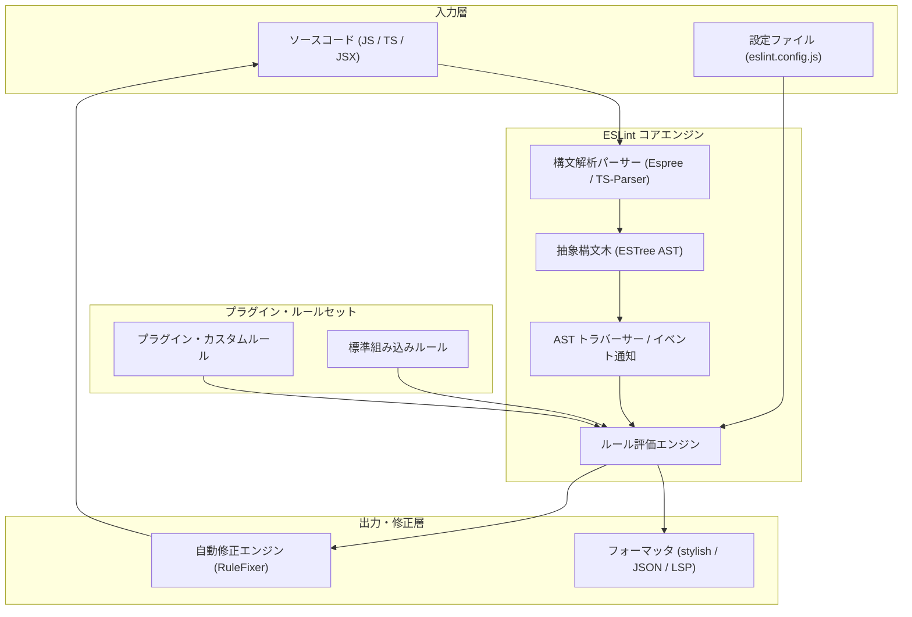

# **ESLint 調査レポート**

## **1. 基本情報**

* **ツール名**: ESLint
* **ツールの読み方**: イーエスリント
* **開発元**: ESLint Team (OpenJS Foundation)
* **公式サイト**: [https://eslint.org/](https://eslint.org/)
* **関連リンク**:
  * GitHub: [https://github.com/eslint/eslint](https://github.com/eslint/eslint)
  * ドキュメント: [https://eslint.org/docs/latest/](https://eslint.org/docs/latest/)
  * レビューサイト: [G2](https://www.g2.com/products/eslint/reviews)
* **カテゴリ**: コード品質/静的解析
* **概要**: ESLintは、JavaScript、JSX、TypeScriptなどのコードを構文解析（AST生成）し、潜在的なバグの検出、コーディング規約の遵守、自動修正を行うオープンソースの静的解析ツールです。v10系では従来の `.eslintrc` を完全撤廃してFlat Configへの統一を完了し、ファイル単位の設定解決やCodemodによるアップグレード自動化など、現代のWebエコシステムに最適化された進化を遂げています。

## **2. 目的と主な利用シーン**

* **解決する課題**:
  * 実行前（静的フェーズ）におけるランタイムエラーや潜在的バグ（未定義変数、デッドコード、非同期処理の誤用など）の検知。
  * チーム開発におけるコーディング作法やアーキテクチャ規約の不統一による可読性・保守性の低下。
  * コードレビューにおける機械的なスタイル指摘の手間削減とレビュー品質の標準化。
* **想定利用者**: JavaScript/TypeScriptを扱うWebフロントエンド開発者、Node.jsバックエンドエンジニア、ライブラリ作者、フルスタックエンジニア。
* **利用シーン**:
  * **IDE上でのリアルタイム解析**: コード記述中に問題箇所をインライン波線で即座に検知し、保存時に自動修正を実行。
  * **コミット前フック (lint-staged / husky)**: ステージングされた変更ファイルに対してのみ高速にリントを実行し、品質基準を満たさないコードのコミットを防止。
  * **CI/CDパイプラインでの品質ゲート**: プルリクエスト作成時にプロジェクト全体の静的解析と型ベースのリントを自動検証。

### **2.1 代表的な利用フロー**

```mermaid
swimlane-beta TB
  subgraph 開発者
    A[コード編集および保存]
    F[警告・修正内容の確認]
  end
  subgraph エディタ / IDE拡張
    B[変更検知とLSPリクエスト送信]
    E[インライン波線表示とクイックフィックス提示]
  end
  subgraph ESLint コアエンジン
    C[ソースコードをパースしてAST生成]
    D[ルール評価と自動修正差分を算出]
  end
  subgraph CIパイプライン
    G[コミット・PR時の全体リント検証]
  end
  A --> B
  B --> C
  C --> D
  D --> E
  E --> F
  F --> G
```

* **代表的な流れ**: 開発者がコードを保存するとエディタ拡張機能がESLintエンジンを呼び出し、AST解析を通じてリアルタイムに問題を通知します。自動修正可能な項目はその場で解決され、コミット後はCI環境でプロジェクト全体の品質検証が一括実行されます。

## **3. 主要機能**

* **静的解析とAST検証**: Espreeや`@typescript-eslint/parser`を使用してコードをESTree仕様のAST（抽象構文木）へ変換し、潜在的な不具合やアンチパターンを高精度に検出。
* **自動修正機能 (`--fix`)**: 構文の修正やインポート整理、安全なリファクタリングを自動適用し、手動修正の手間を最小化。
* **Flat Config (`eslint.config.js`)**: JavaScriptオブジェクトの配列として設定を定義するモダンな構成方式。依存関係の明示、設定のカスケード予測性の向上、ファイル単位の柔軟なルール適用を実現。
* **ファイル単位の設定探索アルゴリズム**: v10で標準化された仕組み。カレントディレクトリ固定ではなく、検査対象ファイルが存在するディレクトリから設定ファイルを探索するため、モノレポ構成での複数パッケージ検証がスムーズに動作。
* **JSXネイティブ参照トラッキング**: JSXコンポーネントタグをスコープ内の標準的な変数参照としてネイティブ追跡し、未使用変数判定などの誤検知を大幅に低減。
* **TypeScript完全統合 (typescript-eslint)**: 型チェッカーの型情報を活用した高度な静的解析（Promiseのハンドリング漏れ検知や安全な型キャストの強制など）に対応。
* **豊富なプラグインエコシステム**: React, Vue, Svelte, Next.js, Jest, Vitest, Tailwind CSSなど主要なライブラリ・フレームワークに特化した拡張ルールを自由に統合可能。
* **バルクサプレッション (Bulk Suppressions) API**: v10で拡張されたNode.js APIにより、大規模レガシーコードへの新規ルール導入時に既存警告を一括で抑制ファイルへ分離可能。
* **Codemod公式提携**: Codemod Registryと連携した公式コードモッド（`eslint/codemods`）を提供し、メジャーバージョン更新に伴う設定やルールの自動移行を支援。

## **4. 動作原理・システム構成**

* **アーキテクチャ**: Node.jsランタイム上で稼働するローカル完結型の静的解析エンジン。コードを外部クラウドへ送信することなく、開発端末やCIランナーのローカル環境内で完全に処理を実行。
* **主要コンポーネントとデータフロー**:
  * **Config Loader**: `eslint.config.js` を読み込み、対象ファイルのグロブパターンに応じたルールセットとプラグインを展開。
  * **Parser (Espree / typescript-eslint)**: ソースコード文字列をトークン化し、構文木（ESTree準拠AST）を構築。
  * **AST Traverser / Event Dispatcher**: 構築されたASTを深さ優先探索で走査し、各ASTノードの進入（Enter）および脱出（Exit）イベントを発火。
  * **Rule Engine**: 各ルールが登録したセレクターやビジター（Visitor）に応じてノードを検証し、違反を検知した場合はメッセージと修正指示（Fixer）を生成。
  * **RuleFixer & Reporter**: 修正指示を適用して修正済みソースコードを書き出すとともに、違反結果をフォーマッタ（`stylish`, `json` など）を通じてCLIやLSPクライアントに出力。



* **特筆すべき要素技術**:
  * **ESTree 仕様**: JavaScript ASTの共通標準仕様に基づく木構造の表現。
  * **Espree & Acorn**: 高速かつ厳格なECMAScript標準準拠のパーサー基盤。
  * **Node.js 標準 styleText**: v10において従来のサードパーティ依存からNode.js標準のテキスト装飾APIへ移行し、依存削減とセキュリティを向上。

## **5. 開始手順・セットアップ**

* **前提条件**:
  * Node.js v20.19.0 以上（Node.js v24.x LTS 推奨 ※ESLint v10よりNode.js要件が引き上げ）
  * npm, pnpm, または yarn パッケージマネージャー
* **インストール/導入**:

  ```bash
  # 対話型初期化ウィザードを使用する場合
  npm init @eslint/config@latest

  # 手動でインストールする場合
  npm install --save-dev eslint @eslint/js
  ```

* **初期設定 (`eslint.config.js`)**:

  ```javascript
  import js from "@eslint/js";

  export default [
    js.configs.recommended,
    {
      rules: {
        "no-unused-vars": "warn",
        "no-undef": "error",
        "prefer-const": "error"
      }
    }
  ];
  ```

* **クイックスタート**:

  ```bash
  # カレントディレクトリ配下のファイルを検査
  npx eslint .

  # 検出された問題を自動修正
  npx eslint . --fix
  ```

## **6. 特徴・強み (Pros)**

* **圧倒的なエコシステムとデファクトスタンダードの実績**: Web業界における事実上の標準ツールであり、React、Next.js、Vue、Angularなど主要なあらゆるエコシステムに最適化された公式・サードパーティプラグインが揃う。
* **Flat Configへの完全移行による明瞭な設定モデル**: 従来の隠蔽された暗黙的設定解決（extendsの魔法）を排し、標準的なJavaScriptモジュールとして依存関係と配列順序で直感的に構成可能。
* **型情報を活かした厳格な静的解析**: `typescript-eslint` の Type-Aware Linting を併用することで、単なる構文チェックを超えた安全な型推論に基づく高品質なバグ検知が可能。
* **きめ細やかな自動修正機能**: 単純なセミコロン付与から複雑な構文の書き換えまで、ASTレベルでの正確な自動修正（`--fix`）を提供。
* **Codemodによるアップグレード自動化**: 公式Codemodレジストリが整備されており、メジャーアップデート時の設定ファイル書き換え工数を大幅に圧縮可能。

## **7. 弱み・注意点 (Cons)**

* **ネイティブ言語製ツール（Biome / Oxlint）に対する実行速度の差**: JavaScript/Node.jsランタイム上で動作するため、Rust等で実装された次世代ツール群と比較して大規模コードベースでのパース・解析速度にオーバーヘッドがある。
* **歴史的移行コストと設定の学習**: 長年親しまれた `.eslintrc` 形式がv10で完全撤廃されたため、古いチュートリアル記事との乖離や、未対応の古いコミュニティプラグインに対するFlat Config互換ラッパー設定が必要となる場合がある。
* **コードフォーマッタ（Prettier）との責務分離設計の必要性**: ESLint自体のコードスタイル整形ルールは非推奨化が進んでおり、Prettier等のフォーマッタと組み合わせる際は競合回避（`eslint-config-prettier` など）の設定が前提となる。
* **ドキュメントの日本語化状況**: 公式ドキュメントは英語が主軸であり、最新のマイナーアップデート情報や詳細なAPIリファレンスは英語を参照する必要がある（ただし国内の技術ブログやコミュニティによる日本語情報は非常に豊富）。

## **8. 料金プラン**

| プラン名 | 料金 | 主な特徴 |
|---|---|---|
| **OSS (MIT License)** | 完全無料 | コアエンジン、全組み込みルール、プラグインAPI、CLIなど全機能を無制限に利用可能。 |

* **課金体系**: 完全無料のオープンソースソフトウェア。商用利用・個人利用を問わず無償で利用可能。
* **スポンサーシップ/寄付**: OpenJS Foundation傘下プロジェクトとして、Open CollectiveおよびGitHub Sponsors経由で企業・個人からの寄付を受け付け、メンテナーへの報酬や開発資金に充当。

## **9. 導入実績・事例**

* **導入企業**: Microsoft, Google, Meta (Facebook), Netflix, Airbnb, Shopify, Vercel, Stripe など、国内外のテック企業の大半が標準採用。
* **導入事例**:
  * React、Vue.js、Next.js、TypeScript等の主要フロントエンドOSSリポジトリでリント基盤として採用。
  * エンタープライズ開発における社内共有ルールセット（Shareable Config）の策定基盤として活用。
* **対象業界**: Webサービス、モバイルアプリ（React Native）、クラウドサービス、SaaS、受託開発など、JavaScript/TypeScriptを用いるあらゆる業界・組織。

## **10. サポート体制**

* **ドキュメント**: [公式ドキュメント（eslint.org）](https://eslint.org/docs/latest/)にて、全ルールの詳細な挙動、コード例、Flat Configマイグレーションガイド、Node.js API仕様が包括的に提供されている。
* **コミュニティ**: 
  * [GitHub Discussions](https://github.com/eslint/eslint/discussions) および Discordサーバーにて開発者・メンテナー間のQ&Aが活発に進行。
  * Stack Overflowや国内技術コミュニティ（Zenn, Qiita）でも膨大な知見が蓄積。
* **公式サポート**: OpenJS FoundationによるOSSコミュニティ主導のサポート体制。商用SLAサポートは提供されないが、セキュリティ報告窓口（Tidelift連携）や迅速なパッチリリース体制が確立されている。

## **11. エコシステムと連携**

### **11.1 API・外部サービス連携**

* **API**: プログラマティックに実行可能なNode.js API（`ESLint` クラス、`SourceCode`、`RuleTester`）を提供し、ビルドスクリプトやカスタムツールチェーンへの組み込みが可能。
* **外部サービス連携**:
  * **エディタ**: VS Code (ESLint拡張機能)、WebStorm、Neovim、Sublime Text等。
  * **CI/CDツール**: GitHub Actions、GitLab CI、CircleCI、Bitbucket Pipelinesなど。
  * **Git フック**: Husky、lint-staged、pre-commit と連携したコミット時自動チェック。
  * **自動化サービス**: Renovate、Dependabot によるバージョン管理、Codemodによる移行自動化。

### **11.2 技術スタックとの相性**

| 技術スタック | 相性 | メリット・推奨理由 | 懸念点・注意点 |
|:---|:---:|:---|:---|
| **TypeScript** | ◎ | `typescript-eslint` により型情報を利用した精密な解析が可能。 | 型付きリント（project設定）は解析時間が延びるためキャッシュ活用が必須。 |
| **React / JSX** | ◎ | `eslint-plugin-react-hooks` によりフック規約を強制可能。JSX参照トラッキングがネイティブ対応。 | スタイル整形ルールはPrettierに委譲することが推奨。 |
| **Next.js** | ◎ | Next.js公式で `eslint-config-next` が提供され、フレームワーク特有の最適化を自動チェック。 | Flat Configへの移行設定で公式ガイドの確認が必要。 |
| **Vue.js / Nuxt** | ◎ | `eslint-plugin-vue` によりSFC（単一ファイルコンポーネント）のtemplate/scriptを一括解析。 | 専用パーサー（`vue-eslint-parser`）の指定が必要。 |
| **Node.js (ランタイム)** | ◎ | Node.js標準API（`node:` プレフィックス）やモダンESM構文の静的チェックが容易。 | Node.js v20.19.0未満のレガシー環境では動作不可。 |

## **12. セキュリティとコンプライアンス**

* **認証**: ツール自体の利用にアカウント認証は不要。
* **データ管理**: 外部サーバーへのテレメトリ送信やコード送信は一切行われず、すべての解析・修正処理がローカル環境およびプライベートCI環境で完結。
* **準拠規格・セキュリティ維持**:
  * `eslint-plugin-security` などのプラグインを導入することで、危険な正規表現（ReDoS）やEval使用、安全でないモジュール読み込みなどの脆弱性を検知可能。
  * 依存関係の脆弱性対応が迅速に行われており、直近でも `minimatch` 依存を引き上げて正規表現展開脆弱性を回避するなどのメンテナンスを徹底。

## **13. 操作性 (UI/UX) と学習コスト**

* **UI/UX**: 
  * 主にCLIおよびエディタ内統合で利用。VS Code等の拡張機能では、問題箇所に赤や黄色の波線が表示され、ホバーするとルールの詳細説明と修正ドキュメントリンクが表示される。
  * クイックフィックス（`Ctrl + .` / `Cmd + .`）によるワンクリック自動修正が可能。
  * v10の改善により、長大な関数に対する複雑度ルール警告で関数全体をハイライトせず先頭ヘッダーのみをハイライトするなど、エディタ上の視覚ノイズが大幅に低減。
* **学習コスト**:
  * 基本的な利用（推奨プリセットの導入）は極めて低コスト。
  * プロジェクト固有のカスタムルール開発や、Flat Configでの複雑なオーバーライド・パーサー設定の記述にはESTree ASTの理解が求められ、中〜高程度の学習が必要。

## **14. ベストプラクティス**

* **効果的な活用法 (Modern Practices)**:
  * **Flat Config標準プリセットの組み合わせ**: `@eslint/js` の `js.configs.recommended` や `tseslint.configs.recommended` を基盤とし、必要なルールのみをスプレッド構文で追加する。
  * **`includeIgnoreFile` による ignore 管理の統合**: `eslint/config` の `includeIgnoreFile(path)` を利用し、`.gitignore` の除外パターンをそのままESLint設定へ反映。
  * **Prettierとの完全な役割分担**: コードスタイルの整形（インデントや改行）はPrettierに任せ、ESLintはロジック・バグ・型チェックに集中（`eslint-config-prettier` で競合ルールをオフにする）。
  * **型付きリントのCI最適化**: TypeScriptの型チェックを伴うルールは時間とメモリを消費するため、エディタでは軽量ルールのみを即時実行し、コミット時やCIで型付きルールを実行する多段構成を推奨。
* **陥りやすい罠 (Antipatterns)**:
  * **`// eslint-disable` の安易な常態化**: 根本原因を解決せずインラインコメントで警告を握りつぶすと、潜在的な不具合の温床となる。
  * **レガシー `.eslintrc` 前提の古いプラグインの直接指定**: Flat Configに対応していないプラグインをそのまま記述すると構文エラーになるため、`@eslint/compat` の `fixupPluginRules` 等を適切に利用する。
  * **過度に厳格すぎるルールの全適用**: チームの合意やプロジェクト規模に見合わない過密なルールを設定すると、開発速度を大きく阻害する。

## **15. ユーザーの声（レビュー分析）**

* **調査対象**: G2, GitHub Discussions, Reddit, X (旧Twitter), 各種テックブログ
* **総合評価**: 4.7 / 5.0 (G2)
* **ポジティブな評価**:
  * 「JavaScript開発において、もはや呼吸と同じレベルで不可欠なインフラ基盤。」
  * 「エディタ保存時の `--fix` による自動修正が快適で、手動修正のストレスが劇的に減る。」
  * 「エコシステムの充実度が圧倒的で、React HooksやNext.jsのベストプラクティスをチーム全員に無理なく浸透させられる。」
* **ネガティブな評価 / 改善要望**:
  * 「大規模モノレポでTypeScriptの型チェックを有効にすると、ビルドやCIの時間が長くなる。」
  * 「Flat Configへの完全移行に伴い、過去の古い設定記事や未更新プラグインの移行で戸惑った。」
  * 「BiomeやOxlintなどのRust製高速ツールと比較すると、実行スピードの面で見劣りする場面がある。」
* **特徴的なユースケース**:
  * 大規模組織において、独自のカスタムルールプラグインを作成して社内デザインシステム規約やAPI利用ポリシーの強制に活用。
  * Bulk Suppressions（バルクサプレッション）を活用し、レガシープロジェクトに最新の厳格ルールを段階的に導入する漸進的マイグレーション。

## **16. 直近半年のアップデート情報**

* **2026-10-30**: ESLint v10.14.0 リリース。`func-name-matching` のプロパティ記述子処理や `no-invalid-this` のアクセサフィールド処理、`object-shorthand` での `super` 呼び出しにおける不正な自動修正の防止など、コアツールのエッジケース不具合を多数修正。セキュリティ面では脆弱な `brace-expansion` を回避するため `minimatch` 依存を 10.2.6 に更新し、`@humanfs/node` 依存を最新化。
* **2026-10-16**: ESLint v10.13.0 リリース。`no-use-before-define` ルールにおいて、即時実行関数式（IIFE）によって生成される実行コンテキストを正しく評価するよう機能改善。
* **2026-10-02**: ESLint v10.12.0 リリース。`SourceCode` の `getText()`、`getLoc()`、`getRange()` メソッドの型定義がトークンおよびコメントを正式に受け入れるよう強化。`new-cap` ルールでのアストラル文字のサポートを改善。
* **2026-08-06**: ESLint v9.x 系列の公式サポート終了（End-of-Life）。今後は v10.x 系列のみに機能追加・セキュリティ修正が集約される体制へ移行。
* **2026-07-16**: Codemod との公式提携を発表。`eslint/codemods` および Codemod Registry を通じ、v8からv9、v9からv10へのメジャーバージョンアップ移行を完全自動化する公式コードモッドの提供を開始。
* **2026-06-XX**: ESLint v10.5.0 / v10.6.0 リリース。`max-lines-per-function` や `max-nested-callbacks` などの行数・複雑度チェックルールにおいて、関数全体ではなく関数ヘッダーのみをハイライトするよう変更し、エディタ上の視覚ノイズを低減。
* **2026-05-15**: ESLint v10.4.0 リリース。`eslint/config` パッケージに `includeIgnoreFile()` ヘルパーを導入し、`.gitignore` ファイル等の除外パターンを Flat Config からネイティブに読み込む機能を強化。

(出典: [ESLint GitHub Releases](https://github.com/eslint/eslint/releases), [ESLint Blog](https://eslint.org/blog/))

## **17. 類似ツールとの比較**

### **17.1 機能比較表 (星取表)**

| 機能カテゴリ | 機能項目 | ESLint | Biome | SonarQube | Knip |
|:---:|:---|:---:|:---:|:---:|:---:|
| **解析能力** | コード品質・バグ検知 | ◎<br><small>デファクト・高精度</small> | ◯<br><small>主要ルール網羅</small> | ◎<br><small>多言語・高機能</small> | △<br><small>未使用コード特化</small> |
| **解析能力** | 型情報ベース解析 | ◎<br><small>typescript-eslint</small> | △<br><small>構文解析中心</small> | ◯<br><small>サーバー側で解析</small> | ◯<br><small>TS型参照に対応</small> |
| **フォーマット** | コード整形機能 | △<br><small>Prettier併用推奨</small> | ◎<br><small>超高速ネイティブ統合</small> | -<br><small>非対応</small> | -<br><small>非対応</small> |
| **実行性能** | 解析スピード | △<br><small>Node.js製</small> | ◎<br><small>Rust製（桁違いに高速）</small> | △<br><small>重厚なサーバー解析</small> | ◯<br><small>特化型で軽快</small> |
| **拡張性** | プラグインエコシステム | ◎<br><small>世界最大の資産</small> | △<br><small>プラグイン制限あり</small> | ◯<br><small>独自プラグイン対応</small> | △<br><small>独自設定中心</small> |
| **運用形態** | 実行環境 | ◎<br><small>ローカル / CI完結</small> | ◎<br><small>ローカル / CI完結</small> | △<br><small>サーバー/SaaS必須</small> | ◎<br><small>ローカル / CI完結</small> |

### **17.2 詳細比較**

| ツール名 | 特徴 | 強み | 弱み | 選択肢となるケース |
|---|---|---|---|---|
| **ESLint** | JavaScript/TypeScriptエコシステムの標準リンター | 圧倒的なプラグイン数、きめ細かなルール設定、TypeScript型連携、Codemod自動移行 | Node.js実行による速度限界、設定の学習コスト | ほぼすべてのWeb開発プロジェクトの標準選択肢。特定フレームワーク向けカスタムルールや厳格な型検証が必要な場合。 |
| **Biome** | Rustで構築された高速なオールインワンツールチェーン | 圧倒的な解析・整形速度、ゼロコンフィグに近い手軽さ、Prettier完全互換フォーマッタ | プラグインエコシステムの未成熟、型情報解析の未実装 | ビルド・リント速度を最重要視するプロジェクトや、設定の複雑化を避けて軽量に運用したい場合。 |
| **SonarQube** | 組織全体の品質・セキュリティを統括するプラットフォーム | 30以上の多言語対応、セキュリティ脆弱性診断、品質ゲートの可視化ダッシュボード | サーバー構築・運用コスト、リアルタイムエディタ検証の手軽さ | エンタープライズ企業、セキュリティコンプライアンス遵守、ポリグロット（多言語）開発組織。 |
| **Knip** | プロジェクト内の未使用ファイル・エクスポート・依存関係検出に特化 | デッドコードや不要パッケージの徹底的なあぶり出し | 構文エラーやロジックチェックは行わない | ESLintと併用し、プロジェクトのリファクタリングや依存関係のスリム化を行う場合。 |

## **18. 総評**

* **総合的な評価**:
  ESLintは、WebフロントエンドおよびNode.js開発における絶対的な基盤ツールです。v10系への移行により、長年課題であった設定の複雑さ（`.eslintrc`）がFlat Configへ完全刷新され、現代的なモジュール構造とファイル単位探索アルゴリズムを獲得しました。BiomeのようなRust製超高速ツールの台頭はあるものの、`typescript-eslint`による型安全な解析やReact/Next.js/Vueなどの公式プラグインエコシステム、Codemodによる移行自動化の充実度において、依然として他の追随を許さない第一選択肢であり続けています。
* **推奨されるチームやプロジェクト**:
  * すべてのJavaScript / TypeScriptプロジェクト。
  * React Hooksやフレームワーク特有のコーディング規約をチーム全体で確実に遵守させたい組織。
  * 型定義に基づいた高度なバグ検出（Promiseの扱いミス等）を重視するプロジェクト。
* **選択時のポイント**:
  * 標準的なWebアプリケーション開発では、**ESLint + Prettier**の組み合わせが最も安全で確実な選択肢です。
  * 開発スピードやCI時間短縮を極限まで追求し、かつ標準的なルールで事足りる小〜中規模プロジェクトでは**Biome**の採用を検討する価値があります。
  * さらにデッドコード削減には**Knip**、組織全体の横断的ガバナンスには**SonarQube**をESLintと組み合わせる運用が極めて効果的です。
